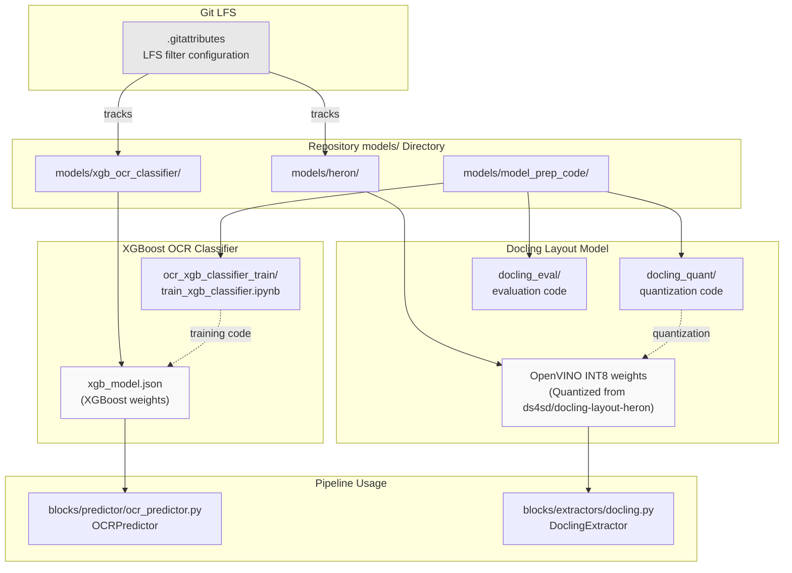
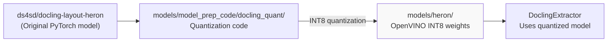
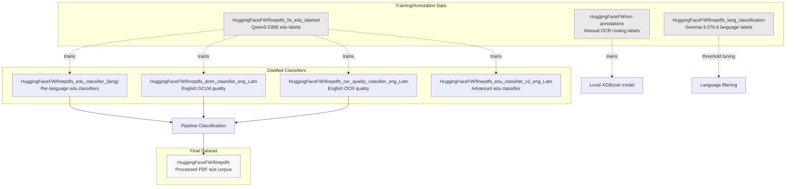
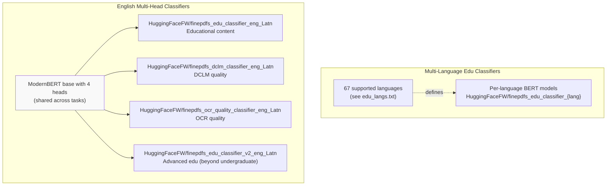

<!-- source: DeepWiki mcp.deepwiki.com · repo huggingface/finepdfs · page 5 Model Artifacts and Storage · fetched 2026-10-26 -->

# Model Artifacts and Storage

<details>
<summary>Relevant source files</summary>

The following files were used as context for generating this wiki page:

- [.gitattributes](.gitattributes)
- [README.md](README.md)

</details>


## Purpose and Scope

This document describes how model artifacts are stored and managed in the FinePDFs repository. This includes both local model files tracked via Git LFS and published artifacts on HuggingFace Hub. The page covers the Git LFS configuration for large binary files, the structure of locally stored models, and a comprehensive inventory of published datasets and classifiers.

For information about training models and generating checkpoints, see [Training Infrastructure](#3). For details on how these models are used during inference, see [OCR Routing Classifier](#2.1.1), [Quality Classifiers](#2.2.2), and [Batched Inference API](#2.2.4).

**Sources:** [README.md:1-122](), [.gitattributes:1-3]()

## Overview of Model Artifacts

The FinePDFs system maintains two categories of model artifacts:

| Category | Storage Location | Purpose | Size Class |
|----------|-----------------|---------|------------|
| **Local Models** | Git LFS in `models/` directory | Models used directly during pipeline execution | 100MB - 2GB |
| **Published Artifacts** | HuggingFace Hub under `HuggingFaceFW/` organization | Training data, distilled classifiers, final datasets | Varies |

The local models are essential for pipeline operation and are checked into the repository via Git LFS. Published artifacts serve as either training inputs, intermediate labeled datasets, or final production outputs.

**Sources:** [README.md:39-76](), [.gitattributes:1-3]()

## Local Model Storage Architecture



The repository stores two critical models locally:

1. **XGBoost OCR Classifier**: Routes PDFs to OCR or embedded text extraction
2. **OpenVINO Quantized Layout Model**: Accelerates Docling's layout analysis

Both are stored under `models/` and tracked via Git LFS due to their size.

**Sources:** [README.md:39-42](), [README.md:91-92](), [.gitattributes:1-3]()

### Git LFS Configuration

The Git LFS tracking configuration is defined in `.gitattributes`:

```
models/heron/** filter=lfs diff=lfs merge=lfs
models/xgb_ocr_classifier/** filter=lfs diff=lfs merge=lfs
```

This configuration ensures that all files under these directories are:
- **Stored as LFS pointers** in Git history
- **Downloaded on-demand** during clone/checkout
- **Tracked with LFS filters** for diff and merge operations

The LFS setup is essential for managing binary model files that would otherwise bloat the Git repository. Users cloning the repository need Git LFS installed to properly download these model weights.

**Sources:** [.gitattributes:1-3]()

### XGBoost OCR Classifier Storage

Located at `models/xgb_ocr_classifier/`, this directory contains the trained XGBoost model used by `OCRPredictor` to determine PDF routing strategy.

| Component | Path | Description |
|-----------|------|-------------|
| Model Weights | `models/xgb_ocr_classifier/xgb_model.json` | Serialized XGBoost classifier |
| Training Code | `models/model_prep_code/ocr_xgb_classifier_train/train_xgb_classifier.ipynb` | Notebook for training the classifier |
| Training Data | `HuggingFaceFW/ocr-annotations` | Manually annotated OCR routing labels |

The model is loaded by [blocks/predictor/ocr_predictor.py]() and used to classify PDFs based on metadata features (page count, file size, PDF version, etc.) into "needs OCR" or "has embedded text" categories.

**Sources:** [README.md:38-39](), [README.md:91-92]()

### OpenVINO Docling Layout Model

Located at `models/heron/`, this directory contains a quantized version of the Docling layout analysis model.



The quantization process:
1. Converts the original PyTorch model to OpenVINO IR format
2. Applies INT8 quantization for inference acceleration
3. Reduces model size and improves throughput

The evaluation code at `models/model_prep_code/docling_quant/docling_eval/` validates that quantization does not significantly degrade layout detection accuracy.

**Sources:** [README.md:41-42](), [README.md:92]()

## Published Datasets and Models on HuggingFace

The FinePDFs system publishes multiple artifacts to HuggingFace Hub under the `HuggingFaceFW/` organization. These fall into three categories:

### Published Artifacts Taxonomy



**Sources:** [README.md:39-76]()

### Training and Annotation Datasets

| Dataset | Purpose | Size/Coverage | Annotation Method |
|---------|---------|---------------|-------------------|
| `HuggingFaceFW/ocr-annotations` | OCR routing training data | Manual annotations | Human labeling |
| `HuggingFaceFW/finepdfs_lang_classification` | Language threshold tuning | 20k samples per language | `google/gemma-3-27b-it` |
| `HuggingFaceFW/finepdfs_fw_edu_labeled` | Educational content labels | All languages | `Qwen3-235B-A22B-Instruct-2507` |

These datasets serve as intermediate training artifacts. The OCR annotations were manually created to train the XGBoost routing classifier. The language classification dataset was generated by prompting Gemma to identify language membership, then used in threshold optimization (see [Language Filtering](#2.2.1)). The edu-labeled dataset was created by a teacher model (Qwen3-235B) and used to train distilled BERT-based classifiers.

**Sources:** [README.md:39](), [README.md:45-54](), [README.md:65-76]()

### Distilled Quality Classifiers

The following distilled classifiers are published as standalone models:



For non-English languages, separate BERT-based classifiers are trained for educational content detection. The list of supported languages is maintained in `edu_langs.txt` and includes 67 languages.

For English, a multi-head architecture on ModernBERT enables efficient multi-task inference. All four classification tasks (edu, dclm, ocr_quality, edu_v2) share the same base encoder layers, with separate classification heads. This architecture is described in detail in [Multi-Head ModernBERT Architecture](#2.2.3).

Training is performed using [classification/train_classifier.sh]() with teacher-labeled data from `HuggingFaceFW/finepdfs_fw_edu_labeled`. The teacher model was `Qwen3-235B-A22B-Instruct-2507`, selected because it most closely matched Claude Sonnet 3.7 among open-source options.

**Sources:** [README.md:57-76]()

### Final Published Dataset

| Dataset | Description | License |
|---------|-------------|---------|
| `HuggingFaceFW/finepdfs` | Processed, filtered, and deduplicated PDF text corpus | ODC-By 1.0 |

This is the primary output of the entire pipeline. It contains extracted text from CommonCrawl PDFs that have passed through:
- OCR routing and extraction
- Language filtering
- Quality classification (edu/dclm filters)
- Exact and MinHash deduplication

The dataset is published with a comprehensive dataset card documenting the methodology, limitations, and intended uses.

**Sources:** [README.md:7](), [README.md:104](), [README.md:108]()

## Model Loading Patterns in Code

The following table maps published artifacts to their usage points in the codebase:

| Model/Dataset | Loaded By | Purpose in Pipeline |
|---------------|-----------|---------------------|
| `models/xgb_ocr_classifier/` | [blocks/predictor/ocr_predictor.py]() | OCR routing decision |
| `models/heron/` | [blocks/extractors/docling.py]() | Layout analysis during extraction |
| `HuggingFaceFW/finepdfs_edu_classifier_*` | [blocks/classification/]() | Quality filtering |
| `HuggingFaceFW/finepdfs_dclm_classifier_eng_Latn` | [blocks/classification/]() | DCLM quality scoring |
| `HuggingFaceFW/finepdfs_ocr_quality_classifier_eng_Latn` | [blocks/classification/]() | OCR quality assessment |

Local models are loaded directly from filesystem paths. Published HuggingFace models are loaded via the Transformers library using `AutoModel.from_pretrained()` or equivalent APIs during the classification stage of the pipeline.

**Sources:** [README.md:84-93]()

## Storage Size Considerations

Model artifacts tracked with Git LFS represent significant storage:

| Model Type | Approximate Size | Justification |
|------------|-----------------|---------------|
| XGBoost OCR Classifier | ~1-10 MB | Lightweight tree-based model |
| OpenVINO Layout Model | ~500 MB - 2 GB | Quantized INT8 weights still substantial |

The LFS approach ensures:
- Repository clones remain fast for users who don't need models immediately
- Binary files don't bloat Git history
- Models can be updated independently via LFS pointers

Users must have Git LFS installed (`git lfs install`) before cloning to properly download model weights.

**Sources:** [.gitattributes:1-3](), [README.md:41-42]()

---

