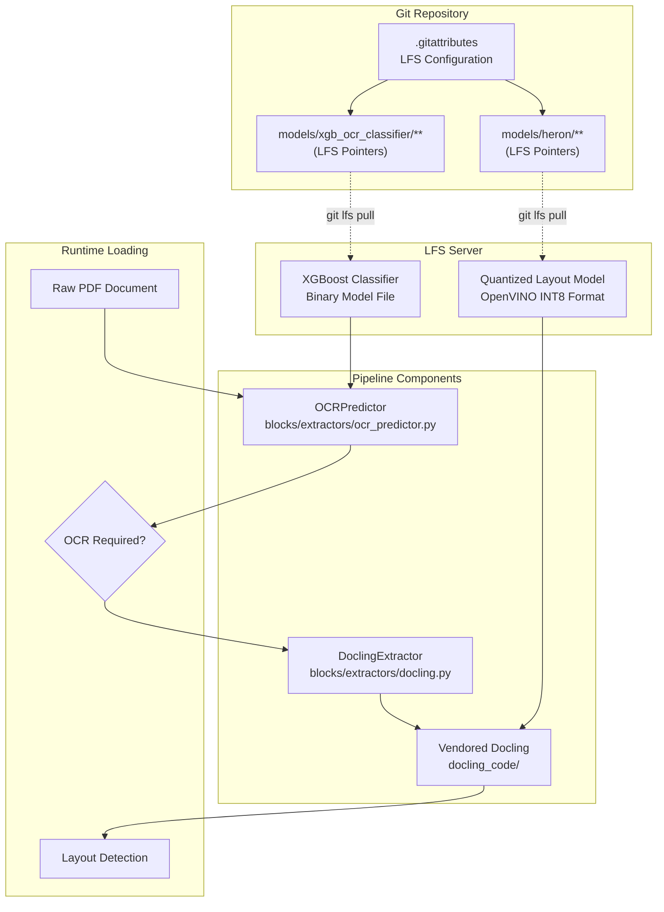
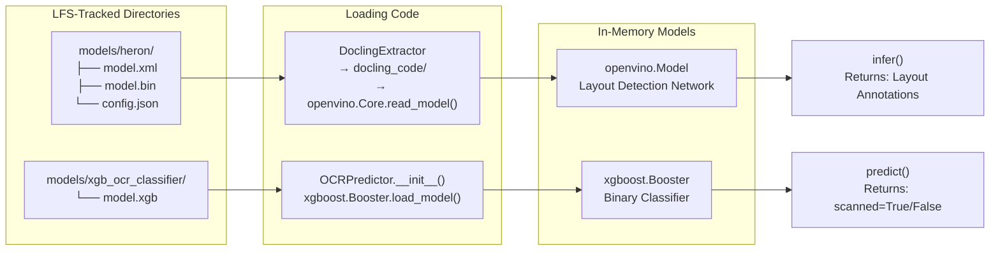

<!-- source: DeepWiki mcp.deepwiki.com · repo huggingface/finepdfs · page 5.1 Git LFS Configuration · fetched 2026-10-26 -->

# Git LFS Configuration

<details>
<summary>Relevant source files</summary>

The following files were used as context for generating this wiki page:

- [.gitattributes](.gitattributes)

</details>


## Purpose and Scope

This document describes the Git LFS (Large File Storage) configuration used in the FinePDFs repository to manage large model artifacts. It covers the specific directories tracked by LFS, the configuration syntax in `.gitattributes`, and how various pipeline components load models from LFS-tracked locations. For information about the model artifacts themselves and their usage, see [Model Artifacts and Storage](#5). For details on how these models are deployed in the extraction and classification pipelines, see [PDF Extraction System](#2.1) and [Classification and Filtering](#2.2).

## Overview

The FinePDFs repository uses Git LFS to version control large binary model files without bloating the Git repository. This is essential for storing:

- Machine learning model weights (XGBoost, OpenVINO quantized models)
- Pre-trained classifier artifacts used in production inference
- Layout detection models used for PDF extraction

Git LFS replaces large files with text pointers in the Git repository while storing the actual file contents on a separate LFS server. This allows developers to clone and work with the repository efficiently while optionally pulling the large model files only when needed.

**Sources:** [.gitattributes:1-2]()

## LFS Configuration File

The repository's Git LFS configuration is defined in `.gitattributes` at the repository root. This file specifies which paths should be managed by LFS using pattern matching.

### Configuration Syntax

```
models/heron/** filter=lfs diff=lfs merge=lfs
models/xgb_ocr_classifier/** filter=lfs diff=lfs merge=lfs
```

Each line specifies:
- **Pattern**: Glob pattern matching files to track (`**` matches all files recursively)
- **`filter=lfs`**: Applies LFS smudge/clean filters during checkout/commit
- **`diff=lfs`**: Uses LFS-aware diff for these files
- **`merge=lfs`**: Uses LFS-aware merge strategy for conflicts

**Sources:** [.gitattributes:1-2]()

## Tracked Directories

The repository tracks two specific model directories with Git LFS:

| Directory | Purpose | Model Type | Used By |
|-----------|---------|------------|---------|
| `models/heron/` | Layout detection model for PDF extraction | OpenVINO INT8 quantized model | Docling extractor |
| `models/xgb_ocr_classifier/` | OCR routing decision model | XGBoost binary classifier | OCR predictor |

### models/heron/

Contains the quantized layout detection model used by the Docling extraction system. This model identifies document structure elements (text blocks, tables, figures) in PDF pages.

**Key characteristics:**
- Format: OpenVINO INT8 quantized
- Purpose: Layout analysis for embedded-text PDFs
- Loading: Used by vendored Docling code via `DoclingExtractor`

### models/xgb_ocr_classifier/

Contains the trained XGBoost model that determines whether a PDF requires OCR processing or can use embedded text extraction. This classifier analyzes PDF metadata and basic properties to make routing decisions.

**Key characteristics:**
- Format: XGBoost binary model file
- Purpose: OCR vs. embedded text routing
- Loading: Loaded by `OCRPredictor` class during pipeline initialization

**Sources:** [.gitattributes:1-2]()

## LFS in the Pipeline Architecture



**Diagram: Git LFS Integration with Pipeline Components**

This diagram shows how Git LFS pointers in the repository are resolved to actual model files on the LFS server, and how pipeline components load these models during execution.

**Sources:** [.gitattributes:1-2]()

## Model Loading Patterns



**Diagram: Model File Loading from LFS-Tracked Directories**

This diagram maps the LFS-tracked directory structure to the specific code paths that load these models into memory.

**Sources:** [.gitattributes:1-2]()

## Working with LFS Files

### Initial Clone

When cloning the repository, Git LFS pointers are downloaded automatically, but the actual large files are not:

```bash
git clone https://github.com/huggingface/finepdfs.git
```

### Pulling LFS Objects

To download the actual model files:

```bash
# Pull all LFS objects
git lfs pull

# Pull specific directory only
git lfs pull --include="models/heron/**"
```

### Checking LFS Status

To see which files are tracked by LFS:

```bash
git lfs ls-files
```

### Storage Requirements

Developers working with the pipeline components that load these models must ensure LFS objects are pulled before running extraction or classification tasks. Without the actual model files, attempts to load models will fail.

**Typical storage requirements:**
- `models/heron/`: ~100-500 MB (layout model)
- `models/xgb_ocr_classifier/`: ~1-10 MB (XGBoost model)

## LFS Configuration Best Practices

### Pattern Specificity

The configuration uses directory-level patterns (`models/heron/**`) rather than file extension patterns (e.g., `*.bin`). This approach:

- Makes it explicit which directories contain LFS-tracked files
- Prevents accidental tracking of other binary files elsewhere
- Simplifies reasoning about repository structure

### Filter Order

Git processes `.gitattributes` patterns in order. More specific patterns can override general ones. The current configuration has no overlapping patterns, ensuring deterministic behavior.

### Version Control

The `.gitattributes` file itself is tracked by regular Git (not LFS), ensuring all repository clones receive the same LFS configuration.

**Sources:** [.gitattributes:1-2]()

## Integration with CI/CD

Systems that run the FinePDFs pipeline in automated environments (e.g., SLURM clusters, CI runners) must configure Git LFS credentials and ensure `git lfs pull` is executed before running extraction or classification components.

**Failure modes without LFS files:**
- `OCRPredictor` initialization fails when loading XGBoost model
- `DoclingExtractor` fails to initialize layout detection model
- Pipeline crashes during PDF extraction phase

## Maintenance Considerations

### Adding New Models

To track additional model directories with LFS:

1. Add pattern to `.gitattributes`:
   ```
   models/new_model/** filter=lfs diff=lfs merge=lfs
   ```

2. Track and commit the pattern change:
   ```bash
   git add .gitattributes
   git commit -m "Track models/new_model with LFS"
   ```

3. Add the model files:
   ```bash
   git add models/new_model/
   git commit -m "Add new model files"
   git push
   ```

### Migrating Existing Files

If a large file was accidentally committed to regular Git history, it can be migrated to LFS using `git lfs migrate`:

```bash
git lfs migrate import --include="path/to/file"
```

**Sources:** [.gitattributes:1-2]()

## Summary

The Git LFS configuration in FinePDFs is minimal and focused, tracking only two critical model directories:

- **`models/heron/`**: Layout detection model for PDF structure analysis
- **`models/xgb_ocr_classifier/`**: OCR routing classifier for extraction strategy selection

This configuration enables efficient repository cloning while ensuring production-critical model files are version controlled and accessible to pipeline components. Developers must explicitly pull LFS objects to work with extraction and classification features.

**Sources:** [.gitattributes:1-2]()

---

