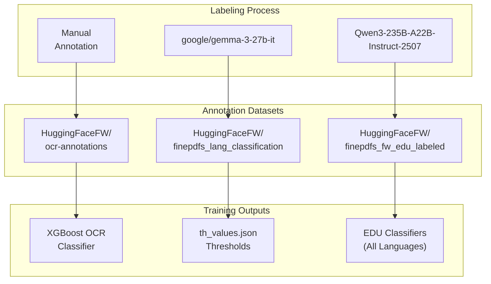
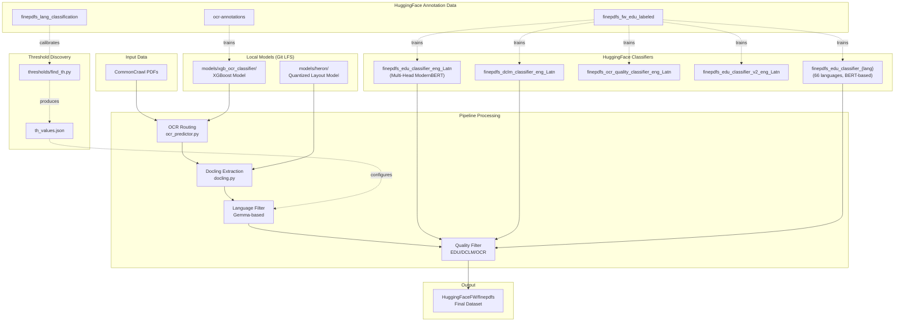
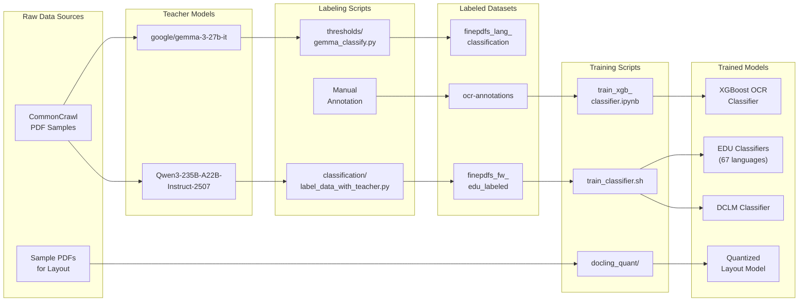

<!-- source: DeepWiki mcp.deepwiki.com · repo huggingface/finepdfs · page 5.2 Published Datasets and Models · fetched 2026-10-26 -->

# Published Datasets and Models

<details>
<summary>Relevant source files</summary>

The following files were used as context for generating this wiki page:

- [README.md](README.md)

</details>


This page documents all datasets and models published by the FinePDFs project on HuggingFace and stored locally in the repository. These artifacts include the final processed dataset, training/annotation datasets used for classifier development, and the trained classifier models themselves.

For information about how these models are trained, see [Training Infrastructure](#3). For details on model storage using Git LFS, see [Git LFS Configuration](#5.1). For information about how these classifiers are used in the pipeline, see [Classification and Filtering](#2.2).

## Main Dataset

### HuggingFaceFW/finepdfs

The primary output of the entire pipeline is the `finepdfs` dataset, published at `HuggingFaceFW/finepdfs` on HuggingFace. This dataset contains processed, filtered, deduplicated, and classified PDF text content extracted from CommonCrawl.

The dataset is pushed to HuggingFace by the final stage of [run_finepdfs_pipeline.py:780-802](), which uses the `dataset.push_to_hub()` method after all processing stages are complete.

**Dataset Characteristics:**
- Multi-language support (67 languages)
- Quality-filtered using multiple classifiers
- Deduplicated using both exact and MinHash methods
- Includes metadata fields for language scores, educational scores, and other quality indicators

**License:** ODC-By 1.0 (also subject to CommonCrawl terms)

Sources: [README.md:7-7](), [README.md:108-108](), [run_finepdfs_pipeline.py:780-802]()

## Training and Annotation Datasets

These datasets contain labeled data used to train the various classifiers in the FinePDFs pipeline. They enable reproducibility and allow others to understand the training data characteristics.

### HuggingFaceFW/ocr-annotations

This dataset contains manually annotated PDFs used to train the OCR routing classifier. The annotations indicate whether each PDF requires OCR processing (scanned document) or can use embedded text extraction.

The annotations are used by the training code in [models/model_prep_code/ocr_xgb_classifier_train/train_xgb_classifier.ipynb]() to train the XGBoost classifier stored in [models/xgb_ocr_classifier/]().

**Purpose:** Binary classification (OCR needed vs. embedded text available)

**Usage in Pipeline:** Training data for [blocks/predictor/ocr_predictor.py]()

Sources: [README.md:39-39](), [models/model_prep_code/ocr_xgb_classifier_train/train_xgb_classifier.ipynb]()

### HuggingFaceFW/finepdfs_lang_classification

This dataset contains language classification annotations generated by `google/gemma-3-27b-it`. It includes 20,000 samples per language, labeled to indicate whether the sample is actually in the target language.

The dataset is used to discover optimal language filtering thresholds via [thresholds/find_th.py](), which implements F-beta score optimization with β=0.1 (heavily prioritizing precision over recall).

**Labeling Method:** LLM-based classification using Gemma-3-27b-it

**Threshold Discovery:** 
- Minimum recall: 0.1
- Minimum precision: 0.9
- Minimum score cutoff: 0.1
- Optimization target: F-beta (β=0.1)

**Usage in Pipeline:** Determines threshold values in [thresholds/th_values.json]() for language filtering during classification

Sources: [README.md:50-53](), [thresholds/find_th.py](), [thresholds/gemma_classify.py]()

### HuggingFaceFW/finepdfs_fw_edu_labeled

This dataset contains educational content annotations across all supported languages. Labels were generated using `Qwen3-235B-A22B-Instruct-2507` as a teacher model, selected for its close match to Claude Sonnet 3.7 performance among open-source LLMs.

The dataset is created by [classification/label_data_with_teacher.py]() and used to train distilled student classifiers via [classification/train_classifier.sh]().

**Teacher Model:** Qwen3-235B-A22B-Instruct-2507

**Label Type:** Educational content quality scores

**Languages:** All 67 languages supported by FinePDFs

**Usage in Pipeline:** Training data for all `finepdfs_edu_classifier_*` models

Sources: [README.md:65-66](), [README.md:72-72](), [classification/label_data_with_teacher.py](), [classification/train_classifier.sh]()



Sources: [README.md:39-76](), [classification/label_data_with_teacher.py](), [thresholds/find_th.py]()

## Published Classifier Models

The FinePDFs pipeline uses multiple trained classifiers for quality filtering. Most are published on HuggingFace, while the OCR routing classifier is stored locally using Git LFS.

### English Multi-Head Classifiers

For English (`eng_Latn`), the pipeline uses a multi-head ModernBERT architecture that enables efficient multi-task inference. A single model with shared base layers produces predictions for multiple quality dimensions simultaneously.

#### HuggingFaceFW/finepdfs_edu_classifier_eng_Latn

Educational content classifier for English documents. Identifies documents with educational value.

**Architecture:** Multi-head ModernBERT (one head for EDU scoring)

**Training:** Teacher-student distillation from Qwen3-235B annotations

**Threshold:** Top 10% of scores

**Code References:** [blocks/classification/multi_head_moder_bert.py](), [classification/train_classifier.sh]()

#### HuggingFaceFW/finepdfs_dclm_classifier_eng_Latn

DCLM (DataComp-LM) quality classifier for English documents. Evaluates general document quality using DCLM criteria.

**Architecture:** Multi-head ModernBERT (DCLM head)

**Training:** Teacher-student distillation

**Usage Decision:** Found to yield meaningful gains alongside EDU classifier

#### HuggingFaceFW/finepdfs_ocr_quality_classifier_eng_Latn

OCR quality assessment classifier for English documents. Evaluates the quality of OCR-extracted text.

**Architecture:** Multi-head ModernBERT (OCR quality head)

**Training:** Teacher-student distillation

**Usage Decision:** Evaluated but not used in final pipeline (EDU and DCLM were sufficient)

#### HuggingFaceFW/finepdfs_edu_classifier_v2_eng_Latn

Enhanced educational content classifier targeting content "beyond undergraduate-level textbooks."

**Architecture:** Multi-head ModernBERT (EDU v2 head)

**Training:** Teacher-student distillation with modified prompts

**Usage Decision:** Evaluated but EDU v1 was selected for production

Sources: [README.md:63-76](), [blocks/classification/multi_head_moder_bert.py]()

### Non-English Language Classifiers

For the 66 non-English languages, the pipeline provides BERT-based educational content classifiers. Each language has its own dedicated classifier.

#### HuggingFaceFW/finepdfs_edu_classifier_{language}

Language-specific educational content classifiers, where `{language}` is replaced by the language code (e.g., `fra_Latn`, `zho_Hans`, `ara_Arab`).

**Architecture:** BERT-based sequence classification

**Training:** Teacher-student distillation from Qwen3-235B annotations

**Languages:** 66 languages listed in [classification/edu_langs.txt]()

**Threshold:** Top 10% of scores per language

**Example Languages:**
- French: `finepdfs_edu_classifier_fra_Latn`
- Chinese (Simplified): `finepdfs_edu_classifier_zho_Hans`
- Arabic: `finepdfs_edu_classifier_ara_Arab`
- Russian: `finepdfs_edu_classifier_rus_Cyrl`

Sources: [README.md:73-73](), [classification/edu_langs.txt](), [classification/train_classifier.sh]()

### Local Model Artifacts

#### XGBoost OCR Routing Classifier

Stored locally at [models/xgb_ocr_classifier/]() and tracked with Git LFS. This classifier predicts whether a PDF requires OCR processing based on metadata and initial analysis.

**Model Type:** XGBoost binary classifier

**Training Code:** [models/model_prep_code/ocr_xgb_classifier_train/train_xgb_classifier.ipynb]()

**Usage:** [blocks/predictor/ocr_predictor.py]()

**Training Data:** `HuggingFaceFW/ocr-annotations`

**Storage:** Git LFS (see [Git LFS Configuration](#5.1))

#### OpenVINO Quantized Layout Model

Stored locally at [models/heron/]() and tracked with Git LFS. This is a quantized INT8 version of `ds4sd/docling-layout-heron` optimized for faster inference.

**Original Model:** `ds4sd/docling-layout-heron`

**Quantization:** OpenVINO INT8

**Quantization Code:** [models/model_prep_code/docling_quant/]()

**Usage:** [blocks/extractors/docling.py]() for layout analysis during Docling extraction

**Note:** Quantization code is provided as reference; source PDFs/images are not included

Sources: [README.md:38-42](), [models/xgb_ocr_classifier/](), [models/heron/]()

## Dataset and Model Relationship Diagram

The following diagram shows how published datasets and models relate to each other and to the pipeline stages:



Sources: [run_finepdfs_pipeline.py](), [blocks/predictor/ocr_predictor.py](), [blocks/extractors/docling.py](), [blocks/classification/multi_head_moder_bert.py]()

## Classifier Usage Summary

The following table summarizes which classifiers are used in the production pipeline and their purposes:

| Classifier | Language | Architecture | Used in Production | Purpose |
|------------|----------|--------------|-------------------|---------|
| `finepdfs_edu_classifier_eng_Latn` | English | Multi-Head ModernBERT | ✅ Yes | Educational content detection |
| `finepdfs_dclm_classifier_eng_Latn` | English | Multi-Head ModernBERT | ✅ Yes | DCLM quality scoring |
| `finepdfs_ocr_quality_classifier_eng_Latn` | English | Multi-Head ModernBERT | ❌ No | OCR quality assessment (evaluated only) |
| `finepdfs_edu_classifier_v2_eng_Latn` | English | Multi-Head ModernBERT | ❌ No | Advanced EDU detection (evaluated only) |
| `finepdfs_edu_classifier_{lang}` | 66 languages | BERT | ✅ Yes | Language-specific EDU detection |
| XGBoost OCR Classifier | All | XGBoost | ✅ Yes | OCR routing decision |
| Quantized Layout Model | All | OpenVINO INT8 | ✅ Yes | Document layout analysis |

**Note:** The pipeline found that EDU and DCLM classifiers provided sufficient quality filtering. OCR quality and EDU v2 classifiers were trained and evaluated but not selected for production use.

Sources: [README.md:57-64]()

## Training Data Lineage



Sources: [classification/label_data_with_teacher.py](), [thresholds/gemma_classify.py](), [models/model_prep_code/ocr_xgb_classifier_train/train_xgb_classifier.ipynb]()

## Accessing Published Artifacts

All HuggingFace artifacts can be accessed programmatically using the `datasets` and `transformers` libraries:

```python
# Load the main dataset
from datasets import load_dataset
dataset = load_dataset("HuggingFaceFW/finepdfs")

# Load annotation datasets
ocr_annotations = load_dataset("HuggingFaceFW/ocr-annotations")
lang_annotations = load_dataset("HuggingFaceFW/finepdfs_lang_classification")
edu_labeled = load_dataset("HuggingFaceFW/finepdfs_fw_edu_labeled")

# Load classifiers
from transformers import AutoModelForSequenceClassification, AutoTokenizer
edu_model = AutoModelForSequenceClassification.from_pretrained(
    "HuggingFaceFW/finepdfs_edu_classifier_eng_Latn"
)
tokenizer = AutoTokenizer.from_pretrained(
    "HuggingFaceFW/finepdfs_edu_classifier_eng_Latn"
)
```

Local models are loaded directly from the file system:
- XGBoost: [models/xgb_ocr_classifier/model.json]() via `xgboost.Booster()`
- Layout Model: [models/heron/]() via OpenVINO runtime

Sources: [blocks/predictor/ocr_predictor.py](), [blocks/extractors/docling.py]()

## Model Versioning and Updates

All published models and datasets represent the state used for the FinePDFs dataset release. For reproducibility:

1. The exact Git commit is recorded in the repository
2. Git LFS tracks local model versions
3. HuggingFace Hub maintains versioned model snapshots
4. Training code and hyperparameters are included in [classification/]() and [models/model_prep_code/]()

Sources: [README.md:107-122](), [.gitattributes]()

---

