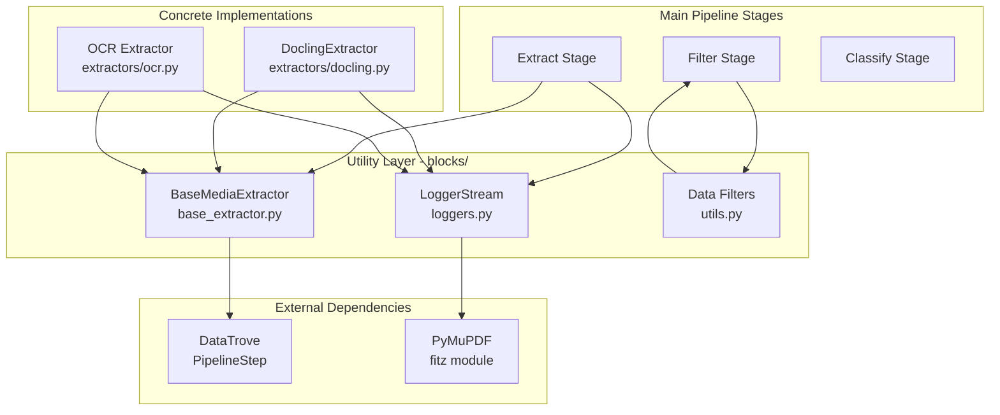
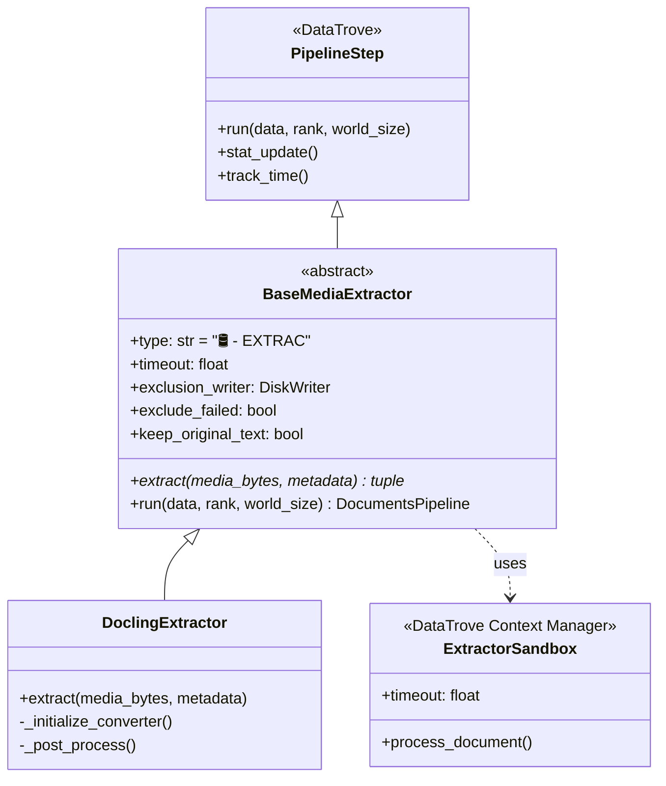
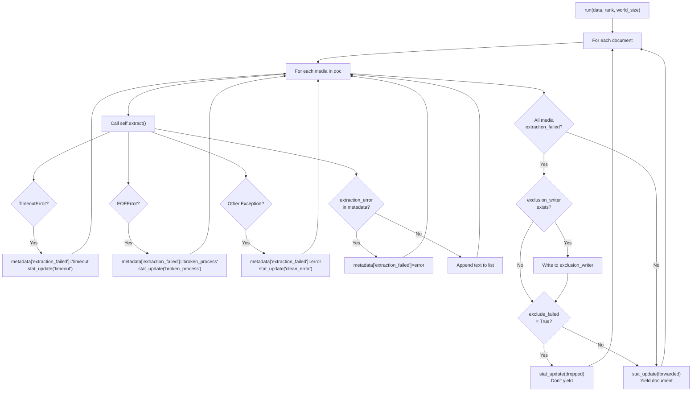
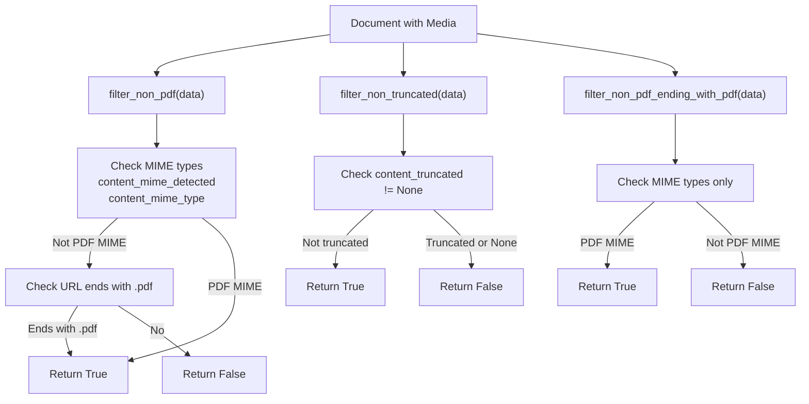
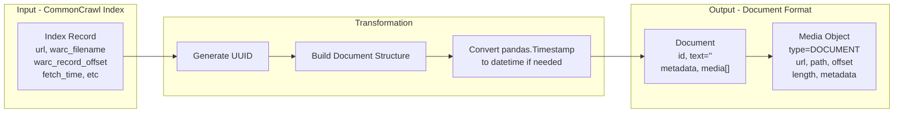

<!-- source: DeepWiki mcp.deepwiki.com · repo huggingface/finepdfs · page 6 Utilities and Supporting Code · fetched 2026-10-26 -->

# Utilities and Supporting Code

<details>
<summary>Relevant source files</summary>

The following files were used as context for generating this wiki page:

- [blocks/loggers.py](blocks/loggers.py)
- [blocks/predictor/base_extractor.py](blocks/predictor/base_extractor.py)
- [blocks/utils.py](blocks/utils.py)

</details>


## Purpose and Scope

This page documents the utility functions, helper classes, and supporting infrastructure code used throughout the FinePDFs pipeline. These utilities provide cross-cutting functionality for logging, error handling, data filtering, and extraction abstraction. Unlike the main pipeline stages (see [Main Processing Pipeline](#2)) or infrastructure components (see [SLURM Integration](#7)), the utilities documented here are general-purpose tools used by multiple pipeline components.

For specific extraction implementations like Docling or OCR, see [PDF Extraction System](#2.1). For classification utilities, see [Classification and Filtering](#2.2).

## Overview

The FinePDFs utilities are organized into three main categories:

| Category | Location | Primary Purpose |
|----------|----------|-----------------|
| **Base Extractor Framework** | `blocks/predictor/base_extractor.py` | Abstract base class for media extractors with timeout and error handling |
| **Logging Utilities** | `blocks/loggers.py` | Log capture and metadata filtering for debugging PDF extraction issues |
| **Data Filtering** | `blocks/utils.py` | PDF detection, MIME type validation, and data adapter functions |

These utilities form the foundational layer that enables robust, production-grade PDF processing with comprehensive error handling and debugging capabilities.

## Utility System Architecture

The following diagram shows how utility components relate to the main pipeline stages:



**Sources:** [blocks/predictor/base_extractor.py:1-113](), [blocks/loggers.py:1-48](), [blocks/utils.py:1-80]()

## Base Extractor Framework

### BaseMediaExtractor Abstract Class

The `BaseMediaExtractor` class provides a standardized interface for implementing media extractors with built-in timeout handling, error management, and exclusion tracking. It extends DataTrove's `PipelineStep` to integrate seamlessly with the pipeline architecture.



**Sources:** [blocks/predictor/base_extractor.py:16-34]()

### Key Components

#### Constructor Parameters

The `BaseMediaExtractor.__init__()` method [blocks/predictor/base_extractor.py:22-33]() accepts:

| Parameter | Type | Purpose |
|-----------|------|---------|
| `timeout` | `float` | Maximum seconds per document extraction (default: 60) |
| `exclusion_writer` | `Optional[DiskWriter]` | Writer for failed documents |
| `exclude_failed` | `bool` | Whether to drop failed documents (default: True) |
| `keep_original_text` | `bool` | Preserve original text alongside extracted text |

#### Abstract Extract Method

Concrete extractors must implement `extract(media_bytes: bytes, document_metadata: dict) -> tuple[str, dict]` [blocks/predictor/base_extractor.py:36-45](), which:
- Takes raw media bytes and metadata
- Returns extracted text and updated metadata
- Raises exceptions on failure (caught by the runner)

#### Run Method and Error Handling

The `run()` method [blocks/predictor/base_extractor.py:47-111]() implements the extraction workflow with comprehensive error handling:



**Sources:** [blocks/predictor/base_extractor.py:47-111]()

### Error Categories and Statistics

The extractor tracks distinct error categories through `stat_update()` calls:

| Stat Key | Trigger Condition | Line Reference |
|----------|-------------------|----------------|
| `"extracted"` | Successful extraction | [blocks/predictor/base_extractor.py:71]() |
| `"timeout"` | `TimeoutError` exception | [blocks/predictor/base_extractor.py:73]() |
| `"broken_process"` | `EOFError` (process died) | [blocks/predictor/base_extractor.py:79]() |
| `"clean_error"` | Generic exceptions | [blocks/predictor/base_extractor.py:84]() |
| `StatHints.dropped` | All media failed | [blocks/predictor/base_extractor.py:101]() |
| `StatHints.forwarded` | At least one media succeeded | [blocks/predictor/base_extractor.py:108]() |

### Integration with ExtractorSandbox

While the code shows direct calls to `self.extract()` [blocks/predictor/base_extractor.py:63](), the import of `ExtractorSandbox` [blocks/predictor/base_extractor.py:10]() and context manager usage [blocks/predictor/base_extractor.py:55]() indicates timeout enforcement is handled by DataTrove's sandbox mechanism when enabled.

**Sources:** [blocks/predictor/base_extractor.py:55-76]()

## Logging and Debugging Utilities

### LoggerStream Context Manager

The `LoggerStream` class provides a mechanism to capture PyMuPDF log output, which is critical for debugging PDF extraction issues. PyMuPDF (imported as `pymupdf` or `fitz`) generates diagnostic messages that would otherwise be lost.

```mermaid
flowchart LR
    subgraph "Initialization"
        INIT["LoggerStream.__init__(loggers)"]
        SET_MSG["pymupdf.set_messages(pylogging=True)"]
    end
    
    subgraph "Context Manager Entry"
        ENTER["__enter__()"]
        GET_HANDLER["self.handler property"]
        CREATE["logging.StreamHandler(io.StringIO())"]
        ATTACH["Attach to all loggers"]
        CLEAR["Clear existing handlers"]
        FLUSH["handler.flush()"]
        RETURN["Return StreamValue"]
    end
    
    subgraph "Usage"
        EXTRACT["PDF extraction code runs"]
        PYMUPDF["pymupdf generates logs"]
        STREAM["Logs captured in StringIO"]
    end
    
    subgraph "Value Retrieval"
        VALUE["stream_value.value()"]
        GET_VALUE["handler.stream.getvalue()"]
        TRUNCATE["handler.stream.truncate(0)"]
        SEEK["handler.stream.seek(0)"]
    end
    
    INIT --> SET_MSG
    ENTER --> GET_HANDLER
    GET_HANDLER --> CREATE
    CREATE --> ATTACH
    ATTACH --> CLEAR
    CLEAR --> FLUSH
    FLUSH --> RETURN
    
    RETURN --> EXTRACT
    EXTRACT --> PYMUPDF
    PYMUPDF --> STREAM
    
    STREAM --> VALUE
    VALUE --> GET_VALUE
    GET_VALUE --> TRUNCATE
    TRUNCATE --> SEEK
```



**Sources:** [blocks/loggers.py:19-48]()

### StreamValue Helper Class

The `StreamValue` class [blocks/loggers.py:8-17]() acts as a value extractor wrapper:

- **`value()` method**: Flushes the handler, retrieves accumulated log text, truncates the buffer, and resets seek position
- Returns string content of all captured logs
- Resets stream for next usage cycle

This design allows multiple captures within the same context:

```python
with LoggerStream(my_logger) as stream:
    # Operation 1
    extract_pdf_1()
    logs_1 = stream.value()  # Get logs from operation 1
    
    # Operation 2  
    extract_pdf_2()
    logs_2 = stream.value()  # Get logs from operation 2 only
```

**Sources:** [blocks/loggers.py:8-17]()

### Handler Configuration

The `handler` property [blocks/loggers.py:27-41]() performs lazy initialization:

1. Creates a `StreamHandler` with an in-memory `io.StringIO()` buffer
2. Removes all existing handlers from target loggers to prevent duplicate output
3. Attaches the new handler to all specified loggers
4. Sets `propagate = False` to prevent logs from bubbling to root logger
5. Sets level to `logging.INFO`

This configuration isolates PyMuPDF logs for controlled capture without interfering with the application's main logging system.

**Sources:** [blocks/loggers.py:27-41]()

### Metadata Validation Utility

The `keep_only_valid_metadata()` function [blocks/loggers.py:5-6]() provides simple metadata cleaning:

```python
def keep_only_valid_metadata(metadata: dict) -> dict:
    return {k:v for k,v in metadata.items() if v}
```

This filters out falsy values (`None`, empty strings, `False`, `0`, empty collections) from metadata dictionaries, ensuring only meaningful metadata is preserved.

**Sources:** [blocks/loggers.py:5-6]()

## Data Filtering Utilities

### MIME Type Detection

The `MIME_TYPES` dictionary [blocks/utils.py:3-11]() defines canonical PDF MIME type strings:

```python
MIME_TYPES = {
    "pdf": [
        "application/pdf",
        "application/x-pdf",
        "application/acrobat",
        "applications/vnd.pdf",
        "text/pdf",
    ]
}
```

This handles the variety of MIME type representations for PDFs found in web crawl data.

**Sources:** [blocks/utils.py:3-11]()

### PDF Filtering Functions

The utilities provide three filtering functions with different strictness levels:



**Sources:** [blocks/utils.py:13-80]()

#### filter_non_pdf

The `filter_non_pdf()` function [blocks/utils.py:13-31]() implements lenient PDF detection:

1. Checks if `content_mime_detected` or `content_mime_type` matches PDF MIME types
2. Falls back to URL inspection: keeps documents if URL ends with `.pdf`
3. Logs when keeping a document based on URL despite non-PDF MIME type

This handles cases where MIME type detection fails but the URL clearly indicates a PDF.

**Sources:** [blocks/utils.py:13-31]()

#### filter_non_truncated

The `filter_non_truncated()` function [blocks/utils.py:65-71]() filters documents with truncated content:

- Returns `True` if `content_truncated != None` **and** the document is not a misclassified PDF
- The logic inverts the PDF check: allows truncated documents that have non-PDF MIME types
- Intended to exclude genuinely truncated PDFs while allowing truncated non-PDFs through

**Sources:** [blocks/utils.py:65-71]()

#### filter_non_pdf_ending_with_pdf

The `filter_non_pdf_ending_with_pdf()` function [blocks/utils.py:73-80]() implements strict MIME-based filtering:

- Only checks MIME types, ignoring URL
- Returns `True` only if MIME types explicitly indicate PDF
- More conservative than `filter_non_pdf()`

**Sources:** [blocks/utils.py:73-80]()

### Index Adapter Function

The `index_adapter()` function [blocks/utils.py:33-63]() transforms CommonCrawl index records into the FinePDFs document format:



**Sources:** [blocks/utils.py:33-63]()

#### Key Transformations

The adapter performs several critical transformations:

1. **UUID Generation**: Creates unique IDs for both document and media [blocks/utils.py:36-37]()
2. **Placeholder Text**: Sets `text: "<no content>"` since extraction hasn't occurred [blocks/utils.py:38]()
3. **Media Type**: Sets `type: MediaType.DOCUMENT` indicating this is a document media [blocks/utils.py:46]()
4. **WARC Location**: Preserves `path`, `offset`, and `length` for later WARC retrieval [blocks/utils.py:47-49]()
5. **Timestamp Normalization**: Converts pandas `Timestamp` objects to Python `datetime` [blocks/utils.py:60-62]()

The timestamp conversion handles inconsistencies in CommonCrawl data where some crawls (e.g., 2019-47) use pandas Timestamps instead of standard datetime objects.

**Sources:** [blocks/utils.py:33-63]()

## Usage Patterns

### Typical Filter Chain

Filters are typically applied sequentially in the pipeline:

```python
from blocks.utils import filter_non_pdf, filter_non_truncated

# In pipeline configuration
pipeline = (
    Reader()
    .filter(filter_non_pdf)           # Keep PDFs only
    .filter(filter_non_truncated)     # Remove truncated
    .run(Extractor())                 # Extract text
)
```

### Extractor Implementation Pattern

Concrete extractors follow this pattern:

```python
from blocks.predictor.base_extractor import BaseMediaExtractor

class MyExtractor(BaseMediaExtractor):
    def __init__(self, timeout=60, **kwargs):
        super().__init__(timeout=timeout, **kwargs)
        # Initialize extractor-specific resources
        
    def extract(self, media_bytes: bytes, document_metadata: dict) -> tuple[str, dict]:
        # Implement extraction logic
        text = self._extract_text(media_bytes)
        metadata = document_metadata.copy()
        metadata['extractor_version'] = "1.0"
        return text, metadata
```

### Log Capture Pattern

The `LoggerStream` is used within extraction to capture diagnostic output:

```python
from blocks.loggers import LoggerStream
import pymupdf

with LoggerStream(pymupdf.mupdf_logger) as stream:
    # Perform PDF operations
    doc = pymupdf.open(stream=pdf_bytes)
    text = extract_text(doc)
    
    # Retrieve any warnings or errors
    logs = stream.value()
    if "error" in logs.lower():
        metadata['pymupdf_warnings'] = logs
```

This pattern is used in both the Docling and OCR extractors to capture and store diagnostic information.

**Sources:** [blocks/loggers.py:19-48]()

## Common Metadata Fields

Utilities manipulate and check several standard metadata fields:

| Field | Source | Purpose |
|-------|--------|---------|
| `content_mime_detected` | CommonCrawl | Detected MIME type |
| `content_mime_type` | CommonCrawl | Declared MIME type |
| `content_truncated` | CommonCrawl | Whether content was truncated |
| `content_languages` | CommonCrawl | Detected languages |
| `fetch_time` | CommonCrawl | When document was crawled |
| `fetch_status` | CommonCrawl | HTTP status code |
| `extraction_failed` | BaseMediaExtractor | Error type if extraction failed |
| `extraction_error` | Extractor implementations | Specific error message |
| `index_file` | index_adapter | Source index file path |

These fields are used throughout the pipeline for filtering, routing, and debugging.

**Sources:** [blocks/utils.py:33-63](), [blocks/predictor/base_extractor.py:64-92]()

---

