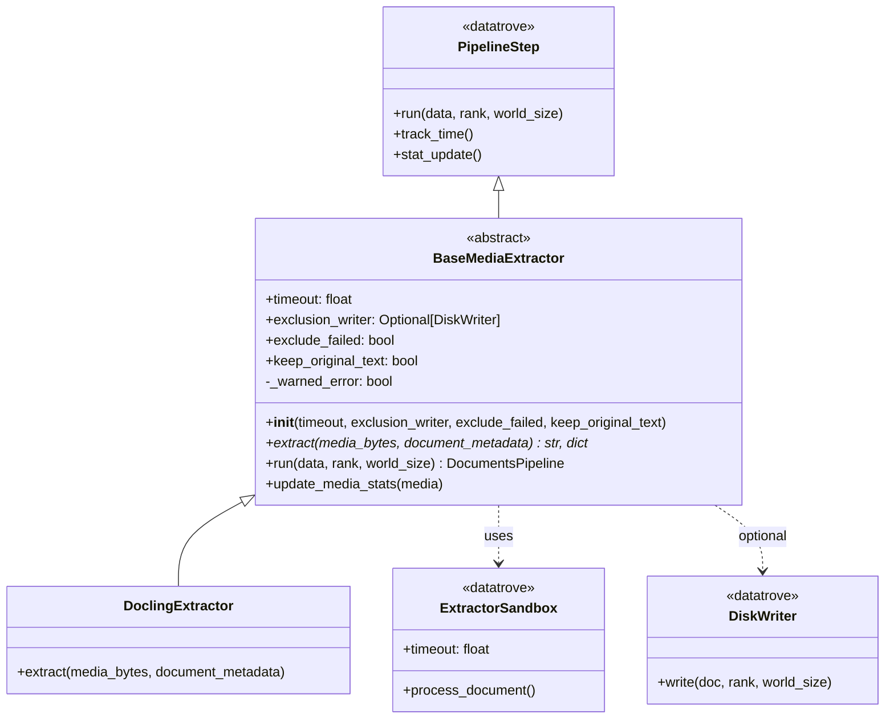
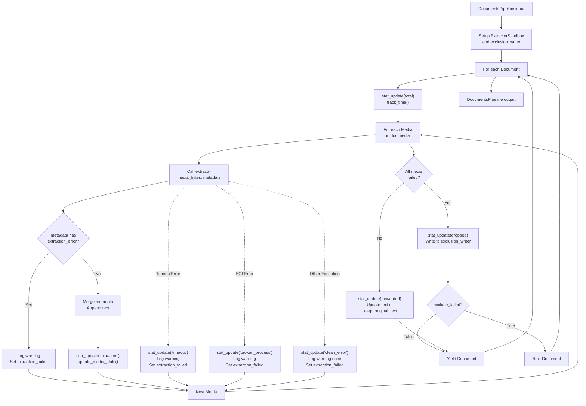
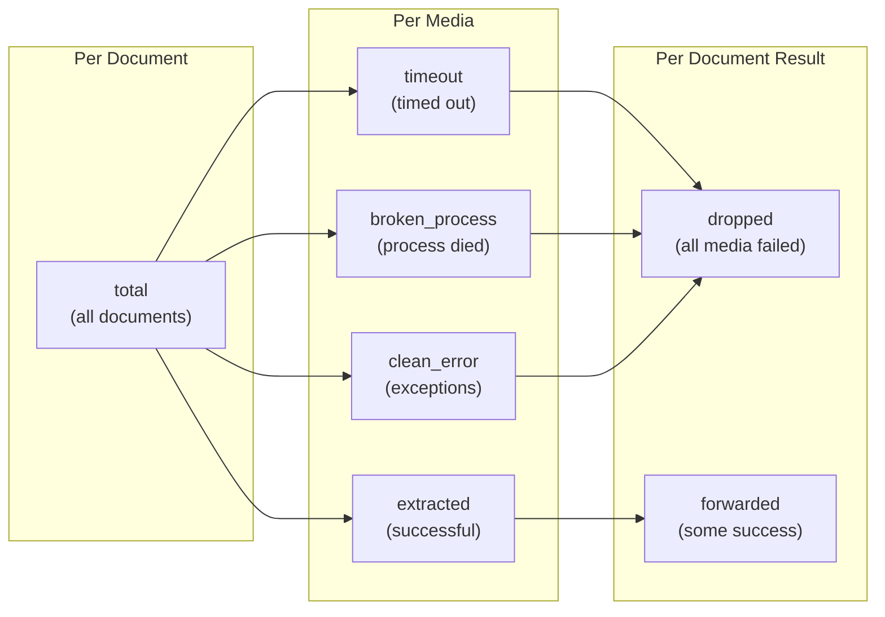
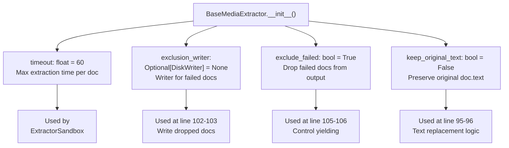
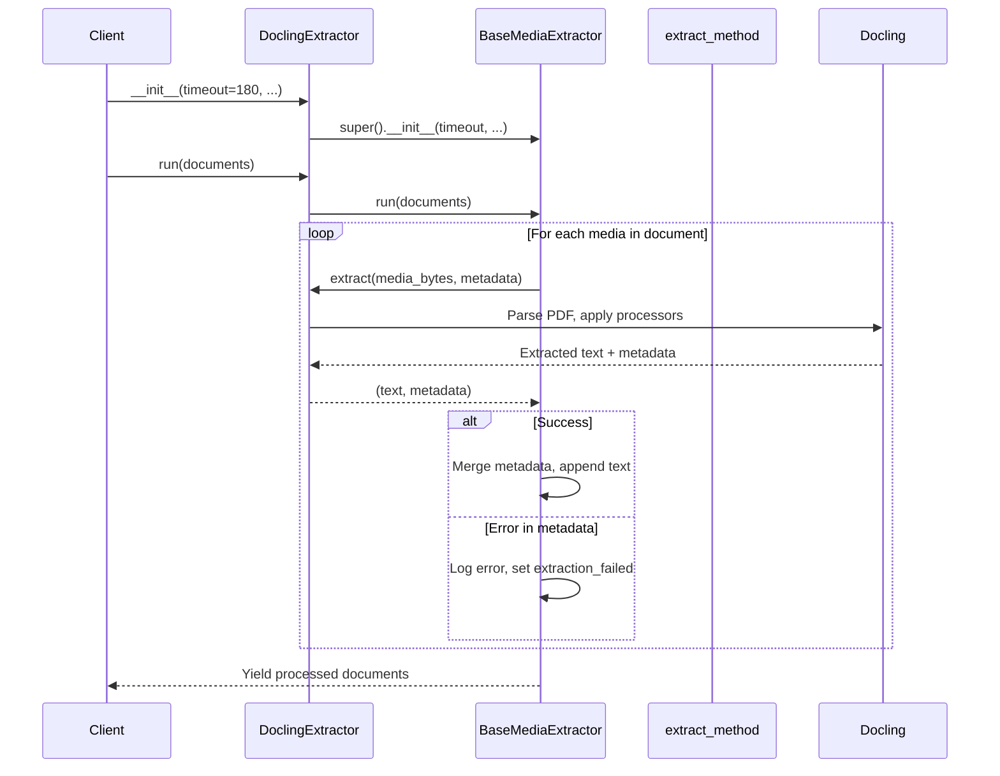

<!-- source: DeepWiki mcp.deepwiki.com · repo huggingface/finepdfs · page 6.1 Base Extractor Framework · fetched 2026-10-26 -->

# Base Extractor Framework

<details>
<summary>Relevant source files</summary>

The following files were used as context for generating this wiki page:

- [blocks/predictor/base_extractor.py](blocks/predictor/base_extractor.py)

</details>


## Purpose and Scope

The Base Extractor Framework provides an abstract foundation for implementing custom media extraction pipeline steps in the FinePDFs system. The `BaseMediaExtractor` class defines a standardized interface for extracting text from non-plain text formats (primarily PDFs), with built-in timeout handling, error management, and statistics tracking.

This framework is used by concrete extractor implementations, most notably the `DoclingExtractor` documented in [Docling Integration](#2.1.2). For information about the overall PDF extraction system, see [PDF Extraction System](#2.1).

## Architecture Overview

The `BaseMediaExtractor` class extends datatrove's `PipelineStep` to provide a reusable extraction framework. It follows the template method pattern, where the base class manages the extraction workflow while subclasses implement the actual extraction logic.



**Sources:** [blocks/predictor/base_extractor.py:1-113]()

## Class Structure

### BaseMediaExtractor

The `BaseMediaExtractor` class is defined at [blocks/predictor/base_extractor.py:16-111]() and provides the following core components:

| Component | Type | Purpose |
|-----------|------|---------|
| `timeout` | `float` | Maximum extraction time per document in seconds (default: 60) |
| `exclusion_writer` | `Optional[DiskWriter]` | Writer for documents that failed extraction |
| `exclude_failed` | `bool` | Whether to exclude failed documents from output (default: True) |
| `keep_original_text` | `bool` | Whether to preserve original document text (default: False) |
| `_warned_error` | `bool` | Internal flag to prevent repeated error warnings |

### Abstract Methods

Subclasses must implement the `extract` method at [blocks/predictor/base_extractor.py:36-45]():

```python
@abstractmethod
def extract(self, media_bytes: bytes, document_metadata: dict) -> tuple[str, dict]:
    """
    Args:
        media_bytes: Raw bytes of the media to extract
        document_metadata: Metadata dictionary for the media
        
    Returns:
        tuple: (extracted_text, updated_metadata)
    """
```

The method should return a tuple containing:
1. **Extracted text** (str): Plain text extracted from the media
2. **Updated metadata** (dict): Metadata with extraction-related information

If extraction fails, the metadata should include an `extraction_error` key with the error message.

**Sources:** [blocks/predictor/base_extractor.py:16-45]()

## Document Processing Pipeline

The `run` method at [blocks/predictor/base_extractor.py:47-111]() implements the main processing pipeline. The following diagram shows the flow of documents and media through the extraction process:



### Key Processing Steps

1. **Initialization** [blocks/predictor/base_extractor.py:55](): Create `ExtractorSandbox` context with timeout and optional `exclusion_writer`

2. **Document Iteration** [blocks/predictor/base_extractor.py:56-58](): Process each document with statistics tracking

3. **Media Extraction** [blocks/predictor/base_extractor.py:60-93](): For each media object:
   - Call the `extract` method with media bytes and metadata
   - Handle extraction errors, timeouts, and process failures
   - Merge extracted metadata with existing media metadata
   - Accumulate extracted text

4. **Text Aggregation** [blocks/predictor/base_extractor.py:95-96](): If `keep_original_text` is False, replace document text with concatenated extracted texts

5. **Failure Handling** [blocks/predictor/base_extractor.py:98-111]():
   - If all media failed: update dropped statistics, optionally write to exclusion_writer
   - If some media succeeded: update forwarded statistics, yield document
   - Respect `exclude_failed` setting for whether to yield completely failed documents

**Sources:** [blocks/predictor/base_extractor.py:47-111]()

## Error Handling and Statistics

The framework provides comprehensive error categorization and statistics tracking:

### Error Categories

| Error Type | Trigger | Statistic | Metadata Key |
|------------|---------|-----------|--------------|
| `extraction_error` | Metadata flag from `extract()` | N/A | `extraction_failed` |
| `TimeoutError` | Extraction exceeds timeout | `timeout` | `extraction_failed` |
| `EOFError` | Process died unexpectedly | `broken_process` | `extraction_failed` |
| Generic `Exception` | Any other exception | `clean_error` | `extraction_failed` |

### Statistics Tracked

The following statistics are tracked via `stat_update()` calls:



### Error Warning Behavior

- The first extraction error of each type is logged at WARNING level [blocks/predictor/base_extractor.py:65-66, 74, 80, 86-89]()
- Subsequent errors of the same type are suppressed using the `_warned_error` flag [blocks/predictor/base_extractor.py:85-90]()
- All media-level failures are logged when a document is completely dropped [blocks/predictor/base_extractor.py:99-100]()

**Sources:** [blocks/predictor/base_extractor.py:57-111]()

## Configuration Options

### Constructor Parameters

The `__init__` method at [blocks/predictor/base_extractor.py:22-33]() accepts the following parameters:



### Timeout Behavior

The timeout is enforced via datatrove's `ExtractorSandbox` context manager [blocks/predictor/base_extractor.py:55](). When a timeout occurs:
- A `TimeoutError` is caught at [blocks/predictor/base_extractor.py:72]()
- The `timeout` statistic is incremented
- The media's `extraction_failed` metadata is set to `"timeout"`
- Processing continues with the next media object

### Exclusion Writer Usage

When `exclusion_writer` is provided:
- Documents where all media failed extraction are written to it [blocks/predictor/base_extractor.py:102-103]()
- The writer is used as a context manager for proper resource management [blocks/predictor/base_extractor.py:55]()
- The writer must be a datatrove `DiskWriter` compatible object

**Sources:** [blocks/predictor/base_extractor.py:22-33, 55, 72, 95-96, 102-103]()

## Implementation Example

The `DoclingExtractor` class in the FinePDFs codebase demonstrates a concrete implementation of the `BaseMediaExtractor` framework. While the full implementation is documented in [Docling Integration](#2.1.2), the basic pattern is:



The key responsibilities of a concrete extractor implementation are:
1. Call `super().__init__()` with appropriate timeout and options
2. Implement the `extract()` method to perform format-specific extraction
3. Return extracted text and metadata, with `extraction_error` key on failure
4. Rely on the base class for timeout handling, error management, and statistics

**Sources:** [blocks/predictor/base_extractor.py:1-113]()

## Integration with DataTrove

The `BaseMediaExtractor` integrates tightly with the datatrove library:

| DataTrove Component | Usage Location | Purpose |
|---------------------|----------------|---------|
| `PipelineStep` | [blocks/predictor/base_extractor.py:16]() | Base class providing pipeline infrastructure |
| `DocumentsPipeline` | [blocks/predictor/base_extractor.py:47]() | Input/output type for document streams |
| `Media` | [blocks/predictor/base_extractor.py:60]() | Individual media objects within documents |
| `ExtractorSandbox` | [blocks/predictor/base_extractor.py:55]() | Timeout enforcement context manager |
| `DiskWriter` | [blocks/predictor/base_extractor.py:22]() | Optional writer for failed documents |
| `StatHints` | [blocks/predictor/base_extractor.py:57, 101, 108]() | Standard statistic names (total, dropped, forwarded) |
| `logger` | [blocks/predictor/base_extractor.py:65, 74, 80, 86, 100]() | Logging utility |

The framework maintains compatibility with datatrove's pipeline architecture, allowing `BaseMediaExtractor` subclasses to be composed with other datatrove pipeline steps.

**Sources:** [blocks/predictor/base_extractor.py:1-15, 47-111]()

---

