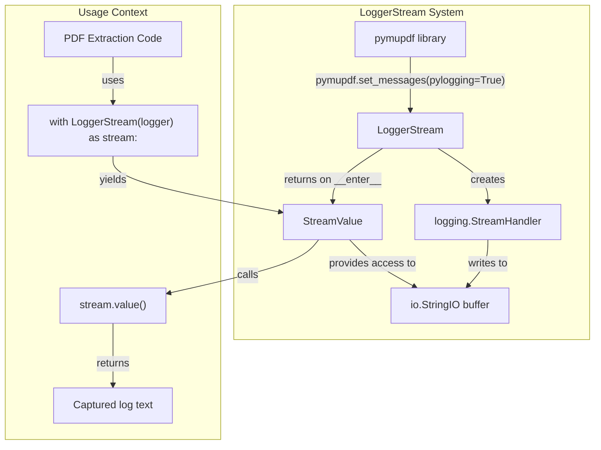
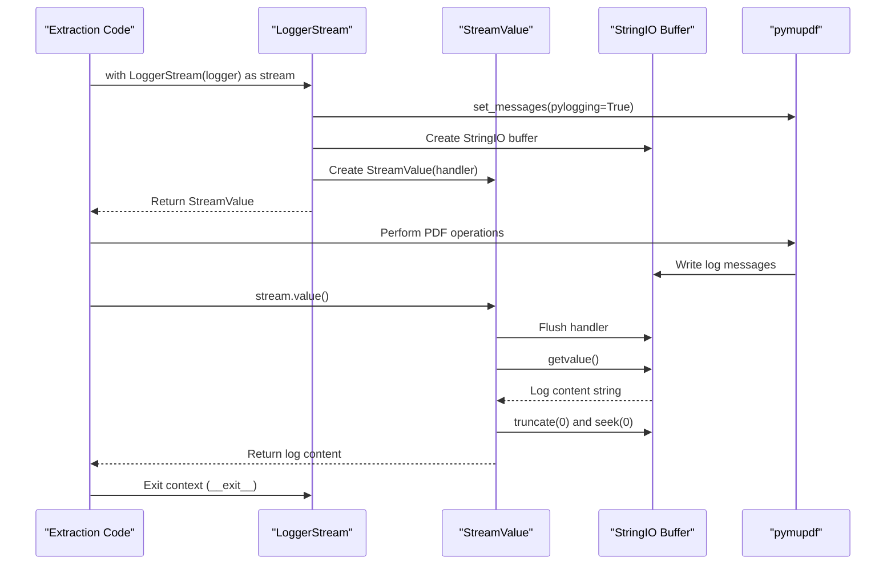
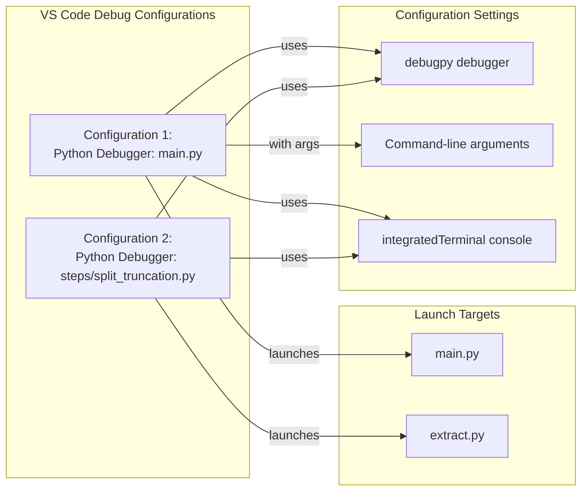
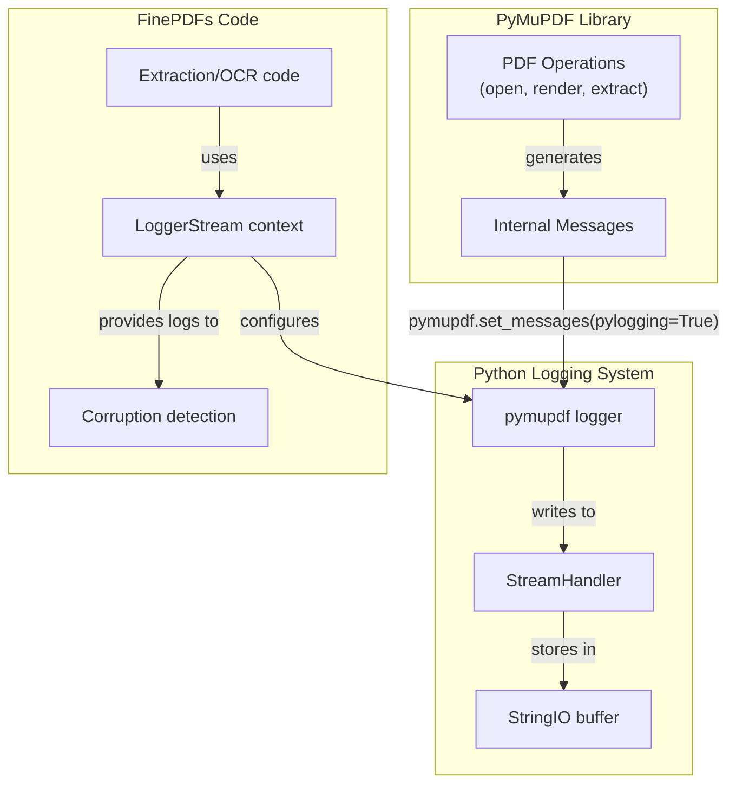

<!-- source: DeepWiki mcp.deepwiki.com · repo huggingface/finepdfs · page 6.2 Logging and Debugging · fetched 2026-10-26 -->

# Logging and Debugging

<details>
<summary>Relevant source files</summary>

The following files were used as context for generating this wiki page:

- [.vscode/launch.json](.vscode/launch.json)
- [blocks/loggers.py](blocks/loggers.py)

</details>


This page documents the logging and debugging infrastructure used throughout the FinePDFs system. It covers the `LoggerStream` utility for capturing PyMuPDF logs, VS Code debug configurations for local development, and metadata filtering utilities.

For information about error handling in PDF extraction, see [PDF Extraction System](#2.1). For information about the base extractor timeout handling, see [Base Extractor Framework](#6.1).

## Overview

The FinePDFs pipeline processes millions of PDFs and uses specialized logging infrastructure to capture output from third-party libraries, particularly PyMuPDF. The system provides:

- **LoggerStream**: A context manager for capturing and retrieving logs from PyMuPDF operations
- **VS Code Debug Configurations**: Pre-configured launch settings for debugging pipeline components
- **Metadata Utilities**: Helper functions for cleaning and validating PDF metadata

## LoggerStream Utility

The `LoggerStream` class provides a mechanism to capture log output from PyMuPDF operations, which is critical for diagnosing PDF extraction issues and detecting corrupted files.

### Architecture



**Sources**: [blocks/loggers.py:1-48]()

### Class Structure

The logging system consists of two classes:

| Class | Purpose | Key Methods |
|-------|---------|-------------|
| `LoggerStream` | Context manager that redirects logger output to a buffer | `__enter__()`, `__exit__()`, `handler` property |
| `StreamValue` | Wrapper that provides access to buffered log content | `value()` |

#### LoggerStream Implementation

The `LoggerStream` class is initialized with one or more `logging.Logger` instances and configures them to write to an in-memory buffer:

```
LoggerStream(loggers: logging.Logger | list[logging.Logger])
```

Key implementation details:

1. **PyMuPDF Integration**: Calls `pymupdf.set_messages(pylogging=True)` to enable Python logging for PyMuPDF [blocks/loggers.py:21]()
2. **Handler Management**: Removes existing handlers and adds a `StreamHandler` that writes to a `StringIO` buffer [blocks/loggers.py:28-41]()
3. **Logger Configuration**: Sets logger level to `INFO` and disables propagation to root logger [blocks/loggers.py:38-40]()

#### StreamValue Implementation

The `StreamValue` class provides a clean interface for retrieving logged content:

```python
stream_value.value()  # Returns captured logs and clears buffer
```

The `value()` method:
1. Flushes the handler to ensure all logs are written [blocks/loggers.py:13]()
2. Retrieves the buffer content via `getvalue()` [blocks/loggers.py:14]()
3. Clears the buffer by truncating and seeking to position 0 [blocks/loggers.py:15-16]()

**Sources**: [blocks/loggers.py:8-17](), [blocks/loggers.py:19-48]()

### Usage Pattern



**Example Usage Pattern**:

The LoggerStream is typically used in extraction code to capture PyMuPDF warnings and errors. The context manager ensures proper setup and teardown, while `value()` can be called multiple times to retrieve and clear the buffer.

**Sources**: [blocks/loggers.py:19-48]()

## Metadata Utilities

The `keep_only_valid_metadata` function filters PDF metadata dictionaries to remove empty or null values.

### Function Signature

```python
def keep_only_valid_metadata(metadata: dict) -> dict
```

This function uses dictionary comprehension to filter out entries where the value is falsy (None, empty string, 0, False, etc.) [blocks/loggers.py:5-6]().

### Purpose

PDF metadata often contains fields that are present but empty. This utility ensures that only meaningful metadata is retained, which is important for:

- Reducing storage overhead in processed datasets
- Simplifying downstream metadata analysis
- Avoiding null value issues in data processing pipelines

**Sources**: [blocks/loggers.py:5-6]()

## VS Code Debug Configurations

The repository includes pre-configured debug launch settings for VS Code to facilitate local development and debugging.

### Debug Configuration Overview



**Sources**: [.vscode/launch.json:1-24]()

### Configuration 1: Main Pipeline Debugger

This configuration launches the main pipeline entry point with a CommonCrawl snapshot argument:

| Property | Value |
|----------|-------|
| Name | `Python Debugger: main.py` |
| Type | `debugpy` |
| Request | `launch` |
| Program | `main.py` |
| Args | `["CC-MAIN-2019-47"]` |
| Console | `integratedTerminal` |

The configuration passes `CC-MAIN-2019-47` as a command-line argument, specifying which CommonCrawl snapshot to process [.vscode/launch.json:8-15]().

### Configuration 2: Extraction Debugger

This configuration launches the extraction script:

| Property | Value |
|----------|-------|
| Name | `Python Debugger: steps/split_truncation.py` |
| Type | `debugpy` |
| Request | `launch` |
| Program | `extract.py` |
| Console | `integratedTerminal` |

Note: Despite the name referring to `steps/split_truncation.py`, the actual program launched is `extract.py` [.vscode/launch.json:17-22]().

**Sources**: [.vscode/launch.json:6-23]()

## Integration Points

### PyMuPDF Logging Integration



The LoggerStream is particularly important for the corrupted PDF detection system (see [Corrupted PDF Detection](#2.1.3)), which analyzes PyMuPDF log output to identify damaged or encrypted PDFs. By capturing PyMuPDF's internal warnings and errors, the system can make intelligent decisions about whether to skip problematic files or attempt alternative extraction methods.

**Sources**: [blocks/loggers.py:19-48]()

## Debugging Workflow

### Local Development Debugging

For developers working on the extraction pipeline:

1. **Set Breakpoints**: Use VS Code to set breakpoints in `main.py` or `extract.py`
2. **Select Configuration**: Choose the appropriate debug configuration from the VS Code debug panel
3. **Launch Debugger**: Press F5 or click the green play button
4. **Inspect Variables**: Use the VS Code debug console to inspect PDFs, metadata, and extraction results
5. **Step Through Code**: Use step over/into/out to trace execution through the extraction pipeline

### Log-Based Debugging

For debugging PyMuPDF-related issues:

1. **Wrap Operations**: Use `LoggerStream` as a context manager around PDF operations
2. **Capture Logs**: Call `stream.value()` to retrieve PyMuPDF messages
3. **Analyze Output**: Search for specific error patterns (see [Corrupted PDF Detection](#2.1.3))
4. **Diagnose Issues**: Use captured logs to identify PDF corruption, missing fonts, or rendering failures

**Sources**: [.vscode/launch.json:1-24](), [blocks/loggers.py:19-48]()

## Summary

The logging and debugging infrastructure in FinePDFs provides:

- **Robust Log Capture**: `LoggerStream` class for capturing PyMuPDF output with automatic buffer management
- **IDE Integration**: Pre-configured VS Code debug settings for rapid development iteration
- **Metadata Cleaning**: Utility functions for filtering invalid metadata entries
- **PyMuPDF Integration**: Direct connection to PyMuPDF's logging system for comprehensive error capture

These utilities are used throughout the extraction pipeline to diagnose issues, detect corrupted PDFs, and ensure robust processing of millions of documents.

**Sources**: [blocks/loggers.py:1-48](), [.vscode/launch.json:1-24]()

---

