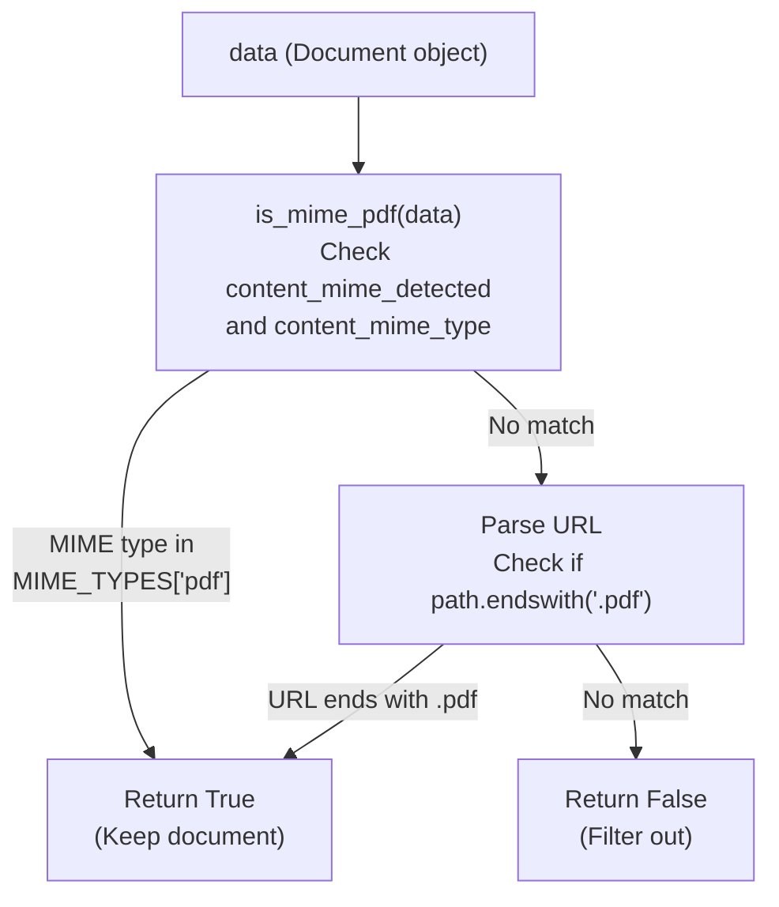
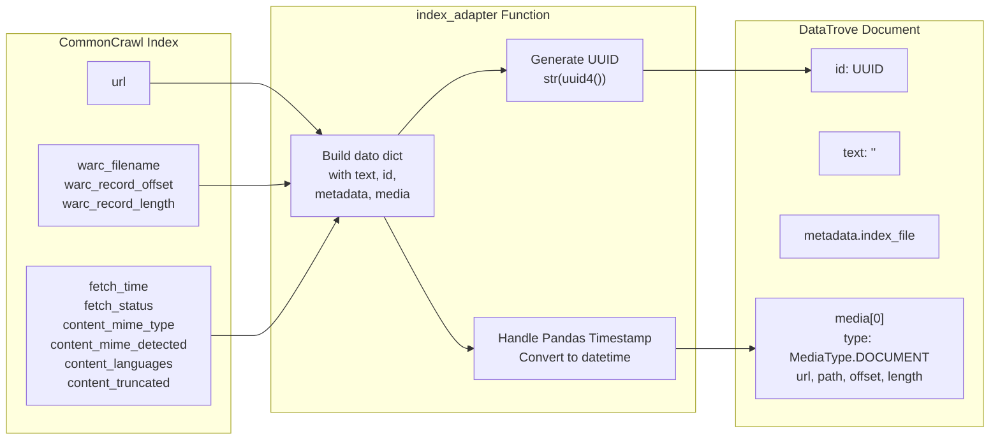
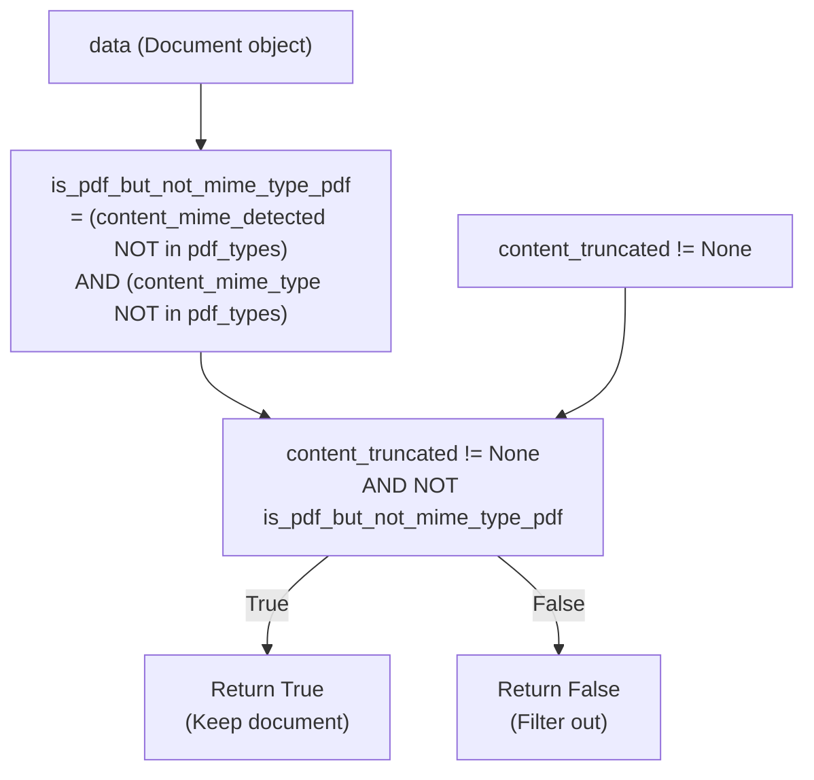
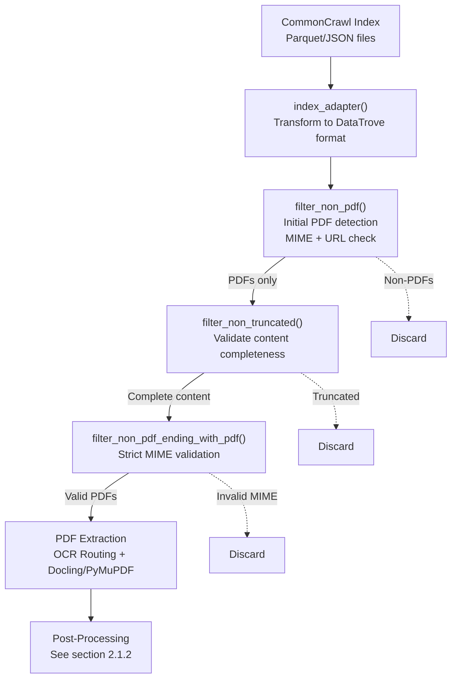

<!-- source: DeepWiki mcp.deepwiki.com · repo huggingface/finepdfs · page 6.3 Data Filtering Utilities · fetched 2026-10-26 -->

# Data Filtering Utilities

<details>
<summary>Relevant source files</summary>

The following files were used as context for generating this wiki page:

- [blocks/utils.py](blocks/utils.py)

</details>


This page documents the data filtering utilities in [blocks/utils.py](), which provide core filtering and data adaptation functions used during the initial stages of the FinePDFs pipeline. These utilities handle PDF detection, metadata transformation, and content validation before documents enter the extraction system.

For information about the broader filtering pipeline, see [Main Processing Pipeline](#2). For classification-based filtering (language and quality), see [Classification and Filtering](#2.2).

## Overview

The utilities in [blocks/utils.py]() serve three primary purposes:

1. **PDF Detection**: Identify valid PDF documents from CommonCrawl data using MIME types and URL patterns
2. **Metadata Adaptation**: Transform CommonCrawl index data into the internal document format used by DataTrove
3. **Content Validation**: Filter out truncated or corrupted content that would fail during extraction

These functions are designed to work with DataTrove's document model and are typically applied early in the pipeline to reduce processing costs by eliminating invalid documents.

Sources: [blocks/utils.py:1-80]()

## MIME Type Constants

The module defines accepted MIME types for PDF documents in the `MIME_TYPES` dictionary:

```python
MIME_TYPES = {
    "pdf": [
        "application/pdf",
        "application/x-pdf",
        "application/acrobat",
        "applications/vnd.pdf",
        "text/pdf",
    ]
}
```

This list includes both standard and non-standard MIME type variations observed in CommonCrawl data. The constants are referenced by multiple filtering functions to ensure consistent PDF detection logic.

Sources: [blocks/utils.py:3-11]()

## PDF Detection and Validation

### Filter Functions Overview

The module provides two main PDF detection functions that operate at different stages of the pipeline:

| Function | Purpose | Detection Strategy |
|----------|---------|-------------------|
| `filter_non_pdf` | Initial PDF detection | MIME type + URL fallback |
| `filter_non_pdf_ending_with_pdf` | Strict MIME validation | MIME type only |

### `filter_non_pdf` Function

The `filter_non_pdf(data)` function implements a two-stage PDF detection strategy:

**Stage 1: MIME Type Checking**
The function first checks if either `content_mime_detected` or `content_mime_type` metadata fields match known PDF MIME types [blocks/utils.py:17-23]().

**Stage 2: URL Pattern Fallback**
If MIME type checks fail, the function examines the URL path. Documents with URLs ending in `.pdf` are retained with a warning log, as they are likely PDFs with incorrect MIME type headers [blocks/utils.py:25-31]().



**Diagram: PDF Detection Logic in filter_non_pdf**

Sources: [blocks/utils.py:13-31]()

### `filter_non_pdf_ending_with_pdf` Function

This function provides stricter validation, accepting only documents with valid PDF MIME types. It does not use URL-based fallback detection [blocks/utils.py:73-80]().

The function internally uses the same `is_mime_pdf` helper logic but returns immediately without checking URL patterns. This is useful in pipeline stages where strict validation is required after initial filtering.

Sources: [blocks/utils.py:73-80]()

## Metadata Adaptation

### `index_adapter` Function

The `index_adapter(self, data, file_path, _)` function transforms CommonCrawl index entries into DataTrove document objects. This is a critical bridge between the CommonCrawl data format and the internal processing format.

**Function Signature and Purpose**

The function takes three parameters:
- `self`: Context object (typically unused)
- `data`: Dictionary containing CommonCrawl index fields
- `file_path`: Path to the source index file
- `_`: Unused parameter (placeholder)

It returns a dictionary conforming to DataTrove's document schema with `text`, `id`, `metadata`, and `media` fields.

**Data Transformation Flow**



**Diagram: Metadata Adaptation in index_adapter**

**Key Implementation Details**

1. **UUID Generation**: Each document receives a unique identifier using Python's `uuid4()` [blocks/utils.py:36]()
2. **Placeholder Text**: Documents are initialized with `"<no content>"` text, which will be replaced during extraction [blocks/utils.py:38]()
3. **Media Type**: Documents are marked as `MediaType.DOCUMENT` from DataTrove [blocks/utils.py:46]()
4. **WARC Coordinates**: The function preserves WARC file coordinates (`path`, `offset`, `length`) needed to retrieve the actual document content [blocks/utils.py:47-49]()
5. **Timestamp Handling**: Special logic handles Pandas Timestamp objects that appear in some crawls (e.g., 2019-47), converting them to Python datetime objects [blocks/utils.py:60-62]()

**Field Mapping**

| CommonCrawl Field | DataTrove Location | Purpose |
|-------------------|-------------------|---------|
| `url` | `media[0].url` | Document source URL |
| `warc_filename` | `media[0].path` | WARC file location |
| `warc_record_offset` | `media[0].offset` | Byte offset in WARC |
| `warc_record_length` | `media[0].length` | Record size in bytes |
| `fetch_time` | `media[0].metadata.fetch_time` | Crawl timestamp |
| `fetch_status` | `media[0].metadata.fetch_status` | HTTP status code |
| `content_mime_type` | `media[0].metadata.content_mime_type` | Declared MIME type |
| `content_mime_detected` | `media[0].metadata.content_mime_detected` | Detected MIME type |
| `content_languages` | `media[0].metadata.content_languages` | Detected languages |
| `content_truncated` | `media[0].metadata.content_truncated` | Truncation flag |

Sources: [blocks/utils.py:33-63]()

## Content Truncation Filtering

### `filter_non_truncated` Function

The `filter_non_truncated(data)` function validates that document content was fully captured during crawling. It implements special logic to avoid false positives with non-PDF documents.

**Filtering Logic**



**Diagram: Truncation Validation Logic in filter_non_truncated**

**Special Case Handling**

The function includes logic to handle edge cases where documents have PDF-like URLs but non-PDF MIME types [blocks/utils.py:67]():

- If `content_mime_detected` and `content_mime_type` both indicate non-PDF, the document is classified as `is_pdf_but_not_mime_type_pdf`
- This flag prevents false rejections when `content_truncated` is `None` for legitimate reasons

The truncation check only applies to actual PDFs (by MIME type), allowing other document types through even if truncation information is missing.

Sources: [blocks/utils.py:65-71]()

## Data Flow in Pipeline

The utilities in this module are applied at different stages of the FinePDFs pipeline. The following diagram shows how they integrate with the broader system:



**Diagram: Utility Functions in Pipeline Context**

The typical application order is:

1. **`index_adapter`**: Applied when reading CommonCrawl indices to transform data format
2. **`filter_non_pdf`**: First filtering pass, lenient to catch all potential PDFs
3. **`filter_non_truncated`**: Remove incomplete downloads
4. **`filter_non_pdf_ending_with_pdf`**: Final validation before expensive extraction

This multi-stage approach balances recall (catching all valid PDFs) with precision (avoiding wasted computation on invalid documents).

Sources: [blocks/utils.py:1-80]()

## Implementation Notes

### Document Object Structure

All filtering functions expect DataTrove document objects with the following structure:

```python
{
    "text": str,
    "id": str,
    "metadata": dict,
    "media": [
        {
            "id": str,
            "url": str,
            "type": MediaType,
            "path": str,
            "offset": int,
            "length": int,
            "metadata": {
                "fetch_time": datetime,
                "fetch_status": int,
                "content_mime_type": str,
                "content_mime_detected": str,
                "content_languages": str,
                "content_truncated": bool/None
            }
        }
    ]
}
```

The functions access metadata through `data.media[0].metadata` where `data.media[0]` represents the primary document media object.

### Logger Integration

The `filter_non_pdf` function uses the `loguru` logger to record when documents are kept based on URL patterns despite MIME type mismatches [blocks/utils.py:29](). This provides audit trails for filtering decisions and helps identify data quality issues in the source CommonCrawl data.

### Error Handling

The utilities rely on the presence of specific metadata fields. Calling code should ensure that:
- `content_mime_detected` and `content_mime_type` are present in metadata
- `content_truncated` may be `None` (represents unknown truncation status)
- `fetch_time` may be either a standard Python datetime or Pandas Timestamp

Sources: [blocks/utils.py:1-80]()

---

