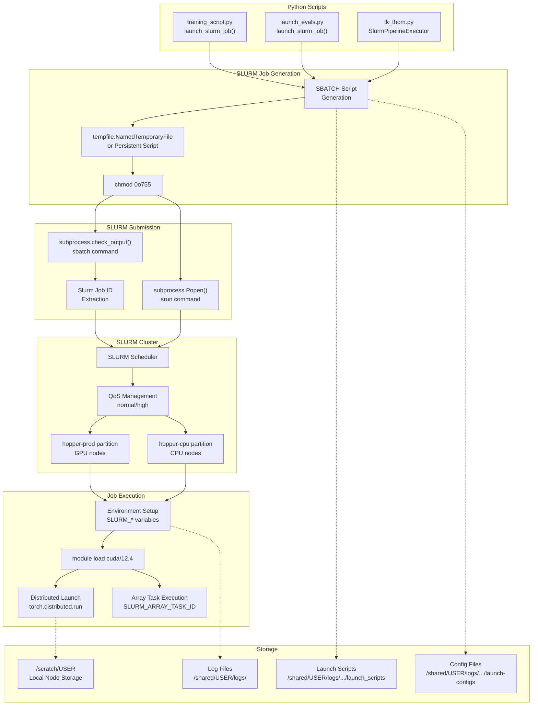
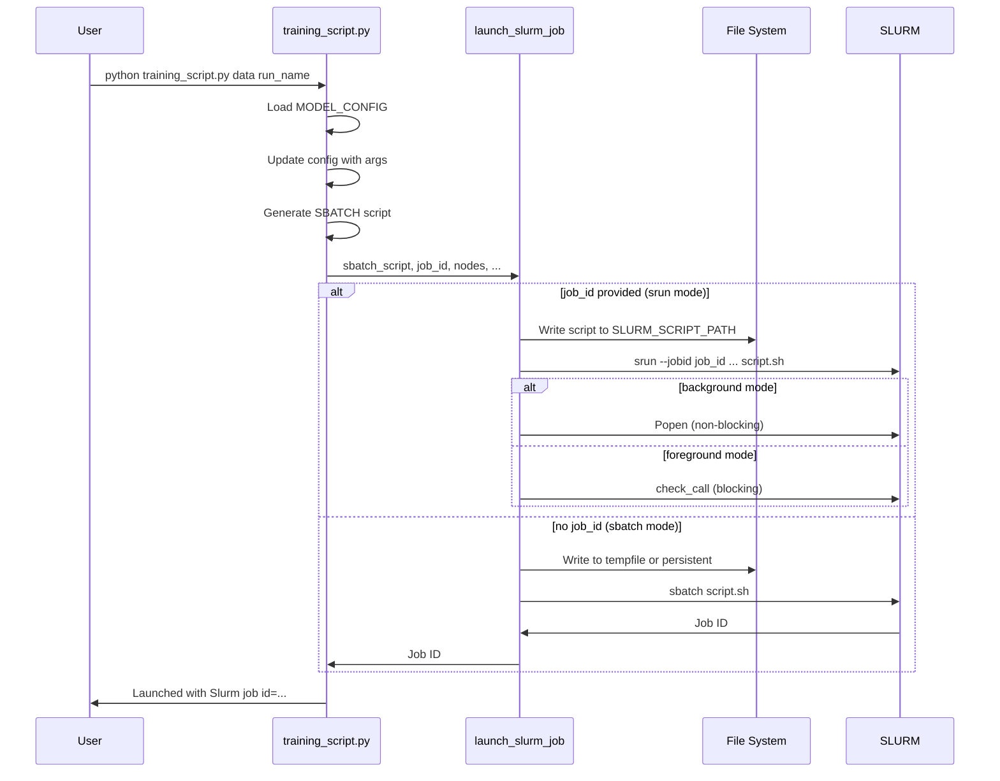
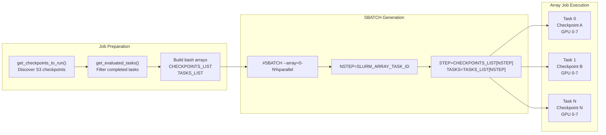
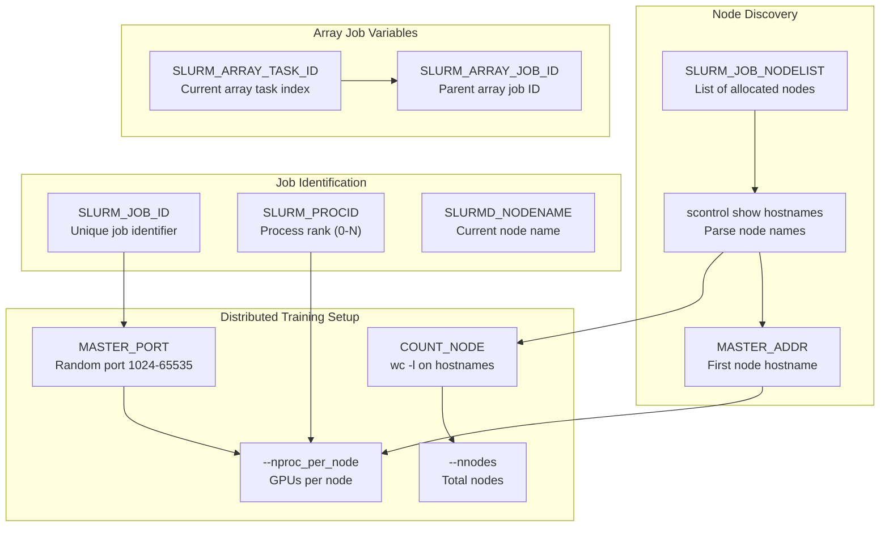
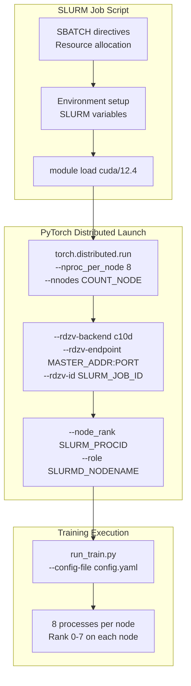
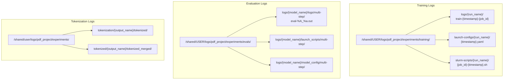

<!-- source: DeepWiki mcp.deepwiki.com · repo huggingface/finepdfs · page 7 SLURM Integration · fetched 2026-10-26 -->

# SLURM Integration

<details>
<summary>Relevant source files</summary>

The following files were used as context for generating this wiki page:

- [ablations/evaluations/launch_evals.py](ablations/evaluations/launch_evals.py)
- [ablations/tokenization/tk_thom.py](ablations/tokenization/tk_thom.py)
- [ablations/training/training_script.py](ablations/training/training_script.py)

</details>


This document describes how the FinePDFs repository integrates with SLURM (Simple Linux Utility for Resource Management) workload manager for distributed computing across GPU clusters. The system uses SLURM extensively for training, evaluation, and data processing tasks.

**Scope:** This page covers SLURM job submission patterns, resource management, job dependencies, and environment configuration. For training-specific configuration details, see [Training Infrastructure](#3). For evaluation orchestration, see [Evaluation Infrastructure](#4). For tokenization pipeline details, see [Tokenization Pipeline](#2.3).

## Overview

The FinePDFs system leverages SLURM for three primary workflows:

1. **Training Jobs** - Single or multi-node distributed training with nanotron
2. **Evaluation Jobs** - SLURM array jobs for parallel checkpoint evaluation
3. **Tokenization Jobs** - CPU-based distributed data processing via DataTrove's `SlurmPipelineExecutor`

All SLURM integration uses the `hopper-prod` or `hopper-cpu` partitions and supports QoS-based priority scheduling.

Sources: [ablations/training/training_script.py:1-432](), [ablations/evaluations/launch_evals.py:1-512](), [ablations/tokenization/tk_thom.py:1-286]()

## Core SLURM Integration Architecture



Sources: [ablations/training/training_script.py:192-220](), [ablations/evaluations/launch_evals.py:87-111]()

## Job Submission Pattern

The repository implements a common `launch_slurm_job()` helper function pattern for submitting SLURM jobs:

### Training Job Submission

The training script generates and submits SBATCH scripts dynamically:



**Key Functions:**

- `launch_slurm_job()` - [ablations/training/training_script.py:192-220]()
  - Writes SBATCH script to file system
  - Executes `sbatch` or `srun` command
  - Extracts and returns SLURM job ID
  - Supports both foreground and background execution

**SBATCH Script Generation:**

The training script generates a complete SBATCH script with:

```
#SBATCH --job-name={job_name}
#SBATCH --nodes={args.nodes}
#SBATCH --ntasks-per-node=1
#SBATCH --cpus-per-task={NUM_CPUS_IN_NODE}  # 88
#SBATCH --gres=gpu:{NUM_GPUS}                # 8
#SBATCH --partition=hopper-prod
#SBATCH --qos={args.priority}
#SBATCH --time={args.time}
#SBATCH --exclusive
#SBATCH --dependency=afterok:{dependency_job_id}
```

Sources: [ablations/training/training_script.py:353-366]()

### Evaluation Job Submission

Evaluations use SLURM array jobs for parallel checkpoint processing:



**Array Job Configuration:**

```bash
#SBATCH --array=0-{len(checkpoints_with_tasks) - 1}%{args.parallel}
```

This creates one array task per checkpoint, with `%{args.parallel}` limiting concurrent execution (default 5).

Sources: [ablations/evaluations/launch_evals.py:381-393]()

**Array Task Indexing:**

Each array task uses `SLURM_ARRAY_TASK_ID` to select its checkpoint and tasks:

```bash
CHECKPOINTS_LIST=("checkpoint_500" "checkpoint_1000" ...)
TASKS_LIST=("task1|task2|..." "task3|task4|..." ...)

NSTEP=$((SLURM_ARRAY_TASK_ID))
STEP=${CHECKPOINTS_LIST[$NSTEP]}
TASKS_TO_EVAL=${TASKS_LIST[$NSTEP]}
```

Sources: [ablations/evaluations/launch_evals.py:423-430]()

### Tokenization Job Submission

Tokenization uses DataTrove's `SlurmPipelineExecutor`:

```python
from datatrove.executor import SlurmPipelineExecutor

tokenizer_executor = SlurmPipelineExecutor(
    job_name=f"tok-{output_name}",
    pipeline=[
        JsonlReader(...),
        SamplerFilter(...),
        DocumentTokenizer(...)
    ],
    tasks=args.n_tasks,           # Number of parallel tasks
    time="20:00:00",
    partition="hopper-cpu",
    logging_dir=f"/shared/user/logs/...",
    cpus_per_task=8,
    mem_per_cpu_gb=2,
    qos=args.qos,
    depends_job_id=args.dep_job_id
)
tokenizer_executor.run()
```

The `SlurmPipelineExecutor` internally:
1. Generates an SBATCH script for each task
2. Submits array jobs to SLURM
3. Manages pipeline execution across tasks

Sources: [ablations/tokenization/tk_thom.py:217-248]()

## Resource Management

### Cluster Configuration

The system targets specific cluster partitions with fixed resource configurations:

| Constant | Value | Usage |
|----------|-------|-------|
| `PARTITION` | `"hopper-prod"` | GPU training/evaluation partition |
| `CPUS_PER_NODE` | `88` | CPUs per node for training/eval |
| `GPUS_PER_NODE` | `8` | GPUs per node |
| `NODES` | `1` (default) | Multi-node for training |

Sources: [ablations/evaluations/launch_evals.py:24-27](), [ablations/training/training_script.py:22-23]()

### Training Resource Allocation

Training jobs request:

```bash
#SBATCH --nodes={args.nodes}
#SBATCH --ntasks-per-node=1          # Crucial - only 1 task per node
#SBATCH --cpus-per-task=88
#SBATCH --gres=gpu:8
#SBATCH --partition=hopper-prod
#SBATCH --exclusive                   # Exclusive node access
```

The `--exclusive` flag ensures no other jobs share the node.

Sources: [ablations/training/training_script.py:353-365]()

### Evaluation Resource Allocation

Evaluation array jobs allocate resources per task:

```bash
#SBATCH --nodes=1
#SBATCH --ntasks-per-node=1
#SBATCH --partition=hopper-prod
#SBATCH --array=0-N%5                 # Max 5 concurrent tasks
#SBATCH --gres=gpu:{args.gpus}        # Default 8
#SBATCH --time=1:50:00                # Per-task timeout
#SBATCH --cpus-per-task=88
```

Sources: [ablations/evaluations/launch_evals.py:383-390]()

### Tokenization Resource Allocation

Tokenization uses CPU-only nodes:

```python
partition="hopper-cpu"
cpus_per_task=8
mem_per_cpu_gb=2
time="20:00:00"
```

Sources: [ablations/tokenization/tk_thom.py:240-243]()

## Job Dependencies and Scheduling

### Dependency Syntax

The system supports SLURM job dependencies via the `--dependency` flag:

```bash
#SBATCH --dependency=afterok:JOB_ID
```

**Training Dependencies:**

```python
parser.add_argument("-d", help="Dependency job", type=str, default=None)

# In SBATCH script:
{"#SBATCH --dependency=afterok:" + args.d if args.d else ""}
```

Sources: [ablations/training/training_script.py:226](), [ablations/training/training_script.py:365]()

**Evaluation Dependencies:**

```python
deps = []
if args.d:
    deps.append(f"afterok:{args.d}")
if args.run_all and job_id:
    deps.append(f"afterany:{job_id}")

# In SBATCH script:
{"#SBATCH --dependency=" + ",".join(deps) if deps else ""}
```

Sources: [ablations/evaluations/launch_evals.py:368-393]()

**Tokenization Dependencies:**

The `SlurmPipelineExecutor` supports `depends_job_id` and `depends` parameters:

```python
depends_job_id=args.dep_job_id  # Dependency on another job ID

# For merger job:
depends=tokenizer_executor      # Dependency on another executor
```

Sources: [ablations/tokenization/tk_thom.py:247](), [ablations/tokenization/tk_thom.py:281]()

### QoS (Quality of Service)

Priority scheduling is controlled via the `--qos` flag:

| QoS | Usage |
|-----|-------|
| `normal` | Default priority |
| `high` | Higher priority (limited quota) |

```bash
#SBATCH --qos={args.qos}
```

Sources: [ablations/evaluations/launch_evals.py:286](), [ablations/training/training_script.py:230]()

### Sequential Job Execution

The evaluation script supports sequential execution via `--run-all`:

```python
if args.run_all and job_id:
    deps.append(f"afterany:{job_id}")
```

This chains jobs so each model evaluation waits for the previous one to complete (success or failure).

Sources: [ablations/evaluations/launch_evals.py:371-372]()

## SLURM Environment Variables

### Standard SLURM Variables Used

The system reads and uses these SLURM-provided environment variables:



**Training Environment Setup:**

```bash
export HOSTNAMES=`scontrol show hostnames "$SLURM_JOB_NODELIST"`
export MASTER_ADDR=$(scontrol show hostnames "$SLURM_JOB_NODELIST" | head -n 1)
export MASTER_PORT={random_port}
export COUNT_NODE=`scontrol show hostnames "$SLURM_JOB_NODELIST" | wc -l`
```

Sources: [ablations/training/training_script.py:380-383]()

**Evaluation Environment Setup:**

```bash
export HOSTNAMES=`scontrol show hostnames "$SLURM_JOB_NODELIST"`
export MASTER_ADDR=$(scontrol show hostnames "$SLURM_JOB_NODELIST" | head -n 1)
export MASTER_PORT={master_port}
export COUNT_NODE=`scontrol show hostnames "$SLURM_JOB_NODELIST" | wc -l`

# Array-specific:
NSTEP=$((SLURM_ARRAY_TASK_ID))
STEP=${CHECKPOINTS_LIST[$NSTEP]}
```

Sources: [ablations/evaluations/launch_evals.py:410-428]()

### Custom Environment Variables

The system sets additional environment variables:

```bash
# Scratch space for temporary data
export TMPDIR=/scratch/{USER}/tmp
mkdir -p $TMPDIR

# HuggingFace cache location
export HF_DATASETS_OFFLINE={0|1}

# CUDA configuration
export CUDA_DEVICE_MAX_CONNECTIONS="1"
```

Sources: [ablations/evaluations/launch_evals.py:399](), [ablations/training/training_script.py:385-386]()

## Distributed Training Launch

Training jobs use PyTorch's distributed launcher with SLURM integration:



**Launch Command:**

```bash
export LAUNCHER="python -u -m torch.distributed.run \
    --nproc_per_node 8 \
    --nnodes $COUNT_NODE \
    --rdzv-backend c10d \
    --rdzv-endpoint $MASTER_ADDR:$MASTER_PORT \
    --rdzv-id $SLURM_JOB_ID \
    --node_rank $SLURM_PROCID \
    --role $SLURMD_NODENAME: \
    --max_restarts 0 \
    --tee 3 \
    "

CMD="{NANOTRON_PATH}/run_train.py --config-file {config_path}"

bash -c "$LAUNCHER $CMD"
```

Key parameters:
- `--rdzv-backend c10d` - Use PyTorch's c10d rendezvous backend
- `--rdzv-endpoint` - Master node address for coordination
- `--rdzv-id` - Unique ID for this training run (SLURM job ID)
- `--node_rank` - Process ID determines node rank
- `--max_restarts 0` - Don't automatically restart on failure

Sources: [ablations/training/training_script.py:397-415]()

## Log Management

### Log File Organization

The system creates structured log directories:



**Training Log Paths:**

```python
TRAINING_LOGS_PATH = f"/shared/{USER}/logs/pdf_project/experiments/training/logs"
LAUNCH_CONFIGS_PATH = f"/shared/{USER}/logs/pdf_project/experiments/training/launch-configs"
SLURM_SCRIPT_PATH = f"/shared/{USER}/logs/pdf_project/experiments/training/slurm-scripts"

# SBATCH directive:
#SBATCH --output={TRAINING_LOGS_PATH}/{run_name}/train-{timestamp}-%x-%j
```

Sources: [ablations/training/training_script.py:14-20](), [ablations/training/training_script.py:360]()

**Evaluation Log Paths:**

Array jobs use `%A` (array job ID) and `%a` (array task ID):

```python
EVAL_LOGS_PATH = f"/shared/{USER}/logs/pdf_project/experiments/evals/logs"

eval_logs_path = os.path.join(
    EVAL_LOGS_PATH, 
    formatted_model_name, 
    "logs", 
    "multi-step"
)

#SBATCH --output={eval_logs_path}/eval-%A_%a.out
#SBATCH --error={eval_logs_path}/eval-%A_%a.out
```

Sources: [ablations/evaluations/launch_evals.py:19](), [ablations/evaluations/launch_evals.py:337-391]()

## Scratch Space Management

### Local Node Storage

All jobs use `/scratch/{USER}` for temporary data:

```bash
export TMPDIR=/scratch/{USER}/tmp
mkdir -p $TMPDIR
```

**Training Dataset Download:**

For S3 datasets, training jobs download to scratch before training:

```bash
LOCAL_DATASET_PATH=/scratch/{USER}/dataset/{run_name}/
{S5CMD_PATH} cp 's3://bucket/data/*' $LOCAL_DATASET_PATH

# ... training happens ...

# Cleanup after training:
rm -rf $LOCAL_DATASET_PATH
```

Sources: [ablations/training/training_script.py:253](), [ablations/training/training_script.py:345-348](), [ablations/training/training_script.py:419-421]()

**Evaluation Checkpoint Download:**

Each array task downloads its checkpoint to a unique scratch directory:

```bash
RANDOM_NUMBER=$((RANDOM % 60 + 5))
LOCAL_DOWNLOAD_CHECKPOINT_FOLDER=/scratch/{USER}/eval-checkpoints/{model_name}-$RANDOM_NUMBER/$STEP

{S5CMD_PATH} --stat cp \
    --concurrency 50 \
    --exclude "optimizer/*" \
    --exclude "random/*" \
    --exclude "lr_scheduler/*" \
    --part-size 100 \
    "{s3_path}/$STEP/*" "$LOCAL_DOWNLOAD_CHECKPOINT_FOLDER/"

# ... evaluation happens ...

# Cleanup:
rm -rf "$LOCAL_DOWNLOAD_CHECKPOINT_FOLDER"
```

The random number prevents collision when multiple array tasks run on the same node.

Sources: [ablations/evaluations/launch_evals.py:435-497]()

## Advanced Patterns

### Job Requeue Support

Evaluation jobs support automatic requeue on node failure:

```bash
#SBATCH --requeue
```

This allows SLURM to automatically restart failed array tasks on different nodes.

Sources: [ablations/evaluations/launch_evals.py:394]()

### Checkpoint Discovery and Task Filtering

The evaluation system discovers checkpoints from S3 and filters already-completed tasks:

```python
def get_checkpoints_to_run(
    s3_path: str, 
    model_name: str,
    checkpoints: str,
    after_date: Optional[str] = None,
    tasks_list_path: Optional[str] = None
) -> List[Tuple[str, Set[str]]]:
    # 1. List checkpoints from S3
    df = get_datafolder(s3_path)
    avail_checkpoints = sorted(df.ls("", detail=False))
    
    # 2. Filter by date if provided
    reference_date = parse_date(after_date)
    
    # 3. For each checkpoint, get already-evaluated tasks
    for ckpt in selected_checkpoints:
        evaluated_tasks = get_evaluated_tasks(model_name, ckpt, reference_date)
        
        # 4. Calculate remaining tasks
        all_tasks = get_tasks_from_file(tasks_list_path)
        remaining_tasks = all_tasks - evaluated_tasks
        
        if remaining_tasks:
            checkpoints_with_tasks.append((ckpt, remaining_tasks))
    
    return checkpoints_with_tasks
```

This ensures efficient use of compute resources by skipping redundant evaluations.

Sources: [ablations/evaluations/launch_evals.py:175-224]()

### Random Sleep to Avoid Resource Contention

Both training and evaluation include random delays to prevent concurrent HuggingFace Hub requests:

**Training:**

```bash
random_milliseconds=$(( RANDOM % 1001 ))
sleep_time=$(bc <<< "scale=3; $random_milliseconds / 1000")
echo "Sleeping for $sleep_time seconds..."
sleep $sleep_time
```

Sources: [ablations/training/training_script.py:410-413]()

**Tokenization:**

```python
env_command="sleep $((RANDOM % 30))"
```

Sources: [ablations/tokenization/tk_thom.py:245]()

### Multi-Language Task Selection

Both training and evaluation automatically select task files based on language prefix:

```python
custom_tasks = {
    "eng_Latn": "/admin/home/user/shared/projects/new_training_setup/task_list.py",
    "fra_Latn": "lighteval.tasks.multilingual.tasks",
    "arb_Arab": "lighteval.tasks.multilingual.tasks",
    "cmn_Hani": "lighteval.tasks.multilingual.tasks",
    "rus_Cyrl": "lighteval.tasks.multilingual.tasks",
}

tasks_list = {
    "eng_Latn": ".../tasks_eng.txt",
    "fra_Latn": ".../tasks_fra.txt",
    # ... etc
}

# Extract language from model/run name:
language = model_name.split("-")[0]  # or run_name.split("-")[0]
custom_tasks_path = custom_tasks.get(language, custom_tasks["eng_Latn"])
tasks_list_path = tasks_list.get(language, tasks_list["eng_Latn"])
```

Sources: [ablations/evaluations/launch_evals.py:29-43](), [ablations/evaluations/launch_evals.py:307-315](), [ablations/training/training_script.py:176-190](), [ablations/training/training_script.py:283-295]()

## Common Paths and Constants

### Key Directory Paths

| Path | Purpose |
|------|---------|
| `/shared/{USER}/logs/pdf_project/experiments/` | Root for all experiment logs |
| `/shared/user/projects/new_training_setup/nanotron` | Nanotron framework installation |
| `/scratch/{USER}/` | Node-local temporary storage |
| `s3://bucket/experiments/checkpoints/` | S3 checkpoint storage |
| `s3://bucket/experiments/evals-test/` | S3 evaluation results |
| `s3://bucket/experiments/tokenized/` | S3 tokenized data |

Sources: [ablations/training/training_script.py:12-21](), [ablations/evaluations/launch_evals.py:18-22]()

### S5cmd Integration

All S3 operations use `s5cmd` for high-performance data transfer:

```python
S5CMD_PATH = "/shared/user/projects/new_training_setup/training_venv/bin/s5cmd"

# Download:
{S5CMD_PATH} --stat cp \
    --concurrency 50 \
    --part-size 100 \
    "s3://source/*" "/local/destination/"

# Upload (configured in model config):
s3_upload:
  s5cmd_path: {S5CMD_PATH}
  s5cmd_concurrency: 5
  s5cmd_numworkers: 16
  upload_s3_path: {S3_CHECKPOINTS_PREFIX}
  remove_after_upload: true
```

Sources: [ablations/training/training_script.py:17](), [ablations/training/training_script.py:133-138](), [ablations/evaluations/launch_evals.py:22](), [ablations/evaluations/launch_evals.py:442-448]()

---

