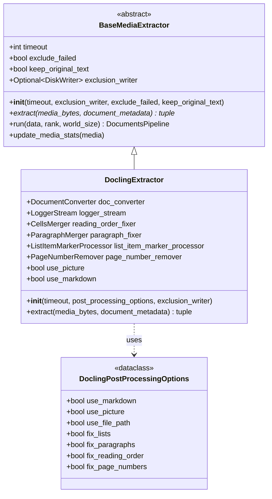
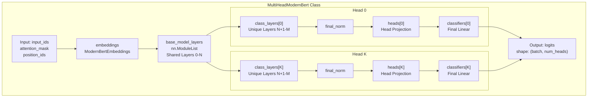
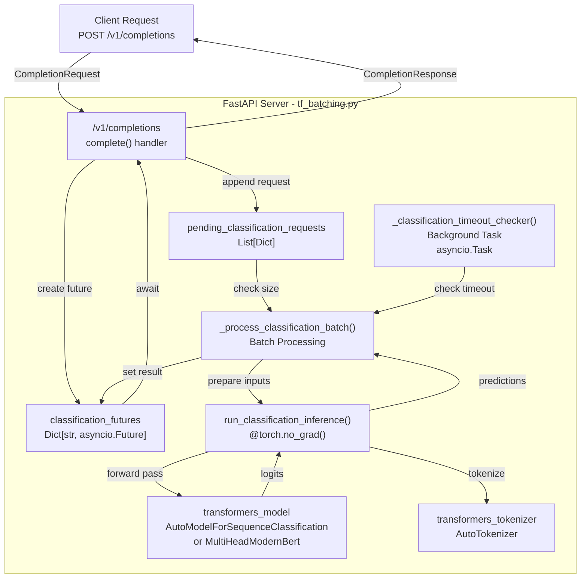

<!-- source: DeepWiki mcp.deepwiki.com · repo huggingface/finepdfs · page 9 API Reference · fetched 2026-10-26 -->

# API Reference

<details>
<summary>Relevant source files</summary>

The following files were used as context for generating this wiki page:

- [blocks/classification/multi_head_moder_bert.py](blocks/classification/multi_head_moder_bert.py)
- [blocks/classification/tf_batching.py](blocks/classification/tf_batching.py)
- [blocks/extractors/docling.py](blocks/extractors/docling.py)
- [blocks/predictor/base_extractor.py](blocks/predictor/base_extractor.py)

</details>


This document provides technical reference documentation for the key classes, functions, and API endpoints in the FinePDFs codebase. It focuses on signatures, parameters, return types, and usage patterns for the core components used throughout the pipeline.

For higher-level architectural overviews of these systems, see [Main Processing Pipeline](#2) and [Classification and Filtering](#2.2). For practical usage examples and configuration, see [Quick Start](#1.1).

---

## Extractor API

The extractor API provides the base abstractions and implementations for extracting text from PDF documents.

### Class Hierarchy



**Sources:** [blocks/predictor/base_extractor.py:16-112](), [blocks/extractors/docling.py:24-107]()

### BaseMediaExtractor

Abstract base class for all media extractors that defines the interface for extracting text from document media.

#### Constructor

```python
def __init__(
    self,
    timeout: float = 60,
    exclusion_writer: Optional[DiskWriter] = None,
    exclude_failed: bool = True,
    keep_original_text: bool = False
)
```

| Parameter | Type | Default | Description |
|-----------|------|---------|-------------|
| `timeout` | `float` | `60` | Timeout in seconds for extraction per document |
| `exclusion_writer` | `Optional[DiskWriter]` | `None` | Writer for documents that fail extraction |
| `exclude_failed` | `bool` | `True` | Whether to exclude failed documents from output |
| `keep_original_text` | `bool` | `False` | Whether to keep original document text alongside extracted text |

**Sources:** [blocks/predictor/base_extractor.py:22-33]()

#### Abstract Methods

##### extract

```python
@abstractmethod
def extract(
    self,
    media_bytes: bytes,
    document_metadata: dict
) -> tuple[str, dict]
```

Abstract method that implements the actual extraction logic. Must be implemented by subclasses.

**Parameters:**
- `media_bytes` (`bytes`): Raw bytes of the media file to extract
- `document_metadata` (`dict`): Metadata dictionary for the document

**Returns:** `tuple[str, dict]`
- First element: Extracted plain text
- Second element: Metadata dictionary with extraction results and error information

**Sources:** [blocks/predictor/base_extractor.py:35-45]()

#### Pipeline Methods

##### run

```python
def run(
    self,
    data: DocumentsPipeline,
    rank: int = 0,
    world_size: int = 1
) -> DocumentsPipeline
```

Main pipeline execution method that iterates through documents and applies extraction.

**Parameters:**
- `data` (`DocumentsPipeline`): Input pipeline of documents to process
- `rank` (`int`): Process rank for distributed processing (default: 0)
- `world_size` (`int`): Total number of processes (default: 1)

**Returns:** `DocumentsPipeline` - Generator yielding processed documents

**Behavior:**
- Iterates through each document and its media
- Calls `extract()` on each media item
- Handles timeouts, errors, and process failures
- Updates document statistics
- Optionally writes failed documents to exclusion writer
- Yields documents unless all media extraction failed and `exclude_failed=True`

**Sources:** [blocks/predictor/base_extractor.py:47-111]()

### DoclingExtractor

Concrete implementation of BaseMediaExtractor that uses the Docling library for PDF text extraction with advanced post-processing.

#### Constructor

```python
def __init__(
    self,
    timeout: int = 10*60,
    post_processing_options: DoclingPostProcessingOptions = DoclingPostProcessingOptions(),
    exclusion_writer: Optional[DiskWriter] = None
)
```

| Parameter | Type | Default | Description |
|-----------|------|---------|-------------|
| `timeout` | `int` | `600` | Timeout in seconds (default 10 minutes) |
| `post_processing_options` | `DoclingPostProcessingOptions` | Default options | Configuration for post-processing steps |
| `exclusion_writer` | `Optional[DiskWriter]` | `None` | Writer for failed documents |

**Initializes:**
- `DocumentConverter` with CPU acceleration and single thread
- `LoggerStream` for capturing docling and pymupdf logs
- Post-processing components: `CellsMerger`, `ParagraphMerger`, `ListItemMarkerProcessor`, `PageNumberRemover`

**Sources:** [blocks/extractors/docling.py:35-55]()

#### extract Method

```python
def extract(
    self,
    media_bytes: bytes | None,
    document_metadata: dict
) -> tuple[str, dict]
```

Extracts text from PDF bytes using Docling and applies post-processing pipeline.

**Returns:** `tuple[str, dict]` containing:

**Text (str):** Extracted text with post-processing applied

**Metadata (dict):** Dictionary with the following keys:
- `num_pages` (`int`): Number of pages in the document
- `page_offsets` (`list[int]`): Cumulative character offsets for each page
- `docling_doc_dict` (`dict`): Initial Docling document structure before post-processing
- `logs` (`str`): Captured logs from docling and pymupdf
- `version` (`str`): Version identifier (currently "2.0")
- `conversion_status` (`str`): Status value from Docling conversion
- `extraction_error` (`str`, optional): Error message if conversion failed

**Sources:** [blocks/extractors/docling.py:59-107]()

#### DoclingPostProcessingOptions

```python
@dataclass(frozen=True)
class DoclingPostProcessingOptions:
    use_markdown: bool = False
    use_picture: bool = False
    use_file_path: bool = False
    fix_lists: bool = True
    fix_paragraphs: bool = True
    fix_reading_order: bool = True
    fix_page_numbers: bool = True
```

Configuration dataclass controlling post-processing behavior.

| Field | Type | Default | Description |
|-------|------|---------|-------------|
| `use_markdown` | `bool` | `False` | Output in markdown format |
| `use_picture` | `bool` | `False` | Include picture placeholders |
| `use_file_path` | `bool` | `False` | Include file path in output |
| `fix_lists` | `bool` | `True` | Normalize list item markers |
| `fix_paragraphs` | `bool` | `True` | Merge paragraph fragments |
| `fix_reading_order` | `bool` | `True` | Fix cell reading order |
| `fix_page_numbers` | `bool` | `True` | Remove page numbers |

**Sources:** [blocks/extractors/docling.py:24-32]()

---

## Classification API

The classification API provides multi-task sequence classification with efficient batched inference.

### Multi-Head Architecture



**Sources:** [blocks/classification/multi_head_moder_bert.py:7-269]()

### MultiHeadModernBert

Combines multiple ModernBERT sequence classification models by sharing base layers and creating separate classification heads. Enables efficient multi-task inference by computing shared representations once.

#### Constructor

```python
def __init__(
    self,
    models: List[ModernBertForSequenceClassification]
)
```

**Parameters:**
- `models` (`List[ModernBertForSequenceClassification]`): List of pre-trained ModernBERT models to combine

**Initialization Process:**
1. Compares parameters across all models layer-by-layer to find the last common layer
2. Extracts shared base layers (`layers[0:last_common_layer]`)
3. Extracts per-head unique layers (`layers[last_common_layer:]`)
4. Creates `nn.ModuleList` for classifiers, class_layers, and heads
5. Uses first model's embeddings and configuration as shared

**Attributes Created:**
- `base_model_layers` (`nn.ModuleList`): Shared encoder layers
- `classifiers` (`nn.ModuleList`): Final linear layers for each head
- `class_layers` (`nn.ModuleList`): Unique upper layers for each head
- `heads` (`nn.ModuleList`): Head projection layers
- `embeddings`: Shared embedding layer
- `final_norm`: Shared final normalization
- `config`: Model configuration
- `dtype`, `device`: Data type and device

**Sources:** [blocks/classification/multi_head_moder_bert.py:8-56]()

#### forward Method

```python
def forward(
    self,
    input_ids: Optional[torch.LongTensor] = None,
    attention_mask: Optional[torch.Tensor] = None,
    sliding_window_mask: Optional[torch.Tensor] = None,
    position_ids: Optional[torch.LongTensor] = None,
    inputs_embeds: Optional[torch.Tensor] = None,
    indices: Optional[torch.Tensor] = None,
    cu_seqlens: Optional[torch.Tensor] = None,
    max_seqlen: Optional[int] = None,
    batch_size: Optional[int] = None,
    seq_len: Optional[int] = None,
    output_attentions: Optional[bool] = None,
    output_hidden_states: Optional[bool] = None,
    return_dict: Optional[bool] = None,
) -> Union[tuple[torch.Tensor, ...], SequenceClassifierOutput]
```

Forward pass computing predictions for all classification heads simultaneously.

**Parameters:**

| Parameter | Type | Description |
|-----------|------|-------------|
| `input_ids` | `Optional[torch.LongTensor]` | Input token IDs of shape `(batch_size, sequence_length)` |
| `attention_mask` | `Optional[torch.Tensor]` | Attention mask of shape `(batch_size, sequence_length)` |
| `sliding_window_mask` | `Optional[torch.Tensor]` | Mask for local attention layers |
| `position_ids` | `Optional[torch.LongTensor]` | Position indices for positional embeddings |
| `inputs_embeds` | `Optional[torch.Tensor]` | Pre-computed embeddings instead of input_ids |
| `indices` | `Optional[torch.Tensor]` | Indices for unpadding (Flash Attention 2) |
| `cu_seqlens` | `Optional[torch.Tensor]` | Cumulative sequence lengths (Flash Attention 2) |
| `max_seqlen` | `Optional[int]` | Maximum sequence length (Flash Attention 2) |
| `batch_size` | `Optional[int]` | Batch size for padding output |
| `seq_len` | `Optional[int]` | Sequence length for padding output |
| `output_attentions` | `Optional[bool]` | Whether to return attention weights |
| `output_hidden_states` | `Optional[bool]` | Whether to return all hidden states |
| `return_dict` | `Optional[bool]` | Whether to return `SequenceClassifierOutput` |

**Returns:** `Union[tuple[torch.Tensor, ...], SequenceClassifierOutput]`

When `return_dict=True` (default), returns `SequenceClassifierOutput` with:
- `logits` (`torch.Tensor`): Shape `(batch_size, num_heads)` with predictions from all heads
- `hidden_states` (`tuple[torch.Tensor]`, optional): All hidden states if requested
- `attentions` (`tuple[torch.Tensor]`, optional): All attention weights if requested

**Sources:** [blocks/classification/multi_head_moder_bert.py:120-269]()

---

## Batched Inference Server API

FastAPI server providing batched inference for sequence classification with automatic request queuing and timeout handling.

### Server Architecture



**Sources:** [blocks/classification/tf_batching.py:1-453]()

### Request/Response Models

#### CompletionRequest

```python
class CompletionRequest(BaseModel):
    input: str
    max_tokens: int = 100
    temperature: float = 0.0
    model: Optional[str] = None
```

Request model for classification inference.

| Field | Type | Default | Description |
|-------|------|---------|-------------|
| `input` | `str` | - | Text to classify |
| `max_tokens` | `int` | `100` | Ignored for classification |
| `temperature` | `float` | `0.0` | Ignored for classification |
| `model` | `Optional[str]` | `None` | Model name override |

**Sources:** [blocks/classification/tf_batching.py:26-30]()

#### CompletionResponse

```python
class CompletionResponse(BaseModel):
    id: str
    object: str = "completion"
    created: int
    model: str
    choices: List[CompletionResult]
```

Response model containing classification results.

| Field | Type | Description |
|-------|------|-------------|
| `id` | `str` | Unique response ID |
| `object` | `str` | Object type (always "completion") |
| `created` | `int` | Unix timestamp |
| `model` | `str` | Model name used |
| `choices` | `List[CompletionResult]` | List with single result |

**Sources:** [blocks/classification/tf_batching.py:37-42]()

#### CompletionResult

```python
class CompletionResult(BaseModel):
    text: str
    usage: Usage
    finish_reason: str = "stop"
```

Contains classification scores and token usage.

| Field | Type | Description |
|-------|------|-------------|
| `text` | `str` | Comma-separated logit values (e.g., "0.5,0.3,0.2") |
| `usage` | `Usage` | Token usage statistics |
| `finish_reason` | `str` | Completion reason (always "stop") |

**Sources:** [blocks/classification/tf_batching.py:32-35]()

### API Endpoints

#### POST /v1/completions

```python
@app.post("/v1/completions")
async def complete(request: CompletionRequest) -> CompletionResponse
```

Main endpoint for classification requests. Queues requests for batched processing.

**Request Body:** `CompletionRequest` (JSON)

**Response:** `CompletionResponse` (JSON)

**Behavior:**
1. Generates unique `request_id`
2. Creates `asyncio.Future` for this request
3. Appends request to `pending_classification_requests` queue
4. If queue size ≥ `batch_size`, triggers immediate batch processing
5. Otherwise, waits for future to be resolved by batch processor or timeout checker
6. Returns result when future resolves

**Error Responses:**
- `503 Service Unavailable`: Server is shutting down
- `500 Internal Server Error`: Processing error

**Sources:** [blocks/classification/tf_batching.py:326-355]()

#### GET /health

```python
@app.get("/health")
async def health()
```

Health check endpoint.

**Response:** `{"status": "healthy"}` if server is operational, `503` if shutting down

**Sources:** [blocks/classification/tf_batching.py:357-362]()

#### GET /v1/models

```python
@app.get("/v1/models")
async def list_models()
```

Lists available models.

**Response:** Model list in OpenAI-compatible format

**Sources:** [blocks/classification/tf_batching.py:364-377]()

### Core Functions

#### create_app

```python
def create_app(
    model_name_or_path: str,
    batch_size: int = 4,
    batch_timeout: float = 10.0,
    max_context: int = 2048,
    model_kwargs: Optional[Dict[str, Any]] = None
) -> FastAPI
```

Creates and configures the FastAPI application.

**Parameters:**

| Parameter | Type | Default | Description |
|-----------|------|---------|-------------|
| `model_name_or_path` | `str` | - | Model path or semicolon-separated paths for multi-head |
| `batch_size` | `int` | `4` | Number of requests to batch together |
| `batch_timeout` | `float` | `10.0` | Seconds to wait before processing partial batch |
| `max_context` | `int` | `2048` | Maximum sequence length for tokenization |
| `model_kwargs` | `Optional[Dict[str, Any]]` | `None` | Additional model loading arguments |

**Returns:** `FastAPI` - Configured application instance

**Model Loading:**
- Single model path: Loads `AutoModelForSequenceClassification`
- Multiple paths (separated by `;`): Creates `MultiHeadModernBert` instance
- Default kwargs: `torch_dtype="bfloat16"`, `device_map="auto"`, `attn_implementation="flash_attention_2"`

**Sources:** [blocks/classification/tf_batching.py:229-379]()

#### run_classification_inference

```python
@torch.no_grad()
def run_classification_inference(
    current_batch: List[Dict[str, Any]]
) -> List[Union[float, int]]
```

Performs batched classification inference.

**Parameters:**
- `current_batch` (`List[Dict[str, Any]]`): List of request dictionaries containing `request_id` and `request` fields

**Returns:** `tuple[List[List[float]], List[int]]`
- First element: List of logit lists (one per request)
- Second element: List of input token lengths

**Process:**
1. Extracts text from requests via `_prepare_classification_inputs()`
2. Tokenizes with padding and truncation
3. Moves inputs to model device
4. Runs forward pass in inference mode
5. Returns logits on CPU

**Sources:** [blocks/classification/tf_batching.py:68-99]()

#### _process_classification_batch

```python
async def _process_classification_batch(force_partial: bool = False)
```

Processes a batch of pending classification requests.

**Parameters:**
- `force_partial` (`bool`): If `True`, processes available requests even if below `batch_size`

**Behavior:**
1. Acquires `classification_batch_lock`
2. Checks if enough requests available (or `force_partial=True`)
3. Extracts batch from `pending_classification_requests`
4. Calls `run_classification_inference()`
5. Creates `CompletionResponse` for each request
6. Resolves corresponding futures in `classification_futures`
7. Removes processed requests from queue

**Sources:** [blocks/classification/tf_batching.py:101-169]()

#### _classification_timeout_checker

```python
async def _classification_timeout_checker()
```

Background task monitoring for batch timeout.

**Behavior:**
- Runs continuously until `shutting_down` flag is set
- Checks every 0.1 seconds if timeout exceeded
- If pending requests exist and `batch_timeout` elapsed since last batch, calls `_process_classification_batch(force_partial=True)`
- Ensures requests don't wait indefinitely when batch size not reached

**Sources:** [blocks/classification/tf_batching.py:171-198]()

### CLI Interface

```bash
python blocks/classification/tf_batching.py \
    --model-name-or-path MODEL_PATH \
    --batch-size 4 \
    --batch-timeout 10.0 \
    --max-context 2048 \
    --host 0.0.0.0 \
    --port 8000
```

**Arguments:**

| Argument | Type | Default | Description |
|----------|------|---------|-------------|
| `--model-name-or-path` | `str` | Required | Model path or semicolon-separated paths |
| `--batch-size` | `int` | `4` | Batch size for inference |
| `--batch-timeout` | `float` | `10.0` | Timeout for partial batches (seconds) |
| `--max-context` | `int` | `2048` | Maximum sequence length |
| `--model-kwargs` | `str` | `"{}"` | JSON string of additional model kwargs |
| `--host` | `str` | `"0.0.0.0"` | Host to bind server |
| `--port` | `int` | `8000` | Port to bind server |

**Multi-Head Usage:**
```bash
--model-name-or-path "path/model1;path/model2;path/model3"
```

**Sources:** [blocks/classification/tf_batching.py:381-449]()

---

## Usage Examples

### Using DoclingExtractor

```python
from blocks.extractors.docling import DoclingExtractor, DoclingPostProcessingOptions
from datatrove.data import Document, Media
from datatrove.pipeline.writers.disk_base import DiskWriter

# Configure post-processing
options = DoclingPostProcessingOptions(
    fix_lists=True,
    fix_paragraphs=True,
    fix_reading_order=True,
    fix_page_numbers=True
)

# Create extractor with 5 minute timeout
extractor = DoclingExtractor(
    timeout=5*60,
    post_processing_options=options,
    exclusion_writer=DiskWriter("./failed_extractions")
)

# Use in pipeline
documents = extractor.run(input_pipeline, rank=0, world_size=1)
```

### Using MultiHeadModernBert

```python
from transformers import AutoModelForSequenceClassification
from blocks.classification.multi_head_moder_bert import MultiHeadModernBert

# Load individual models
model1 = AutoModelForSequenceClassification.from_pretrained(
    "model_path_1",
    torch_dtype="bfloat16",
    num_labels=1
)
model2 = AutoModelForSequenceClassification.from_pretrained(
    "model_path_2",
    torch_dtype="bfloat16",
    num_labels=1
)

# Combine into multi-head model
multi_head = MultiHeadModernBert([model1, model2])
multi_head.to("cuda")

# Run inference
outputs = multi_head(
    input_ids=input_ids,
    attention_mask=attention_mask
)
# outputs.logits shape: (batch_size, 2)
```

### Calling Batched Inference Server

```python
import requests
import json

# Server endpoint
url = "http://localhost:8000/v1/completions"

# Prepare request
request_data = {
    "input": "Text to classify...",
    "model": "my_classifier"
}

# Send request
response = requests.post(url, json=request_data)
result = response.json()

# Parse classification scores
scores_str = result["choices"][0]["text"]
scores = [float(x) for x in scores_str.split(",")]
print(f"Classification scores: {scores}")
```

**Sources:** Example patterns derived from [blocks/classification/tf_batching.py:326-355]() and [blocks/classification/multi_head_moder_bert.py:120-269]()

---

