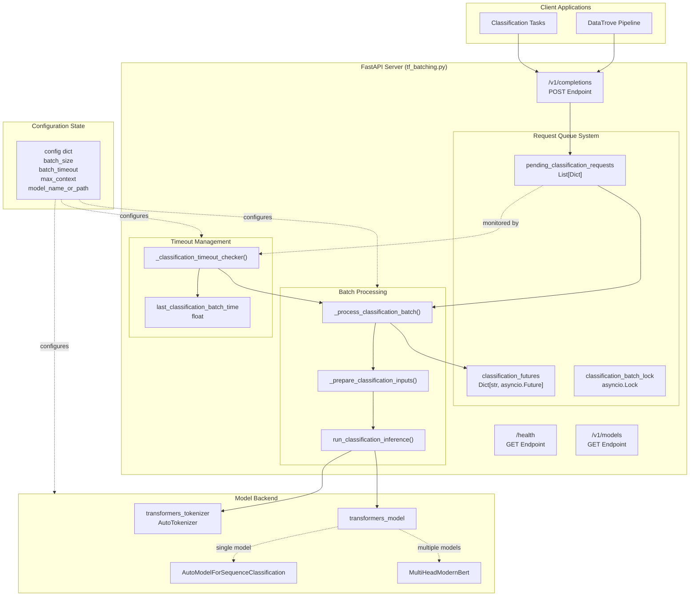
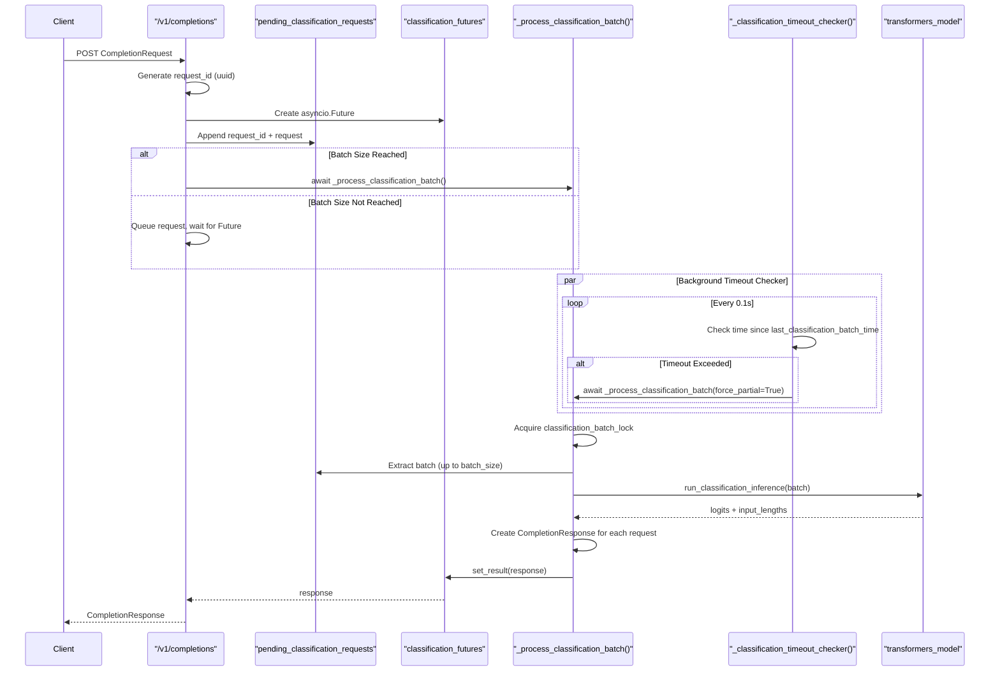
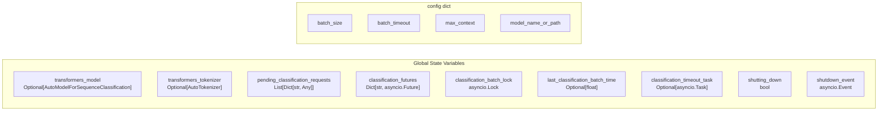
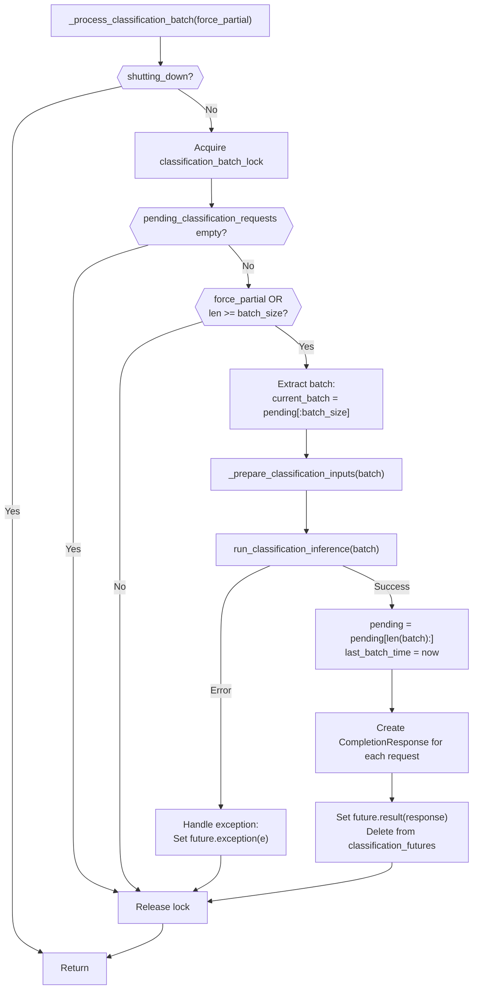
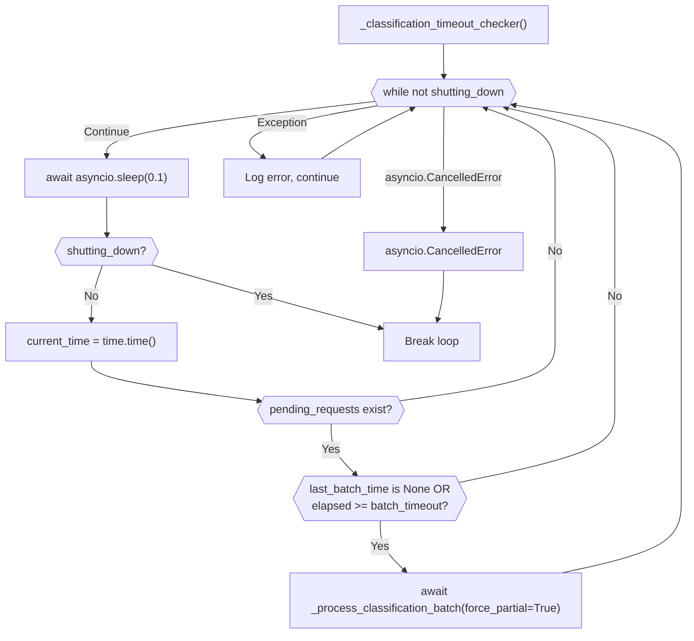
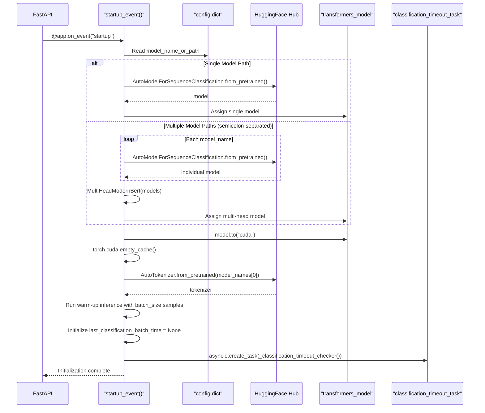
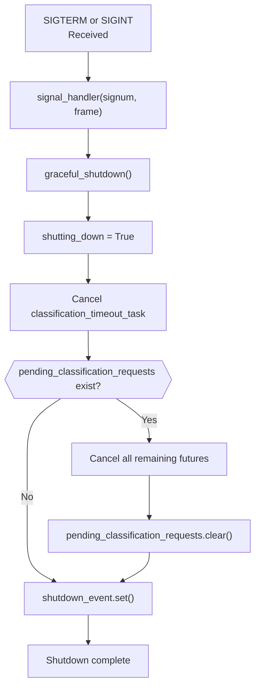

<!-- source: DeepWiki mcp.deepwiki.com · repo huggingface/finepdfs · extra page Batched Inference API · fetched 2026-10-26 -->

# Batched Inference API

<details>
<summary>Relevant source files</summary>

The following files were used as context for generating this wiki page:

- [blocks/classification/tf_batching.py](blocks/classification/tf_batching.py)

</details>


## Purpose and Scope

This document describes the FastAPI-based batched inference server implemented in [blocks/classification/tf_batching.py]() that provides production-ready classification inference with automatic request batching and timeout handling. The server optimizes throughput by accumulating incoming classification requests into batches before processing them through PyTorch models.

This system is designed for deployment in the main processing pipeline where classification quality filters (see [2.2.2](#2.2.2)) are applied to large volumes of documents. For details on the multi-head ModernBERT architecture that this API serves, see [2.2.3](#2.2.3).

## System Architecture

The batching server implements a queue-based architecture where incoming HTTP requests are held in memory until either a full batch accumulates or a timeout expires. This design maximizes GPU utilization by ensuring models process multiple inputs simultaneously.

### Overall Architecture



**Sources:** [blocks/classification/tf_batching.py:1-453]()

### Request Lifecycle



**Sources:** [blocks/classification/tf_batching.py:326-355](), [blocks/classification/tf_batching.py:101-170](), [blocks/classification/tf_batching.py:171-198]()

## Core Components

### Data Models

The API uses Pydantic models to define request/response schemas that are compatible with OpenAI-style completion APIs:

| Model | Purpose | Key Fields |
|-------|---------|------------|
| `CompletionRequest` | Incoming classification request | `input` (str), `max_tokens`, `temperature`, `model` |
| `CompletionResult` | Classification output | `text` (comma-separated logits), `usage`, `finish_reason` |
| `CompletionResponse` | API response wrapper | `id`, `model`, `choices` (List[CompletionResult]) |
| `Usage` | Token counting | `prompt_tokens`, `completion_tokens`, `total_tokens` |

**Sources:** [blocks/classification/tf_batching.py:21-43]()

### Global State Management

The server maintains several global variables to coordinate batching across async request handlers:



**Sources:** [blocks/classification/tf_batching.py:44-56]()

### Batch Processing Mechanism

The `_process_classification_batch()` function implements the core batching logic with lock-based synchronization:

1. **Acquire Lock**: Uses `classification_batch_lock` to prevent race conditions
2. **Extract Batch**: Takes up to `batch_size` requests from `pending_classification_requests`
3. **Run Inference**: Calls `run_classification_inference()` with the batch
4. **Distribute Results**: Resolves each request's `asyncio.Future` with its response



**Sources:** [blocks/classification/tf_batching.py:101-170]()

### Inference Execution

The `run_classification_inference()` function handles the actual model forward pass:

| Step | Operation | Code Reference |
|------|-----------|----------------|
| 1. Prepare Inputs | Extract text from each request | [blocks/classification/tf_batching.py:58-66]() |
| 2. Tokenize | Use `transformers_tokenizer` with padding and truncation | [blocks/classification/tf_batching.py:80-86]() |
| 3. Move to Device | Transfer tensors to GPU | [blocks/classification/tf_batching.py:91-92]() |
| 4. Model Forward Pass | Run inference with `torch.inference_mode()` | [blocks/classification/tf_batching.py:95-98]() |
| 5. Extract Results | Convert logits to Python lists | [blocks/classification/tf_batching.py:97]() |

The function is decorated with `@torch.no_grad()` and uses `torch.inference_mode()` for optimal inference performance.

**Sources:** [blocks/classification/tf_batching.py:68-99]()

## Timeout Management

The timeout system ensures partial batches are processed even when request volume is low, preventing requests from waiting indefinitely.

### Timeout Checker Task



The timeout checker runs as a background `asyncio.Task` that:
- Checks every 0.1 seconds for pending requests
- Processes partial batches if `batch_timeout` seconds have elapsed since `last_classification_batch_time`
- Continues running until graceful shutdown

**Sources:** [blocks/classification/tf_batching.py:171-198]()

## Model Initialization

The startup process loads models and initializes the batching infrastructure:

### Startup Sequence



**Sources:** [blocks/classification/tf_batching.py:257-324]()

### Model Loading Logic

The server supports two model loading modes based on the `model_name_or_path` configuration:

**Single Model Mode** (default):
- Model path contains no semicolons
- Loads using `AutoModelForSequenceClassification.from_pretrained()`
- Example: `"HuggingFaceFW/finepdfs_edu_classifier_eng_Latn"`

**Multi-Head Mode** (advanced):
- Model paths separated by semicolons
- Loads each model separately
- Wraps in `MultiHeadModernBert` for unified inference
- Example: `"model1;model2;model3"`

**Model Kwargs:**
The server applies these default kwargs for optimal inference:
- `torch_dtype`: `"bfloat16"`
- `device_map`: `"auto"`
- `trust_remote_code`: `True`
- `attn_implementation`: `"flash_attention_2"`

These can be overridden via the `--model-kwargs` CLI argument.

**Sources:** [blocks/classification/tf_batching.py:264-306]()

### Warm-up Inference

After loading the model, the server runs a test inference batch to:
1. Trigger PyTorch JIT compilation
2. Allocate CUDA memory
3. Verify model functionality

The warm-up uses `config["batch_size"]` requests, each with `max_context` length text.

**Sources:** [blocks/classification/tf_batching.py:310-319]()

## API Endpoints

### POST /v1/completions

The primary classification endpoint that queues requests and returns results.

**Request Format:**
```json
{
  "input": "Text to classify",
  "max_tokens": 100,
  "temperature": 0.0,
  "model": "optional-model-override"
}
```

**Response Format:**
```json
{
  "id": "classify-abc123...",
  "object": "completion",
  "created": 1234567890,
  "model": "HuggingFaceFW/finepdfs_edu_classifier_eng_Latn",
  "choices": [
    {
      "text": "0.123,-0.456,0.789",
      "usage": {
        "prompt_tokens": 512,
        "completion_tokens": 1,
        "total_tokens": 513
      },
      "finish_reason": "stop"
    }
  ]
}
```

**Note:** The `text` field contains comma-separated logit values. This format is chosen for compatibility with DataTrove's classification block expectations.

**Sources:** [blocks/classification/tf_batching.py:326-355](), [blocks/classification/tf_batching.py:150-158]()

### GET /health

Health check endpoint that returns server status. Returns HTTP 503 during shutdown.

**Response:**
```json
{
  "status": "healthy"
}
```

**Sources:** [blocks/classification/tf_batching.py:357-362]()

### GET /v1/models

Lists available models in OpenAI-compatible format.

**Response:**
```json
{
  "object": "list",
  "data": [
    {
      "id": "HuggingFaceFW/finepdfs_edu_classifier_eng_Latn",
      "object": "model",
      "created": 1234567890,
      "owned_by": "transformers"
    }
  ]
}
```

**Sources:** [blocks/classification/tf_batching.py:364-377]()

## Configuration and CLI

### Command-Line Arguments

The server is configured via CLI arguments passed to `main()`:

| Argument | Type | Default | Description |
|----------|------|---------|-------------|
| `--model-name-or-path` | str | Required | Model name/path or semicolon-separated list |
| `--batch-size` | int | 4 | Number of requests per batch |
| `--batch-timeout` | float | 10.0 | Seconds before processing partial batch |
| `--max-context` | int | 2048 | Maximum token length for classification |
| `--model-kwargs` | str | `"{}"` | JSON string of additional model kwargs |
| `--host` | str | `"0.0.0.0"` | Server bind address |
| `--port` | int | 8000 | Server bind port |

**Example Usage:**
```bash
python blocks/classification/tf_batching.py \
  --model-name-or-path "HuggingFaceFW/finepdfs_edu_classifier_eng_Latn" \
  --batch-size 8 \
  --batch-timeout 5.0 \
  --max-context 2048 \
  --port 8000
```

**Sources:** [blocks/classification/tf_batching.py:381-445]()

### Configuration Storage

The `config` global dictionary stores parsed CLI arguments and is accessed throughout the codebase:

```python
config = {
    "model_name_or_path": str,
    "batch_size": int,
    "batch_timeout": float,
    "max_context": int,
    "model_kwargs": dict
}
```

**Sources:** [blocks/classification/tf_batching.py:56](), [blocks/classification/tf_batching.py:239-246]()

## Graceful Shutdown

The server implements comprehensive shutdown handling to prevent data loss and ensure clean termination.

### Shutdown Flow



**Shutdown Process:**
1. Set `shutting_down = True` to stop accepting new requests
2. Cancel the `classification_timeout_task`
3. Cancel all pending futures in `classification_futures`
4. Clear `pending_classification_requests`
5. Set `shutdown_event` to signal completion

**Sources:** [blocks/classification/tf_batching.py:200-228]()

## Performance Considerations

### Batching Strategy

The server optimizes GPU utilization through two batching triggers:

| Trigger | Condition | Priority |
|---------|-----------|----------|
| **Eager Batching** | `len(pending_requests) >= batch_size` | High - processes immediately |
| **Timeout Batching** | `time_since_last_batch >= batch_timeout` | Low - prevents starvation |

This dual-trigger approach balances throughput (larger batches) with latency (timely processing).

### Memory Management

The implementation includes several memory optimization techniques:
- Explicit `torch.cuda.empty_cache()` after model loading
- Python garbage collection with `gc.collect()`
- Moving results to CPU immediately: `logits.cpu().tolist()`
- Deleting intermediate lists after multi-head model creation

**Sources:** [blocks/classification/tf_batching.py:298-301](), [blocks/classification/tf_batching.py:293]()

### Lock Granularity

The `classification_batch_lock` uses `async with` context management to ensure minimal lock hold time. The lock is only held during:
1. Batch extraction from the queue
2. Inference execution
3. Queue update

Response creation and future resolution occur outside the lock to maximize concurrency.

**Sources:** [blocks/classification/tf_batching.py:108]()

## Integration with Classification Pipeline

This batching server is deployed as a standalone service that classification blocks communicate with via HTTP. The API design follows OpenAI's completion endpoint conventions to enable compatibility with existing classification infrastructure.

### DataTrove Integration

The server's response format is specifically designed for DataTrove's classification blocks:
- Logits are returned as comma-separated strings in the `text` field
- Token counts are reported in `usage` for monitoring
- Request IDs enable distributed tracing

For information on how these classifiers are trained and deployed, see [2.2.2](#2.2.2) (Quality Classifiers) and [2.2.3](#2.2.3) (Multi-Head ModernBERT Architecture).

**Sources:** [blocks/classification/tf_batching.py:150-158]()

---

