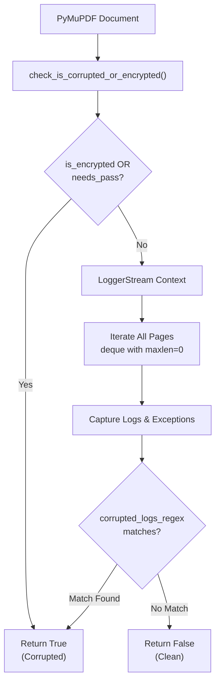
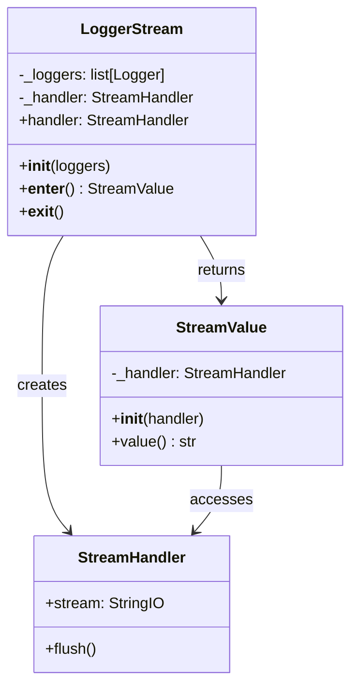
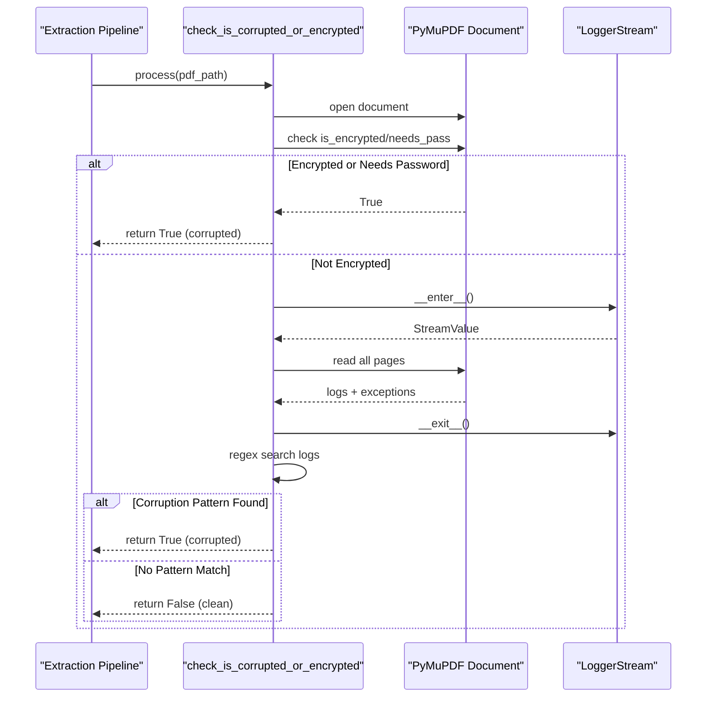

<!-- source: DeepWiki mcp.deepwiki.com · repo huggingface/finepdfs · extra page Corrupted PDF Detection · fetched 2026-10-26 -->

# Corrupted PDF Detection

<details>
<summary>Relevant source files</summary>

The following files were used as context for generating this wiki page:

- [blocks/corrupted_utils.py](blocks/corrupted_utils.py)
- [blocks/loggers.py](blocks/loggers.py)

</details>


## Purpose and Scope

This document describes the corrupted PDF detection system that identifies and filters out problematic PDFs before they enter the extraction pipeline. The system detects two categories of problematic files: encrypted/password-protected documents and corrupted PDFs with structural errors. This detection occurs early in the PDF extraction process to avoid wasting computational resources on files that cannot be successfully processed.

For information about the overall PDF extraction workflow that uses this detection system, see [PDF Extraction System](#2.1). For details about the logging infrastructure used to capture PyMuPDF errors, see [Logging and Debugging](#6.2).

## System Overview

The corruption detection system is implemented in `blocks/corrupted_utils.py` and relies on two primary detection mechanisms:

1. **Encryption Detection**: Checks PyMuPDF document properties to identify password-protected or encrypted files
2. **Log-Based Corruption Detection**: Attempts to read all pages while capturing PyMuPDF error logs, then searches for known corruption patterns using regex

The system is designed to be fail-safe: when a PDF exhibits any corruption symptoms, it is marked as corrupted and excluded from further processing.



**Figure 1: Corruption Detection Flow**

Sources: [blocks/corrupted_utils.py:20-40]()

## Detection Mechanisms

### Encryption and Password Protection

The first detection mechanism checks PyMuPDF document properties to identify encrypted or password-protected files. This is implemented by examining two boolean attributes:

| Property | Description |
|----------|-------------|
| `is_encrypted` | Indicates the PDF uses encryption |
| `needs_pass` | Indicates the PDF requires a password to open |

If either property returns `True`, the document is immediately classified as corrupted and no further processing occurs.

```python
if pymupdf_doc.is_encrypted or pymupdf_doc.needs_pass:
    return True
```

Sources: [blocks/corrupted_utils.py:21-22]()

### Log-Based Corruption Detection

The second mechanism attempts to read all pages of the PDF while capturing error logs from PyMuPDF. This approach detects structural corruption that may not be immediately apparent from document properties alone.

```mermaid
graph LR
    subgraph "LoggerStream Context"
        LOGGER["LoggerStream<br/>(pymupdf logger)"]
        HANDLER["StreamHandler<br/>(StringIO buffer)"]
        STREAM["StreamValue<br/>(buffer accessor)"]
    end
    
    subgraph "Page Reading"
        DEQUE["deque(..., maxlen=0)"]
        PAGES["page.get_text()<br/>for all pages"]
        EXCEPT["Exception Handling"]
    end
    
    subgraph "Log Analysis"
        LOGS["Captured Logs<br/>+ Error Messages"]
        ENCODE["UTF-8 Encode/Decode<br/>(ignore errors)"]
        REGEX["corrupted_logs_regex<br/>.search()"]
    end
    
    LOGGER --> HANDLER
    HANDLER --> STREAM
    STREAM --> DEQUE
    DEQUE --> PAGES
    PAGES --> EXCEPT
    EXCEPT --> LOGS
    LOGS --> ENCODE
    ENCODE --> REGEX
```



**Figure 2: Log Capture and Analysis Pipeline**

The page reading operation uses `deque` with `maxlen=0` to iterate through all pages without storing results in memory:

```python
deque((page.get_text() for page in pymupdf_doc.pages()), maxlen=0)
```

This approach efficiently triggers any page-level errors that would occur during extraction without allocating memory for the extracted text.

Sources: [blocks/corrupted_utils.py:24-35]()

## Corruption Pattern Registry

The system maintains a registry of regex patterns that match known PyMuPDF error messages indicating PDF corruption. These patterns are compiled into a single regex for efficient matching:

| Pattern | Description |
|---------|-------------|
| `format error: object out of range` | Object references outside valid document bounds |
| `syntax error: no XObject subtype specified` | Missing required XObject metadata |
| `syntax error: syntax error in content stream` | Malformed PDF content stream |
| `object is not a stream` | Type mismatch in PDF object structure |
| `syntax error: syntax error in array` | Malformed array structure |
| `format error: cannot load page tree` | Corrupted page hierarchy |
| `syntax error: cannot parse indirect object` | Invalid object reference |

The regex compilation combines all patterns with OR logic:

```python
regexes = [
    r"format error: object out of range",
    r"syntax error: no XObject subtype specified",
    # ... additional patterns
]

corrupted_logs_regex = re.compile("|".join(regexes))
```

These patterns were empirically determined from PyMuPDF error logs encountered during large-scale PDF processing. When any of these patterns appear in the captured logs, the PDF is classified as corrupted.

Sources: [blocks/corrupted_utils.py:7-17]()

## LoggerStream Utility

The `LoggerStream` class provides a context manager for capturing PyMuPDF logs to a string buffer. This utility is essential for the log-based corruption detection mechanism.



**Figure 3: LoggerStream Class Architecture**

### Initialization and Configuration

When initialized, `LoggerStream` configures PyMuPDF to route messages through Python's logging system and sets up a `StreamHandler` with a `StringIO` buffer:

```python
pymupdf.set_messages(pylogging=True)
self._handler = logging.StreamHandler(io.StringIO())
```

The handler is configured to capture logs at `INFO` level and above, with propagation disabled to prevent duplicate log entries.

### Context Manager Protocol

The context manager protocol enables clean log capture:

1. **`__enter__`**: Flushes the handler and returns a `StreamValue` accessor
2. **`__exit__`**: Completes the context (no cleanup needed)

### Log Buffer Access

The `StreamValue` class provides thread-safe access to the captured logs:

```python
def value(self):
    self._handler.flush()
    value = self._handler.stream.getvalue()
    self._handler.stream.truncate(0)
    self._handler.stream.seek(0)
    return value
```

After retrieving the log contents, the buffer is truncated and reset for potential reuse.

Sources: [blocks/loggers.py:19-48]()

## Error Handling and UTF-8 Encoding

The corruption detection system includes robust error handling to deal with potentially corrupted log data:

```python
logs = log_output.value().encode("utf-8", errors="ignore").decode("utf-8", errors="ignore")
```

This double encoding/decoding with `errors="ignore"` ensures that malformed character sequences in the logs don't cause the detection system itself to fail. Any undecodable bytes are silently dropped.

Exception messages from the page reading operation are also captured and appended to the logs for regex matching:

```python
try:
    deque((page.get_text() for page in pymupdf_doc.pages()), maxlen=0)
except Exception as e:
    error_logs += str(e)
```

This ensures that both PyMuPDF warning logs and Python exception messages are searched for corruption patterns.

Sources: [blocks/corrupted_utils.py:29-35]()

## Integration with Extraction Pipeline

The `check_is_corrupted_or_encrypted` function returns a boolean indicating whether the PDF should be excluded from processing:

| Return Value | Meaning | Pipeline Action |
|--------------|---------|----------------|
| `True` | PDF is corrupted or encrypted | Skip extraction, mark document as failed |
| `False` | PDF appears clean | Proceed with extraction |

This function is typically called early in the extraction workflow, before computationally expensive operations like OCR routing or Docling extraction. The early detection minimizes wasted resources on files that cannot produce usable output.



**Figure 4: Corruption Detection Integration Sequence**

Sources: [blocks/corrupted_utils.py:20-40]()

## Performance Considerations

The corruption detection system balances thoroughness with performance:

1. **Fast-Path Encryption Check**: The `is_encrypted` and `needs_pass` checks are near-instantaneous property accesses that quickly filter out a common category of problematic files

2. **Memory-Efficient Page Reading**: Using `deque` with `maxlen=0` ensures that all pages are accessed (triggering any structural errors) without allocating memory for extracted text

3. **Compiled Regex**: The corruption patterns are compiled once at module load time, making the pattern matching operation efficient even with multiple patterns

4. **Early Detection**: By running this check before expensive operations like OCR or layout analysis, the system avoids wasting compute resources on files that will ultimately fail

The trade-off is that every PDF must have all its pages accessed to complete the corruption check. For large PDFs, this can take several seconds. However, this cost is justified because attempting extraction on a corrupted PDF would likely take even longer and produce unusable output.

Sources: [blocks/corrupted_utils.py:1-40]()

---

