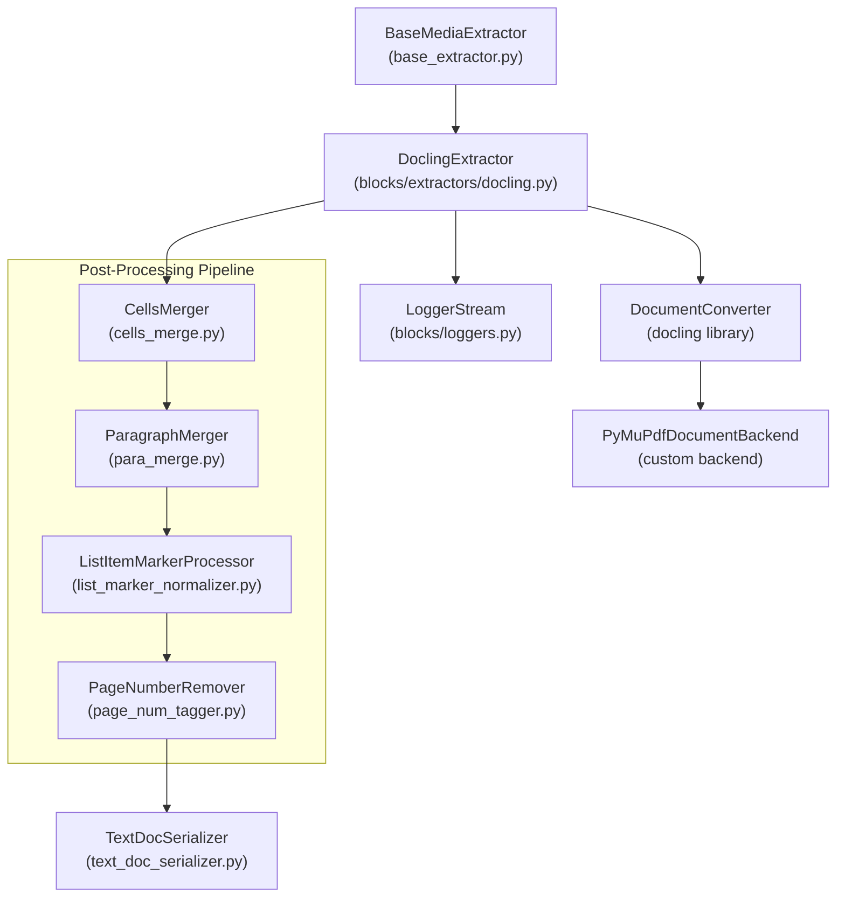
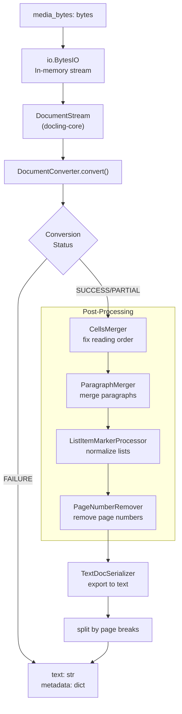
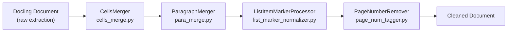
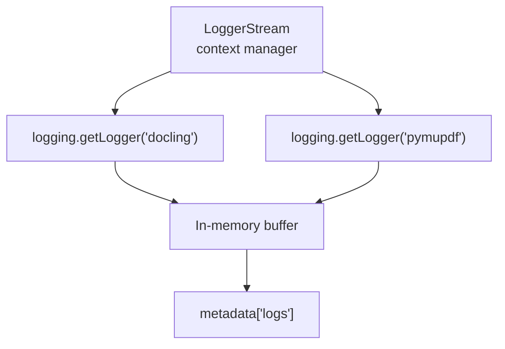
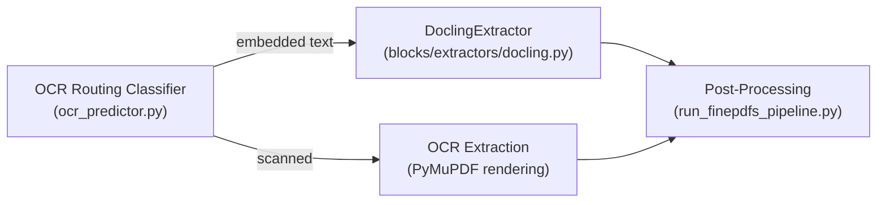

<!-- source: DeepWiki mcp.deepwiki.com · repo huggingface/finepdfs · extra page Docling Integration · fetched 2026-10-26 -->

# Docling Integration

<details>
<summary>Relevant source files</summary>

The following files were used as context for generating this wiki page:

- [THIRD_PARTY_NOTICES.md](THIRD_PARTY_NOTICES.md)
- [blocks/extractors/docling.py](blocks/extractors/docling.py)

</details>


## Purpose and Scope

This document describes the integration of the Docling library into the FinePDFs pipeline for PDF text extraction. Docling is used specifically for PDFs with embedded text (non-scanned documents), as determined by the OCR routing classifier (see [OCR Routing Classifier](#2.1.1)). This page covers the vendored Docling code structure, the `DoclingExtractor` class implementation, the post-processing pipeline, and the serialization process.

For information about when Docling is selected versus OCR processing, see [OCR Routing Classifier](#2.1.1). For corruption detection that occurs before extraction, see [Corrupted PDF Detection](#2.1.3).

---

## Vendored Code Structure

The FinePDFs repository vendors (includes a copy of) the Docling library code rather than using it as a standard Python dependency. This approach allows for custom modifications and ensures reproducibility of the extraction process.

### Directory Layout

```
docling_code/
├── docling/              # Core Docling library
├── docling-core/         # Base types and models
├── docling-ibm-models/   # IBM-provided layout detection models
└── custom_code/          # FinePDFs-specific customizations
    ├── backend/
    │   └── pymupdf_backend.py
    ├── postprocessing/
    │   ├── cells_merge.py
    │   ├── para_merge.py
    │   ├── list_marker_normalizer.py
    │   └── page_num_tagger.py
    └── text_doc_serializer.py
```

### Licensing

| Component | License | Location |
|-----------|---------|----------|
| Docling core library | MIT | `docling_code/docling/LICENSE` |
| Docling-core | MIT | `docling_code/docling-core/LICENSE` |
| Docling IBM Models | See upstream | `docling_code/docling-ibm-models/LICENSE` |
| PyMuPDF (indirect) | AGPL-3.0 | External dependency |

**Sources:** [THIRD_PARTY_NOTICES.md:1-29]()

---

## DoclingExtractor Architecture

The `DoclingExtractor` class provides a high-level interface for PDF text extraction using the vendored Docling library. It extends `BaseMediaExtractor` to integrate with the FinePDFs pipeline's timeout and error handling mechanisms.

### Class Diagram



**Sources:** [blocks/extractors/docling.py:1-107]()

### Configuration Options

The extractor is configured using two dataclass configurations:

#### DoclingPostProcessingOptions

```python
@dataclass(frozen=True)
class DoclingPostProcessingOptions:
    use_markdown: bool = False
    use_picture: bool = False
    use_file_path: bool = False
    fix_lists: bool = True
    fix_paragraphs: bool = True
    fix_reading_order: bool = True
    fix_page_numbers: bool = True
```

| Parameter | Default | Purpose |
|-----------|---------|---------|
| `use_markdown` | `False` | Reserved for future markdown formatting |
| `use_picture` | `False` | Reserved for image extraction |
| `use_file_path` | `False` | Reserved for file path metadata |
| `fix_lists` | `True` | Enable list marker normalization |
| `fix_paragraphs` | `True` | Enable paragraph boundary detection |
| `fix_reading_order` | `True` | Enable reading order correction |
| `fix_page_numbers` | `True` | Enable page number removal |

#### PdfPipelineOptions

```python
pipeline_options = PdfPipelineOptions(
    do_table_structure=False,
    do_ocr=False,
    document_timeout=docling_timeout,
    accelerator_options=AcceleratorOptions(
        device=AcceleratorDevice.CPU, 
        num_threads=1
    )
)
```

| Parameter | Value | Rationale |
|-----------|-------|-----------|
| `do_table_structure` | `False` | Table parsing disabled for performance |
| `do_ocr` | `False` | OCR handled separately by OCR router |
| `document_timeout` | `timeout - 2` | Leave 2 seconds for cleanup |
| `device` | `CPU` | CPU-based inference |
| `num_threads` | `1` | Single-threaded for resource control |

**Sources:** [blocks/extractors/docling.py:24-48]()

---

## Extraction Process

The extraction process converts PDF bytes into structured text through a multi-stage pipeline.

### Extraction Flow Diagram



### Conversion Implementation

The extraction method [blocks/extractors/docling.py:59-107]() performs the following steps:

1. **Input Validation**: Returns empty string if `media_bytes` is None
2. **Stream Creation**: Wraps bytes in `io.BytesIO` and `DocumentStream`
3. **Logging Capture**: Uses `LoggerStream` context manager to capture docling and pymupdf logs
4. **Document Conversion**: Calls `DocumentConverter.convert()` with error raising enabled
5. **Status Check**: Validates conversion status (`SUCCESS` or `PARTIAL_SUCCESS`)
6. **Post-Processing**: Applies four post-processing transformations sequentially
7. **Serialization**: Converts document to plain text with page break markers
8. **Metadata Assembly**: Constructs metadata dictionary with page information

### Error Handling

```python
if converted.status not in [ConversionStatus.SUCCESS, ConversionStatus.PARTIAL_SUCCESS]:
    errors = ", ".join([e.model_dump(mode="json") for e in converted.errors])
    metadata["extraction_error"] = f"Conversion failed with status {converted.status} and errors {errors} and logger content: {logger_content}"
```

Failed conversions include detailed error information in the `extraction_error` metadata field, combining:
- Conversion status enum value
- JSON-serialized error objects
- Complete log output from docling/pymupdf

**Sources:** [blocks/extractors/docling.py:59-107]()

---

## Post-Processing Pipeline

The post-processing pipeline corrects common PDF extraction issues through four sequential transformations. Each processor accepts a Docling document object and returns a modified version.

### Post-Processor Sequence



### Post-Processor Details

| Processor | Class | Purpose | File |
|-----------|-------|---------|------|
| Reading Order Fixer | `CellsMerger` | Corrects multi-column reading order and merges cells | `docling_code/custom_code/postprocessing/cells_merge.py` |
| Paragraph Merger | `ParagraphMerger` | Identifies paragraph boundaries and merges split paragraphs | `docling_code/custom_code/postprocessing/para_merge.py` |
| List Normalizer | `ListItemMarkerProcessor` | Standardizes bullet points and numbered list markers | `docling_code/custom_code/postprocessing/list_marker_normalizer.py` |
| Page Number Remover | `PageNumberRemover` | Detects and removes page numbers from headers/footers | `docling_code/custom_code/postprocessing/page_num_tagger.py` |

### Post-Processing Invocation

```python
document_postprocessed = self.reading_order_fixer.process_document(
    converted.document, allow_multi_prov=True
)
document_postprocessed = self.paragraph_fixer.process_document(
    document_postprocessed, allow_multi_prov=True
)
document_postprocessed = self.list_item_marker_processor.process_document(
    document_postprocessed
)
document_postprocessed = self.page_number_remover.process_document(
    document_postprocessed
)
```

The `allow_multi_prov=True` parameter allows processors to maintain provenance information for debugging and validation purposes.

**Sources:** [blocks/extractors/docling.py:51-54](), [blocks/extractors/docling.py:78-81]()

---

## Custom Backend Integration

The extractor uses a custom PyMuPDF backend instead of Docling's default backend. This backend is specified in the format options when initializing the `DocumentConverter`.

### Backend Configuration

```python
self.doc_converter = DocumentConverter(
    format_options={
        InputFormat.PDF: PdfFormatOption(
            pipeline_options=pipeline_options, 
            backend=PyMuPdfDocumentBackend
        )
    }
)
```

The `PyMuPdfDocumentBackend` class is located at [docling_code/custom_code/backend/pymupdf_backend.py]() and provides:
- PDF parsing using PyMuPDF (fitz) library
- Text extraction from PDF structure
- Coordinate mapping for layout detection
- Integration with Docling's document model

This custom backend allows FinePDFs to leverage PyMuPDF's performance characteristics and handle specific PDF formats that may differ from Docling's default backend.

**Sources:** [blocks/extractors/docling.py:44-48](), [blocks/extractors/docling.py:22]()

---

## Serialization

After post-processing, the document is serialized to plain text using a custom `TextDocSerializer` that extends Docling's serialization capabilities.

### Serializer Configuration

```python
page_break_placeholder = "<--- page break --->"

serializer = TextDocSerializer(
    doc=document_postprocessed,
    params=MarkdownParams(
        page_break_placeholder=page_break_placeholder,
        image_placeholder="<docling_image></docling_image>",
        escape_underscores=False,
        escape_html=False,
    )
)
```

### Serialization Parameters

| Parameter | Value | Purpose |
|-----------|-------|---------|
| `page_break_placeholder` | `"<--- page break --->"` | Delimiter for splitting text by page |
| `image_placeholder` | `"<docling_image></docling_image>"` | Placeholder for embedded images |
| `escape_underscores` | `False` | Preserve underscores in text |
| `escape_html` | `False` | Preserve HTML-like characters |

### Page Splitting

After serialization, the text is split by the page break placeholder to compute page-level metadata:

```python
full_text = serializer.serialize().text
page_list = full_text.split(page_break_placeholder)
```

The final output rejoins pages without the delimiter, but metadata preserves page boundaries via cumulative character offsets.

**Sources:** [blocks/extractors/docling.py:82-94]()

---

## Logging and Monitoring

The extractor captures all log output from Docling and PyMuPDF during extraction using the `LoggerStream` utility.

### Logger Configuration

```python
self.logger_stream = LoggerStream([
    logging.getLogger("docling"), 
    logging.getLogger("pymupdf")
])
```

### Log Capture Process



### Log Encoding

Logs are UTF-8 encoded with error handling to prevent encoding issues:

```python
"logs": logger_content.encode("utf-8", errors="ignore").decode("utf-8", errors="ignore")
```

This ensures that non-UTF-8 characters in logs (which may occur with malformed PDFs) don't cause extraction failures.

**Sources:** [blocks/extractors/docling.py:43](), [blocks/extractors/docling.py:69-76](), [blocks/extractors/docling.py:100]()

---

## Output Format

The `extract()` method returns a tuple of extracted text and metadata dictionary.

### Return Value Structure

```python
return "".join(page_list), metadata
```

### Text Output

The text output is a string containing all extracted text from the PDF, with pages concatenated (page break markers removed). The text has been cleaned by all post-processing steps.

### Metadata Dictionary

| Field | Type | Description |
|-------|------|-------------|
| `num_pages` | `int` | Total number of pages detected |
| `page_offsets` | `list[int]` | Cumulative character offsets for each page boundary |
| `docling_doc_dict` | `dict` | Initial Docling document structure before post-processing |
| `logs` | `str` | Captured log output from docling and pymupdf |
| `version` | `str` | Extractor version identifier (currently "2.0") |
| `conversion_status` | `str` | Status enum value from Docling conversion |
| `extraction_error` | `str` | Error message (only present if conversion failed) |

### Metadata Example

```python
metadata = {
    "num_pages": 15,
    "page_offsets": [1234, 2456, 3789, ...],
    "docling_doc_dict": {...},
    "logs": "DEBUG: Processing page 1\nINFO: Layout detected...",
    "version": "2.0",
    "conversion_status": "SUCCESS",
}
```

For failed extractions, the `extraction_error` field provides diagnostic information combining status, errors, and logs.

**Sources:** [blocks/extractors/docling.py:96-107]()

---

## Integration with Pipeline

The `DoclingExtractor` integrates into the main FinePDFs pipeline through the following mechanism:



The extractor is instantiated with:
- **Timeout**: Inherited from pipeline configuration (default 10 minutes)
- **Post-processing options**: `DoclingPostProcessingOptions` with all fixes enabled
- **Exclusion writer**: Optional writer for documents that fail extraction

The extractor's timeout handling ensures that hung PDF conversions don't block the pipeline indefinitely. The `BaseMediaExtractor` parent class provides process-level timeout enforcement.

**Sources:** [blocks/extractors/docling.py:35-56]()

---

