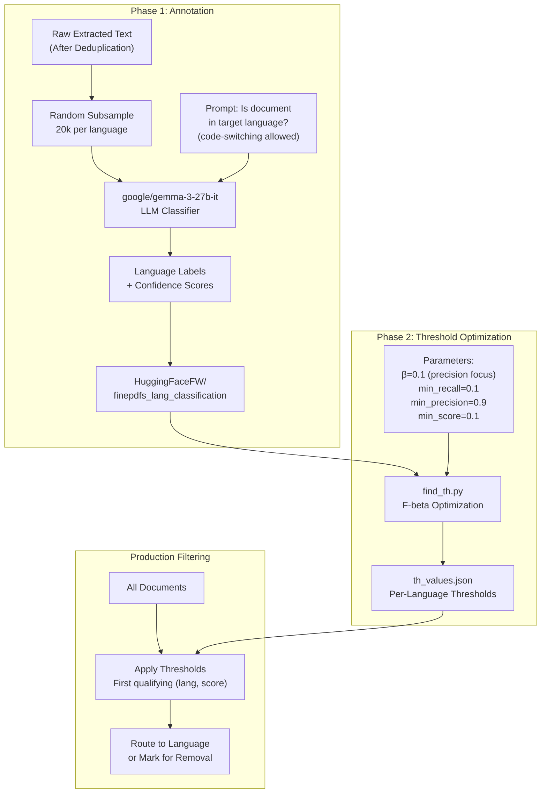
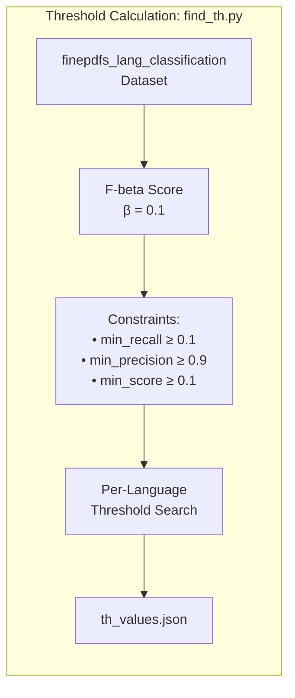
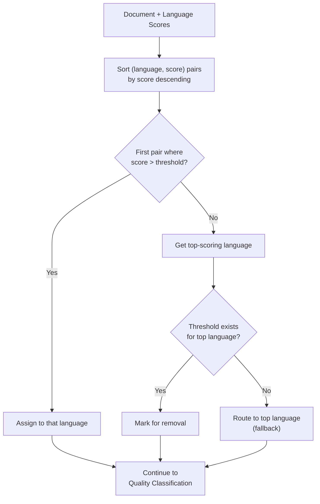
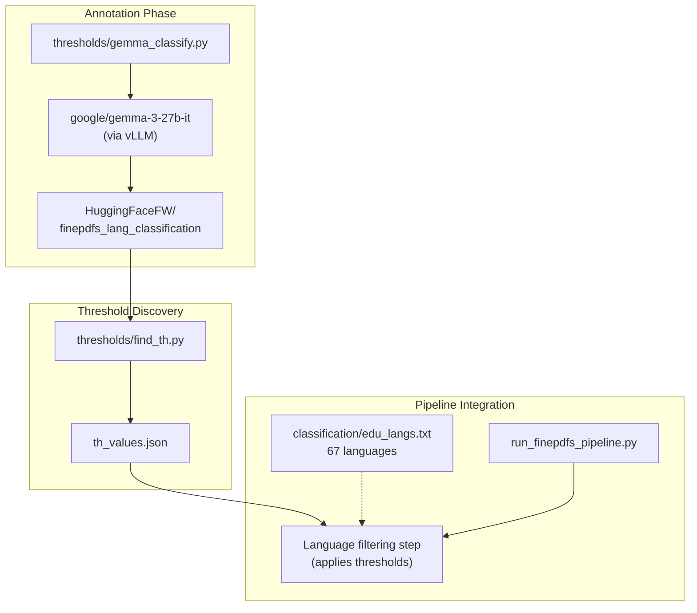
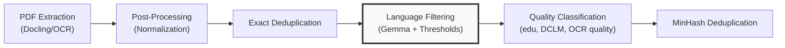

<!-- source: DeepWiki mcp.deepwiki.com · repo huggingface/finepdfs · extra page Language Filtering · fetched 2026-10-26 -->

# Language Filtering

<details>
<summary>Relevant source files</summary>

The following files were used as context for generating this wiki page:

- [README.md](README.md)
- [classification/edu_langs.txt](classification/edu_langs.txt)

</details>


## Purpose and Scope

This document describes the language filtering system in the FinePDFs pipeline, which classifies documents by language and applies precision-optimized thresholds to route them to appropriate language-specific processing streams. Language filtering occurs after exact deduplication and before quality classification in the main pipeline (see [Classification and Filtering](#2.2) for the broader context).

The system consists of two phases:
1. **Annotation Phase**: Using `google/gemma-3-27b-it` to classify a subsample of documents
2. **Threshold Optimization**: Computing per-language thresholds using F-beta scoring with strong precision bias

For information about quality classifiers (edu, DCLM, OCR quality) that run after language filtering, see [Quality Classifiers](#2.2.2).

---

## System Overview

The language filtering system uses a large language model (`google/gemma-3-27b-it`) to classify documents into language categories, then applies optimized thresholds to make high-precision routing decisions. The system is designed to minimize false positives (documents incorrectly assigned to a language) at the cost of some recall.

### Two-Phase Workflow



**Sources**: [README.md:45-54](), [thresholds/find_th.py](), [thresholds/gemma_classify.py]()

---

## Language Classification with Gemma

### Annotation Process

The annotation phase uses `gemma_classify.py` to run the `google/gemma-3-27b-it` model on a random subsample of documents. The key characteristics:

| Parameter | Value | Rationale |
|-----------|-------|-----------|
| Model | `google/gemma-3-27b-it` | Balance of capability and inference cost |
| Sample Size | 20,000 per language | Sufficient for threshold calibration |
| Prompt Strategy | Binary classification per language | "Is this document in [language]?" |
| Code-Switching | Allowed | Any portion in target language counts |
| Output | Label + confidence score | Enables threshold optimization |

The system prompts the LLM to determine if a document contains content in a specific target language. Because code-switching is common in real-world documents (e.g., English documents with embedded code, multilingual academic papers), the system considers a document to be in a language if *any portion* is in that language.

### Annotation Output

Annotations are published to the dataset `HuggingFaceFW/finepdfs_lang_classification`, which contains:
- Document text samples
- Per-language binary labels
- Confidence scores from the Gemma model
- Metadata for reproducibility

**Sources**: [README.md:45-54](), [thresholds/gemma_classify.py]()

---

## Threshold Discovery Process

### F-beta Optimization Strategy

The `find_th.py` script computes optimal thresholds using F-beta scoring with strong precision bias. This approach reflects the design goal: **avoid false positives** (documents incorrectly assigned to a language) even at the cost of some recall.



### Threshold Calculation Parameters

The F-beta score with β = 0.1 heavily weights precision over recall:

```
F_β = (1 + β²) × (precision × recall) / (β² × precision + recall)
```

With β = 0.1, precision is weighted 100× more than recall.

**Command-line invocation**:
```bash
python thresholds/find_th.py \
  --min-recall=0.1 \
  --min-precision=0.9 \
  --min-score=0.1 \
  --workers=11 \
  --th_file=th_values.json
```

### Constraints Explained

| Constraint | Value | Purpose |
|------------|-------|---------|
| `min_recall` | 0.1 | Ensure at least 10% of true positives are captured |
| `min_precision` | 0.9 | Require 90% accuracy on positive predictions |
| `min_score` | 0.1 | Avoid unreasonably low thresholds |
| `β` | 0.1 | Weight precision 100× more than recall in optimization |

These constraints ensure thresholds are "reasonable" – not too permissive (which would cause false positives) or too restrictive (which would reject valid documents).

**Sources**: [README.md:46-53](), [thresholds/find_th.py]()

---

## Filtering Logic in Production

### Decision Flow

During pipeline execution, the language filtering logic applies thresholds to route documents:



### Filtering Rules

The filtering algorithm implements the following priority logic:

1. **Primary Rule**: Iterate through `(language, score)` pairs sorted by descending score. Assign to the first language where `score > threshold[language]`.

2. **Fallback Rule**: If no pair qualifies:
   - If a threshold exists for the top-scoring language: **mark document for removal** (indicates low-quality or ambiguous document)
   - Otherwise: **route to top-scoring language** (threshold not calibrated for this language, so trust the model)

This logic ensures:
- High-confidence documents are correctly routed
- Low-quality or ambiguous documents are removed when we have calibrated thresholds
- Documents in languages without thresholds are optimistically routed (fail-open behavior)

**Sources**: [README.md:48-49]()

---

## Language Coverage

The system supports 67 languages for downstream educational content classification, indicating the multilingual scope of the pipeline. The language identifiers follow the format `{language_code}_{script}`, such as:

- `eng_Latn` (English, Latin script)
- `cmn_Hani` (Mandarin Chinese, Han script)
- `arb_Arab` (Arabic, Arabic script)
- `jpn_Jpan` (Japanese, Japanese script)
- `rus_Cyrl` (Russian, Cyrillic script)

A full list is maintained in `edu_langs.txt`:

| Language Family | Example Languages |
|----------------|-------------------|
| **Romance** | `fra_Latn`, `spa_Latn`, `por_Latn`, `ita_Latn`, `ron_Latn` |
| **Germanic** | `eng_Latn`, `deu_Latn`, `nld_Latn`, `swe_Latn`, `dan_Latn` |
| **Slavic** | `rus_Cyrl`, `pol_Latn`, `ukr_Cyrl`, `ces_Latn`, `bul_Cyrl` |
| **East Asian** | `cmn_Hani`, `jpn_Jpan`, `kor_Hang`, `tha_Thai`, `vie_Latn` |
| **Indo-Aryan** | `hin_Deva`, `ben_Beng`, `urd_Arab`, `mar_Deva`, `guj_Gujr` |

**Note**: While 67 languages have educational classifiers, language filtering may handle a broader set of languages detected by Gemma. Languages without explicit thresholds use the fallback routing logic.

**Sources**: [classification/edu_langs.txt:1-71]()

---

## Code Entity Mapping



**Sources**: [README.md:45-54](), [run_finepdfs_pipeline.py](), [thresholds/]()

---

## Integration in Main Pipeline

Language filtering occurs at a specific point in the FinePDFs pipeline orchestrated by `run_finepdfs_pipeline.py`:

### Pipeline Position



### Purpose in Pipeline Flow

Language filtering serves two critical functions:

1. **Routing**: Assigns documents to language-specific processing streams for downstream quality classification (e.g., separate edu classifiers per language)

2. **Quality Gate**: Removes ambiguous or low-quality documents that don't meet threshold requirements, reducing computational cost in subsequent expensive classification steps

The precision-focused approach ensures that language-specific quality classifiers (see [Quality Classifiers](#2.2.2)) operate on high-confidence language assignments, improving their effectiveness.

**Sources**: [README.md:24-54](), [run_finepdfs_pipeline.py:81-82]()

---

## Performance Considerations

### Computational Cost

- **Annotation Phase**: One-time cost using 20k samples per language with Gemma-3-27b-it
- **Threshold Discovery**: Fast optimization on labeled data (seconds to minutes)
- **Production Filtering**: Negligible – simple threshold comparison on pre-computed scores

### Precision vs. Recall Trade-off

The β = 0.1 configuration represents a strong precision bias:

| Metric | Expected Range | Interpretation |
|--------|---------------|----------------|
| Precision | ≥ 0.9 | At least 90% of language assignments are correct |
| Recall | ≥ 0.1 | Captures at least 10% of documents in each language |
| F-beta (β=0.1) | Maximized | Optimizes for precision while maintaining minimum recall |

This trade-off is appropriate for the FinePDFs use case, where false positives (mislabeled documents) are more problematic than false negatives (missing some valid documents), since downstream quality classifiers are language-specific and cannot handle mislabeled documents effectively.

**Sources**: [README.md:46-47]()

---

## Data Artifacts

### Input Data
- Raw documents after exact deduplication (from pipeline)
- Random subsample: 20,000 documents per language

### Published Artifacts
- **Dataset**: `HuggingFaceFW/finepdfs_lang_classification` (Gemma annotations)
- **Thresholds**: `th_values.json` (per-language threshold values)
- **Language List**: `classification/edu_langs.txt` (67 supported languages)

### Intermediate Files
- Language confidence scores from Gemma model
- F-beta optimization curves per language
- Validation metrics (precision, recall, F-beta per threshold)

**Sources**: [README.md:50-54](), [classification/edu_langs.txt:1-71]()

---

