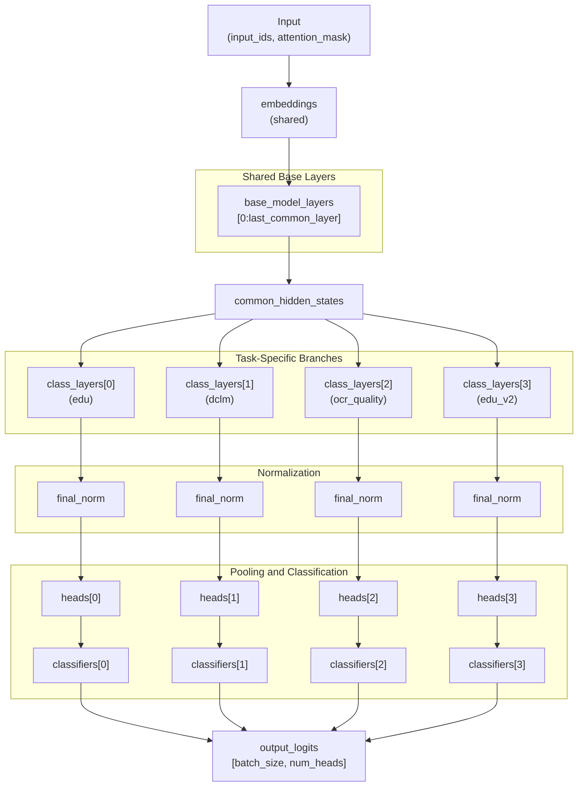
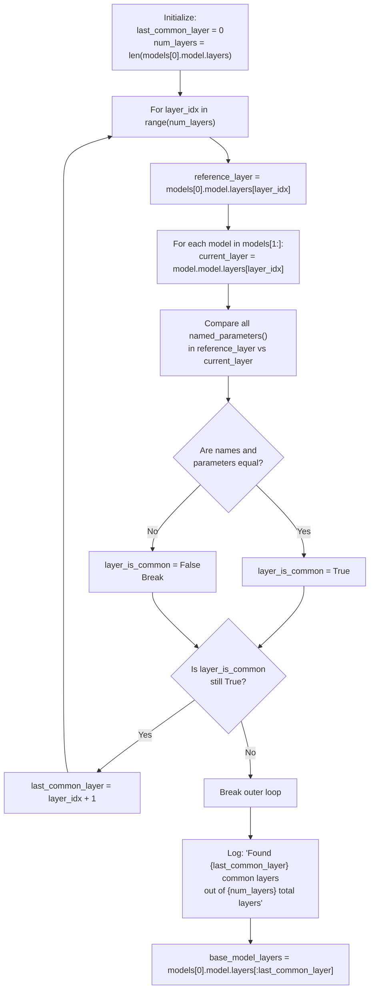
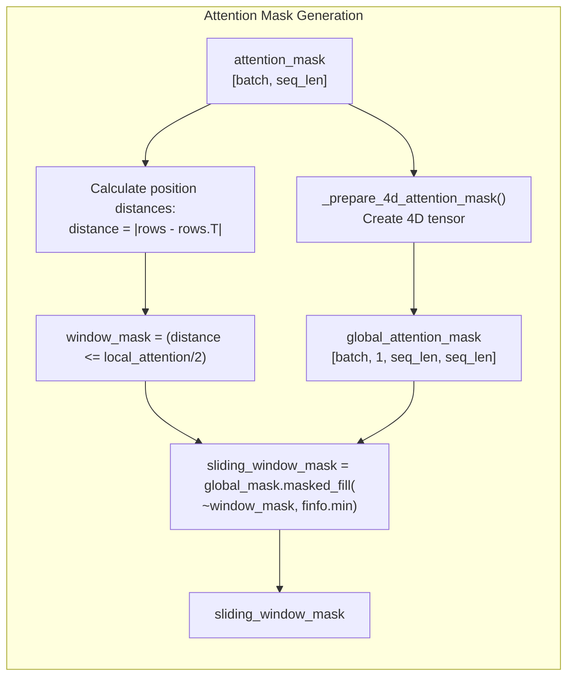
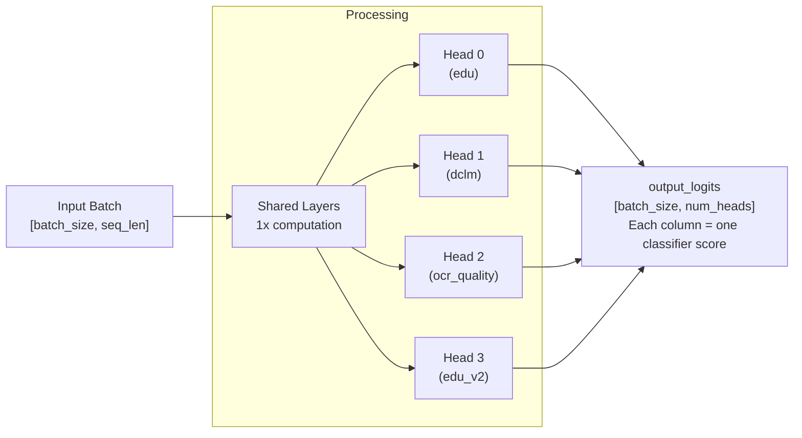
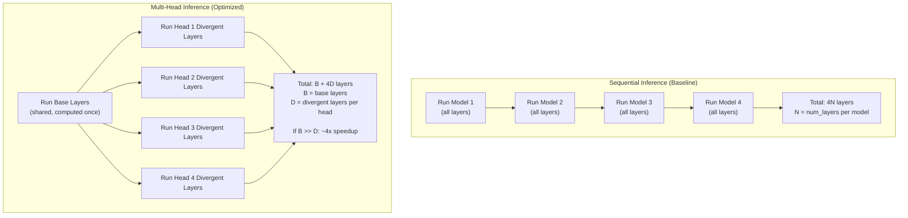

<!-- source: DeepWiki mcp.deepwiki.com · repo huggingface/finepdfs · extra page Multi-Head ModernBERT Architecture · fetched 2026-10-26 -->

# Multi-Head ModernBERT Architecture

<details>
<summary>Relevant source files</summary>

The following files were used as context for generating this wiki page:

- [blocks/classification/multi_head_moder_bert.py](blocks/classification/multi_head_moder_bert.py)

</details>


## Purpose and Scope

This document describes the `MultiHeadModernBert` architecture, a specialized multi-task sequence classification model that enables efficient simultaneous inference across multiple quality dimensions. The architecture is specifically designed for the English language classification pipeline in FinePDFs, where documents need to be evaluated across multiple criteria (educational content, DCLM quality, OCR quality) without the computational overhead of running separate models.

For information about how these classifiers are trained, see [Quality Classifiers](#2.2.2). For information about the production inference infrastructure that uses this architecture, see [Batched Inference API](#2.2.4). For language-specific classifiers for non-English content, see [Quality Classifiers](#2.2.2).

**Sources:** [blocks/classification/multi_head_moder_bert.py:1-269]()

## Architecture Overview

The `MultiHeadModernBert` class implements a parameter-sharing strategy where multiple fine-tuned `ModernBertForSequenceClassification` models are merged into a single unified architecture. Instead of running N separate models sequentially, this architecture identifies layers that have identical parameters across all models (the "common layers") and shares them during inference.

### Key Design Principles

| Principle | Implementation | Benefit |
|-----------|---------------|---------|
| **Layer Sharing** | Common base layers computed once | Reduces redundant computation |
| **Task-Specific Branching** | Divergent layers per classifier | Maintains model specialization |
| **Unified Embeddings** | Single embedding layer shared | Reduces memory footprint |
| **Parallel Head Computation** | All classifier heads in single forward pass | Enables batched multi-task inference |

### Architecture Components



**Sources:** [blocks/classification/multi_head_moder_bert.py:7-56]()

## Layer Sharing Mechanism

The constructor identifies common layers by performing parameter-wise comparison across all input models. This automatic discovery process determines the optimal split point between shared and task-specific computation.

### Layer Identification Algorithm

The layer identification process [blocks/classification/multi_head_moder_bert.py:10-39]() works as follows:



### Component Extraction

After identifying the common layers, the constructor extracts and stores the following components:

| Component | Source | Purpose |
|-----------|--------|---------|
| `base_model_layers` | `models[0].model.layers[:last_common_layer]` | Shared transformer layers |
| `classifiers` | `[model.classifier for model in models]` | Final linear classification layers |
| `class_layers` | `[model.model.layers[last_common_layer:] for model in models]` | Task-specific divergent layers |
| `heads` | `[model.head for model in models]` | Task-specific pooling projection heads |
| `embeddings` | `models[0].model.embeddings` | Shared token embeddings |
| `final_norm` | `models[0].model.final_norm` | Shared layer normalization |

**Sources:** [blocks/classification/multi_head_moder_bert.py:40-56]()

## Forward Pass Implementation

The forward pass consists of three stages: shared computation, branched computation, and output aggregation.

### Three-Stage Forward Pass

```mermaid
flowchart TD
    subgraph "Stage 1: Shared Computation"
        Input["input_ids, attention_mask"]
        ValidateInput["Validate inputs<br/>(input_ids XOR inputs_embeds)"]
        PrepareAttn["Prepare attention masks:<br/>_update_attention_mask()"]
        Unpad["Optional: _unpad_modernbert_input()<br/>(for flash_attention_2)"]
        Embed["hidden_states = embeddings()"]
        BaseLoop["For layer in base_model_layers:<br/>hidden_states = layer(hidden_states, ...)"]
        CommonState["common_hidden_states = hidden_states"]
    end
    
    subgraph "Stage 2: Branched Computation"
        InitLogits["output_logits = zeros(batch_size, num_heads)"]
        HeadLoop["For i in range(len(class_layers)):"]
        ResetState["hidden_states = common_hidden_states"]
        ClassLoop["For layer in class_layers[i]:<br/>hidden_states = layer(hidden_states, ...)"]
        Normalize["hidden_states = final_norm(hidden_states)"]
        Repad["Optional: _pad_modernbert_output()<br/>(if unpadded earlier)"]
        Pool["Pool hidden states:<br/>cls token or mean pooling"]
        Head["pooled_output = heads[i](last_hidden_state)"]
        Classify["logits = classifiers[i](pooled_output)"]
        Store["output_logits[:, i] = logits[:, 0]"]
    end
    
    subgraph "Stage 3: Output"
        ReturnDict["Return SequenceClassifierOutput:<br/>logits=output_logits"]
    end
    
    Input --> ValidateInput
    ValidateInput --> PrepareAttn
    PrepareAttn --> Unpad
    Unpad --> Embed
    Embed --> BaseLoop
    BaseLoop --> CommonState
    
    CommonState --> InitLogits
    InitLogits --> HeadLoop
    HeadLoop --> ResetState
    ResetState --> ClassLoop
    ClassLoop --> Normalize
    Normalize --> Repad
    Repad --> Pool
    Pool --> Head
    Head --> Classify
    Classify --> Store
    Store -.->|"Next head"| HeadLoop
    Store -.->|"All heads done"| ReturnDict
```



### Pooling Strategies

The architecture supports two pooling strategies for sequence classification [blocks/classification/multi_head_moder_bert.py:251-256]():

| Strategy | Implementation | Use Case |
|----------|---------------|----------|
| **CLS Token** | `hidden_states[:, 0]` | Standard BERT-style classification |
| **Mean Pooling** | `(hidden_states * mask).sum(1) / mask.sum(1)` | Averaged representation across sequence |

**Sources:** [blocks/classification/multi_head_moder_bert.py:120-261]()

## Attention Handling

The `MultiHeadModernBert` class inherits ModernBERT's sophisticated attention mechanisms, including support for both global and local sliding window attention.

### Attention Mask Preparation

The `_update_attention_mask` method [blocks/classification/multi_head_moder_bert.py:58-87]() creates two attention masks:

1. **Global Attention Mask**: Standard 4D attention mask for global attention layers
2. **Sliding Window Mask**: Restricted attention mask for local attention layers



### Flash Attention 2 Support

When using `flash_attention_2` implementation, the architecture supports unpadding and repadding operations to improve computational efficiency:

- **Unpadding** [blocks/classification/multi_head_moder_bert.py:186-197](): Removes padding tokens before computation using `_unpad_modernbert_input`
- **Repadding** [blocks/classification/multi_head_moder_bert.py:246-249](): Restores original shape after computation using `_pad_modernbert_output`

**Sources:** [blocks/classification/multi_head_moder_bert.py:58-205]()

## Output Structure

The forward pass returns a `SequenceClassifierOutput` object with the following structure:

### Output Tensor Shape



### SequenceClassifierOutput Fields

| Field | Type | Description |
|-------|------|-------------|
| `logits` | `torch.Tensor [batch_size, num_heads]` | Classification logits for all tasks |
| `hidden_states` | `tuple[torch.Tensor, ...]` or `None` | Intermediate hidden states (if requested) |
| `attentions` | `tuple[torch.Tensor, ...]` or `None` | Attention weights (if requested) |

Each column in the `logits` tensor corresponds to one classifier head's output [blocks/classification/multi_head_moder_bert.py:260]().

**Sources:** [blocks/classification/multi_head_moder_bert.py:229-269]()

## Configuration and Compilation

### Compile Mode Detection

The architecture includes automatic detection for `torch.compile` compatibility [blocks/classification/multi_head_moder_bert.py:89-119]():

| Condition | Action | Reason |
|-----------|--------|--------|
| Multi-device via `accelerate` | Disable compile | `torch.compile` doesn't support device splitting |
| MPS device | Disable compile | MPS backend incompatible with compilation |
| CPU device | Disable compile | CPU compilation not supported |
| Triton unavailable | Disable compile | Triton required for optimal compilation |

### Configuration Inheritance

The class inherits configuration from the first model in the input list:

```python
self.config = models[0].config
self.dtype = models[0].dtype
self.device = models[0].device
self.warn_if_padding_and_no_attention_mask = models[0].warn_if_padding_and_no_attention_mask
```

This ensures consistent behavior across all classifier heads while allowing them to share the same underlying configuration.

**Sources:** [blocks/classification/multi_head_moder_bert.py:53-56, 89-119]()

## Computational Benefits

The multi-head architecture provides significant computational savings for multi-task inference:

### Performance Comparison



### Typical Layer Distribution

For ModernBERT models where early layers have converged to similar representations:

- **Base Layers**: Often 18-20 out of 22 total layers
- **Divergent Layers**: Typically 2-4 final layers per head
- **Speedup Factor**: Approximately 3-4x compared to sequential inference

**Sources:** [blocks/classification/multi_head_moder_bert.py:10-39]()

---

