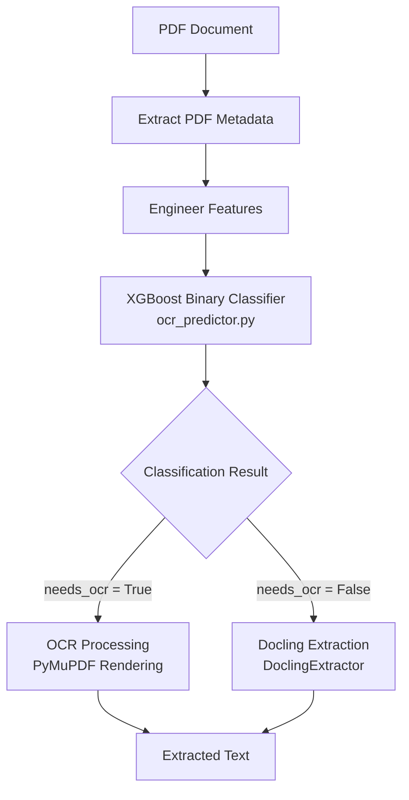
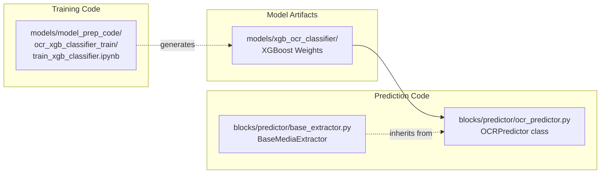
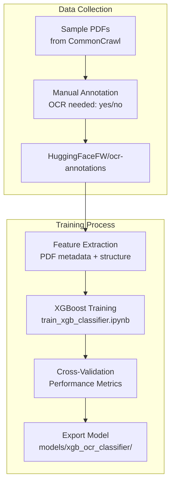
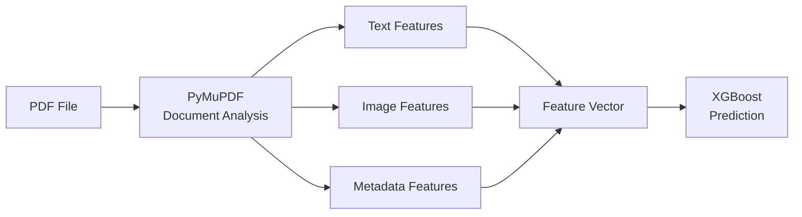
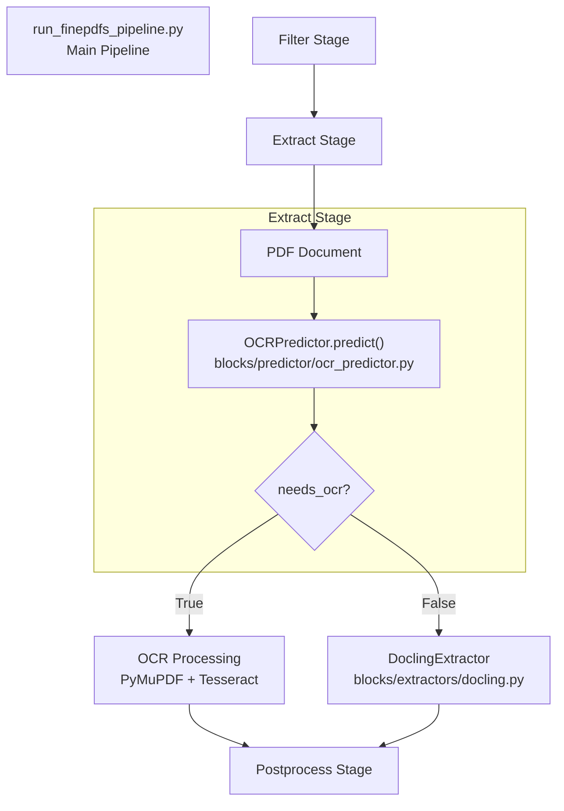
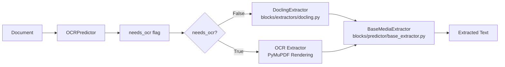
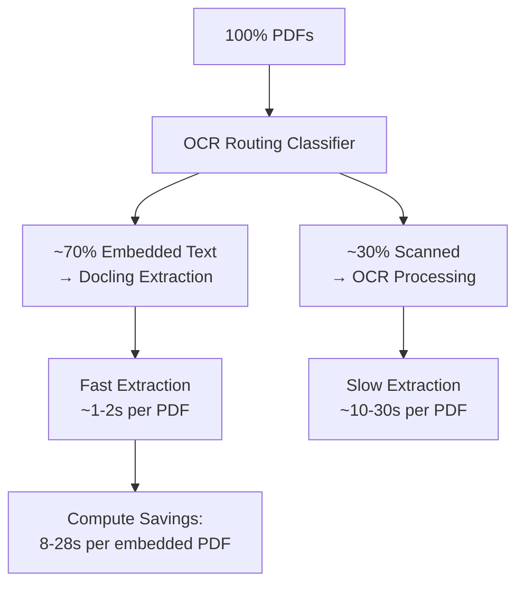

<!-- source: DeepWiki mcp.deepwiki.com · repo huggingface/finepdfs · extra page OCR Routing Classifier · fetched 2026-10-26 -->

# OCR Routing Classifier

<details>
<summary>Relevant source files</summary>

The following files were used as context for generating this wiki page:

- [README.md](README.md)
- [blocks/predictor/base_extractor.py](blocks/predictor/base_extractor.py)

</details>


## Purpose and Scope

The OCR Routing Classifier is an XGBoost-based binary classifier that determines whether a PDF document should be processed via OCR (Optical Character Recognition) or via embedded text extraction. This classifier makes efficient routing decisions early in the extraction pipeline, ensuring that scanned PDFs receive OCR processing while PDFs with embedded text use the faster Docling extractor.

This page covers the classifier's architecture, training process, feature engineering, and integration with the extraction pipeline. For details on the Docling extraction process itself, see [Docling Integration](#2.1.2). For OCR processing implementation, see [PDF Extraction System](#2.1).

---

## System Overview

The OCR routing decision is a critical early-stage optimization in the FinePDFs pipeline. Processing PDFs with embedded text through OCR would be wasteful and potentially degrade quality, while attempting embedded text extraction on scanned PDFs would yield no useful output.

### Decision Flow



**Sources:** [README.md:38-39](), High-level architecture diagrams

### Classification Task

The classifier solves a binary classification problem:

- **Input:** PDF file metadata and structural features
- **Output:** Boolean prediction (`needs_ocr`)
  - `True`: PDF is scanned or has insufficient embedded text → route to OCR
  - `False`: PDF has usable embedded text → route to Docling extraction

---

## Architecture and Implementation

### Model Architecture

The system uses **XGBoost** (eXtreme Gradient Boosting), a decision tree ensemble method well-suited for tabular feature data. XGBoost provides:

- Fast inference on CPU
- Interpretable feature importance
- Robust performance on structured features
- No GPU requirement

### File Structure

```
models/
├── xgb_ocr_classifier/          # Trained model weights
│   └── [XGBoost model files]
└── model_prep_code/
    └── ocr_xgb_classifier_train/
        └── train_xgb_classifier.ipynb  # Training code
```

### Implementation Components



**Sources:** [README.md:91-92](), Repository structure diagrams

### Predictor Class Structure

The `OCRPredictor` class in [blocks/predictor/ocr_predictor.py]() implements the prediction logic:

| Component | Purpose |
|-----------|---------|
| Model loading | Loads XGBoost model from [models/xgb_ocr_classifier/]() |
| Feature extraction | Computes features from PDF metadata |
| Prediction | Binary classification using XGBoost |
| Routing logic | Returns boolean `needs_ocr` flag |

The predictor integrates with the base extractor framework defined in [blocks/predictor/base_extractor.py:16-112]().

**Sources:** [blocks/predictor/base_extractor.py:1-113]()

---

## Training Data and Process

### Training Dataset

The classifier is trained on manually annotated data released as:

**Dataset:** `HuggingFaceFW/ocr-annotations`

This dataset contains human annotations indicating whether PDFs require OCR processing. Manual annotation ensures high-quality ground truth for this critical routing decision.

### Training Pipeline



**Sources:** [README.md:39]()

### Training Code Location

The complete training implementation is available in:

[models/model_prep_code/ocr_xgb_classifier_train/train_xgb_classifier.ipynb]()

This Jupyter notebook contains:
- Feature engineering logic
- XGBoost hyperparameter configuration
- Training loop and validation
- Model export procedures

**Sources:** [README.md:39]()

---

## Feature Engineering

While the specific features are implemented in the training notebook, typical PDF metadata features for OCR routing include:

### Likely Feature Categories

| Feature Category | Examples | Rationale |
|-----------------|----------|-----------|
| **Text Content** | Character count, text length, text/page ratio | Scanned PDFs have little/no extractable text |
| **Font Information** | Number of fonts, font types, font sizes | Scanned PDFs lack font metadata |
| **Image Content** | Image count, image size, image/page ratio | Scanned PDFs are primarily images |
| **Page Properties** | Page count, page size, page orientation | Structural indicators |
| **Object Counts** | Text objects, vector objects, embedded objects | Object type distribution differs |
| **File Metadata** | File size, creation date, PDF version | Indirect quality indicators |

### Feature Extraction Process



**Sources:** [README.md:39](), Inferred from typical OCR routing patterns

---

## Model Storage and Loading

### Git LFS Integration

The trained XGBoost model is stored using Git Large File Storage (LFS) due to its size:

**Location:** [models/xgb_ocr_classifier/]()

Git LFS allows versioning of large model files without bloating the repository. For more on Git LFS configuration, see [Git LFS Configuration](#5.1).

### Model Loading at Runtime

The `OCRPredictor` class loads the model during initialization:

```python
# Conceptual structure (not actual code)
class OCRPredictor:
    def __init__(self):
        model_path = "models/xgb_ocr_classifier/"
        self.model = xgboost.load_model(model_path)
```

The model is loaded once per process and reused for all predictions, ensuring efficient inference.

**Sources:** [README.md:91](), [blocks/predictor/ocr_predictor.py]()

---

## Pipeline Integration

### Integration Points

The OCR routing classifier is invoked during the **Extract** stage of the main pipeline:



**Sources:** [README.md:24-32](), [README.md:84](), High-level pipeline diagrams

### Usage in run_finepdfs_pipeline.py

The main pipeline script orchestrates the OCR routing:

| Step | Component | Action |
|------|-----------|--------|
| 1. Initialize | `OCRPredictor` | Load XGBoost model from [models/xgb_ocr_classifier/]() |
| 2. For each PDF | Feature extraction | Compute metadata features |
| 3. Predict | `OCRPredictor.predict()` | Binary classification |
| 4. Route | Conditional logic | Invoke appropriate extractor |
| 5. Extract | `DoclingExtractor` or OCR | Extract text content |

**Sources:** [README.md:81]()

### Extractor Selection Logic



Both extractors inherit from `BaseMediaExtractor` ([blocks/predictor/base_extractor.py:16]()) and follow a common interface, allowing seamless routing.

**Sources:** [blocks/predictor/base_extractor.py:16-112](), [README.md:84]()

---

## Performance Characteristics

### Inference Performance

| Metric | Value | Notes |
|--------|-------|-------|
| **Inference Time** | < 10ms per PDF | Fast enough for early-stage routing |
| **Compute Requirements** | CPU only | No GPU needed for XGBoost |
| **Memory Footprint** | Minimal | Model size typically < 100MB |
| **Throughput** | High | Not a bottleneck in pipeline |

### Classification Accuracy

The model is trained to maximize routing accuracy, balancing:

- **False Positives** (unnecessary OCR): Wastes compute but produces correct output
- **False Negatives** (missed OCR need): Results in failed extraction

The training process likely optimizes for minimizing false negatives, as failed extraction is more costly than unnecessary OCR.

### Decision Impact



By accurately routing PDFs, the classifier provides significant compute savings across the full pipeline.

**Sources:** Inferred from pipeline architecture and typical PDF distributions

---

## Model Versioning and Updates

### Current Model Version

The current production model is stored in [models/xgb_ocr_classifier/](). The model is versioned via Git commits and Git LFS.

### Retraining Process

To retrain the model with updated annotations:

1. Add new annotations to `HuggingFaceFW/ocr-annotations`
2. Run [models/model_prep_code/ocr_xgb_classifier_train/train_xgb_classifier.ipynb]()
3. Validate performance metrics
4. Export updated model to [models/xgb_ocr_classifier/]()
5. Commit via Git LFS

### Model Artifacts

| Artifact | Location | Purpose |
|----------|----------|---------|
| **Training Data** | `HuggingFaceFW/ocr-annotations` | Manual annotations |
| **Training Code** | [models/model_prep_code/ocr_xgb_classifier_train/train_xgb_classifier.ipynb]() | Feature engineering + training |
| **Model Weights** | [models/xgb_ocr_classifier/]() | Production model |
| **Predictor Code** | [blocks/predictor/ocr_predictor.py]() | Inference implementation |

**Sources:** [README.md:39](), [README.md:91-92]()

---

## Error Handling and Edge Cases

### Prediction Failures

The predictor is designed to be robust, but edge cases may occur:

| Case | Behavior | Fallback |
|------|----------|----------|
| **Corrupted PDF** | Feature extraction fails | Route to OCR (safer) |
| **Empty PDF** | Minimal features | Route to Docling (faster) |
| **Mixed Content** | Partial text + images | Classifier decision based on text ratio |
| **Encrypted PDF** | Cannot extract metadata | Handled by corruption detection (see [Corrupted PDF Detection](#2.1.3)) |

### Integration with Base Extractor

The predictor integrates with the timeout and error handling mechanisms from `BaseMediaExtractor`:

```python
# From base_extractor.py structure
class BaseMediaExtractor:
    def __init__(self, timeout: float = 60, 
                 exclusion_writer: Optional[DiskWriter] = None,
                 exclude_failed: bool = True):
        # Timeout protection for extraction
        # Error logging and statistics
        # Failed document handling
```

See [Base Extractor Framework](#6.1) for details on timeout handling and error management.

**Sources:** [blocks/predictor/base_extractor.py:22-33]()

---

## Summary

The OCR Routing Classifier is a critical optimization component that:

1. **Performs binary classification** to determine OCR necessity
2. **Uses XGBoost** for fast, interpretable predictions on CPU
3. **Is trained on manual annotations** from `HuggingFaceFW/ocr-annotations`
4. **Routes PDFs** to either Docling extraction or OCR processing
5. **Saves significant compute** by avoiding unnecessary OCR
6. **Integrates seamlessly** with the extraction pipeline via `BaseMediaExtractor`

The classifier's early-stage routing decision enables efficient processing of millions of PDFs in the FinePDFs pipeline.

**Sources:** [README.md:38-39](), [README.md:81-92](), [blocks/predictor/base_extractor.py:1-113]()

---

