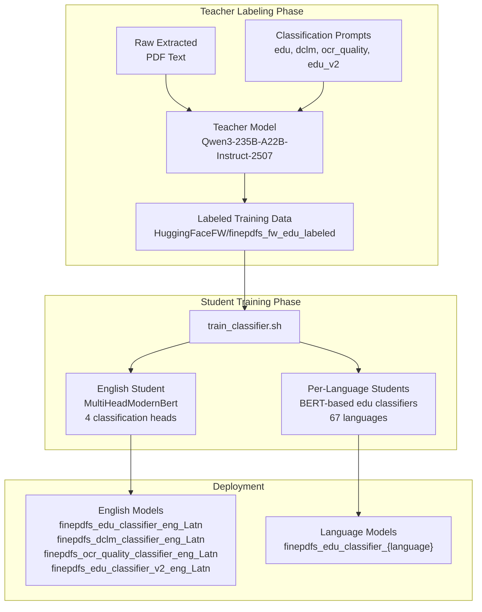
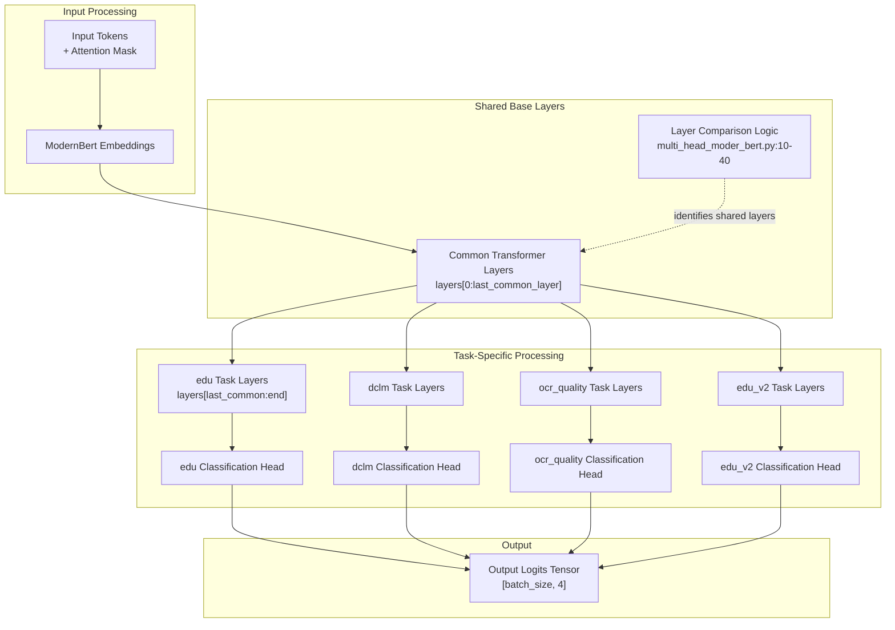
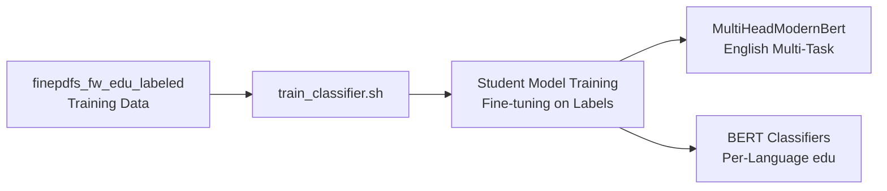
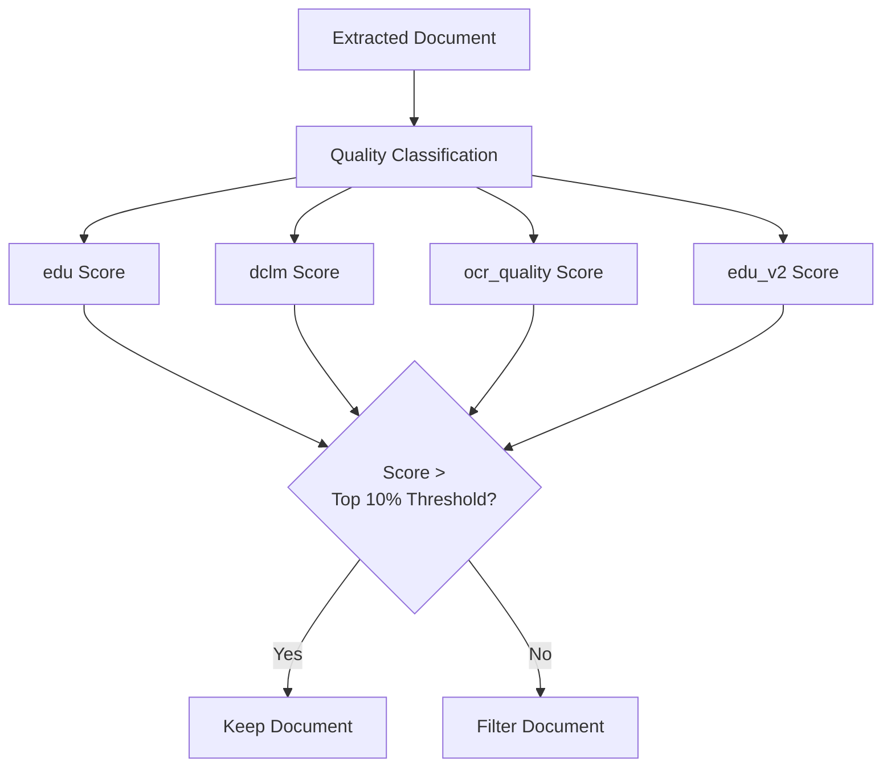

<!-- source: DeepWiki mcp.deepwiki.com · repo huggingface/finepdfs · extra page Quality Classifiers · fetched 2026-10-26 -->

# Quality Classifiers

<details>
<summary>Relevant source files</summary>

The following files were used as context for generating this wiki page:

- [README.md](README.md)
- [blocks/classification/multi_head_moder_bert.py](blocks/classification/multi_head_moder_bert.py)
- [classification/edu_langs.txt](classification/edu_langs.txt)

</details>


## Purpose and Scope

This document describes the quality classification system used in the FinePDFs pipeline to filter PDF documents based on educational value and content quality. The system employs a teacher-student distillation approach where a large language model labels training data, which is then used to train smaller, faster classifiers for production inference.

For the multi-head ModernBERT architecture details, see [Multi-Head ModernBERT Architecture](#2.2.3). For the batched inference API serving these classifiers, see [Batched Inference API](#2.2.4). For language filtering (distinct from quality filtering), see [Language Filtering](#2.2.1).

## Quality Dimensions Evaluated

The system evaluates four distinct quality dimensions for English text:

| Dimension | Purpose | Status |
|-----------|---------|--------|
| `edu` | Educational content (primary filter) | Active - highest impact |
| `dclm` | DataComp-LM quality criteria | Active - meaningful gains |
| `ocr_quality` | OCR extraction quality assessment | Evaluated - limited impact |
| `edu_v2` | Beyond undergraduate-level textbooks | Evaluated - limited impact |

For non-English languages, only the `edu` classifier is provided, covering 67 languages as defined in [classification/edu_langs.txt:1-71]().

**Sources:** [README.md:57-63](), [classification/edu_langs.txt:1-71]()

## Teacher-Student Distillation Architecture

The quality classifier training follows a teacher-student distillation pipeline:



**Model Selection Rationale:** The teacher model `Qwen3-235B-A22B-Instruct-2507` was selected because it most closely matched Claude Sonnet 3.7 performance among available open-source language models.

**Sources:** [README.md:65-76](), [README.md:57-63]()

## Multi-Head ModernBERT for English

### Architecture Overview

For English text, a specialized multi-head architecture is implemented in [blocks/classification/multi_head_moder_bert.py:7-269]() that enables efficient multi-task inference. The `MultiHeadModernBert` class shares base transformer layers across all quality dimensions while maintaining separate classification heads.



### Implementation Details

**Layer Sharing Detection:** The constructor [blocks/classification/multi_head_moder_bert.py:10-40]() automatically identifies the last common layer by comparing parameters across all input models:

```python
# Pseudocode representation
for layer_idx in range(num_layers):
    if all_models_have_identical_parameters_at(layer_idx):
        last_common_layer = layer_idx + 1
    else:
        break
```

**Model Components Initialization:**
- [blocks/classification/multi_head_moder_bert.py:40-52]() extracts and stores:
  - `base_model_layers`: Shared transformer layers (0 to `last_common_layer`)
  - `class_layers`: Task-specific layers (per classifier)
  - `heads`: Task-specific pooling heads
  - `classifiers`: Final classification layers

**Forward Pass:** [blocks/classification/multi_head_moder_bert.py:120-269]() processes inputs through:
1. Shared embeddings and base layers [blocks/classification/multi_head_moder_bert.py:206-226]()
2. Parallel processing through task-specific layers [blocks/classification/multi_head_moder_bert.py:228-261]()
3. Concatenation of outputs into single logits tensor

**Sources:** [blocks/classification/multi_head_moder_bert.py:1-269]()

## Per-Language BERT Classifiers

### Language Coverage

The system provides `edu` classifiers for 67 languages, organized by language code and script in [classification/edu_langs.txt:1-71](). Sample languages include:

| Language Family | Examples |
|----------------|----------|
| **Latin Script** | English, German, French, Spanish, Italian, Portuguese, Polish, Dutch, Czech |
| **Cyrillic Script** | Russian, Ukrainian, Bulgarian, Serbian, Macedonian |
| **Asian Scripts** | Chinese (Hani), Japanese (Jpan, Hira), Korean (Hang), Thai (Thai) |
| **Middle Eastern** | Arabic (Arab), Hebrew (Hebr), Persian (Arab), Urdu (Arab) |
| **Indic Scripts** | Hindi (Deva), Bengali (Beng), Marathi (Deva), Tamil (Taml), Gujarati (Gujr) |
| **Other** | Greek (Grek), Armenian (Armn), Georgian (Geor) |

### Architecture

Unlike the multi-head English classifier, non-English classifiers use standard BERT-based sequence classification:


Each language has a dedicated model published as `HuggingFaceFW/finepdfs_edu_classifier_{language}` where `{language}` follows the format from [classification/edu_langs.txt:1-71]() (e.g., `fra_Latn`, `jpn_Jpan`, `arb_Arab`).

**Sources:** [classification/edu_langs.txt:1-71](), [README.md:72-76]()

## Training and Labeling Process

### Data Labeling

The labeling process is orchestrated by [classification/label_data_with_teacher.py]():

1. **Input:** Raw extracted PDF text from the pipeline
2. **Prompts:** Classification prompts embedded in the labeling script (not separately stored)
3. **Teacher Model:** `Qwen3-235B-A22B-Instruct-2507` processes each sample
4. **Output:** Binary labels (0/1) for each quality dimension per language

The labeled dataset is published at `HuggingFaceFW/finepdfs_fw_edu_labeled`, containing annotations for all evaluated dimensions across all languages.

### Student Model Training

Training is executed via [classification/train_classifier.sh]():



Training configuration details:
- **Base Model (English):** ModernBERT with multi-head architecture
- **Base Model (Other Languages):** Language-appropriate BERT variants
- **Objective:** Binary classification (distillation from teacher labels)
- **Optimization:** Standard cross-entropy loss

**Sources:** [README.md:65-76](), [classification/label_data_with_teacher.py](), [classification/train_classifier.sh]()

## Threshold Selection and Filtering

### Threshold Strategy

The pipeline applies a **top-10% threshold** strategy: documents scoring in the top 10% for each quality dimension are retained. This percentile-based approach ensures consistent filtering rates across different quality dimensions and languages.

### Application in Pipeline



**Pipeline Integration:** Quality scores are computed after language filtering ([Language Filtering](#2.2.1)) and before MinHash deduplication ([Deduplication](#2.4)). The quality scores serve as metadata in the final dataset, enabling downstream users to apply custom thresholds.

**Sources:** [README.md:63]()

## Published Artifacts

### Datasets

| Dataset | Purpose | Content |
|---------|---------|---------|
| `HuggingFaceFW/finepdfs_fw_edu_labeled` | Training data | Teacher-labeled samples for all languages and quality dimensions |

### Models

**English Multi-Task Models:**
- `HuggingFaceFW/finepdfs_edu_classifier_eng_Latn` - Educational content classifier
- `HuggingFaceFW/finepdfs_dclm_classifier_eng_Latn` - DCLM quality classifier  
- `HuggingFaceFW/finepdfs_ocr_quality_classifier_eng_Latn` - OCR quality classifier
- `HuggingFaceFW/finepdfs_edu_classifier_v2_eng_Latn` - Advanced educational content classifier

**Per-Language Models:**
- `HuggingFaceFW/finepdfs_edu_classifier_{language}` - One model per language from [classification/edu_langs.txt:1-71]()

Example language-specific models:
- `HuggingFaceFW/finepdfs_edu_classifier_deu_Latn` (German)
- `HuggingFaceFW/finepdfs_edu_classifier_jpn_Jpan` (Japanese)
- `HuggingFaceFW/finepdfs_edu_classifier_arb_Arab` (Arabic)

### Model Loading Example

The multi-head ModernBERT model for English can be loaded as:

```python
from blocks.classification.multi_head_moder_bert import MultiHeadModernBert
from transformers import ModernBertForSequenceClassification

# Load individual classifiers
models = [
    ModernBertForSequenceClassification.from_pretrained(
        "HuggingFaceFW/finepdfs_edu_classifier_eng_Latn"
    ),
    ModernBertForSequenceClassification.from_pretrained(
        "HuggingFaceFW/finepdfs_dclm_classifier_eng_Latn"
    ),
    # ... additional classifiers
]

# Create multi-head wrapper
multi_head = MultiHeadModernBert(models=models)
```

**Sources:** [README.md:71-76](), [blocks/classification/multi_head_moder_bert.py:7-9]()

---

