<!-- source: DeepWiki mcp.deepwiki.com · repo huggingface/finetrainers · page 1 Overview · fetched 2026-10-26 -->

# Overview

<details>
<summary>Relevant source files</summary>

The following files were used as context for generating this wiki page:

- [.gitignore](.gitignore)
- [Makefile](Makefile)
- [README.md](README.md)
- [docs/models/README.md](docs/models/README.md)
- [finetrainers/__init__.py](finetrainers/__init__.py)
- [finetrainers/config.py](finetrainers/config.py)
- [finetrainers/functional/__init__.py](finetrainers/functional/__init__.py)
- [finetrainers/functional/text.py](finetrainers/functional/text.py)
- [finetrainers/models/flux/base_specification.py](finetrainers/models/flux/base_specification.py)
- [setup.py](setup.py)
- [tests/models/flux/base_specification.py](tests/models/flux/base_specification.py)

</details>


This document provides an introduction to finetrainers, its purpose, key features, supported models, and high-level architecture. It serves as a starting point for understanding how the library is organized and how its components interact.

For installation instructions, see [Getting Started](#2). For detailed configuration options, see [Configuration System](#3.3). For specific model training guides, see [Supported Models](#6).

## Purpose and Scope

Finetrainers is a library designed to make training of diffusion models accessible and practical across a range of hardware configurations. The library provides a unified interface for training multiple diffusion architectures (both video and image generation models) with various training strategies (LoRA, full finetuning, control conditioning) and distributed training backends.

The library's scope encompasses:

- **Model Abstraction**: A standardized interface (`ModelSpecification`) for training arbitrary diffusion models
- **Training Orchestration**: Two primary trainer classes (`SFTTrainer` and `ControlTrainer`) that handle the complete training lifecycle
- **Data Pipeline**: Auto-detection of dataset formats, multi-resolution bucketing, and efficient preprocessing with optional precomputation
- **Distribution**: Multiple parallelism strategies (DDP, FSDP2, HSDP, Context Parallel, Tensor Parallel) via pluggable backends
- **Memory Efficiency**: Techniques including gradient checkpointing, FP8 training, VAE tiling/slicing, and precomputation to enable training on consumer hardware

Sources: [README.md:1-3](), [setup.py:10-14]()

## Key Features

| Feature | Description |
|---------|-------------|
| **Multi-Model Support** | 6 diffusion models (CogVideoX, CogView4, Flux, HunyuanVideo, LTX-Video, Wan) across video and image generation |
| **Training Strategies** | LoRA (parameter-efficient), full finetuning, and control conditioning (channel concatenation) |
| **Distributed Training** | DDP, FSDP2, HSDP, Context Parallel (CP), Tensor Parallel (TP) via `PytorchDTensorParallelBackend` or simple DDP via `AccelerateParallelBackend` |
| **Attention Backends** | Flash Attention, Sage Attention, xFormers, native PyTorch via `attention_dispatch` |
| **Data Flexibility** | CSV, JSON, Parquet, WebDataset formats with auto-detection; combined image/video datasets; multi-resolution bucketing |
| **Memory Optimization** | Precomputation (in-memory or disk), gradient checkpointing, FP8 weight casting, VAE optimizations |
| **Standardized Interface** | `ModelSpecification` abstraction enables training custom models without modifying core training logic |

Sources: [README.md:55-65](), [README.md:85-110]()

## Supported Models

The following table shows all supported models and their training capabilities:

| Model | Domain | Training Types | Min. LoRA VRAM<sup>*</sup> | Min. Full FT VRAM<sup>^</sup> |
|-------|--------|----------------|----------------|------------------|
| [LTX-Video](#6.1) | Text-to-Video | `lora`, `full-finetune` | 5 GB | 21 GB |
| [CogVideoX-5b](#6.1) | Text-to-Video | `lora`, `full-finetune` | 18 GB | 53 GB |
| [HunyuanVideo](#6.1) | Text-to-Video | `lora`, `full-finetune` | 32 GB | OOM |
| [Wan](#6.1) | Text-to-Video, Image-to-Video | `lora`, `full-finetune`, `control-lora`, `control-full-finetune` | TBD | TBD |
| [CogView4](#6.2) | Text-to-Image | `lora`, `full-finetune`, `control-lora`, `control-full-finetune` | TBD | TBD |
| [Flux](#6.2) | Text-to-Image | `lora`, `full-finetune` | TBD | TBD |

<sub><sup>*</sup>Measured at resolution `49x512x768`, rank 128, with precomputation, using FP8 weights & gradient checkpointing</sub><br/>
<sub><sup>^</sup>Measured at resolution `49x512x768`, with precomputation, using BF16 weights & gradient checkpointing</sub>

Each model is represented by a concrete implementation of the `ModelSpecification` interface. Training types are specified via the `--training_type` CLI argument and mapped to the appropriate model specification class via `SUPPORTED_MODEL_CONFIGS`.

Sources: [README.md:85-110](), [finetrainers/config.py:13-63]()

## Core Architecture

### High-Level Component Organization

```mermaid
graph TB
    subgraph "Entry Point"
        train.py["train.py<br/>(CLI Entry)"]
    end
    
    subgraph "Configuration Layer"
        BaseArgs["BaseArgs<br/>finetrainers/args/base_args.py"]
        ConfigMixins["Configuration Mixins<br/>SFTLowRankConfig<br/>SFTFullRankConfig<br/>ControlLowRankConfig<br/>ControlFullRankConfig"]
        BaseArgs --> ConfigMixins
    end
    
    subgraph "Training Orchestration"
        SFTTrainer["SFTTrainer<br/>finetrainers/trainer/sft_trainer.py"]
        ControlTrainer["ControlTrainer<br/>finetrainers/trainer/control_trainer.py"]
    end
    
    subgraph "Model Registry & Abstraction"
        ModelSpecification["ModelSpecification<br/>finetrainers/models/modeling_utils.py"]
        SUPPORTED_MODEL_CONFIGS["SUPPORTED_MODEL_CONFIGS<br/>finetrainers/config.py:32-63"]
        
        subgraph "Model Implementations"
            LTXVideoSpec["LTXVideoModelSpecification"]
            CogVideoXSpec["CogVideoXModelSpecification"]
            HunyuanVideoSpec["HunyuanVideoModelSpecification"]
            WanSpec["WanModelSpecification<br/>WanControlModelSpecification"]
            CogView4Spec["CogView4ModelSpecification<br/>CogView4ControlModelSpecification"]
            FluxSpec["FluxModelSpecification"]
        end
        
        SUPPORTED_MODEL_CONFIGS --> ModelSpecification
        ModelSpecification --> LTXVideoSpec
        ModelSpecification --> CogVideoXSpec
        ModelSpecification --> HunyuanVideoSpec
        ModelSpecification --> WanSpec
        ModelSpecification --> CogView4Spec
        ModelSpecification --> FluxSpec
    end
    
    subgraph "Data Pipeline"
        initialize_dataset["initialize_dataset<br/>finetrainers/data/dataset.py"]
        Preprocessors["Preprocessor System<br/>InMemoryPreprocessor<br/>PrecomputedPreprocessor"]
        ResolutionSampler["ResolutionSampler<br/>finetrainers/data/resolution.py"]
        
        initialize_dataset --> Preprocessors
        Preprocessors --> ResolutionSampler
    end
    
    subgraph "Parallelism Backends"
        BaseParallelBackend["BaseParallelBackend<br/>finetrainers/parallel/base_backend.py"]
        PTDBackend["PytorchDTensorParallelBackend<br/>finetrainers/parallel/pytorch_dtensor_backend.py"]
        AccelerateBackend["AccelerateParallelBackend<br/>finetrainers/parallel/accelerate_backend.py"]
        
        BaseParallelBackend --> PTDBackend
        BaseParallelBackend --> AccelerateBackend
    end
    
    subgraph "Cross-Cutting Concerns"
        attention_dispatch["attention_dispatch<br/>finetrainers/attention/providers.py"]
        functional["functional/*<br/>Image/Video/Text/Diffusion Utils"]
        utils["utils/*<br/>Memory/Checkpointing/Torch"]
    end
    
    train.py --> BaseArgs
    BaseArgs --> SFTTrainer
    BaseArgs --> ControlTrainer
    
    SFTTrainer --> SUPPORTED_MODEL_CONFIGS
    ControlTrainer --> SUPPORTED_MODEL_CONFIGS
    
    SFTTrainer --> initialize_dataset
    ControlTrainer --> initialize_dataset
    
    SFTTrainer --> BaseParallelBackend
    ControlTrainer --> BaseParallelBackend
    
    ModelSpecification -.uses.-> attention_dispatch
    ModelSpecification -.uses.-> functional
    SFTTrainer -.uses.-> utils
    ControlTrainer -.uses.-> utils
    
    style SFTTrainer fill:#f9f9f9
    style ControlTrainer fill:#f9f9f9
    style ModelSpecification fill:#f9f9f9
    style BaseParallelBackend fill:#f9f9f9
```



**Diagram: Component Organization and Dependencies**

This diagram shows the core architectural layers and their relationships:

1. **Entry Point**: `train.py` CLI script that accepts command-line arguments
2. **Configuration Layer**: `BaseArgs` class aggregates configuration mixins for different training types
3. **Training Orchestration**: Two trainer classes (`SFTTrainer` and `ControlTrainer`) manage the complete training lifecycle
4. **Model Registry**: `SUPPORTED_MODEL_CONFIGS` dictionary maps `(ModelType, TrainingType)` tuples to `ModelSpecification` subclasses
5. **Model Abstraction**: `ModelSpecification` interface with 6 concrete implementations (one per supported model, with some having control variants)
6. **Data Pipeline**: Dataset loading, preprocessing, and resolution bucketing
7. **Parallelism Backends**: Two backend implementations (`PytorchDTensorParallelBackend` for advanced parallelism, `AccelerateParallelBackend` for simple DDP)
8. **Cross-Cutting Concerns**: Attention providers, functional utilities, and helper functions

Sources: [finetrainers/__init__.py:1-6](), [finetrainers/config.py:1-76]()

### Training Execution Flow

```mermaid
flowchart TD
    Start["python train.py<br/>--model_name cogvideox<br/>--training_type lora"]
    
    ParseArgs["Parse BaseArgs<br/>finetrainers/args/base_args.py"]
    
    GetConfig["Determine Config Class<br/>SFTLowRankConfig"]
    
    GetModelSpec["_get_model_specifiction_cls()<br/>finetrainers/config.py:66-75"]
    
    CreateSpec["Instantiate ModelSpecification<br/>e.g., CogVideoXModelSpecification"]
    
    InitTrainer["Initialize Trainer<br/>SFTTrainer or ControlTrainer"]
    
    PrepModels["_prepare_models()<br/>Load: tokenizer, text_encoder,<br/>transformer, vae, scheduler"]
    
    PrepTrainable["_prepare_trainable_parameters()<br/>Apply LoRA adapters or<br/>mark full parameters trainable"]
    
    PrepTraining["_prepare_for_training()<br/>Apply parallelism backend,<br/>compile (if enabled)"]
    
    PrepDataset["_prepare_dataset()<br/>initialize_dataset()<br/>IterableDatasetPreprocessingWrapper<br/>ResolutionSampler"]
    
    PrepCheckpoint["_prepare_checkpointing()<br/>Setup checkpointing system,<br/>load from checkpoint if resuming"]
    
    TrainLoop["Training Loop<br/>for step in range(max_steps)"]
    
    ForwardPass["Forward Pass<br/>model_spec.forward(<br/>  transformer,<br/>  conditions,<br/>  latents,<br/>  sigmas<br/>)"]
    
    Loss["Compute Loss<br/>MSE between pred & target"]
    
    Backward["Backward Pass<br/>loss.backward()<br/>optimizer.step()"]
    
    CheckpointCheck{"step % checkpointing_steps<br/>== 0 ?"}
    
    SaveCheckpoint["Save Checkpoint<br/>checkpointer.save_checkpoint()"]
    
    ValidationCheck{"step % validation_steps<br/>== 0 ?"}
    
    RunValidation["Run Validation<br/>model_spec.validation(<br/>  pipeline, prompt<br/>)"]
    
    LogMetrics["Log Metrics<br/>to WandB/TensorBoard"]
    
    Continue{"step < max_steps ?"}
    
    FinalSave["Save Final Checkpoint<br/>Upload to Hub (if enabled)"]
    
    End["Training Complete"]
    
    Start --> ParseArgs
    ParseArgs --> GetConfig
    GetConfig --> GetModelSpec
    GetModelSpec --> CreateSpec
    CreateSpec --> InitTrainer
    InitTrainer --> PrepModels
    PrepModels --> PrepTrainable
    PrepTrainable --> PrepTraining
    PrepTraining --> PrepDataset
    PrepDataset --> PrepCheckpoint
    PrepCheckpoint --> TrainLoop
    TrainLoop --> ForwardPass
    ForwardPass --> Loss
    Loss --> Backward
    Backward --> CheckpointCheck
    CheckpointCheck -->|Yes| SaveCheckpoint
    CheckpointCheck -->|No| ValidationCheck
    SaveCheckpoint --> ValidationCheck
    ValidationCheck -->|Yes| RunValidation
    ValidationCheck -->|No| LogMetrics
    RunValidation --> LogMetrics
    LogMetrics --> Continue
    Continue -->|Yes| TrainLoop
    Continue -->|No| FinalSave
    FinalSave --> End
```



**Diagram: Training Execution Flow from CLI to Completion**

This flowchart illustrates the complete execution path:

1. **Initialization Phase**: Parse arguments, determine configuration class, retrieve and instantiate the appropriate `ModelSpecification`
2. **Preparation Phase**: Six distinct preparation steps ensure proper setup order:
   - Load model components (tokenizers, encoders, transformer, VAE, scheduler)
   - Configure trainable parameters (LoRA adapters or full parameters)
   - Apply parallelism strategy and optional compilation
   - Initialize dataset pipeline with preprocessing and bucketing
   - Setup checkpointing and optionally resume from previous state
3. **Training Loop**: Iterate through training steps with forward/backward passes
4. **Checkpointing & Validation**: Periodic saving and validation based on configured intervals
5. **Finalization**: Save final checkpoint and optionally upload to Hugging Face Hub

Sources: [finetrainers/config.py:66-75](), [finetrainers/trainer/sft_trainer.py]()

## Configuration and Model Selection

The library uses two enumerations to select the appropriate model and training strategy:

**ModelType Enumeration** ([finetrainers/config.py:13-20]()):
```python
class ModelType(str, Enum):
    COGVIDEOX = "cogvideox"
    COGVIEW4 = "cogview4"
    FLUX = "flux"
    HUNYUAN_VIDEO = "hunyuan_video"
    LTX_VIDEO = "ltx_video"
    WAN = "wan"
```

**TrainingType Enumeration** ([finetrainers/config.py:22-30]()):
```python
class TrainingType(str, Enum):
    LORA = "lora"                           # SFT with LoRA adapters
    FULL_FINETUNE = "full-finetune"         # SFT with full parameters
    CONTROL_LORA = "control-lora"           # Control training with LoRA
    CONTROL_FULL_FINETUNE = "control-full-finetune"  # Control with full parameters
```

These enumerations are used as keys in the `SUPPORTED_MODEL_CONFIGS` registry ([finetrainers/config.py:32-63]()) to look up the appropriate `ModelSpecification` subclass:

```python
# Example: Training CogVideoX with LoRA
SUPPORTED_MODEL_CONFIGS[ModelType.COGVIDEOX][TrainingType.LORA] 
# Returns: CogVideoXModelSpecification
```

The registry supports different specifications for control vs. standard training. For example, `WanModelSpecification` is used for standard SFT, while `WanControlModelSpecification` is used for control training.

Sources: [finetrainers/config.py:13-63]()

## ModelSpecification Interface

The `ModelSpecification` abstract class ([finetrainers/models/modeling_utils.py]()) defines the interface that all model implementations must satisfy. Each concrete implementation provides:

### Component Loading Methods

| Method | Purpose | Returns |
|--------|---------|---------|
| `load_condition_models()` | Load tokenizers and text encoders | `Dict[str, torch.nn.Module]` |
| `load_latent_models()` | Load VAE for encoding images/videos | `Dict[str, torch.nn.Module]` |
| `load_diffusion_models()` | Load transformer/UNet and scheduler | `Dict[str, torch.nn.Module]` |
| `load_pipeline()` | Construct inference pipeline | Pipeline instance |

### Data Processing Methods

| Method | Purpose | Returns |
|--------|---------|---------|
| `prepare_conditions()` | Process text prompts → embeddings | `Dict[str, torch.Tensor]` |
| `prepare_latents()` | Encode images/videos → latent space | `Dict[str, torch.Tensor]` |

### Training and Validation Methods

| Method | Purpose | Returns |
|--------|---------|---------|
| `forward()` | Compute forward pass with noise injection | `Tuple[pred, target, sigmas]` |
| `validation()` | Generate artifacts during validation | `List[ArtifactType]` |

### Processor System

Each `ModelSpecification` maintains two lists of processors:

- **`condition_model_processors`**: List of `ProcessorMixin` instances that transform text prompts into embeddings (e.g., `CLIPPooledProcessor`, `T5Processor`)
- **`latent_model_processors`**: List of `ProcessorMixin` instances that encode visual inputs into latents (e.g., `FluxLatentEncodeProcessor`)

These processors are chained during `prepare_conditions()` and `prepare_latents()` calls to produce the required tensors for training.

For implementation details, see [Model Specifications](#3.2). For adding a new model, see [Adding a New Model](#9.1).

Sources: [finetrainers/models/modeling_utils.py](), [finetrainers/models/flux/base_specification.py:23-68]()

## Trainer Classes

Finetrainers provides two trainer classes that orchestrate the complete training lifecycle:

### SFTTrainer

The `SFTTrainer` class ([finetrainers/trainer/sft_trainer.py]()) handles standard supervised fine-tuning. Key responsibilities:

- Load and configure model components via `ModelSpecification`
- Setup LoRA adapters or mark full parameters trainable
- Initialize data pipeline with preprocessing and bucketing
- Apply parallelism strategy via `BaseParallelBackend`
- Execute training loop with loss computation and optimization
- Periodic checkpointing and validation

For detailed documentation, see [SFT Trainer](#4.1).

### ControlTrainer

The `ControlTrainer` class ([finetrainers/trainer/control_trainer.py]()) extends SFT training to support conditional control:

- Accepts additional control conditioning inputs (e.g., control frames)
- Uses control-specific `ModelSpecification` implementations (e.g., `WanControlModelSpecification`, `CogView4ControlModelSpecification`)
- Concatenates control channels to latent inputs during forward pass
- Otherwise follows the same preparation and training pipeline as `SFTTrainer`

For detailed documentation, see [Control Trainer](#4.2).

Sources: [finetrainers/trainer/sft_trainer.py](), [finetrainers/trainer/control_trainer.py]()

## Data Pipeline Architecture

```mermaid
graph LR
    subgraph "Data Sources"
        LocalCSV["Local CSV"]
        LocalJSON["Local JSON/Parquet"]
        HubDataset["HF Hub Dataset"]
        WebDataset["WebDataset (tar)"]
    end
    
    subgraph "Dataset Loading"
        initialize_dataset["initialize_dataset()<br/>finetrainers/data/dataset.py"]
        combine_datasets["combine_datasets()"]
    end
    
    subgraph "Preprocessing Wrapper"
        IterableWrapper["IterableDatasetPreprocessingWrapper<br/>finetrainers/data/dataset.py"]
        CaptionCleaning["Caption Cleaning<br/>(remove prefixes, convert bytes)"]
        ResolutionBucketing["Resolution Bucketing<br/>ResolutionSampler"]
    end
    
    subgraph "Preprocessor System"
        PreprocessorInit["initialize_preprocessor()<br/>finetrainers/data/preprocessor.py"]
        InMemory["InMemoryPreprocessor"]
        Precomputed["PrecomputedPreprocessor"]
        
        PreprocessorInit --> InMemory
        PreprocessorInit --> Precomputed
    end
    
    subgraph "Condition Pipeline"
        ConditionProc["Condition Processors<br/>(e.g., T5Processor, CLIPProcessor)"]
        TextEmbeddings["Text Embeddings<br/>encoder_hidden_states<br/>pooled_projections"]
        
        ConditionProc --> TextEmbeddings
    end
    
    subgraph "Latent Pipeline"
        LatentProc["Latent Processors<br/>(e.g., FluxLatentEncodeProcessor)"]
        LatentTensors["Latent Tensors<br/>VAE-encoded"]
        
        LatentProc --> LatentTensors
    end
    
    LocalCSV --> initialize_dataset
    LocalJSON --> initialize_dataset
    HubDataset --> initialize_dataset
    WebDataset --> initialize_dataset
    
    initialize_dataset --> combine_datasets
    combine_datasets --> IterableWrapper
    
    IterableWrapper --> CaptionCleaning
    CaptionCleaning --> ResolutionBucketing
    
    ResolutionBucketing --> PreprocessorInit
    
    InMemory --> ConditionProc
    InMemory --> LatentProc
    Precomputed --> ConditionProc
    Precomputed --> LatentProc
    
    TextEmbeddings --> TrainingBatch["Training Batch<br/>(collated tensors)"]
    LatentTensors --> TrainingBatch
```



**Diagram: Data Pipeline from Source to Training Batch**

The data pipeline consists of several stages:

1. **Dataset Loading**: `initialize_dataset()` auto-detects format (CSV, JSON, Parquet, WebDataset) and returns appropriate iterable datasets
2. **Dataset Combination**: Multiple datasets can be combined and sampled proportionally
3. **Preprocessing Wrapper**: `IterableDatasetPreprocessingWrapper` applies caption cleaning, converts byte strings, and performs resolution bucketing via `ResolutionSampler`
4. **Preprocessor Initialization**: Two modes available:
   - `InMemoryPreprocessor`: Computes embeddings on-the-fly during training
   - `PrecomputedPreprocessor`: Loads pre-saved embeddings from disk
5. **Parallel Processing**: Text and visual data flow through separate processor chains to produce embeddings and latents
6. **Collation**: Tensors are batched and sent to the training loop

For detailed documentation, see [Data Pipeline](#5).

Sources: [finetrainers/data/dataset.py](), [finetrainers/data/preprocessor.py]()

## Parallelism and Distribution

Finetrainers supports multiple parallelism strategies through a backend abstraction:

### Backend Interface

The `BaseParallelBackend` class ([finetrainers/parallel/base_backend.py]()) defines the interface:

```python
class BaseParallelBackend:
    def apply_ddp(model, **kwargs)
    def apply_fsdp2(model, **kwargs)
    def apply_hsdp(model, **kwargs)
    def apply_cp(model, **kwargs)
    def apply_tp(model, **kwargs)
```

### Backend Implementations

| Backend | File | Capabilities |
|---------|------|--------------|
| `PytorchDTensorParallelBackend` | [finetrainers/parallel/pytorch_dtensor_backend.py]() | DDP, FSDP2, HSDP, Context Parallel (CP), Tensor Parallel (TP), Pipeline Parallel (PP) via multi-dimensional `DeviceMesh` |
| `AccelerateParallelBackend` | [finetrainers/parallel/accelerate_backend.py]() | DDP only via Hugging Face Accelerate |

### Parallelism Degrees

The PyTorch DTensor backend supports configuring parallelism across multiple dimensions:

- `--dp_degree`: Data parallel degree (model replication)
- `--dp_shards`: Sharding degree within data parallel group (FSDP/HSDP)
- `--cp_degree`: Context parallel degree (sequence sharding)
- `--tp_degree`: Tensor parallel degree (layer sharding)
- `--pp_degree`: Pipeline parallel degree (stage sharding)

These dimensions are organized into a `DeviceMesh` topology that coordinates distributed computation.

For detailed documentation, see [Parallelism and Distribution](#7).

Sources: [finetrainers/parallel/base_backend.py](), [finetrainers/parallel/pytorch_dtensor_backend.py](), [finetrainers/parallel/accelerate_backend.py]()

## Attention Provider System

The library includes a dispatch system for different attention implementations:

**Attention Providers** ([finetrainers/attention/providers.py]()):
- `flash`: Flash Attention 2
- `flex`: Flash Attention 3 (Flex Attention)
- `sage`: Sage Attention
- `xformers`: xFormers memory-efficient attention
- `native`: PyTorch native scaled dot-product attention

The provider is selected via the `FINETRAINERS_ATTN_PROVIDER` environment variable. The `attention_dispatch()` function routes attention calls to the appropriate backend based on configuration and checks.

For detailed documentation, see [Attention Providers](#8.1).

Sources: [finetrainers/attention/providers.py]()

## Utility Modules

Finetrainers includes several utility modules:

### Functional Utilities ([finetrainers/functional/]())

| Module | Purpose |
|--------|---------|
| `diffusion.py` | Flow matching functions: `flow_match_xt()`, `flow_match_target()` |
| `image.py` | Image resizing, cropping, bucketing |
| `video.py` | Video resizing, cropping, bucketing |
| `text.py` | Caption dropout, prefix removal, byte string conversion |
| `normalization.py` | Tensor normalization helpers |

### Core Utilities ([finetrainers/utils/]())

- Memory management and gradient checkpointing
- Checkpoint saving/loading utilities
- Torch utilities (compilation, mixed precision)
- VAE optimization helpers (slicing, tiling)

For detailed documentation, see [Functional Utilities](#8.2) and [Utility Functions](#8.4).

Sources: [finetrainers/functional/__init__.py:1-17](), [finetrainers/functional/text.py:1-41]()

## Extension Points

The library is designed for extensibility through several interfaces:

### Adding a New Model

1. Create a subclass of `ModelSpecification`
2. Implement required methods: `load_condition_models()`, `load_latent_models()`, `load_diffusion_models()`, `forward()`, `validation()`
3. Define processors for conditions and latents
4. Register in `SUPPORTED_MODEL_CONFIGS` dictionary

Example structure:
```python
class CustomModelSpecification(ModelSpecification):
    def __init__(self, condition_model_processors, latent_model_processors, **kwargs):
        super().__init__(**kwargs)
        self.condition_model_processors = condition_model_processors
        self.latent_model_processors = latent_model_processors
    
    def load_condition_models(self) -> Dict[str, torch.nn.Module]:
        # Load tokenizers, text encoders
        ...
    
    def forward(self, transformer, conditions, latents, sigmas, **kwargs):
        # Implement diffusion forward pass
        ...
```

### Adding a Custom Processor

Create a subclass of `ProcessorMixin` and implement the `forward()` method:

```python
class CustomProcessor(ProcessorMixin):
    def forward(self, **kwargs) -> Dict[str, torch.Tensor]:
        # Transform inputs into outputs
        ...
```

### Adding a Parallelism Backend

Implement the `BaseParallelBackend` interface with desired parallelism strategies.

For comprehensive guides, see [Extending Finetrainers](#9).

Sources: [finetrainers/models/modeling_utils.py](), [finetrainers/processors/base_processor.py](), [finetrainers/parallel/base_backend.py]()

## Development Status

Finetrainers is currently in active development (version 0.2.0.dev0). The `main` branch is the development branch, and users seeking stability should use the latest release tag. The library builds on established open-source projects including `transformers`, `accelerate`, `diffusers`, and `peft`.

For contribution guidelines and development workflow, see [Development Workflow](#9.3).

Sources: [setup.py:12](), [README.md:27-36]()

---

