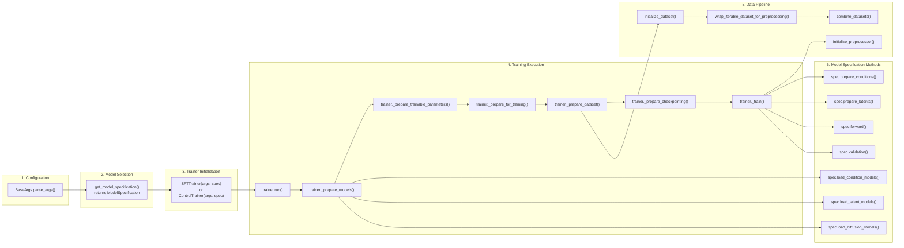

<!-- source: DeepWiki mcp.deepwiki.com · repo huggingface/finetrainers · page 10 API Reference · fetched 2026-10-26 -->

# API Reference

<details>
<summary>Relevant source files</summary>

The following files were used as context for generating this wiki page:

- [docs/dataset/README.md](docs/dataset/README.md)
- [finetrainers/args.py](finetrainers/args.py)
- [finetrainers/data/__init__.py](finetrainers/data/__init__.py)
- [finetrainers/data/dataset.py](finetrainers/data/dataset.py)
- [finetrainers/data/precomputation.py](finetrainers/data/precomputation.py)
- [finetrainers/models/cogvideox/base_specification.py](finetrainers/models/cogvideox/base_specification.py)
- [finetrainers/models/hunyuan_video/base_specification.py](finetrainers/models/hunyuan_video/base_specification.py)
- [finetrainers/models/ltx_video/base_specification.py](finetrainers/models/ltx_video/base_specification.py)
- [finetrainers/models/wan/base_specification.py](finetrainers/models/wan/base_specification.py)
- [finetrainers/models/wan/control_specification.py](finetrainers/models/wan/control_specification.py)
- [finetrainers/trainer/sft_trainer/trainer.py](finetrainers/trainer/sft_trainer/trainer.py)
- [tests/data/test_dataset.py](tests/data/test_dataset.py)
- [tests/data/test_precomputation.py](tests/data/test_precomputation.py)

</details>


This page provides comprehensive API documentation for the finetrainers library, organized by functional area. It covers the public classes, functions, and their signatures that users interact with when training diffusion models.

For step-by-step usage examples and workflow guides, see [Training Workflows](#4). For detailed explanations of system design, see [Core Concepts](#3). For information on extending the library with custom implementations, see [Extending Finetrainers](#9).

## API Organization

The finetrainers API is organized into four main categories:

1. **Trainer API** ([#10.1](#10.1)) - Training orchestration classes that manage the complete training lifecycle
2. **Data API** ([#10.2](#10.2)) - Dataset loading, preprocessing, and data pipeline components
3. **Model API** ([#10.3](#10.3)) - Model specification interfaces and implementations for supported architectures
4. **Configuration API** ([#10.4](#10.4)) - Command-line argument parsing and configuration management

## Core API Architecture

```mermaid
graph TB
    subgraph "Entry Point"
        CLI["train.py"]
    end
    
    subgraph "Configuration Layer"
        BaseArgs["BaseArgs<br/>[args.py:85-630]"]
        SFTLowRankConfig["SFTLowRankConfig<br/>[trainer/sft_trainer/config.py]"]
        SFTFullRankConfig["SFTFullRankConfig<br/>[trainer/sft_trainer/config.py]"]
        ControlLowRankConfig["ControlLowRankConfig<br/>[trainer/control_trainer/config.py]"]
        ControlFullRankConfig["ControlFullRankConfig<br/>[trainer/control_trainer/config.py]"]
    end
    
    subgraph "Trainer Layer"
        Trainer["Trainer<br/>[trainer/base.py]"]
        SFTTrainer["SFTTrainer<br/>[trainer/sft_trainer/trainer.py:33-829]"]
        ControlTrainer["ControlTrainer<br/>[trainer/control_trainer/trainer.py]"]
    end
    
    subgraph "Model Specification Layer"
        ModelSpecification["ModelSpecification<br/>[models/modeling_utils.py]"]
        WanModelSpecification["WanModelSpecification<br/>[models/wan/base_specification.py:210-578]"]
        HunyuanVideoModelSpecification["HunyuanVideoModelSpecification<br/>[models/hunyuan_video/base_specification.py:75-392]"]
        LTXVideoModelSpecification["LTXVideoModelSpecification<br/>[models/ltx_video/base_specification.py:93-441]"]
        CogVideoXModelSpecification["CogVideoXModelSpecification<br/>[models/cogvideox/base_specification.py:79-361]"]
        ControlModelSpecification["ControlModelSpecification<br/>[models/modeling_utils.py]"]
        WanControlModelSpecification["WanControlModelSpecification<br/>[models/wan/control_specification.py:36-438]"]
    end
    
    subgraph "Data Pipeline Layer"
        initialize_dataset["initialize_dataset()<br/>[data/dataset.py]"]
        ImageCaptionFilePairDataset["ImageCaptionFilePairDataset<br/>[data/dataset.py:44-115]"]
        VideoCaptionFilePairDataset["VideoCaptionFilePairDataset<br/>[data/dataset.py:117-188]"]
        ImageWebDataset["ImageWebDataset<br/>[data/dataset.py:422-514]"]
        VideoWebDataset["VideoWebDataset<br/>[data/dataset.py:516-617]"]
        initialize_preprocessor["initialize_preprocessor()<br/>[data/precomputation.py:16-30]"]
        InMemoryDistributedDataPreprocessor["InMemoryDistributedDataPreprocessor<br/>[data/precomputation.py:44-133]"]
        PrecomputedDistributedDataPreprocessor["PrecomputedDistributedDataPreprocessor<br/>[data/precomputation.py:135-260]"]
        ResolutionSampler["ResolutionSampler<br/>[data/sampler.py]"]
    end
    
    subgraph "Processor Layer"
        ProcessorMixin["ProcessorMixin<br/>[processors/base.py]"]
        T5Processor["T5Processor<br/>[processors/t5.py]"]
        CLIPPooledProcessor["CLIPPooledProcessor<br/>[processors/clip.py]"]
        LlamaProcessor["LlamaProcessor<br/>[processors/llama.py]"]
        WanLatentEncodeProcessor["WanLatentEncodeProcessor<br/>[models/wan/base_specification.py:30-82]"]
        HunyuanLatentEncodeProcessor["HunyuanLatentEncodeProcessor<br/>[models/hunyuan_video/base_specification.py:28-73]"]
    end
    
    CLI --> BaseArgs
    BaseArgs --> SFTLowRankConfig
    BaseArgs --> SFTFullRankConfig
    BaseArgs --> ControlLowRankConfig
    BaseArgs --> ControlFullRankConfig
    
    SFTLowRankConfig --> SFTTrainer
    SFTFullRankConfig --> SFTTrainer
    ControlLowRankConfig --> ControlTrainer
    ControlFullRankConfig --> ControlTrainer
    
    SFTTrainer -.implements.-> Trainer
    ControlTrainer -.implements.-> Trainer
    
    SFTTrainer --> ModelSpecification
    ControlTrainer --> ControlModelSpecification
    
    ModelSpecification <|-- WanModelSpecification
    ModelSpecification <|-- HunyuanVideoModelSpecification
    ModelSpecification <|-- LTXVideoModelSpecification
    ModelSpecification <|-- CogVideoXModelSpecification
    ControlModelSpecification <|-- WanControlModelSpecification
    
    SFTTrainer --> initialize_dataset
    ControlTrainer --> initialize_dataset
    
    initialize_dataset --> ImageCaptionFilePairDataset
    initialize_dataset --> VideoCaptionFilePairDataset
    initialize_dataset --> ImageWebDataset
    initialize_dataset --> VideoWebDataset
    
    SFTTrainer --> initialize_preprocessor
    ControlTrainer --> initialize_preprocessor
    
    initialize_preprocessor --> InMemoryDistributedDataPreprocessor
    initialize_preprocessor --> PrecomputedDistributedDataPreprocessor
    
    SFTTrainer --> ResolutionSampler
    ControlTrainer --> ResolutionSampler
    
    ModelSpecification --> ProcessorMixin
    ProcessorMixin <|-- T5Processor
    ProcessorMixin <|-- CLIPPooledProcessor
    ProcessorMixin <|-- LlamaProcessor
    ProcessorMixin <|-- WanLatentEncodeProcessor
    ProcessorMixin <|-- HunyuanLatentEncodeProcessor
```

**Core API Class Hierarchy**

This diagram shows the inheritance and composition relationships between major API components. The trainer classes orchestrate training, model specifications define model-specific behavior, and the data pipeline handles loading and preprocessing.

Sources: [finetrainers/trainer/sft_trainer/trainer.py:33-829](), [finetrainers/args.py:85-630](), [finetrainers/models/wan/base_specification.py:210-578](), [finetrainers/data/dataset.py:44-617](), [finetrainers/data/precomputation.py:16-260]()

## API Usage Pattern



**Typical API Call Flow**

This diagram shows the sequence of API calls during a typical training run, from configuration parsing through model loading, dataset preparation, and training execution.

Sources: [finetrainers/trainer/sft_trainer/trainer.py:71-84](), [finetrainers/trainer/sft_trainer/trainer.py:85-95](), [finetrainers/trainer/sft_trainer/trainer.py:236-275](), [finetrainers/data/dataset.py]()

## Key API Classes by Category

### Trainer Classes

| Class | Location | Purpose |
|-------|----------|---------|
| `Trainer` | [finetrainers/trainer/base.py]() | Abstract base class for all trainers with shared functionality |
| `SFTTrainer` | [finetrainers/trainer/sft_trainer/trainer.py:33]() | Supervised fine-tuning trainer for standard text-to-video/image generation |
| `ControlTrainer` | [finetrainers/trainer/control_trainer/trainer.py]() | Control-conditioned training with frame conditioning support |

### Configuration Classes

| Class | Location | Purpose |
|-------|----------|---------|
| `BaseArgs` | [finetrainers/args.py:85]() | Core argument container with all training parameters |
| `AttentionProviderArgs` | [finetrainers/args.py:27]() | Configuration for attention implementation selection |
| `SFTLowRankConfig` | [finetrainers/trainer/sft_trainer/config.py]() | LoRA-specific configuration for SFT training |
| `SFTFullRankConfig` | [finetrainers/trainer/sft_trainer/config.py]() | Full fine-tuning configuration for SFT training |
| `ControlLowRankConfig` | [finetrainers/trainer/control_trainer/config.py]() | LoRA-specific configuration for control training |
| `ControlFullRankConfig` | [finetrainers/trainer/control_trainer/config.py]() | Full fine-tuning configuration for control training |
| `ArgsConfigMixin` | [finetrainers/utils/args.py]() | Mixin for modular argument group registration |

### Model Specification Classes

| Class | Location | Purpose |
|-------|----------|---------|
| `ModelSpecification` | [finetrainers/models/modeling_utils.py]() | Abstract interface for model-specific implementations |
| `ControlModelSpecification` | [finetrainers/models/modeling_utils.py]() | Extended interface for control-conditioned models |
| `WanModelSpecification` | [finetrainers/models/wan/base_specification.py:210]() | Wan T2V/I2V model implementation |
| `WanControlModelSpecification` | [finetrainers/models/wan/control_specification.py:36]() | Wan control model implementation |
| `HunyuanVideoModelSpecification` | [finetrainers/models/hunyuan_video/base_specification.py:75]() | HunyuanVideo model implementation |
| `LTXVideoModelSpecification` | [finetrainers/models/ltx_video/base_specification.py:93]() | LTX-Video model implementation |
| `CogVideoXModelSpecification` | [finetrainers/models/cogvideox/base_specification.py:79]() | CogVideoX model implementation |
| `CogView4ModelSpecification` | [finetrainers/models/cogview4/base_specification.py]() | CogView4 image generation implementation |
| `FluxModelSpecification` | [finetrainers/models/flux/base_specification.py]() | Flux model implementation |

### Dataset Classes

| Class | Location | Purpose |
|-------|----------|---------|
| `ImageCaptionFilePairDataset` | [finetrainers/data/dataset.py:44]() | Caption-image filename pair format |
| `VideoCaptionFilePairDataset` | [finetrainers/data/dataset.py:117]() | Caption-video filename pair format |
| `ImageFileCaptionFileListDataset` | [finetrainers/data/dataset.py:190]() | List-based image dataset format |
| `VideoFileCaptionFileListDataset` | [finetrainers/data/dataset.py:269]() | List-based video dataset format |
| `ImageFolderDataset` | [finetrainers/data/dataset.py:348]() | HF datasets imagefolder format |
| `VideoFolderDataset` | [finetrainers/data/dataset.py:385]() | HF datasets videofolder format |
| `ImageWebDataset` | [finetrainers/data/dataset.py:422]() | WebDataset format for images |
| `VideoWebDataset` | [finetrainers/data/dataset.py:516]() | WebDataset format for videos |
| `ValidationDataset` | [finetrainers/data/dataset.py]() | CSV/JSON validation dataset loader |

### Preprocessor Classes

| Class | Location | Purpose |
|-------|----------|---------|
| `InMemoryDistributedDataPreprocessor` | [finetrainers/data/precomputation.py:44]() | In-memory preprocessing without disk caching |
| `PrecomputedDistributedDataPreprocessor` | [finetrainers/data/precomputation.py:135]() | Disk-cached preprocessing for memory efficiency |
| `InMemoryDataIterable` | [finetrainers/data/precomputation.py:262]() | Iterator for in-memory preprocessed data |
| `PrecomputedDataIterable` | [finetrainers/data/precomputation.py:298]() | Iterator for disk-cached preprocessed data |
| `ResolutionSampler` | [finetrainers/data/sampler.py]() | Resolution bucketing and batch sampling |

### Processor Classes

| Class | Location | Purpose |
|-------|----------|---------|
| `ProcessorMixin` | [finetrainers/processors/base.py]() | Base class for data processors |
| `T5Processor` | [finetrainers/processors/t5.py]() | T5 text encoder processing |
| `CLIPPooledProcessor` | [finetrainers/processors/clip.py]() | CLIP pooled text embedding processing |
| `LlamaProcessor` | [finetrainers/processors/llama.py]() | Llama text encoder processing |
| `WanLatentEncodeProcessor` | [finetrainers/models/wan/base_specification.py:30]() | Wan VAE latent encoding |
| `HunyuanLatentEncodeProcessor` | [finetrainers/models/hunyuan_video/base_specification.py:28]() | HunyuanVideo VAE latent encoding |
| `LTXLatentEncodeProcessor` | [finetrainers/models/ltx_video/base_specification.py:32]() | LTX-Video VAE latent encoding |
| `CogVideoXLatentEncodeProcessor` | [finetrainers/models/cogvideox/base_specification.py:31]() | CogVideoX VAE latent encoding |

## Core API Functions

### Data Loading Functions

| Function | Location | Signature | Purpose |
|----------|----------|-----------|---------|
| `initialize_dataset` | [finetrainers/data/dataset.py]() | `(dataset_name_or_root: str, dataset_type: str, streaming: bool, infinite: bool, **kwargs)` | Auto-detect and initialize dataset from path or name |
| `wrap_iterable_dataset_for_preprocessing` | [finetrainers/data/dataset.py]() | `(dataset, dataset_type: str, config: Dict)` | Wrap dataset with preprocessing transformations |
| `combine_datasets` | [finetrainers/data/dataset.py]() | `(datasets: List, buffer_size: int, shuffle: bool)` | Combine multiple datasets with shuffling |
| `initialize_preprocessor` | [finetrainers/data/precomputation.py:16]() | `(rank: int, world_size: int, num_items: int, processor_fn: Dict, save_dir: str, enable_precomputation: bool, enable_reuse: bool)` | Create preprocessor instance based on configuration |

### Model Loading Functions

| Function | Location | Signature | Purpose |
|----------|----------|-----------|---------|
| `get_model_specification` | [finetrainers/config.py]() | `(model_name: str, training_type: str, **kwargs) -> ModelSpecification` | Get model specification instance for given model and training type |

### Utility Functions

| Function | Location | Purpose |
|----------|----------|---------|
| `get_optimizer` | [finetrainers/optimizer.py]() | Create optimizer instance from configuration |
| `get_lr_scheduler` | [finetrainers/optimizer.py]() | Create learning rate scheduler from configuration |
| `attention_dispatch` | [finetrainers/models/attention_dispatch.py]() | Route attention operations to configured provider |

Sources: [finetrainers/data/dataset.py](), [finetrainers/data/precomputation.py:16-30](), [finetrainers/config.py]()

## Model Specification Interface

The `ModelSpecification` interface is the core abstraction for supporting different diffusion models. All model implementations must provide these methods:

| Method | Returns | Purpose |
|--------|---------|---------|
| `load_condition_models()` | `Dict[str, torch.nn.Module]` | Load tokenizers and text encoders |
| `load_latent_models()` | `Dict[str, torch.nn.Module]` | Load VAE and image processors |
| `load_diffusion_models()` | `Dict[str, torch.nn.Module]` | Load transformer/UNet and scheduler |
| `load_pipeline(**kwargs)` | `DiffusionPipeline` | Create inference pipeline |
| `prepare_conditions(**kwargs)` | `Dict[str, Any]` | Encode text prompts to embeddings |
| `prepare_latents(**kwargs)` | `Dict[str, torch.Tensor]` | Encode images/videos to latents |
| `collate_conditions(batch)` | `Dict[str, torch.Tensor]` | Collate condition batches |
| `collate_latents(batch)` | `Dict[str, torch.Tensor]` | Collate latent batches |
| `forward(**kwargs)` | `Tuple[torch.Tensor, ...]` | Execute diffusion forward pass |
| `validation(**kwargs)` | `List[ArtifactType]` | Generate validation samples |
| `apply_tensor_parallel(**kwargs)` | `None` | Apply tensor parallelism to model |

Sources: [finetrainers/models/modeling_utils.py](), [finetrainers/models/wan/base_specification.py:210-578]()

## Trainer Lifecycle Methods

Both `SFTTrainer` and `ControlTrainer` follow this lifecycle:

| Method | Called By | Purpose |
|--------|-----------|---------|
| `run()` | User code | Main entry point, orchestrates full training run |
| `_prepare_models()` | `run()` | Load all model components via ModelSpecification |
| `_prepare_trainable_parameters()` | `run()` | Configure LoRA adapters or full parameters |
| `_prepare_for_training()` | `run()` | Apply parallelism, compile, initialize optimizer |
| `_prepare_dataset()` | `run()` | Load and wrap datasets with preprocessing |
| `_prepare_checkpointing()` | `run()` | Setup checkpoint manager and resume logic |
| `_train()` | `run()` | Execute main training loop |
| `_validate(step, final_validation)` | `_train()` | Run validation and save artifacts |
| `_init_pipeline(final_validation)` | `_validate()` | Initialize inference pipeline for validation |

Sources: [finetrainers/trainer/sft_trainer/trainer.py:71-84](), [finetrainers/trainer/sft_trainer/trainer.py:85-582]()

## Configuration System

The configuration system uses a mixin pattern for modularity:

```mermaid
graph TB
    subgraph "Base Configuration"
        BaseArgs["BaseArgs"]
    end
    
    subgraph "Argument Mixins"
        ArgsConfigMixin["ArgsConfigMixin<br/>(Abstract)"]
        AttentionProviderArgs["AttentionProviderArgs"]
        CustomMixin["Custom Mixin<br/>(User-defined)"]
    end
    
    subgraph "Specialized Configs"
        SFTLowRankConfig["SFTLowRankConfig"]
        SFTFullRankConfig["SFTFullRankConfig"]
        ControlLowRankConfig["ControlLowRankConfig"]
        ControlFullRankConfig["ControlFullRankConfig"]
    end
    
    subgraph "Mixin Methods"
        add_args["add_args(parser)"]
        map_args["map_args(argparse_args, mapped_args)"]
        validate_args["validate_args(args)"]
        to_dict["to_dict()"]
    end
    
    BaseArgs --> ArgsConfigMixin
    ArgsConfigMixin <|-- AttentionProviderArgs
    ArgsConfigMixin <|-- CustomMixin
    
    BaseArgs --> SFTLowRankConfig
    BaseArgs --> SFTFullRankConfig
    BaseArgs --> ControlLowRankConfig
    BaseArgs --> ControlFullRankConfig
    
    ArgsConfigMixin --> add_args
    ArgsConfigMixin --> map_args
    ArgsConfigMixin --> validate_args
    ArgsConfigMixin --> to_dict
```

**Configuration Class Hierarchy**

The mixin pattern allows modular argument groups to be registered with `BaseArgs`, which then aggregates all registered mixins during parsing.

Sources: [finetrainers/args.py:85-630](), [finetrainers/args.py:27-83](), [finetrainers/utils/args.py]()

### ArgsConfigMixin Interface

To create a custom argument group:

```python
class ArgsConfigMixin:
    """Base class for modular argument groups."""
    
    def add_args(self, parser: argparse.ArgumentParser) -> None:
        """Add arguments to the parser."""
        raise NotImplementedError
    
    def map_args(self, argparse_args: argparse.Namespace, mapped_args: "BaseArgs") -> None:
        """Map parsed arguments to configuration attributes."""
        raise NotImplementedError
    
    def validate_args(self, args: "BaseArgs") -> None:
        """Validate argument values and combinations."""
        raise NotImplementedError
    
    def to_dict(self) -> Dict[str, Any]:
        """Serialize arguments to dictionary."""
        raise NotImplementedError
```

Sources: [finetrainers/utils/args.py]()

## Data Pipeline API

### Dataset Auto-Detection

The `initialize_dataset` function auto-detects dataset format:

| Format | Detection Logic | Class Used |
|--------|-----------------|------------|
| Caption-file pairs | `*.txt` files with matching `*.jpg/mp4` | `ImageCaptionFilePairDataset` or `VideoCaptionFilePairDataset` |
| File list format | `prompts.txt` + `images.txt/videos.txt` exists | `ImageFileCaptionFileListDataset` or `VideoFileCaptionFileListDataset` |
| Folder format | `metadata.csv/json/jsonl` exists | `ImageFolderDataset` or `VideoFolderDataset` |
| WebDataset | HF Hub dataset name | `ImageWebDataset` or `VideoWebDataset` |

Sources: [finetrainers/data/dataset.py]()

### Preprocessor API

Preprocessors handle embedding computation and caching:

| Method | InMemoryDistributedDataPreprocessor | PrecomputedDistributedDataPreprocessor |
|--------|-------------------------------------|----------------------------------------|
| `consume(data_type, components, data_iterator, **kwargs)` | Processes `num_items` in memory, returns iterator | Processes `num_items` to disk, returns iterator from disk |
| `consume_once(data_type, components, data_iterator, **kwargs)` | Processes all data once, reuses iterator | Processes all data once to disk, reuses iterator from disk |
| `requires_data` (property) | Returns `True` when iterator exhausted | Returns `True` when iterator exhausted |

Sources: [finetrainers/data/precomputation.py:44-133](), [finetrainers/data/precomputation.py:135-260]()

### ResolutionSampler API

The `ResolutionSampler` handles variable-resolution batching:

| Method | Purpose |
|--------|---------|
| `consume(condition_item, latent_item)` | Add item to internal buffer |
| `is_ready` (property) | Returns `True` when batch is ready |
| `get_batch()` | Returns collated condition and latent batches |

Sources: [finetrainers/data/sampler.py]()

## Processor API

Processors implement data transformations for model inputs:

| Method | Signature | Purpose |
|--------|-----------|---------|
| `forward(**kwargs)` | `(**kwargs) -> Dict[str, Any]` | Transform input data and return processed outputs |

Example processors:

**T5Processor** - Tokenizes and encodes text with T5:
- Input: `tokenizer`, `text_encoder`, `caption`, `max_sequence_length`
- Output: `encoder_hidden_states`, `encoder_attention_mask`

**WanLatentEncodeProcessor** - Encodes video to latents:
- Input: `vae`, `image`/`video`, `generator`, `compute_posterior`
- Output: `latents`, `latents_mean`, `latents_std`

Sources: [finetrainers/processors/base.py](), [finetrainers/processors/t5.py](), [finetrainers/models/wan/base_specification.py:30-82]()

## Parallel Backend API

The parallel backend abstraction supports different distribution strategies:

| Class | Supported Parallelism | Use Case |
|-------|----------------------|----------|
| `AccelerateParallelBackend` | DDP only | Single-node training |
| `PytorchDTensorParallelBackend` | DDP, FSDP2, HSDP, TP, CP, PP | Multi-node, multi-dimensional parallelism |

Key methods:

| Method | Purpose |
|--------|---------|
| `prepare_model(model)` | Prepare model for training |
| `apply_ddp(model, mesh)` | Apply DDP to model |
| `apply_fsdp2(model, **kwargs)` | Apply FSDP2 to model |
| `apply_context_parallel(model, mesh)` | Apply context parallelism |
| `prepare_optimizer(optimizer, scheduler)` | Prepare optimizer for distributed training |
| `prepare_dataset(dataset)` | Split dataset by DP rank |
| `prepare_dataloader(dataset, **kwargs)` | Create distributed dataloader |
| `get_checkpointer(**kwargs)` | Create checkpointer instance |
| `log(logs, step)` | Log metrics to tracker |
| `wait_for_everyone()` | Synchronize all processes |

Sources: [finetrainers/parallel/base.py](), [finetrainers/parallel/ptd.py](), [finetrainers/parallel/accelerate.py]()

## Artifact Types

Validation outputs use typed artifact classes:

| Class | Location | Purpose |
|-------|----------|---------|
| `ImageArtifact` | [finetrainers/data/_artifact.py]() | Wraps PIL Image for validation output |
| `VideoArtifact` | [finetrainers/data/_artifact.py]() | Wraps List[PIL Image] for validation output |

These artifacts provide uniform handling of validation results across different model types.

Sources: [finetrainers/data/_artifact.py]()

## Type Annotations

Common type aliases used throughout the API:

| Type | Definition | Usage |
|------|------------|-------|
| `ArtifactType` | `Union[ImageArtifact, VideoArtifact]` | Validation outputs |
| `SchedulerType` | Scheduler classes from diffusers | Noise schedulers |
| `BaseArgsType` | `Union[BaseArgs, AttentionProviderArgs]` | Configuration objects |

Sources: [finetrainers/typing.py](), [finetrainers/args.py:23-24]()

---

