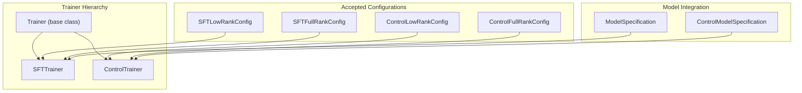
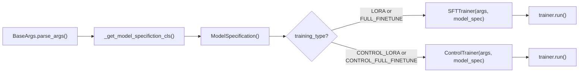

<!-- source: DeepWiki mcp.deepwiki.com · repo huggingface/finetrainers · page 10.1 Trainer API · fetched 2026-10-26 -->

# Trainer API

<details>
<summary>Relevant source files</summary>

The following files were used as context for generating this wiki page:

- [docs/args.md](docs/args.md)
- [finetrainers/args.py](finetrainers/args.py)
- [finetrainers/state.py](finetrainers/state.py)
- [finetrainers/trainer/control_trainer/trainer.py](finetrainers/trainer/control_trainer/trainer.py)
- [finetrainers/trainer/sft_trainer/trainer.py](finetrainers/trainer/sft_trainer/trainer.py)
- [tests/trainer/test_control_trainer.py](tests/trainer/test_control_trainer.py)
- [train.py](train.py)

</details>


This page provides comprehensive API documentation for the trainer classes in finetrainers. It covers the `SFTTrainer` and `ControlTrainer` classes, their methods, parameters, and lifecycle. For information about configuration classes that these trainers accept, see [Configuration API](#10.4). For model-specific implementation details, see [Model API](#10.3). For data pipeline integration, see [Data API](#10.2).

## Overview

The trainer API consists of two primary classes that orchestrate the complete training workflow:

- **`SFTTrainer`**: Supervised fine-tuning for standard diffusion model training
- **`ControlTrainer`**: Specialized trainer for control-conditioned generation

Both trainers inherit from a common `Trainer` base class [finetrainers/trainer/base.py]() and follow an identical lifecycle pattern with six preparation phases followed by the training loop.



**Trainer Initialization Pattern**

Sources: [finetrainers/trainer/sft_trainer/trainer.py:33-70](), [finetrainers/trainer/control_trainer/trainer.py:37-74](), [train.py:14-76]()

---

## SFTTrainer

**Class:** `finetrainers.trainer.sft_trainer.trainer.SFTTrainer`

The `SFTTrainer` class manages supervised fine-tuning for diffusion models, supporting both LoRA and full fine-tuning strategies.

### Constructor

```python
SFTTrainer(args: ArgsType, model_specification: models.ModelSpecification)
```

**Parameters:**

| Parameter | Type | Description |
|-----------|------|-------------|
| `args` | `Union[BaseArgsType, SFTFullRankConfig, SFTLowRankConfig]` | Configuration object containing all training parameters |
| `model_specification` | `models.ModelSpecification` | Model specification instance that defines model loading and forward pass logic |

**Attributes:**

The trainer initializes the following component attributes to `None`, which are populated during `_prepare_models()`:

- **Tokenizers:** `tokenizer`, `tokenizer_2`, `tokenizer_3`
- **Text Encoders:** `text_encoder`, `text_encoder_2`, `text_encoder_3`
- **Image Components:** `image_encoder`, `image_processor`
- **Denoisers:** `transformer`, `unet`
- **VAE:** `vae`
- **Scheduler:** `scheduler`
- **Training Components:** `optimizer`, `lr_scheduler`, `checkpointer`

Sources: [finetrainers/trainer/sft_trainer/trainer.py:33-70]()

### Primary Methods

#### run()

```python
def run(self) -> None
```

Entry point that executes the complete training workflow. Orchestrates six preparation phases followed by training.

**Execution Flow:**
1. `_prepare_models()`
2. `_prepare_trainable_parameters()`
3. `_prepare_for_training()`
4. `_prepare_dataset()`
5. `_prepare_checkpointing()`
6. `_train()`

On exception, destroys the parallel backend and re-raises.

Sources: [finetrainers/trainer/sft_trainer/trainer.py:71-83]()

---

#### _prepare_models()

```python
def _prepare_models(self) -> None
```

Loads all diffusion model components via `model_specification.load_diffusion_models()` and sets them as trainer attributes. Raises `NotImplementedError` if pipeline parallelism is enabled (not yet supported).

Sources: [finetrainers/trainer/sft_trainer/trainer.py:85-94]()

---

#### _prepare_trainable_parameters()

```python
def _prepare_trainable_parameters(self) -> None
```

Configures which parameters require gradients based on training type:

**Full Fine-tuning (`TrainingType.FULL_FINETUNE`):**
- Enables gradients for all transformer parameters
- Applies parameter dtype from `args.transformer_dtype`

**LoRA Training (`TrainingType.LORA`):**
- Freezes transformer base parameters
- Applies layerwise upcasting if specified via `args.layerwise_upcasting_modules`
- Creates `LoraConfig` with parameters:
  - `r`: `args.rank`
  - `lora_alpha`: `args.lora_alpha`
  - `target_modules`: `args.target_modules`
- Adds adapter to transformer via `transformer.add_adapter()`
- Casts trainable parameters to `torch.float32` if data sharding is disabled

Sources: [finetrainers/trainer/sft_trainer/trainer.py:96-137]()

---

#### _prepare_for_training()

```python
def _prepare_for_training(self) -> None
```

Applies parallelism strategies, optimization, and initializes infrastructure.

**Parallelism Application (in order):**
1. Context Parallel: `parallel_backend.apply_context_parallel()` if `cp_degree > 1`
2. Tensor Parallel: `model_specification.apply_tensor_parallel()` if `tp_degree > 1`
3. Gradient Checkpointing: `utils.apply_activation_checkpointing()` if enabled
4. Torch Compile: `_maybe_torch_compile()` if `compile_modules` specified
5. Data Parallelism:
   - FSDP2/HSDP: `parallel_backend.apply_fsdp2()` if `dp_shards > 1`
   - DDP: `parallel_backend.apply_ddp()` if `dp_degree > 1`

**Optimization Setup:**
- Creates optimizer via `optimizer.get_optimizer()` with parameters from args
- Creates LR scheduler via `optimizer.get_lr_scheduler()` with warmup configuration
- Wraps both via `parallel_backend.prepare_optimizer()`

**Infrastructure:**
- Initializes `TrainState` instance
- Calls `_init_logging()`, `_init_trackers()`, `_init_directories_and_repositories()`

Sources: [finetrainers/trainer/sft_trainer/trainer.py:138-234]()

---

#### _prepare_dataset()

```python
def _prepare_dataset(self) -> None
```

Loads and prepares datasets from the JSON configuration file specified in `args.dataset_config`.

**Configuration Format:**
```json
{
  "datasets": [
    {
      "data_root": "path/to/data",
      "dataset_type": "video",
      "video_resolution_buckets": [[16, 256, 256]],
      "reshape_mode": "bicubic",
      "caption_options": {}
    }
  ]
}
```

**Process:**
1. Loads JSON from `args.dataset_config`
2. For each dataset configuration:
   - Calls `data.initialize_dataset()` with dataset path and type
   - Validates precomputation compatibility if `args.precomputation_once` is enabled
   - Wraps with `parallel_backend.prepare_dataset()` for distributed splitting
   - Wraps with `data.wrap_iterable_dataset_for_preprocessing()` for bucketing
3. Combines all datasets with `data.combine_datasets()` with shuffling
4. Creates dataloader via `parallel_backend.prepare_dataloader()`

**Attributes Set:**
- `self.dataset`: Combined, preprocessed dataset
- `self.dataloader`: DataLoader instance with specified workers and batch size

Sources: [finetrainers/trainer/sft_trainer/trainer.py:236-274]()

---

#### _prepare_checkpointing()

```python
def _prepare_checkpointing(self) -> None
```

Sets up checkpointing infrastructure with a callback hook for saving model weights.

**Save Model Hook:**
The hook function `save_model_hook(state_dict)` is called during checkpoint saving:
- Unwraps model state dict from parallelism wrappers
- For LoRA training:
  - Extracts PEFT adapter state via `get_peft_model_state_dict()`
  - Saves to `{output_dir}/lora_weights/{step:06d}/` via `model_specification._save_lora_weights()`
  - Includes metadata: rank, lora_alpha, target_modules
- For full fine-tuning:
  - Saves full model to `{output_dir}/model_weights/{step:06d}/` via `model_specification._save_model()`

**Checkpointer Creation:**
```python
self.checkpointer = parallel_backend.get_checkpointer(
    dataloader=self.dataloader,
    model_parts=[self.transformer],
    optimizers=self.optimizer,
    schedulers=self.lr_scheduler,
    states={"train_state": self.state.train_state},
    checkpointing_steps=self.args.checkpointing_steps,
    checkpointing_limit=self.args.checkpointing_limit,
    output_dir=self.args.output_dir,
    enable=enable_state_checkpointing,
    _callback_fn=save_model_hook
)
```

**Resume Support:**
If `args.resume_from_checkpoint` is provided:
- Accepts integer step number or string `"latest"` (converted to `-1`)
- Calls `checkpointer.load(resume_from_checkpoint)` to restore state

Sources: [finetrainers/trainer/sft_trainer/trainer.py:276-326]()

---

#### _train()

```python
def _train(self) -> None
```

Executes the main training loop with forward/backward passes, gradient accumulation, checkpointing, and validation.

**Training Loop Structure:**

```mermaid
graph TD
    Start["Training Loop Start"] --> CheckData{"Preprocessor<br/>requires_data?"}
    CheckData -->|Yes| PrepData["_prepare_data()<br/>condition_iterator, latent_iterator"]
    CheckData -->|No| ConsumeBatch
    PrepData --> ConsumeBatch["Get next condition/latent items<br/>sampler.consume()"]
    
    ConsumeBatch --> CheckReady{"sampler.is_ready?"}
    CheckReady -->|No| CheckData
    CheckReady -->|Yes| GetBatch["sampler.get_batch()<br/>collate_conditions()<br/>collate_latents()"]
    
    GetBatch --> IncrStep["train_state.step += 1"]
    IncrStep --> PrepSigmas["prepare_sigmas()<br/>Sample timesteps"]
    PrepSigmas --> Forward["model_specification.forward()<br/>pred, target, sigmas"]
    
    Forward --> Loss["Compute MSE loss<br/>weights * (pred - target)^2"]
    Loss --> Backward["loss.backward()"]
    Backward --> ClipGrad["Clip gradients<br/>max_grad_norm"]
    
    ClipGrad --> CheckAccum{"step %<br/>grad_accum_steps<br/>== 0?"}
    CheckAccum -->|Yes| OptimStep["optimizer.step()<br/>lr_scheduler.step()<br/>optimizer.zero_grad()"]
    CheckAccum -->|No| Log
    
    OptimStep --> Log["Log metrics"]
    Log --> CheckCkpt{"Checkpoint<br/>step?"}
    CheckCkpt -->|Yes| SaveCkpt["checkpointer.save()"]
    CheckCkpt -->|No| CheckVal
    
    SaveCkpt --> CheckVal{"Validation<br/>step?"}
    CheckVal -->|Yes| Validate["_validate()"]
    CheckVal -->|No| CheckContinue
    
    Validate --> CheckContinue{"step < train_steps<br/>&&<br/>samples < max_samples?"}
    CheckContinue -->|Yes| CheckData
    CheckContinue -->|No| FinalCkpt["Final checkpoint"]
    FinalCkpt --> FinalVal["Final validation"]
    FinalVal --> Upload["Upload to Hub<br/>(if push_to_hub)"]
    Upload --> End["Cleanup & destroy backend"]
```



**Key Components:**

| Component | Description |
|-----------|-------------|
| **Preprocessor** | Manages condition/latent computation via `data.initialize_preprocessor()` |
| **ResolutionSampler** | Batches items by resolution bucket via `data.ResolutionSampler()` |
| **Generator** | PyTorch RNG seeded with `args.seed` for reproducibility |
| **Scheduler Sigmas** | Pre-computed and cached on device for efficiency |
| **Attention Context** | `self.attention_provider_ctx(training=True)` wraps forward/backward |

**Loss Computation:**
- Weighted MSE: `weights * (pred.float() - target.float()).pow(2)`
- Averages across non-batch dimensions first, then batch dimension
- Divides by `gradient_accumulation_steps` if > 1

**Metrics Logged:**
- `train/global_avg_loss`: Average loss across DP/CP ranks
- `train/global_max_loss`: Maximum loss across DP/CP ranks
- `train/grad_norm`: Gradient norm (if clipping applied)
- `train/observed_data_samples`: Total samples processed

Sources: [finetrainers/trainer/sft_trainer/trainer.py:328-581]()

---

#### _validate()

```python
def _validate(self, step: int, final_validation: bool = False) -> None
```

Runs validation by generating artifacts from the validation dataset.

**Parameters:**
- `step`: Current training step for logging
- `final_validation`: If `True`, loads final checkpoint and creates pipeline from scratch

**Validation Process:**
1. Loads validation dataset from `args.validation_dataset_file`
2. Splits dataset across DP ranks for parallel generation
3. Initializes pipeline:
   - **During Training:** Reuses loaded components, keeps transformer in training mode temporarily
   - **Final Validation:** Loads full pipeline from checkpoint (LoRA or full weights)
4. Generates artifacts via `model_specification.validation(pipeline, generator, **validation_data)`
5. Saves artifacts to `{output_dir}/validation-{step}-{rank}-{index}-{prompt_filename}-{timestamp}.{ext}`
6. Gathers artifacts from all processes via `torch.distributed.all_gather_object()`
7. Logs to tracker as `wandb.Image` or `wandb.Video` objects

**Memory Management:**
- Removes pipeline hooks after validation
- Optionally deletes condition models if `enable_precomputation` is enabled
- Resets peak memory stats
- Re-enables training mode on transformer if not final validation

Sources: [finetrainers/trainer/sft_trainer/trainer.py:583-724]()

---

### Utility Methods

#### _init_pipeline()

```python
def _init_pipeline(self, final_validation: bool = False) -> DiffusionPipeline
```

Creates a `DiffusionPipeline` for inference during validation.

**Behavior:**
- **`final_validation=False`:** Reuses trainer's loaded components, excludes transformer from reload
- **`final_validation=True`:** Deletes all components and loads fresh pipeline from output directory, including final checkpoint weights

**Configuration:**
- Applies `enable_slicing`, `enable_tiling`, `enable_model_cpu_offload` from args
- For LoRA final validation: Loads adapter weights via `pipeline.load_lora_weights()`

Sources: [finetrainers/trainer/sft_trainer/trainer.py:772-820]()

---

#### _move_components_to_device()

```python
def _move_components_to_device(
    components: Optional[List[torch.nn.Module]] = None,
    device: Optional[Union[str, torch.device]] = None
) -> None
```

Moves specified model components to target device. Defaults to all non-null components and `parallel_backend.device`.

Sources: [finetrainers/trainer/sft_trainer/trainer.py:739-756]()

---

#### _set_components()

```python
def _set_components(self, components: Dict[str, Any]) -> None
```

Sets trainer attributes from a dictionary of component names to objects.

Sources: [finetrainers/trainer/sft_trainer/trainer.py:758-762]()

---

#### _delete_components()

```python
def _delete_components(self, component_names: Optional[List[str]] = None) -> None
```

Deletes specified components (or all if not specified), frees memory, and synchronizes device.

Sources: [finetrainers/trainer/sft_trainer/trainer.py:764-770]()

---

## ControlTrainer

**Class:** `finetrainers.trainer.control_trainer.trainer.ControlTrainer`

The `ControlTrainer` extends the training workflow for control-conditioned generation, modifying the input channels to accept control signals.

### Constructor

```python
ControlTrainer(args: ArgsType, model_specification: models.ControlModelSpecification)
```

**Parameters:**

| Parameter | Type | Description |
|-----------|------|-------------|
| `args` | `Union[BaseArgsType, ControlFullRankConfig, ControlLowRankConfig]` | Configuration object with control-specific parameters |
| `model_specification` | `models.ControlModelSpecification` | Control-specialized model specification |

**Additional Initialization:**
Calls `model_specification._trainer_init()` with control configuration:
- `frame_conditioning_type`: How control frames are selected ("index", "prefix", "random", "first_and_last", "full")
- `frame_conditioning_index`: Specific frame index (for "index" type)
- `frame_conditioning_concatenate_mask`: Whether to concatenate frame mask with latents

Sources: [finetrainers/trainer/control_trainer/trainer.py:37-74]()

### Key Method Differences

#### _prepare_models()

Loads diffusion models with **modified input channels**:

```python
new_in_features = self.model_specification._original_control_layer_in_features * 2
diffusion_components = self.model_specification.load_diffusion_models(new_in_features)
```

This doubles the input features to accommodate concatenated control conditions.

Sources: [finetrainers/trainer/control_trainer/trainer.py:89-100]()

---

#### _prepare_trainable_parameters()

**Control LoRA Differences:**
- Uses `_get_lora_target_modules()` method for target module selection
- Applies `rank_pattern` and `alpha_pattern` for the control injection layer:
  - Rank: `model_spec._original_control_layer_out_features`
  - Alpha: `model_spec._original_control_layer_out_features`

**QK Norm Training:**
If `args.train_qk_norm` is enabled:
- Searches for modules matching `model_spec._qk_norm_identifiers` regex patterns
- Enables gradients for matched parametric modules
- Logs matched module names

Sources: [finetrainers/trainer/control_trainer/trainer.py:102-170]()

---

#### _prepare_dataset()

Wraps the combined dataset with `IterableControlDataset`:

```python
dataset = IterableControlDataset(dataset, self.args.control_type, self.state.parallel_backend.device)
```

This dataset wrapper applies control extraction (e.g., Canny edge detection) on-the-fly.

**Control Types:**
- `ControlType.CANNY`: Applies Canny edge detection via OpenCV
- `ControlType.CUSTOM`: User-provided control images

Sources: [finetrainers/trainer/control_trainer/trainer.py:268-307]()

---

#### _prepare_checkpointing()

**Additional Checkpoint Data:**
When saving LoRA checkpoints, also saves QK norm parameters if `train_qk_norm` is enabled:

```python
qk_norm_state_dict = {
    name: parameter
    for name, parameter in state_dict.items()
    if any(re.search(identifier, name) for identifier in self.model_specification._qk_norm_identifiers)
    and parameter.numel() > 0
}
```

Passes `qk_norm_state_dict` to `model_specification._save_lora_weights()`.

Sources: [finetrainers/trainer/control_trainer/trainer.py:309-375]()

---

#### _validate()

Uses `ValidationControlDataset` instead of `ValidationDataset` to load control validation data.

Sources: [finetrainers/trainer/control_trainer/trainer.py:645-781]()

---

### Control-Specific Methods

#### _get_lora_target_modules()

```python
def _get_lora_target_modules(self) -> List[str]
```

Returns list of target modules for LoRA adaptation, excluding the control injection layer to prevent conflicts with full-rank control parameters.

Sources: [finetrainers/trainer/control_trainer/trainer.py:848-861]()

---

## Trainer Lifecycle Diagram

```mermaid
graph TB
    Init["Trainer.__init__()<br/>args, model_specification"] --> Run["run()"]
    
    Run --> PM["_prepare_models()<br/>Load diffusion components"]
    PM --> PTP["_prepare_trainable_parameters()<br/>LoRA adapters or full params"]
    PTP --> PFT["_prepare_for_training()<br/>Apply parallelism, compile"]
    PFT --> PD["_prepare_dataset()<br/>Load & preprocess data"]
    PD --> PC["_prepare_checkpointing()<br/>Setup resume logic"]
    PC --> Train["_train()<br/>Main training loop"]
    
    Train --> Loop["Loop until train_steps<br/>or max_data_samples"]
    Loop --> PrepData["Preprocess batch<br/>conditions & latents"]
    PrepData --> Forward["Forward pass<br/>model_specification.forward()"]
    Forward --> Backward["Backward pass<br/>loss.backward()"]
    Backward --> OptimStep{"Gradient<br/>accumulation<br/>complete?"}
    OptimStep -->|No| Loop
    OptimStep -->|Yes| Update["optimizer.step()<br/>lr_scheduler.step()"]
    Update --> CheckCkpt{"Checkpoint<br/>step?"}
    CheckCkpt -->|Yes| SaveCkpt["checkpointer.save()<br/>+ save_model_hook()"]
    CheckCkpt -->|No| CheckVal
    SaveCkpt --> CheckVal{"Validation<br/>step?"}
    CheckVal -->|Yes| Validate["_validate()<br/>Generate artifacts"]
    CheckVal -->|No| CheckDone
    Validate --> CheckDone{"Training<br/>complete?"}
    CheckDone -->|No| Loop
    CheckDone -->|Yes| FinalCkpt["Final checkpoint<br/>+ validation"]
    FinalCkpt --> Upload{"push_to_hub?"}
    Upload -->|Yes| UploadHub["upload_folder()<br/>to Hugging Face Hub"]
    Upload -->|No| Cleanup
    UploadHub --> Cleanup["Cleanup components<br/>parallel_backend.destroy()"]
```



Sources: [finetrainers/trainer/sft_trainer/trainer.py:71-581](), [finetrainers/trainer/control_trainer/trainer.py:75-643]()

---

## TrainState

**Class:** `finetrainers.state.TrainState`

Stateful object for tracking training progress, implementing `torch.distributed.checkpoint.stateful.Stateful` for checkpoint compatibility.

### Attributes

| Attribute | Type | Description |
|-----------|------|-------------|
| `step` | `int` | Current training step (default: 0) |
| `observed_data_samples` | `int` | Total data samples processed (default: 0) |
| `global_avg_losses` | `List[float]` | History of average losses across ranks |
| `global_max_losses` | `List[float]` | History of maximum losses across ranks |
| `log_steps` | `List[int]` | Steps at which losses were logged |

### Methods

#### state_dict()

```python
def state_dict(self) -> Dict[str, Any]
```

Returns checkpoint-compatible state dictionary with:
- `step` as `torch.int32` tensor
- `observed_data_samples` as `torch.int32` tensor
- Loss and log histories as serialized `BytesIO` objects

Sources: [finetrainers/state.py:23-38]()

---

#### load_state_dict()

```python
def load_state_dict(self, state_dict: Dict[str, Any]) -> None
```

Restores state from checkpoint dictionary, deserializing BytesIO objects for loss histories.

Sources: [finetrainers/state.py:40-49]()

---

## State

**Class:** `finetrainers.state.State`

Container for global training state, shared across trainer components.

### Attributes

| Attribute | Type | Description |
|-----------|------|-------------|
| `parallel_backend` | `ParallelBackendType` | Active parallelism backend instance |
| `train_state` | `TrainState` | Training progress tracker |
| `num_trainable_parameters` | `int` | Count of parameters requiring gradients |
| `generator` | `torch.Generator` | Seeded RNG for reproducibility |
| `repo_id` | `str` | Hugging Face Hub repository identifier |
| `output_dir` | `str` | Local output directory path |

Sources: [finetrainers/state.py:52-66]()

---

## Integration Example



**Example Usage from train.py:**

```python
# Parse arguments with training-type-specific config
args = BaseArgs()
args.register_args(SFTLowRankConfig())
args = args.parse_args()

# Get model specification class
model_specification_cls = _get_model_specifiction_cls(args.model_name, args.training_type)
model_specification = model_specification_cls(
    pretrained_model_name_or_path=args.pretrained_model_name_or_path,
    # ... other component IDs
)

# Create appropriate trainer
if args.training_type in [TrainingType.LORA, TrainingType.FULL_FINETUNE]:
    trainer = SFTTrainer(args, model_specification)
elif args.training_type in [TrainingType.CONTROL_LORA, TrainingType.CONTROL_FULL_FINETUNE]:
    trainer = ControlTrainer(args, model_specification)

# Execute training
trainer.run()
```

Sources: [train.py:13-86]()

---

## Comparison Table

| Feature | SFTTrainer | ControlTrainer |
|---------|------------|----------------|
| Base class | `Trainer` | `Trainer` |
| Config types | `SFTLowRankConfig`, `SFTFullRankConfig` | `ControlLowRankConfig`, `ControlFullRankConfig` |
| Model spec | `ModelSpecification` | `ControlModelSpecification` (subclass) |
| Input channels | Standard latent channels | 2× latent channels (with control) |
| Dataset wrapper | `IterableDatasetPreprocessingWrapper` | `IterableControlDataset` |
| LoRA rank pattern | Uniform rank for all modules | Full-rank for control layer, low-rank for others |
| QK norm training | Not supported | Optional via `train_qk_norm` |
| Frame conditioning | N/A | Configurable via `frame_conditioning_type` |
| Validation dataset | `ValidationDataset` | `ValidationControlDataset` |

Sources: [finetrainers/trainer/sft_trainer/trainer.py](), [finetrainers/trainer/control_trainer/trainer.py]()

---

