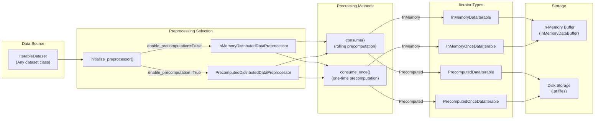

<!-- source: DeepWiki mcp.deepwiki.com · repo huggingface/finetrainers · page 10.2 Data API · fetched 2026-10-26 -->

# Data API

<details>
<summary>Relevant source files</summary>

The following files were used as context for generating this wiki page:

- [.gitignore](.gitignore)
- [README.md](README.md)
- [docs/dataset/README.md](docs/dataset/README.md)
- [examples/training/sft/cogview4/raider_white_tarot/training.json](examples/training/sft/cogview4/raider_white_tarot/training.json)
- [examples/training/sft/cogview4/raider_white_tarot/validation.json](examples/training/sft/cogview4/raider_white_tarot/validation.json)
- [finetrainers/data/__init__.py](finetrainers/data/__init__.py)
- [finetrainers/data/dataset.py](finetrainers/data/dataset.py)
- [finetrainers/data/precomputation.py](finetrainers/data/precomputation.py)
- [finetrainers/functional/__init__.py](finetrainers/functional/__init__.py)
- [finetrainers/functional/image.py](finetrainers/functional/image.py)
- [finetrainers/functional/text.py](finetrainers/functional/text.py)
- [finetrainers/functional/video.py](finetrainers/functional/video.py)
- [finetrainers/models/cogview4/__init__.py](finetrainers/models/cogview4/__init__.py)
- [finetrainers/processors/__init__.py](finetrainers/processors/__init__.py)
- [finetrainers/processors/glm.py](finetrainers/processors/glm.py)
- [tests/data/test_dataset.py](tests/data/test_dataset.py)
- [tests/data/test_precomputation.py](tests/data/test_precomputation.py)

</details>


## Overview

This page provides a comprehensive API reference for the data loading, preprocessing, and precomputation systems in finetrainers. The Data API consists of dataset classes for various formats, preprocessing utilities for batching and bucketing, and a precomputation system for efficient training with cached embeddings.

For conceptual information and usage guides, see:
- Dataset loading workflows: [Dataset Loading](#5.1)
- Preprocessing and bucketing: [Preprocessing and Resolution Bucketing](#5.2)
- Precomputation system: [Precomputation System](#5.3)

**Sources:** [finetrainers/data/__init__.py:1-27]()

---

## Dataset Class Hierarchy

The following diagram shows the organization of dataset classes and their relationships:

```mermaid
graph TB
    subgraph "Base Classes"
        IterableDataset["torch.utils.data.IterableDataset"]
        Stateful["torch.distributed.checkpoint.stateful.Stateful"]
    end
    
    subgraph "Local Dataset Classes"
        ImageCaptionFilePairDataset["ImageCaptionFilePairDataset"]
        VideoCaptionFilePairDataset["VideoCaptionFilePairDataset"]
        ImageFileCaptionFileListDataset["ImageFileCaptionFileListDataset"]
        VideoFileCaptionFileListDataset["VideoFileCaptionFileListDataset"]
        ImageFolderDataset["ImageFolderDataset"]
        VideoFolderDataset["VideoFolderDataset"]
    end
    
    subgraph "Hub Dataset Classes"
        ImageWebDataset["ImageWebDataset"]
        VideoWebDataset["VideoWebDataset"]
    end
    
    subgraph "Special Dataset Classes"
        ValidationDataset["ValidationDataset"]
        IterableDatasetPreprocessingWrapper["IterableDatasetPreprocessingWrapper"]
        IterableCombinedDataset["IterableCombinedDataset"]
    end
    
    IterableDataset --> ImageCaptionFilePairDataset
    IterableDataset --> VideoCaptionFilePairDataset
    IterableDataset --> ImageFileCaptionFileListDataset
    IterableDataset --> VideoFileCaptionFileListDataset
    IterableDataset --> ImageFolderDataset
    IterableDataset --> VideoFolderDataset
    IterableDataset --> ImageWebDataset
    IterableDataset --> VideoWebDataset
    IterableDataset --> ValidationDataset
    IterableDataset --> IterableDatasetPreprocessingWrapper
    IterableDataset --> IterableCombinedDataset
    
    Stateful --> ImageCaptionFilePairDataset
    Stateful --> VideoCaptionFilePairDataset
    Stateful --> ImageFileCaptionFileListDataset
    Stateful --> VideoFileCaptionFileListDataset
    Stateful --> ImageFolderDataset
    Stateful --> VideoFolderDataset
    Stateful --> ImageWebDataset
    Stateful --> VideoWebDataset
    Stateful --> IterableDatasetPreprocessingWrapper
    Stateful --> IterableCombinedDataset
```



**Sources:** [finetrainers/data/dataset.py:44-820]()

---

## Local Dataset Classes

### ImageCaptionFilePairDataset

Loads image-caption pairs from a directory where each image file has a corresponding `.txt` caption file with the same basename.

**Class Definition:**
```python
class ImageCaptionFilePairDataset(
    torch.utils.data.IterableDataset, 
    torch.distributed.checkpoint.stateful.Stateful
)
```

**Constructor Parameters:**

| Parameter | Type | Description |
|-----------|------|-------------|
| `root` | `str` | Path to directory containing image and caption files |
| `infinite` | `bool` | If `True`, dataset loops indefinitely. Default: `False` |

**Expected Directory Structure:**
```
root/
├── image1.jpg
├── image1.txt
├── image2.png
├── image2.txt
└── ...
```

**Yields:** Dictionary with keys:
- `"caption"` (`str`): Text content from caption file
- `"image"` (`torch.Tensor`): Image tensor of shape `(C, H, W)`

**Stateful Methods:**
- `load_state_dict(state_dict)`: Restores dataset iteration state
- `state_dict()`: Returns current iteration state

**Sources:** [finetrainers/data/dataset.py:44-115]()

---

### VideoCaptionFilePairDataset

Loads video-caption pairs from a directory where each video file has a corresponding `.txt` caption file with the same basename.

**Class Definition:**
```python
class VideoCaptionFilePairDataset(
    torch.utils.data.IterableDataset,
    torch.distributed.checkpoint.stateful.Stateful
)
```

**Constructor Parameters:**

| Parameter | Type | Description |
|-----------|------|-------------|
| `root` | `str` | Path to directory containing video and caption files |
| `infinite` | `bool` | If `True`, dataset loops indefinitely. Default: `False` |

**Expected Directory Structure:**
```
root/
├── video1.mp4
├── video1.txt
├── video2.avi
├── video2.txt
└── ...
```

**Yields:** Dictionary with keys:
- `"caption"` (`str`): Text content from caption file
- `"video"` (`torch.Tensor`): Video tensor of shape `(T, C, H, W)`

**Sources:** [finetrainers/data/dataset.py:117-188]()

---

### ImageFileCaptionFileListDataset

Loads images and captions from separate list files. One file contains all captions (one per line), another contains relative image paths (one per line).

**Class Definition:**
```python
class ImageFileCaptionFileListDataset(
    torch.utils.data.IterableDataset,
    torch.distributed.checkpoint.stateful.Stateful
)
```

**Constructor Parameters:**

| Parameter | Type | Description |
|-----------|------|-------------|
| `root` | `str` | Path to directory containing list files and image subdirectory |
| `infinite` | `bool` | If `True`, dataset loops indefinitely. Default: `False` |

**Expected Directory Structure:**
```
root/
├── prompt.txt          # or captions.txt, caption.txt, prompts.txt
├── images.txt          # or image.txt
└── images/
    ├── img1.jpg
    ├── img2.png
    └── ...
```

**Valid Caption Filenames:** `caption.txt`, `captions.txt`, `prompt.txt`, `prompts.txt`

**Valid Image List Filenames:** `image.txt`, `images.txt`

**Yields:** Dictionary with keys:
- `"caption"` (`str`): Caption text
- `"image"` (`torch.Tensor`): Image tensor of shape `(C, H, W)`

**Sources:** [finetrainers/data/dataset.py:190-267]()

---

### VideoFileCaptionFileListDataset

Loads videos and captions from separate list files. One file contains all captions (one per line), another contains relative video paths (one per line).

**Class Definition:**
```python
class VideoFileCaptionFileListDataset(
    torch.utils.data.IterableDataset,
    torch.distributed.checkpoint.stateful.Stateful
)
```

**Constructor Parameters:**

| Parameter | Type | Description |
|-----------|------|-------------|
| `root` | `str` | Path to directory containing list files and video subdirectory |
| `infinite` | `bool` | If `True`, dataset loops indefinitely. Default: `False` |

**Expected Directory Structure:**
```
root/
├── prompt.txt          # or captions.txt, caption.txt, prompts.txt
├── videos.txt          # or video.txt
└── videos/
    ├── vid1.mp4
    ├── vid2.avi
    └── ...
```

**Valid Caption Filenames:** `caption.txt`, `captions.txt`, `prompt.txt`, `prompts.txt`

**Valid Video List Filenames:** `video.txt`, `videos.txt`

**Yields:** Dictionary with keys:
- `"caption"` (`str`): Caption text
- `"video"` (`torch.Tensor`): Video tensor of shape `(T, C, H, W)`

**Sources:** [finetrainers/data/dataset.py:269-346]()

---

### ImageFolderDataset

Loads images using HuggingFace Datasets' `imagefolder` loader. Expects a `metadata.csv`, `metadata.json`, or `metadata.jsonl` file.

**Class Definition:**
```python
class ImageFolderDataset(
    torch.utils.data.IterableDataset,
    torch.distributed.checkpoint.stateful.Stateful
)
```

**Constructor Parameters:**

| Parameter | Type | Description |
|-----------|------|-------------|
| `root` | `str` | Path to directory containing metadata file and images |
| `infinite` | `bool` | If `True`, dataset loops indefinitely. Default: `False` |

**Expected Directory Structure:**
```
root/
├── metadata.csv        # or metadata.json, metadata.jsonl
├── img1.jpg
├── img2.png
└── ...
```

**Yields:** Dictionary with keys from the metadata file, including:
- `"caption"` or similar text field
- `"image"` (`torch.Tensor`): Image tensor

**Sources:** [finetrainers/data/dataset.py:348-383]()

---

### VideoFolderDataset

Loads videos using HuggingFace Datasets' `videofolder` loader. Expects a `metadata.csv`, `metadata.json`, or `metadata.jsonl` file.

**Class Definition:**
```python
class VideoFolderDataset(
    torch.utils.data.IterableDataset,
    torch.distributed.checkpoint.stateful.Stateful
)
```

**Constructor Parameters:**

| Parameter | Type | Description |
|-----------|------|-------------|
| `root` | `str` | Path to directory containing metadata file and videos |
| `infinite` | `bool` | If `True`, dataset loops indefinitely. Default: `False` |

**Expected Directory Structure:**
```
root/
├── metadata.csv        # or metadata.json, metadata.jsonl
├── vid1.mp4
├── vid2.avi
└── ...
```

**Yields:** Dictionary with keys from the metadata file, including:
- `"caption"` or similar text field
- `"video"` (`torch.Tensor`): Video tensor

**Sources:** [finetrainers/data/dataset.py:385-420]()

---

## Hub Dataset Classes

### ImageWebDataset

Loads image datasets from HuggingFace Hub in streaming mode. Automatically detects caption columns or allows manual specification.

**Class Definition:**
```python
class ImageWebDataset(
    torch.utils.data.IterableDataset,
    torch.distributed.checkpoint.stateful.Stateful
)
```

**Constructor Parameters:**

| Parameter | Type | Default | Description |
|-----------|------|---------|-------------|
| `dataset_name` | `str` | - | HuggingFace Hub dataset identifier |
| `infinite` | `bool` | `False` | If `True`, dataset loops indefinitely |
| `column_names` | `Union[str, List[str]]` | `"__auto__"` | Caption column name(s). `"__auto__"` auto-detects from common names |
| `weights` | `Dict[str, float]` | `-1` | Sampling weights for each caption column. `-1` means uniform |
| `**kwargs` | - | - | Additional arguments |

**Caption Column Auto-Detection:** Searches for columns matching common names like `"txt"`, `"text"`, `"caption"`, `"prompt"`, `"description"`, etc. (see [finetrainers/data/dataset.py:40-41]())

**Yields:** Dictionary with keys:
- `"caption"` (`str`): Selected caption text (randomly sampled from available columns if multiple)
- `"image"` (`torch.Tensor`): Image tensor

**Sources:** [finetrainers/data/dataset.py:422-514]()

---

### VideoWebDataset

Loads video datasets from HuggingFace Hub in streaming mode. Automatically detects caption columns or allows manual specification.

**Class Definition:**
```python
class VideoWebDataset(
    torch.utils.data.IterableDataset,
    torch.distributed.checkpoint.stateful.Stateful
)
```

**Constructor Parameters:**

| Parameter | Type | Default | Description |
|-----------|------|---------|-------------|
| `dataset_name` | `str` | - | HuggingFace Hub dataset identifier |
| `infinite` | `bool` | `False` | If `True`, dataset loops indefinitely |
| `column_names` | `Union[str, List[str]]` | `"__auto__"` | Caption column name(s). `"__auto__"` auto-detects from common names |
| `weights` | `Dict[str, float]` | `-1` | Sampling weights for each caption column. `-1` means uniform |
| `**kwargs` | - | - | Additional arguments |

**Yields:** Dictionary with keys:
- `"caption"` (`str`): Selected caption text (randomly sampled from available columns if multiple)
- `"video"` (`torch.Tensor`): Video tensor

**Sources:** [finetrainers/data/dataset.py:516-607]()

---

## Validation Dataset

### ValidationDataset

Loads validation data from CSV, JSON, JSONL, Parquet, or Arrow files for inference during training.

**Class Definition:**
```python
class ValidationDataset(torch.utils.data.IterableDataset)
```

**Constructor Parameters:**

| Parameter | Type | Description |
|-----------|------|-------------|
| `filename` | `str` | Path to validation file (`.csv`, `.json`, `.jsonl`, `.parquet`, `.arrow`) |

**Required Columns:**
- `"caption"`: Text prompt for generation

**Optional Columns:**

| Column | Type | Description |
|--------|------|-------------|
| `"image_path"` | `str` | Path or URL to input image |
| `"video_path"` | `str` | Path or URL to input video |
| `"control_image_path"` | `str` | Path or URL to control image |
| `"control_video_path"` | `str` | Path or URL to control video |
| `"num_inference_steps"` | `int` | Number of denoising steps |
| `"height"` | `int` | Output height in pixels |
| `"width"` | `int` | Output width in pixels |
| `"num_frames"` | `int` | Output number of frames |
| `"frame_rate"` | `int` | Output frame rate |

**Yields:** Dictionary with all columns present in the file. Missing or null values are excluded. For backward compatibility, `"prompt"` is aliased to `"caption"`.

**File Format Examples:**

**CSV:**
```csv
caption,image_path,num_inference_steps,height,width
"A cat",/path/to/image.jpg,50,512,512
```

**JSON:**
```json
{
  "data": [
    {
      "caption": "A cat",
      "image_path": "/path/to/image.jpg",
      "num_inference_steps": 50,
      "height": 512,
      "width": 512
    }
  ]
}
```

**Sources:** [finetrainers/data/dataset.py:609-675]()

---

## Dataset Wrappers

### IterableDatasetPreprocessingWrapper

Wraps any iterable dataset to apply preprocessing operations including resolution bucketing, caption cleaning, and column renaming.

**Class Definition:**
```python
class IterableDatasetPreprocessingWrapper(
    torch.utils.data.IterableDataset,
    torch.distributed.checkpoint.stateful.Stateful
)
```

**Constructor Parameters:**

| Parameter | Type | Default | Description |
|-----------|------|---------|-------------|
| `dataset` | `torch.utils.data.IterableDataset` | - | Base dataset to wrap |
| `dataset_type` | `str` | - | Either `"image"` or `"video"` |
| `id_token` | `Optional[str]` | `None` | Token to prepend to captions (for identity preservation) |
| `image_resolution_buckets` | `List[Tuple[int, int]]` | `None` | List of `(height, width)` buckets |
| `video_resolution_buckets` | `List[Tuple[int, int, int]]` | `None` | List of `(num_frames, height, width)` buckets |
| `rename_columns` | `Optional[Dict[str, str]]` | `None` | Column renaming map |
| `drop_columns` | `Optional[List[str]]` | `None` | Columns to drop |
| `reshape_mode` | `str` | `"bicubic"` | Resize mode: `"bicubic"`, `"center_crop"`, or `"resize_crop"` |
| `remove_common_llm_caption_prefixes` | `bool` | `False` | Remove common LLM prefixes from captions |
| `**kwargs` | - | - | Additional arguments |

**Preprocessing Operations (in order):**
1. Drop specified columns
2. Rename specified columns
3. Convert PIL images/videos to tensors
4. Resize to nearest resolution bucket (if buckets specified)
5. Store original dimensions in `_original_num_frames`, `_original_height`, `_original_width`
6. Clean captions (remove byte string formatting, LLM prefixes)
7. Prepend `id_token` to caption if specified

**Yields:** Preprocessed sample dictionary

**Sources:** [finetrainers/data/dataset.py:677-774]()

---

### IterableCombinedDataset

Combines multiple iterable datasets with shuffling via a buffer.

**Class Definition:**
```python
class IterableCombinedDataset(
    torch.utils.data.IterableDataset,
    torch.distributed.checkpoint.stateful.Stateful
)
```

**Constructor Parameters:**

| Parameter | Type | Default | Description |
|-----------|------|---------|-------------|
| `datasets` | `List[torch.utils.data.IterableDataset]` | - | List of datasets to combine |
| `buffer_size` | `int` | - | Buffer size for shuffling |
| `shuffle` | `bool` | `False` | If `True`, randomly sample from buffer |

**Behavior:**
1. Fills buffer by taking `buffer_size // len(datasets)` samples from each dataset
2. If `shuffle=True`, randomly selects from buffer; otherwise, takes from front
3. After yielding an item, attempts to refill from that dataset's iterator
4. Continues until all datasets are exhausted

**Yields:** Samples from combined datasets

**Sources:** [finetrainers/data/dataset.py:776-821]()

---

## Factory Functions

### initialize_dataset

Factory function that auto-detects dataset format and returns the appropriate dataset instance.

**Function Signature:**
```python
def initialize_dataset(
    dataset_name_or_root: str,
    dataset_type: str = "video",
    streaming: bool = True,
    infinite: bool = False,
    *,
    _caption_options: Optional[Dict[str, Any]] = None,
) -> torch.utils.data.IterableDataset
```

**Parameters:**

| Parameter | Type | Default | Description |
|-----------|------|---------|-------------|
| `dataset_name_or_root` | `str` | - | Path to local directory or HuggingFace Hub dataset name |
| `dataset_type` | `str` | `"video"` | Either `"image"` or `"video"` |
| `streaming` | `bool` | `True` | Enable streaming mode (currently unused) |
| `infinite` | `bool` | `False` | If `True`, dataset loops indefinitely |
| `_caption_options` | `Optional[Dict[str, Any]]` | `None` | Internal options for caption handling |

**Detection Logic:**
1. Check if dataset exists on HuggingFace Hub → Return `ImageWebDataset` or `VideoWebDataset`
2. Check for metadata files (`metadata.csv`, `metadata.json`, `metadata.jsonl`) → Return `ImageFolderDataset` or `VideoFolderDataset`
3. Check for list files (`prompt.txt`/`prompts.txt` + `image.txt`/`video.txt`) → Return `ImageFileCaptionFileListDataset` or `VideoFileCaptionFileListDataset`
4. Check for caption-data file pairs (`.txt` files with matching image/video files) → Return `ImageCaptionFilePairDataset` or `VideoCaptionFilePairDataset`

**Returns:** Appropriate dataset instance

**Sources:** [finetrainers/data/dataset.py:824-845]()

---

### combine_datasets

Combines multiple iterable datasets into a single dataset with optional shuffling.

**Function Signature:**
```python
def combine_datasets(
    datasets: List[torch.utils.data.IterableDataset],
    buffer_size: int,
    shuffle: bool = False
) -> torch.utils.data.IterableDataset
```

**Parameters:**

| Parameter | Type | Default | Description |
|-----------|------|---------|-------------|
| `datasets` | `List[torch.utils.data.IterableDataset]` | - | Datasets to combine |
| `buffer_size` | `int` | - | Size of shuffling buffer |
| `shuffle` | `bool` | `False` | Enable random shuffling |

**Returns:** `IterableCombinedDataset` instance

**Sources:** [finetrainers/data/dataset.py:847-851]()

---

### wrap_iterable_dataset_for_preprocessing

Wraps a dataset with preprocessing operations.

**Function Signature:**
```python
def wrap_iterable_dataset_for_preprocessing(
    dataset: torch.utils.data.IterableDataset,
    dataset_type: str,
    config: Dict[str, Any]
) -> torch.utils.data.IterableDataset
```

**Parameters:**

| Parameter | Type | Description |
|-----------|------|-------------|
| `dataset` | `torch.utils.data.IterableDataset` | Dataset to wrap |
| `dataset_type` | `str` | Either `"image"` or `"video"` |
| `config` | `Dict[str, Any]` | Preprocessing configuration (see `IterableDatasetPreprocessingWrapper` parameters) |

**Returns:** `IterableDatasetPreprocessingWrapper` instance

**Sources:** [finetrainers/data/dataset.py:853-857]()

---

## Preprocessing and Precomputation

The following diagram shows the data flow through the preprocessing and precomputation system:



**Sources:** [finetrainers/data/precomputation.py:1-421]()

---

## Preprocessor Classes

### initialize_preprocessor

Factory function that creates the appropriate preprocessor based on configuration.

**Function Signature:**
```python
def initialize_preprocessor(
    rank: int,
    world_size: int,
    num_items: int,
    processor_fn: Dict[str, Callable[[Dict[str, Any]], Dict[str, Any]]],
    save_dir: Optional[str] = None,
    enable_precomputation: bool = False,
    enable_reuse: bool = False,
) -> Union[InMemoryDistributedDataPreprocessor, PrecomputedDistributedDataPreprocessor]
```

**Parameters:**

| Parameter | Type | Default | Description |
|-----------|------|---------|-------------|
| `rank` | `int` | - | Process rank in distributed setting |
| `world_size` | `int` | - | Total number of processes |
| `num_items` | `int` | - | Number of items to preprocess per batch |
| `processor_fn` | `Dict[str, Callable]` | - | Dictionary mapping data types (`"latent"`, `"condition"`) to processing functions |
| `save_dir` | `Optional[str]` | `None` | Directory for saving precomputed data |
| `enable_precomputation` | `bool` | `False` | If `True`, use disk-based precomputation |
| `enable_reuse` | `bool` | `False` | If `True`, reuse existing precomputed data |

**Returns:** `InMemoryDistributedDataPreprocessor` if `enable_precomputation=False`, otherwise `PrecomputedDistributedDataPreprocessor`

**Sources:** [finetrainers/data/precomputation.py:16-30]()

---

### DistributedDataProcessorMixin

Abstract base class defining the interface for distributed data preprocessors.

**Methods:**

**`consume()`**
```python
def consume(
    self,
    data_type: str,
    components: Dict[str, Any],
    data_iterator,
    generator: Optional[torch.Generator] = None,
    cache_samples: bool = False,
    use_cached_samples: bool = False,
    drop_samples: bool = False,
) -> Iterable[Dict[str, Any]]
```

Processes and returns an iterator for rolling precomputation. When data is exhausted, `requires_data` becomes `True`.

**`consume_once()`**
```python
def consume_once(
    self,
    data_type: str,
    components: Dict[str, Any],
    data_iterator,
    generator: Optional[torch.Generator] = None,
    cache_samples: bool = False,
    use_cached_samples: bool = False,
    drop_samples: bool = False,
) -> Iterable[Dict[str, Any]]
```

Processes all data once and returns an infinite iterator. `requires_data` never becomes `True`.

**Property:**
- `requires_data` (`bool`): Indicates whether more data needs to be consumed

**Sources:** [finetrainers/data/precomputation.py:32-42]()

---

### InMemoryDistributedDataPreprocessor

Preprocessor that stores processed data in memory.

**Class Definition:**
```python
class InMemoryDistributedDataPreprocessor(DistributedDataProcessorMixin)
```

**Constructor Parameters:**

| Parameter | Type | Description |
|-----------|------|-------------|
| `rank` | `int` | Process rank |
| `num_items` | `int` | Number of items to process per batch |
| `processor_fn` | `Dict[str, Callable]` | Processing functions for each data type |

**Methods:**
- `consume()`: Processes `num_items` samples, stores in buffer, returns `InMemoryDataIterable`
- `consume_once()`: Processes `num_items` samples, stores in buffer, returns `InMemoryOnceDataIterable`

**Caching Options:**
- `cache_samples=True`: Store raw samples before processing for reuse
- `use_cached_samples=True`: Use previously cached raw samples instead of fetching new ones
- `drop_samples=True`: Clear cached samples after processing

**Sources:** [finetrainers/data/precomputation.py:44-133]()

---

### PrecomputedDistributedDataPreprocessor

Preprocessor that stores processed data to disk for efficient large-scale training.

**Class Definition:**
```python
class PrecomputedDistributedDataPreprocessor(DistributedDataProcessorMixin)
```

**Constructor Parameters:**

| Parameter | Type | Description |
|-----------|------|-------------|
| `rank` | `int` | Process rank |
| `world_size` | `int` | Total number of processes |
| `num_items` | `int` | Number of items to process per batch |
| `processor_fn` | `Dict[str, Callable]` | Processing functions for each data type |
| `save_dir` | `str` | Directory where precomputed data will be saved |
| `enable_reuse` | `bool` | If `True`, reuse existing precomputed data instead of recomputing |

**Storage Format:**
- Files are saved as `{data_type}-{global_index}.pt` (e.g., `latent-0.pt`, `condition-1.pt`)
- Global index = `rank * num_items + local_index`
- Files stored in `{save_dir}/finetrainers-precomputed-data/`

**Methods:**
- `consume()`: If not reusing, processes and saves `num_items` samples to disk. Returns `PrecomputedDataIterable`
- `consume_once()`: If not reusing, processes and saves `num_items` samples to disk. Returns `PrecomputedOnceDataIterable`

**Sources:** [finetrainers/data/precomputation.py:135-260]()

---

## Iterator Classes

### InMemoryDataIterable

Iterator for in-memory preprocessed data with rolling precomputation.

**Constructor Parameters:**

| Parameter | Type | Description |
|-----------|------|-------------|
| `rank` | `int` | Process rank |
| `data_type` | `str` | Data type being iterated (`"latent"` or `"condition"`) |
| `buffer` | `InMemoryDataBuffer` | Buffer containing preprocessed items |

**Behavior:**
- Yields items from buffer until empty
- Sets `requires_data=True` when only 1 item remains
- Does not loop infinitely

**Properties:**
- `requires_data` (`bool`): `True` when buffer is nearly exhausted

**Sources:** [finetrainers/data/precomputation.py:262-288]()

---

### InMemoryOnceDataIterable

Iterator for in-memory preprocessed data with infinite looping.

**Constructor Parameters:**

| Parameter | Type | Description |
|-----------|------|-------------|
| `rank` | `int` | Process rank |
| `data_type` | `str` | Data type being iterated |
| `buffer` | `InMemoryDataBuffer` | Buffer containing preprocessed items |

**Behavior:**
- Yields items from buffer infinitely
- Re-adds each item to buffer after yielding (circular iteration)
- `requires_data` always remains `False`

**Properties:**
- `requires_data` (`bool`): Always `False`

**Sources:** [finetrainers/data/precomputation.py:290-317]()

---

### PrecomputedDataIterable

Iterator for disk-based preprocessed data with rolling precomputation.

**Constructor Parameters:**

| Parameter | Type | Description |
|-----------|------|-------------|
| `rank` | `int` | Process rank |
| `world_size` | `int` | Total number of processes |
| `save_dir` | `str` | Directory containing precomputed files |
| `data_type` | `str` | Data type being iterated |

**Behavior:**
- Loads files `{data_type}-{rank*num_items+i}.pt` for `i` in `[0, num_items)`
- Sets `requires_data=True` after yielding the last item
- Does not loop infinitely

**Properties:**
- `requires_data` (`bool`): `True` after all files are loaded

**Sources:** [finetrainers/data/precomputation.py:319-349]()

---

### PrecomputedOnceDataIterable

Iterator for disk-based preprocessed data with infinite looping.

**Constructor Parameters:**

| Parameter | Type | Description |
|-----------|------|-------------|
| `rank` | `int` | Process rank |
| `world_size` | `int` | Total number of processes |
| `save_dir` | `str` | Directory containing precomputed files |
| `data_type` | `str` | Data type being iterated |

**Behavior:**
- Determines `num_items_per_rank` as `total_files // world_size`
- Loads files `{data_type}-{rank*num_items_per_rank+i}.pt` cyclically
- `requires_data` always remains `False`

**Properties:**
- `requires_data` (`bool`): Always `False`

**Sources:** [finetrainers/data/precomputation.py:351-386]()

---

### InMemoryDataBuffer

Internal buffer class for storing preprocessed items in memory.

**Constructor Parameters:**

| Parameter | Type | Default | Description |
|-----------|------|---------|-------------|
| `max_limit` | `int` | `-1` | Maximum number of items per data type. `-1` means unlimited |

**Methods:**

**`add(data_type: str, item: Dict[str, Any]) -> None`**

Adds an item to the buffer. If `max_limit` is reached, drops the oldest item.

**`get(data_type: str) -> Dict[str, Any]`**

Removes and returns the oldest item for the given data type.

**`get_length(data_type: str) -> int`**

Returns the number of items in the buffer for the given data type.

**Sources:** [finetrainers/data/precomputation.py:388-411]()

---

## Utility Classes

### ResolutionSampler

Sampler that groups samples by resolution bucket for efficient batching.

**Class Definition:**
```python
class ResolutionSampler(torch.utils.data.Sampler)
```

**Constructor Parameters:**

| Parameter | Type | Default | Description |
|-----------|------|---------|-------------|
| `dataset` | Dataset | - | Dataset to sample from |
| `batch_size` | `int` | - | Batch size |
| `num_replicas` | `Optional[int]` | `None` | Number of data parallel replicas |
| `rank` | `Optional[int]` | `None` | Rank of current replica |
| `shuffle` | `bool` | `True` | Shuffle samples within each bucket |
| `seed` | `int` | `0` | Random seed |
| `drop_last` | `bool` | `False` | Drop incomplete batches |

**Behavior:**
1. Groups dataset samples by `(_original_num_frames, _original_height, _original_width)`
2. Shuffles samples within each group (if `shuffle=True`)
3. Splits each group across `num_replicas` replicas
4. Yields indices for the current `rank`

**Expected Dataset Format:**
Dataset samples must include metadata keys:
- `_original_num_frames`: Original temporal size (1 for images)
- `_original_height`: Original height in pixels
- `_original_width`: Original width in pixels

These are added by `IterableDatasetPreprocessingWrapper` when bucketing is enabled.

**Sources:** [finetrainers/data/sampler.py:1-100]() *(file not shown but referenced in imports)*

---

### DPDataLoader

Custom DataLoader that handles distributed data loading across data parallel groups.

**Class Definition:**
```python
class DPDataLoader
```

**Constructor Parameters:**
Standard PyTorch DataLoader parameters plus distributed configuration.

**Features:**
- Splits data across data parallel replicas
- Ensures each replica sees non-overlapping data
- Coordinates with `ResolutionSampler` for bucket-based batching

**Sources:** [finetrainers/data/dataloader.py:1-50]() *(file not shown but referenced in imports)*

---

## Data Structures and Constants

### Supported File Extensions

**Images:**
```python
SUPPORTED_IMAGE_FILE_EXTENSIONS = [
    "jpg", "jpeg", "png", "webp", "bmp", "gif", "tiff"
]
```

**Videos:**
```python
SUPPORTED_VIDEO_FILE_EXTENSIONS = [
    "mp4", "avi", "mov", "mkv", "webm"
]
```

**Sources:** [finetrainers/constants.py:1-50]() *(file referenced)*

---

### Common Caption Column Names

For `ImageWebDataset` and `VideoWebDataset`, the following column names are automatically detected:

```python
COMMON_WDS_CAPTION_COLUMN_NAMES = [
    "txt", "text", "caption", "captions", 
    "short_caption", "long_caption",
    "prompt", "prompts", 
    "short_prompt", "long_prompt",
    "description", "descriptions",
    "alt_text", "alt_texts",
    "image_description", "image_caption", "image_prompt",
    "video_description", "video_caption", "video_prompt",
    # ... and more variants
]
```

**Sources:** [finetrainers/data/dataset.py:40-41]()

---

### Precomputation Constants

**Maximum items for single precomputation:**
```python
MAX_PRECOMPUTABLE_ITEMS_LIMIT = 1024
```

Datasets with ≤ 1024 items can be precomputed once and reused. This limit is checked via the `_precomputable_once` attribute.

**Precomputed data directory name:**
```python
PRECOMPUTED_DATA_DIR = "finetrainers-precomputed-data"
```

Precomputed files are stored in `{save_dir}/finetrainers-precomputed-data/`.

**Sources:** [finetrainers/data/dataset.py:36](), [finetrainers/data/precomputation.py:13]()

---

## Example Usage Patterns

### Basic Dataset Loading

```python
from finetrainers.data import initialize_dataset

# Auto-detect format
dataset = initialize_dataset(
    dataset_name_or_root="path/to/dataset",
    dataset_type="video",
    infinite=True
)
```

### Preprocessing with Bucketing

```python
from finetrainers.data import initialize_dataset, wrap_iterable_dataset_for_preprocessing

dataset = initialize_dataset("path/to/dataset", "video", infinite=True)

dataset = wrap_iterable_dataset_for_preprocessing(
    dataset,
    dataset_type="video",
    config={
        "video_resolution_buckets": [
            [49, 480, 720],
            [121, 480, 720],
        ],
        "reshape_mode": "bicubic",
        "id_token": "TOK",
        "remove_common_llm_caption_prefixes": True,
    }
)
```

### Combining Multiple Datasets

```python
from finetrainers.data import initialize_dataset, combine_datasets

dataset1 = initialize_dataset("path/to/dataset1", "video", infinite=True)
dataset2 = initialize_dataset("path/to/dataset2", "video", infinite=True)

combined = combine_datasets(
    datasets=[dataset1, dataset2],
    buffer_size=1000,
    shuffle=True
)
```

### Precomputation Setup

```python
from finetrainers.data import initialize_preprocessor

# Define processing functions
def latent_processor(**data):
    # Process video with VAE
    return {"latents": vae.encode(data["video"])}

def condition_processor(**data):
    # Process caption with text encoder
    return {"prompt_embeds": text_encoder(data["caption"])}

# Initialize preprocessor
preprocessor = initialize_preprocessor(
    rank=0,
    world_size=1,
    num_items=512,
    processor_fn={
        "latent": latent_processor,
        "condition": condition_processor,
    },
    save_dir="./output",
    enable_precomputation=True,
)

# Consume data
data_iterator = iter(dataset)
condition_iter = preprocessor.consume(
    "condition",
    components={"text_encoder": text_encoder},
    data_iterator=data_iterator,
    cache_samples=True,
)
latent_iter = preprocessor.consume(
    "latent",
    components={"vae": vae},
    data_iterator=data_iterator,
    use_cached_samples=True,
    drop_samples=True,
)
```

**Sources:** [tests/data/test_dataset.py:1-356](), [tests/data/test_precomputation.py:1-213]()

---

