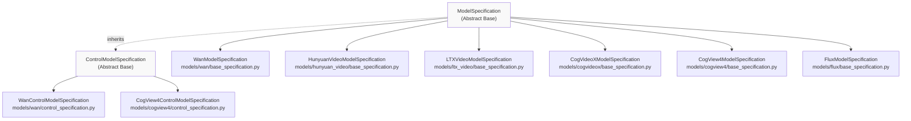
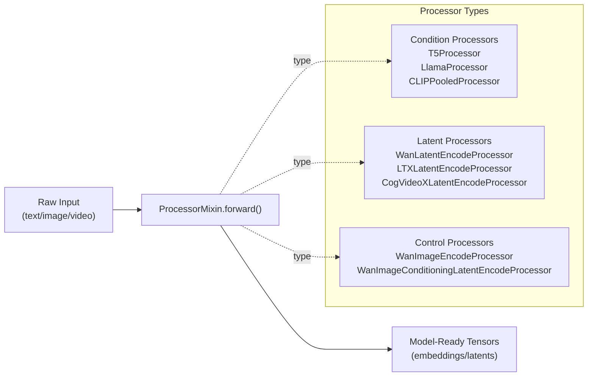
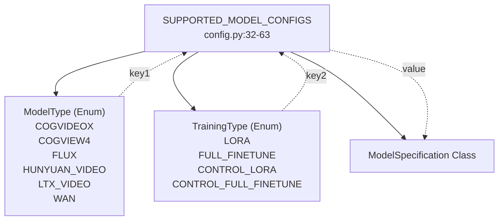
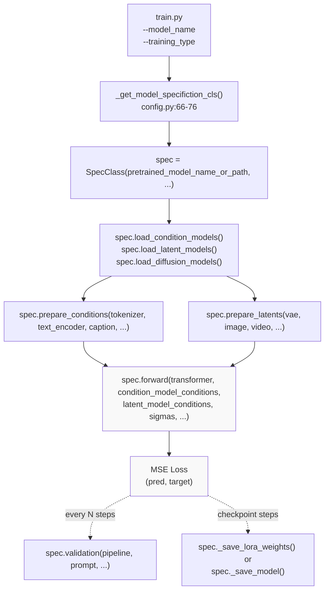
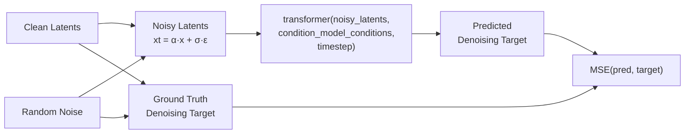

<!-- source: DeepWiki mcp.deepwiki.com · repo huggingface/finetrainers · page 10.3 Model API · fetched 2026-10-26 -->

# Model API

<details>
<summary>Relevant source files</summary>

The following files were used as context for generating this wiki page:

- [docs/models/README.md](docs/models/README.md)
- [finetrainers/config.py](finetrainers/config.py)
- [finetrainers/models/cogvideox/base_specification.py](finetrainers/models/cogvideox/base_specification.py)
- [finetrainers/models/cogview4/base_specification.py](finetrainers/models/cogview4/base_specification.py)
- [finetrainers/models/flux/base_specification.py](finetrainers/models/flux/base_specification.py)
- [finetrainers/models/hunyuan_video/base_specification.py](finetrainers/models/hunyuan_video/base_specification.py)
- [finetrainers/models/ltx_video/base_specification.py](finetrainers/models/ltx_video/base_specification.py)
- [finetrainers/models/wan/base_specification.py](finetrainers/models/wan/base_specification.py)
- [finetrainers/models/wan/control_specification.py](finetrainers/models/wan/control_specification.py)
- [finetrainers/parallel/accelerate.py](finetrainers/parallel/accelerate.py)
- [finetrainers/parallel/base.py](finetrainers/parallel/base.py)
- [finetrainers/parallel/ptd.py](finetrainers/parallel/ptd.py)
- [tests/README.md](tests/README.md)
- [tests/models/flux/base_specification.py](tests/models/flux/base_specification.py)

</details>


This document provides comprehensive API reference for the model abstraction layer in finetrainers. For information about trainer classes that use these models, see [Trainer API](#10.1). For configuration options, see [Configuration API](#10.4).

The Model API defines the `ModelSpecification` interface and its concrete implementations for each supported model architecture. These specifications handle model loading, conditioning preparation, latent encoding, training forward passes, validation inference, and checkpoint saving.

## ModelSpecification Interface

The `ModelSpecification` abstract base class defines the contract that all model implementations must fulfill. It provides a unified interface for loading components, preparing data, running training steps, and generating validation artifacts.

### Class Hierarchy



**Sources:** [finetrainers/config.py:1-76](), [finetrainers/models/wan/base_specification.py:210-578](), [finetrainers/models/wan/control_specification.py:36-438]()

### Core Methods

The `ModelSpecification` interface requires implementations to provide the following methods:

| Method | Return Type | Purpose |
|--------|-------------|---------|
| `load_condition_models()` | `Dict[str, torch.nn.Module]` | Load tokenizers and text encoders |
| `load_latent_models()` | `Dict[str, torch.nn.Module]` | Load VAE and related components |
| `load_diffusion_models()` | `Dict[str, torch.nn.Module]` | Load transformer/UNet and scheduler |
| `load_pipeline()` | `Pipeline` | Assemble complete inference pipeline |
| `prepare_conditions()` | `Dict[str, Any]` | Process text into conditioning embeddings |
| `prepare_latents()` | `Dict[str, torch.Tensor]` | Encode images/videos into latent space |
| `forward()` | `Tuple[torch.Tensor, ...]` | Execute training forward pass |
| `validation()` | `List[ArtifactType]` | Generate validation outputs |
| `_save_lora_weights()` | `None` | Save LoRA adapter weights |
| `_save_model()` | `None` | Save full model checkpoint |

**Sources:** [finetrainers/models/wan/base_specification.py:210-578](), [finetrainers/models/hunyuan_video/base_specification.py:75-392]()

### Initialization Parameters

All `ModelSpecification` implementations accept the following common parameters:

| Parameter | Type | Default | Description |
|-----------|------|---------|-------------|
| `pretrained_model_name_or_path` | `str` | Model-specific | HuggingFace Hub ID or local path |
| `tokenizer_id` | `Optional[str]` | `None` | Override tokenizer path |
| `tokenizer_2_id` | `Optional[str]` | `None` | Override secondary tokenizer path |
| `tokenizer_3_id` | `Optional[str]` | `None` | Override tertiary tokenizer path |
| `text_encoder_id` | `Optional[str]` | `None` | Override text encoder path |
| `text_encoder_2_id` | `Optional[str]` | `None` | Override secondary text encoder path |
| `text_encoder_3_id` | `Optional[str]` | `None` | Override tertiary text encoder path |
| `transformer_id` | `Optional[str]` | `None` | Override transformer path |
| `vae_id` | `Optional[str]` | `None` | Override VAE path |
| `text_encoder_dtype` | `torch.dtype` | `torch.bfloat16` | Text encoder precision |
| `transformer_dtype` | `torch.dtype` | `torch.bfloat16` | Transformer precision |
| `vae_dtype` | `torch.dtype` | `torch.bfloat16` | VAE precision |
| `revision` | `Optional[str]` | `None` | Git revision for Hub models |
| `cache_dir` | `Optional[str]` | `None` | Cache directory for downloads |
| `condition_model_processors` | `List[ProcessorMixin]` | Model-specific | Text conditioning processors |
| `latent_model_processors` | `List[ProcessorMixin]` | Model-specific | Latent encoding processors |

**Sources:** [finetrainers/models/wan/base_specification.py:211-226](), [finetrainers/models/hunyuan_video/base_specification.py:76-93]()

## Concrete Model Implementations

### Video Generation Models

#### WanModelSpecification

Implements the Wan model family (T2V, I2V, FLF2V) with parameter sizes ranging from 1.3B to 14B.

**Default Path:** `Wan-AI/Wan2.1-T2V-1.3B-Diffusers`

**Component Loading:**
- **Tokenizer/Text Encoder:** UMT5EncoderModel
- **VAE:** AutoencoderKLWan
- **Transformer:** WanTransformer3DModel
- **Scheduler:** FlowMatchEulerDiscreteScheduler
- **Additional (I2V only):** CLIPVisionModel, CLIPImageProcessor

**Processors:**
- `T5Processor` - Text conditioning with UMT5
- `WanLatentEncodeProcessor` - Video latent encoding
- `WanImageConditioningLatentEncodeProcessor` - Image conditioning latents (I2V)
- `WanImageEncodeProcessor` - CLIP image embeddings (I2V)

**Key Implementation Details:**
- Latent normalization using `latents_mean` and `latents_std` from VAE config
- Flow matching formulation: `noisy_latents = FF.flow_match_xt(latents, noise, sigmas)`
- Image-to-video models concatenate latent conditioning channels
- Frame mask generation for first/last frame conditioning

**Sources:** [finetrainers/models/wan/base_specification.py:210-578]()

#### HunyuanVideoModelSpecification

Implements HunyuanVideo, a large-scale text-to-video model.

**Default Path:** `hunyuanvideo-community/HunyuanVideo`

**Component Loading:**
- **Tokenizer:** AutoTokenizer (Llama), CLIPTokenizer
- **Text Encoder:** LlamaModel, CLIPTextModel
- **VAE:** AutoencoderKLHunyuanVideo
- **Transformer:** HunyuanVideoTransformer3DModel
- **Scheduler:** FlowMatchEulerDiscreteScheduler

**Processors:**
- `LlamaProcessor` - Primary text conditioning
- `CLIPPooledProcessor` - Pooled text embeddings
- `HunyuanLatentEncodeProcessor` - Video latent encoding

**Key Implementation Details:**
- Dual text encoder architecture (Llama + CLIP)
- VAE scaling factor applied to latents: `latents * vae.config.scaling_factor`
- Guidance embedding: `guidance = latents.new_full((batch_size,), guidance_scale) * 1000.0`

**Sources:** [finetrainers/models/hunyuan_video/base_specification.py:75-392]()

#### LTXVideoModelSpecification

Implements LTX-Video, a lightweight video generation model.

**Default Path:** `Lightricks/LTX-Video`

**Component Loading:**
- **Tokenizer/Text Encoder:** T5EncoderModel, T5Tokenizer
- **VAE:** AutoencoderKLLTXVideo
- **Transformer:** LTXVideoTransformer3DModel
- **Scheduler:** FlowMatchEulerDiscreteScheduler

**Processors:**
- `T5Processor` - Text conditioning
- `LTXLatentEncodeProcessor` - Video latent encoding with metadata

**Key Implementation Details:**
- Latent packing into patch tokens: `_pack_latents(latents, patch_size, patch_size_t)`
- First frame conditioning with reduced sigma: `first_frame_sigma < 0.25`
- RoPE interpolation scaling: `[1/latent_frame_rate, vae_scale, vae_scale]`
- Latent normalization using per-sample mean/std from VAE

**Sources:** [finetrainers/models/ltx_video/base_specification.py:93-460]()

#### CogVideoXModelSpecification

Implements CogVideoX 2B and 5B models.

**Default Path:** `THUDM/CogVideoX-5b`

**Component Loading:**
- **Tokenizer/Text Encoder:** T5EncoderModel, T5Tokenizer
- **VAE:** AutoencoderKLCogVideoX
- **Transformer:** CogVideoXTransformer3DModel
- **Scheduler:** CogVideoXDDIMScheduler

**Processors:**
- `T5Processor` - Text conditioning
- `CogVideoXLatentEncodeProcessor` - Video latent encoding

**Key Implementation Details:**
- Latent permutation: `[B, C, F, H, W] -> [B, F, C, H, W]`
- Frame padding to match patch size: `_pad_frames(latents, patch_size_t)`
- Rotary positional embeddings: `prepare_rotary_positional_embeddings()`
- Velocity prediction: `pred = scheduler.get_velocity(velocity, noisy_latents, timesteps)`

**Sources:** [finetrainers/models/cogvideox/base_specification.py:79-411]()

### Image Generation Models

#### CogView4ModelSpecification

Implements CogView4 6B image generation model.

**Default Path:** `THUDM/CogView4-6B`

**Component Loading:**
- **Tokenizer/Text Encoder:** GlmModel, AutoTokenizer
- **VAE:** AutoencoderKL
- **Transformer:** CogView4Transformer2DModel
- **Scheduler:** FlowMatchEulerDiscreteScheduler

**Processors:**
- `CogView4GLMProcessor` - GLM text conditioning
- `CogView4LatentEncodeProcessor` - Image latent encoding with metadata

**Key Implementation Details:**
- Image size conditioning: `original_size`, `target_size`, `crop_coords`
- Timestep shifting: `shifted_sigmas = mu / (mu + (1 / sigmas - 1) ** 1.0)`
- Shift parameters: `base_shift=0.25`, `max_shift=0.75`
- VAE shift factor: `(latents - shift_factor) * scaling_factor`

**Sources:** [finetrainers/models/cogview4/base_specification.py:95-386]()

#### FluxModelSpecification

Implements FLUX.1 [dev] and [schnell] models.

**Default Path:** `black-forest-labs/FLUX.1-dev`

**Component Loading:**
- **Tokenizer:** CLIPTokenizer, AutoTokenizer (T5)
- **Text Encoder:** CLIPTextModel, T5EncoderModel
- **VAE:** AutoencoderKL
- **Transformer:** FluxTransformer2DModel
- **Scheduler:** FlowMatchEulerDiscreteScheduler

**Processors:**
- `CLIPPooledProcessor` - CLIP pooled embeddings
- `T5Processor` - T5 text conditioning
- `FluxLatentEncodeProcessor` - Image latent encoding

**Key Implementation Details:**
- Dual text encoder (CLIP + T5)
- Latent packing: `FluxPipeline._pack_latents()`
- Image and text IDs for positional encoding
- Guidance embedding for classifier-free guidance

**Sources:** [finetrainers/models/flux/base_specification.py:71-412]()

### Control Models

#### WanControlModelSpecification

Extends `WanModelSpecification` to support control-conditioned generation (e.g., depth, canny edges).

**Additional Features:**
- Control channel concatenation via `control_injection_layer_name = "patch_embedding"`
- Control latent encoding via `WanLatentEncodeProcessor`
- Frame conditioning types: `"full"`, `"first"`, `"sparse"`
- Zeroed weight initialization: `_expand_conv3d_with_zeroed_weights()`

**Forward Pass Modification:**
```
noisy_latents = flow_match_xt(latents, noise, sigmas)
control_latents = apply_frame_conditioning_on_latents(control_latents, ...)
noisy_latents = torch.cat([noisy_latents, control_latents], dim=1)
```

**Sources:** [finetrainers/models/wan/control_specification.py:36-438]()

#### CogView4ControlModelSpecification

Extends `CogView4ModelSpecification` for control-conditioned image generation.

**Sources:** Referenced in [finetrainers/config.py:42-43]()

## Processor System

Processors handle the transformation of raw inputs into model-ready tensors. They inherit from `ProcessorMixin` and implement a `forward()` method.

### Processor Execution Flow



**Sources:** [finetrainers/models/wan/base_specification.py:30-208](), [finetrainers/models/hunyuan_video/base_specification.py:28-73]()

### Common Processors

#### Text Conditioning Processors

**T5Processor**
- **Input:** `tokenizer`, `text_encoder`, `caption`, `max_sequence_length`
- **Output:** `encoder_hidden_states`, `encoder_attention_mask`
- **Usage:** WanModelSpecification, LTXVideoModelSpecification, CogVideoXModelSpecification

**LlamaProcessor**
- **Input:** `tokenizer`, `text_encoder`, `caption`, `max_sequence_length`
- **Output:** `encoder_hidden_states`, `encoder_attention_mask`
- **Usage:** HunyuanVideoModelSpecification

**CLIPPooledProcessor**
- **Input:** `tokenizer`, `text_encoder`, `caption`, `max_sequence_length`
- **Output:** `pooled_projections`
- **Usage:** HunyuanVideoModelSpecification, FluxModelSpecification

**CogView4GLMProcessor**
- **Input:** `tokenizer`, `text_encoder`, `caption`, `max_sequence_length`
- **Output:** `encoder_hidden_states`
- **Usage:** CogView4ModelSpecification

**Sources:** [finetrainers/models/wan/base_specification.py:242-243](), [finetrainers/models/hunyuan_video/base_specification.py:110-116]()

#### Latent Encoding Processors

**WanLatentEncodeProcessor**
- **Input:** `vae`, `image`, `video`, `generator`, `compute_posterior`
- **Output:** `latents`, `latents_mean`, `latents_std`
- **Details:** Encodes video to latent space with normalization statistics

**HunyuanLatentEncodeProcessor**
- **Input:** `vae`, `image`, `video`, `generator`, `compute_posterior`
- **Output:** `latents`
- **Details:** Encodes video for HunyuanVideo architecture

**LTXLatentEncodeProcessor**
- **Input:** `vae`, `image`, `video`, `generator`, `compute_posterior`
- **Output:** `latents`, `num_frames`, `height`, `width`, `latents_mean`, `latents_std`
- **Details:** Encodes video with shape metadata and per-sample statistics

**CogVideoXLatentEncodeProcessor**
- **Input:** `vae`, `image`, `video`, `generator`, `compute_posterior`
- **Output:** `latents`
- **Details:** Encodes video with dimension permutation `[B, C, F, H, W] -> [B, F, C, H, W]`

**CogView4LatentEncodeProcessor**
- **Input:** `vae`, `image`, `video`, `generator`, `compute_posterior`, `_original_height`, `_original_width`
- **Output:** `latents`, `original_size`, `target_size`, `crop_coords`
- **Details:** Encodes images with size conditioning metadata

**FluxLatentEncodeProcessor**
- **Input:** `vae`, `image`, `video`, `generator`, `compute_posterior`
- **Output:** `latents`
- **Details:** Encodes images for Flux architecture

**Sources:** [finetrainers/models/wan/base_specification.py:30-82](), [finetrainers/models/hunyuan_video/base_specification.py:28-73](), [finetrainers/models/ltx_video/base_specification.py:32-91]()

#### Control Processors

**WanImageConditioningLatentEncodeProcessor**
- **Input:** `vae`, `image`, `video`, `compute_posterior`, `use_last_frame`
- **Output:** `latent_condition`, `latent_condition_mask`
- **Details:** Encodes first (and optionally last) frame as conditioning, creates temporal mask

**WanImageEncodeProcessor**
- **Input:** `image_encoder`, `image_processor`, `image`, `video`, `use_last_frame`
- **Output:** `image_embeds`
- **Details:** Extracts CLIP vision embeddings from conditioning frames

**Sources:** [finetrainers/models/wan/base_specification.py:84-208]()

## Model Registration and Selection

Models are registered in the `SUPPORTED_MODEL_CONFIGS` dictionary, mapping `(ModelType, TrainingType)` to specification classes.

### Model Registry Structure



**Sources:** [finetrainers/config.py:13-63]()

### Registration Table

| ModelType | TrainingType | Specification Class |
|-----------|--------------|---------------------|
| `COGVIDEOX` | `LORA` | `CogVideoXModelSpecification` |
| `COGVIDEOX` | `FULL_FINETUNE` | `CogVideoXModelSpecification` |
| `COGVIEW4` | `LORA` | `CogView4ModelSpecification` |
| `COGVIEW4` | `FULL_FINETUNE` | `CogView4ModelSpecification` |
| `COGVIEW4` | `CONTROL_LORA` | `CogView4ControlModelSpecification` |
| `COGVIEW4` | `CONTROL_FULL_FINETUNE` | `CogView4ControlModelSpecification` |
| `FLUX` | `LORA` | `FluxModelSpecification` |
| `FLUX` | `FULL_FINETUNE` | `FluxModelSpecification` |
| `HUNYUAN_VIDEO` | `LORA` | `HunyuanVideoModelSpecification` |
| `HUNYUAN_VIDEO` | `FULL_FINETUNE` | `HunyuanVideoModelSpecification` |
| `LTX_VIDEO` | `LORA` | `LTXVideoModelSpecification` |
| `LTX_VIDEO` | `FULL_FINETUNE` | `LTXVideoModelSpecification` |
| `WAN` | `LORA` | `WanModelSpecification` |
| `WAN` | `FULL_FINETUNE` | `WanModelSpecification` |
| `WAN` | `CONTROL_LORA` | `WanControlModelSpecification` |
| `WAN` | `CONTROL_FULL_FINETUNE` | `WanControlModelSpecification` |

**Sources:** [finetrainers/config.py:32-63]()

### Model Selection Function

The `_get_model_specifiction_cls()` function retrieves the appropriate specification class:

```python
def _get_model_specifiction_cls(model_name: str, training_type: str) -> Type[ModelSpecification]:
    if model_name not in SUPPORTED_MODEL_CONFIGS:
        raise ValueError(f"Model {model_name} not supported. ...")
    if training_type not in SUPPORTED_MODEL_CONFIGS[model_name]:
        raise ValueError(f"Training type {training_type} not supported for model {model_name}. ...")
    return SUPPORTED_MODEL_CONFIGS[model_name][training_type]
```

**Sources:** [finetrainers/config.py:66-76]()

## Training Integration

The following diagram shows how `ModelSpecification` instances are used during training:

### Training Flow with ModelSpecification



**Sources:** [finetrainers/models/wan/base_specification.py:383-493](), [finetrainers/config.py:66-76]()

## Key Method Details

### load_condition_models()

Loads tokenizers and text encoders for conditioning. Returns dictionary with keys like `"tokenizer"`, `"text_encoder"`, etc.

**Common Loading Pattern:**
```python
def load_condition_models(self) -> Dict[str, torch.nn.Module]:
    common_kwargs = {"revision": self.revision, "cache_dir": self.cache_dir}
    
    tokenizer = AutoTokenizer.from_pretrained(
        self.tokenizer_id or f"{self.pretrained_model_name_or_path}/tokenizer",
        **common_kwargs
    )
    
    text_encoder = TextEncoderClass.from_pretrained(
        self.text_encoder_id or f"{self.pretrained_model_name_or_path}/text_encoder",
        torch_dtype=self.text_encoder_dtype,
        **common_kwargs
    )
    
    return {"tokenizer": tokenizer, "text_encoder": text_encoder}
```

**Examples:**
- Wan: UMT5EncoderModel + AutoTokenizer
- HunyuanVideo: LlamaModel + CLIPTextModel + dual tokenizers
- Flux: CLIPTextModel + T5EncoderModel + dual tokenizers

**Sources:** [finetrainers/models/wan/base_specification.py:265-287](), [finetrainers/models/hunyuan_video/base_specification.py:127-173](), [finetrainers/models/flux/base_specification.py:123-169]()

### load_latent_models()

Loads VAE and related components for latent space encoding. Returns dictionary with keys like `"vae"`, potentially `"image_encoder"`, etc.

**Common Loading Pattern:**
```python
def load_latent_models(self) -> Dict[str, torch.nn.Module]:
    common_kwargs = {"revision": self.revision, "cache_dir": self.cache_dir}
    
    vae = VAEClass.from_pretrained(
        self.vae_id or f"{self.pretrained_model_name_or_path}/vae",
        torch_dtype=self.vae_dtype,
        **common_kwargs
    )
    
    return {"vae": vae}
```

**Special Cases:**
- Wan I2V models: Additional CLIPVisionModel and CLIPImageProcessor
- All models: VAE loaded from subfolder or override path

**Sources:** [finetrainers/models/wan/base_specification.py:289-311](), [finetrainers/models/hunyuan_video/base_specification.py:175-185]()

### load_diffusion_models()

Loads the diffusion transformer/UNet and noise scheduler. Returns dictionary with keys `"transformer"` and `"scheduler"`.

**Common Loading Pattern:**
```python
def load_diffusion_models(self) -> Dict[str, torch.nn.Module]:
    common_kwargs = {"revision": self.revision, "cache_dir": self.cache_dir}
    
    transformer = TransformerClass.from_pretrained(
        self.transformer_id or f"{self.pretrained_model_name_or_path}/transformer",
        torch_dtype=self.transformer_dtype,
        **common_kwargs
    )
    
    scheduler = SchedulerClass()  # or from_pretrained()
    
    return {"transformer": transformer, "scheduler": scheduler}
```

**Scheduler Types:**
- Flow Matching: `FlowMatchEulerDiscreteScheduler` (Wan, HunyuanVideo, LTX-Video, CogView4, Flux)
- DDIM: `CogVideoXDDIMScheduler` (CogVideoX)

**Sources:** [finetrainers/models/wan/base_specification.py:313-330](), [finetrainers/models/cogvideox/base_specification.py:157-176]()

### load_pipeline()

Assembles the complete inference pipeline from loaded components. Handles dtype conversions, memory optimizations, and offloading.

**Common Loading Pattern:**
```python
def load_pipeline(
    self,
    tokenizer=None,
    text_encoder=None,
    transformer=None,
    vae=None,
    scheduler=None,
    enable_slicing=False,
    enable_tiling=False,
    enable_model_cpu_offload=False,
    training=False,
    **kwargs
) -> PipelineClass:
    components = get_non_null_items({
        "tokenizer": tokenizer,
        "text_encoder": text_encoder,
        "transformer": transformer,
        "vae": vae,
        "scheduler": scheduler,
    })
    
    pipe = PipelineClass.from_pretrained(
        self.pretrained_model_name_or_path,
        **components,
        revision=self.revision,
        cache_dir=self.cache_dir
    )
    
    # Set dtypes
    pipe.text_encoder.to(self.text_encoder_dtype)
    pipe.vae.to(self.vae_dtype)
    if not training:
        pipe.transformer.to(self.transformer_dtype)
    
    # Memory optimizations
    if enable_slicing:
        pipe.vae.enable_slicing()
    if enable_tiling:
        pipe.vae.enable_tiling()
    if enable_model_cpu_offload:
        pipe.enable_model_cpu_offload()
    
    return pipe
```

**Sources:** [finetrainers/models/wan/base_specification.py:332-380](), [finetrainers/models/hunyuan_video/base_specification.py:206-244]()

### prepare_conditions()

Processes text prompts into conditioning embeddings by routing through condition processors.

**Execution Flow:**
```
caption (str)
    → condition_model_processors[0].forward(tokenizer, text_encoder, caption, ...)
    → encoder_hidden_states, encoder_attention_mask, pooled_projections, etc.
```

**Common Implementation:**
```python
@torch.no_grad()
def prepare_conditions(
    self,
    tokenizer,
    text_encoder,
    caption: str,
    max_sequence_length: int = 512,
    **kwargs
) -> Dict[str, Any]:
    conditions = {
        "tokenizer": tokenizer,
        "text_encoder": text_encoder,
        "caption": caption,
        "max_sequence_length": max_sequence_length,
        **kwargs,
    }
    input_keys = set(conditions.keys())
    conditions = super().prepare_conditions(**conditions)  # Route through processors
    conditions = {k: v for k, v in conditions.items() if k not in input_keys}
    return conditions
```

**Sources:** [finetrainers/models/wan/base_specification.py:383-401](), [finetrainers/models/hunyuan_video/base_specification.py:247-269]()

### prepare_latents()

Encodes images/videos into latent representations by routing through latent processors.

**Execution Flow:**
```
image/video (torch.Tensor)
    → latent_model_processors[0].forward(vae, image, video, generator, ...)
    → latents, latents_mean, latents_std, num_frames, etc.
```

**Common Implementation:**
```python
@torch.no_grad()
def prepare_latents(
    self,
    vae,
    image: Optional[torch.Tensor] = None,
    video: Optional[torch.Tensor] = None,
    generator: Optional[torch.Generator] = None,
    compute_posterior: bool = True,
    **kwargs
) -> Dict[str, torch.Tensor]:
    conditions = {
        "vae": vae,
        "image": image,
        "video": video,
        "generator": generator,
        "compute_posterior": compute_posterior,
        **kwargs,
    }
    input_keys = set(conditions.keys())
    conditions = super().prepare_latents(**conditions)  # Route through processors
    conditions = {k: v for k, v in conditions.items() if k not in input_keys}
    return conditions
```

**Sources:** [finetrainers/models/wan/base_specification.py:403-431](), [finetrainers/models/hunyuan_video/base_specification.py:271-292]()

### forward()

Executes the training forward pass: adds noise, predicts denoising target, computes loss.

**Common Flow:**


**Common Implementation Pattern:**
```python
def forward(
    self,
    transformer,
    condition_model_conditions: Dict[str, torch.Tensor],
    latent_model_conditions: Dict[str, torch.Tensor],
    sigmas: torch.Tensor,
    generator: Optional[torch.Generator] = None,
    compute_posterior: bool = True,
    **kwargs
) -> Tuple[torch.Tensor, ...]:
    # 1. Sample from posterior if compute_posterior=False
    if compute_posterior:
        latents = latent_model_conditions.pop("latents")
    else:
        posterior = DiagonalGaussianDistribution(latent_model_conditions.pop("latents"))
        latents = posterior.sample(generator=generator)
    
    # 2. Apply normalization/scaling
    latents = latents * self.vae_config.scaling_factor
    
    # 3. Generate noise and create noisy latents
    noise = torch.zeros_like(latents).normal_(generator=generator)
    noisy_latents = flow_match_xt(latents, noise, sigmas)  # or scheduler.add_noise()
    
    # 4. Prepare timesteps
    timesteps = (sigmas.flatten() * 1000.0).long()
    
    # 5. Forward through transformer
    latent_model_conditions["hidden_states"] = noisy_latents.to(latents)
    pred = transformer(
        **latent_model_conditions,
        **condition_model_conditions,
        timestep=timesteps,
        return_dict=False,
    )[0]
    
    # 6. Compute target
    target = flow_match_target(noise, latents)  # or just latents for velocity prediction
    
    return pred, target, sigmas
```

**Model-Specific Details:**
- **Wan:** Latent normalization before posterior sampling, optional image conditioning concatenation
- **HunyuanVideo:** Guidance embedding, dual text encoders
- **LTX-Video:** First frame conditioning, latent packing, RoPE scaling
- **CogVideoX:** Latent permutation, frame padding, rotary embeddings, velocity prediction
- **CogView4:** Timestep shifting, size conditioning
- **Flux:** Latent packing, image/text IDs, guidance embedding

**Sources:** [finetrainers/models/wan/base_specification.py:433-493](), [finetrainers/models/hunyuan_video/base_specification.py:294-330](), [finetrainers/models/ltx_video/base_specification.py:271-345](), [finetrainers/models/cogvideox/base_specification.py:258-333]()

### validation()

Generates validation artifacts (images/videos) using the loaded pipeline.

**Common Implementation:**
```python
def validation(
    self,
    pipeline,
    prompt: str,
    height: Optional[int] = None,
    width: Optional[int] = None,
    num_frames: Optional[int] = None,  # Video models only
    num_inference_steps: int = 50,
    generator: Optional[torch.Generator] = None,
    **kwargs
) -> List[ArtifactType]:
    generation_kwargs = get_non_null_items({
        "prompt": prompt,
        "height": height,
        "width": width,
        "num_frames": num_frames,
        "num_inference_steps": num_inference_steps,
        "generator": generator,
        "return_dict": True,
        "output_type": "pil",
    })
    
    output = pipeline(**generation_kwargs)
    
    # Return appropriate artifact type
    if video_model:
        return [VideoArtifact(value=output.frames[0])]
    else:
        return [ImageArtifact(value=output.images[0])]
```

**Sources:** [finetrainers/models/wan/base_specification.py:495-529](), [finetrainers/models/hunyuan_video/base_specification.py:332-355](), [finetrainers/models/cogview4/base_specification.py:328-349]()

### _save_lora_weights()

Saves LoRA adapter weights to disk in the format expected by diffusers pipelines.

**Common Implementation:**
```python
def _save_lora_weights(
    self,
    directory: str,
    transformer_state_dict: Optional[Dict[str, torch.Tensor]] = None,
    scheduler: Optional[SchedulerType] = None,
    metadata: Optional[Dict[str, str]] = None,
    *args,
    **kwargs
) -> None:
    if transformer_state_dict is not None:
        PipelineClass.save_lora_weights(
            directory,
            transformer_state_dict,
            save_function=functools.partial(safetensors_torch_save_function, metadata=metadata),
            safe_serialization=True,
        )
    if scheduler is not None:
        scheduler.save_pretrained(os.path.join(directory, "scheduler"))
```

**Sources:** [finetrainers/models/wan/base_specification.py:531-553](), [finetrainers/models/hunyuan_video/base_specification.py:357-375]()

### _save_model()

Saves full model checkpoint including transformer weights and scheduler configuration.

**Common Implementation:**
```python
def _save_model(
    self,
    directory: str,
    transformer,
    transformer_state_dict: Optional[Dict[str, torch.Tensor]] = None,
    scheduler: Optional[SchedulerType] = None,
) -> None:
    if transformer_state_dict is not None:
        with init_empty_weights():
            transformer_copy = TransformerClass.from_config(transformer.config)
        transformer_copy.load_state_dict(transformer_state_dict, strict=True, assign=True)
        transformer_copy.save_pretrained(os.path.join(directory, "transformer"))
    if scheduler is not None:
        scheduler.save_pretrained(os.path.join(directory, "scheduler"))
```

**Sources:** [finetrainers/models/wan/base_specification.py:554-568](), [finetrainers/models/hunyuan_video/base_specification.py:377-391]()

## Properties and Configuration Access

ModelSpecification instances provide convenient access to component configurations:

| Property | Type | Description |
|----------|------|-------------|
| `transformer_config` | `ConfigMixin` | Transformer model configuration |
| `vae_config` | `ConfigMixin` | VAE model configuration |
| `text_encoder_config` | `ConfigMixin` | Primary text encoder configuration |
| `text_encoder_2_config` | `ConfigMixin` | Secondary text encoder configuration |
| `text_encoder_3_config` | `ConfigMixin` | Tertiary text encoder configuration |
| `_resolution_dim_keys` | `Dict[str, Tuple[int, ...]]` | Dimension indices for resolution bucketing |

**Resolution Dimension Keys:**
Used by the data pipeline to identify which tensor dimensions correspond to spatial/temporal resolution for bucketing.

Examples:
- Video models: `{"latents": (2, 3, 4)}` → `[B, C, F, H, W]`
- Image models: `{"latents": (2, 3)}` → `[B, C, H, W]`

**Sources:** [finetrainers/models/wan/base_specification.py:261-263](), [finetrainers/models/cogview4/base_specification.py:135-137]()

## Control Model Extensions

The `ControlModelSpecification` abstract class extends `ModelSpecification` for control-conditioned generation.

### Additional Methods and Properties

| Method/Property | Description |
|-----------------|-------------|
| `control_injection_layer_name` | Layer name where control channels are concatenated |
| `load_diffusion_models(new_in_features: int)` | Load transformer with expanded input channels |
| `prepare_latents()` | Extended to process both main and control latents |
| `control_model_processors` | List of processors for control signal encoding |

### Control Forward Pass

Control models concatenate control latents to noisy latents before the transformer forward pass:

```python
noisy_latents = flow_match_xt(latents, noise, sigmas)

# Process control signal through control processors
control_latents = self.prepare_latents(vae=vae, control_image=control_image, ...)["control_latents"]

# Apply frame conditioning (e.g., first frame only, sparse frames)
control_latents = apply_frame_conditioning_on_latents(
    control_latents,
    target_num_frames=noisy_latents.shape[2],
    frame_conditioning_type="first",  # or "full", "sparse"
    ...
)

# Concatenate along channel dimension
noisy_latents = torch.cat([noisy_latents, control_latents], dim=1)

# Forward through transformer with expanded input channels
pred = transformer(hidden_states=noisy_latents, ...)
```

**Sources:** [finetrainers/models/wan/control_specification.py:243-308]()

## Advanced Features

### Tensor Parallel Support

Some models implement `apply_tensor_parallel()` for distributing computation across multiple GPUs:

```python
def apply_tensor_parallel(
    self,
    backend: ParallelBackendEnum,
    device_mesh: torch.distributed.DeviceMesh,
    transformer,
    **kwargs
) -> None:
    if backend == ParallelBackendEnum.PTD:
        _apply_tensor_parallel_ptd(device_mesh, transformer)
    else:
        raise NotImplementedError(f"Parallel backend {backend} is not supported")
```

**Example:** LTXVideoModelSpecification implements tensor parallelism for feed-forward layers.

**Sources:** [finetrainers/models/ltx_video/base_specification.py:415-426](), [finetrainers/models/ltx_video/base_specification.py:462-505]()

### Latent Normalization

Models use different normalization schemes for latent tensors:

**Wan:** Per-channel normalization using VAE statistics
```python
latents_mean = latents_mean.view(1, -1, 1, 1, 1).to(device=latents.device)
latents_std = latents_std.view(1, -1, 1, 1, 1).to(device=latents.device)
latents = ((latents.float() - latents_mean) * latents_std).to(latents)
```

**LTX-Video:** Per-sample normalization
```python
latents = ((latents.float() - latents_mean) * scaling_factor / latents_std).to(latents)
```

**CogView4/Flux:** VAE shift and scale factors
```python
latents = (latents - vae.config.shift_factor) * vae.config.scaling_factor
```

**Sources:** [finetrainers/models/wan/base_specification.py:570-577](), [finetrainers/models/ltx_video/base_specification.py:428-436](), [finetrainers/models/cogview4/base_specification.py:299-302]()

### Latent Packing

Some models pack latent tensors into sequence tokens for transformer processing:

**LTX-Video:**
```python
# [B, C, F, H, W] -> [B, num_patches, C * patch_size_t * patch_size * patch_size]
latents = _pack_latents(latents, patch_size=1, patch_size_t=1)
```

**Flux:**
```python
# Pack for transformer input
noisy_latents = FluxPipeline._pack_latents(noisy_latents, *latents.shape)
# Unpack predictions
pred = FluxPipeline._unpack_latents(pred, height, width, spatial_compression_ratio)
```

**Sources:** [finetrainers/models/ltx_video/base_specification.py:316-318](), [finetrainers/models/ltx_video/base_specification.py:439-459](), [finetrainers/models/flux/base_specification.py:327-347]()

---

