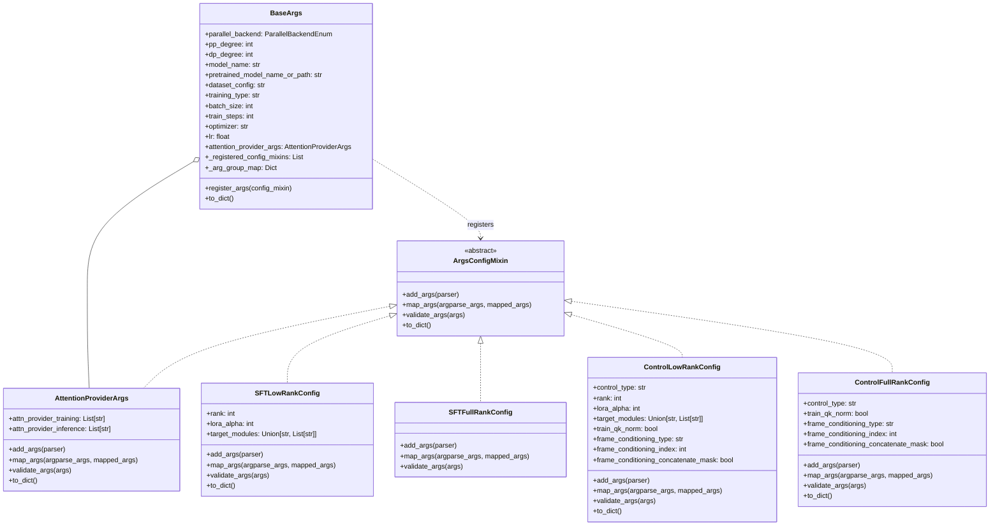
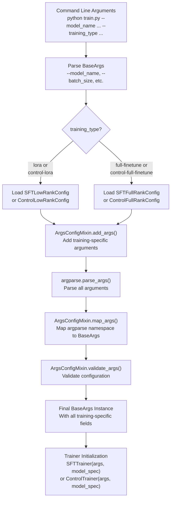
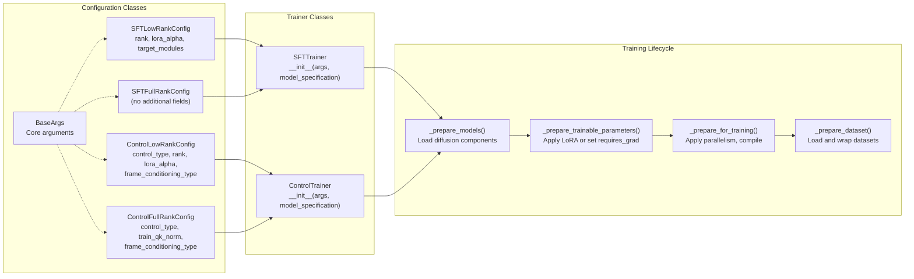

<!-- source: DeepWiki mcp.deepwiki.com · repo huggingface/finetrainers · page 10.4 Configuration API · fetched 2026-10-26 -->

# Configuration API

<details>
<summary>Relevant source files</summary>

The following files were used as context for generating this wiki page:

- [docs/args.md](docs/args.md)
- [finetrainers/args.py](finetrainers/args.py)
- [finetrainers/trainer/control_trainer/config.py](finetrainers/trainer/control_trainer/config.py)
- [finetrainers/trainer/control_trainer/trainer.py](finetrainers/trainer/control_trainer/trainer.py)
- [finetrainers/trainer/sft_trainer/config.py](finetrainers/trainer/sft_trainer/config.py)
- [finetrainers/trainer/sft_trainer/trainer.py](finetrainers/trainer/sft_trainer/trainer.py)
- [finetrainers/utils/import_utils.py](finetrainers/utils/import_utils.py)
- [tests/trainer/test_control_trainer.py](tests/trainer/test_control_trainer.py)

</details>


This page documents the configuration system for finetrainers, including the `BaseArgs` class, configuration mixins, and training-type-specific configuration classes. The configuration API provides a structured way to specify all training parameters via command-line arguments or programmatically.

For information about how trainers use these configurations, see [Trainer API](#10.1). For model-specific configuration requirements, see [Model API](#10.3).

## Overview

The finetrainers configuration system is built around three core concepts:

1. **BaseArgs**: The central configuration class containing all general training arguments
2. **ArgsConfigMixin**: An abstract interface for modular configuration groups
3. **Training-Specific Configs**: Specialized configuration classes for different training types (LoRA, full finetune, control training)

The system supports both command-line argument parsing via `argparse` and programmatic configuration. Each configuration class can add its own arguments, validate them, and map parsed arguments to the appropriate fields.

**Sources**: [finetrainers/args.py:85-630](), [finetrainers/trainer/sft_trainer/config.py:1-66](), [finetrainers/trainer/control_trainer/config.py:1-186]()

## Configuration Class Hierarchy



**Sources**: [finetrainers/args.py:27-83](), [finetrainers/args.py:85-630](), [finetrainers/trainer/sft_trainer/config.py:11-66](), [finetrainers/trainer/control_trainer/config.py:34-186]()

## BaseArgs Class

The `BaseArgs` class is the central configuration object containing all training parameters. It is organized into several logical groups of arguments.

### Argument Categories

| Category | Description | Key Fields |
|----------|-------------|------------|
| **Parallel** | Distributed training configuration | `parallel_backend`, `pp_degree`, `dp_degree`, `dp_shards`, `cp_degree`, `tp_degree` |
| **Model** | Model loading and data types | `model_name`, `pretrained_model_name_or_path`, `revision`, `variant`, `transformer_dtype`, `vae_dtype`, `text_encoder_dtype` |
| **Dataset** | Training data configuration | `dataset_config`, `dataset_shuffle_buffer_size`, `enable_precomputation`, `precomputation_items` |
| **Dataloader** | Data loading settings | `dataloader_num_workers`, `pin_memory` |
| **Diffusion** | Flow matching parameters | `flow_shift`, `flow_weighting_scheme`, `flow_logit_mean`, `flow_logit_std` |
| **Training** | Training loop configuration | `training_type`, `seed`, `batch_size`, `train_steps`, `gradient_accumulation_steps`, `gradient_checkpointing` |
| **Optimizer** | Optimization settings | `optimizer`, `lr`, `lr_scheduler`, `lr_warmup_steps`, `beta1`, `beta2`, `weight_decay`, `max_grad_norm` |
| **Validation** | Validation configuration | `validation_dataset_file`, `validation_steps`, `enable_model_cpu_offload` |
| **Checkpointing** | Checkpoint management | `checkpointing_steps`, `checkpointing_limit`, `resume_from_checkpoint` |
| **Miscellaneous** | Logging and output | `tracker_name`, `push_to_hub`, `output_dir`, `logging_steps`, `report_to`, `verbose` |
| **Torch Config** | PyTorch settings | `compile_modules`, `compile_scopes`, `allow_tf32`, `float32_matmul_precision` |

### Class Definition

The `BaseArgs` class is defined at [finetrainers/args.py:85-630]() with the following key attributes:

```python
class BaseArgs:
    # Parallel arguments (lines 366-371)
    parallel_backend = ParallelBackendEnum.ACCELERATE
    pp_degree: int = 1
    dp_degree: int = 1
    dp_shards: int = 1
    cp_degree: int = 1
    tp_degree: int = 1
    
    # Model arguments (lines 374-396)
    model_name: str = None
    pretrained_model_name_or_path: str = None
    revision: Optional[str] = None
    variant: Optional[str] = None
    transformer_dtype: torch.dtype = torch.bfloat16
    vae_dtype: torch.dtype = torch.bfloat16
    text_encoder_dtype: torch.dtype = torch.bfloat16
    # ... more model fields
    
    # Dataset arguments (lines 399-405)
    dataset_config: str = None
    enable_precomputation: bool = False
    precomputation_items: int = 512
    # ... more dataset fields
    
    # Training arguments (lines 424-435)
    training_type: str = None
    seed: int = 42
    batch_size: int = 1
    train_steps: int = 1000
    gradient_checkpointing: bool = False
    # ... more training fields
```

### Registered Mixins

`BaseArgs` maintains a registry of configuration mixins via `_registered_config_mixins` and `_arg_group_map` [finetrainers/args.py:478-487](). During initialization, it registers the `AttentionProviderArgs` mixin, which adds attention-related configuration options.

**Sources**: [finetrainers/args.py:85-630](), [finetrainers/args.py:481-487]()

## ArgsConfigMixin Pattern

The `ArgsConfigMixin` is an abstract base class that enables modular configuration composition. It defines four required methods:

```python
class ArgsConfigMixin:
    def add_args(self, parser: argparse.ArgumentParser) -> None:
        """Add command-line arguments to the parser"""
        
    def map_args(self, argparse_args: argparse.Namespace, mapped_args: BaseArgs) -> None:
        """Map parsed arguments to the configuration object"""
        
    def validate_args(self, args: BaseArgs) -> None:
        """Validate configuration values"""
        
    def to_dict(self) -> Dict[str, Any]:
        """Serialize configuration to dictionary"""
```

This pattern allows training-type-specific configurations to extend `BaseArgs` without modifying its core implementation.

**Sources**: [finetrainers/utils/__init__.py]() (referenced in imports), [finetrainers/args.py:27-83]()

## Configuration Flow



The configuration flow proceeds as follows:

1. **Initial Parsing**: Basic arguments including `training_type` are parsed from the command line
2. **Config Selection**: Based on `training_type`, the appropriate config mixin is selected
3. **Argument Addition**: The mixin's `add_args()` method adds training-specific arguments to the parser
4. **Full Parsing**: All arguments (base + training-specific) are parsed together
5. **Mapping**: The mixin's `map_args()` method maps parsed values to `BaseArgs` fields
6. **Validation**: The mixin's `validate_args()` method ensures configuration validity
7. **Trainer Initialization**: The complete `BaseArgs` instance is passed to the trainer

**Sources**: [finetrainers/args.py:631-1008]() (parsing logic in train.py, inferred from usage), [finetrainers/trainer/sft_trainer/trainer.py:34-35](), [finetrainers/trainer/control_trainer/trainer.py:38-39]()

## AttentionProviderArgs

The `AttentionProviderArgs` class configures attention implementations for different model components during training and inference.

### Fields

| Field | Type | Default | Description |
|-------|------|---------|-------------|
| `attn_provider_training` | `List[str]` | `None` | Attention providers for training, format: `"component:provider"` |
| `attn_provider_inference` | `List[str]` | `None` | Attention providers for inference, format: `"component:provider"` |

### Valid Attention Providers

**Training**: `flash`, `flash_varlen`, `flex`, `native`, `_native_cudnn`, `_native_efficient`, `_native_flash`, `_native_math`, `xformers`

**Inference**: All training providers plus `sage`, `sage_varlen`, `_sage_qk_int8_pv_fp8_cuda`, `_sage_qk_int8_pv_fp8_cuda_sm90`, `_sage_qk_int8_pv_fp16_cuda`, `_sage_qk_int8_pv_fp16_triton`

### Usage Example

```bash
python train.py \
  --attn_provider_training transformer:flash_varlen \
  --attn_provider_inference transformer:sage_varlen
```

**Sources**: [finetrainers/args.py:27-83](), [finetrainers/args.py:18-20]()

## SFT Configuration Classes

### SFTLowRankConfig

Configuration for supervised fine-tuning with LoRA (Low-Rank Adaptation).

**Class Location**: [finetrainers/trainer/sft_trainer/config.py:11-51]()

| Field | Type | Default | Description |
|-------|------|---------|-------------|
| `rank` | `int` | `64` | Rank of the low-rank approximation matrices |
| `lora_alpha` | `int` | `64` | Alpha parameter for computing the LoRA scaling factor (`lora_alpha / rank`) |
| `target_modules` | `str` or `List[str]` | `"(transformer_blocks\|single_transformer_blocks).*(to_q\|to_k\|to_v\|to_out.0)"` | Regex pattern(s) matching module names to apply LoRA to |

**Validation** [finetrainers/trainer/sft_trainer/config.py:38-40]():
- `rank` must be a positive integer
- `lora_alpha` must be a positive integer

### SFTFullRankConfig

Configuration for supervised fine-tuning with full model parameters. This class has no additional fields beyond `BaseArgs`, serving as a marker for full finetuning.

**Class Location**: [finetrainers/trainer/sft_trainer/config.py:53-66]()

**Sources**: [finetrainers/trainer/sft_trainer/config.py:1-66]()

## Control Training Configuration Classes

### ControlType Enum

Defines the type of control signal to use for conditional generation.

**Enum Location**: [finetrainers/trainer/control_trainer/config.py:12-19]()

| Value | Description |
|-------|-------------|
| `CANNY` | Canny edge detection control |
| `CUSTOM` | Custom control signal |
| `NONE` | No control signal |

### FrameConditioningType Enum

Defines how frames are conditioned during control training for video models.

**Enum Location**: [finetrainers/trainer/control_trainer/config.py:22-31]()

| Value | Description |
|-------|-------------|
| `INDEX` | Condition on a specific frame index |
| `PREFIX` | Condition on prefix frames |
| `RANDOM` | Randomly select conditioning frames |
| `FIRST_AND_LAST` | Condition on first and last frames |
| `FULL` | Condition on all frames |

### ControlLowRankConfig

Configuration for control training with LoRA adaptation.

**Class Location**: [finetrainers/trainer/control_trainer/config.py:34-123]()

| Field | Type | Default | Description |
|-------|------|---------|-------------|
| `control_type` | `str` | `ControlType.CANNY` | Type of control signal |
| `rank` | `int` | `64` | LoRA rank |
| `lora_alpha` | `int` | `64` | LoRA alpha parameter |
| `target_modules` | `str` or `List[str]` | `"(transformer_blocks\|single_transformer_blocks).*(to_q\|to_k\|to_v\|to_out.0\|ff.net.0.proj\|ff.net.2)"` | Target modules for LoRA |
| `train_qk_norm` | `bool` | `False` | Whether to train QK normalization layers |
| `frame_conditioning_type` | `str` | `FrameConditioningType.FULL` | Frame conditioning strategy |
| `frame_conditioning_index` | `int` | `0` | Frame index when using `INDEX` conditioning |
| `frame_conditioning_concatenate_mask` | `bool` | `False` | Whether to concatenate frame mask with latents |

**Validation** [finetrainers/trainer/control_trainer/config.py:97-99]():
- `rank` must be a positive integer
- `lora_alpha` must be a positive integer

### ControlFullRankConfig

Configuration for control training with full model parameters.

**Class Location**: [finetrainers/trainer/control_trainer/config.py:126-185]()

| Field | Type | Default | Description |
|-------|------|---------|-------------|
| `control_type` | `str` | `ControlType.CANNY` | Type of control signal |
| `train_qk_norm` | `bool` | `False` | Whether to train QK normalization layers |
| `frame_conditioning_type` | `str` | `FrameConditioningType.INDEX` | Frame conditioning strategy |
| `frame_conditioning_index` | `int` | `0` | Frame index when using `INDEX` conditioning |
| `frame_conditioning_concatenate_mask` | `bool` | `False` | Whether to concatenate frame mask with latents |

**Sources**: [finetrainers/trainer/control_trainer/config.py:1-186]()

## Configuration Usage in Trainers



### Accessing Configuration in Trainers

Trainers access configuration through `self.args`:

```python
# In SFTTrainer._prepare_trainable_parameters()
if self.args.training_type == TrainingType.LORA:
    transformer_lora_config = LoraConfig(
        r=self.args.rank,
        lora_alpha=self.args.lora_alpha,
        target_modules=self.args.target_modules,
    )
```

The `args` object is a `BaseArgs` instance with additional fields from the training-specific config mixin.

**Sources**: [finetrainers/trainer/sft_trainer/trainer.py:120-128](), [finetrainers/trainer/control_trainer/trainer.py:131-144]()

## Type Hints and Type Unions

The codebase uses type unions to represent the combined configuration types:

```python
# SFT Trainer
ArgsType = Union[BaseArgsType, SFTFullRankConfig, SFTLowRankConfig]

# Control Trainer  
ArgsType = Union[BaseArgsType, ControlFullRankConfig, ControlLowRankConfig]

# BaseArgsType includes attention provider args
BaseArgsType = Union["BaseArgs", "AttentionProviderArgs"]
```

These type hints enable proper type checking while supporting the dynamic mixin pattern.

**Sources**: [finetrainers/trainer/sft_trainer/trainer.py:28](), [finetrainers/trainer/control_trainer/trainer.py:32](), [finetrainers/args.py:23]()

## Configuration Serialization

All configuration classes implement the `to_dict()` method to serialize their state. `BaseArgs.to_dict()` returns a nested dictionary organized by argument categories:

```python
{
    "parallel_arguments": { "pp_degree": 1, "dp_degree": 1, ... },
    "model_arguments": { "model_name": "cogvideox", ... },
    "dataset_arguments": { "dataset_config": "...", ... },
    "training_arguments": { "batch_size": 1, "train_steps": 1000, ... },
    "optimizer_arguments": { "optimizer": "adamw", "lr": 1e-4, ... },
    "validation_arguments": { "validation_steps": 500, ... },
    "miscellaneous_arguments": { "output_dir": "...", ... },
    "additional_arguments": {
        "AttentionProviderArgs": { "attn_provider_training": [...], ... },
        "SFTLowRankConfig": { "rank": 64, "lora_alpha": 64, ... }
    },
    "torch_config_arguments": { "compile_modules": [], ... }
}
```

The `additional_arguments` key contains serialized data from all registered config mixins.

**Sources**: [finetrainers/args.py:489-629](), [finetrainers/args.py:613-616]()

## Command-Line Argument Examples

### SFT LoRA Training

```bash
python train.py \
  --model_name cogvideox \
  --pretrained_model_name_or_path THUDM/CogVideoX-2b \
  --training_type lora \
  --rank 128 \
  --lora_alpha 128 \
  --target_modules "to_q" "to_k" "to_v" "to_out.0" \
  --dataset_config configs/dataset.json \
  --batch_size 1 \
  --train_steps 1000 \
  --gradient_checkpointing \
  --enable_precomputation \
  --output_dir output/cogvideox-lora
```

### Control Full Finetune Training

```bash
python train.py \
  --model_name wan \
  --pretrained_model_name_or_path Wan-Lab/Wan-T2V-7B \
  --training_type control-full-finetune \
  --control_type canny \
  --train_qk_norm \
  --frame_conditioning_type random \
  --dataset_config configs/control_dataset.json \
  --batch_size 1 \
  --train_steps 5000 \
  --dp_shards 4 \
  --gradient_checkpointing \
  --output_dir output/wan-control
```

**Sources**: [docs/args.md:1-356]()

## Default Values Reference

### Critical Defaults

| Parameter | Default | Notes |
|-----------|---------|-------|
| `parallel_backend` | `"accelerate"` | Use `"ptd"` for advanced parallelism |
| `transformer_dtype` | `torch.bfloat16` | BF16 is recommended for most models |
| `batch_size` | `1` | Per-device batch size |
| `train_steps` | `1000` | Total training steps |
| `gradient_accumulation_steps` | `1` | Effective batch size = batch_size × accumulation |
| `gradient_checkpointing` | `False` | Enable to reduce memory usage |
| `optimizer` | `"adamw"` | AdamW optimizer with weight decay |
| `lr` | `1e-4` | Learning rate |
| `lr_scheduler` | `"cosine_with_restarts"` | Cosine annealing with restarts |
| `checkpointing_steps` | `500` | Save checkpoint every N steps |
| `validation_steps` | `500` | Run validation every N steps |
| `enable_precomputation` | `False` | Precompute embeddings for faster training |
| `precomputation_items` | `512` | Number of items to precompute at once |

**Sources**: [finetrainers/args.py:366-473]()