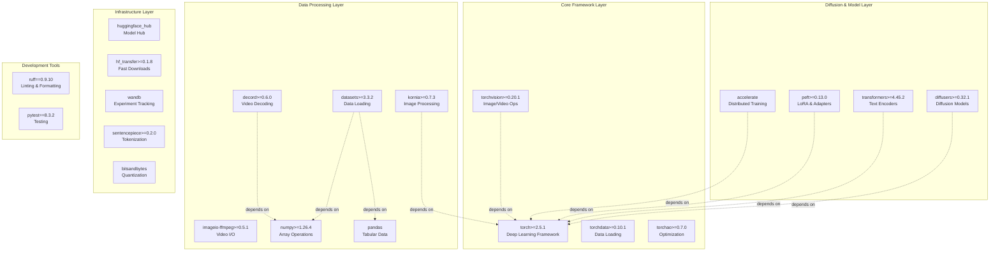
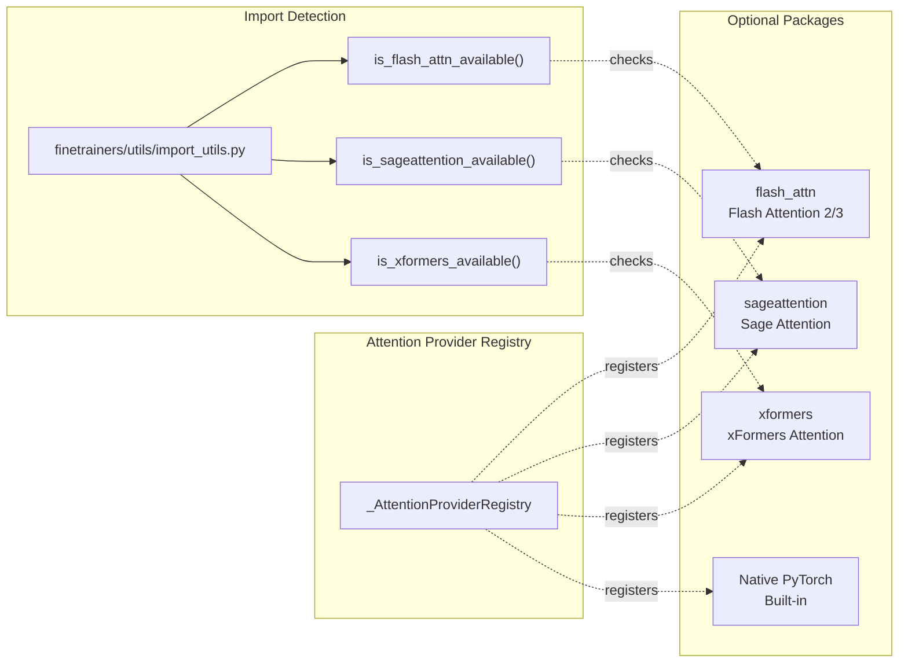
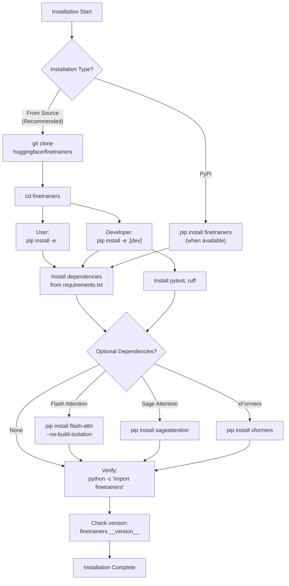

<!-- source: DeepWiki mcp.deepwiki.com · repo huggingface/finetrainers · page 2.1 Installation and Dependencies · fetched 2026-10-26 -->

# Installation and Dependencies

<details>
<summary>Relevant source files</summary>

The following files were used as context for generating this wiki page:

- [.github/workflows/pr_tests.yml](.github/workflows/pr_tests.yml)
- [Makefile](Makefile)
- [finetrainers/__init__.py](finetrainers/__init__.py)
- [finetrainers/trainer/control_trainer/config.py](finetrainers/trainer/control_trainer/config.py)
- [finetrainers/trainer/sft_trainer/config.py](finetrainers/trainer/sft_trainer/config.py)
- [finetrainers/utils/import_utils.py](finetrainers/utils/import_utils.py)
- [requirements.txt](requirements.txt)
- [setup.py](setup.py)
- [tests/models/ltx_video/_test_tp.py](tests/models/ltx_video/_test_tp.py)

</details>


This page provides detailed instructions for installing finetrainers and configuring its dependencies. It covers system requirements, required and optional packages, installation methods, environment variable configuration, and verification steps.

For instructions on running your first training after installation, see [Quick Start Guide](#2.2). For general system architecture and design, see [Overview](#1).

## Purpose and Scope

This document covers:
- Python version requirements and system prerequisites
- Core and optional dependencies with version constraints
- Multiple installation methods (pip, source, development)
- Environment variable configuration for runtime behavior
- Dependency checking mechanisms and version compatibility
- Development tools setup for contributors

---

## System Requirements

### Python Version

Finetrainers requires **Python 3.8 or higher**. This constraint is defined in [setup.py:19]().

```python
python_requires=">=3.8.0"
```

Supported Python versions include:
- Python 3.8
- Python 3.9
- Python 3.10
- Python 3.11+

### Hardware Requirements

**GPU**: CUDA-capable GPU is required for training. The library uses PyTorch with CUDA support and expects:
- NVIDIA GPU with CUDA compute capability 7.0+ (Volta architecture or newer)
- Sufficient VRAM based on model and training configuration (see [Supported Models](#6) for memory requirements)

**Storage**: Adequate disk space for:
- Model checkpoints (several GB per model)
- Dataset storage
- Precomputed latents/embeddings (if using precomputation)

**Sources:** [setup.py:19-38](), [requirements.txt:1-21]()

---

## Core Dependencies

The following diagram illustrates the dependency hierarchy and their roles in the system:

### Dependency Architecture



**Sources:** [requirements.txt:1-21](), [setup.py:7-22]()

### Required Packages

The complete list of required dependencies is specified in [requirements.txt:1-21](). Key packages include:

| Package | Version | Purpose |
|---------|---------|---------|
| `torch` | >=2.5.1 | Core deep learning framework, tensor operations |
| `torchvision` | >=0.20.1 | Image and video transformations |
| `torchdata` | >=0.10.1 | Data loading utilities |
| `torchao` | >=0.7.0 | PyTorch optimization library |
| `diffusers` | >=0.32.1 | Diffusion model implementations (UNet, Transformer) |
| `transformers` | >=4.45.2 | Text encoders (T5, CLIP, LLaMA, GLM) |
| `peft` | >=0.13.0 | LoRA and low-rank adaptation utilities |
| `accelerate` | - | Distributed training backend (DDP) |
| `datasets` | >=3.3.2 | Dataset loading and processing |
| `decord` | >=0.6.0 | Efficient video frame decoding |
| `imageio-ffmpeg` | >=0.5.1 | Video I/O with FFmpeg backend |
| `kornia` | >=0.7.3 | Differentiable computer vision operations |
| `numpy` | >=1.26.4 | Numerical array operations |
| `pandas` | - | CSV/tabular data handling |
| `huggingface_hub` | - | Model and dataset hub integration |
| `hf_transfer` | >=0.1.8 | Accelerated file transfers from HF Hub |
| `wandb` | - | Experiment tracking and logging |
| `sentencepiece` | >=0.2.0 | Tokenization for some models |
| `bitsandbytes` | - | Quantization and optimization |

**Sources:** [requirements.txt:1-21]()

---

## Optional Dependencies

### Attention Providers

Finetrainers supports multiple attention implementation backends for performance optimization. These are detected at runtime via the import checking system.



**Sources:** [finetrainers/utils/import_utils.py:53-129]()

#### Flash Attention

For fastest attention computation, especially on A100/H100 GPUs:

```bash
pip install flash-attn --no-build-isolation
```

Detection function: `is_flash_attn_available()` at [finetrainers/utils/import_utils.py:70-71]()

#### Sage Attention

Alternative attention implementation with different performance characteristics:

```bash
pip install sageattention
```

Detection function: `is_sageattention_available()` at [finetrainers/utils/import_utils.py:78-79]()

#### xFormers

Memory-efficient attention with flexible kernels:

```bash
pip install xformers
```

Detection function: `is_xformers_available()` at [finetrainers/utils/import_utils.py:86-87]()

**Note:** Native PyTorch attention is always available as a fallback. The attention provider is selected via the `FINETRAINERS_ATTN_PROVIDER` environment variable (see [Environment Variables](#environment-variables)).

**Sources:** [finetrainers/utils/import_utils.py:53-129]()

### Development Dependencies

For contributors and developers, additional tools are required:

| Package | Version | Purpose |
|---------|---------|---------|
| `ruff` | ==0.9.10 | Code formatting and linting |
| `pytest` | ==8.3.2 | Testing framework |

Specified in [setup.py:23]() as `extras_require={"dev": [...]}`.

**Sources:** [setup.py:23](), [requirements.txt:20]()

---

## Installation Methods

### Method 1: Install from Source (Recommended)

This method is recommended for active users and developers:

```bash
# Clone the repository
git clone https://github.com/huggingface/finetrainers.git
cd finetrainers

# Install in editable mode
pip install -e .
```

The `-e` flag installs the package in editable mode, allowing code changes to take effect immediately without reinstallation.

**Sources:** [setup.py:10-38]()

### Method 2: Direct pip Install

Install specific dependencies from requirements.txt:

```bash
pip install -r requirements.txt
```

Or install the package when available on PyPI (version 0.2.0.dev0 is currently in development):

```bash
pip install finetrainers
```

**Note:** Package metadata indicates version `0.2.0.dev0` at [finetrainers/__init__.py:8]() and [setup.py:12]().

**Sources:** [requirements.txt:1-21](), [setup.py:40-46]()

### Method 3: Development Installation

For contributors who need testing and quality tools:

```bash
# Clone repository
git clone https://github.com/huggingface/finetrainers.git
cd finetrainers

# Install with development extras
pip install -e ".[dev]"

# Or install requirements + dev tools separately
pip install -r requirements.txt
pip install pytest==8.3.2 ruff==0.9.10
```

**Sources:** [setup.py:23]()

### Installation Flow Diagram



**Sources:** [setup.py:10-38](), [requirements.txt:1-21]()

---

## Dependency Checking System

Finetrainers implements a comprehensive dependency checking system in [finetrainers/utils/import_utils.py]() that detects package availability and validates versions at runtime.

### Import Checking Functions

The following functions are provided for checking dependency availability:

```mermaid
graph TB
    subgraph "Core Checking Logic"
        is_package["_is_package_available(pkg_name)<br/>[import_utils.py:18-29]"]
        compare_versions["compare_versions(library, op, version)<br/>[import_utils.py:33-50]"]
    end
    
    subgraph "Package Detection Functions"
        is_bitsandbytes["is_bitsandbytes_available()<br/>[import_utils.py:62-63]"]
        is_datasets["is_datasets_available()<br/>[import_utils.py:66-67]"]
        is_flash["is_flash_attn_available()<br/>[import_utils.py:70-71]"]
        is_kornia["is_kornia_available()<br/>[import_utils.py:74-75]"]
        is_sage["is_sageattention_available()<br/>[import_utils.py:78-79]"]
        is_torch["is_torch_available()<br/>[import_utils.py:82-83]"]
        is_xformers["is_xformers_available()<br/>[import_utils.py:86-87]"]
    end
    
    subgraph "Version Checking Functions"
        is_bitsandbytes_ver["is_bitsandbytes_version(op, ver)<br/>[import_utils.py:90-93]"]
        is_datasets_ver["is_datasets_version(op, ver)<br/>[import_utils.py:96-99]"]
        is_flash_ver["is_flash_attn_version(op, ver)<br/>[import_utils.py:102-105]"]
        is_torch_ver["is_torch_version(op, ver)<br/>[import_utils.py:120-123]"]
    end
    
    is_package -.used by.-> is_bitsandbytes
    is_package -.used by.-> is_datasets
    is_package -.used by.-> is_flash
    is_package -.used by.-> is_kornia
    is_package -.used by.-> is_sage
    is_package -.used by.-> is_torch
    is_package -.used by.-> is_xformers
    
    compare_versions -.used by.-> is_bitsandbytes_ver
    compare_versions -.used by.-> is_datasets_ver
    compare_versions -.used by.-> is_flash_ver
    compare_versions -.used by.-> is_torch_ver
```



**Sources:** [finetrainers/utils/import_utils.py:1-130]()

### Usage Example

```python
from finetrainers.utils.import_utils import (
    is_flash_attn_available,
    is_torch_version
)

# Check if flash attention is available
if is_flash_attn_available():
    print("Flash Attention is installed")

# Check if torch version is >= 2.5.1
if is_torch_version(">=", "2.5.1"):
    print("PyTorch version requirement satisfied")
```

The system uses `importlib.util.find_spec()` to detect packages and `importlib_metadata.version()` to retrieve version information, as implemented in [finetrainers/utils/import_utils.py:18-29]().

**Sources:** [finetrainers/utils/import_utils.py:1-130]()

---

## Environment Variables

Finetrainers uses environment variables to configure runtime behavior without code changes.

### Available Environment Variables

| Variable | Purpose | Valid Values | Default |
|----------|---------|--------------|---------|
| `FINETRAINERS_ATTN_PROVIDER` | Select attention implementation | `flash`, `sage`, `xformers`, `native` | Auto-detect based on availability |
| `FINETRAINERS_ATTN_CHECKS` | Enable/disable attention validation checks | `0`, `1` | `1` (enabled) |

### Setting Environment Variables

**Linux/macOS:**
```bash
export FINETRAINERS_ATTN_PROVIDER=flash
export FINETRAINERS_ATTN_CHECKS=1
```

**Windows (Command Prompt):**
```cmd
set FINETRAINERS_ATTN_PROVIDER=flash
set FINETRAINERS_ATTN_CHECKS=1
```

**Python script:**
```python
import os
os.environ["FINETRAINERS_ATTN_PROVIDER"] = "flash"
os.environ["FINETRAINERS_ATTN_CHECKS"] = "1"
```

### Attention Provider Selection

The attention provider is selected based on:
1. `FINETRAINERS_ATTN_PROVIDER` environment variable (if set)
2. Automatic detection of installed packages (flash_attn → sageattention → xformers → native)

For more details on attention providers, see [Attention Providers](#8.1).

**Sources:** Based on architecture diagram showing environment variables

---

## Development Tools Setup

For contributors maintaining code quality, finetrainers uses `ruff` for linting and formatting.

### Makefile Targets

The [Makefile:1-12]() defines quality check and formatting commands:

```makefile
check_dirs := finetrainers tests examples train.py setup.py

quality:
    ruff check $(check_dirs) --exclude examples/_legacy
    ruff format --check $(check_dirs) --exclude examples/_legacy

style:
    ruff check $(check_dirs) --fix --exclude examples/_legacy
    ruff format $(check_dirs) --exclude examples/_legacy
```

### Running Quality Checks

**Check code quality without modifications:**
```bash
make quality
```

**Auto-fix issues and format code:**
```bash
make style
```

### CI Integration

GitHub Actions runs quality checks on all pull requests via [.github/workflows/pr_tests.yml:1-31]():

```yaml
- name: Install dependencies
  run: |
    python -m pip install --upgrade pip
    pip install ruff==0.9.10
- name: Check quality
  run: make quality
```

**Note:** There's a version mismatch between [requirements.txt:20]() (`ruff==0.9.10`) and [setup.py:23]() (`ruff==0.1.5`). The CI uses `ruff==0.9.10`.

**Sources:** [Makefile:1-12](), [.github/workflows/pr_tests.yml:1-31](), [requirements.txt:20](), [setup.py:23]()

---

## Verification

After installation, verify that finetrainers is properly installed:

### Basic Import Test

```bash
python -c "import finetrainers; print(finetrainers.__version__)"
```

Expected output: `0.2.0.dev0`

### Check Core Components

```python
from finetrainers import BaseArgs, ModelType, TrainingType
from finetrainers import ModelSpecification, SFTTrainer, ControlTrainer
from finetrainers.logging import get_logger

print("Core imports successful!")
```

The main exports are defined in [finetrainers/__init__.py:1-8]():
- `BaseArgs` - Configuration system
- `ModelType` - Supported model enum
- `TrainingType` - Training type enum  
- `ModelSpecification` - Model abstraction interface
- `SFTTrainer` - Supervised fine-tuning trainer
- `ControlTrainer` - Control training trainer
- `get_logger` - Logging utility

### Verify Optional Dependencies

```python
from finetrainers.utils.import_utils import (
    is_flash_attn_available,
    is_sageattention_available,
    is_xformers_available,
)

print(f"Flash Attention: {is_flash_attn_available()}")
print(f"Sage Attention: {is_sageattention_available()}")
print(f"xFormers: {is_xformers_available()}")
```

### Version Compatibility Check

```python
from finetrainers.utils.import_utils import (
    is_torch_version,
    is_diffusers_version,
    is_transformers_version,
)

# Check minimum required versions
assert is_torch_version(">=", "2.5.1"), "PyTorch >= 2.5.1 required"
assert is_diffusers_version(">=", "0.32.1"), "diffusers >= 0.32.1 required"
assert is_transformers_version(">=", "4.45.2"), "transformers >= 4.45.2 required"

print("All version requirements satisfied!")
```

**Note:** Version checking functions like `is_diffusers_version` and `is_transformers_version` would need to be added to [finetrainers/utils/import_utils.py]() following the same pattern as existing checkers.

**Sources:** [finetrainers/__init__.py:1-8](), [finetrainers/utils/import_utils.py:62-129]()

---

## Troubleshooting

### Common Installation Issues

**Issue: PyTorch CUDA mismatch**
```
RuntimeError: CUDA error: no kernel image is available for execution on the device
```
**Solution:** Ensure PyTorch is installed with matching CUDA version:
```bash
# For CUDA 11.8
pip install torch torchvision --index-url https://download.pytorch.org/whl/cu118

# For CUDA 12.1
pip install torch torchvision --index-url https://download.pytorch.org/whl/cu121
```

**Issue: Flash Attention compilation failure**
```
error: command 'gcc' failed with exit status 1
```
**Solution:** Use `--no-build-isolation` flag:
```bash
pip install flash-attn --no-build-isolation
```

**Issue: Import errors after installation**
```
ModuleNotFoundError: No module named 'finetrainers'
```
**Solution:** Verify installation path and Python environment:
```bash
pip show finetrainers
python -c "import sys; print(sys.path)"
```

**Issue: Version conflicts**
```
ERROR: pip's dependency resolver does not currently take into account all the packages that are installed
```
**Solution:** Use a fresh virtual environment:
```bash
python -m venv finetrainers_env
source finetrainers_env/bin/activate  # or `finetrainers_env\Scripts\activate` on Windows
pip install -e .
```

**Sources:** Based on common PyTorch and dependency installation patterns

---

## Summary

This page covered the complete installation and dependency setup for finetrainers:

- **System Requirements**: Python 3.8+, CUDA-capable GPU
- **Core Dependencies**: 19 required packages including torch >=2.5.1, diffusers >=0.32.1, transformers >=4.45.2
- **Optional Dependencies**: flash_attn, sageattention, xformers for optimized attention
- **Installation Methods**: Source installation (recommended), pip install, development setup
- **Dependency Checking**: Runtime detection via `is_*_available()` functions in [finetrainers/utils/import_utils.py]()
- **Environment Variables**: `FINETRAINERS_ATTN_PROVIDER`, `FINETRAINERS_ATTN_CHECKS`
- **Development Tools**: ruff for linting/formatting, pytest for testing
- **Verification**: Import tests and version compatibility checks

For next steps on running your first training, proceed to [Quick Start Guide](#2.2).

**Sources:** [requirements.txt:1-21](), [setup.py:1-47](), [finetrainers/__init__.py:1-8](), [finetrainers/utils/import_utils.py:1-130](), [Makefile:1-12](), [.github/workflows/pr_tests.yml:1-31]()

---

