<!-- source: DeepWiki mcp.deepwiki.com · repo huggingface/finetrainers · page 2.2 Quick Start Guide · fetched 2026-10-26 -->

# Quick Start Guide

<details>
<summary>Relevant source files</summary>

The following files were used as context for generating this wiki page:

- [.gitignore](.gitignore)
- [README.md](README.md)
- [docs/models/cogvideox.md](docs/models/cogvideox.md)
- [docs/models/cogview4.md](docs/models/cogview4.md)
- [docs/models/flux.md](docs/models/flux.md)
- [docs/models/hunyuan_video.md](docs/models/hunyuan_video.md)
- [docs/models/ltx_video.md](docs/models/ltx_video.md)
- [docs/models/wan.md](docs/models/wan.md)
- [examples/training/sft/flux_dev/raider_white_tarot/train.sh](examples/training/sft/flux_dev/raider_white_tarot/train.sh)
- [examples/training/sft/flux_dev/raider_white_tarot/training.json](examples/training/sft/flux_dev/raider_white_tarot/training.json)
- [examples/training/sft/flux_dev/raider_white_tarot/validation.json](examples/training/sft/flux_dev/raider_white_tarot/validation.json)
- [finetrainers/functional/__init__.py](finetrainers/functional/__init__.py)
- [finetrainers/functional/text.py](finetrainers/functional/text.py)
- [finetrainers/models/flux/__init__.py](finetrainers/models/flux/__init__.py)
- [finetrainers/processors/t5.py](finetrainers/processors/t5.py)

</details>


This guide provides a step-by-step walkthrough for running your first training job with finetrainers. By the end of this tutorial, you will have successfully fine-tuned a diffusion model using LoRA and run inference with the trained adapter. For detailed information about installation and dependencies, see [Installation and Dependencies](#2.1). For comprehensive documentation on configuration options, see [Configuration System](#3.3).

## Prerequisites

Before starting, ensure you have:
- Installed finetrainers and its dependencies (see [Installation and Dependencies](#2.1))
- Access to at least one GPU with sufficient VRAM (minimum 5GB for LTX-Video LoRA)
- A Hugging Face account (optional, for pushing trained models)

## Training Workflow Overview

The following diagram illustrates the complete workflow from repository setup to model inference:

```mermaid
flowchart TD
    Start([Start]) --> Clone["git clone repository<br/>git checkout release tag"]
    Clone --> Install["pip install -r requirements.txt<br/>pip install diffusers"]
    Install --> SelectExample["Select Example:<br/>examples/training/sft/{model}/{example}/"]
    
    SelectExample --> ReviewFiles["Review Training Configuration:<br/>- train.sh (execution script)<br/>- training.json (dataset config)<br/>- validation.json (validation prompts)"]
    
    ReviewFiles --> ConfigEnv["Configure Environment:<br/>- CUDA_VISIBLE_DEVICES<br/>- WANDB_MODE<br/>- FINETRAINERS_LOG_LEVEL"]
    
    ConfigEnv --> ExecuteChoice{Execution Method?}
    
    ExecuteChoice -->|PTD Backend| Torchrun["torchrun --standalone<br/>--nproc_per_node=NUM_GPUS<br/>train.py + arguments"]
    ExecuteChoice -->|Accelerate Backend| AccelerateLaunch["accelerate launch<br/>--config_file config.yaml<br/>train.py + arguments"]
    
    Torchrun --> TrainingLoop["Training Loop Executes:<br/>- SFTTrainer initialized<br/>- Model/data preparation<br/>- Forward/backward passes"]
    AccelerateLaunch --> TrainingLoop
    
    TrainingLoop --> MonitorProgress["Monitor Progress:<br/>- wandb dashboard<br/>- tensorboard logs<br/>- console output"]
    
    MonitorProgress --> CheckpointSave["Checkpoints Saved:<br/>output_dir/checkpoint-{step}/<br/>- pytorch_lora_weights.safetensors<br/>- optimizer.pt<br/>- random_states_*.pkl"]
    
    CheckpointSave --> ValidationRun["Validation Artifacts:<br/>- Generated videos/images<br/>- Saved to validation_dataset/"]
    
    ValidationRun --> TrainComplete{Training Complete?}
    TrainComplete -->|No| TrainingLoop
    TrainComplete -->|Yes| FinalCheckpoint["Final Checkpoint:<br/>- Saved to output_dir<br/>- Optionally pushed to HF Hub"]
    
    FinalCheckpoint --> LoadPipeline["Load Diffusers Pipeline:<br/>pipe.from_pretrained()"]
    LoadPipeline --> LoadLora["pipe.load_lora_weights()<br/>pipe.set_adapters()"]
    LoadLora --> Inference["Generate with Trained Model:<br/>pipe(prompt).frames/images"]
    Inference --> End([End])
    
    style Start fill:#e1f5ff
    style TrainingLoop fill:#ffe1e1
    style Inference fill:#e1ffe1
    style End fill:#e1ffe1
```



**Sources:** [README.md:25-50](), [examples/training/sft/flux_dev/raider_white_tarot/train.sh:1-161]()

## Step 1: Clone and Setup

Clone the repository and checkout the latest stable release:

```bash
git clone https://github.com/huggingface/finetrainers.git
cd finetrainers
git fetch --all --tags
git checkout tags/v0.2.0
```

Install the required dependencies:

```bash
pip install -r requirements.txt
pip install git+https://github.com/huggingface/diffusers
```

> **Note:** The main branch is the development branch. For stable training, always use a release tag.

**Sources:** [README.md:27-36]()

## Step 2: Select a Training Example

Finetrainers provides multiple example training configurations for different models. For this quick start, we'll use the LTX-Video "crush effect" LoRA training example, which requires minimal VRAM (5GB):

```bash
cd examples/training/sft/ltx_video/crush_smol_lora/
```

Each example directory contains three key files:

| File | Purpose |
|------|---------|
| `train.sh` | Bash script that configures all training arguments and launches the training process |
| `training.json` | Dataset configuration specifying data sources, resolution buckets, and preprocessing options |
| `validation.json` | Validation prompts and generation parameters for periodic quality checks |

**Sources:** [README.md:40-44](), [docs/models/ltx_video.md:7-9]()

## Step 3: Understanding the Training Script Structure

The training script is organized into modular argument groups. Here's how these groups map to the training system:

```mermaid
graph TB
    subgraph "train.sh Script Structure"
        EnvVars["Environment Variables<br/>WANDB_MODE, CUDA_VISIBLE_DEVICES<br/>FINETRAINERS_LOG_LEVEL"]
        Backend["Backend Selection<br/>BACKEND='ptd' or 'accelerate'"]
        ParallelCmd["parallel_cmd array<br/>--parallel_backend<br/>--dp_degree, --dp_shards<br/>--cp_degree, --tp_degree"]
        ModelCmd["model_cmd array<br/>--model_name<br/>--pretrained_model_name_or_path"]
        DatasetCmd["dataset_cmd array<br/>--dataset_config<br/>--enable_precomputation"]
        DataloaderCmd["dataloader_cmd array<br/>--dataloader_num_workers"]
        DiffusionCmd["diffusion_cmd array<br/>--flow_weighting_scheme"]
        TrainingCmd["training_cmd array<br/>--training_type<br/>--rank, --lora_alpha<br/>--target_modules"]
        OptimizerCmd["optimizer_cmd array<br/>--optimizer, --lr<br/>--lr_scheduler"]
        ValidationCmd["validation_cmd array<br/>--validation_dataset_file<br/>--validation_steps"]
        MiscCmd["miscellaneous_cmd array<br/>--output_dir<br/>--report_to"]
        
        Launch["Execution Command<br/>torchrun or accelerate launch"]
    end
    
    subgraph "train.py Entry Point"
        BaseArgs["BaseArgs.parse()"]
    end
    
    subgraph "Trainer Initialization"
        GetSpec["get_model_specification()<br/>Returns ModelSpecification"]
        InitTrainer["SFTTrainer() or ControlTrainer()"]
    end
    
    subgraph "Training Execution"
        PrepModels["_prepare_models()<br/>Load tokenizer, text_encoder, vae, transformer"]
        PrepParams["_prepare_trainable_parameters()<br/>Setup LoRA adapters or full params"]
        PrepParallel["_prepare_for_training()<br/>Apply DDP/FSDP/HSDP"]
        PrepData["_prepare_dataset()<br/>Load and preprocess data"]
        TrainLoop["train_loop()<br/>Forward → compute_loss → backward"]
    end
    
    EnvVars --> Backend
    Backend --> ParallelCmd
    ParallelCmd --> ModelCmd
    ModelCmd --> DatasetCmd
    DatasetCmd --> DataloaderCmd
    DataloaderCmd --> DiffusionCmd
    DiffusionCmd --> TrainingCmd
    TrainingCmd --> OptimizerCmd
    OptimizerCmd --> ValidationCmd
    ValidationCmd --> MiscCmd
    MiscCmd --> Launch
    
    Launch --> BaseArgs
    BaseArgs --> GetSpec
    GetSpec --> InitTrainer
    InitTrainer --> PrepModels
    PrepModels --> PrepParams
    PrepParams --> PrepParallel
    PrepParallel --> PrepData
    PrepData --> TrainLoop
    
    style Launch fill:#ffe1e1
    style BaseArgs fill:#e1ffe1
    style TrainLoop fill:#ffe1e1
```



**Sources:** [examples/training/sft/flux_dev/raider_white_tarot/train.sh:1-161]()

### Key Configuration Groups

#### Environment Variables

Set up the training environment before execution:

```bash
export WANDB_MODE="offline"           # or "online" for cloud logging
export CUDA_VISIBLE_DEVICES="0"       # GPU selection
export FINETRAINERS_LOG_LEVEL="DEBUG" # or "INFO", "WARNING"
```

**Sources:** [examples/training/sft/flux_dev/raider_white_tarot/train.sh:7-10]()

#### Backend and Parallelism Arguments

Finetrainers supports two distributed training backends:

| Backend | Use Case | Configuration |
|---------|----------|---------------|
| `ptd` (PyTorchDTensor) | Advanced parallelism (FSDP, HSDP, CP, TP) | `--parallel_backend ptd` |
| `accelerate` | Simple DDP training | `--parallel_backend accelerate` |

For single-GPU training, use DDP with 1 GPU:
```bash
--parallel_backend ptd --pp_degree 1 --dp_degree 1 --dp_shards 1 --cp_degree 1 --tp_degree 1
```

**Sources:** [examples/training/sft/flux_dev/raider_white_tarot/train.sh:13-30]()

#### Model Arguments

Specify which model to train:

```bash
--model_name "ltx_video"  # or "cogvideox", "wan", "flux", etc.
--pretrained_model_name_or_path "Lightricks/LTX-Video"
```

**Sources:** [examples/training/sft/flux_dev/raider_white_tarot/train.sh:38-41]()

#### Training Type Arguments

Choose between LoRA and full fine-tuning:

```bash
--training_type "lora"              # or "full-finetune"
--rank 128                          # LoRA rank
--lora_alpha 128                    # LoRA alpha parameter
--target_modules ".*attn.*"         # Regex for target layers
```

For full fine-tuning, simply set `--training_type "full-finetune"` and omit LoRA-specific arguments.

**Sources:** [examples/training/sft/flux_dev/raider_white_tarot/train.sh:68-82](), [docs/models/ltx_video.md:5]()

## Step 4: Configure Dataset

The dataset configuration is specified in JSON format. Here's the structure:

```json
{
  "datasets": [
    {
      "data_root": "dataset-name-or-path",
      "dataset_type": "video",
      "video_resolution_buckets": [[49, 512, 768]],
      "reshape_mode": "center_crop"
    }
  ]
}
```

For image training (Flux, CogView4), the structure is similar:

```json
{
  "datasets": [
    {
      "data_root": "multimodalart/1920-raider-waite-tarot-public-domain",
      "dataset_type": "image",
      "id_token": "TRTCRD",
      "image_resolution_buckets": [[1280, 720]],
      "reshape_mode": "bicubic"
    }
  ]
}
```

**Sources:** [examples/training/sft/flux_dev/raider_white_tarot/training.json:1-34]()

### Validation Configuration

The validation file specifies prompts for periodic inference checks:

```json
{
  "data": [
    {
      "caption": "A cat walks on grass",
      "num_inference_steps": 30,
      "num_frames": 49,
      "height": 512,
      "width": 768
    }
  ]
}
```

**Sources:** [examples/training/sft/flux_dev/raider_white_tarot/validation.json:1-68]()

## Step 5: Execute Training

Make the training script executable and run it:

```bash
chmod +x train.sh
./train.sh
```

The script will:
1. Initialize the distributed training backend via `torchrun` or `accelerate launch`
2. Parse all arguments through `BaseArgs.parse()`
3. Initialize the appropriate trainer (`SFTTrainer` or `ControlTrainer`)
4. Load model components (tokenizer, text encoder, VAE, transformer)
5. Setup LoRA adapters or prepare full fine-tuning
6. Apply parallelism strategy (DDP/FSDP/HSDP)
7. Load and preprocess the dataset
8. Execute the training loop

### Execution Commands by Backend

**PTD Backend:**
```bash
torchrun \
  --standalone \
  --nnodes=1 \
  --nproc_per_node=1 \
  train.py \
    --parallel_backend ptd \
    --model_name ltx_video \
    ...
```

**Accelerate Backend:**
```bash
accelerate launch \
  --config_file accelerate_configs/uncompiled_1.yaml \
  train.py \
    --parallel_backend accelerate \
    --model_name ltx_video \
    ...
```

**Sources:** [examples/training/sft/flux_dev/raider_white_tarot/train.sh:114-158]()

## Step 6: Monitor Training Progress

### Console Output

Training progress is logged to the console with the following information:
- Current step and epoch
- Loss values
- Learning rate
- Training throughput (steps/sec)
- Estimated time remaining

### Weights & Biases

If `--report_to wandb` is specified, training metrics are logged to W&B:
- Training loss curves
- Validation artifacts (generated videos/images)
- System metrics (GPU utilization, memory usage)

### Checkpoint Directory Structure

Checkpoints are saved to the specified `--output_dir`:

```
output_dir/
├── checkpoint-250/
│   ├── pytorch_lora_weights.safetensors  # LoRA weights
│   ├── optimizer.pt                       # Optimizer state
│   ├── random_states_0.pkl               # RNG states
│   └── metadata.json                      # Training metadata
├── checkpoint-500/
│   └── ...
└── validation_dataset/
    ├── step_250_sample_0.mp4             # Validation videos
    └── step_250_sample_1.mp4
```

**Sources:** [examples/training/sft/flux_dev/raider_white_tarot/train.sh:76-78]()

## Step 7: Inference with Trained Model

Once training is complete, use the trained LoRA adapter for inference:

### Video Models (LTX-Video, CogVideoX, Wan, HunyuanVideo)

```python
import torch
from diffusers import LTXPipeline
from diffusers.utils import export_to_video

# Load base model
pipe = LTXPipeline.from_pretrained(
    "Lightricks/LTX-Video", 
    torch_dtype=torch.bfloat16
).to("cuda")

# Load trained LoRA weights
pipe.load_lora_weights(
    "output_dir",  # or HF Hub repo name
    adapter_name="ltxv-lora"
)

# Set adapter strength (0.0 to 1.0)
pipe.set_adapters(["ltxv-lora"], [0.75])

# Generate video
video = pipe(
    prompt="A cat walking on grass with crush effect",
    num_inference_steps=30,
    num_frames=49,
    height=512,
    width=768
).frames[0]

export_to_video(video, "output.mp4", fps=8)
```

**Sources:** [docs/models/ltx_video.md:19-42](), [docs/models/cogvideox.md:27-44](), [docs/models/wan.md:32-48]()

### Image Models (Flux, CogView4)

```python
import torch
from diffusers import FluxPipeline

# Load base model
pipe = FluxPipeline.from_pretrained(
    "black-forest-labs/FLUX.1-dev",
    torch_dtype=torch.bfloat16
).to("cuda")

# Load trained LoRA weights
pipe.load_lora_weights(
    "output_dir",
    adapter_name="flux-lora"
)

# Set adapter strength
pipe.set_adapters(["flux-lora"], [0.9])

# Generate image
image = pipe(
    prompt="TRTCRD a tarot card of a knight on a horse",
    num_inference_steps=50,
    height=1280,
    width=720
).images[0]

image.save("output.png")
```

**Sources:** [docs/models/flux.md:30-47](), [docs/models/cogview4.md:27-44]()

## Resuming Training from Checkpoint

To resume training from a saved checkpoint, uncomment and set the `--resume_from_checkpoint` argument in the training script:

```bash
--resume_from_checkpoint 1000  # Resume from checkpoint-1000/
```

The trainer will automatically:
1. Load model weights from the checkpoint
2. Restore optimizer state
3. Resume from the saved training step
4. Restore RNG states for reproducibility

**Sources:** [examples/training/sft/flux_dev/raider_white_tarot/train.sh:79]()

## Quick Start Summary

This table summarizes the complete workflow with key code entities:

| Step | Action | Key Files/Functions |
|------|--------|-------------------|
| 1. Setup | Clone and install dependencies | [requirements.txt]() |
| 2. Select Example | Choose training configuration | `examples/training/sft/{model}/{example}/` |
| 3. Configure | Review train.sh, training.json, validation.json | [train.sh](), [training.json](), [validation.json]() |
| 4. Environment | Set CUDA_VISIBLE_DEVICES, WANDB_MODE | [train.sh:7-10]() |
| 5. Execute | Run `./train.sh` | `torchrun` or `accelerate launch` |
| 6. Training | Automatic execution | `SFTTrainer.train_loop()`, `ControlTrainer.train_loop()` |
| 7. Monitor | Check logs and W&B dashboard | `--report_to wandb` |
| 8. Checkpoints | Periodic saves | `output_dir/checkpoint-{step}/` |
| 9. Inference | Load and use trained model | `pipe.load_lora_weights()`, `pipe.set_adapters()` |

## Next Steps

After completing this quick start, explore:

- **[Training Types](#3.1)**: Learn about LoRA vs full fine-tuning and when to use each
- **[Model Specifications](#3.2)**: Understand how different models are abstracted
- **[Data Pipeline](#5)**: Dive deeper into dataset loading, preprocessing, and bucketing
- **[Parallelism and Distribution](#7)**: Scale training across multiple GPUs
- **[Supported Models](#6)**: Explore all available models and their specific configurations

For troubleshooting and advanced configurations, refer to the comprehensive [API Reference](#10).

**Sources:** [README.md:16-112](), [docs/models/ltx_video.md:1-42](), [docs/models/wan.md:1-116](), [docs/models/flux.md:1-54]()

---

