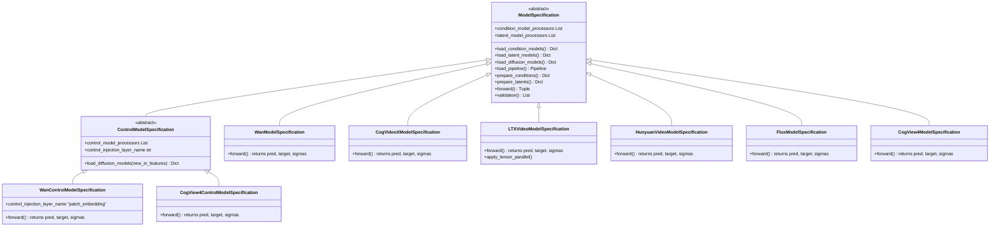
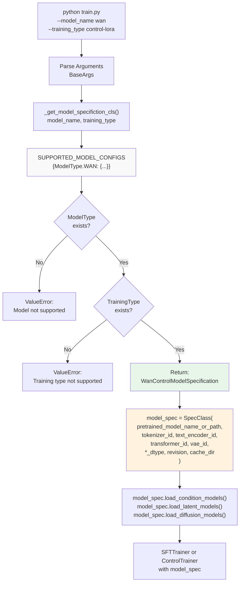
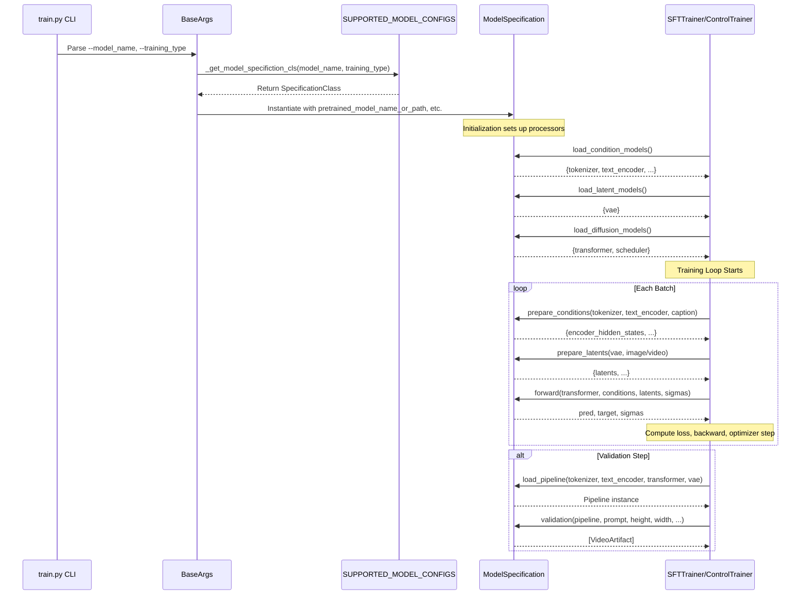
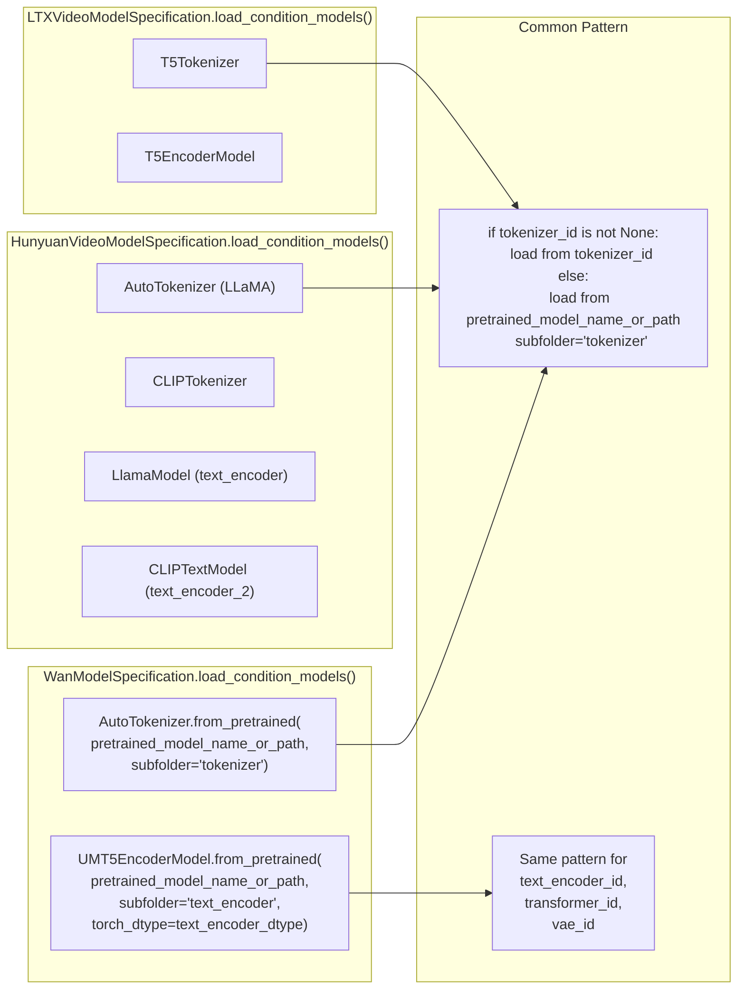
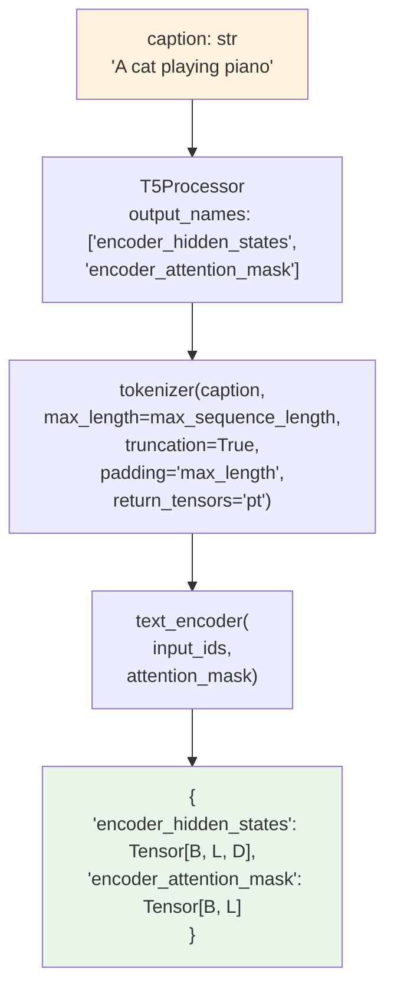
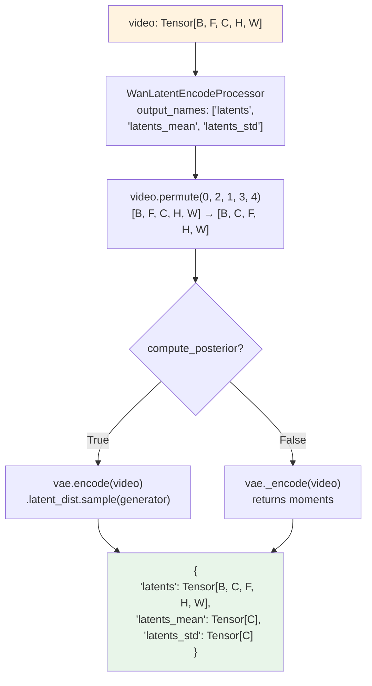
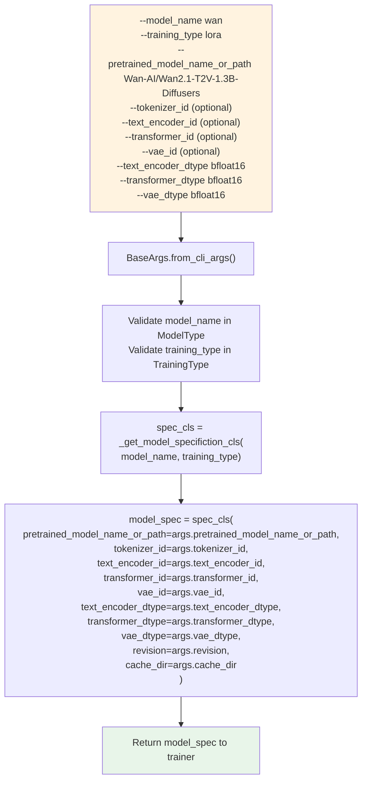

<!-- source: DeepWiki mcp.deepwiki.com · repo huggingface/finetrainers · page 3 Core Concepts · fetched 2026-10-26 -->

# Core Concepts

<details>
<summary>Relevant source files</summary>

The following files were used as context for generating this wiki page:

- [.gitignore](.gitignore)
- [README.md](README.md)
- [docs/models/README.md](docs/models/README.md)
- [finetrainers/config.py](finetrainers/config.py)
- [finetrainers/functional/__init__.py](finetrainers/functional/__init__.py)
- [finetrainers/functional/text.py](finetrainers/functional/text.py)
- [finetrainers/models/cogvideox/base_specification.py](finetrainers/models/cogvideox/base_specification.py)
- [finetrainers/models/flux/base_specification.py](finetrainers/models/flux/base_specification.py)
- [finetrainers/models/hunyuan_video/base_specification.py](finetrainers/models/hunyuan_video/base_specification.py)
- [finetrainers/models/ltx_video/base_specification.py](finetrainers/models/ltx_video/base_specification.py)
- [finetrainers/models/wan/base_specification.py](finetrainers/models/wan/base_specification.py)
- [finetrainers/models/wan/control_specification.py](finetrainers/models/wan/control_specification.py)
- [tests/models/flux/base_specification.py](tests/models/flux/base_specification.py)

</details>


This document explains the fundamental architectural concepts that underpin finetrainers: the `ModelType` and `TrainingType` enums, the `ModelSpecification` interface, and how these components interact to enable training of diverse diffusion models with different training strategies.

For specific details on training approaches (LoRA vs full finetuning, SFT vs Control), see [Training Types](#3.1). For deep implementation details of the `ModelSpecification` abstraction, see [Model Specifications](#3.2). For configuration and command-line argument handling, see [Configuration System](#3.3).

## Core Architectural Concepts

Finetrainers is built around three key abstractions that enable extensible, multi-model training:

1. **ModelType**: An enumeration identifying which diffusion model architecture to train
2. **TrainingType**: An enumeration specifying the training strategy (LoRA, full finetune, control conditioning)
3. **ModelSpecification**: An abstract interface that defines how to load, prepare, and train each model

### ModelType and TrainingType Enums

The `ModelType` enum defines all supported model architectures:

```python
class ModelType(str, Enum):
    COGVIDEOX = "cogvideox"
    COGVIEW4 = "cogview4"
    FLUX = "flux"
    HUNYUAN_VIDEO = "hunyuan_video"
    LTX_VIDEO = "ltx_video"
    WAN = "wan"
```

The `TrainingType` enum defines all supported training strategies:

```python
class TrainingType(str, Enum):
    # Supervised Fine-Tuning (SFT)
    LORA = "lora"                           # Low-rank adaptation
    FULL_FINETUNE = "full-finetune"         # Full parameter training
    
    # Control Training
    CONTROL_LORA = "control-lora"           # LoRA with control conditioning
    CONTROL_FULL_FINETUNE = "control-full-finetune"  # Full finetune with control
```

These enums serve as keys in the `SUPPORTED_MODEL_CONFIGS` registry, which maps `(ModelType, TrainingType)` pairs to their corresponding `ModelSpecification` implementation classes.

**Sources:** [finetrainers/config.py:13-30]()

### The Registry Pattern

The `SUPPORTED_MODEL_CONFIGS` dictionary is the central registry that connects models and training types to their implementations:

```python
SUPPORTED_MODEL_CONFIGS = {
    ModelType.COGVIDEOX: {
        TrainingType.LORA: CogVideoXModelSpecification,
        TrainingType.FULL_FINETUNE: CogVideoXModelSpecification,
    },
    ModelType.WAN: {
        TrainingType.LORA: WanModelSpecification,
        TrainingType.FULL_FINETUNE: WanModelSpecification,
        TrainingType.CONTROL_LORA: WanControlModelSpecification,
        TrainingType.CONTROL_FULL_FINETUNE: WanControlModelSpecification,
    },
    # ... other models
}
```

This registry enables dynamic dispatch: given `--model_name wan --training_type control-lora`, the system automatically instantiates `WanControlModelSpecification` without hard-coded conditionals in the trainer logic.

**Sources:** [finetrainers/config.py:32-63]()

## The ModelSpecification Interface

The `ModelSpecification` abstract base class defines a standardized interface that all model implementations must follow. This abstraction is what enables finetrainers to support diverse models with a single training codebase.

### Key Responsibilities

Each `ModelSpecification` implementation must define:

| Method | Purpose |
|--------|---------|
| `load_condition_models()` | Load tokenizers and text encoders for caption conditioning |
| `load_latent_models()` | Load VAE for image/video encoding |
| `load_diffusion_models()` | Load the transformer/UNet and scheduler |
| `load_pipeline()` | Assemble components into a Diffusers pipeline |
| `prepare_conditions()` | Process text captions into embeddings |
| `prepare_latents()` | Encode images/videos into latent space |
| `forward()` | Execute the training forward pass (noise prediction) |
| `validation()` | Generate artifacts during validation |

### Processor Architecture

Model specifications use **processors** (`ProcessorMixin` implementations) to modularize data transformations:

- **Condition Model Processors**: Transform text captions into embeddings (e.g., `T5Processor`, `CLIPPooledProcessor`)
- **Latent Model Processors**: Encode images/videos into latents (e.g., `WanLatentEncodeProcessor`, `LTXLatentEncodeProcessor`)
- **Control Model Processors**: Process control conditioning signals (only for control training)

This processor pattern enables composition and reuse. For example, both HunyuanVideo and LTX-Video use `T5Processor` for text encoding, but with different output names and parameters.

**Sources:** [finetrainers/models/wan/base_specification.py:210-260](), [finetrainers/models/ltx_video/base_specification.py:93-131](), [finetrainers/models/hunyuan_video/base_specification.py:75-122]()

## Model Specification Hierarchy



**Sources:** [finetrainers/config.py:1-11](), [finetrainers/models/wan/base_specification.py:210-261](), [finetrainers/models/wan/control_specification.py:36-77]()

## Registry Lookup and Instantiation



**Sources:** [finetrainers/config.py:66-75](), [finetrainers/models/wan/control_specification.py:36-76]()

## Component Lifecycle and Data Flow

The following diagram shows how `ModelType`, `TrainingType`, and `ModelSpecification` interact during the training lifecycle:



**Sources:** [finetrainers/models/wan/base_specification.py:383-432](), [finetrainers/models/ltx_video/base_specification.py:227-345]()

## Model-Specific Component Loading

Each `ModelSpecification` implementation loads model-specific components with configurable dtype and optional overrides:



This pattern enables:
1. **Default loading**: Components loaded from the pretrained model path
2. **Component override**: Users can specify `--tokenizer_id`, `--text_encoder_id`, etc. to use custom components
3. **Mixed-precision**: Each component can have its own dtype (`text_encoder_dtype`, `transformer_dtype`, `vae_dtype`)

**Sources:** [finetrainers/models/wan/base_specification.py:265-287](), [finetrainers/models/hunyuan_video/base_specification.py:127-173](), [finetrainers/models/ltx_video/base_specification.py:137-159]()

## Processor Pattern

Processors encapsulate data transformations and enable composition. Each processor implements a `forward()` method that takes models and data as input and returns named outputs.

### Example: Text Processing Chain



### Example: Latent Encoding Chain



The processor pattern provides several benefits:
- **Modularity**: Each transformation is self-contained
- **Reusability**: Processors can be shared across models (e.g., `T5Processor` used by multiple models)
- **Composability**: Multiple processors can be chained together
- **Testability**: Each processor can be tested independently

**Sources:** [finetrainers/models/wan/base_specification.py:30-81](), [finetrainers/processors/t5_processor.py]() (referenced but not provided)

## Training Type Dispatch

The choice between `SFTTrainer` and `ControlTrainer` is determined by the `TrainingType`:

| TrainingType | Trainer Class | Key Difference |
|--------------|---------------|----------------|
| `LORA` | `SFTTrainer` | Standard supervised fine-tuning with LoRA adapters |
| `FULL_FINETUNE` | `SFTTrainer` | Standard supervised fine-tuning with all parameters |
| `CONTROL_LORA` | `ControlTrainer` | Control conditioning with LoRA adapters + channel concat |
| `CONTROL_FULL_FINETUNE` | `ControlTrainer` | Control conditioning with all parameters + channel concat |

Control training requires a `ControlModelSpecification` which extends `ModelSpecification` with:
- `control_model_processors`: Processors for control signal encoding
- Modified `load_diffusion_models(new_in_features)`: Expands input channels for control concatenation
- `control_injection_layer_name`: Identifies where to inject control signals (e.g., `"patch_embedding"`)

**Sources:** [finetrainers/config.py:22-30](), [finetrainers/models/wan/control_specification.py:36-84]()

## Forward Pass Structure

All model specifications implement a `forward()` method that follows this general structure:

1. **Extract latents** from `latent_model_conditions` (either pre-sampled or sample from posterior)
2. **Normalize/scale latents** according to model-specific requirements
3. **Generate noise** using the provided generator
4. **Create noisy latents** using flow matching or DDPM noise scheduling
5. **Call transformer** with noisy latents, conditions, and timesteps
6. **Compute target** (either noise or velocity depending on the model)
7. **Return** prediction, target, and sigmas for loss computation

### Example: Wan Forward Pass

The Wan model uses flow matching with latent normalization:

```python
def forward(self, transformer, condition_model_conditions, 
            latent_model_conditions, sigmas, generator, ...):
    # 1. Sample latents from posterior
    mu, logvar = torch.chunk(latents, 2, dim=1)
    mu = self._normalize_latents(mu, latents_mean, latents_std)
    latents = DiagonalGaussianDistribution(...).sample(generator)
    
    # 2. Flow matching
    noise = torch.zeros_like(latents).normal_(generator=generator)
    noisy_latents = FF.flow_match_xt(latents, noise, sigmas)
    
    # 3. Forward through transformer
    pred = transformer(
        hidden_states=noisy_latents,
        encoder_hidden_states=condition_model_conditions["encoder_hidden_states"],
        timestep=timesteps,
        return_dict=False,
    )[0]
    
    # 4. Compute target
    target = FF.flow_match_target(noise, latents)
    
    return pred, target, sigmas
```

**Sources:** [finetrainers/models/wan/base_specification.py:433-493](), [finetrainers/models/ltx_video/base_specification.py:271-345](), [finetrainers/models/cogvideox/base_specification.py:258-333]()

## Configuration Integration

The configuration system connects user-provided command-line arguments to `ModelSpecification` instantiation:



The modular configuration system is detailed in [Configuration System](#3.3).

**Sources:** [finetrainers/config.py:66-75]()

## Extensibility

Adding a new model requires:

1. **Implement `ModelSpecification`**: Create a subclass defining all required methods
2. **Implement processors**: Create `ProcessorMixin` subclasses for model-specific data transformations
3. **Register in `SUPPORTED_MODEL_CONFIGS`**: Add entries mapping `(ModelType, TrainingType)` to your specification
4. **Add to `ModelType` enum**: Define a new enum value for your model

For control training, additionally implement `ControlModelSpecification` with control-specific methods.

See [Adding a New Model](#9.1) for a step-by-step guide.

**Sources:** [finetrainers/config.py:32-75](), [finetrainers/models/wan/base_specification.py:210-261](), [finetrainers/models/wan/control_specification.py:36-84]()

---

