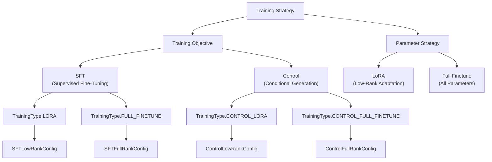
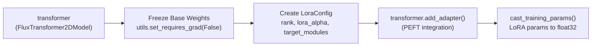
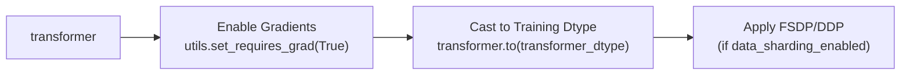
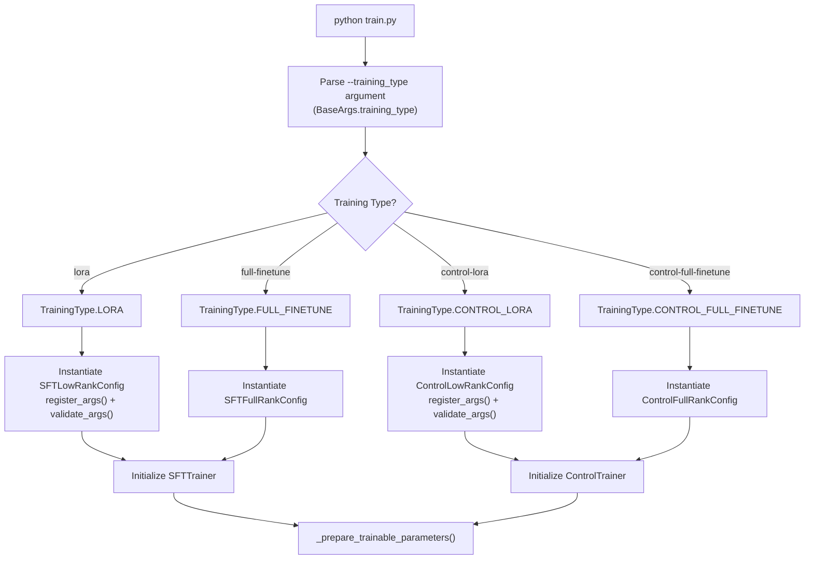
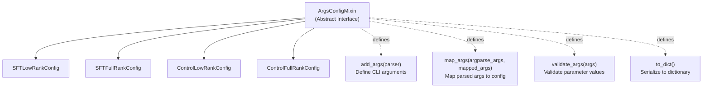
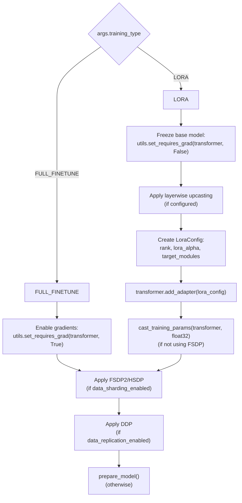

<!-- source: DeepWiki mcp.deepwiki.com · repo huggingface/finetrainers · page 3.1 Training Types · fetched 2026-10-26 -->

# Training Types

<details>
<summary>Relevant source files</summary>

The following files were used as context for generating this wiki page:

- [docs/models/README.md](docs/models/README.md)
- [finetrainers/args.py](finetrainers/args.py)
- [finetrainers/config.py](finetrainers/config.py)
- [finetrainers/models/flux/base_specification.py](finetrainers/models/flux/base_specification.py)
- [finetrainers/trainer/control_trainer/config.py](finetrainers/trainer/control_trainer/config.py)
- [finetrainers/trainer/sft_trainer/config.py](finetrainers/trainer/sft_trainer/config.py)
- [finetrainers/trainer/sft_trainer/trainer.py](finetrainers/trainer/sft_trainer/trainer.py)
- [finetrainers/utils/import_utils.py](finetrainers/utils/import_utils.py)
- [tests/models/flux/base_specification.py](tests/models/flux/base_specification.py)

</details>


This page explains the training type system in finetrainers, covering the differences between LoRA and full finetuning, SFT (Supervised Fine-Tuning) versus Control training, and guidance on when to use each approach. For information about the specific trainer implementations, see [SFT Trainer](#4.1) and [Control Trainer](#4.2). For details on configuration arguments, see [Configuration System](#3.3).

## Overview

Finetrainers supports four distinct training types, organized along two orthogonal dimensions:

1. **Training Objective**: SFT (standard supervised fine-tuning) vs Control (conditional control training)
2. **Parameter Update Strategy**: LoRA (low-rank adaptation) vs Full Finetuning (all parameters)

This design enables flexible training configurations based on computational resources, dataset characteristics, and intended use cases.



**Sources:** [finetrainers/config.py:22-30](), [finetrainers/trainer/sft_trainer/config.py:11-66](), [finetrainers/trainer/control_trainer/config.py:34-185]()

## Training Type Enumeration

The `TrainingType` enum defines the four supported training modes:

| Enum Value | String Value | Purpose | Configuration Class |
|------------|--------------|---------|---------------------|
| `TrainingType.LORA` | `"lora"` | SFT with LoRA adapters | `SFTLowRankConfig` |
| `TrainingType.FULL_FINETUNE` | `"full-finetune"` | SFT with all parameters | `SFTFullRankConfig` |
| `TrainingType.CONTROL_LORA` | `"control-lora"` | Control training with LoRA | `ControlLowRankConfig` |
| `TrainingType.CONTROL_FULL_FINETUNE` | `"control-full-finetune"` | Control training with all parameters | `ControlFullRankConfig` |

These values are used throughout the codebase to select the appropriate training configuration and model specification.

**Sources:** [finetrainers/config.py:22-30]()

## SFT Training Types

### SFT with LoRA (`TrainingType.LORA`)

**Overview**: Trains low-rank adapter matrices inserted into the transformer model, keeping the base model weights frozen. This approach significantly reduces memory requirements and training time while achieving strong performance on domain-specific tasks.

**Configuration Class**: `SFTLowRankConfig`

**Key Parameters**:
- `rank` (default: 64): Dimensionality of the low-rank decomposition matrices
- `lora_alpha` (default: 64): Scaling factor computed as `lora_alpha / rank`
- `target_modules`: Regex pattern(s) specifying which modules receive LoRA adapters

**Default Target Modules Pattern**:
```
(transformer_blocks|single_transformer_blocks).*(to_q|to_k|to_v|to_out.0)
```

This targets attention projection layers in both standard and single transformer blocks.

**Trainable Parameters Setup**:


**Memory Profile**: 
- Typical range: 5-18 GB VRAM depending on model size
- Example: LTX-Video LoRA requires ~5 GB, CogVideoX-5B requires ~18 GB

**When to Use**:
- Limited GPU memory (single consumer GPU)
- Quick iteration on domain-specific datasets
- Training lightweight adapters for distribution
- Fine-tuning for specific styles, subjects, or concepts

**Sources:** [finetrainers/trainer/sft_trainer/config.py:11-51](), [finetrainers/trainer/sft_trainer/trainer.py:96-137](), [finetrainers/args.py:253]()

### SFT with Full Finetuning (`TrainingType.FULL_FINETUNE`)

**Overview**: Updates all transformer parameters during training, producing a fully fine-tuned model. This approach offers maximum flexibility and performance but requires significantly more memory.

**Configuration Class**: `SFTFullRankConfig`

**Key Parameters**: None specific; inherits all base training arguments.

**Trainable Parameters Setup**:


**Memory Profile**:
- Typical range: 21-53+ GB VRAM depending on model size
- Example: LTX-Video requires ~21 GB, CogVideoX-5B requires ~53 GB
- HunyuanVideo full finetune exceeds typical consumer GPU memory

**When to Use**:
- High-end GPU clusters or cloud infrastructure
- Maximum performance requirements
- Substantial architectural changes or comprehensive adaptation
- Research experiments requiring full parameter updates

**Sources:** [finetrainers/trainer/sft_trainer/config.py:53-66](), [finetrainers/trainer/sft_trainer/trainer.py:96-137](), [finetrainers/args.py:253]()

## Control Training Types

Control training adds conditional control channels to the model, enabling generation guided by additional inputs such as edge maps, depth maps, or custom control signals. This is implemented via channel-wise concatenation in the latent space.

### Control with LoRA (`TrainingType.CONTROL_LORA`)

**Overview**: Trains LoRA adapters on a control-conditioned model where control signals are concatenated to the latent input. Enables lightweight control adaptation with minimal memory overhead.

**Configuration Class**: `ControlLowRankConfig`

**Key Parameters**:
- `rank` (default: 64): LoRA rank
- `lora_alpha` (default: 64): LoRA scaling factor
- `target_modules`: Extended pattern including feedforward layers
- `control_type` (default: `"canny"`): Type of control signal (canny, custom)
- `train_qk_norm` (default: False): Whether to train QK normalization layers
- `frame_conditioning_type`: For video models - how frames are conditioned
- `frame_conditioning_index`: Specific frame index when using index-based conditioning
- `frame_conditioning_concatenate_mask`: Whether to concatenate frame masks

**Default Target Modules Pattern**:
```
(transformer_blocks|single_transformer_blocks).*(to_q|to_k|to_v|to_out.0|ff.net.0.proj|ff.net.2)
```

This extends the SFT pattern to include feedforward network projections.

**Control Types**:

| Control Type | Description | Use Case |
|--------------|-------------|----------|
| `ControlType.CANNY` | Edge detection control | Structure-guided generation |
| `ControlType.CUSTOM` | User-provided control signal | Arbitrary conditioning |
| `ControlType.NONE` | No control (fallback) | Standard training |

**Frame Conditioning Types** (for video models):

| Type | Description | Implementation |
|------|-------------|----------------|
| `FrameConditioningType.INDEX` | Single frame by index | Condition on specific frame |
| `FrameConditioningType.PREFIX` | Prefix frames | First N frames as control |
| `FrameConditioningType.RANDOM` | Random frame selection | Stochastic frame conditioning |
| `FrameConditioningType.FIRST_AND_LAST` | Boundary frames | First and last frames |
| `FrameConditioningType.FULL` | All frames | Complete temporal conditioning |

**When to Use**:
- Adding control capabilities to existing models with limited memory
- Controllable generation research
- Style transfer or structure-guided synthesis
- Video frame interpolation or extrapolation

**Sources:** [finetrainers/trainer/control_trainer/config.py:34-123](), [finetrainers/trainer/control_trainer/config.py:12-31]()

### Control with Full Finetuning (`TrainingType.CONTROL_FULL_FINETUNE`)

**Overview**: Full parameter training with control channel concatenation. Provides maximum flexibility for control-conditioned generation at the cost of high memory requirements.

**Configuration Class**: `ControlFullRankConfig`

**Key Parameters**:
- `control_type` (default: `"canny"`): Type of control signal
- `train_qk_norm` (default: False): Whether to train QK normalization
- Frame conditioning parameters (same as Control LoRA)

**Memory Profile**: Similar to full finetuning (21-53+ GB) with additional overhead for control channel processing.

**When to Use**:
- Building production-grade control models
- Maximum control fidelity requirements
- Research into novel control mechanisms
- When LoRA capacity is insufficient

**Sources:** [finetrainers/trainer/control_trainer/config.py:126-185]()

## Training Type Selection Flow



**Sources:** [finetrainers/trainer/sft_trainer/trainer.py:96-137](), [finetrainers/args.py:423-424](), [train.py (not shown but referenced)]()

## Model Support Matrix

Not all models support all training types. The `SUPPORTED_MODEL_CONFIGS` dictionary maps model types to supported training configurations:

| Model | LORA | FULL_FINETUNE | CONTROL_LORA | CONTROL_FULL_FINETUNE |
|-------|------|---------------|--------------|------------------------|
| CogVideoX | ✓ | ✓ | ✗ | ✗ |
| CogView4 | ✓ | ✓ | ✓ | ✓ |
| Flux | ✓ | ✓ | ✗ | ✗ |
| HunyuanVideo | ✓ | ✓ | ✗ | ✗ |
| LTX-Video | ✓ | ✓ | ✗ | ✗ |
| Wan | ✓ | ✓ | ✓ | ✓ |

Control training is currently supported only for **CogView4** (image generation) and **Wan** (video generation). These models use specialized `*ControlModelSpecification` classes that handle control channel concatenation.

**Sources:** [finetrainers/config.py:32-63](), [docs/models/README.md:17-28]()

## Configuration Registration and Validation

Each training type configuration implements the `ArgsConfigMixin` interface, providing a standardized way to:

1. **Add Arguments**: Define command-line arguments via `add_args(parser)`
2. **Map Arguments**: Convert argparse namespace to config attributes via `map_args()`
3. **Validate Arguments**: Ensure parameter validity via `validate_args()`
4. **Serialize**: Export configuration via `to_dict()`



**Example Validation** (from `SFTLowRankConfig`):
```python
def validate_args(self, args: "BaseArgs"):
    assert self.rank > 0, "Rank must be a positive integer."
    assert self.lora_alpha > 0, "lora_alpha must be a positive integer."
```

**Sources:** [finetrainers/trainer/sft_trainer/config.py:28-50](), [finetrainers/trainer/control_trainer/config.py:70-123](), [finetrainers/utils/args_utils.py (referenced)]()

## Parameter Management During Training

The training type determines how parameters are prepared and managed:



**Key Implementation Details**:

1. **Full Finetune**: All transformer parameters have `requires_grad=True` and participate in optimization
2. **LoRA**: Base model frozen, only LoRA adapter weights are trainable
3. **Layerwise Upcasting**: For LoRA training, can store weights in FP8 while computing in BF16/FP32
4. **FSDP Compatibility**: When using FSDP (Fully Sharded Data Parallel), all parameters must be the same dtype
5. **DDP Fallback**: When not using data sharding, LoRA parameters are cast to float32 for stability

**Sources:** [finetrainers/trainer/sft_trainer/trainer.py:96-192](), [finetrainers/args.py:149-156]()

## Memory and Performance Comparison

### Memory Requirements by Training Type

Based on documented memory measurements (from `docs/models/README.md` and model-specific docs):

| Model | LoRA (GB) | Full Finetune (GB) | Control LoRA (GB) | Control Full (GB) |
|-------|-----------|-------------------|------------------|------------------|
| LTX-Video | ~5 | ~21 | N/A | N/A |
| CogVideoX-2B | ~8 | ~24 | N/A | N/A |
| CogVideoX-5B | ~18 | ~53 | N/A | N/A |
| HunyuanVideo | ~32 | OOM (>80 GB) | N/A | N/A |
| Wan | TBD | TBD | TBD | TBD |
| CogView4 | TBD | TBD | TBD | TBD |
| Flux | TBD | TBD | N/A | N/A |

**Notes**:
- LoRA typically uses 1/4 to 1/3 the memory of full finetuning
- Control training adds overhead for control channel processing but follows similar ratios
- Memory scales with batch size, gradient accumulation, and parallelism settings

### Training Speed Considerations

**LoRA Advantages**:
- Faster forward/backward passes (fewer active parameters)
- Lower communication overhead in distributed training
- Faster checkpoint saves (smaller state dict)
- Quicker convergence on smaller datasets

**Full Finetune Advantages**:
- Higher capacity for learning complex patterns
- Better performance on large, diverse datasets
- No adapter architecture constraints
- More straightforward deployment (no adapter loading)

**Sources:** [docs/models/README.md:17-28](), [docs/models/ltx_video.md (referenced)](), [docs/models/cogvideox.md (referenced)]()

## Usage Examples

### Command-Line Selection

Training type is specified via the `--training_type` argument:

```bash
# SFT with LoRA
python train.py \
  --model_name cogvideox \
  --training_type lora \
  --rank 64 \
  --lora_alpha 64 \
  --target_modules "(transformer_blocks).*(to_q|to_k|to_v)"

# SFT with Full Finetuning
python train.py \
  --model_name cogvideox \
  --training_type full-finetune

# Control with LoRA
python train.py \
  --model_name wan \
  --training_type control-lora \
  --control_type canny \
  --rank 64 \
  --frame_conditioning_type index

# Control with Full Finetuning
python train.py \
  --model_name cogview4 \
  --training_type control-full-finetune \
  --control_type canny
```

### Programmatic Selection

The training type determines which configuration class is instantiated and validated:

```python
# In train.py (conceptual flow)
training_type = args.training_type

if training_type == TrainingType.LORA:
    config = SFTLowRankConfig()
elif training_type == TrainingType.FULL_FINETUNE:
    config = SFTFullRankConfig()
elif training_type == TrainingType.CONTROL_LORA:
    config = ControlLowRankConfig()
elif training_type == TrainingType.CONTROL_FULL_FINETUNE:
    config = ControlFullRankConfig()

config.register_args(parser)
config.validate_args(args)
```

**Sources:** [finetrainers/args.py:423-424](), [finetrainers/config.py:66-76](), [docs/models/README.md:30-36]()

## Decision Guide

### Choose LoRA When:
- ✓ Training on consumer GPUs (single RTX 4090, A6000, etc.)
- ✓ Experimenting with hyperparameters or architectures
- ✓ Fine-tuning for specific styles, subjects, or concepts
- ✓ Need fast iteration cycles
- ✓ Distributing lightweight adapters to users
- ✓ Training multiple task-specific adapters

### Choose Full Finetuning When:
- ✓ Access to high-memory GPUs or multi-GPU clusters
- ✓ Require maximum model quality and capacity
- ✓ Training on large, diverse datasets
- ✓ Making significant architectural modifications
- ✓ Production deployment as a standalone model
- ✓ Research requiring full parameter updates

### Choose SFT When:
- ✓ Standard image-to-image or text-to-video generation
- ✓ Domain adaptation (e.g., medical imaging, animation)
- ✓ Style transfer without explicit control signals
- ✓ Most common training scenarios

### Choose Control Training When:
- ✓ Need conditional generation with explicit control signals
- ✓ Structure-guided synthesis (edges, depth, pose)
- ✓ Video frame interpolation or extrapolation
- ✓ Multi-modal conditioning beyond text prompts
- ✓ Model supports control (Wan, CogView4 only)

**Sources:** Based on analysis of [finetrainers/config.py:32-63](), [docs/models/README.md:17-44](), [finetrainers/trainer/sft_trainer/trainer.py:96-137]()

---

