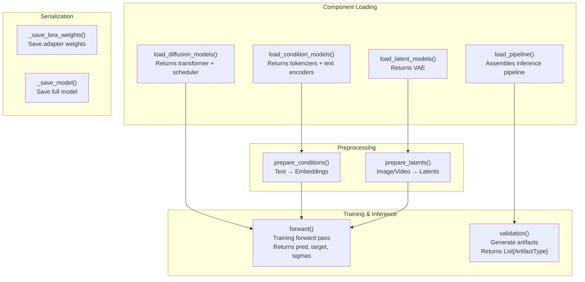
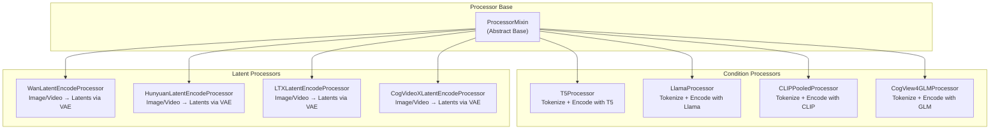
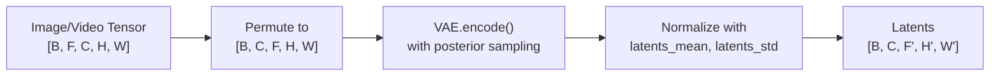
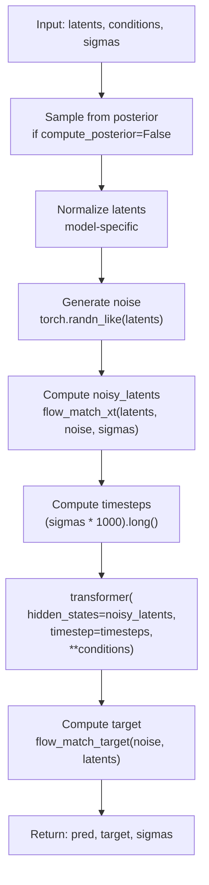
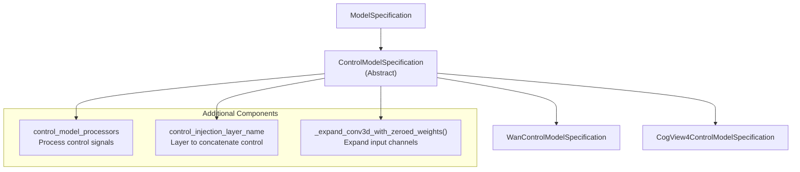
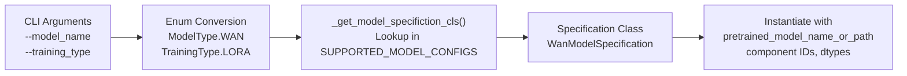

<!-- source: DeepWiki mcp.deepwiki.com · repo huggingface/finetrainers · page 3.2 Model Specifications · fetched 2026-10-26 -->

# Model Specifications

<details>
<summary>Relevant source files</summary>

The following files were used as context for generating this wiki page:

- [docs/models/README.md](docs/models/README.md)
- [finetrainers/config.py](finetrainers/config.py)
- [finetrainers/models/cogvideox/base_specification.py](finetrainers/models/cogvideox/base_specification.py)
- [finetrainers/models/cogview4/base_specification.py](finetrainers/models/cogview4/base_specification.py)
- [finetrainers/models/flux/base_specification.py](finetrainers/models/flux/base_specification.py)
- [finetrainers/models/hunyuan_video/base_specification.py](finetrainers/models/hunyuan_video/base_specification.py)
- [finetrainers/models/ltx_video/base_specification.py](finetrainers/models/ltx_video/base_specification.py)
- [finetrainers/models/wan/base_specification.py](finetrainers/models/wan/base_specification.py)
- [finetrainers/models/wan/control_specification.py](finetrainers/models/wan/control_specification.py)
- [finetrainers/parallel/accelerate.py](finetrainers/parallel/accelerate.py)
- [finetrainers/parallel/base.py](finetrainers/parallel/base.py)
- [finetrainers/parallel/ptd.py](finetrainers/parallel/ptd.py)
- [tests/README.md](tests/README.md)
- [tests/models/flux/base_specification.py](tests/models/flux/base_specification.py)

</details>


## Purpose and Scope

This document describes the `ModelSpecification` abstraction, which is the core interface that enables finetrainers to support multiple diffusion models with a unified training API. A `ModelSpecification` encapsulates all model-specific logic including component loading, preprocessing, forward passes, and validation for a particular diffusion architecture.

For information about training workflows that use these specifications, see [Training Workflows](#4). For details on supported models and their usage, see [Supported Models](#6).

## Overview

The `ModelSpecification` abstract class defines a standard interface that must be implemented for each supported diffusion model. This abstraction separates model-specific details from the generic training loop, allowing the same trainer code to work with different architectures.

Each specification is responsible for:
1. Loading model components (tokenizers, text encoders, VAE, transformer, scheduler)
2. Defining preprocessing pipelines (text encoding, latent encoding)
3. Implementing the training forward pass
4. Providing validation/inference logic
5. Saving trained weights

**Architecture Pattern**

```mermaid
graph TB
    subgraph "Abstract Interface"
        ModelSpec["ModelSpecification<br/>(Abstract Base Class)"]
    end
    
    subgraph "Concrete Implementations"
        WanSpec["WanModelSpecification"]
        HunyuanSpec["HunyuanVideoModelSpecification"]
        LTXSpec["LTXVideoModelSpecification"]
        CogVideoSpec["CogVideoXModelSpecification"]
        CogViewSpec["CogView4ModelSpecification"]
        FluxSpec["FluxModelSpecification"]
    end
    
    subgraph "Control Variants"
        WanCtrl["WanControlModelSpecification"]
        CogViewCtrl["CogView4ControlModelSpecification"]
    end
    
    ModelSpec --> WanSpec
    ModelSpec --> HunyuanSpec
    ModelSpec --> LTXSpec
    ModelSpec --> CogVideoSpec
    ModelSpec --> CogViewSpec
    ModelSpec --> FluxSpec
    
    WanSpec -.extends.-> WanCtrl
    CogViewSpec -.extends.-> CogViewCtrl
    
    subgraph "Registry"
        Registry["SUPPORTED_MODEL_CONFIGS<br/>Dict[ModelType, Dict[TrainingType, Type[ModelSpecification]]]"]
    end
    
    WanSpec --> Registry
    HunyuanSpec --> Registry
    LTXSpec --> Registry
    CogVideoSpec --> Registry
    CogViewSpec --> Registry
    FluxSpec --> Registry
    WanCtrl --> Registry
    CogViewCtrl --> Registry
```

Sources: [finetrainers/config.py:1-76](), [finetrainers/models/modeling_utils.py]()

## ModelSpecification Interface

The base `ModelSpecification` class is an abstract class that all model implementations must inherit from. It defines the contract for model loading, preprocessing, training, and inference.

**Key Attributes**

Each `ModelSpecification` instance stores:
- Component identifiers and dtypes (e.g., `pretrained_model_name_or_path`, `text_encoder_dtype`, `transformer_dtype`, `vae_dtype`)
- Model configurations loaded from pretrained models (e.g., `transformer_config`, `vae_config`)
- Processor lists (`condition_model_processors`, `latent_model_processors`)

**Core Methods Hierarchy**



Sources: [finetrainers/models/wan/base_specification.py:210-578](), [finetrainers/models/hunyuan_video/base_specification.py:75-392](), [finetrainers/models/ltx_video/base_specification.py:93-414]()

## Component Loading Methods

Model specifications implement four primary loading methods that initialize the model components from pretrained weights.

### load_condition_models()

Returns a dictionary of conditioning components (tokenizers and text encoders). Different models use different text encoders:

| Model | Text Encoder(s) | Implementation |
|-------|----------------|----------------|
| Wan | UMT5 | [finetrainers/models/wan/base_specification.py:265-287]() |
| HunyuanVideo | Llama + CLIP | [finetrainers/models/hunyuan_video/base_specification.py:127-173]() |
| LTX-Video | T5 | [finetrainers/models/ltx_video/base_specification.py:137-159]() |
| CogVideoX | T5 | [finetrainers/models/cogvideox/base_specification.py:121-143]() |
| CogView4 | GLM | [finetrainers/models/cogview4/base_specification.py:139-161]() |
| Flux | CLIP + T5 | [finetrainers/models/flux/base_specification.py:123-169]() |

Each method loads components from `pretrained_model_name_or_path` or overridden component IDs (e.g., `tokenizer_id`, `text_encoder_id`).

### load_latent_models()

Returns the VAE used to encode images/videos into the latent space. All models use diffusers `AutoencoderKL` variants:

```python
# Example from WanModelSpecification
def load_latent_models(self) -> Dict[str, torch.nn.Module]:
    common_kwargs = {"revision": self.revision, "cache_dir": self.cache_dir}
    
    if self.vae_id is not None:
        vae = AutoencoderKLWan.from_pretrained(self.vae_id, torch_dtype=self.vae_dtype, **common_kwargs)
    else:
        vae = AutoencoderKLWan.from_pretrained(
            self.pretrained_model_name_or_path, subfolder="vae", torch_dtype=self.vae_dtype, **common_kwargs
        )
    
    return {"vae": vae}
```

Some models (e.g., Wan I2V) also load additional encoders like CLIP vision models here.

Sources: [finetrainers/models/wan/base_specification.py:289-311](), [finetrainers/models/hunyuan_video/base_specification.py:175-185]()

### load_diffusion_models()

Returns the transformer/UNet and noise scheduler. This is the trainable component:

```python
# Example from LTXVideoModelSpecification
def load_diffusion_models(self) -> Dict[str, torch.nn.Module]:
    common_kwargs = {"revision": self.revision, "cache_dir": self.cache_dir}
    
    transformer = LTXVideoTransformer3DModel.from_pretrained(
        self.pretrained_model_name_or_path,
        subfolder="transformer",
        torch_dtype=self.transformer_dtype,
        **common_kwargs,
    )
    
    scheduler = FlowMatchEulerDiscreteScheduler()
    
    return {"transformer": transformer, "scheduler": scheduler}
```

Most models use flow matching with `FlowMatchEulerDiscreteScheduler`, except CogVideoX which uses `CogVideoXDDIMScheduler`.

Sources: [finetrainers/models/ltx_video/base_specification.py:173-190](), [finetrainers/models/cogvideox/base_specification.py:157-176]()

### load_pipeline()

Assembles all components into a diffusers `Pipeline` for inference:

```python
# Example signature
def load_pipeline(
    self,
    tokenizer: Optional[...] = None,
    text_encoder: Optional[...] = None,
    transformer: Optional[...] = None,
    vae: Optional[...] = None,
    scheduler: Optional[...] = None,
    enable_slicing: bool = False,
    enable_tiling: bool = False,
    enable_model_cpu_offload: bool = False,
    training: bool = False,
    **kwargs,
) -> Pipeline
```

This method is used for validation during training and final inference after training.

Sources: [finetrainers/models/wan/base_specification.py:332-380](), [finetrainers/models/ltx_video/base_specification.py:192-225]()

## Preprocessing Pipeline

Model specifications use `ProcessorMixin` instances to define preprocessing logic. These processors are composable and reusable across models.

**Processor Architecture**



Sources: [finetrainers/processors/](), [finetrainers/models/wan/base_specification.py:30-82]()

### Condition Processors

Each specification defines `condition_model_processors` that convert text prompts into embeddings:

```python
# Example: WanModelSpecification
self.condition_model_processors = [
    T5Processor(["encoder_hidden_states", "__drop__"])
]

# Example: HunyuanVideoModelSpecification  
self.condition_model_processors = [
    LlamaProcessor(["encoder_hidden_states", "encoder_attention_mask"]),
    CLIPPooledProcessor(
        ["pooled_projections"],
        input_names={"tokenizer_2": "tokenizer", "text_encoder_2": "text_encoder"}
    ),
]
```

The output names (e.g., `"encoder_hidden_states"`) define what keys the processor writes to the output dictionary. `"__drop__"` indicates an output to discard.

Sources: [finetrainers/models/wan/base_specification.py:242-243](), [finetrainers/models/hunyuan_video/base_specification.py:109-116]()

### Latent Processors

Each specification defines `latent_model_processors` that encode images/videos into latent representations:

```python
# Example: LTXVideoModelSpecification
self.latent_model_processors = [
    LTXLatentEncodeProcessor(["latents", "num_frames", "height", "width", "latents_mean", "latents_std"])
]
```

These processors:
1. Accept image or video tensors
2. Encode via the VAE
3. Return latents and metadata (dimensions, normalization statistics)

**Latent Encoding Flow**



Sources: [finetrainers/models/ltx_video/base_specification.py:32-91](), [finetrainers/models/wan/base_specification.py:30-82]()

### prepare_conditions() and prepare_latents()

These methods orchestrate processor execution:

```python
def prepare_conditions(self, tokenizer, text_encoder, caption, max_sequence_length, **kwargs):
    conditions = {
        "tokenizer": tokenizer,
        "text_encoder": text_encoder,
        "caption": caption,
        "max_sequence_length": max_sequence_length,
        **kwargs,
    }
    # Calls processors via super().prepare_conditions()
    # Filters out input keys to return only processor outputs
    return conditions
```

The base class iterates through `self.condition_model_processors` and `self.latent_model_processors`, passing the relevant inputs to each processor's `forward()` method.

Sources: [finetrainers/models/wan/base_specification.py:382-401](), [finetrainers/models/ltx_video/base_specification.py:227-269]()

## Training Forward Pass

The `forward()` method implements the model-specific training logic. Despite architectural differences, most models follow a similar pattern:

**Generic Training Forward Pass**



Sources: [finetrainers/models/wan/base_specification.py:433-493](), [finetrainers/models/ltx_video/base_specification.py:271-345]()

### Model-Specific Variations

Different models have unique requirements in their forward passes:

**LTX-Video: First Frame Conditioning**

LTX-Video implements special first-frame conditioning logic:

```python
# With probability 0.1, apply weaker noise to first frame
if random.random() < first_frame_conditioning_p:
    first_frame_sigma = torch.rand_like(sigmas) * sigmas
    first_frame_sigma = torch.min(first_frame_sigma, sigmas.new_full(sigmas.shape, min_first_frame_sigma))
    
    latents_first_frame, latents_rest = latents[:, :, :1], latents[:, :, 1:]
    noisy_latents_first_frame = FF.flow_match_xt(latents_first_frame, noise[:, :, :1], first_frame_sigma)
    noisy_latents_remaining = FF.flow_match_xt(latents_rest, noise[:, :, 1:], sigmas)
    noisy_latents = torch.cat([noisy_latents_first_frame, noisy_latents_remaining], dim=2)
```

**CogVideoX: DDIM Scheduler**

CogVideoX uses DDIM noise addition instead of flow matching:

```python
noise = torch.zeros_like(latents).normal_(generator=generator)
noisy_latents = scheduler.add_noise(latents, noise, timesteps)

# Transformer predicts velocity, not direct noise
velocity = transformer(...)
pred = scheduler.get_velocity(velocity, noisy_latents, timesteps)
target = latents  # Target is original latents, not noise
```

**CogView4: Resolution-Dependent Sigma Shifting**

CogView4 applies timestep shifting based on resolution:

```python
image_sequence_length = latents.size(2) * latents.size(3) // patch_size**2
mu = (image_sequence_length / base_image_sequence_length) ** 0.5
mu = mu * max_shift + base_shift
shifted_sigmas = mu / (mu + (1 / sigmas - 1) ** 1.0)
noisy_latents = FF.flow_match_xt(latents, noise, shifted_sigmas)
```

Sources: [finetrainers/models/ltx_video/base_specification.py:298-311](), [finetrainers/models/cogvideox/base_specification.py:290-331](), [finetrainers/models/cogview4/base_specification.py:305-311]()

## Validation and Inference

The `validation()` method generates artifacts (images/videos) during training for monitoring:

```python
def validation(
    self,
    pipeline: Pipeline,
    prompt: str,
    height: Optional[int] = None,
    width: Optional[int] = None,
    num_frames: Optional[int] = None,
    num_inference_steps: int = 50,
    generator: Optional[torch.Generator] = None,
    **kwargs,
) -> List[ArtifactType]:
    generation_kwargs = {
        "prompt": prompt,
        "height": height,
        "width": width,
        "num_frames": num_frames,
        "num_inference_steps": num_inference_steps,
        "generator": generator,
        "return_dict": True,
        "output_type": "pil",
    }
    video = pipeline(**generation_kwargs).frames[0]
    return [VideoArtifact(value=video)]
```

The method uses the diffusers pipeline assembled by `load_pipeline()` to generate outputs. It returns a list of `ArtifactType` (either `ImageArtifact` or `VideoArtifact`) for logging to trackers.

Sources: [finetrainers/models/wan/base_specification.py:495-529](), [finetrainers/models/ltx_video/base_specification.py:347-377]()

## Weight Saving

Model specifications implement two methods for saving trained weights:

### _save_lora_weights()

Saves only LoRA adapter weights when `training_type` is LoRA:

```python
def _save_lora_weights(
    self,
    directory: str,
    transformer_state_dict: Optional[Dict[str, torch.Tensor]] = None,
    scheduler: Optional[SchedulerType] = None,
    metadata: Optional[Dict[str, str]] = None,
) -> None:
    if transformer_state_dict is not None:
        Pipeline.save_lora_weights(
            directory,
            transformer_state_dict,
            save_function=functools.partial(safetensors_torch_save_function, metadata=metadata),
            safe_serialization=True,
        )
    if scheduler is not None:
        scheduler.save_pretrained(os.path.join(directory, "scheduler"))
```

The method uses the pipeline's `save_lora_weights()` utility to extract and save only adapter weights.

### _save_model()

Saves full model weights when `training_type` is full finetune:

```python
def _save_model(
    self,
    directory: str,
    transformer: TransformerModel,
    transformer_state_dict: Optional[Dict[str, torch.Tensor]] = None,
    scheduler: Optional[SchedulerType] = None,
) -> None:
    if transformer_state_dict is not None:
        with init_empty_weights():
            transformer_copy = TransformerModel.from_config(transformer.config)
        transformer_copy.load_state_dict(transformer_state_dict, strict=True, assign=True)
        transformer_copy.save_pretrained(os.path.join(directory, "transformer"))
    if scheduler is not None:
        scheduler.save_pretrained(os.path.join(directory, "scheduler"))
```

This creates a fresh transformer instance, loads the trained weights, and saves using diffusers' `save_pretrained()`.

Sources: [finetrainers/models/wan/base_specification.py:531-568](), [finetrainers/models/ltx_video/base_specification.py:379-413]()

## Control Model Specifications

For conditional control training, the library provides `ControlModelSpecification`, which extends `ModelSpecification` with control signal handling.

**Control Architecture**



Sources: [finetrainers/models/wan/control_specification.py:36-438](), [finetrainers/models/cogview4/control_specification.py]()

### Key Differences

Control specifications add:

1. **control_model_processors**: Process control images/videos into latents
2. **control_injection_layer_name**: Identifies where to inject control (e.g., `"patch_embedding"`)
3. **load_diffusion_models(new_in_features)**: Expands input channels to accommodate control signals
4. **Frame conditioning logic**: Applies control signals to specific frames (first/last/full video)

Example control forward pass modification:

```python
def forward(self, transformer, condition_model_conditions, latent_model_conditions, sigmas, **kwargs):
    # Standard processing
    latents = latent_model_conditions.pop("latents")
    control_latents = latent_model_conditions.pop("control_latents")
    
    # Apply frame conditioning (e.g., only first frame)
    control_latents = apply_frame_conditioning_on_latents(
        control_latents,
        noisy_latents.shape[2],
        frame_conditioning_type=self.frame_conditioning_type,
        frame_conditioning_index=self.frame_conditioning_index,
    )
    
    # Concatenate control with noisy latents
    noisy_latents = torch.cat([noisy_latents, control_latents], dim=1)
    
    # Forward through transformer with expanded input
    pred = transformer(hidden_states=noisy_latents, ...)
    return pred, target, sigmas
```

Sources: [finetrainers/models/wan/control_specification.py:243-308]()

## Model Registry and Selection

The `SUPPORTED_MODEL_CONFIGS` dictionary maps model types and training types to specification classes:

```python
SUPPORTED_MODEL_CONFIGS = {
    ModelType.WAN: {
        TrainingType.LORA: WanModelSpecification,
        TrainingType.FULL_FINETUNE: WanModelSpecification,
        TrainingType.CONTROL_LORA: WanControlModelSpecification,
        TrainingType.CONTROL_FULL_FINETUNE: WanControlModelSpecification,
    },
    ModelType.HUNYUAN_VIDEO: {
        TrainingType.LORA: HunyuanVideoModelSpecification,
        TrainingType.FULL_FINETUNE: HunyuanVideoModelSpecification,
    },
    ModelType.LTX_VIDEO: {
        TrainingType.LORA: LTXVideoModelSpecification,
        TrainingType.FULL_FINETUNE: LTXVideoModelSpecification,
    },
    # ... other models
}
```

**Selection Flow**



The helper function `_get_model_specifiction_cls()` performs validation and returns the appropriate specification class:

```python
def _get_model_specifiction_cls(model_name: str, training_type: str) -> Type[ModelSpecification]:
    if model_name not in SUPPORTED_MODEL_CONFIGS:
        raise ValueError(f"Model {model_name} not supported. Supported models are: {list(SUPPORTED_MODEL_CONFIGS.keys())}")
    if training_type not in SUPPORTED_MODEL_CONFIGS[model_name]:
        raise ValueError(f"Training type {training_type} not supported for model {model_name}.")
    return SUPPORTED_MODEL_CONFIGS[model_name][training_type]
```

Sources: [finetrainers/config.py:32-76]()

## Supported Model Specifications

| Model | Specification Class | Text Encoder(s) | VAE Type | Transformer Type | Scheduler |
|-------|---------------------|-----------------|----------|------------------|-----------|
| Wan | `WanModelSpecification` | UMT5 | AutoencoderKLWan | WanTransformer3DModel | FlowMatchEulerDiscreteScheduler |
| HunyuanVideo | `HunyuanVideoModelSpecification` | Llama + CLIP | AutoencoderKLHunyuanVideo | HunyuanVideoTransformer3DModel | FlowMatchEulerDiscreteScheduler |
| LTX-Video | `LTXVideoModelSpecification` | T5 | AutoencoderKLLTXVideo | LTXVideoTransformer3DModel | FlowMatchEulerDiscreteScheduler |
| CogVideoX | `CogVideoXModelSpecification` | T5 | AutoencoderKLCogVideoX | CogVideoXTransformer3DModel | CogVideoXDDIMScheduler |
| CogView4 | `CogView4ModelSpecification` | GLM | AutoencoderKL | CogView4Transformer2DModel | FlowMatchEulerDiscreteScheduler |
| Flux | `FluxModelSpecification` | CLIP + T5 | AutoencoderKL | FluxTransformer2DModel | FlowMatchEulerDiscreteScheduler |

### Control Variants

| Model | Specification Class | Control Injection Layer | Frame Conditioning Support |
|-------|---------------------|------------------------|---------------------------|
| Wan | `WanControlModelSpecification` | `patch_embedding` | First/Last/Full |
| CogView4 | `CogView4ControlModelSpecification` | `pos_embed_input` | N/A (image model) |

Sources: [finetrainers/config.py:32-63](), [finetrainers/models/wan/base_specification.py:210-226](), [finetrainers/models/wan/control_specification.py:36-77]()

## Creating a Custom ModelSpecification

To add support for a new model:

1. **Create a specification class** inheriting from `ModelSpecification`:
   ```python
   class MyModelSpecification(ModelSpecification):
       def __init__(self, pretrained_model_name_or_path, ...):
           super().__init__(...)
           self.condition_model_processors = [...]
           self.latent_model_processors = [...]
   ```

2. **Implement component loading**:
   - `load_condition_models()` - Load tokenizers and text encoders
   - `load_latent_models()` - Load VAE
   - `load_diffusion_models()` - Load transformer and scheduler
   - `load_pipeline()` - Assemble diffusers pipeline

3. **Implement preprocessing**:
   - Define processors in `condition_model_processors` and `latent_model_processors`
   - Implement `prepare_conditions()` and `prepare_latents()` to orchestrate processors

4. **Implement training logic**:
   - `forward()` - Define the training forward pass
   - `validation()` - Generate validation artifacts

5. **Implement serialization**:
   - `_save_lora_weights()` - Save LoRA adapters
   - `_save_model()` - Save full model weights

6. **Register the specification** in `SUPPORTED_MODEL_CONFIGS`:
   ```python
   SUPPORTED_MODEL_CONFIGS[ModelType.MY_MODEL] = {
       TrainingType.LORA: MyModelSpecification,
       TrainingType.FULL_FINETUNE: MyModelSpecification,
   }
   ```

For more details on extending the library, see [Adding a New Model](#9.1).

Sources: [finetrainers/config.py:32-76](), [finetrainers/models/modeling_utils.py]()

---

