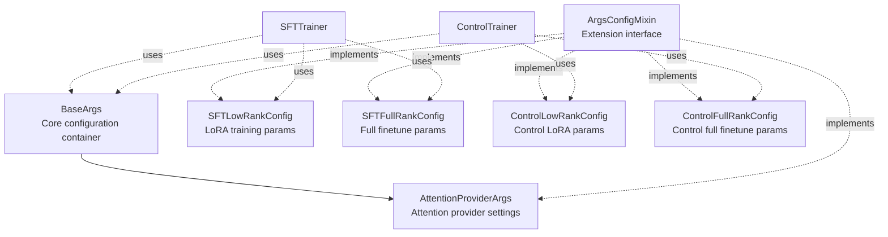
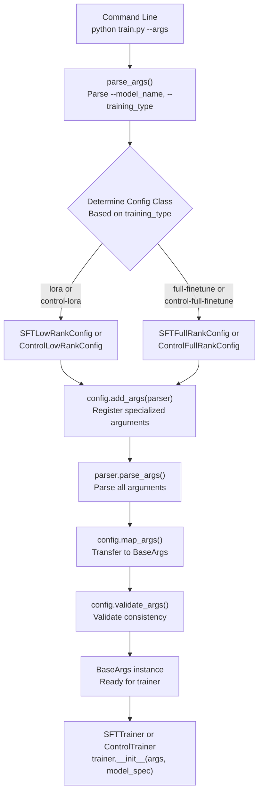

<!-- source: DeepWiki mcp.deepwiki.com · repo huggingface/finetrainers · page 3.3 Configuration System · fetched 2026-10-26 -->

# Configuration System

<details>
<summary>Relevant source files</summary>

The following files were used as context for generating this wiki page:

- [docs/args.md](docs/args.md)
- [finetrainers/args.py](finetrainers/args.py)
- [finetrainers/trainer/control_trainer/config.py](finetrainers/trainer/control_trainer/config.py)
- [finetrainers/trainer/control_trainer/trainer.py](finetrainers/trainer/control_trainer/trainer.py)
- [finetrainers/trainer/sft_trainer/config.py](finetrainers/trainer/sft_trainer/config.py)
- [finetrainers/trainer/sft_trainer/trainer.py](finetrainers/trainer/sft_trainer/trainer.py)
- [finetrainers/utils/import_utils.py](finetrainers/utils/import_utils.py)
- [tests/trainer/test_control_trainer.py](tests/trainer/test_control_trainer.py)

</details>


This document describes the configuration system used throughout finetrainers. It covers the `BaseArgs` class, the `ArgsConfigMixin` pattern for modular configuration, training-specific configuration classes, and the argument parsing lifecycle. For information about training workflows, see [Training Workflows](#4). For model-specific configurations, see [Model Specifications](#3.2).

## Architecture Overview

The configuration system uses a modular design where `BaseArgs` serves as the central configuration container, and specialized configurations extend it through the `ArgsConfigMixin` pattern. This allows different training types (LoRA, full finetune, control) to register their specific parameters without modifying the core configuration class.

### Configuration Class Hierarchy



**Sources:** [finetrainers/args.py:85-630](), [finetrainers/trainer/sft_trainer/config.py:1-66](), [finetrainers/trainer/control_trainer/config.py:1-186]()

## BaseArgs Class

The `BaseArgs` class is the primary configuration container for all training runs. It organizes parameters into logical groups and provides serialization, validation, and extension mechanisms.

### Configuration Categories

| Category | Purpose | Key Parameters |
|----------|---------|----------------|
| Parallel | Distributed training topology | `parallel_backend`, `pp_degree`, `dp_degree`, `dp_shards`, `cp_degree`, `tp_degree` |
| Model | Model loading and dtypes | `model_name`, `pretrained_model_name_or_path`, `*_dtype`, `*_id` |
| Dataset | Data loading configuration | `dataset_config`, `enable_precomputation`, `precomputation_*` |
| Dataloader | PyTorch DataLoader settings | `dataloader_num_workers`, `pin_memory` |
| Diffusion | Flow matching parameters | `flow_shift`, `flow_weighting_scheme`, `flow_logit_mean` |
| Training | Training loop settings | `batch_size`, `train_steps`, `gradient_checkpointing`, `seed` |
| Optimizer | Optimization parameters | `optimizer`, `lr`, `lr_scheduler`, `weight_decay`, `max_grad_norm` |
| Validation | Validation settings | `validation_dataset_file`, `validation_steps`, `enable_model_cpu_offload` |
| Miscellaneous | Logging and hub integration | `output_dir`, `push_to_hub`, `tracker_name`, `report_to` |
| Torch Config | PyTorch compilation settings | `compile_modules`, `compile_scopes`, `allow_tf32` |

**Sources:** [finetrainers/args.py:85-474](), [docs/args.md:16-282]()

### Core Attributes and Defaults

```python
# Location: finetrainers/args.py
class BaseArgs:
    # Parallel arguments
    parallel_backend = ParallelBackendEnum.ACCELERATE
    pp_degree: int = 1
    dp_degree: int = 1
    dp_shards: int = 1
    cp_degree: int = 1
    tp_degree: int = 1
    
    # Model arguments
    model_name: str = None
    pretrained_model_name_or_path: str = None
    transformer_dtype: torch.dtype = torch.bfloat16
    
    # Training arguments
    training_type: str = None  # Set by specialized config
    batch_size: int = 1
    train_steps: int = 1000
    gradient_checkpointing: bool = False
    
    # Registered extension configurations
    _registered_config_mixins: List[ArgsConfigMixin] = []
    _arg_group_map: Dict[str, ArgsConfigMixin] = {}
```

**Sources:** [finetrainers/args.py:365-488]()

## ArgsConfigMixin Pattern

The `ArgsConfigMixin` interface enables modular configuration extensions. Each mixin implements four key methods to integrate with the argument parsing lifecycle.

### Interface Definition

```python
class ArgsConfigMixin:
    def add_args(self, parser: argparse.ArgumentParser) -> None:
        """Register arguments with argparse parser"""
        
    def map_args(self, argparse_args: Namespace, mapped_args: BaseArgs):
        """Transfer parsed arguments to BaseArgs instance"""
        
    def validate_args(self, args: BaseArgs):
        """Validate configuration consistency"""
        
    def to_dict(self) -> Dict[str, Any]:
        """Serialize configuration to dictionary"""
```

**Sources:** [finetrainers/args.py:12]() (import statement), [finetrainers/trainer/sft_trainer/config.py:4]()

### Built-in Mixin: AttentionProviderArgs

The `AttentionProviderArgs` mixin demonstrates the pattern by adding attention provider configuration:

```python
class AttentionProviderArgs(ArgsConfigMixin):
    attn_provider_training: List[AttentionProviderTraining] = None
    attn_provider_inference: List[AttentionProviderInference] = None
    
    def add_args(self, parser: argparse.ArgumentParser) -> None:
        parser.add_argument(
            "--attn_provider_training",
            type=str,
            default=None,
            nargs="+",
            help="Attention provider for training..."
        )
        # ... additional arguments
        
    def map_args(self, argparse_args, mapped_args: BaseArgs):
        mapped_args.attn_provider_training = argparse_args.attn_provider_training or []
        mapped_args.attn_provider_inference = argparse_args.attn_provider_inference or []
```

The `BaseArgs` class registers this mixin during initialization:

```python
def __init__(self):
    self._arg_group_map: Dict[str, ArgsConfigMixin] = {
        "attention_provider_args": self.attention_provider_args,
    }
    for arg_config_mixin in self._arg_group_map.values():
        self.register_args(arg_config_mixin)
```

**Sources:** [finetrainers/args.py:27-83](), [finetrainers/args.py:481-487]()

## Training-Specific Configurations

Different training types register specialized configurations that extend `BaseArgs` with their specific parameters.

### SFT Training Configurations

#### SFTLowRankConfig (LoRA Training)

```python
class SFTLowRankConfig(ArgsConfigMixin):
    rank: int = 64
    lora_alpha: int = 64
    target_modules: Union[str, List[str]] = "(transformer_blocks|single_transformer_blocks).*(to_q|to_k|to_v|to_out.0)"
    
    def add_args(self, parser: argparse.ArgumentParser):
        parser.add_argument("--rank", type=int, default=64)
        parser.add_argument("--lora_alpha", type=int, default=64)
        parser.add_argument("--target_modules", type=str, nargs="+", default=[...])
        
    def validate_args(self, args: BaseArgs):
        assert self.rank > 0, "Rank must be a positive integer."
        assert self.lora_alpha > 0, "lora_alpha must be a positive integer."
```

**Parameters:**
- `rank`: Rank of the low-rank approximation matrices (default: 64)
- `lora_alpha`: Alpha parameter for LoRA scaling (default: 64)
- `target_modules`: Regex pattern(s) matching module names to apply LoRA

**Sources:** [finetrainers/trainer/sft_trainer/config.py:11-51]()

#### SFTFullRankConfig (Full Finetuning)

```python
class SFTFullRankConfig(ArgsConfigMixin):
    # No additional parameters beyond BaseArgs
    def add_args(self, parser: argparse.ArgumentParser):
        pass
```

This config acts as a marker indicating full-rank finetuning with no parameter-efficient adaptations.

**Sources:** [finetrainers/trainer/sft_trainer/config.py:53-66]()

### Control Training Configurations

Control training adds parameters for control signal processing and frame conditioning.

#### ControlLowRankConfig (Control LoRA)

```python
class ControlLowRankConfig(ArgsConfigMixin):
    control_type: str = ControlType.CANNY
    rank: int = 64
    lora_alpha: int = 64
    target_modules: Union[str, List[str]] = "..."
    train_qk_norm: bool = False
    
    # Video-specific
    frame_conditioning_type: str = FrameConditioningType.FULL
    frame_conditioning_index: int = 0
    frame_conditioning_concatenate_mask: bool = False
```

**Additional Parameters:**
- `control_type`: Type of control signal (`canny`, `custom`, `none`)
- `train_qk_norm`: Whether to train query-key normalization layers
- `frame_conditioning_type`: How to select conditioning frames (`index`, `prefix`, `random`, `first_and_last`, `full`)
- `frame_conditioning_index`: Specific frame index (when type is `index`)
- `frame_conditioning_concatenate_mask`: Whether to concatenate frame mask with latents

**Sources:** [finetrainers/trainer/control_trainer/config.py:34-124]()

#### ControlFullRankConfig

Similar to `ControlLowRankConfig` but without LoRA-specific parameters (`rank`, `lora_alpha`, `target_modules`).

**Sources:** [finetrainers/trainer/control_trainer/config.py:126-186]()

### Control Type Enumerations

```python
class ControlType(str, Enum):
    CANNY = "canny"
    CUSTOM = "custom"
    NONE = "none"

class FrameConditioningType(str, Enum):
    INDEX = "index"
    PREFIX = "prefix"
    RANDOM = "random"
    FIRST_AND_LAST = "first_and_last"
    FULL = "full"
```

**Sources:** [finetrainers/trainer/control_trainer/config.py:12-32]()

## Argument Lifecycle

The configuration system follows a structured lifecycle from command-line arguments to validated configuration objects.



**Sources:** [finetrainers/args.py:630-846](), [finetrainers/trainer/sft_trainer/trainer.py:28-36](), [finetrainers/trainer/control_trainer/trainer.py:32-38]()

### Parsing Flow in train.py

The main training script implements this lifecycle:

1. **Initial parsing**: Extract `model_name` and `training_type` to determine which config class to use
2. **Config selection**: Map `(ModelType, TrainingType)` to appropriate config class
3. **Argument registration**: Call `config.add_args(parser)` to register specialized parameters
4. **Full parsing**: Parse all command-line arguments
5. **Argument mapping**: Transfer parsed values to `BaseArgs` instance via `config.map_args()`
6. **Validation**: Validate configuration consistency via `config.validate_args()`
7. **Trainer initialization**: Pass validated `BaseArgs` to trainer constructor

**Sources:** [finetrainers/trainer/sft_trainer/trainer.py:34](), [finetrainers/trainer/control_trainer/trainer.py:38]()

## Configuration Serialization

The `BaseArgs.to_dict()` method serializes configuration into nested dictionaries organized by category:

```python
def to_dict(self) -> Dict[str, Any]:
    return {
        "parallel_arguments": {...},
        "model_arguments": {...},
        "dataset_arguments": {...},
        "dataloader_arguments": {...},
        "diffusion_arguments": {...},
        "training_arguments": {...},
        "optimizer_arguments": {...},
        "validation_arguments": {...},
        "miscellaneous_arguments": {...},
        "torch_config_arguments": {...},
        "additional_arguments": {
            "AttentionProviderArgs": {...},
            "SFTLowRankConfig": {...},  # If registered
        }
    }
```

Each registered `ArgsConfigMixin` contributes to the `additional_arguments` section by implementing its own `to_dict()` method.

**Sources:** [finetrainers/args.py:489-629]()

## Configuration File Formats

The configuration system also consumes JSON configuration files for dataset and validation settings.

### Dataset Configuration File

The `dataset_config` parameter points to a JSON file specifying training datasets:

```json
{
  "datasets": [
    {
      "data_root": "/path/to/dataset",
      "dataset_type": "video",
      "id_token": "CONCEPT_TOKEN",
      "video_resolution_buckets": [[16, 512, 512], [24, 512, 512]],
      "reshape_mode": "center_crop",
      "caption_options": {
        "remove_common_llm_caption_prefixes": true
      }
    }
  ]
}
```

**Required Fields:**
- `data_root` or `dataset_file`: Data source location
- `dataset_type`: `"image"` or `"video"`
- `image_resolution_buckets` or `video_resolution_buckets`: Resolution targets
- `reshape_mode`: `"center_crop"`, `"random_crop"`, or `"bicubic"`

**Optional Fields:**
- `id_token`: Prefix token for prompts (useful for concept learning)
- `caption_options`: Caption preprocessing settings

**Sources:** [finetrainers/trainer/sft_trainer/trainer.py:239-266](), [docs/args.md:85-111]()

### Validation Configuration File

The `validation_dataset_file` parameter points to a CSV/JSON/Parquet file with validation prompts and optional conditioning:

```json
[
  {
    "prompt": "A cat sitting on a chair",
    "height": 512,
    "width": 512,
    "num_frames": 16,
    "num_inference_steps": 50,
    "guidance_scale": 7.5
  }
]
```

**Required Fields:**
- `prompt`: Text prompt for generation

**Optional Fields:**
- `image_path`, `video_path`: Path to conditioning image/video
- `height`, `width`, `num_frames`: Generation resolution
- `num_inference_steps`: Denoising steps
- `guidance_scale`: Classifier-free guidance strength
- Model-specific parameters passed to `ModelSpecification.validation()`

**Sources:** [finetrainers/trainer/sft_trainer/trainer.py:591](), [docs/args.md:233-243]()

## Usage in Trainers

Both `SFTTrainer` and `ControlTrainer` receive a fully-constructed `BaseArgs` instance along with a `ModelSpecification`:

```python
class SFTTrainer(Trainer):
    def __init__(self, args: ArgsType, model_specification: models.ModelSpecification) -> None:
        super().__init__(args)
        # args contains all configuration including specialized parameters
        
    def _prepare_trainable_parameters(self) -> None:
        if self.args.training_type == TrainingType.LORA:
            transformer_lora_config = LoraConfig(
                r=self.args.rank,  # From SFTLowRankConfig
                lora_alpha=self.args.lora_alpha,
                target_modules=self.args.target_modules,
            )
```

The trainer accesses configuration parameters directly from the `args` object. Specialized parameters (like `rank`, `lora_alpha`) are available when the appropriate config mixin has been registered.

**Sources:** [finetrainers/trainer/sft_trainer/trainer.py:34-36](), [finetrainers/trainer/sft_trainer/trainer.py:96-128](), [finetrainers/trainer/control_trainer/trainer.py:38-73]()

## Configuration Access Patterns

### Dynamic Attribute Access

`BaseArgs` uses `__getattribute__` override to provide seamless access to attributes defined in registered mixins:

```python
# Inside BaseArgs
def __getattribute__(self, name: str):
    # First check BaseArgs attributes
    try:
        return object.__getattribute__(self, name)
    except AttributeError:
        pass
    
    # Then check registered mixins
    for mixin in self._registered_config_mixins:
        if hasattr(mixin, name):
            return getattr(mixin, name)
    
    raise AttributeError(f"'{type(self).__name__}' has no attribute '{name}'")
```

This allows trainer code to access specialized parameters like `args.rank` without explicit mixin lookups.

**Sources:** [finetrainers/args.py:22-24]() (type hint showing union), [finetrainers/trainer/sft_trainer/trainer.py:28]()

## Summary Table

| Component | Purpose | Key Methods | File Location |
|-----------|---------|-------------|---------------|
| `BaseArgs` | Core configuration container | `to_dict()`, `register_args()` | [finetrainers/args.py:85-630]() |
| `ArgsConfigMixin` | Extension interface | `add_args()`, `map_args()`, `validate_args()`, `to_dict()` | [finetrainers/utils/]() |
| `AttentionProviderArgs` | Attention provider settings | All mixin methods | [finetrainers/args.py:27-83]() |
| `SFTLowRankConfig` | LoRA training parameters | All mixin methods | [finetrainers/trainer/sft_trainer/config.py:11-51]() |
| `SFTFullRankConfig` | Full finetune marker | All mixin methods (no-ops) | [finetrainers/trainer/sft_trainer/config.py:53-66]() |
| `ControlLowRankConfig` | Control LoRA parameters | All mixin methods | [finetrainers/trainer/control_trainer/config.py:34-124]() |
| `ControlFullRankConfig` | Control full finetune parameters | All mixin methods | [finetrainers/trainer/control_trainer/config.py:126-186]() |

---

