<!-- source: DeepWiki mcp.deepwiki.com · repo huggingface/finetrainers · page 4 Training Workflows · fetched 2026-10-26 -->

# Training Workflows

<details>
<summary>Relevant source files</summary>

The following files were used as context for generating this wiki page:

- [docs/args.md](docs/args.md)
- [finetrainers/args.py](finetrainers/args.py)
- [finetrainers/state.py](finetrainers/state.py)
- [finetrainers/trainer/control_trainer/trainer.py](finetrainers/trainer/control_trainer/trainer.py)
- [finetrainers/trainer/sft_trainer/trainer.py](finetrainers/trainer/sft_trainer/trainer.py)
- [tests/trainer/test_control_trainer.py](tests/trainer/test_control_trainer.py)
- [train.py](train.py)

</details>


This page provides an overview of the complete training lifecycle in finetrainers, from initialization through model preparation, dataset loading, training loop execution, and checkpointing. The training workflow is orchestrated by two primary trainer classes that follow a standardized six-phase preparation sequence before entering the main training loop.

For detailed information about specific trainers, see [SFT Trainer](#4.1) and [Control Trainer](#4.2). For checkpoint management and training state persistence, see [Training State and Checkpointing](#4.3). For configuration options, see [Configuration System](#3.3).

## Overview

The training workflow is implemented through two trainer classes:
- **`SFTTrainer`**: Standard supervised fine-tuning for diffusion models
- **`ControlTrainer`**: Conditional control training with additional control signals

Both trainers inherit from a common `Trainer` base class and implement the same execution pattern. The workflow consists of six preparation phases followed by the training loop, periodic validation, and final artifact saving.

Sources: [finetrainers/trainer/sft_trainer/trainer.py:33-84](), [finetrainers/trainer/control_trainer/trainer.py:37-87](), [train.py:1-87]()

## Training Execution Entry Point

Training is initiated through the `train.py` script, which parses command-line arguments, selects the appropriate trainer and configuration class based on `--training_type`, instantiates the model specification, and invokes the trainer's `run()` method.

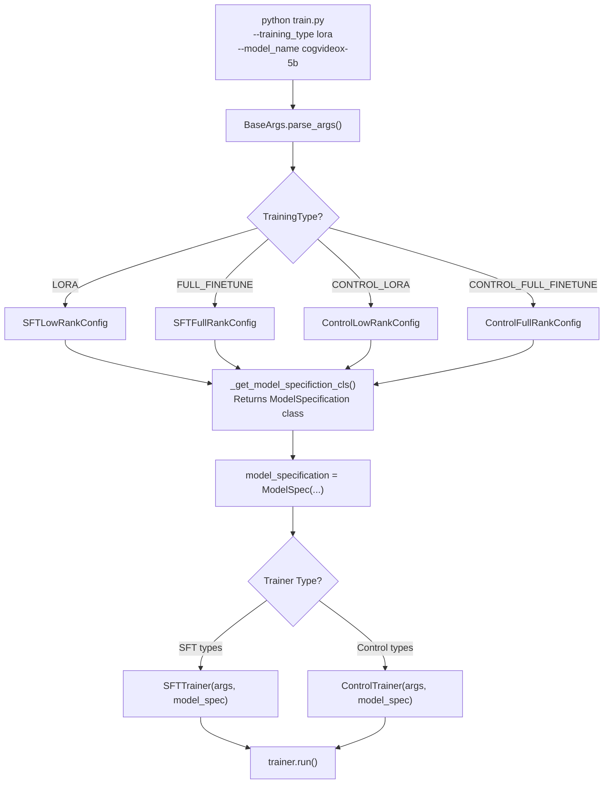

**Training Type Selection**

| Training Type | Config Class | Trainer | Use Case |
|--------------|-------------|---------|----------|
| `lora` | `SFTLowRankConfig` | `SFTTrainer` | LoRA fine-tuning |
| `full-finetune` | `SFTFullRankConfig` | `SFTTrainer` | Full model fine-tuning |
| `control-lora` | `ControlLowRankConfig` | `ControlTrainer` | Control LoRA training |
| `control-full-finetune` | `ControlFullRankConfig` | `ControlTrainer` | Full control model training |

Sources: [train.py:13-76](), [finetrainers/config.py:1-50]()

## Complete Training Lifecycle

Both `SFTTrainer` and `ControlTrainer` implement the same lifecycle through the `run()` method, which executes six sequential preparation phases followed by the training loop.

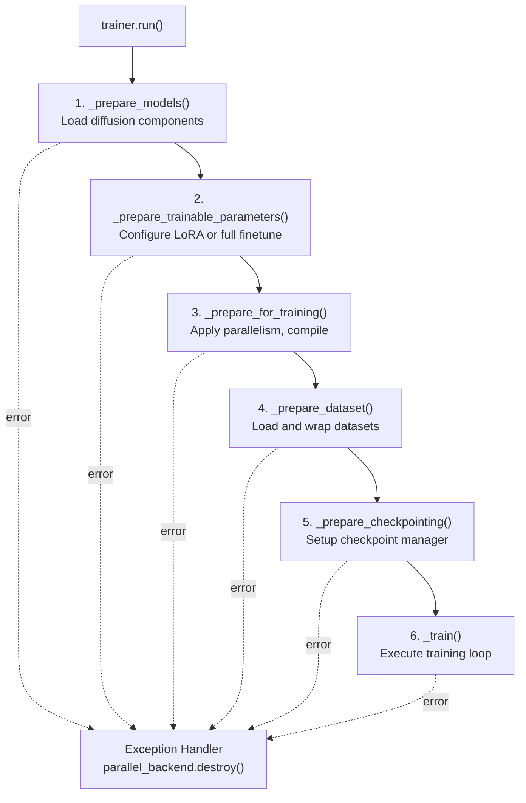

**Lifecycle Phases**

| Phase | Method | Purpose | Key Operations |
|-------|--------|---------|----------------|
| 1 | `_prepare_models()` | Load model components | Load tokenizers, text encoders, transformer, VAE, scheduler |
| 2 | `_prepare_trainable_parameters()` | Configure trainable params | Apply LoRA adapters or enable full finetuning |
| 3 | `_prepare_for_training()` | Apply parallelism | Setup DDP/FSDP, tensor parallel, context parallel, torch.compile |
| 4 | `_prepare_dataset()` | Initialize data pipeline | Load datasets, wrap for preprocessing, create dataloader |
| 5 | `_prepare_checkpointing()` | Setup checkpoint manager | Configure checkpointer with save hooks |
| 6 | `_train()` | Execute training | Main training loop with forward/backward passes |

Sources: [finetrainers/trainer/sft_trainer/trainer.py:71-84](), [finetrainers/trainer/control_trainer/trainer.py:75-87]()

## Phase 1: Model Preparation

The `_prepare_models()` method loads all diffusion model components through the `ModelSpecification` interface. Components are stored as trainer instance attributes.

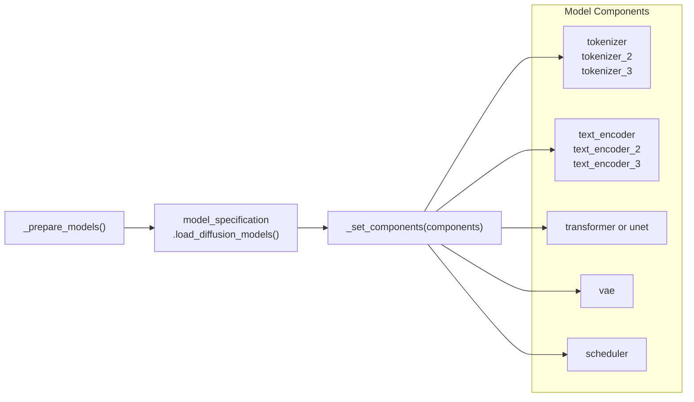

**Component Initialization**

```python
# Trainer instance attributes initialized to None
self.tokenizer = None
self.tokenizer_2 = None
self.tokenizer_3 = None
self.text_encoder = None
self.text_encoder_2 = None
self.text_encoder_3 = None
self.transformer = None
self.unet = None
self.vae = None
self.scheduler = None
```

Sources: [finetrainers/trainer/sft_trainer/trainer.py:85-95](), [finetrainers/trainer/sft_trainer/trainer.py:37-59](), [finetrainers/trainer/sft_trainer/trainer.py:758-763]()

## Phase 2: Trainable Parameter Configuration

The `_prepare_trainable_parameters()` method configures which parameters will be trained based on the training type. For LoRA training, it adds adapter layers. For full finetuning, it enables gradients on all transformer parameters.

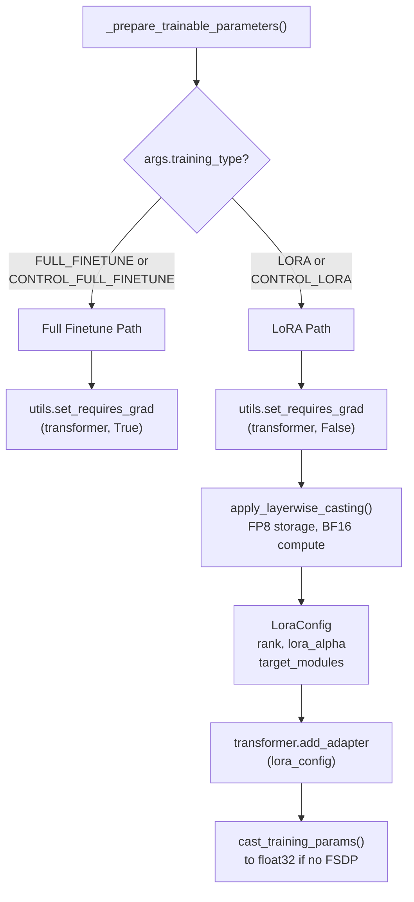

**LoRA Configuration Parameters**

| Parameter | Source Argument | Purpose |
|-----------|----------------|---------|
| `r` | `args.rank` | Rank of low-rank matrices |
| `lora_alpha` | `args.lora_alpha` | Scaling factor (lora_alpha / rank) |
| `target_modules` | `args.target_modules` | Regex patterns for target layers |
| `rank_pattern` | Control only | Per-layer rank overrides |
| `alpha_pattern` | Control only | Per-layer alpha overrides |

Sources: [finetrainers/trainer/sft_trainer/trainer.py:96-137](), [finetrainers/trainer/control_trainer/trainer.py:102-170]()

## Phase 3: Training Preparation

The `_prepare_for_training()` method applies parallelism strategies, initializes the optimizer and learning rate scheduler, and sets up logging infrastructure. This phase transforms the model from a single-device configuration to a distributed training setup.

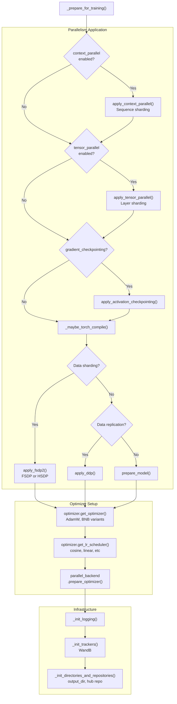

**Parallelism Strategy Selection**

The system applies parallelism in this order:
1. **Context Parallel** (if `cp_degree > 1`): Shards sequence dimension
2. **Tensor Parallel** (if `tp_degree > 1`): Shards layers across GPUs
3. **Activation Checkpointing** (if `gradient_checkpointing=True`): Trades compute for memory
4. **Data Sharding/Replication**:
   - FSDP2 if `dp_shards > 1`: Shards parameters, gradients, optimizer states
   - HSDP if `dp_degree > 1` and `dp_shards > 1`: Hybrid sharding + replication
   - DDP if `dp_degree > 1`: Pure replication with gradient all-reduce

Sources: [finetrainers/trainer/sft_trainer/trainer.py:138-234](), [finetrainers/trainer/control_trainer/trainer.py:171-266]()

## Phase 4: Dataset Preparation

The `_prepare_dataset()` method loads datasets from the JSON configuration file, applies preprocessing wrappers, and creates a PyTorch dataloader. Multiple datasets can be combined with shuffling.

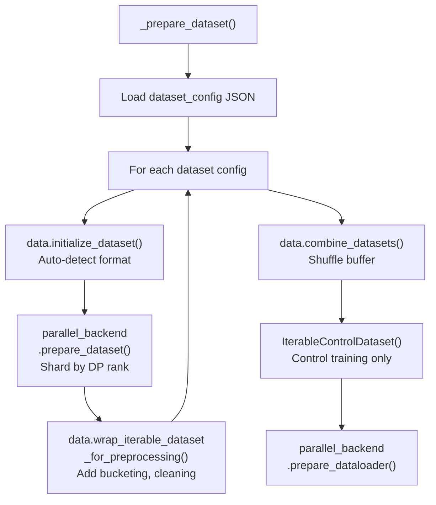

**Dataset Configuration Structure**

Each dataset in the JSON config requires:
```json
{
  "datasets": [
    {
      "data_root": "/path/to/data",
      "dataset_type": "video",
      "id_token": "TOKEN",
      "video_resolution_buckets": [[16, 256, 256]],
      "reshape_mode": "center_crop",
      "caption_options": {}
    }
  ]
}
```

Sources: [finetrainers/trainer/sft_trainer/trainer.py:236-275](), [finetrainers/trainer/control_trainer/trainer.py:268-307]()

## Phase 5: Checkpointing Setup

The `_prepare_checkpointing()` method configures the checkpoint manager with model state, optimizer state, scheduler state, and training state. It also sets up a save hook that exports model weights in the appropriate format (LoRA weights or full model weights).

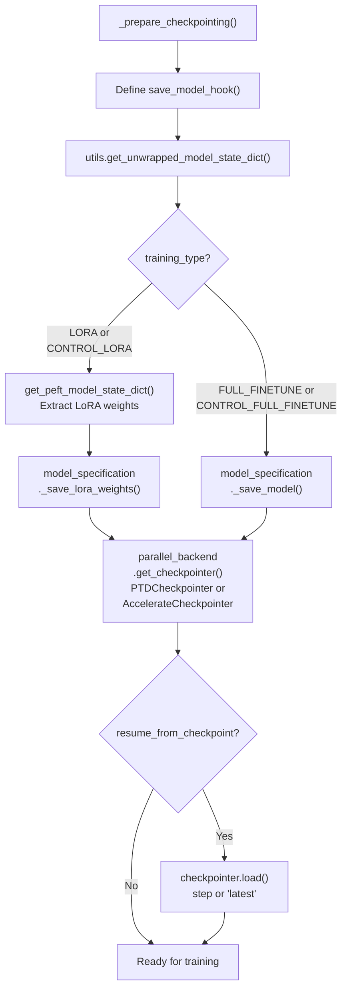

**Checkpointer Configuration**

```python
checkpointer = parallel_backend.get_checkpointer(
    dataloader=self.dataloader,           # For dataset state
    model_parts=[self.transformer],       # Models to checkpoint
    optimizers=self.optimizer,            # Optimizer state
    schedulers=self.lr_scheduler,         # Scheduler state
    states={"train_state": self.state.train_state},  # Training metrics
    checkpointing_steps=args.checkpointing_steps,    # Save frequency
    checkpointing_limit=args.checkpointing_limit,    # Max checkpoints
    output_dir=args.output_dir,
    enable=enable_state_checkpointing,
    _callback_fn=save_model_hook           # Called on save
)
```

Sources: [finetrainers/trainer/sft_trainer/trainer.py:276-327](), [finetrainers/trainer/control_trainer/trainer.py:309-375]()

## Phase 6: Training Loop

The `_train()` method implements the main training loop with forward/backward passes, gradient accumulation, optimizer steps, and periodic checkpointing/validation. The loop continues until `train_steps` is reached or `max_data_samples` is observed.

```mermaid
graph TD
    Train["_train()"]
    Setup["Setup:<br/>TrainState, device, dtype<br/>scheduler sigmas/alphas<br/>generator seed"]
    
    InitPreprocessor["initialize_preprocessor()<br/>InMemory or Precomputed"]
    InitSampler["ResolutionSampler()<br/>Batching by resolution"]
    
    LoopStart["While step < train_steps AND<br/>observed_samples < max_data_samples"]
    
    CheckData{"preprocessor<br/>.requires_data?"}
    PrepareData["_prepare_data()<br/>Preprocess conditions<br/>and latents"]
    
    NextItem["Get next condition_item<br/>and latent_item"]
    SamplerConsume["sampler.consume()"]
    CheckReady{"sampler.is_ready?"}
    
    GetBatch["sampler.get_batch()"]
    Collate["collate_conditions()<br/>collate_latents()"]
    AlignDevice["align_device_and_dtype()"]
    
    Forward["Forward Pass:<br/>model_specification.forward()<br/>Get pred, target, sigmas"]
    ComputeLoss["Compute weighted MSE loss"]
    Backward["loss.backward()"]
    
    ClipGrad["Clip gradients<br/>max_grad_norm"]
    
    CheckGradStep{"step % gradient<br/>_accumulation_steps == 0?"}
    OptimizerStep["optimizer.step()<br/>lr_scheduler.step()<br/>optimizer.zero_grad()"]
    DistAvgLoss["parallel.dist_mean()<br/>Aggregate loss across ranks"]
    LogMetrics["Log to tracker"]
    
    CheckpointStep{"Checkpoint step?"}
    SaveCheckpoint["checkpointer.save()"]
    
    ValidationStep{"Validation step?"}
    Validate["_validate()"]
    
    LoopEnd["Continue or break"]
    
    FinalCheckpoint["Final checkpoint"]
    FinalValidation["Final validation"]
    Cleanup["Delete components<br/>Upload to hub"]
    
    Train --> Setup
    Setup --> InitPreprocessor
    InitPreprocessor --> InitSampler
    InitSampler --> LoopStart
    
    LoopStart --> CheckData
    CheckData -->|Yes| PrepareData
    CheckData -->|No| NextItem
    PrepareData --> NextItem
    
    NextItem --> SamplerConsume
    SamplerConsume --> CheckReady
    CheckReady -->|No| LoopStart
    CheckReady -->|Yes| GetBatch
    
    GetBatch --> Collate
    Collate --> AlignDevice
    AlignDevice --> Forward
    Forward --> ComputeLoss
    ComputeLoss --> Backward
    Backward --> ClipGrad
    
    ClipGrad --> CheckGradStep
    CheckGradStep -->|Yes| OptimizerStep
    CheckGradStep -->|No| CheckpointStep
    OptimizerStep --> DistAvgLoss
    DistAvgLoss --> LogMetrics
    LogMetrics --> CheckpointStep
    
    CheckpointStep -->|Yes| SaveCheckpoint
    CheckpointStep -->|No| ValidationStep
    SaveCheckpoint --> ValidationStep
    
    ValidationStep -->|Yes| Validate
    ValidationStep -->|No| LoopEnd
    Validate --> LoopEnd
    
    LoopEnd --> LoopStart
    LoopEnd --> FinalCheckpoint
    FinalCheckpoint --> FinalValidation
    FinalValidation --> Cleanup
```

**Training Loop Key Variables**

| Variable | Type | Purpose |
|----------|------|---------|
| `train_state.step` | `int` | Current training step (incremented each iteration) |
| `train_state.observed_data_samples` | `int` | Total samples seen across all ranks |
| `accumulated_loss` | `float` | Loss accumulated during gradient accumulation |
| `requires_gradient_step` | `bool` | Whether optimizer.step() is needed |
| `condition_iterator` | `Iterator` | Yields preprocessed text/image conditions |
| `latent_iterator` | `Iterator` | Yields preprocessed VAE latents |
| `sampler` | `ResolutionSampler` | Batches samples by resolution |

Sources: [finetrainers/trainer/sft_trainer/trainer.py:328-581](), [finetrainers/trainer/control_trainer/trainer.py:377-629]()

## Data Preprocessing Flow

The training loop uses a preprocessing system that can operate in two modes: in-memory (computing embeddings on-the-fly) or precomputed (saving embeddings to disk and loading as needed). This is controlled by `enable_precomputation` argument.

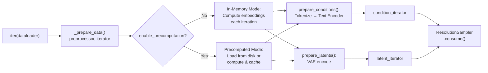

**Preprocessing Configuration**

```python
preprocessor = data.initialize_preprocessor(
    rank=parallel_backend.rank,
    world_size=parallel_backend.world_size,
    num_items=args.precomputation_items,  # Batch size for precomputation
    processor_fn={
        "condition": model_specification.prepare_conditions,
        "latent": functools.partial(
            model_specification.prepare_latents, 
            compute_posterior=compute_posterior
        )
    },
    save_dir=args.precomputation_dir,
    enable_precomputation=args.enable_precomputation,
    enable_reuse=args.precomputation_reuse,
)
```

Sources: [finetrainers/trainer/sft_trainer/trainer.py:374-423](), [finetrainers/data/preprocessing/__init__.py:1-50]()

## Validation Workflow

The `_validate()` method generates sample outputs at specified intervals during training and at the end of training. It loads a validation dataset, initializes a pipeline with the current model state, generates artifacts, and logs them to the tracking system (WandB).

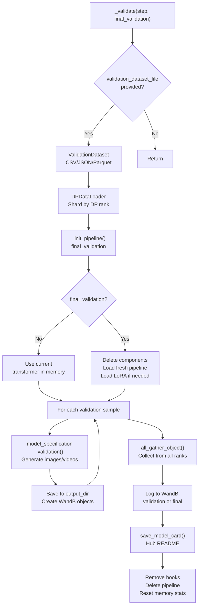

**Validation Dataset Format**

The validation dataset file must contain at minimum a `prompt` column. Additional columns can specify generation parameters:

```json
[
  {
    "prompt": "A cat in the snow",
    "height": 512,
    "width": 512,
    "num_frames": 49,
    "num_inference_steps": 50,
    "guidance_scale": 6.0,
    "image_path": "/path/to/conditioning_image.jpg",
    "video_path": "/path/to/conditioning_video.mp4"
  }
]
```

Sources: [finetrainers/trainer/sft_trainer/trainer.py:583-725](), [finetrainers/trainer/control_trainer/trainer.py:631-773](), [finetrainers/data/validation.py:1-100]()

## Training State Management

The `TrainState` class tracks training progress and metrics. It implements the `Stateful` interface for distributed checkpointing, allowing training to be resumed from any checkpoint.

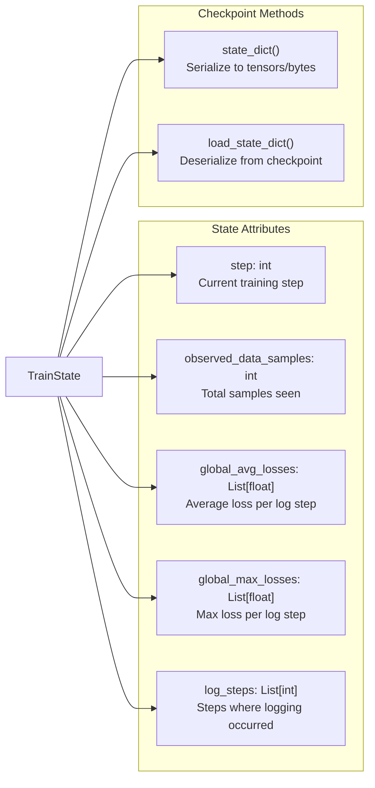

**State Initialization and Updates**

```python
# Initialization in _prepare_for_training()
self.state.train_state = TrainState()

# Updates in training loop
train_state.step += 1
train_state.observed_data_samples += batch_size * dp_degree

# Logging
train_state.global_avg_losses.append(global_avg_loss)
train_state.global_max_losses.append(global_max_loss)
train_state.log_steps.append(train_state.step)
```

Sources: [finetrainers/state.py:1-67](), [finetrainers/trainer/sft_trainer/trainer.py:208-209](), [finetrainers/trainer/sft_trainer/trainer.py:425-550]()

## Attention Provider Context

Both trainers use an attention provider context manager that allows different attention implementations for training versus inference. This is configured through `attn_provider_training` and `attn_provider_inference` arguments.

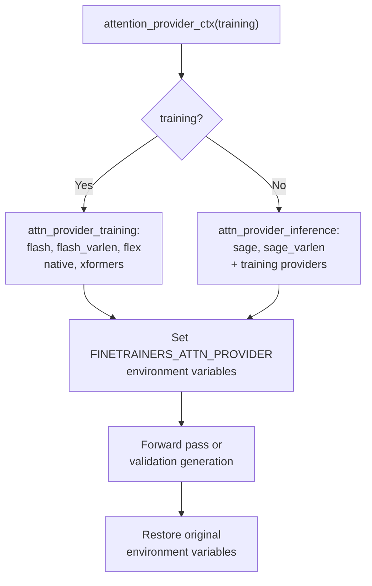

**Usage in Training Loop**

```python
# Training forward pass
with self.attention_provider_ctx(training=True):
    with self.tracker.timed("timing/forward"):
        pred, target, sigmas = self.model_specification.forward(...)
    
    with self.tracker.timed("timing/backward"):
        loss.backward()

# Validation generation
with self.attention_provider_ctx(training=False):
    validation_artifacts = self.model_specification.validation(
        pipeline=pipeline, generator=generator, **validation_data
    )
```

Sources: [finetrainers/trainer/base.py:1-100](), [finetrainers/trainer/sft_trainer/trainer.py:452-481](), [finetrainers/trainer/sft_trainer/trainer.py:631-634]()

## Memory Management

The trainers implement several memory optimization strategies throughout the lifecycle:

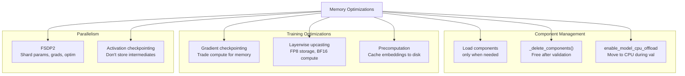

**Memory Statistics Logging**

The trainer logs memory statistics at key points:
- Before training start
- Before validation start
- After validation end
- After training end

```python
memory_statistics = utils.get_memory_statistics()
logger.info(f"Memory before training start: {json.dumps(memory_statistics, indent=4)}")
```

Sources: [finetrainers/trainer/sft_trainer/trainer.py:336-337](), [finetrainers/trainer/sft_trainer/trainer.py:613-614](), [finetrainers/trainer/sft_trainer/trainer.py:683-693](), [finetrainers/trainer/sft_trainer/trainer.py:764-770]()

## Error Handling and Cleanup

The training workflow implements comprehensive error handling with proper cleanup of distributed resources. All exceptions during the `run()` method trigger parallel backend destruction.

```python
def run(self) -> None:
    try:
        self._prepare_models()
        self._prepare_trainable_parameters()
        self._prepare_for_training()
        self._prepare_dataset()
        self._prepare_checkpointing()
        self._train()
    except Exception as e:
        logger.error(f"Error during training: {e}")
        self.state.parallel_backend.destroy()
        raise e
```

The `_train()` method also handles early termination conditions:
- **StopIteration**: Dataset exhausted (breaks loop, performs final optimizer step if needed)
- **Step limit**: `train_state.step >= train_steps`
- **Sample limit**: `observed_data_samples >= max_data_samples`

After training completion:
1. Final checkpoint saved with `force=True`
2. Final validation performed
3. Components deleted and memory freed
4. Artifacts uploaded to Hugging Face Hub (if `push_to_hub=True`)
5. Parallel backend destroyed

Sources: [finetrainers/trainer/sft_trainer/trainer.py:71-84](), [finetrainers/trainer/sft_trainer/trainer.py:410-416](), [finetrainers/trainer/sft_trainer/trainer.py:562-581]()

---

