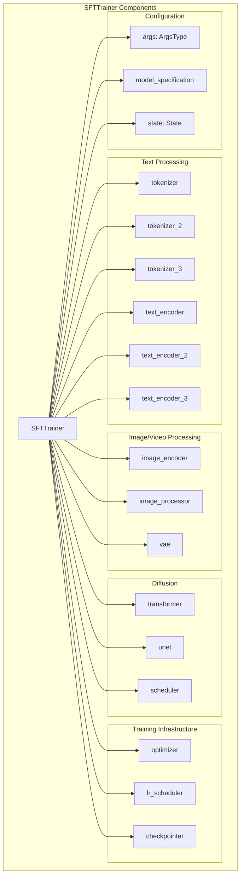
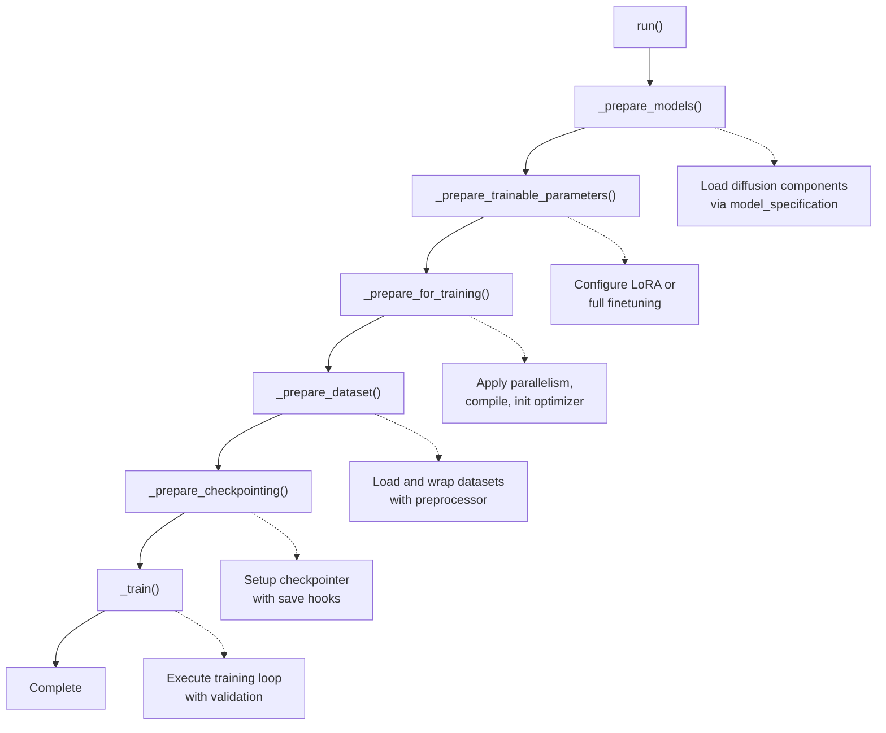
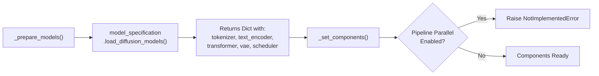
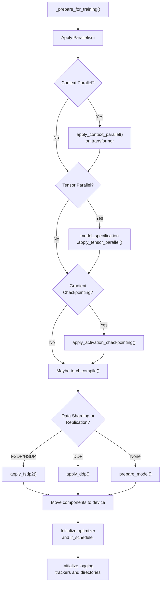
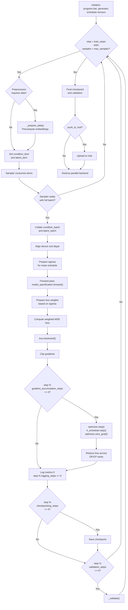
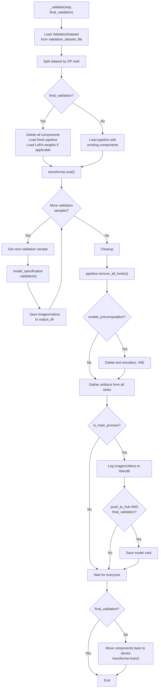

<!-- source: DeepWiki mcp.deepwiki.com · repo huggingface/finetrainers · page 4.1 SFT Trainer (Supervised Fine-Tuning) · fetched 2026-10-26 -->

# SFT Trainer (Supervised Fine-Tuning)

<details>
<summary>Relevant source files</summary>

The following files were used as context for generating this wiki page:

- [finetrainers/args.py](finetrainers/args.py)
- [finetrainers/state.py](finetrainers/state.py)
- [finetrainers/trainer/sft_trainer/trainer.py](finetrainers/trainer/sft_trainer/trainer.py)
- [finetrainers/utils/__init__.py](finetrainers/utils/__init__.py)
- [finetrainers/utils/torch.py](finetrainers/utils/torch.py)
- [tests/trainer/test_sft_trainer.py](tests/trainer/test_sft_trainer.py)
- [train.py](train.py)

</details>


The `SFTTrainer` class implements standard supervised fine-tuning for diffusion models. It orchestrates the complete training workflow from model initialization through training to validation, supporting both LoRA (low-rank adaptation) and full parameter fine-tuning strategies. This trainer is designed for unconditioned or text-conditioned generation tasks, as opposed to control-conditioned tasks (covered in [4.2](#4.2)).

For information about control-conditioned training with additional control signals, see [Control Trainer](#4.2). For details on the training state management and checkpointing mechanisms used by this trainer, see [Training State and Checkpointing](#4.3).

## Overview

The `SFTTrainer` class in [finetrainers/trainer/sft_trainer/trainer.py:33-823]() provides a structured training pipeline that separates concerns into distinct preparation and execution phases. It integrates with the `ModelSpecification` abstraction to support multiple diffusion model architectures, coordinates with parallel backends for distributed training, and manages the data pipeline for preprocessing and batching.

**Key Responsibilities:**
- Load and initialize model components (tokenizers, text encoders, transformer, VAE, scheduler)
- Configure trainable parameters (LoRA adapters or full model parameters)
- Apply parallelism strategies (DDP, FSDP, TP, CP) via the parallel backend
- Execute the training loop with gradient accumulation and loss computation
- Perform periodic validation and checkpoint saving
- Upload trained models to Hugging Face Hub

Sources: [finetrainers/trainer/sft_trainer/trainer.py:33-84]()

## Class Structure and Initialization

### Component Architecture



Sources: [finetrainers/trainer/sft_trainer/trainer.py:34-70]()

### Initialization

The `SFTTrainer.__init__` method accepts two primary arguments:

| Parameter | Type | Description |
|-----------|------|-------------|
| `args` | `Union[BaseArgsType, SFTFullRankConfig, SFTLowRankConfig]` | Configuration object containing all training parameters |
| `model_specification` | `models.ModelSpecification` | Model-specific implementation defining how to load components and execute training |

All component attributes (tokenizers, encoders, transformer, etc.) are initialized to `None` and populated during the preparation phases.

Sources: [finetrainers/trainer/sft_trainer/trainer.py:34-70](), [finetrainers/trainer/sft_trainer/trainer.py:28]()

## Lifecycle Methods

The `SFTTrainer.run()` method orchestrates training through six sequential preparation phases followed by training execution:



Sources: [finetrainers/trainer/sft_trainer/trainer.py:71-83]()

### Phase 1: Model Preparation

The `_prepare_models()` method loads all diffusion model components through the `ModelSpecification` interface:



The `_set_components()` method updates the trainer's component attributes from the returned dictionary. Components that are not provided by a specific model (e.g., `tokenizer_2` for single-text-encoder models) remain `None`.

Sources: [finetrainers/trainer/sft_trainer/trainer.py:85-94](), [finetrainers/trainer/sft_trainer/trainer.py:758-762]()

### Phase 2: Trainable Parameter Configuration

The `_prepare_trainable_parameters()` method configures which parameters will be trained based on the `training_type`:

| Training Type | Behavior | Parameters Set to `requires_grad=True` |
|---------------|----------|----------------------------------------|
| `TrainingType.FULL_FINETUNE` | All transformer parameters trainable | All parameters in `self.transformer` |
| `TrainingType.LORA` | LoRA adapters added to transformer | Only LoRA adapter parameters |

**LoRA Configuration:** When using LoRA, the method:
1. Applies layerwise upcasting if specified (fp8 storage with higher precision compute)
2. Creates a `LoraConfig` with rank, alpha, and target modules
3. Adds the LoRA adapter to the transformer via `transformer.add_adapter()`
4. Casts trainable parameters to `float32` for training stability (unless FSDP is used)

Sources: [finetrainers/trainer/sft_trainer/trainer.py:96-137]()

### Phase 3: Training Infrastructure Setup

The `_prepare_for_training()` method sets up the complete training infrastructure:



**Key Operations:**
- **Context Parallel:** Shards sequence dimension across ranks for longer sequences
- **Tensor Parallel:** Shards model layers across ranks for larger models
- **Gradient Checkpointing:** Trades compute for memory by recomputing activations
- **Data Parallelism:** Applies FSDP2 (parameter sharding), DDP (gradient all-reduce), or no parallelism

Sources: [finetrainers/trainer/sft_trainer/trainer.py:138-234]()

### Phase 4: Dataset Preparation

The `_prepare_dataset()` method initializes the data pipeline:

1. **Load Dataset Configuration:** Parse JSON file at `args.dataset_config` containing dataset metadata
2. **Initialize Datasets:** For each dataset configuration, call `data.initialize_dataset()` with format auto-detection
3. **Prepare for Distribution:** Call `parallel_backend.prepare_dataset()` to shard data across ranks
4. **Wrap for Preprocessing:** Apply `data.wrap_iterable_dataset_for_preprocessing()` with resolution bucketing
5. **Combine Datasets:** Merge multiple datasets with `data.combine_datasets()` with optional shuffling
6. **Create DataLoader:** Initialize dataloader with specified workers and pinning

Sources: [finetrainers/trainer/sft_trainer/trainer.py:236-274]()

### Phase 5: Checkpointing Setup

The `_prepare_checkpointing()` method configures checkpoint saving and loading:

**Save Hook:** The `save_model_hook` function is invoked on each checkpoint save:
- Unwraps the model state dict (removes `_orig_mod.` prefixes from torch.compile)
- For LoRA: Extracts LoRA weights via `get_peft_model_state_dict()` and saves with metadata
- For full finetune: Saves complete transformer weights

**Checkpoint Manager:** Created via `parallel_backend.get_checkpointer()` with:
- References to dataloader, models, optimizer, scheduler, and training state
- Save frequency (`checkpointing_steps`) and retention limit (`checkpointing_limit`)
- Callback function for model weight extraction

**Resume Logic:** If `resume_from_checkpoint` is specified:
- `"latest"` → Finds the most recent checkpoint
- Integer → Loads checkpoint at that specific step
- Restores dataloader position, optimizer state, scheduler state, and training state

Sources: [finetrainers/trainer/sft_trainer/trainer.py:276-326]()

### Phase 6: Training Execution

See [Training Loop](#training-loop) section below for details.

## Training Loop

The `_train()` method implements the main training loop with gradient accumulation, validation, and checkpointing:



### Training Step Details

Each training step performs the following operations:

**1. Data Loading and Preprocessing:**
- If preprocessor needs data: Call `_prepare_data()` to precompute embeddings for next batch of items
- Fetch next `condition_item` and `latent_item` from iterators
- Accumulate items in `ResolutionSampler` until a full batch at the same resolution is ready

**2. Forward Pass:**
- Prepare noise schedule sigmas using flow matching or DDPM approach
- Execute `model_specification.forward()` which:
  - Adds noise to latents: `noisy_latents = latents + noise * sigmas`
  - Passes through transformer with conditions
  - Returns predictions, targets, and adjusted sigmas
- Compute loss weights based on weighting scheme (uniform, logit-normal, mode, etc.)

**3. Loss Computation:**
```python
loss = weights.float() * (pred.float() - target.float()).pow(2)
loss = loss.mean(list(range(1, loss.ndim)))  # Spatial average
loss = loss.mean()  # Batch average
```

**4. Gradient Accumulation:**
- Scale loss by `1 / gradient_accumulation_steps`
- Accumulate gradients via `loss.backward()`
- Only step optimizer every `gradient_accumulation_steps` iterations

**5. Metrics Logging:**
- Reduce loss across distributed ranks to compute global average and maximum
- Track gradient norm after clipping
- Log to tracker (WandB) every `logging_steps`

Sources: [finetrainers/trainer/sft_trainer/trainer.py:328-581]()

### Gradient Clipping

The trainer uses a custom gradient clipping implementation that handles distributed tensors (DTensors) and pipeline parallelism:

```python
grad_norm = utils.torch._clip_grad_norm_while_handling_failing_dtensor_cases(
    [p for m in model_parts for p in m.parameters()],
    self.args.max_grad_norm,
    foreach=True,
    pp_mesh=parallel_backend.get_mesh()["pp"] if parallel_backend.pipeline_parallel_enabled else None,
)
```

This wrapper function:
- Computes total gradient norm across all parameters
- Reduces norm across pipeline parallel ranks if needed
- Clips gradients by scaling with `max_norm / (total_norm + epsilon)`
- Handles failures when DTensors don't support cross-mesh operations

Sources: [finetrainers/trainer/sft_trainer/trainer.py:487-493](), [finetrainers/utils/torch.py:68-162]()

## Validation

The `_validate()` method generates samples using the trained model to assess training progress:



### Validation Dataset Format

The validation dataset (CSV, JSON, Parquet, or Arrow) must contain:

| Column | Required | Description |
|--------|----------|-------------|
| `prompt` or `caption` | Yes | Text prompt for generation |
| `image_path` | No | Path to conditioning image (for I2V models) |
| `video_path` | No | Path to conditioning video (for frame-to-frame models) |
| `height` | No | Output height (overrides default) |
| `width` | No | Output width (overrides default) |
| `num_frames` | No | Output frame count for video models |
| `num_inference_steps` | No | Number of denoising steps |
| `guidance_scale` | No | CFG scale for conditional generation |

Additional model-specific parameters can be included and will be passed to `ModelSpecification.validation()`.

### Pipeline Initialization

**Non-Final Validation:**
- Reuses existing components (text encoders, VAE, etc.)
- Loads a fresh transformer for validation
- Enables slicing/tiling for memory efficiency if configured

**Final Validation:**
- Deletes all existing components to free memory
- Loads a complete fresh pipeline from scratch
- For full finetune: Loads transformer from final checkpoint
- For LoRA: Loads base pipeline and applies LoRA weights

### Artifact Management

Generated artifacts are:
1. **Saved to disk:** `{output_dir}/validation-{step}-{rank}-{index}-{prompt_filename}-{timestamp}.{ext}`
2. **Logged to WandB:** As `wandb.Image` or `wandb.Video` objects
3. **Gathered across ranks:** Using `torch.distributed.all_gather_object()` to collect all artifacts
4. **Included in model card:** Main process saves prompts and filenames to README

Sources: [finetrainers/trainer/sft_trainer/trainer.py:583-724]()

## Configuration

The `SFTTrainer` supports two specialized configuration classes that extend `BaseArgs`:

### SFTLowRankConfig

Configuration for LoRA (Low-Rank Adaptation) training:

| Parameter | Type | Default | Description |
|-----------|------|---------|-------------|
| `rank` | `int` | Required | Rank of LoRA decomposition (typically 4-128) |
| `lora_alpha` | `int` | Required | Scaling factor for LoRA weights (often set to `rank`) |
| `target_modules` | `List[str]` | Required | Module names to apply LoRA (e.g., `["to_q", "to_k", "to_v"]`) |

**Example Usage:**
```python
args = BaseArgs()
args.register_args(SFTLowRankConfig())
args = args.parse_args()
# args.training_type will be TrainingType.LORA
# args.rank, args.lora_alpha, args.target_modules will be set
```

Sources: [finetrainers/trainer/sft_trainer/config.py]()

### SFTFullRankConfig

Configuration for full parameter fine-tuning. This config adds no additional parameters beyond `BaseArgs` but sets `training_type` to `TrainingType.FULL_FINETUNE`.

**Example Usage:**
```python
args = BaseArgs()
args.register_args(SFTFullRankConfig())
args = args.parse_args()
# args.training_type will be TrainingType.FULL_FINETUNE
```

Sources: [finetrainers/trainer/sft_trainer/config.py]()

## Usage Example

### Command Line Interface

The typical entry point is through `train.py`:

```bash
python train.py \
  --model_name cogvideox \
  --pretrained_model_name_or_path THUDM/CogVideoX-5b \
  --training_type lora \
  --rank 128 \
  --lora_alpha 128 \
  --target_modules to_q to_k to_v to_out.0 \
  --dataset_config dataset_config.json \
  --output_dir output/cogvideox-lora \
  --batch_size 1 \
  --train_steps 1000 \
  --gradient_checkpointing \
  --validation_steps 100 \
  --validation_dataset_file validation.json
```

Sources: [train.py:1-86]()

### Programmatic Usage

```python
from finetrainers import BaseArgs, SFTTrainer
from finetrainers.trainer.sft_trainer.config import SFTLowRankConfig
from finetrainers.config import _get_model_specifiction_cls

# 1. Configure training
args = BaseArgs()
args.register_args(SFTLowRankConfig())
args.model_name = "cogvideox"
args.pretrained_model_name_or_path = "THUDM/CogVideoX-5b"
args.training_type = "lora"
args.rank = 128
args.lora_alpha = 128
args.target_modules = ["to_q", "to_k", "to_v", "to_out.0"]
args.dataset_config = "dataset_config.json"
args.output_dir = "output/cogvideox-lora"
args.train_steps = 1000

# 2. Initialize model specification
model_specification_cls = _get_model_specifiction_cls(args.model_name, args.training_type)
model_specification = model_specification_cls(
    pretrained_model_name_or_path=args.pretrained_model_name_or_path,
    transformer_dtype=args.transformer_dtype,
    # ... other component overrides
)

# 3. Create trainer and run
trainer = SFTTrainer(args, model_specification)
trainer.run()
```

Sources: [train.py:13-76](), [tests/trainer/test_sft_trainer.py:110-113]()

## Integration with Parallel Backends

The `SFTTrainer` is backend-agnostic and works with both parallelism backends:

### Accelerate Backend

Suitable for single-node training with DDP:
```bash
--parallel_backend accelerate \
--dp_degree 4  # Replicate model across 4 GPUs
```

### PyTorch DTensor Backend

Supports advanced parallelism strategies:
```bash
--parallel_backend ptd \
--dp_degree 2 \      # Data parallel replicas
--dp_shards 4 \      # FSDP sharding groups
--tp_degree 2 \      # Tensor parallel degree
--cp_degree 2        # Context parallel degree
```

The trainer automatically applies the appropriate parallelism wrappers during `_prepare_for_training()` based on the backend and configuration.

Sources: [finetrainers/trainer/sft_trainer/trainer.py:138-192]()

## Memory Optimization Features

The `SFTTrainer` includes several memory optimization strategies:

### Layerwise Upcasting

Store weights in fp8 but compute in higher precision:
```bash
--layerwise_upcasting_modules transformer \
--layerwise_upcasting_storage_dtype float8_e4m3fn
```

Applied before LoRA adapters are added to prevent OOM during adapter initialization.

### Gradient Checkpointing

Trade compute for memory by recomputing activations:
```bash
--gradient_checkpointing
```

Applied during `_prepare_for_training()` via `utils.apply_activation_checkpointing()`.

### Precomputation

Cache text embeddings and VAE latents to disk:
```bash
--enable_precomputation \
--precomputation_items 512 \
--precomputation_dir precomputed/
```

This allows offloading text encoders and VAE from GPU during training, significantly reducing memory usage.

### VAE Memory Optimizations

Enable slicing and tiling during validation:
```bash
--enable_slicing \  # Process VAE in smaller slices
--enable_tiling     # Process VAE in spatial tiles
```

Sources: [finetrainers/trainer/sft_trainer/trainer.py:108-118](), [finetrainers/trainer/sft_trainer/trainer.py:154-158](), [finetrainers/args.py:190-211](), [finetrainers/args.py:434-435]()

---

