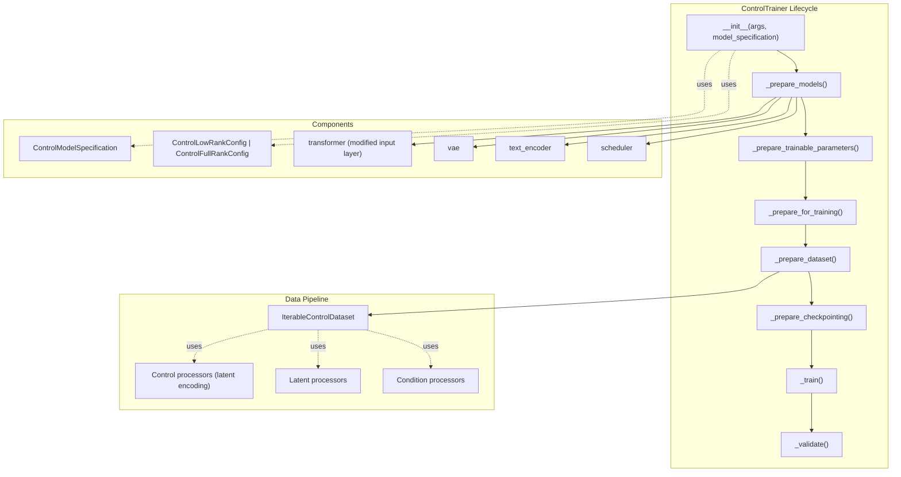
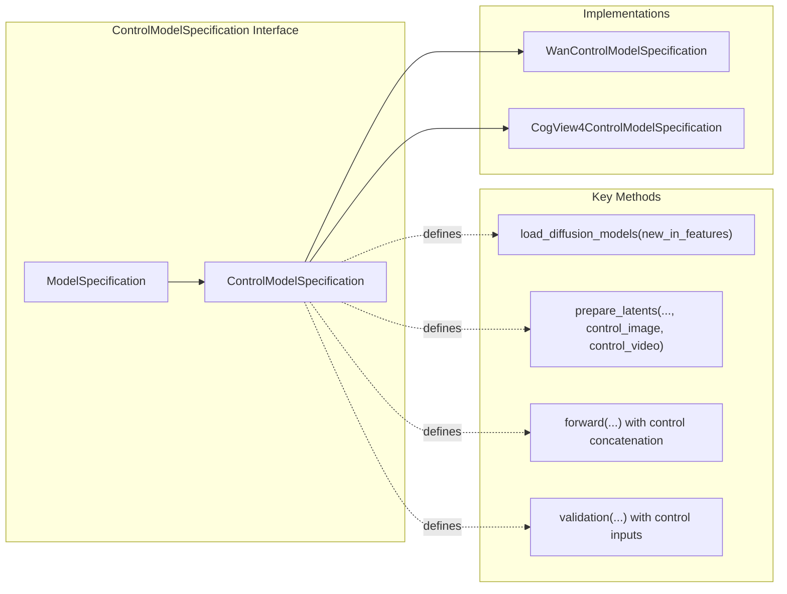
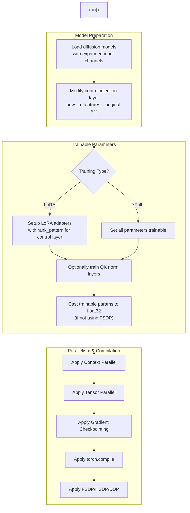
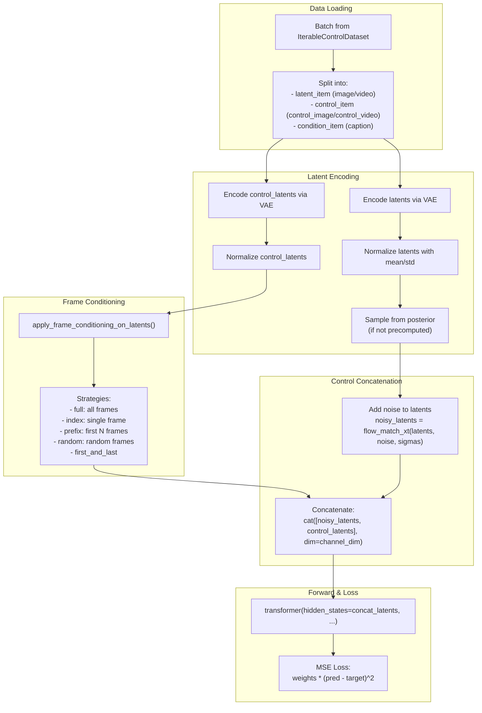
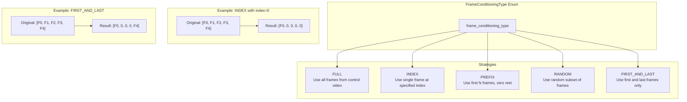
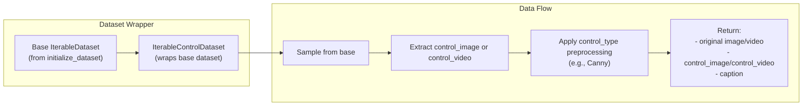
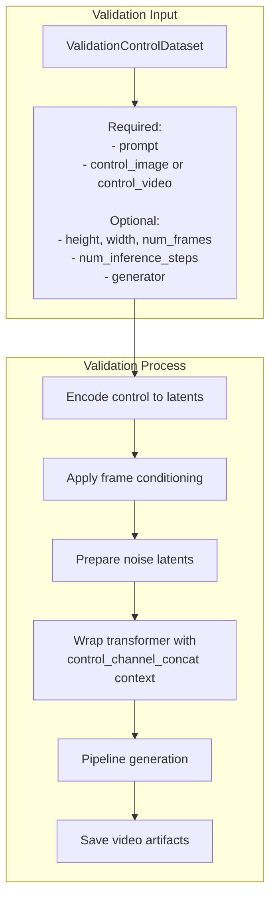

<!-- source: DeepWiki mcp.deepwiki.com · repo huggingface/finetrainers · page 4.2 Control Trainer · fetched 2026-10-26 -->

# Control Trainer

<details>
<summary>Relevant source files</summary>

The following files were used as context for generating this wiki page:

- [docs/args.md](docs/args.md)
- [finetrainers/models/cogvideox/base_specification.py](finetrainers/models/cogvideox/base_specification.py)
- [finetrainers/models/hunyuan_video/base_specification.py](finetrainers/models/hunyuan_video/base_specification.py)
- [finetrainers/models/ltx_video/base_specification.py](finetrainers/models/ltx_video/base_specification.py)
- [finetrainers/models/wan/base_specification.py](finetrainers/models/wan/base_specification.py)
- [finetrainers/models/wan/control_specification.py](finetrainers/models/wan/control_specification.py)
- [finetrainers/trainer/control_trainer/config.py](finetrainers/trainer/control_trainer/config.py)
- [finetrainers/trainer/control_trainer/trainer.py](finetrainers/trainer/control_trainer/trainer.py)
- [finetrainers/trainer/sft_trainer/config.py](finetrainers/trainer/sft_trainer/config.py)
- [finetrainers/utils/import_utils.py](finetrainers/utils/import_utils.py)
- [tests/trainer/test_control_trainer.py](tests/trainer/test_control_trainer.py)

</details>


The `ControlTrainer` class provides functionality for training diffusion models with conditional control signals, enabling models to generate outputs guided by structural information such as edge maps, depth maps, or other control modalities. This page documents the control training workflow, configuration, and architecture.

For standard supervised fine-tuning without control signals, see [SFT Trainer](#4.1). For general training lifecycle concepts, see [Training Workflows](#4).

**Sources:** [finetrainers/trainer/control_trainer/trainer.py:1-631]()

---

## Overview

Control training modifies a pre-trained diffusion model to accept additional conditioning channels concatenated to the latent input. This approach, inspired by ControlNet-style architectures, allows training models that can generate content guided by structural control signals (e.g., Canny edges, depth maps) while preserving the base model's generative capabilities.

The `ControlTrainer` supports two training strategies:
- **Control LoRA** (`TrainingType.CONTROL_LORA`): Low-rank adaptation with control channel injection
- **Control Full Finetune** (`TrainingType.CONTROL_FULL_FINETUNE`): Full parameter training with control channel injection

Currently, control training is implemented for **Wan** (video) and **CogView4** (image) models.

**Sources:** [finetrainers/trainer/control_trainer/trainer.py:37-74](), [finetrainers/trainer/control_trainer/config.py:12-32]()

---

## Architecture

### ControlTrainer Class Structure



**Sources:** [finetrainers/trainer/control_trainer/trainer.py:37-88](), [finetrainers/trainer/control_trainer/trainer.py:89-100]()

---

## Control Model Specification

Control training requires a specialized `ControlModelSpecification` that extends the base `ModelSpecification` interface. This specification handles:

1. **Control channel injection**: Modifying the transformer's input layer to accept additional control channels
2. **Control latent processing**: Encoding control images/videos into latent space
3. **Frame conditioning**: Applying temporal conditioning strategies for video models



### Control Layer Modification

The control specification modifies the transformer's first convolutional layer to accept additional input channels:

| Property | Description | Example Value (Wan) |
|----------|-------------|---------------------|
| `control_injection_layer_name` | Name of layer to modify | `"patch_embedding"` |
| `_original_control_layer_in_features` | Original input channels | 16 (from config) |
| `_original_control_layer_out_features` | Output features for LoRA rank | `num_heads * head_dim` |

The modification uses `_expand_conv3d_with_zeroed_weights` to expand the input layer while initializing new weights to zero, ensuring the model starts from the pre-trained state.

**Sources:** [finetrainers/models/wan/control_specification.py:79-84](), [finetrainers/models/wan/control_specification.py:122-144](), [finetrainers/models/wan/control_specification.py:428-437]()

---

## Configuration

### Control Training Types

The trainer supports two configuration classes based on the training type:

```mermaid
graph TB
    subgraph "Configuration Classes"
        Base["ArgsConfigMixin"]
        ControlLoRA["ControlLowRankConfig"]
        ControlFull["ControlFullRankConfig"]
        
        Base --> ControlLoRA
        Base --> ControlFull
    end
    
    subgraph "ControlLowRankConfig Parameters"
        CL1["control_type: ControlType"]
        CL2["rank: int = 64"]
        CL3["lora_alpha: int = 64"]
        CL4["target_modules: str | List[str]"]
        CL5["train_qk_norm: bool = False"]
        CL6["frame_conditioning_type: FrameConditioningType"]
        CL7["frame_conditioning_index: int"]
        CL8["frame_conditioning_concatenate_mask: bool"]
    end
    
    subgraph "ControlFullRankConfig Parameters"
        CF1["control_type: ControlType"]
        CF2["train_qk_norm: bool = False"]
        CF3["frame_conditioning_type: FrameConditioningType"]
        CF4["frame_conditioning_index: int"]
        CF5["frame_conditioning_concatenate_mask: bool"]
    end
    
    ControlLoRA -.includes.-> CL1
    ControlLoRA -.includes.-> CL2
    ControlLoRA -.includes.-> CL3
    ControlLoRA -.includes.-> CL4
    ControlLoRA -.includes.-> CL5
    ControlLoRA -.includes.-> CL6
    ControlLoRA -.includes.-> CL7
    ControlLoRA -.includes.-> CL8
    
    ControlFull -.includes.-> CF1
    ControlFull -.includes.-> CF2
    ControlFull -.includes.-> CF3
    ControlFull -.includes.-> CF4
    ControlFull -.includes.-> CF5
```



**Sources:** [finetrainers/trainer/control_trainer/config.py:34-123](), [finetrainers/trainer/control_trainer/config.py:126-185]()

### Key Configuration Parameters

| Parameter | Type | Default | Description |
|-----------|------|---------|-------------|
| `control_type` | `ControlType` | `CANNY` | Type of control signal (canny, custom, none) |
| `rank` | `int` | `64` | LoRA rank (LoRA only) |
| `lora_alpha` | `int` | `64` | LoRA alpha scaling factor (LoRA only) |
| `target_modules` | `str \| List[str]` | `"(transformer_blocks\|single_transformer_blocks).*(to_q\|to_k\|to_v\|to_out.0\|ff.net.0.proj\|ff.net.2)"` | Target modules for LoRA (LoRA only) |
| `train_qk_norm` | `bool` | `False` | Whether to train query/key normalization layers |
| `frame_conditioning_type` | `FrameConditioningType` | `FULL` (LoRA) / `INDEX` (Full) | Temporal conditioning strategy |
| `frame_conditioning_index` | `int` | `0` | Frame index for `INDEX` mode |
| `frame_conditioning_concatenate_mask` | `bool` | `False` | Whether to concatenate frame mask |

**Sources:** [finetrainers/trainer/control_trainer/config.py:34-123](), [finetrainers/trainer/control_trainer/config.py:126-185]()

---

## Training Workflow

### Preparation Phase



**Sources:** [finetrainers/trainer/control_trainer/trainer.py:89-100](), [finetrainers/trainer/control_trainer/trainer.py:102-170](), [finetrainers/trainer/control_trainer/trainer.py:171-224]()

### Forward Pass with Control



**Sources:** [finetrainers/trainer/control_trainer/trainer.py:454-533](), [finetrainers/models/wan/control_specification.py:243-308]()

---

## Frame Conditioning Strategies

For video models, the trainer supports multiple temporal conditioning strategies controlled by `frame_conditioning_type`:



The function `apply_frame_conditioning_on_latents()` implements these strategies by zeroing out non-selected frames in the control latent tensor. Optionally, a binary mask can be concatenated along the channel dimension if `frame_conditioning_concatenate_mask=True`.

**Sources:** [finetrainers/trainer/control_trainer/config.py:22-31](), [finetrainers/trainer/control_trainer/data.py:1-100]() (referenced but not provided)

---

## Control Types

The `ControlType` enum defines the type of control signal:

| Control Type | Description | Use Case |
|--------------|-------------|----------|
| `CANNY` | Canny edge detection | Edge-guided generation |
| `CUSTOM` | User-defined control | Custom preprocessing pipelines |
| `NONE` | No control preprocessing | Using raw control images/videos |

Control preprocessing is applied in `IterableControlDataset`, which loads control images/videos and applies the specified transformation before encoding to latent space.

**Sources:** [finetrainers/trainer/control_trainer/config.py:12-19](), [finetrainers/trainer/control_trainer/data.py:1-50]() (referenced)

---

## Data Pipeline

### IterableControlDataset

The control trainer uses a specialized dataset wrapper that extends the base iterable dataset:



**Sources:** [finetrainers/trainer/control_trainer/trainer.py:268-307](), [finetrainers/trainer/control_trainer/data.py:1-100]() (referenced)

---

## Checkpointing and Saving

### LoRA Checkpoint Structure

For Control LoRA training, checkpoints are saved with special handling for the control injection layer:

```python
# Pseudo-code representation
lora_config = {
    "r": rank,
    "lora_alpha": lora_alpha,
    "target_modules": target_modules,
    "rank_pattern": {control_injection_layer_name: original_out_features},
    "alpha_pattern": {control_injection_layer_name: original_out_features}
}
```

The `rank_pattern` and `alpha_pattern` ensure the control injection layer uses a full-rank adaptation (rank equals output features) rather than low-rank.

**Sources:** [finetrainers/trainer/control_trainer/trainer.py:130-144](), [finetrainers/trainer/control_trainer/trainer.py:331-347]()

### Saved Artifacts

Control training saves:
- **LoRA weights** (if `TrainingType.CONTROL_LORA`): `lora_weights/{step:06d}/`
- **Full model weights** (if `TrainingType.CONTROL_FULL_FINETUNE`): `model_weights/{step:06d}/`
- **QK norm weights** (if `train_qk_norm=True`): `norm_state_dict.safetensors`
- **Scheduler config**: `scheduler/`

**Sources:** [finetrainers/trainer/control_trainer/trainer.py:309-375](), [finetrainers/models/wan/control_specification.py:379-416]()

---

## Validation

Validation for control models requires providing control images/videos alongside prompts:



The validation uses `control_channel_concat` context manager to temporarily inject control latents during pipeline inference without modifying the pipeline class.

**Sources:** [finetrainers/trainer/control_trainer/trainer.py:632-761](), [finetrainers/models/wan/control_specification.py:310-377](), [finetrainers/patches/dependencies/diffusers/control.py:1-50]() (referenced)

---

## Differences from SFT Trainer

| Aspect | SFT Trainer | Control Trainer |
|--------|-------------|-----------------|
| **Purpose** | Standard supervised fine-tuning | Conditional control training |
| **Input modification** | None | Expands transformer input channels |
| **Model specification** | `ModelSpecification` | `ControlModelSpecification` |
| **Data format** | image/video + caption | image/video + control_image/control_video + caption |
| **Dataset wrapper** | Base iterable dataset | `IterableControlDataset` |
| **Frame conditioning** | N/A | Supports multiple strategies (index, full, prefix, etc.) |
| **LoRA rank pattern** | Uniform rank | Special rank for control injection layer |
| **Validation inputs** | prompt + optional image | prompt + control_image/control_video |

**Sources:** [finetrainers/trainer/control_trainer/trainer.py:37-88](), [finetrainers/trainer/sft_trainer/trainer.py:1-100]() (comparison inferred)

---

## Implementation Notes

### QK Norm Training

When `train_qk_norm=True`, the trainer identifies and enables training for query-key normalization layers:

```python
# Pseudo-code
qk_norm_identifiers = model_spec._qk_norm_identifiers  # e.g., ["norm_q", "norm_k", ...]
for name, module in transformer.named_modules():
    if any(re.search(identifier, name) for identifier in qk_norm_identifiers):
        if module has parameters:
            set_requires_grad(module, True)
```

This is useful for fine-tuning attention normalization alongside the control adaptation.

**Sources:** [finetrainers/trainer/control_trainer/trainer.py:146-161](), [finetrainers/models/wan/control_specification.py:436-437]()

### Layerwise Upcasting

For Control LoRA, layerwise upcasting (fp8 storage with higher precision compute) must be applied **before** adding the LoRA adapter to avoid OOM issues:

**Sources:** [finetrainers/trainer/control_trainer/trainer.py:115-128]()

### Supported Models

Currently, control training is implemented for:
- **Wan** (T2V): [finetrainers/models/wan/control_specification.py:1-438]()
- **CogView4** (T2I): Referenced in tests

Other models can be supported by implementing `ControlModelSpecification` with appropriate control injection logic.

**Sources:** [tests/trainer/test_control_trainer.py:261-274]()

---

## Example Usage

```bash
# Control LoRA training
python train.py \
    --model_name wan \
    --training_type control-lora \
    --control_type canny \
    --rank 64 \
    --lora_alpha 64 \
    --frame_conditioning_type random \
    --dataset_config datasets/control_config.json \
    --train_steps 5000

# Control full finetuning
python train.py \
    --model_name wan \
    --training_type control-full-finetune \
    --control_type canny \
    --frame_conditioning_type index \
    --frame_conditioning_index 0 \
    --dataset_config datasets/control_config.json \
    --train_steps 5000
```

**Sources:** [docs/args.md:320-355]()

---

