<!-- source: DeepWiki mcp.deepwiki.com · repo huggingface/finetrainers · page 4.3 Training State and Checkpointing · fetched 2026-10-26 -->

# Training State and Checkpointing

<details>
<summary>Relevant source files</summary>

The following files were used as context for generating this wiki page:

- [finetrainers/args.py](finetrainers/args.py)
- [finetrainers/models/cogview4/base_specification.py](finetrainers/models/cogview4/base_specification.py)
- [finetrainers/parallel/accelerate.py](finetrainers/parallel/accelerate.py)
- [finetrainers/parallel/base.py](finetrainers/parallel/base.py)
- [finetrainers/parallel/ptd.py](finetrainers/parallel/ptd.py)
- [finetrainers/state.py](finetrainers/state.py)
- [finetrainers/trainer/sft_trainer/trainer.py](finetrainers/trainer/sft_trainer/trainer.py)
- [tests/README.md](tests/README.md)
- [train.py](train.py)

</details>


This document describes the training state management and checkpointing system in finetrainers. It covers how training progress is tracked, how checkpoints are saved and loaded, and how the system supports resuming training from interruptions.

For information about distributed training strategies that affect checkpointing, see [Distributed Checkpointing](#7.3). For the overall training workflow, see [Training Workflows](#4).

## Overview

The checkpointing system serves two primary purposes:

1. **Training State Persistence** - Tracks training progress (current step, losses, optimizer state) and saves it periodically
2. **Model Weight Extraction** - Extracts trained weights (LoRA adapters or full model) for inference at checkpoint intervals

The system supports two parallel backends with different checkpoint formats:
- **PTDCheckpointer** - Uses PyTorch Distributed Checkpoint (DCP) for efficient distributed state saving
- **AccelerateCheckpointer** - Uses Hugging Face Accelerate's checkpoint API

Sources: [finetrainers/state.py](), [finetrainers/parallel/base.py](), [finetrainers/trainer/sft_trainer/trainer.py:276-327]()

## TrainState Management

### TrainState Class

The `TrainState` class tracks all training progress metrics and implements the `torch.distributed.checkpoint.stateful.Stateful` interface for serialization.

**TrainState Structure**

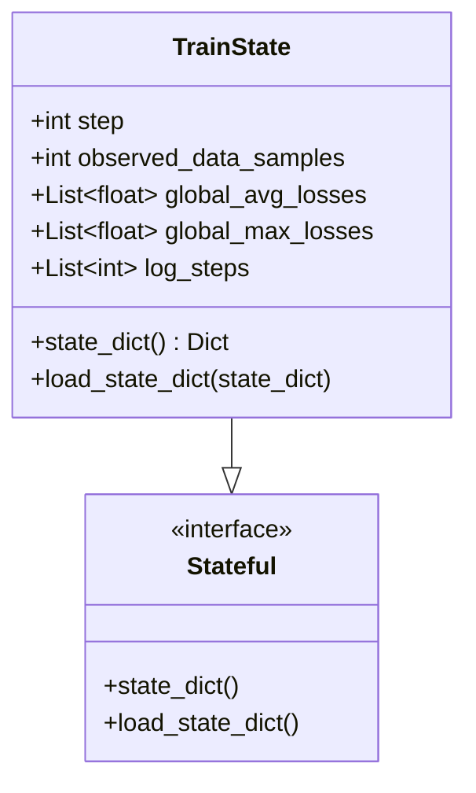

**Fields tracked by TrainState:**

| Field | Type | Purpose |
|-------|------|---------|
| `step` | `int` | Current training step (incremented after each forward/backward pass) |
| `observed_data_samples` | `int` | Total data samples processed across all distributed ranks |
| `global_avg_losses` | `List[float]` | Average loss values logged at each logging step |
| `global_max_losses` | `List[float]` | Maximum loss values logged at each logging step |
| `log_steps` | `List[int]` | Steps at which metrics were logged |

Sources: [finetrainers/state.py:15-50]()

### State Serialization

The `state_dict()` and `load_state_dict()` methods handle serialization of training state:

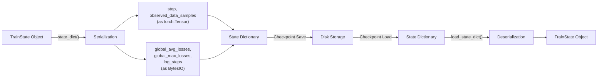

The use of `BytesIO` for lists avoids synchronization overhead during every training iteration - only scalar values (`step`, `observed_data_samples`) need to be checkpointed as tensors for DCP compatibility.

Sources: [finetrainers/state.py:23-49]()

### State Container

The `State` dataclass is the top-level container used throughout training:

| Field | Type | Purpose |
|-------|------|---------|
| `parallel_backend` | `ParallelBackendType` | Reference to the parallel backend (PTD or Accelerate) |
| `train_state` | `TrainState` | Training progress tracker |
| `num_trainable_parameters` | `int` | Count of trainable parameters |
| `generator` | `torch.Generator` | Random number generator for reproducibility |
| `repo_id` | `str` | Hugging Face Hub repository ID (if pushing) |
| `output_dir` | `str` | Output directory for checkpoints and artifacts |

Sources: [finetrainers/state.py:52-66]()

## Checkpoint System Architecture

### Backend Abstraction

The checkpointing system uses a two-tier abstraction with backend-specific implementations:

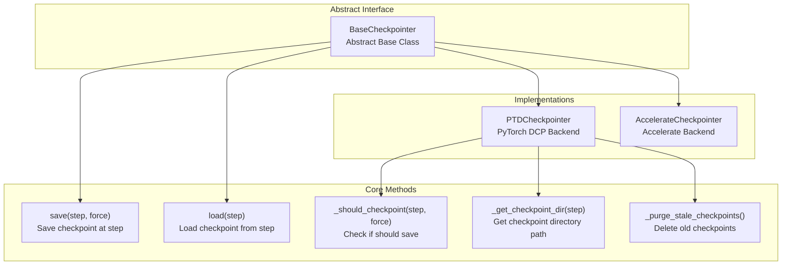

Sources: [finetrainers/parallel/base.py:118-146]()

### PTDCheckpointer Implementation

**Component Structure:**

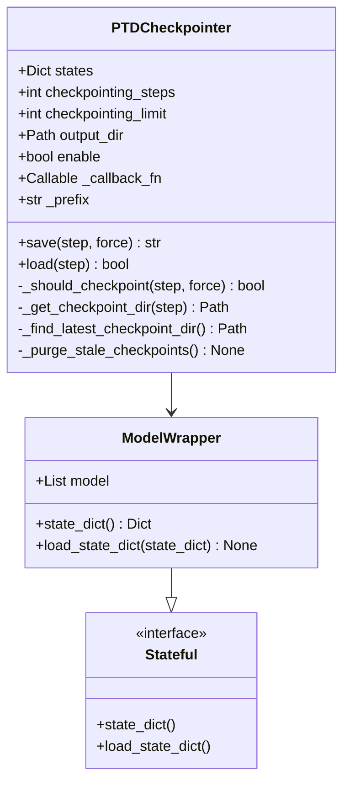

**States Dictionary Structure:**

The `states` dictionary passed to PTDCheckpointer contains:

| Key | Value Type | Description |
|-----|------------|-------------|
| `"model"` | `ModelWrapper` | Wrapper around model parts (transformer) implementing Stateful |
| `"optimizer"` | `OptimizerWrapper` | Distributed optimizer state |
| `"dataloader"` | `DataLoader` | Dataloader state (for resumption) |
| `"train_state"` | `TrainState` | Training progress metrics |
| LR scheduler keys | Various | Learning rate scheduler state(s) |

The `ModelWrapper` class [finetrainers/parallel/ptd.py:282-295]() wraps model parts and implements `Stateful` by calling `get_model_state_dict()` and `set_model_state_dict()` from PyTorch's distributed checkpoint utilities.

Sources: [finetrainers/parallel/ptd.py:298-412](), [finetrainers/parallel/ptd.py:282-295]()

### AccelerateCheckpointer Implementation

The Accelerate backend delegates to the `Accelerator` API:

| Method | Accelerate API | Description |
|--------|----------------|-------------|
| `save()` | `accelerator.save_state()` | Saves all registered components |
| `load()` | `accelerator.load_state()` | Loads all registered components |
| Registration | `register_save_state_pre_hook()` | Hook called before saving |
| Registration | `register_load_state_pre_hook()` | Hook called before loading |

The checkpointer uses hooks to invoke the `_callback_fn` for extracting model weights during save operations.

Sources: [finetrainers/parallel/accelerate.py:255-361]()

## Checkpointing Integration in Training

### Preparation Phase

During `_prepare_checkpointing()` in the trainer lifecycle:

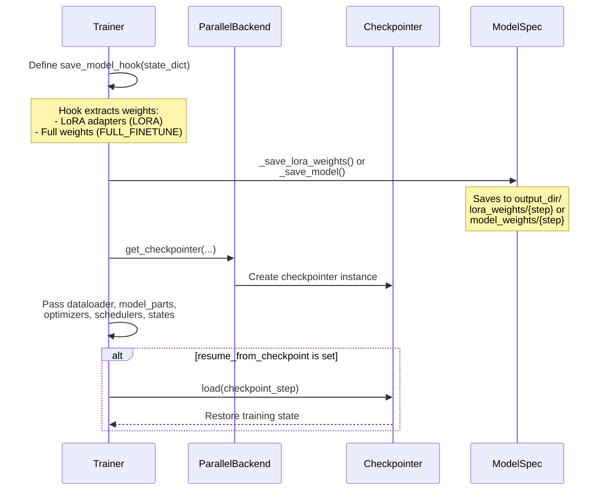

**Key arguments to `get_checkpointer()`:**

```python
checkpointer = parallel_backend.get_checkpointer(
    dataloader=self.dataloader,
    model_parts=[self.transformer],
    optimizers=self.optimizer,
    schedulers=self.lr_scheduler,
    states={"train_state": self.state.train_state},
    checkpointing_steps=self.args.checkpointing_steps,
    checkpointing_limit=self.args.checkpointing_limit,
    output_dir=self.args.output_dir,
    enable=enable_state_checkpointing,
    _callback_fn=save_model_hook,
)
```

Sources: [finetrainers/trainer/sft_trainer/trainer.py:276-327]()

### Training Loop Integration

Checkpointing occurs at regular intervals during the training loop:

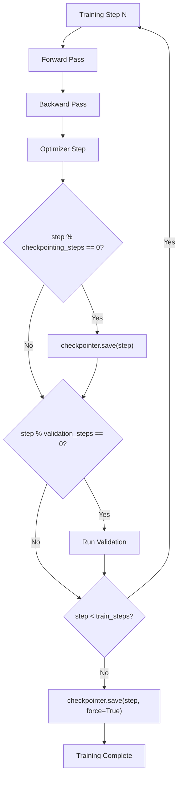

The checkpoint is saved **after** the optimizer step completes, ensuring the state dict includes the updated optimizer state.

Sources: [finetrainers/trainer/sft_trainer/trainer.py:553-567]()

## Saving Checkpoints

### Save Flow (PTDCheckpointer)

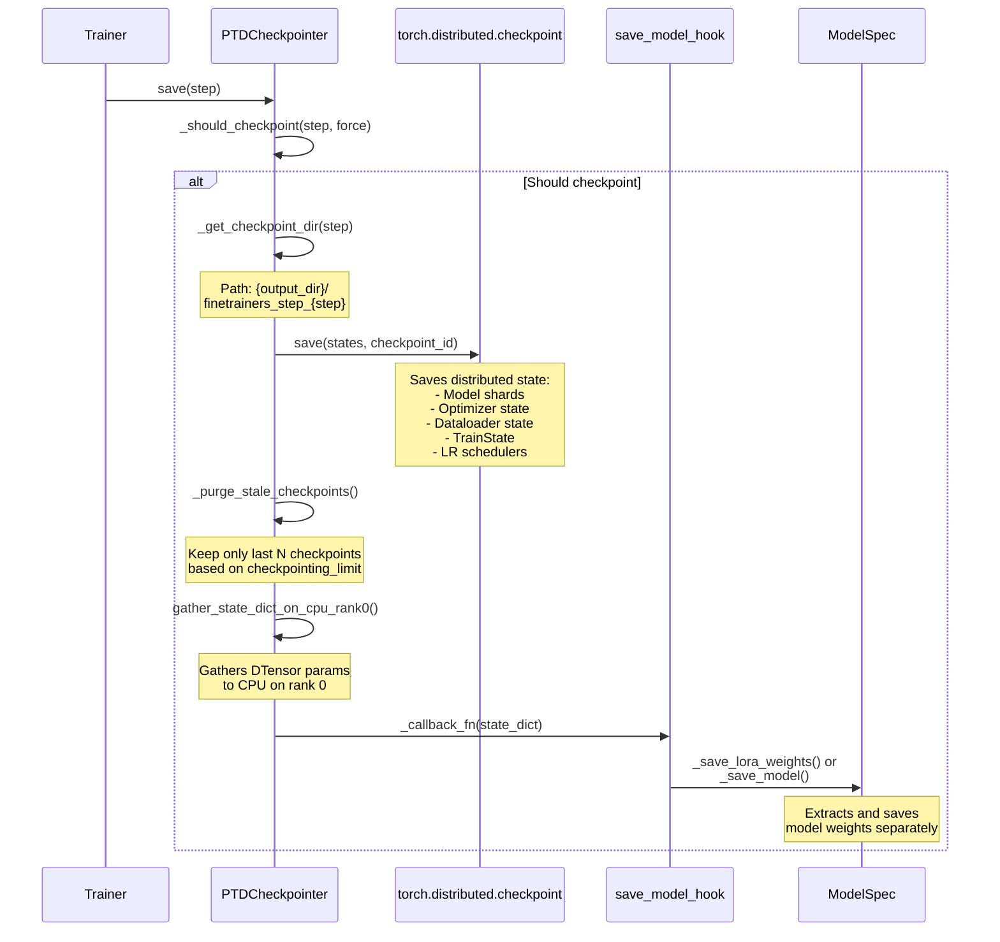

### Checkpoint Directory Structure

For PTDCheckpointer, each checkpoint creates a directory with the DCP format:

```
output_dir/
├── finetrainers_step_500/          # Training state checkpoint
│   ├── .metadata                    # DCP metadata
│   ├── __0_0.distcp                 # Distributed state files
│   └── ...
├── finetrainers_step_1000/
│   └── ...
├── lora_weights/                    # Model weights (LoRA)
│   ├── 000500/
│   │   ├── pytorch_lora_weights.safetensors
│   │   └── scheduler/
│   └── 001000/
│       └── ...
└── model_weights/                   # Model weights (Full finetune)
    ├── 000500/
    │   ├── transformer/
    │   │   ├── config.json
    │   │   └── diffusion_pytorch_model.safetensors
    │   └── scheduler/
    └── 001000/
        └── ...
```

Sources: [finetrainers/parallel/ptd.py:332-352](), [finetrainers/trainer/sft_trainer/trainer.py:279-306]()

### Checkpoint Save Parameters

| Parameter | Type | Default | Description |
|-----------|------|---------|-------------|
| `checkpointing_steps` | `int` | `500` | Save checkpoint every N training steps |
| `checkpointing_limit` | `int` | `None` | Maximum number of checkpoints to keep (oldest deleted) |
| `resume_from_checkpoint` | `str` or `int` | `None` | Path or step to resume from; `"latest"` for most recent |

The `force=True` parameter in `save()` bypasses the `checkpointing_steps` interval check, used for the final checkpoint.

Sources: [finetrainers/args.py:269-278](), [finetrainers/parallel/ptd.py:388-394]()

## Loading Checkpoints

### Load Flow

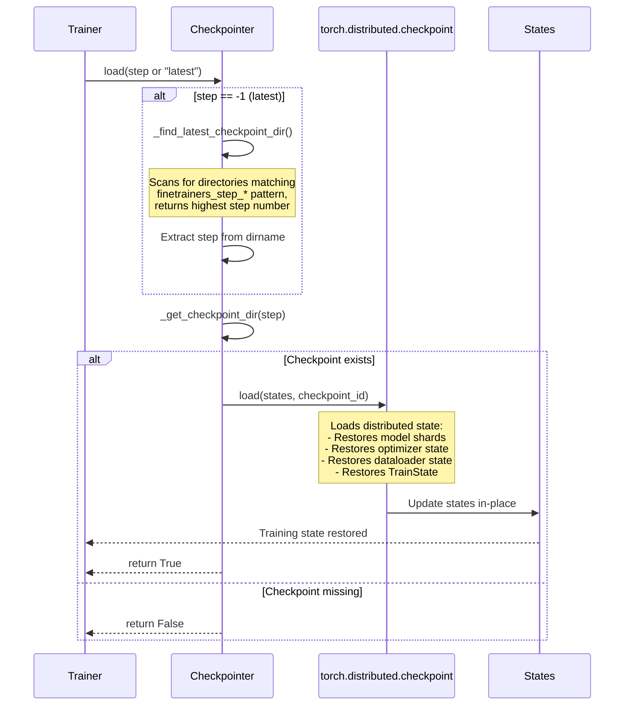

### Resume from Checkpoint

To resume training from a checkpoint, use the `--resume_from_checkpoint` argument:

```bash
# Resume from specific step
python train.py ... --resume_from_checkpoint 1000

# Resume from latest checkpoint
python train.py ... --resume_from_checkpoint latest
```

When loading a checkpoint:
1. **Model state** is restored to its exact training state (including LoRA adapters if applicable)
2. **Optimizer state** is restored (momentum, variance buffers, etc.)
3. **LR scheduler state** is restored (current LR, step counts)
4. **TrainState** is restored (step counter, observed samples, losses)
5. **Dataloader state** is restored (data iteration position)

Sources: [finetrainers/trainer/sft_trainer/trainer.py:322-326](), [finetrainers/parallel/ptd.py:354-386]()

### Step 0 Checkpoint Handling

For step 0 checkpoints (saved before the first optimizer step), only the model state is loaded, since optimizer and scheduler states don't exist yet:

```python
# For step 0, optimizers/schedulers are not available
states = {"model": self.states["model"]} if step == 0 else self.states
```

Sources: [finetrainers/parallel/ptd.py:372]()

## Checkpoint Lifecycle Management

### Purging Stale Checkpoints

The `_purge_stale_checkpoints()` method maintains a maximum number of checkpoints based on `checkpointing_limit`:

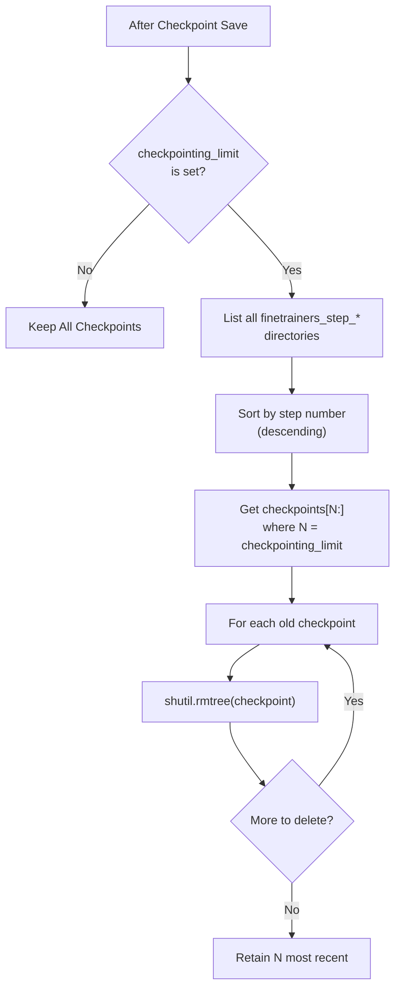

**Example:** With `checkpointing_limit=3` and steps [500, 1000, 1500, 2000, 2500]:
- After saving step 2500, checkpoints 500 and 1000 are deleted
- Remaining: [1500, 2000, 2500]

Sources: [finetrainers/parallel/ptd.py:403-411](), [finetrainers/parallel/accelerate.py:352-360]()

### Checkpoint Naming Convention

Both backends use the same naming pattern:

```
{_prefix}_{step}
```

Default prefix: `"finetrainers_step"`

Examples:
- `finetrainers_step_500`
- `finetrainers_step_1000`
- `finetrainers_step_5000`

The prefix can be customized via the `_prefix` parameter (though this is not exposed in the public API).

Sources: [finetrainers/parallel/ptd.py:396-397](), [finetrainers/parallel/accelerate.py:345-346]()

## Model Weight Extraction

### Save Model Hook

The `save_model_hook` callback function is invoked after distributed checkpoint save to extract model weights:

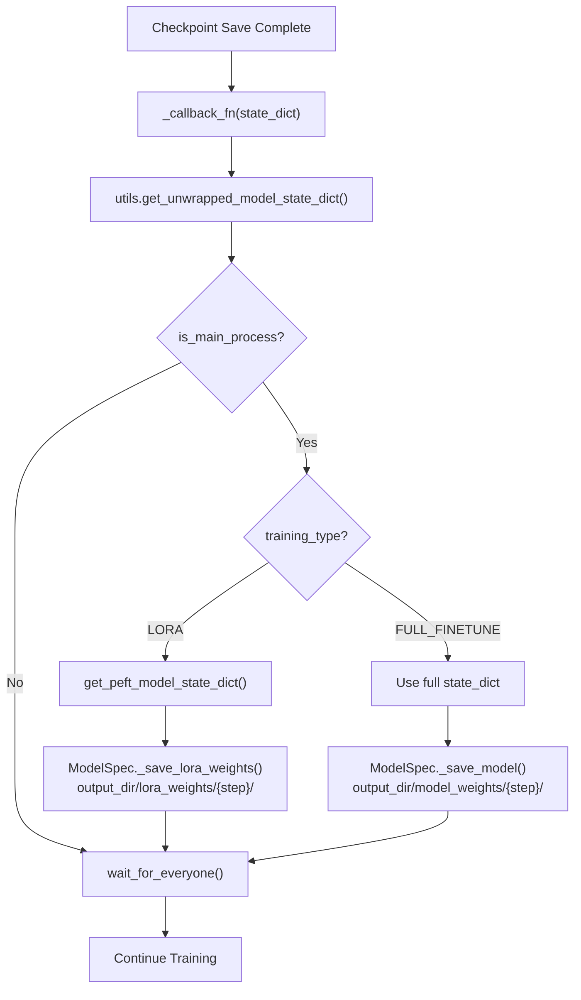

### LoRA Weight Format

For LoRA training, only the adapter weights are saved in `pytorch_lora_weights.safetensors`:

```python
metadata = {
    "lora_config": {
        "r": rank,
        "lora_alpha": lora_alpha,
        "init_lora_weights": True,
        "target_modules": [...],
    }
}
```

The metadata is embedded in the safetensors file for easy loading.

Sources: [finetrainers/trainer/sft_trainer/trainer.py:279-306](), [finetrainers/models/cogview4/base_specification.py:351-369]()

### Full Model Weight Format

For full finetuning, the entire transformer state dict is saved using the model's native format (matching the pretrained model structure).

Sources: [finetrainers/trainer/sft_trainer/trainer.py:299-305](), [finetrainers/models/cogview4/base_specification.py:371-385]()

## Distributed State Management

### Gathering Sharded State

The `gather_state_dict_on_cpu_rank0()` function collects distributed model state to CPU on rank 0:

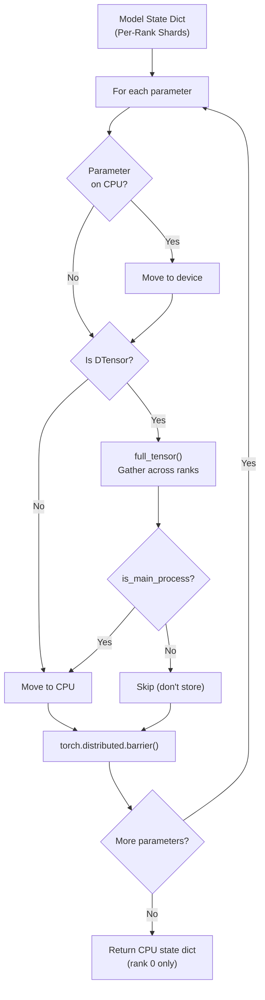

This ensures only rank 0 holds the full model state dict in CPU memory, avoiding OOM on other ranks.

Sources: [finetrainers/parallel/ptd.py:414-429]()

### Stateful Interface Compliance

All checkpointed objects must implement the `torch.distributed.checkpoint.stateful.Stateful` interface:

| Method | Purpose |
|--------|---------|
| `state_dict()` | Returns dictionary representation of state |
| `load_state_dict(state_dict)` | Restores state from dictionary |

Implemented by:
- `TrainState` [finetrainers/state.py:16-49]()
- `ModelWrapper` [finetrainers/parallel/ptd.py:282-295]()
- `OptimizerWrapper` (in optimizer module)
- `SchedulerWrapper` (in optimizer module)
- PyTorch `DataLoader` (native support)

Sources: [finetrainers/state.py:16](), [finetrainers/parallel/ptd.py:282]()

## Configuration Reference

### Command-Line Arguments

| Argument | Type | Default | Description |
|----------|------|---------|-------------|
| `--checkpointing_steps` | `int` | `500` | Save checkpoint every N steps |
| `--checkpointing_limit` | `int` | `None` | Maximum checkpoints to retain |
| `--resume_from_checkpoint` | `str/int` | `None` | Resume from step or `"latest"` |
| `--output_dir` | `str` | Required | Directory for checkpoints |

### Disabling Checkpoints

To disable periodic checkpointing (only save final checkpoint):

```bash
python train.py ... --checkpointing_steps 0
```

This sets `enable=False` in the checkpointer, but the final checkpoint with `force=True` is still saved.

Sources: [finetrainers/args.py:269-278](), [finetrainers/trainer/sft_trainer/trainer.py:308]()

---

