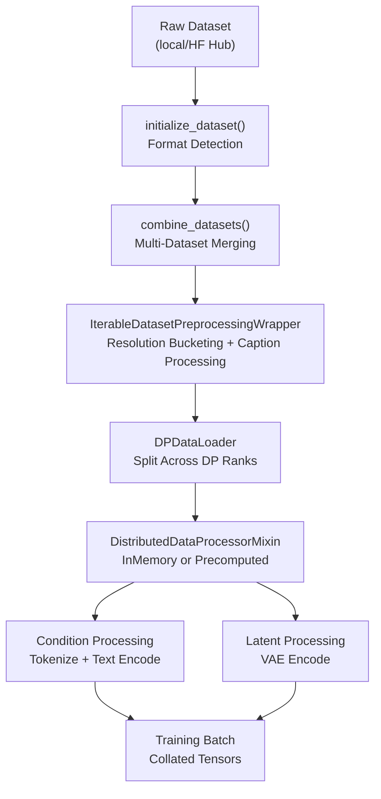
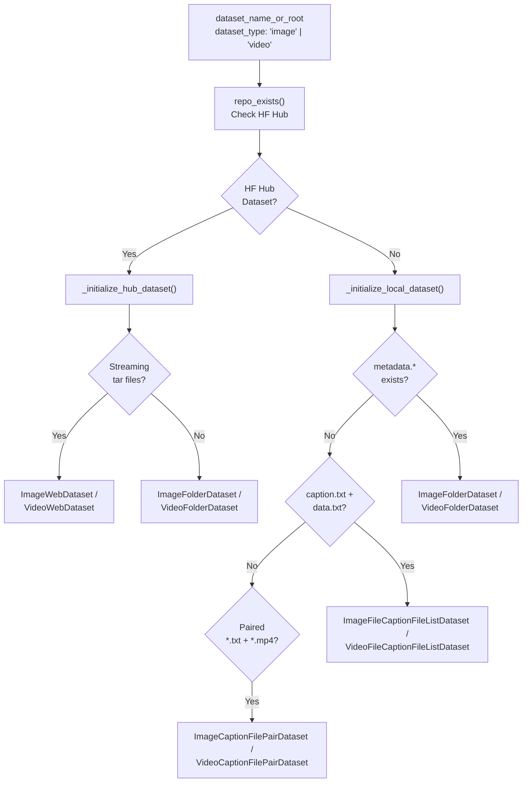
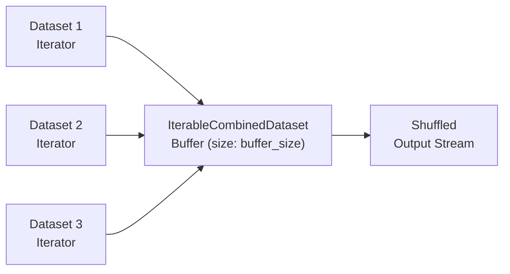
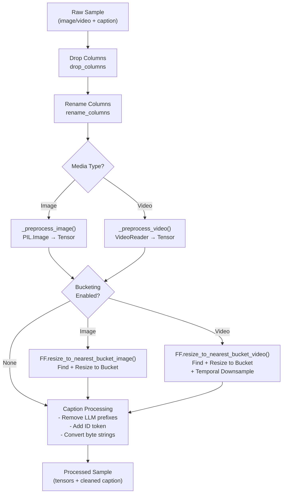
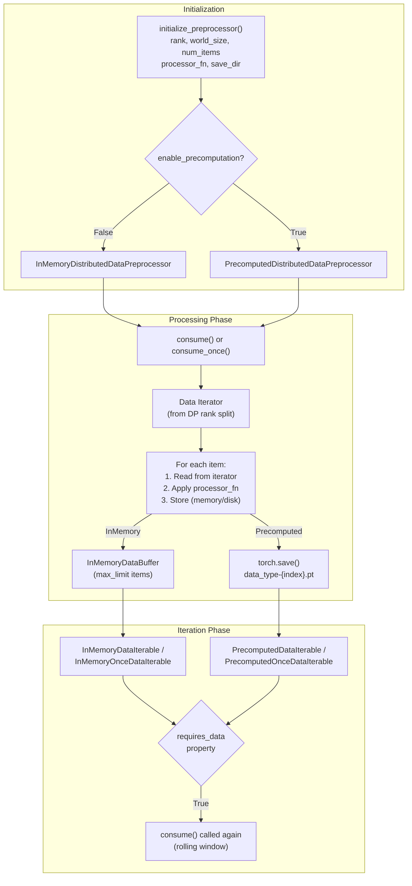
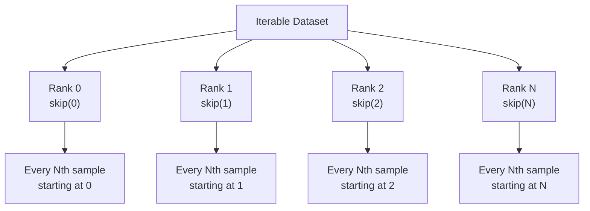
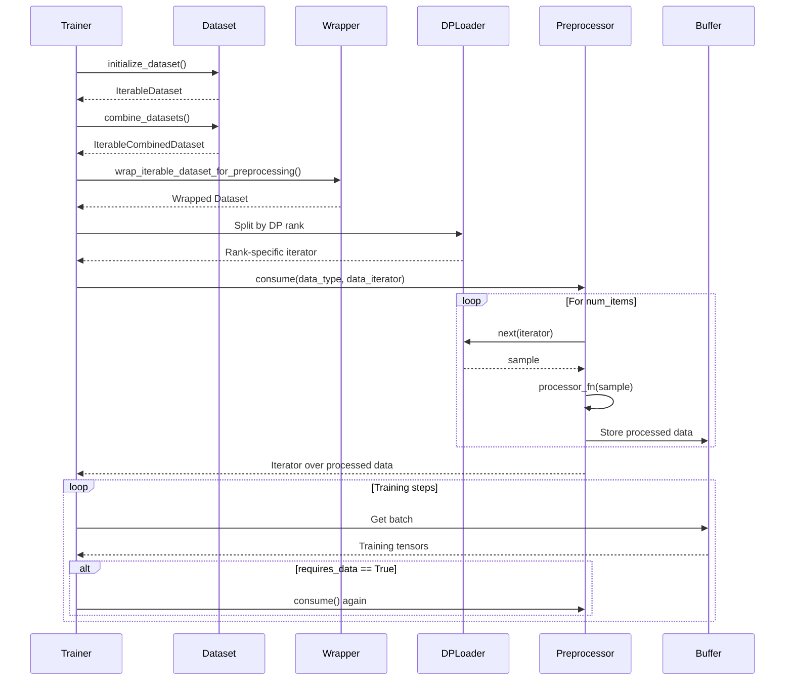

<!-- source: DeepWiki mcp.deepwiki.com · repo huggingface/finetrainers · page 5 Data Pipeline · fetched 2026-10-26 -->

# Data Pipeline

<details>
<summary>Relevant source files</summary>

The following files were used as context for generating this wiki page:

- [.gitignore](.gitignore)
- [README.md](README.md)
- [docs/dataset/README.md](docs/dataset/README.md)
- [examples/training/sft/cogview4/raider_white_tarot/training.json](examples/training/sft/cogview4/raider_white_tarot/training.json)
- [examples/training/sft/cogview4/raider_white_tarot/validation.json](examples/training/sft/cogview4/raider_white_tarot/validation.json)
- [finetrainers/data/__init__.py](finetrainers/data/__init__.py)
- [finetrainers/data/dataset.py](finetrainers/data/dataset.py)
- [finetrainers/data/precomputation.py](finetrainers/data/precomputation.py)
- [finetrainers/functional/__init__.py](finetrainers/functional/__init__.py)
- [finetrainers/functional/image.py](finetrainers/functional/image.py)
- [finetrainers/functional/text.py](finetrainers/functional/text.py)
- [finetrainers/functional/video.py](finetrainers/functional/video.py)
- [finetrainers/models/cogview4/__init__.py](finetrainers/models/cogview4/__init__.py)
- [finetrainers/processors/__init__.py](finetrainers/processors/__init__.py)
- [finetrainers/processors/glm.py](finetrainers/processors/glm.py)
- [tests/data/test_dataset.py](tests/data/test_dataset.py)
- [tests/data/test_precomputation.py](tests/data/test_precomputation.py)

</details>


## Purpose and Scope

The Data Pipeline system handles all aspects of loading, preprocessing, and preparing data for training diffusion models. This includes multi-format dataset loading, resolution bucketing, caption processing, and memory-efficient precomputation of latent and conditional embeddings. The system is designed to support both image and video datasets with distributed training capabilities.

For information about specific model implementations that consume this data, see [Model Specifications](#3.2). For details on how trainers use the data pipeline, see [Training Workflows](#4).

---

## Architecture Overview

The data pipeline follows a multi-stage architecture that transforms raw datasets into training-ready batches through several processing layers:



**Sources:** [finetrainers/data/dataset.py:824-857](), [finetrainers/data/precomputation.py:16-29](), [docs/dataset/README.md:144-162]()

---

## Dataset Formats and Loading

### Supported Dataset Formats

The system auto-detects and loads datasets in multiple formats. The `initialize_dataset()` function handles format detection and instantiates the appropriate dataset class.

| Format | Local | HF Hub | Dataset Classes | Description |
|--------|-------|--------|-----------------|-------------|
| Caption-Data Pair | ✓ | ✗ | `ImageCaptionFilePairDataset`<br/>`VideoCaptionFilePairDataset` | Each data file has matching `.txt` caption file |
| Two-File List | ✓ | ✓ | `ImageFileCaptionFileListDataset`<br/>`VideoFileCaptionFileListDataset` | Separate `captions.txt` and `images.txt`/`videos.txt` files |
| Metadata CSV/JSON | ✓ | ✓ | `ImageFolderDataset`<br/>`VideoFolderDataset` | `metadata.csv`, `metadata.json`, or `metadata.jsonl` |
| WebDataset | ✗ | ✓ | `ImageWebDataset`<br/>`VideoWebDataset` | Streaming tar archives from HF Hub |

**Sources:** [finetrainers/data/dataset.py:44-267](), [finetrainers/data/dataset.py:348-420](), [finetrainers/data/dataset.py:422-607](), [docs/dataset/README.md:8-79]()

### Dataset Initialization Flow



**Sources:** [finetrainers/data/dataset.py:824-844](), [finetrainers/data/dataset.py:859-948]()

### Multi-Dataset Combination

Multiple datasets can be chained together using `combine_datasets()`, which creates an `IterableCombinedDataset` that interleaves samples from multiple sources:



The buffer is filled with `buffer_size // num_datasets` items from each dataset, then samples are drawn randomly (if `shuffle=True`) or sequentially. When a sample is yielded, the system attempts to refill from the same iterator.

**Sources:** [finetrainers/data/dataset.py:776-821](), [finetrainers/data/dataset.py:847-850]()

---

## Preprocessing and Resolution Bucketing

### IterableDatasetPreprocessingWrapper

The `IterableDatasetPreprocessingWrapper` applies several transformations to each sample:



**Sources:** [finetrainers/data/dataset.py:677-773](), [finetrainers/data/dataset.py:853-856]()

### Resolution Bucketing Strategy

Resolution bucketing ensures that samples in a batch have compatible dimensions by resizing inputs to predefined bucket resolutions. The system selects buckets that minimize aspect ratio distortion.

**Image Bucketing:**

```python
# finetrainers/functional/image.py:30-37
find_nearest_resolution_image(image, resolution_buckets)
# Returns bucket with closest aspect ratio: min by (ar_diff, -height, -width)
```

**Video Bucketing:**

```python
# finetrainers/functional/video.py:32-49
find_nearest_video_resolution(video, resolution_buckets)
# 1. Filter buckets where num_frames <= video frames
# 2. Select bucket with max frames from filtered set
# 3. Among same-frame buckets, choose closest aspect ratio
```

| Resize Mode | Image | Video | Description |
|-------------|-------|-------|-------------|
| `bicubic` | `bicubic_resize_image()` | `bicubic_resize_video()` | Bicubic interpolation to target size |
| `center_crop` | `center_crop_image()` | `center_crop_video()` | Center crop to target size |
| `resize_crop` | `resize_crop_image()` | `resize_crop_video()` | Scale to cover, then center crop |

**Sources:** [finetrainers/functional/image.py:1-57](), [finetrainers/functional/video.py:1-97](), [finetrainers/data/dataset.py:730-754]()

### Caption Processing

The preprocessing wrapper applies several caption transformations:

1. **List to String:** If caption is a list, takes first element [finetrainers/data/dataset.py:757-758]()
2. **Byte String Conversion:** Handles webdataset byte strings like `"b'text'"` [finetrainers/data/dataset.py:759-760]()
3. **LLM Prefix Removal:** Strips common prefixes like "The image shows..." [finetrainers/data/dataset.py:761-762]()
4. **ID Token Injection:** Prepends identity token for personalization [finetrainers/data/dataset.py:763-764]()

**Sources:** [finetrainers/functional/text.py:7-40](), [finetrainers/data/dataset.py:756-765]()

---

## Precomputation System

### Overview and Motivation

Precomputation addresses memory constraints by encoding images/videos to latents and text to embeddings offline, allowing training without keeping VAE and text encoders in GPU memory. The system supports two modes:

| Mode | Class | Storage | Use Case |
|------|-------|---------|----------|
| **In-Memory** | `InMemoryDistributedDataPreprocessor` | RAM buffer | Small datasets, fast iteration |
| **Disk-Based** | `PrecomputedDistributedDataPreprocessor` | Disk (`.pt` files) | Large datasets, limited RAM |

**Sources:** [finetrainers/data/precomputation.py:16-29](), [docs/dataset/README.md:163-173]()

### Precomputation Architecture



**Sources:** [finetrainers/data/precomputation.py:32-260]()

### Processor Functions

The preprocessor accepts a dictionary of processor functions keyed by data type (`"condition"` and `"latent"`). Each function receives a data sample and model components, returning processed embeddings:

```python
# Example processor_fn structure
processor_fn = {
    "condition": prepare_conditions,  # Tokenize + text encode
    "latent": prepare_latents,        # VAE encode
}
```

These functions are typically defined in `ModelSpecification` classes and passed to the preprocessor during trainer initialization.

**Sources:** [finetrainers/data/precomputation.py:44-52](), [finetrainers/data/precomputation.py:135-150]()

### Consumption Modes

**consume() - Rolling Window:**
- Processes `num_items` samples
- Returns iterator that sets `requires_data=True` when exhausted
- Trainer calls `consume()` again to process next batch
- Enables training on datasets larger than disk capacity

**consume_once() - Full Precomputation:**
- Processes all samples once (or reuses existing)
- Returns infinite iterator that cycles through data
- `requires_data` always `False`
- Requires `--precomputation_once` flag
- Limited to datasets ≤ 1024 samples or explicitly enabled

**Sources:** [finetrainers/data/precomputation.py:58-133](), [finetrainers/data/precomputation.py:175-253](), [docs/dataset/README.md:164-171]()

### Data Iterables

#### InMemoryDataIterable

Yields items from `InMemoryDataBuffer` until exhausted, then sets `requires_data=True`:

```python
# finetrainers/data/precomputation.py:262-288
class InMemoryDataIterable:
    def __iter__(self):
        while (length := self._buffer.get_length(self._data_type)) > 0:
            if length <= 1:
                self._requires_data = True
            yield self._buffer.get(self._data_type)
```

#### PrecomputedDataIterable

Loads `.pt` files from disk sequentially:

```python
# finetrainers/data/precomputation.py:319-348
class PrecomputedDataIterable:
    def __iter__(self):
        for i in range(self._num_items):
            if i == self._num_items - 1:
                self._requires_data = True
            index = self._rank * self._num_items + i
            yield _load_item(index, self._save_dir, self._data_type, ...)
```

#### "Once" Variants

`InMemoryOnceDataIterable` and `PrecomputedOnceDataIterable` cycle data indefinitely without setting `requires_data=True`. The in-memory version re-adds items to buffer after yielding; the disk version uses modulo arithmetic to wrap indices.

**Sources:** [finetrainers/data/precomputation.py:262-386]()

### File Organization

Precomputed data is stored in `{save_dir}/finetrainers-precomputed-data/` with naming scheme:

```
{data_type}-{index}.pt
```

Where:
- `data_type`: `"condition"` or `"latent"`
- `index`: `rank * num_items + local_index`

This ensures non-overlapping files across DP ranks.

**Sources:** [finetrainers/data/precomputation.py:13](), [finetrainers/data/precomputation.py:413-420]()

---

## Distributed Data Loading

### DPDataLoader

The `DPDataLoader` class wraps an iterable dataset and splits it across data parallel ranks using the `skip()` method:



Each rank processes a disjoint subset of the dataset, ensuring no sample duplication across DP groups.

**Sources:** [finetrainers/data/dataloader.py]() (file not provided but referenced in imports)

---

## Validation Dataset

The `ValidationDataset` class handles validation/evaluation data separately from training datasets. It supports CSV, JSON, JSONL, Parquet, and Arrow formats:

```python
# finetrainers/data/dataset.py:609-674
class ValidationDataset(torch.utils.data.IterableDataset):
    # Loads validation configurations from file
    # Required column: "caption" (aliased to "prompt")
    # Optional: image_path, video_path, control_image_path, control_video_path
    # Optional: num_inference_steps, height, width, num_frames, frame_rate
```

The dataset automatically loads image/video files referenced by path columns and filters out `None` values before yielding samples.

**Sources:** [finetrainers/data/dataset.py:609-674](), [docs/dataset/README.md:82-143]()

---

## Integration Example

Here's how the data pipeline integrates into a training workflow:



**Sources:** [finetrainers/data/dataset.py:824-857](), [finetrainers/data/precomputation.py:58-127](), [docs/dataset/README.md:144-162]()

---

## Configuration Arguments

Key command-line arguments for data pipeline configuration:

| Argument | Type | Description |
|----------|------|-------------|
| `--dataset_file` | str | Path to JSON config defining multiple datasets |
| `--data_root` | str | Single dataset path (alternative to JSON) |
| `--dataset_type` | str | `"image"` or `"video"` |
| `--image_resolution_buckets` | List[Tuple] | Image bucketing resolutions `[(H, W), ...]` |
| `--video_resolution_buckets` | List[Tuple] | Video bucketing resolutions `[(T, H, W), ...]` |
| `--dataset_shuffle_buffer_size` | int | Buffer size for shuffling combined datasets |
| `--enable_precomputation` | bool | Enable disk-based precomputation |
| `--precomputation_items` | int | Number of items to precompute per batch (default: 512) |
| `--precomputation_dir` | str | Directory for storing precomputed data |
| `--precomputation_once` | bool | Precompute all data once and cycle |
| `--precomputation_reuse` | bool | Reuse existing precomputed data |

**Sources:** [docs/dataset/README.md:163-173](), [examples/training/sft/cogview4/raider_white_tarot/training.json:1-34]()

---

## Performance Considerations

### Memory Efficiency

1. **Precomputation:** Offloads VAE/text encoders from GPU during training
2. **Rolling Window:** Processes large datasets in chunks to limit disk usage
3. **Streaming:** WebDataset format enables training on arbitrarily large Hub datasets

### Disk Space Management

With `--precomputation_items=512` (default):
- Processes 512 samples × num_ranks
- Each sample stored as `{data_type}-{index}.pt`
- Files deleted when next batch is precomputed (unless `--precomputation_reuse`)

### Distributed Efficiency

- Each DP rank processes non-overlapping data subset
- No cross-rank communication during data loading
- Buffer-based shuffling avoids global coordination

**Sources:** [docs/dataset/README.md:144-162](), [finetrainers/data/precomputation.py:135-173]()

---

