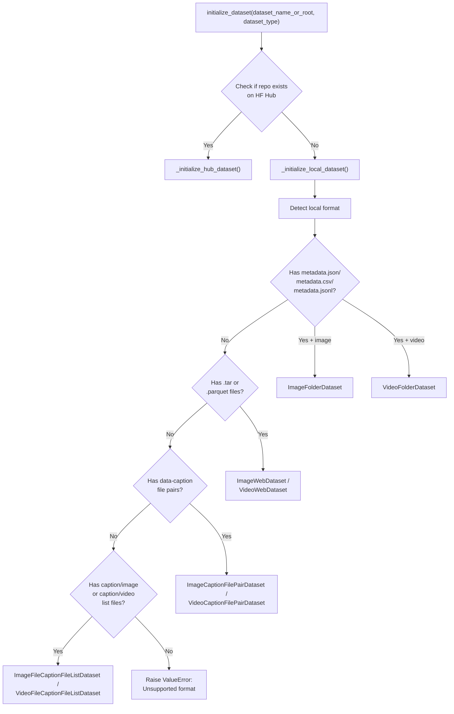
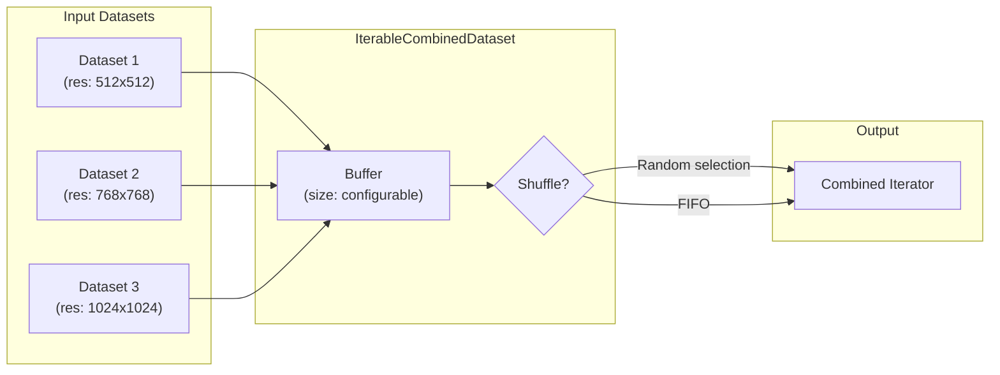
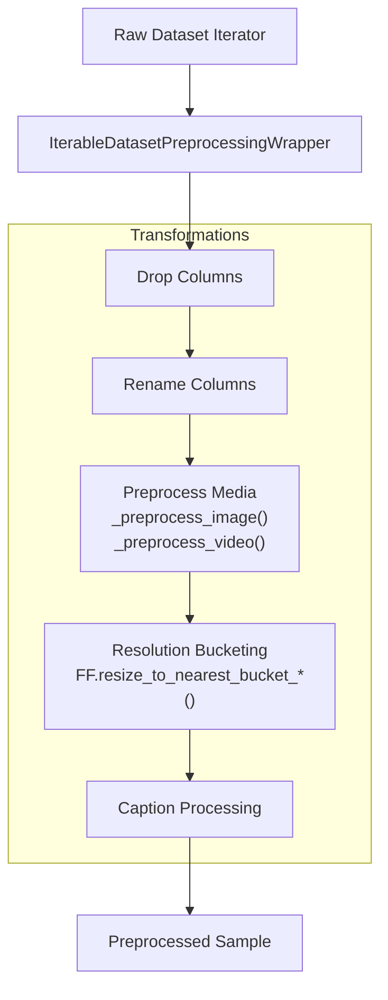
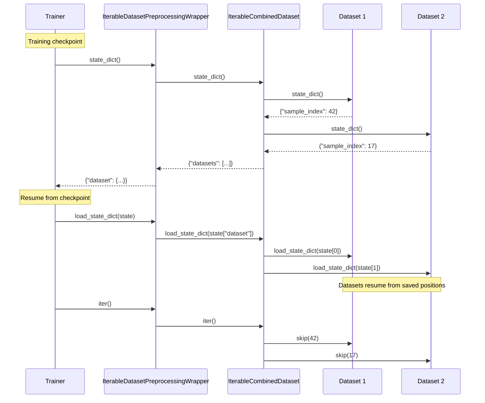

<!-- source: DeepWiki mcp.deepwiki.com · repo huggingface/finetrainers · page 5.1 Dataset Loading · fetched 2026-10-26 -->

# Dataset Loading

<details>
<summary>Relevant source files</summary>

The following files were used as context for generating this wiki page:

- [docs/dataset/README.md](docs/dataset/README.md)
- [docs/models/flux.md](docs/models/flux.md)
- [examples/training/sft/cogview4/raider_white_tarot/training.json](examples/training/sft/cogview4/raider_white_tarot/training.json)
- [examples/training/sft/cogview4/raider_white_tarot/validation.json](examples/training/sft/cogview4/raider_white_tarot/validation.json)
- [examples/training/sft/flux_dev/raider_white_tarot/train.sh](examples/training/sft/flux_dev/raider_white_tarot/train.sh)
- [examples/training/sft/flux_dev/raider_white_tarot/training.json](examples/training/sft/flux_dev/raider_white_tarot/training.json)
- [examples/training/sft/flux_dev/raider_white_tarot/validation.json](examples/training/sft/flux_dev/raider_white_tarot/validation.json)
- [finetrainers/data/__init__.py](finetrainers/data/__init__.py)
- [finetrainers/data/dataset.py](finetrainers/data/dataset.py)
- [finetrainers/data/precomputation.py](finetrainers/data/precomputation.py)
- [finetrainers/functional/image.py](finetrainers/functional/image.py)
- [finetrainers/functional/video.py](finetrainers/functional/video.py)
- [finetrainers/models/cogview4/__init__.py](finetrainers/models/cogview4/__init__.py)
- [finetrainers/models/flux/__init__.py](finetrainers/models/flux/__init__.py)
- [finetrainers/processors/__init__.py](finetrainers/processors/__init__.py)
- [finetrainers/processors/glm.py](finetrainers/processors/glm.py)
- [finetrainers/processors/t5.py](finetrainers/processors/t5.py)
- [tests/data/test_dataset.py](tests/data/test_dataset.py)
- [tests/data/test_precomputation.py](tests/data/test_precomputation.py)

</details>


## Purpose and Scope

This document covers the dataset loading subsystem in finetrainers, which provides the foundation for the data pipeline. Dataset loading is responsible for reading data from various formats (local files, Hugging Face Hub, streaming datasets) and exposing them as iterable datasets that can be consumed by the preprocessing and training systems.

For information about how loaded datasets are preprocessed and bucketed into resolution groups, see [Preprocessing and Resolution Bucketing](#5.2). For details about the precomputation system that caches embeddings, see [Precomputation System](#5.3).

## Overview

The dataset loading system provides a unified interface for loading training and validation data from multiple sources and formats. All datasets are implemented as `torch.utils.data.IterableDataset` instances with checkpoint state management via `torch.distributed.checkpoint.stateful.Stateful`. The system automatically detects dataset formats and dispatches to the appropriate loader implementation.

**Sources:** [finetrainers/data/dataset.py:1-1000](), [docs/dataset/README.md:1-173]()

## Dataset Format Detection and Initialization

### Entry Point: `initialize_dataset`

The primary entry point for dataset loading is the `initialize_dataset` function, which automatically detects the dataset format and returns the appropriate dataset instance.



**Sources:** [finetrainers/data/dataset.py:824-844](), [finetrainers/data/dataset.py:859-920]()

### Detection Logic Details

| Check | Function | Line Reference |
|-------|----------|----------------|
| Hub repository existence | `repo_exists(dataset_name_or_root)` | [finetrainers/data/dataset.py:835-837]() |
| Metadata files | Check for `metadata.json`, `metadata.jsonl`, `metadata.csv` | [finetrainers/data/dataset.py:867-869]() |
| Tar/parquet files | Search for `.tar` or `.parquet` files recursively | [finetrainers/data/dataset.py:881-884]() |
| Data-caption pairs | `_has_data_caption_file_pairs()` | [finetrainers/data/dataset.py:886-890]() |
| File lists | `_has_data_file_caption_file_lists()` | [finetrainers/data/dataset.py:891-895]() |

**Sources:** [finetrainers/data/dataset.py:859-920]()

## Supported Dataset Formats

### Caption-Data File Pairs

**Dataset Classes:** `ImageCaptionFilePairDataset`, `VideoCaptionFilePairDataset`

This format expects pairs of files with matching names but different extensions: a `.txt` file containing the caption and a media file (image or video).

```
dataset/
├── a.txt
├── a.mp4
├── scene_042.txt
├── scene_042.mp4
└── ...
```

**Key Implementation Details:**
- Scans directory for `.txt` files using `find_files()` utility
- For each caption file, searches for corresponding data file using `_find_data_file()`
- Supported image extensions: defined in `constants.SUPPORTED_IMAGE_FILE_EXTENSIONS`
- Supported video extensions: defined in `constants.SUPPORTED_VIDEO_FILE_EXTENSIONS`
- Reads caption content with `_read_caption_from_file()` on iteration
- Validates exactly one data file exists per caption file

**Sources:** [finetrainers/data/dataset.py:44-115](), [finetrainers/data/dataset.py:117-188](), [docs/dataset/README.md:36-56]()

### File List Format

**Dataset Classes:** `ImageFileCaptionFileListDataset`, `VideoFileCaptionFileListDataset`

This format uses two text files: one listing captions (one per line) and one listing data file paths (one per line). The lists must be in corresponding order.

```
dataset/
├── prompts.txt         # or caption.txt, captions.txt, prompt.txt
├── videos.txt          # or video.txt for videos; images.txt, image.txt for images
└── videos/
    ├── 00000.mp4
    ├── 00001.mp4
    └── ...
```

**Valid Caption File Names:**
- `caption.txt`, `captions.txt`, `prompt.txt`, `prompts.txt`

**Valid Data File Names:**
- Images: `image.txt`, `images.txt`
- Videos: `video.txt`, `videos.txt`

**Key Implementation Details:**
- Validates exactly one caption file and one data file exist
- Reads entire file contents into memory during initialization
- Data file paths are relative to the dataset root directory
- Validates caption and data list lengths match
- Converts dataset to HF `datasets.Dataset` with appropriate column casting

**Sources:** [finetrainers/data/dataset.py:190-267](), [finetrainers/data/dataset.py:269-346](), [docs/dataset/README.md:11-35]()

### Folder with Metadata

**Dataset Classes:** `ImageFolderDataset`, `VideoFolderDataset`

This format uses a metadata file (`metadata.csv`, `metadata.json`, or `metadata.jsonl`) that describes the dataset contents. The format follows the Hugging Face `datasets` library conventions for `imagefolder` and `videofolder` datasets.

```
dataset/
├── metadata.csv        # or metadata.json, metadata.jsonl
├── 0.jpg
├── 1.jpg
└── ...
```

**Key Implementation Details:**
- Uses `datasets.load_dataset("imagefolder", ...)` or `datasets.load_dataset("videofolder", ...)`
- Automatically handles metadata parsing and image/video loading
- Supports all formats recognized by HF datasets library

**Sources:** [finetrainers/data/dataset.py:348-383](), [finetrainers/data/dataset.py:385-420](), [docs/dataset/README.md:58-70]()

### WebDataset Format

**Dataset Classes:** `ImageWebDataset`, `VideoWebDataset`

WebDataset is a streaming format designed for large-scale datasets, typically stored as `.tar` archives. This format is commonly used for datasets on the Hugging Face Hub.

**Key Implementation Details:**
- Loads dataset with `datasets.load_dataset(dataset_name, split="train", streaming=True)`
- Supports automatic caption column detection via `COMMON_WDS_CAPTION_COLUMN_NAMES` constant
- Supports weighted sampling from multiple caption columns
- Column names can be specified explicitly or auto-detected
- Caption column weights control sampling probability

**Caption Column Detection:**
```python
# Auto-detect caption columns from this list:
COMMON_WDS_CAPTION_COLUMN_NAMES = [
    "txt", "text", "caption", "captions", "short_caption", "long_caption",
    "prompt", "prompts", "short_prompt", "long_prompt", "description",
    "descriptions", "alt_text", "alt_texts", ...
]
```

**Usage Examples:**

```python
# Auto-detect single caption column
dataset = ImageWebDataset("username/dataset-name", column_names="__auto__")

# Weighted sampling from multiple columns
dataset = VideoWebDataset(
    "username/dataset-name",
    column_names=["short_caption", "long_caption"],
    weights={"short_caption": 0.3, "long_caption": 0.7}
)
```

**Sources:** [finetrainers/data/dataset.py:422-514](), [finetrainers/data/dataset.py:516-607](), [finetrainers/data/dataset.py:36-41](), [docs/dataset/README.md:71-78]()

### Validation Dataset

**Dataset Class:** `ValidationDataset`

Validation datasets are loaded from structured files (CSV, JSON, JSONL, Parquet, Arrow) containing inference prompts and optional reference media paths.

**Required Column:** `caption`

**Optional Columns:**
- `image_path`, `video_path` - paths to reference media for conditional generation
- `control_image_path`, `control_video_path` - paths to control conditioning media
- `num_inference_steps`, `height`, `width`, `num_frames`, `frame_rate` - inference parameters

**Key Implementation Details:**
- Dispatches to appropriate `datasets.load_dataset()` based on file extension
- Creates `prompt` alias for `caption` field for consistency with model specifications
- Loads media files using `diffusers.utils.load_image()` and `diffusers.utils.load_video()`
- Validates file paths and logs warnings for missing files
- Filters out `None` values from output samples

**Supported Formats:**

| Extension | Loader |
|-----------|--------|
| `.csv` | `datasets.load_dataset("csv", ...)` |
| `.json` | `datasets.load_dataset("json", ..., field="data")` |
| `.parquet` | `datasets.load_dataset("parquet", ...)` |
| `.arrow` | `datasets.load_dataset("arrow", ...)` |

**Sources:** [finetrainers/data/dataset.py:609-675](), [docs/dataset/README.md:82-142]()

## Dataset Classes Architecture

```mermaid
classDiagram
    class IterableDataset {
        <<torch.utils.data>>
        +__iter__()
    }
    
    class Stateful {
        <<torch.distributed.checkpoint.stateful>>
        +state_dict()
        +load_state_dict()
    }
    
    class ImageCaptionFilePairDataset {
        +root: Path
        +infinite: bool
        -_data: IterableDataset
        -_sample_index: int
        -_precomputable_once: bool
        +__iter__()
        +state_dict()
        +load_state_dict()
        -_find_data_file()
    }
    
    class ImageFileCaptionFileListDataset {
        +root: Path
        +infinite: bool
        -_data: IterableDataset
        -_sample_index: int
        -_precomputable_once: bool
        +__iter__()
        +state_dict()
        +load_state_dict()
    }
    
    class ImageFolderDataset {
        +root: Path
        +infinite: bool
        -_data: IterableDataset
        -_sample_index: int
        -_precomputable_once: bool
        +__iter__()
        +state_dict()
        +load_state_dict()
    }
    
    class ImageWebDataset {
        +dataset_name: str
        +infinite: bool
        -_data: IterableDataset
        -_sample_index: int
        -_precomputable_once: bool
        -_caption_columns: List[str]
        -_weights: List[float]
        +__iter__()
        +state_dict()
        +load_state_dict()
    }
    
    class VideoCaptionFilePairDataset {
        +root: Path
        +infinite: bool
        -_data: IterableDataset
        -_sample_index: int
        -_precomputable_once: bool
        +__iter__()
        +state_dict()
        +load_state_dict()
        -_find_data_file()
    }
    
    class VideoFileCaptionFileListDataset {
        +root: Path
        +infinite: bool
        -_data: IterableDataset
        -_sample_index: int
        -_precomputable_once: bool
        +__iter__()
        +state_dict()
        +load_state_dict()
    }
    
    class VideoFolderDataset {
        +root: Path
        +infinite: bool
        -_data: IterableDataset
        -_sample_index: int
        -_precomputable_once: bool
        +__iter__()
        +state_dict()
        +load_state_dict()
    }
    
    class VideoWebDataset {
        +dataset_name: str
        +infinite: bool
        -_data: IterableDataset
        -_sample_index: int
        -_precomputable_once: bool
        -_caption_columns: List[str]
        -_weights: List[float]
        +__iter__()
        +state_dict()
        +load_state_dict()
    }
    
    class ValidationDataset {
        +filename: Path
        -_data: IterableDataset
        +__iter__()
    }
    
    IterableDataset <|-- ImageCaptionFilePairDataset
    IterableDataset <|-- ImageFileCaptionFileListDataset
    IterableDataset <|-- ImageFolderDataset
    IterableDataset <|-- ImageWebDataset
    IterableDataset <|-- VideoCaptionFilePairDataset
    IterableDataset <|-- VideoFileCaptionFileListDataset
    IterableDataset <|-- VideoFolderDataset
    IterableDataset <|-- VideoWebDataset
    IterableDataset <|-- ValidationDataset
    
    Stateful <|.. ImageCaptionFilePairDataset
    Stateful <|.. ImageFileCaptionFileListDataset
    Stateful <|.. ImageFolderDataset
    Stateful <|.. ImageWebDataset
    Stateful <|.. VideoCaptionFilePairDataset
    Stateful <|.. VideoFileCaptionFileListDataset
    Stateful <|.. VideoFolderDataset
    Stateful <|.. VideoWebDataset
```



All dataset classes share common patterns:

1. **Infinite Iteration:** When `infinite=True`, datasets loop indefinitely by resetting `_sample_index` to 0 after exhaustion
2. **State Tracking:** `_sample_index` tracks position in the dataset for checkpoint/resume functionality
3. **Precomputation Flag:** `_precomputable_once` indicates if the dataset is small enough (<= 1024 items) for one-time precomputation
4. **Lazy Loading:** All datasets are backed by HF `datasets` library's iterable datasets for memory efficiency
5. **Skip Support:** Uses `dataset.skip(_sample_index)` to resume from checkpoints

**Sources:** [finetrainers/data/dataset.py:44-607]()

## Dataset Combination and Preprocessing Wrapper

### Combining Multiple Datasets

The `combine_datasets` function creates an `IterableCombinedDataset` that interleaves multiple datasets using a buffer-based approach.



**Key Implementation Details:**
- Fills buffer by drawing items from each dataset iterator in round-robin fashion
- Buffer size is configurable via `buffer_size` parameter
- Optional shuffling randomly selects items from buffer
- Without shuffling, uses FIFO (first-in-first-out) order
- When an iterator exhausts, it stops contributing to the buffer
- Iteration continues until all iterators are exhausted and buffer is empty

**Function Signature:**
```python
def combine_datasets(
    datasets: List[torch.utils.data.IterableDataset],
    buffer_size: int,
    shuffle: bool = False
) -> torch.utils.data.IterableDataset
```

**Sources:** [finetrainers/data/dataset.py:776-821](), [finetrainers/data/dataset.py:847-850]()

### Preprocessing Wrapper

The `IterableDatasetPreprocessingWrapper` class wraps a dataset to apply preprocessing transformations including resolution bucketing, caption processing, and column renaming.



**Configuration Parameters:**

| Parameter | Type | Purpose |
|-----------|------|---------|
| `dataset_type` | `str` | `"image"` or `"video"` |
| `id_token` | `str` | Token prepended to captions |
| `image_resolution_buckets` | `List[Tuple[int, int]]` | Available image resolutions |
| `video_resolution_buckets` | `List[Tuple[int, int, int]]` | Available video resolutions (frames, height, width) |
| `rename_columns` | `Dict[str, str]` | Column name mappings |
| `drop_columns` | `List[str]` | Columns to remove |
| `reshape_mode` | `str` | `"bicubic"`, `"center_crop"`, or `"resize_crop"` |
| `remove_common_llm_caption_prefixes` | `bool` | Remove common LLM-generated prefixes |

**Caption Processing:**
1. Handles list captions by selecting first element
2. Converts byte string format (`b'...'`) to regular strings
3. Optionally removes common LLM prefixes from `constants.COMMON_LLM_START_PHRASES`
4. Prepends `id_token` if specified

**Resolution Metadata:**
The wrapper adds original resolution metadata to each sample:
- `_original_num_frames` - original frame count (1 for images)
- `_original_height` - original height in pixels
- `_original_width` - original width in pixels

**Function Signature:**
```python
def wrap_iterable_dataset_for_preprocessing(
    dataset: torch.utils.data.IterableDataset,
    dataset_type: str,
    config: Dict[str, Any]
) -> torch.utils.data.IterableDataset
```

**Sources:** [finetrainers/data/dataset.py:677-774](), [finetrainers/data/dataset.py:853-856]()

## State Management and Checkpointing

All dataset classes (except `ValidationDataset`) implement the `torch.distributed.checkpoint.stateful.Stateful` interface for checkpoint/resume support.

### State Dictionary Structure

```python
# Individual dataset state
{
    "sample_index": int  # Current position in dataset
}

# Combined dataset state
{
    "datasets": [
        {"sample_index": int},  # State of dataset 0
        {"sample_index": int},  # State of dataset 1
        ...
    ]
}

# Preprocessing wrapper state
{
    "dataset": {
        "sample_index": int  # State of wrapped dataset
    }
}
```

### Checkpoint Flow



**Key Implementation Details:**
- `_sample_index` is incremented on each iteration
- `skip()` method is called with `_sample_index` when resuming
- Nested datasets (combined, wrapped) recursively save/load child states
- WebDataset format does not support efficient skip, so resumption may be slow

**Sources:** [finetrainers/data/dataset.py:88-93](), [finetrainers/data/dataset.py:769-773](), [finetrainers/data/dataset.py:815-820]()

## Common Usage Patterns

### Pattern 1: Single Local Dataset

```python
from finetrainers.data import initialize_dataset, wrap_iterable_dataset_for_preprocessing

# Load dataset
dataset = initialize_dataset(
    dataset_name_or_root="/path/to/dataset",
    dataset_type="video",
    infinite=True
)

# Wrap for preprocessing
dataset = wrap_iterable_dataset_for_preprocessing(
    dataset=dataset,
    dataset_type="video",
    config={
        "video_resolution_buckets": [[49, 480, 720], [121, 512, 512]],
        "reshape_mode": "bicubic",
        "id_token": "MYTOKEN",
        "remove_common_llm_caption_prefixes": True
    }
)

# Iterate
for sample in dataset:
    print(sample["caption"], sample["video"].shape)
```

**Sources:** [finetrainers/data/dataset.py:824-856]()

### Pattern 2: Multiple Datasets with Different Resolutions

```python
from finetrainers.data import initialize_dataset, wrap_iterable_dataset_for_preprocessing, combine_datasets

# Load multiple datasets
dataset_512 = initialize_dataset("hf-org/dataset-512", "video", infinite=True)
dataset_768 = initialize_dataset("hf-org/dataset-768", "video", infinite=True)

# Wrap each with different resolution buckets
dataset_512 = wrap_iterable_dataset_for_preprocessing(
    dataset_512, "video",
    config={"video_resolution_buckets": [[49, 512, 512]], "reshape_mode": "center_crop"}
)
dataset_768 = wrap_iterable_dataset_for_preprocessing(
    dataset_768, "video", 
    config={"video_resolution_buckets": [[49, 768, 768]], "reshape_mode": "resize_crop"}
)

# Combine with shuffling
combined = combine_datasets(
    datasets=[dataset_512, dataset_768],
    buffer_size=1000,
    shuffle=True
)
```

**Sources:** [finetrainers/data/dataset.py:847-856](), [examples/training/sft/flux_dev/raider_white_tarot/training.json:1-34]()

### Pattern 3: Validation Dataset

```python
from finetrainers.data import ValidationDataset

# Load validation prompts
validation_dataset = ValidationDataset("validation.json")

# Iterate for inference
for sample in validation_dataset:
    prompt = sample["caption"]  # or sample["prompt"]
    height = sample.get("height", 512)
    width = sample.get("width", 512)
    reference_image = sample.get("image")  # None if not provided
```

**Sources:** [finetrainers/data/dataset.py:609-675](), [examples/training/sft/flux_dev/raider_white_tarot/validation.json:1-68]()

### Pattern 4: Streaming WebDataset from Hub

```python
from finetrainers.data import initialize_dataset

# Auto-detect caption columns
dataset = initialize_dataset(
    "username/large-video-dataset",
    dataset_type="video",
    infinite=True,
    _caption_options={
        "column_names": "__auto__",  # Auto-detect from COMMON_WDS_CAPTION_COLUMN_NAMES
        "weights": -1  # Equal weighting
    }
)

# Or specify weighted caption sampling
dataset = initialize_dataset(
    "username/large-video-dataset",
    dataset_type="video",
    infinite=True,
    _caption_options={
        "column_names": ["short_caption", "long_caption"],
        "weights": {"short_caption": 0.3, "long_caption": 0.7}
    }
)
```

**Sources:** [finetrainers/data/dataset.py:922-957](), [finetrainers/data/dataset.py:422-607]()

## Integration with Training Pipeline

The dataset loading system integrates with the broader training pipeline through the following flow:

```mermaid
flowchart LR
    Config["dataset_config.json"]
    Init["initialize_dataset()"]
    Wrap["wrap_iterable_dataset_for_preprocessing()"]
    Combine["combine_datasets()"]
    Split["Split by DP rank"]
    Preprocessor["Preprocessor<br/>(see page 5.3)"]
    DataLoader["DPDataLoader"]
    
    Config --> Init
    Init --> Wrap
    Wrap --> Combine
    Combine --> Split
    Split --> Preprocessor
    Preprocessor --> DataLoader
    
    style Config fill:#f9f9f9
    style Preprocessor fill:#f9f9f9
    style DataLoader fill:#f9f9f9
```



**Configuration File Format:**

```json
{
  "datasets": [
    {
      "data_root": "username/dataset-name",
      "dataset_type": "video",
      "id_token": "TOKEN",
      "video_resolution_buckets": [[49, 480, 720], [121, 512, 512]],
      "reshape_mode": "bicubic",
      "remove_common_llm_caption_prefixes": true
    }
  ]
}
```

Each entry in the `"datasets"` array creates one dataset that is loaded, wrapped, and then combined with others. The `data_root` is passed to `initialize_dataset()`, while the remaining fields are passed to `wrap_iterable_dataset_for_preprocessing()`.

**Sources:** [examples/training/sft/flux_dev/raider_white_tarot/training.json:1-34](), [examples/training/sft/cogview4/raider_white_tarot/training.json:1-34]()

---

