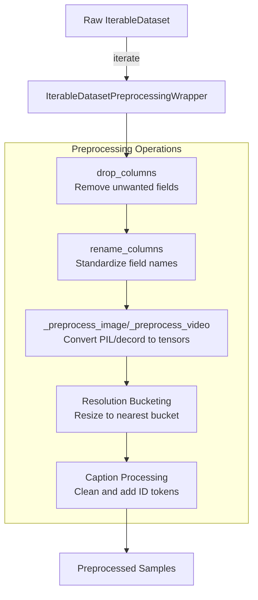
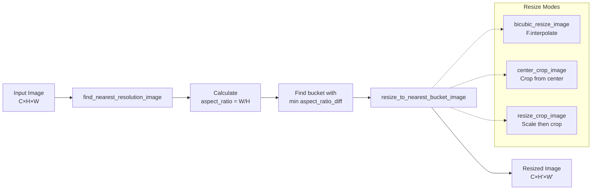
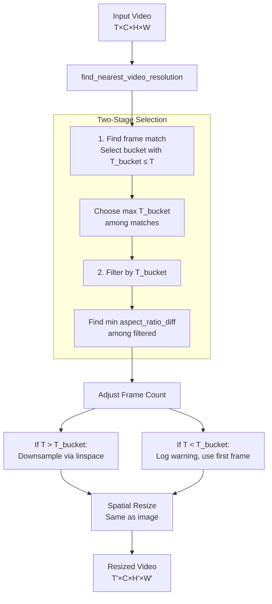
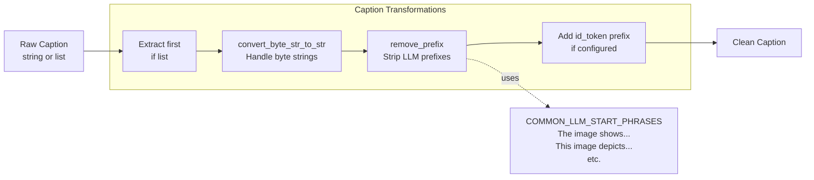
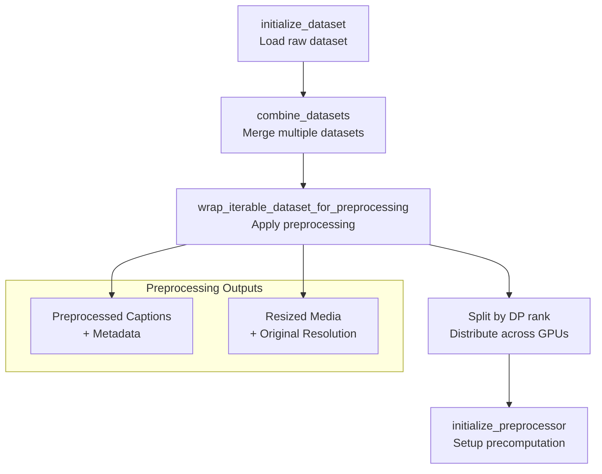

<!-- source: DeepWiki mcp.deepwiki.com · repo huggingface/finetrainers · page 5.2 Preprocessing and Resolution Bucketing · fetched 2026-10-26 -->

# Preprocessing and Resolution Bucketing

<details>
<summary>Relevant source files</summary>

The following files were used as context for generating this wiki page:

- [.gitignore](.gitignore)
- [README.md](README.md)
- [docs/dataset/README.md](docs/dataset/README.md)
- [examples/training/sft/cogview4/raider_white_tarot/training.json](examples/training/sft/cogview4/raider_white_tarot/training.json)
- [examples/training/sft/cogview4/raider_white_tarot/validation.json](examples/training/sft/cogview4/raider_white_tarot/validation.json)
- [finetrainers/data/__init__.py](finetrainers/data/__init__.py)
- [finetrainers/data/dataset.py](finetrainers/data/dataset.py)
- [finetrainers/data/precomputation.py](finetrainers/data/precomputation.py)
- [finetrainers/functional/__init__.py](finetrainers/functional/__init__.py)
- [finetrainers/functional/image.py](finetrainers/functional/image.py)
- [finetrainers/functional/text.py](finetrainers/functional/text.py)
- [finetrainers/functional/video.py](finetrainers/functional/video.py)
- [finetrainers/models/cogview4/__init__.py](finetrainers/models/cogview4/__init__.py)
- [finetrainers/processors/__init__.py](finetrainers/processors/__init__.py)
- [finetrainers/processors/glm.py](finetrainers/processors/glm.py)
- [tests/data/test_dataset.py](tests/data/test_dataset.py)
- [tests/data/test_precomputation.py](tests/data/test_precomputation.py)

</details>


This page documents the preprocessing and resolution bucketing system in finetrainers. Preprocessing transforms raw dataset samples (images/videos with captions) into a standardized format suitable for training, while resolution bucketing enables efficient batching of variable-resolution media by resizing them to predefined resolution buckets.

For information about loading datasets before preprocessing, see [Dataset Loading](#5.1). For information about how preprocessed data is cached and consumed during training, see [Precomputation System](#5.3).

---

## Overview

The preprocessing system performs three primary functions:

1. **Resolution Bucketing**: Resizes images and videos to fit into predefined resolution buckets, enabling efficient batching of variable-resolution media
2. **Caption Processing**: Cleans and standardizes text captions (removing common LLM prefixes, handling byte strings, adding ID tokens)
3. **Metadata Tracking**: Preserves original resolution information for potential restoration or analysis

All preprocessing is performed lazily as data is iterated, making it memory-efficient for large datasets.

**Sources:** [finetrainers/data/dataset.py:677-774](), [docs/dataset/README.md:144-161]()

---

## IterableDatasetPreprocessingWrapper

The `IterableDatasetPreprocessingWrapper` class is the main preprocessing component that wraps any iterable dataset and applies transformations on-the-fly.


**Diagram: Preprocessing Pipeline Flow**

### Configuration Parameters

The wrapper is configured via `wrap_iterable_dataset_for_preprocessing()` with the following parameters:

| Parameter | Type | Description |
|-----------|------|-------------|
| `dataset` | `torch.utils.data.IterableDataset` | The raw dataset to wrap |
| `dataset_type` | `str` | Either `"image"` or `"video"` |
| `id_token` | `str` or `None` | Token to prepend to captions (e.g., for concept learning) |
| `image_resolution_buckets` | `List[Tuple[int, int]]` | Height, width pairs for image buckets |
| `video_resolution_buckets` | `List[Tuple[int, int, int]]` | Frames, height, width triples for video buckets |
| `rename_columns` | `Dict[str, str]` | Column name mappings |
| `drop_columns` | `List[str]` | Columns to remove from samples |
| `reshape_mode` | `str` | Resize method: `"bicubic"`, `"center_crop"`, or `"resize_crop"` |
| `remove_common_llm_caption_prefixes` | `bool` | Whether to strip common LLM response prefixes |

**Sources:** [finetrainers/data/dataset.py:677-714](), [finetrainers/data/__init__.py:15]()

### Processing Flow

The wrapper's `__iter__` method processes each sample:

1. **Column Operations**: Drops unwanted columns and renames others for standardization
2. **Media Conversion**: Converts PIL Images or decord/torchvision video readers to tensors
3. **Resolution Bucketing**: Resizes media to nearest bucket, storing original dimensions
4. **Caption Processing**: Cleans caption text and optionally adds ID token

**Sources:** [finetrainers/data/dataset.py:716-767]()

---

## Resolution Bucketing for Images

Resolution bucketing for images involves finding the closest aspect ratio match from predefined buckets and resizing accordingly.


**Diagram: Image Resolution Bucketing Algorithm**

### Bucket Selection Algorithm

The `find_nearest_resolution_image()` function selects the optimal bucket:

1. Calculate input image aspect ratio: `aspect_ratio = width / height`
2. For each bucket, compute aspect ratio difference: `|bucket_width / bucket_height - aspect_ratio|`
3. Select bucket with minimum difference
4. On ties, prefer larger resolution (secondary sort by `-height, -width`)

**Sources:** [finetrainers/functional/image.py:30-37]()

### Resize Modes

Three resize modes are supported:

| Mode | Function | Description |
|------|----------|-------------|
| `bicubic` | `bicubic_resize_image` | Bicubic interpolation to target size |
| `center_crop` | `center_crop_image` | Crop center region to target size (no scaling) |
| `resize_crop` | `resize_crop_image` | Scale to cover target, then center crop |

**Bicubic** is the default and most commonly used, preserving aspect ratio while resizing. **Center crop** works only if the input is already larger than the target. **Resize crop** ensures the entire target area is filled by first scaling.

**Sources:** [finetrainers/functional/image.py:7-56]()

### Example Configuration

```python
# From training.json config
{
  "image_resolution_buckets": [
    [512, 512],    # Square
    [768, 768],    # Larger square
    [1280, 720]    # Widescreen
  ],
  "reshape_mode": "bicubic"
}
```

The preprocessor will resize each image to the nearest bucket based on aspect ratio.

**Sources:** [examples/training/sft/cogview4/raider_white_tarot/training.json:7-9]()

---

## Resolution Bucketing for Videos

Video resolution bucketing is more complex than images because it must consider both spatial dimensions and temporal (frame count) dimensions.


**Diagram: Video Resolution Bucketing Algorithm**

### Two-Stage Bucket Selection

The `find_nearest_video_resolution()` function uses a two-stage selection process:

**Stage 1: Frame Matching**
1. Filter buckets to those with `num_frames <= input_num_frames`
2. Select the bucket with maximum frame count among matches
3. If no matches exist (all buckets have more frames), select bucket with closest frame count

**Stage 2: Aspect Ratio Matching**
1. Filter all buckets to those matching the selected frame count
2. Among these, select the bucket with closest aspect ratio (same as images)

This ensures that temporal resolution is prioritized, then spatial aspect ratio.

**Sources:** [finetrainers/functional/video.py:32-49]()

### Frame Count Adjustment

After bucket selection, frame counts are adjusted:

- **Downsampling** (`num_frames > target_frames`): Select evenly-spaced frames using `torch.linspace`
- **Insufficient frames** (`num_frames < target_frames`): Log warning and use only the first frame (becomes single-frame video)

The warning for insufficient frames is logged at the first occurrence and then every 128th occurrence to avoid spam.

**Sources:** [finetrainers/functional/video.py:76-85](), [finetrainers/data/dataset.py:739-754]()

### Spatial Resize Modes

Once frame counts are adjusted, spatial resizing uses the same three modes as images:

- `bicubic_resize_video`: Applies bicubic interpolation per frame
- `center_crop_video`: Crops center region per frame
- `resize_crop_video`: Scales then crops per frame

**Sources:** [finetrainers/functional/video.py:7-96]()

### Example Configuration

```python
# Video resolution buckets
{
  "video_resolution_buckets": [
    [49, 512, 768],   # 49 frames, 512x768
    [121, 720, 1280], # 121 frames, 720x1280
    [161, 512, 704]   # 161 frames, 512x704
  ],
  "reshape_mode": "bicubic"
}
```

A video with 100 frames and 1920×1080 resolution would:
1. Match the 49-frame bucket (closest without exceeding)
2. Within 49-frame buckets, match 512×768 based on aspect ratio
3. Downsample from 100 to 49 frames via linear interpolation
4. Resize from 1080×1920 to 512×768 via bicubic interpolation

**Sources:** [finetrainers/data/dataset.py:699-700](), [finetrainers/functional/video.py:52-96]()

---

## Caption Processing

Caption processing standardizes and enhances text captions before they are tokenized.


**Diagram: Caption Processing Pipeline**

### Processing Steps

The caption processing pipeline in `IterableDatasetPreprocessingWrapper.__iter__`:

1. **List Handling**: If caption is a list, extract first element
2. **Byte String Conversion**: Convert stringified bytes (e.g., `"b'hello'"`) to normal strings
3. **LLM Prefix Removal**: Remove common LLM response prefixes if `remove_common_llm_caption_prefixes=True`
4. **ID Token Prepending**: Add ID token prefix if `id_token` is configured

**Sources:** [finetrainers/data/dataset.py:756-765]()

### Common LLM Prefixes

The system can strip common prefixes added by LLMs when generating captions. These are defined in `constants.COMMON_LLM_START_PHRASES` and include patterns like:
- "The image shows..."
- "This image depicts..."
- "The video shows..."
- And other common LLM phrasing patterns

This is useful when using LLM-generated captions, as these prefixes add no semantic value.

**Sources:** [finetrainers/data/dataset.py:762](), [finetrainers/functional/text.py:36-40]()

### ID Token for Concept Learning

The `id_token` parameter enables concept learning by prepending a unique token to all captions. For example:

```python
# Configuration
{
  "id_token": "TRTCRD",
  ...
}

# Input caption:
"a knight mounting a running horse"

# Processed caption:
"TRTCRD a knight mounting a running horse"
```

This is commonly used for DreamBooth-style training where you want the model to associate a specific token with a concept.

**Sources:** [finetrainers/data/dataset.py:763-764](), [examples/training/sft/cogview4/raider_white_tarot/training.json:6]()

---

## Metadata Preservation

The preprocessor preserves original resolution information for each sample by adding metadata fields:

| Field | Type | Description |
|-------|------|-------------|
| `_original_num_frames` | `int` | Original frame count (1 for images) |
| `_original_height` | `int` | Original height in pixels |
| `_original_width` | `int` | Original width in pixels |

These fields are prefixed with `_` to distinguish them from user data and are included in the output sample dictionary. This metadata can be useful for:
- Tracking resolution distribution in datasets
- Debugging preprocessing issues
- Conditional training based on original resolution

**Sources:** [finetrainers/data/dataset.py:732-742]()

---

## Integration with Training Pipeline

The preprocessing wrapper is integrated into the training pipeline between dataset loading and precomputation:


**Diagram: Preprocessing in Training Pipeline**

### Instantiation

The preprocessing wrapper is created via `wrap_iterable_dataset_for_preprocessing()`:

```python
def wrap_iterable_dataset_for_preprocessing(
    dataset: torch.utils.data.IterableDataset,
    dataset_type: str,
    config: Dict[str, Any]
) -> torch.utils.data.IterableDataset:
    return IterableDatasetPreprocessingWrapper(dataset, dataset_type, **config)
```

The `config` dictionary typically comes from the `dataset_config.json` or training arguments.

**Sources:** [finetrainers/data/dataset.py:853-856](), [finetrainers/data/__init__.py:15]()

### Stateful Checkpointing

The wrapper implements the `torch.distributed.checkpoint.stateful.Stateful` interface, enabling checkpoint resumption. It maintains state by delegating to the underlying dataset:

- `state_dict()`: Returns wrapped dataset's state
- `load_state_dict()`: Restores wrapped dataset's state

This ensures that training can resume from the exact same data sample even after preprocessing transformations.

**Sources:** [finetrainers/data/dataset.py:769-773]()

---

## Configuration Examples

### Multi-Resolution Image Training

```json
{
  "datasets": [
    {
      "data_root": "my-dataset",
      "dataset_type": "image",
      "id_token": "MYTOKEN",
      "image_resolution_buckets": [
        [1280, 720],
        [512, 512],
        [768, 768]
      ],
      "reshape_mode": "bicubic",
      "remove_common_llm_caption_prefixes": true
    }
  ]
}
```

This configuration:
- Loads images from `my-dataset`
- Prepends `MYTOKEN` to all captions
- Supports three resolution buckets
- Uses bicubic interpolation for resizing
- Removes common LLM caption prefixes

**Sources:** [examples/training/sft/cogview4/raider_white_tarot/training.json:1-34]()

### Multi-Resolution Video Training

```json
{
  "datasets": [
    {
      "data_root": "my-video-dataset",
      "dataset_type": "video",
      "video_resolution_buckets": [
        [49, 512, 768],
        [121, 720, 1280]
      ],
      "reshape_mode": "center_crop",
      "rename_columns": {
        "text": "caption"
      },
      "drop_columns": ["metadata", "tags"]
    }
  ]
}
```

This configuration:
- Loads videos from `my-video-dataset`
- Supports two temporal-spatial resolution buckets
- Uses center crop for resizing (requires videos larger than target)
- Renames `text` column to `caption`
- Drops `metadata` and `tags` columns

---

## Implementation Notes

### Memory Efficiency

The preprocessing system is designed for memory efficiency:

1. **Lazy Evaluation**: All transformations are applied lazily during iteration, not upfront
2. **No Buffering**: Preprocessed samples are not buffered; they flow directly to precomputation or training
3. **Tensor Reuse**: Resizing operations are performed in-place when possible

### Error Handling

The system includes logging for common edge cases:

- **Insufficient Frames**: When a video has fewer frames than the minimum bucket size, a warning is logged (throttled to avoid spam)
- **Aspect Ratio Mismatches**: Logged at debug level when the chosen bucket differs significantly from input aspect ratio

**Sources:** [finetrainers/data/dataset.py:747-754]()

### Performance Considerations

Resolution bucketing adds computational overhead during iteration. For optimal performance:

- **Precomputation**: Enable precomputation to perform resize operations once and cache results
- **Bucket Count**: Use fewer buckets to reduce aspect ratio matching overhead
- **Resize Mode**: Bicubic is slower than center crop but produces better quality

---

**Summary**: The preprocessing and resolution bucketing system transforms raw dataset samples into a standardized format suitable for training. It handles variable-resolution media by resizing to predefined buckets, processes captions by cleaning and adding ID tokens, and preserves metadata for analysis. The system is designed to be memory-efficient through lazy evaluation and integrates seamlessly with the broader data pipeline.

---

