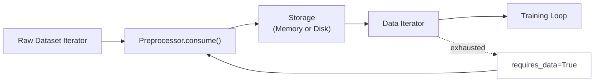
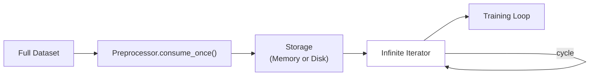
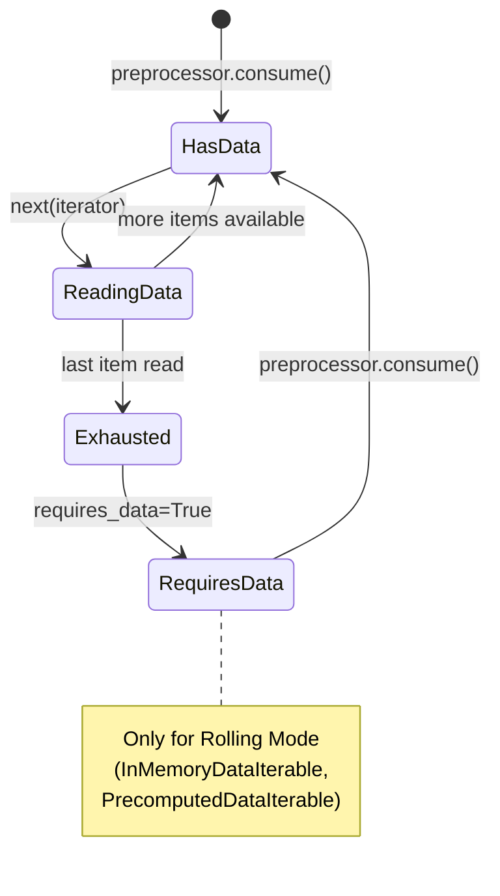
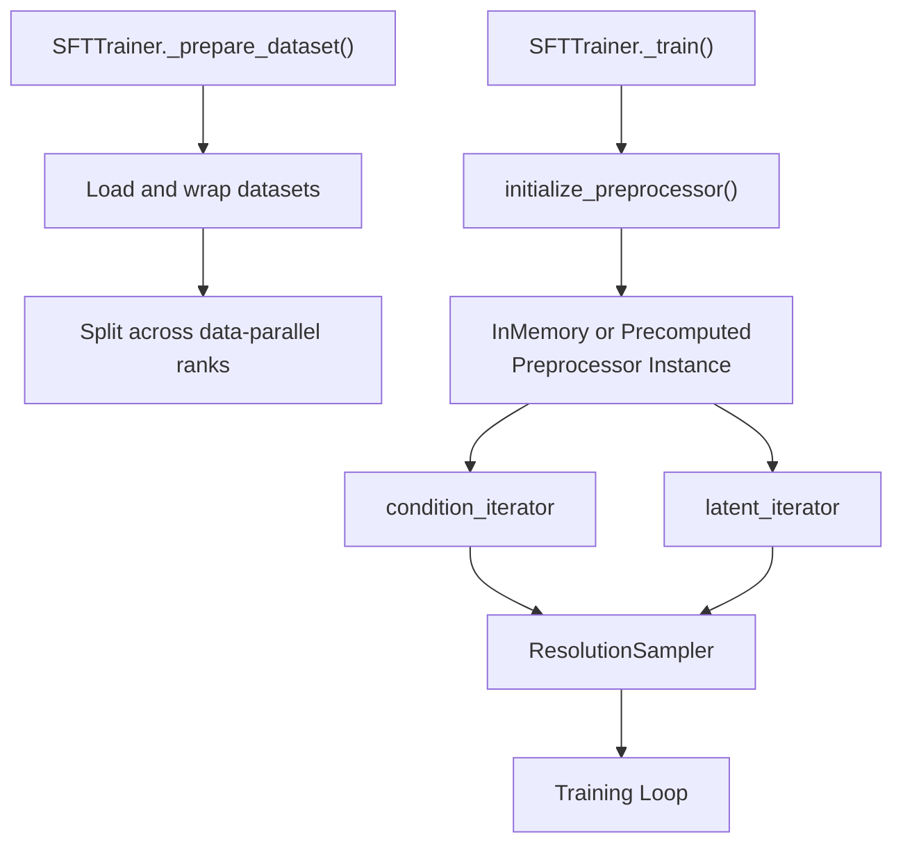
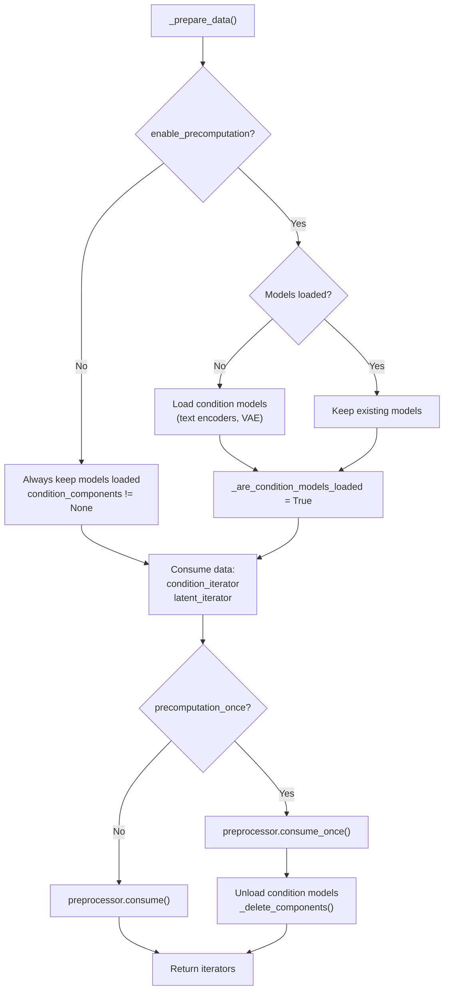
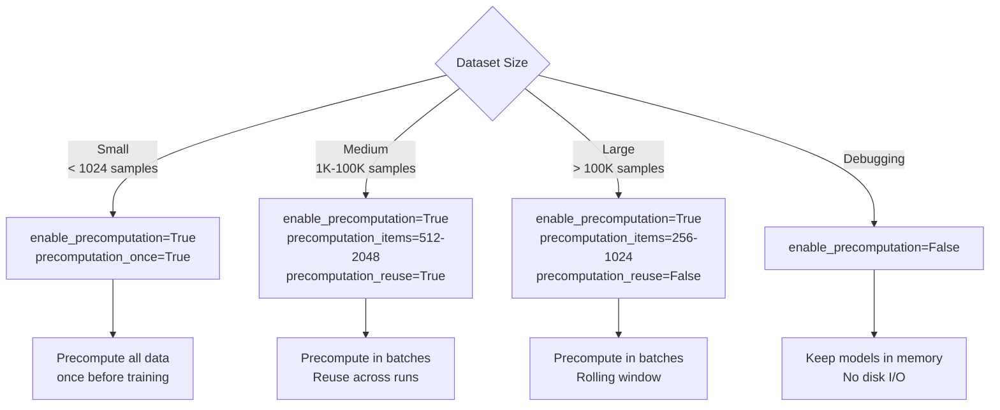

<!-- source: DeepWiki mcp.deepwiki.com · repo huggingface/finetrainers · page 5.3 Precomputation System · fetched 2026-10-26 -->

# Precomputation System

<details>
<summary>Relevant source files</summary>

The following files were used as context for generating this wiki page:

- [.gitignore](.gitignore)
- [README.md](README.md)
- [docs/dataset/README.md](docs/dataset/README.md)
- [finetrainers/args.py](finetrainers/args.py)
- [finetrainers/data/__init__.py](finetrainers/data/__init__.py)
- [finetrainers/data/dataset.py](finetrainers/data/dataset.py)
- [finetrainers/data/precomputation.py](finetrainers/data/precomputation.py)
- [finetrainers/functional/__init__.py](finetrainers/functional/__init__.py)
- [finetrainers/functional/text.py](finetrainers/functional/text.py)
- [finetrainers/trainer/sft_trainer/trainer.py](finetrainers/trainer/sft_trainer/trainer.py)
- [tests/data/test_dataset.py](tests/data/test_dataset.py)
- [tests/data/test_precomputation.py](tests/data/test_precomputation.py)

</details>


The precomputation system enables memory-efficient training by preprocessing and caching model inputs (text embeddings and image/video latents) prior to or during training. This allows conditioning models (text encoders, VAE) to be offloaded from GPU memory during the main training loop, reducing peak VRAM requirements substantially.

**Scope**: This page documents the preprocessing and caching infrastructure. For dataset loading mechanics, see [Dataset Loading](#5.1). For resolution bucketing and collation, see [Preprocessing and Resolution Bucketing](#5.2).

---

## Architecture Overview

The precomputation system consists of four main components: preprocessor factories, data preprocessors, data iterables, and storage backends.

**Precomputation System Architecture**

```mermaid
graph TB
    subgraph "Factory Layer"
        InitPreprocessor["initialize_preprocessor()"]
    end
    
    subgraph "Preprocessor Implementations"
        InMemory["InMemoryDistributedDataPreprocessor"]
        Precomputed["PrecomputedDistributedDataPreprocessor"]
    end
    
    subgraph "Data Iterables"
        InMemoryIter["InMemoryDataIterable"]
        InMemoryOnceIter["InMemoryOnceDataIterable"]
        PrecomputedIter["PrecomputedDataIterable"]
        PrecomputedOnceIter["PrecomputedOnceDataIterable"]
    end
    
    subgraph "Storage"
        Memory["InMemoryDataBuffer"]
        Disk["Disk Storage<br/>.pt files"]
    end
    
    subgraph "Processing Functions"
        ConditionFn["prepare_conditions()"]
        LatentFn["prepare_latents()"]
    end
    
    InitPreprocessor -->|enable_precomputation=False| InMemory
    InitPreprocessor -->|enable_precomputation=True| Precomputed
    
    InMemory -->|consume()| InMemoryIter
    InMemory -->|consume_once()| InMemoryOnceIter
    Precomputed -->|consume()| PrecomputedIter
    Precomputed -->|consume_once()| PrecomputedOnceIter
    
    InMemoryIter --> Memory
    InMemoryOnceIter --> Memory
    PrecomputedIter --> Disk
    PrecomputedOnceIter --> Disk
    
    InMemory -.uses.-> ConditionFn
    InMemory -.uses.-> LatentFn
    Precomputed -.uses.-> ConditionFn
    Precomputed -.uses.-> LatentFn
```

Sources: [finetrainers/data/precomputation.py:16-29](), [finetrainers/data/precomputation.py:44-260]()

---

## Preprocessor Types

The system provides two preprocessor implementations selected via `initialize_preprocessor()` based on the `enable_precomputation` flag.

### InMemoryDistributedDataPreprocessor

Processes data on-the-fly and stores results in an in-memory buffer (`InMemoryDataBuffer`). This preprocessor maintains conditioning models in GPU memory throughout training.

| Property | Value |
|----------|-------|
| Class | `InMemoryDistributedDataPreprocessor` |
| Storage | RAM buffer with configurable limit |
| Use Case | Small datasets, debugging, or when VRAM is abundant |
| Methods | `consume()`, `consume_once()` |

**Key characteristics**:
- Buffer capacity controlled by `num_items` parameter
- Data cycles through buffer when using `consume_once()`
- Models remain in memory during training

### PrecomputedDistributedDataPreprocessor

Processes data and saves to disk as PyTorch `.pt` files. Allows conditioning models to be unloaded after preprocessing, significantly reducing GPU memory consumption.

| Property | Value |
|----------|-------|
| Class | `PrecomputedDistributedDataPreprocessor` |
| Storage | Disk (`.pt` files in `{save_dir}/finetrainers-precomputed-data/`) |
| Use Case | Large datasets, memory-constrained training |
| File Format | `{data_type}-{index}.pt` |

**Key characteristics**:
- Files saved to `{save_dir}/finetrainers-precomputed-data/`
- Each preprocessed item stored as `{data_type}-{rank*num_items + i}.pt`
- Supports reuse across training runs with `enable_reuse=True`
- Automatically cleans up old precomputed data unless reuse is enabled

Sources: [finetrainers/data/precomputation.py:44-133](), [finetrainers/data/precomputation.py:135-260](), [finetrainers/data/precomputation.py:13]()

---

## Processing Modes

Both preprocessor types support two processing modes: rolling (on-the-fly) and once (precompute-all).

### Rolling Mode (consume)

Processes `num_items` samples at a time. When exhausted, sets `requires_data=True` to signal that new data should be preprocessed.

**Rolling Mode Data Flow**



**Usage pattern**:
```python
preprocessor = initialize_preprocessor(
    rank=0, world_size=1, num_items=512,
    processor_fn={"condition": fn, "latent": fn},
    enable_precomputation=True
)

# First batch
condition_iter = preprocessor.consume("condition", components, data_iterator)
latent_iter = preprocessor.consume("latent", components, data_iterator)

# When preprocessor.requires_data == True, repeat the consume calls
```

### Once Mode (consume_once)

Processes all data upfront and cycles through it indefinitely. Never sets `requires_data=True`.

**Once Mode Data Flow**



**Usage pattern**:
```python
preprocessor = initialize_preprocessor(
    rank=0, world_size=1, num_items=1024,
    processor_fn={"condition": fn, "latent": fn},
    enable_precomputation=True
)

# Preprocess all data once
condition_iter = preprocessor.consume_once("condition", components, data_iterator)
latent_iter = preprocessor.consume_once("latent", components, data_iterator)

# Iterator cycles indefinitely, never requires more data
```

**Limitations**:
- Only supported for datasets with `_precomputable_once=True`
- Hardcoded limit of 1024 items (`MAX_PRECOMPUTABLE_ITEMS_LIMIT`)
- Not supported for `WebDataset` formats

Sources: [finetrainers/data/precomputation.py:58-126](), [finetrainers/data/precomputation.py:175-253](), [finetrainers/data/dataset.py:36]()

---

## Data Iterables

Four iterator classes manage reading preprocessed data:

| Iterator | Storage | Mode | Behavior |
|----------|---------|------|----------|
| `InMemoryDataIterable` | Memory | Rolling | Reads from buffer, sets `requires_data=True` when exhausted |
| `InMemoryOnceDataIterable` | Memory | Once | Cycles through buffer indefinitely |
| `PrecomputedDataIterable` | Disk | Rolling | Loads `.pt` files, sets `requires_data=True` when exhausted |
| `PrecomputedOnceDataIterable` | Disk | Once | Cycles through `.pt` files indefinitely |

**Iterator State Management**



**Once mode iterators** (`InMemoryOnceDataIterable`, `PrecomputedOnceDataIterable`) implement infinite cycling:

```python
def __iter__(self) -> Iterable[Dict[str, Any]]:
    assert len(self) > 0
    while True:
        item = self._buffer.get(self._data_type)
        yield item
        self._buffer.add(self._data_type, item)  # Re-add after yielding
```

Sources: [finetrainers/data/precomputation.py:262-386](), [finetrainers/data/precomputation.py:304-310]()

---

## Integration with Training

The trainer integrates the precomputation system during the `_prepare_dataset()` and `_train()` phases.

### Initialization in SFTTrainer

**Preprocessor Initialization Flow**



**Initialization code** [finetrainers/trainer/sft_trainer/trainer.py:374-388]():

```python
compute_posterior = False if args.enable_precomputation else (not args.precomputation_once)
preprocessor = data.initialize_preprocessor(
    rank=parallel_backend.rank,
    world_size=parallel_backend.world_size,
    num_items=args.precomputation_items if args.enable_precomputation else 1,
    processor_fn={
        "condition": model_specification.prepare_conditions,
        "latent": functools.partial(
            model_specification.prepare_latents, compute_posterior=compute_posterior
        ),
    },
    save_dir=args.precomputation_dir,
    enable_precomputation=args.enable_precomputation,
    enable_reuse=args.precomputation_reuse,
)
```

### Data Consumption in Training Loop

The training loop checks `preprocessor.requires_data` and calls `_prepare_data()` when new preprocessing is needed.

**Training Loop Integration** [finetrainers/trainer/sft_trainer/trainer.py:397-424]():

```python
while train_state.step < args.train_steps:
    # 1. Load & preprocess data if required
    if preprocessor.requires_data:
        condition_iterator, latent_iterator = self._prepare_data(preprocessor, data_iterator)
    
    # 2. Prepare batch
    try:
        condition_item = next(condition_iterator)
        latent_item = next(latent_iterator)
        sampler.consume(condition_item, latent_item)
    except StopIteration:
        logger.info("Data exhausted. Exiting training loop.")
        break
    
    if sampler.is_ready:
        condition_batch, latent_batch = sampler.get_batch()
        condition_model_conditions = model_specification.collate_conditions(condition_batch)
        latent_model_conditions = model_specification.collate_latents(latent_batch)
```

### _prepare_data Implementation

The `_prepare_data()` method handles conditional model loading and preprocessing strategy.

**_prepare_data Method Structure**



Implementation details [finetrainers/trainer/sft_trainer/trainer.py:820-890]():

1. **Load condition models** if `enable_precomputation=True` and models not already loaded
2. **Call consume/consume_once** with model components and caching flags
3. **Unload models** if `precomputation_once=True` to free GPU memory
4. **Return iterators** for condition and latent data

Sources: [finetrainers/trainer/sft_trainer/trainer.py:236-275](), [finetrainers/trainer/sft_trainer/trainer.py:328-424](), [finetrainers/trainer/sft_trainer/trainer.py:820-890]()

---

## Configuration Arguments

The precomputation system is controlled by five arguments in `BaseArgs`:

| Argument | Type | Default | Description |
|----------|------|---------|-------------|
| `enable_precomputation` | `bool` | `False` | Enable disk-based precomputation |
| `precomputation_items` | `int` | `512` | Number of samples to precompute per batch |
| `precomputation_dir` | `str` | `None` | Directory for precomputed files (defaults to `{output_dir}/precomputed`) |
| `precomputation_once` | `bool` | `False` | Precompute all data once at start |
| `precomputation_reuse` | `bool` | `False` | Reuse existing precomputed data from previous runs |

**Configuration decision tree**:



**Memory vs Disk trade-offs**:

| Scenario | VRAM Impact | Disk Impact | Config |
|----------|-------------|-------------|--------|
| No precomputation | High (all models loaded) | None | `enable_precomputation=False` |
| Memory precomputation | High (all models loaded) | None | `enable_precomputation=False` |
| Disk precomputation (rolling) | Low (models loaded periodically) | Medium (temp files) | `enable_precomputation=True, precomputation_once=False` |
| Disk precomputation (once) | Low (models loaded once) | High (all embeddings stored) | `enable_precomputation=True, precomputation_once=True` |

Sources: [finetrainers/args.py:190-211](), [docs/dataset/README.md:163-173]()

---

## File Storage Format

When `enable_precomputation=True`, preprocessed data is saved to disk with a specific directory structure.

**Storage Directory Structure**

```
{output_dir}/
└── precomputed/  # or custom precomputation_dir
    └── finetrainers-precomputed-data/
        ├── condition-0.pt
        ├── condition-1.pt
        ├── condition-N.pt
        ├── latent-0.pt
        ├── latent-1.pt
        └── latent-N.pt
```

**File naming convention**:
- Format: `{data_type}-{global_index}.pt`
- `data_type`: Either `"condition"` or `"latent"`
- `global_index`: `rank * num_items + local_index`

**File I/O operations** [finetrainers/data/precomputation.py:413-420]():

```python
def _save_item(item: Dict[str, Any], index: int, directory: pathlib.Path, data_type: str):
    filename = directory / f"{data_type}-{index}.pt"
    torch.save(item, filename.as_posix())

def _load_item(index: int, directory: pathlib.Path, data_type: str, map_location=None):
    filename = directory / f"{data_type}-{index}.pt"
    return torch.load(filename.as_posix(), map_location=map_location, weights_only=True)
```

**Distributed storage**: Each rank saves its portion of preprocessed data with non-overlapping indices, enabling parallel preprocessing.

Sources: [finetrainers/data/precomputation.py:13](), [finetrainers/data/precomputation.py:413-420](), [finetrainers/data/precomputation.py:194-204]()

---

## Advanced Usage Patterns

### Reusing Precomputed Data

When training multiple times on the same dataset, set `precomputation_reuse=True` to skip preprocessing:

```python
# First training run
python train.py --enable_precomputation --precomputation_dir ./precomputed

# Subsequent runs reuse embeddings
python train.py --enable_precomputation --precomputation_dir ./precomputed --precomputation_reuse
```

**Reuse validation** [finetrainers/data/precomputation.py:157-173]():
- Directory must exist when `enable_reuse=True`
- System checks for presence of `.pt` files
- Throws error if directory doesn't exist or is empty

### Caching Strategy for consume()

The `consume()` method supports three caching flags for memory optimization:

| Flag | Purpose | Use Case |
|------|---------|----------|
| `cache_samples=True` | Store raw samples before processing | When processing conditions and latents from same samples |
| `use_cached_samples=True` | Use previously cached raw samples | Second processing pass (latents after conditions) |
| `drop_samples=True` | Clear cache after processing | Free memory after both passes complete |

**Typical usage pattern** [tests/data/test_precomputation.py:101-106]():

```python
# First pass: process conditions and cache raw samples
condition_iterator = preprocessor.consume(
    "condition", components={}, data_iterator=data_iterator, cache_samples=True
)

# Second pass: process latents using cached samples, then drop cache
latent_iterator = preprocessor.consume(
    "latent", components={}, data_iterator=data_iterator, 
    use_cached_samples=True, drop_samples=True
)
```

### Custom Processor Functions

Processor functions receive sample data and model components, returning processed data:

```python
def custom_condition_processor(caption, tokenizer, text_encoder, generator=None, **kwargs):
    # Tokenize and encode
    tokens = tokenizer(caption, return_tensors="pt")
    embeddings = text_encoder(**tokens)
    return {"embeddings": embeddings, "caption": caption}

def custom_latent_processor(video, vae, compute_posterior=True, generator=None, **kwargs):
    # Encode to latent space
    latents = vae.encode(video).latent_dist
    if compute_posterior:
        latents = latents.sample(generator=generator)
    else:
        latents = latents.mode()
    return {"latents": latents}

preprocessor = initialize_preprocessor(
    rank=0, world_size=1, num_items=512,
    processor_fn={
        "condition": custom_condition_processor,
        "latent": custom_latent_processor,
    },
    enable_precomputation=True
)
```

Sources: [finetrainers/data/precomputation.py:58-91](), [finetrainers/data/precomputation.py:175-214](), [tests/data/test_precomputation.py:55-67](), [finetrainers/trainer/sft_trainer/trainer.py:820-890]()

---

## Implementation Details

### InMemoryDataBuffer

The in-memory buffer maintains a dictionary of lists per data type with optional capacity limiting.

**Buffer operations** [finetrainers/data/precomputation.py:388-410]():

```python
class InMemoryDataBuffer:
    def __init__(self, max_limit: int = -1):
        self.max_limit = max_limit
        self.buffer: Dict[str, List[str]] = {}
    
    def add(self, data_type: str, item: Dict[str, Any]):
        if data_type not in self.buffer:
            self.buffer[data_type] = []
        if self.max_limit != -1 and len(self.buffer[data_type]) >= self.max_limit:
            self.buffer[data_type].pop(0)  # Drop oldest item
        self.buffer[data_type].append(item)
    
    def get(self, data_type: str):
        return self.buffer[data_type].pop(0)
```

### Distributed Preprocessing

Each rank preprocesses `num_items` samples independently. The global index ensures non-overlapping file names:

```
Rank 0: indices [0, num_items)
Rank 1: indices [num_items, 2*num_items)
Rank 2: indices [2*num_items, 3*num_items)
...
```

This enables parallel preprocessing without coordination or file conflicts.

### Cleanup and Safety

The system includes safety mechanisms for file operations:

1. **Directory validation**: Checks for `PRECOMPUTED_DATA_DIR` subdirectory
2. **Cleanup on disable**: Deletes old files when `enable_reuse=False`
3. **Reuse validation**: Ensures directory exists when `enable_reuse=True`

**Cleanup logic** [finetrainers/data/precomputation.py:163-173]():

```python
if not enable_reuse:
    subdirectories = [f for f in self._save_dir.iterdir() if f.is_dir()]
    if len(subdirectories) > 0:
        raise RuntimeError("Directory contains unexpected subdirectories")
    delete_files([self._save_dir])  # Safe deletion with PRECOMPUTED_DATA_DIR in path
    self._save_dir.mkdir(parents=True, exist_ok=True)
```

Sources: [finetrainers/data/precomputation.py:388-420](), [finetrainers/data/precomputation.py:163-173](), [finetrainers/data/precomputation.py:194-207]()

---

