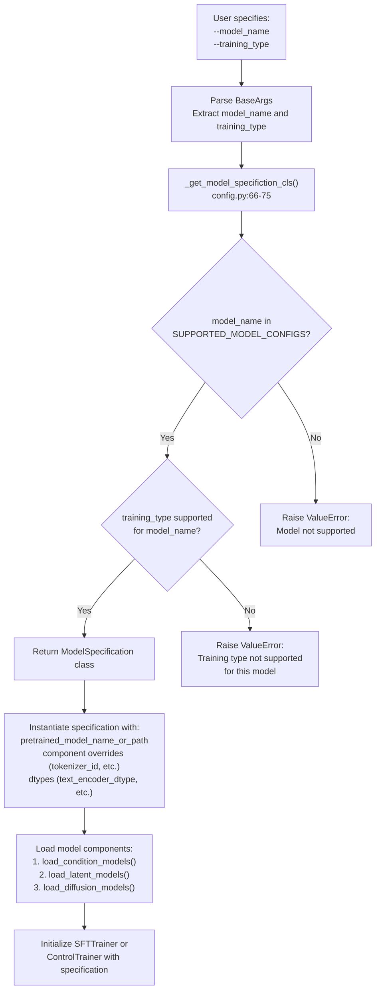

<!-- source: DeepWiki mcp.deepwiki.com · repo huggingface/finetrainers · page 6 Supported Models · fetched 2026-10-26 -->

# Supported Models

<details>
<summary>Relevant source files</summary>

The following files were used as context for generating this wiki page:

- [.gitignore](.gitignore)
- [README.md](README.md)
- [docs/models/README.md](docs/models/README.md)
- [docs/models/cogvideox.md](docs/models/cogvideox.md)
- [docs/models/cogview4.md](docs/models/cogview4.md)
- [docs/models/hunyuan_video.md](docs/models/hunyuan_video.md)
- [docs/models/ltx_video.md](docs/models/ltx_video.md)
- [docs/models/wan.md](docs/models/wan.md)
- [finetrainers/config.py](finetrainers/config.py)
- [finetrainers/functional/__init__.py](finetrainers/functional/__init__.py)
- [finetrainers/functional/text.py](finetrainers/functional/text.py)
- [finetrainers/models/flux/base_specification.py](finetrainers/models/flux/base_specification.py)
- [tests/models/flux/base_specification.py](tests/models/flux/base_specification.py)

</details>


This page provides an overview of all diffusion models supported by finetrainers, including their characteristics, memory requirements, and available training configurations. For detailed model-specific training instructions, inference examples, and configuration options, see the child pages: [Video Generation Models](#6.1), [Image Generation Models](#6.2), and [Model-Specific Components](#6.3). For information about the ModelSpecification abstraction layer, see [Model Specifications](#3.2).

## Model Registration System

Finetrainers uses a registration system to map model types and training types to their corresponding `ModelSpecification` implementations. This system is defined in [finetrainers/config.py:1-76]() and provides the foundation for model discovery and initialization.

```mermaid
graph TB
    subgraph "Model Type Enumeration"
        ModelType["ModelType Enum"]
        COGVIDEOX["COGVIDEOX = 'cogvideox'"]
        COGVIEW4["COGVIEW4 = 'cogview4'"]
        FLUX["FLUX = 'flux'"]
        HUNYUAN_VIDEO["HUNYUAN_VIDEO = 'hunyuan_video'"]
        LTX_VIDEO["LTX_VIDEO = 'ltx_video'"]
        WAN["WAN = 'wan'"]
        
        ModelType --> COGVIDEOX
        ModelType --> COGVIEW4
        ModelType --> FLUX
        ModelType --> HUNYUAN_VIDEO
        ModelType --> LTX_VIDEO
        ModelType --> WAN
    end
    
    subgraph "Training Type Enumeration"
        TrainingType["TrainingType Enum"]
        LORA["LORA = 'lora'"]
        FULL_FINETUNE["FULL_FINETUNE = 'full-finetune'"]
        CONTROL_LORA["CONTROL_LORA = 'control-lora'"]
        CONTROL_FULL_FINETUNE["CONTROL_FULL_FINETUNE = 'control-full-finetune'"]
        
        TrainingType --> LORA
        TrainingType --> FULL_FINETUNE
        TrainingType --> CONTROL_LORA
        TrainingType --> CONTROL_FULL_FINETUNE
    end
    
    subgraph "Model Specifications"
        CogVideoXSpec["CogVideoXModelSpecification"]
        CogView4Spec["CogView4ModelSpecification"]
        CogView4ControlSpec["CogView4ControlModelSpecification"]
        FluxSpec["FluxModelSpecification"]
        HunyuanVideoSpec["HunyuanVideoModelSpecification"]
        LTXVideoSpec["LTXVideoModelSpecification"]
        WanSpec["WanModelSpecification"]
        WanControlSpec["WanControlModelSpecification"]
    end
    
    subgraph "Registry Mapping"
        Registry["SUPPORTED_MODEL_CONFIGS<br/>Dict[ModelType, Dict[TrainingType, Type[ModelSpecification]]]"]
    end
    
    ModelType --> Registry
    TrainingType --> Registry
    Registry --> CogVideoXSpec
    Registry --> CogView4Spec
    Registry --> CogView4ControlSpec
    Registry --> FluxSpec
    Registry --> HunyuanVideoSpec
    Registry --> LTXVideoSpec
    Registry --> WanSpec
    Registry --> WanControlSpec
    
    GetSpec["_get_model_specifiction_cls()<br/>Returns ModelSpecification class"]
    Registry --> GetSpec
```



**Model Registry Structure**

The `SUPPORTED_MODEL_CONFIGS` dictionary at [finetrainers/config.py:32-63]() maps each `ModelType` to a nested dictionary of supported `TrainingType` values and their corresponding `ModelSpecification` classes. The helper function `_get_model_specifiction_cls()` at [finetrainers/config.py:66-75]() validates and retrieves the appropriate specification class based on user-provided model name and training type.

**Sources:** [finetrainers/config.py:1-76](), [README.md:85-110]()

## Supported Models Matrix

The following table shows all currently supported models, their primary tasks, and which training types are available for each:

| Model | Type | Primary Tasks | LoRA | Full FT | Control LoRA | Control Full FT | Documentation |
|:------|:-----|:--------------|:----:|:-------:|:------------:|:---------------:|:--------------|
| **CogVideoX** | Video | Text-to-Video | ✅ | ✅ | ❌ | ❌ | [cogvideox.md](docs/models/cogvideox.md) |
| **CogView4** | Image | Text-to-Image | ✅ | ✅ | ✅ | ✅ | [cogview4.md](docs/models/cogview4.md) |
| **Flux** | Image | Text-to-Image | ✅ | ✅ | ❌ | ❌ | [flux.md](docs/models/flux.md) |
| **HunyuanVideo** | Video | Text-to-Video | ✅ | ✅ | ❌ | ❌ | [hunyuan_video.md](docs/models/hunyuan_video.md) |
| **LTX-Video** | Video | Text-to-Video | ✅ | ✅ | ❌ | ❌ | [ltx_video.md](docs/models/ltx_video.md) |
| **Wan** | Video | T2V / I2V / FLF2V | ✅ | ✅ | ✅ | ✅ | [wan.md](docs/models/wan.md) |

**Legend:**
- **LoRA**: Low-Rank Adaptation training (`--training_type lora`)
- **Full FT**: Full parameter finetuning (`--training_type full-finetune`)
- **Control LoRA**: Control-conditioned LoRA training (`--training_type control-lora`)
- **Control Full FT**: Control-conditioned full finetuning (`--training_type control-full-finetune`)

**Sources:** [finetrainers/config.py:32-63](), [README.md:85-110](), [docs/models/README.md:17-29]()

## Model Specifications and Components

Each model in finetrainers is defined by a `ModelSpecification` class that encapsulates all components required for training. The following diagram illustrates how model specifications map to their concrete implementations:

```mermaid
graph TB
    subgraph "Base Abstraction"
        ModelSpec["ModelSpecification<br/>(Abstract Base Class)"]
    end
    
    subgraph "Video Models"
        CogVideoXSpec["CogVideoXModelSpecification"]
        HunyuanVideoSpec["HunyuanVideoModelSpecification"]
        LTXVideoSpec["LTXVideoModelSpecification"]
        WanSpec["WanModelSpecification"]
        WanControlSpec["WanControlModelSpecification"]
    end
    
    subgraph "Image Models"
        CogView4Spec["CogView4ModelSpecification"]
        CogView4ControlSpec["CogView4ControlModelSpecification"]
        FluxSpec["FluxModelSpecification"]
    end
    
    subgraph "Component Loading Methods"
        LoadCondition["load_condition_models()<br/>tokenizers, text_encoders"]
        LoadLatent["load_latent_models()<br/>vae"]
        LoadDiffusion["load_diffusion_models()<br/>transformer, scheduler"]
        LoadPipeline["load_pipeline()<br/>diffusers.Pipeline"]
    end
    
    subgraph "Processing Methods"
        PrepareConditions["prepare_conditions()<br/>text → embeddings"]
        PrepareLatents["prepare_latents()<br/>image/video → latents"]
        Forward["forward()<br/>training forward pass"]
        Validation["validation()<br/>generate artifacts"]
    end
    
    subgraph "Saving Methods"
        SaveLora["_save_lora_weights()"]
        SaveModel["_save_model()"]
    end
    
    ModelSpec --> LoadCondition
    ModelSpec --> LoadLatent
    ModelSpec --> LoadDiffusion
    ModelSpec --> LoadPipeline
    ModelSpec --> PrepareConditions
    ModelSpec --> PrepareLatents
    ModelSpec --> Forward
    ModelSpec --> Validation
    ModelSpec --> SaveLora
    ModelSpec --> SaveModel
    
    ModelSpec -.implements.-> CogVideoXSpec
    ModelSpec -.implements.-> HunyuanVideoSpec
    ModelSpec -.implements.-> LTXVideoSpec
    ModelSpec -.implements.-> WanSpec
    ModelSpec -.implements.-> WanControlSpec
    ModelSpec -.implements.-> CogView4Spec
    ModelSpec -.implements.-> CogView4ControlSpec
    ModelSpec -.implements.-> FluxSpec
```



**Component Structure**

Each `ModelSpecification` implementation must provide:

1. **Component Loaders**: Methods to load tokenizers, text encoders, VAE, transformer, and scheduler
2. **Data Processors**: Methods to prepare text conditions and visual latents for training
3. **Forward Pass**: Training-specific forward pass implementation with loss computation
4. **Validation**: Generation methods for validation artifacts during training
5. **Persistence**: Methods to save LoRA weights or full model checkpoints

**Sources:** [finetrainers/models/modeling_utils.py](), [finetrainers/config.py:4-10](), [finetrainers/models/flux/base_specification.py:71-412]()

## Training Types

Finetrainers supports four training configurations defined in the `TrainingType` enum at [finetrainers/config.py:22-29]():

### Standard Fine-Tuning

| Training Type | CLI Argument | Description | Memory Efficiency | Use Case |
|:--------------|:-------------|:------------|:------------------|:---------|
| **LoRA** | `--training_type lora` | Trains low-rank adaptation weights using PEFT library | High (1/3 to 1/4 of full FT) | Style transfer, concept learning, limited compute |
| **Full Finetune** | `--training_type full-finetune` | Trains all model parameters | Low (requires full model VRAM) | Significant distribution shifts, high-quality data |

### Control Training

| Training Type | CLI Argument | Description | Additional Requirements | Supported Models |
|:--------------|:-------------|:------------|:-----------------------|:-----------------|
| **Control LoRA** | `--training_type control-lora` | LoRA training with channel-concatenated control signals | Control images/videos, expanded input channels | Wan, CogView4 |
| **Control Full FT** | `--training_type control-full-finetune` | Full parameter training with control conditioning | Control images/videos, expanded input channels | Wan, CogView4 |

**Control Training Mechanism**

Control training expands the model's input channels to accept additional control signals through channel concatenation. For Wan models, this is implemented by expanding the 3D convolution layer at [docs/models/wan.md:73](), while CogView4 expands its linear projection layer at [docs/models/cogview4.md:67](). The control channels are initialized with zeros to maintain compatibility with pretrained weights.

**Sources:** [finetrainers/config.py:22-29](), [docs/models/README.md:30-36](), [docs/models/wan.md:50-110](), [docs/models/cogview4.md:46-88]()

## Memory Requirements

The following table shows minimum VRAM requirements for training at resolution `49x512x768` (video) or `1024x1024` (image) with gradient checkpointing enabled:

| Model | Parameters | LoRA (FP8/BF16)<sup>*</sup> | Full Finetune (BF16)<sup>^</sup> | Notes |
|:------|:-----------|:----------------------------|:---------------------------------|:------|
| **LTX-Video** | ~8B | 5 GB | 21 GB | Most memory-efficient video model |
| **CogVideoX-2b** | 2B | ~12 GB | ~35 GB | Smaller variant, good for single GPU |
| **CogVideoX-5b** | 5B | 18 GB | 53 GB | Larger variant, better quality |
| **HunyuanVideo** | ~13B | 32 GB (FP8 required) | OOM on tested hardware | Requires multi-GPU for full FT |
| **Wan-1.3B** | 1.3B | TBD | TBD | Smallest Wan variant |
| **Wan-14B** | 14B | TBD | TBD | Largest video model supported |
| **CogView4** | 6B | TBD | TBD | Image generation model |
| **Flux-dev** | ~12B | TBD | TBD | High-quality image model |
| **Flux-schnell** | ~12B | TBD | TBD | Fast inference variant |

<sup>*</sup> LoRA training uses rank 128, with precomputation of conditions and latents, training-only (no validation), using FP8 weights where noted or BF16 otherwise.

<sup>^</sup> Full finetuning uses BF16 weights with precomputation of conditions and latents, training-only (no validation).

**Memory Optimization Techniques**

The memory requirements can be further reduced using:
- **Precomputation**: Caching text embeddings and latents to disk to offload conditioning models (see [Precomputation System](#5.3))
- **Gradient Checkpointing**: Trading compute for memory by recomputing activations during backward pass
- **FP8 Training**: Casting transformer weights to FP8 format for ~50% memory reduction (see [README.md:79]())
- **FSDP/HSDP**: Sharding model parameters across multiple GPUs (see [Parallelism Strategies](#7.2))
- **VAE Tiling**: Processing images/videos in tiles to reduce VAE memory (enabled via `--enable_vae_tiling`)

**Sources:** [README.md:95-109](), [docs/models/README.md:56-63]()

## Supported Model Checkpoints

Each model has multiple pretrained checkpoints available on the Hugging Face Hub. The following are verified-compatible checkpoints:

### Video Models

**CogVideoX** ([docs/models/cogvideox.md:19-25]()):
- `THUDM/CogVideoX-2b` - 2B parameter model
- `THUDM/CogVideoX-5B` - 5B parameter model  
- `THUDM/CogVideoX1.5-5B` - Updated 5B model

**HunyuanVideo** (see [docs/models/hunyuan_video.md]()):
- `hunyuanvideo-community/HunyuanVideo` - Official community checkpoint

**LTX-Video** (see [docs/models/ltx_video.md]()):
- `Lightricks/LTX-Video` - Official checkpoint

**Wan** ([docs/models/wan.md:21-29]()):
- `Wan-AI/Wan2.1-T2V-1.3B-Diffusers` - Text-to-Video 1.3B
- `Wan-AI/Wan2.1-T2V-14B-Diffusers` - Text-to-Video 14B
- `Wan-AI/Wan2.1-I2V-14B-480P-Diffusers` - Image-to-Video 480p
- `Wan-AI/Wan2.1-I2V-14B-720P-Diffusers` - Image-to-Video 720p
- `Wan-AI/Wan2.1-FLF2V-14B-720P-diffusers` - First-Last-Frame-to-Video

### Image Models

**CogView4** ([docs/models/cogview4.md:21-25]()):
- `THUDM/CogView4-6B` - 6B parameter text-to-image model

**Flux** (see [docs/models/flux.md]()):
- `black-forest-labs/FLUX.1-dev` - Development model (default in [finetrainers/models/flux/base_specification.py:74]())
- `black-forest-labs/FLUX.1-schnell` - Fast inference model

### Custom Checkpoints

Any architecture-compatible checkpoint can be used by specifying `--pretrained_model_name_or_path`. For example, `Skywork/SkyReels-V1-Hunyuan-T2V` (a HunyuanVideo finetune) works out-of-the-box. Individual components can be overridden using arguments like `--tokenizer_id`, `--text_encoder_id`, `--transformer_id`, `--vae_id` as documented in [docs/models/README.md:38-44]().

**Sources:** [docs/models/cogvideox.md:19-25](), [docs/models/wan.md:21-29](), [docs/models/cogview4.md:21-25](), [docs/models/README.md:38-44](), [finetrainers/models/flux/base_specification.py:74]()

## Model Selection Flow

The following diagram illustrates how the training system selects and initializes the appropriate model specification based on command-line arguments:



**Model Initialization Process**

1. **Validation**: The `_get_model_specifiction_cls()` function at [finetrainers/config.py:66-75]() validates that both the model type and training type are supported
2. **Specification Creation**: The appropriate `ModelSpecification` subclass is instantiated with user-provided arguments
3. **Component Loading**: The specification's `load_*` methods are called to load tokenizers, text encoders, VAE, transformer, and scheduler
4. **Trainer Initialization**: The loaded components are passed to either `SFTTrainer` or `ControlTrainer` based on the training type

**Sources:** [finetrainers/config.py:66-75](), [README.md:85-110]()

## Usage Examples

### Basic LoRA Training

```bash
python train.py \
    --model_name cogvideox \
    --training_type lora \
    --pretrained_model_name_or_path THUDM/CogVideoX-5b \
    --rank 128 \
    --lora_alpha 128 \
    --dataset_file path/to/dataset.csv \
    --output_dir ./outputs
```

### Full Finetuning with Custom Components

```bash
python train.py \
    --model_name flux \
    --training_type full-finetune \
    --pretrained_model_name_or_path black-forest-labs/FLUX.1-dev \
    --transformer_id custom-org/custom-flux-transformer \
    --dataset_file path/to/dataset.csv \
    --output_dir ./outputs
```

### Control Training

```bash
python train.py \
    --model_name wan \
    --training_type control-lora \
    --pretrained_model_name_or_path Wan-AI/Wan2.1-T2V-1.3B-Diffusers \
    --rank 128 \
    --control_type image \
    --dataset_file path/to/dataset_with_control.csv \
    --output_dir ./outputs
```

**Sources:** [docs/models/cogvideox.md:1-50](), [docs/models/wan.md:1-116](), [docs/models/README.md:30-44]()

## See Also

- [Video Generation Models](#6.1) - Detailed documentation for video models (CogVideoX, HunyuanVideo, LTX-Video, Wan)
- [Image Generation Models](#6.2) - Detailed documentation for image models (CogView4, Flux)
- [Model-Specific Components](#6.3) - Details on processors, latent encoding, and forward pass implementations
- [Model Specifications](#3.2) - Information about the ModelSpecification abstraction
- [SFT Trainer](#4.1) - Standard supervised fine-tuning workflow
- [Control Trainer](#4.2) - Control-conditioned training workflow
- [Training Types](#3.1) - Comprehensive explanation of LoRA vs full finetuning

---

