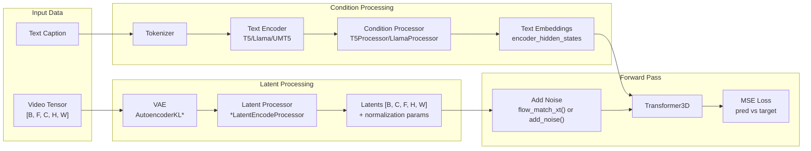
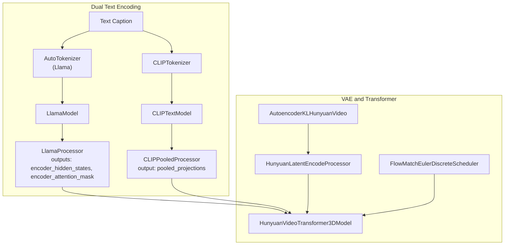
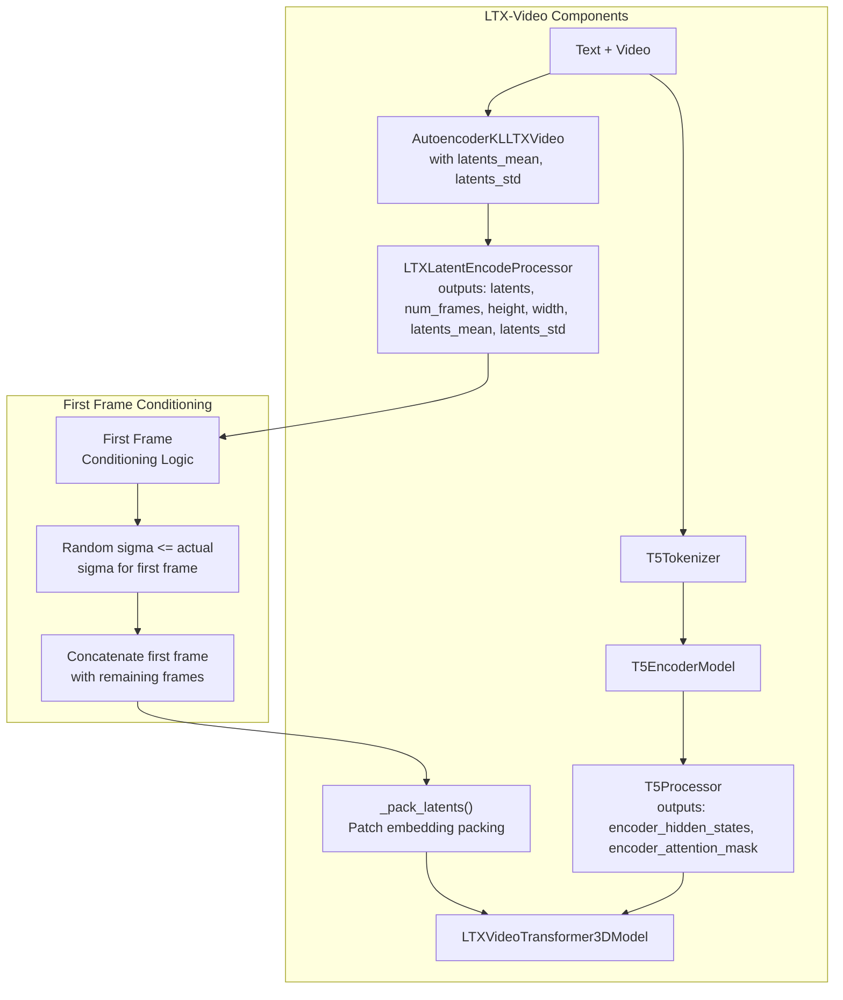
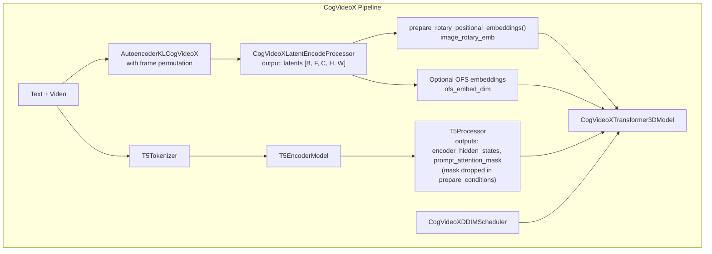
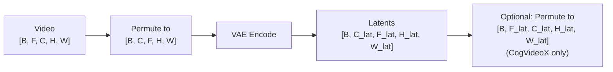

<!-- source: DeepWiki mcp.deepwiki.com · repo huggingface/finetrainers · page 6.1 Video Generation Models · fetched 2026-10-26 -->

# Video Generation Models

Relevant source files

The following files were used as context for generating this wiki page:

- [.gitignore](.gitignore)
- [README.md](README.md)
- [docs/models/cogvideox.md](docs/models/cogvideox.md)
- [docs/models/cogview4.md](docs/models/cogview4.md)
- [docs/models/hunyuan_video.md](docs/models/hunyuan_video.md)
- [docs/models/ltx_video.md](docs/models/ltx_video.md)
- [docs/models/wan.md](docs/models/wan.md)
- [finetrainers/functional/__init__.py](finetrainers/functional/__init__.py)
- [finetrainers/functional/text.py](finetrainers/functional/text.py)
- [finetrainers/models/cogvideox/base_specification.py](finetrainers/models/cogvideox/base_specification.py)
- [finetrainers/models/hunyuan_video/base_specification.py](finetrainers/models/hunyuan_video/base_specification.py)
- [finetrainers/models/ltx_video/base_specification.py](finetrainers/models/ltx_video/base_specification.py)
- [finetrainers/models/wan/base_specification.py](finetrainers/models/wan/base_specification.py)
- [finetrainers/models/wan/control_specification.py](finetrainers/models/wan/control_specification.py)

This page documents the video generation models supported by finetrainers. It covers the architecture of video model specifications, model-specific components, and training configurations. For image generation models, see [Image Generation Models](#6.2). For detailed information about model-specific components like processors and latent encoding, see [Model-Specific Components](#6.3).

## Overview

Finetrainers supports four video generation models, each implemented as a `ModelSpecification` subclass. These models differ in architecture, memory requirements, and supported features, but share a common interface for training.

**Supported Video Models**

| Model | Class | Default Checkpoint | Architecture | Special Features |
|-------|-------|-------------------|--------------|------------------|
| **Wan** | `WanModelSpecification` | `Wan-AI/Wan2.1-T2V-1.3B-Diffusers` | Flow-matching transformer | T2V, I2V, FLF2V variants; Control training support |
| **HunyuanVideo** | `HunyuanVideoModelSpecification` | `hunyuanvideo-community/HunyuanVideo` | Flow-matching transformer | Dual text encoders (Llama + CLIP) |
| **LTX-Video** | `LTXVideoModelSpecification` | `Lightricks/LTX-Video` | Flow-matching transformer | First frame conditioning, tensor parallelism support |
| **CogVideoX** | `CogVideoXModelSpecification` | `THUDM/CogVideoX-5b` | Diffusion transformer (DDIM) | RoPE positional embeddings, 2B/5B variants |

**Memory Requirements** (from [README.md:97-109]())

| Model | LoRA Training (GB) | Full Finetuning (GB) | Notes |
|-------|-------------------|----------------------|-------|
| LTX-Video | 5 | 21 | Most memory-efficient |
| CogVideoX-5b | 18 | 53 | - |
| HunyuanVideo | 32 | OOM | Requires FP8 for full finetuning |
| Wan | TODO | TODO | Multiple size variants (1.3B-14B) |

Sources: [README.md:97-109](), [finetrainers/models/wan/base_specification.py](), [finetrainers/models/hunyuan_video/base_specification.py](), [finetrainers/models/ltx_video/base_specification.py](), [finetrainers/models/cogvideox/base_specification.py]()

## Video Model Architecture

```mermaid
graph TB
    subgraph "ModelSpecification Interface"
        MS["ModelSpecification<br/>(Abstract Base)"]
    end
    
    subgraph "Video Model Implementations"
        WanSpec["WanModelSpecification<br/>finetrainers/models/wan/base_specification.py"]
        HunyuanSpec["HunyuanVideoModelSpecification<br/>finetrainers/models/hunyuan_video/base_specification.py"]
        LTXSpec["LTXVideoModelSpecification<br/>finetrainers/models/ltx_video/base_specification.py"]
        CogVideoSpec["CogVideoXModelSpecification<br/>finetrainers/models/cogvideox/base_specification.py"]
    end
    
    subgraph "Model Components (per spec)"
        Tokenizers["Tokenizers<br/>load_condition_models()"]
        TextEncoders["Text Encoders<br/>T5/Llama/CLIP"]
        Transformer["Transformer3D<br/>load_diffusion_models()"]
        VAE["VAE<br/>load_latent_models()"]
        Scheduler["Scheduler<br/>FlowMatch/DDIM"]
    end
    
    subgraph "Processors"
        CondProc["Condition Processors<br/>T5Processor, LlamaProcessor, etc."]
        LatentProc["Latent Processors<br/>*LatentEncodeProcessor"]
    end
    
    MS --> WanSpec
    MS --> HunyuanSpec
    MS --> LTXSpec
    MS --> CogVideoSpec
    
    WanSpec --> Tokenizers
    WanSpec --> TextEncoders
    WanSpec --> Transformer
    WanSpec --> VAE
    WanSpec --> Scheduler
    
    HunyuanSpec --> Tokenizers
    HunyuanSpec --> TextEncoders
    HunyuanSpec --> Transformer
    HunyuanSpec --> VAE
    HunyuanSpec --> Scheduler
    
    LTXSpec --> Tokenizers
    LTXSpec --> TextEncoders
    LTXSpec --> Transformer
    LTXSpec --> VAE
    LTXSpec --> Scheduler
    
    CogVideoSpec --> Tokenizers
    CogVideoSpec --> TextEncoders
    CogVideoSpec --> Transformer
    CogVideoSpec --> VAE
    CogVideoSpec --> Scheduler
    
    WanSpec -.uses.-> CondProc
    WanSpec -.uses.-> LatentProc
    HunyuanSpec -.uses.-> CondProc
    HunyuanSpec -.uses.-> LatentProc
    LTXSpec -.uses.-> CondProc
    LTXSpec -.uses.-> LatentProc
    CogVideoSpec -.uses.-> CondProc
    CogVideoSpec -.uses.-> LatentProc
```

**Video Model Specification Interface**

All video models implement the `ModelSpecification` interface from [finetrainers/models/modeling_utils.py](). Each specification defines:

- **Component Loading Methods**: `load_condition_models()`, `load_latent_models()`, `load_diffusion_models()`
- **Data Processing Methods**: `prepare_conditions()`, `prepare_latents()`
- **Training Methods**: `forward()`, `validation()`
- **Serialization Methods**: `_save_lora_weights()`, `_save_model()`
- **Processors**: `condition_model_processors` and `latent_model_processors` lists

Sources: [finetrainers/models/modeling_utils.py](), [finetrainers/models/wan/base_specification.py:210-260](), [finetrainers/models/hunyuan_video/base_specification.py:75-122](), [finetrainers/models/ltx_video/base_specification.py:93-132](), [finetrainers/models/cogvideox/base_specification.py:79-116]()

## Processing Pipeline

**Processing Flow**

1. **Condition Processing**: Text captions are tokenized and encoded through model-specific text encoders (T5, UMT5, Llama). Processors like `T5Processor` handle the encoding and extract `encoder_hidden_states`.

2. **Latent Processing**: Videos are encoded to latent space using model-specific VAEs. Latent processors handle VAE encoding and extract latent statistics (mean, std) for normalization.

3. **Forward Pass**: Normalized latents are noised and passed through the transformer along with text embeddings to predict noise or velocity.

Sources: [finetrainers/models/wan/base_specification.py:383-432](), [finetrainers/models/ltx_video/base_specification.py:227-269](), [finetrainers/models/cogvideox/base_specification.py:213-256]()

## Wan

**Overview**

Wan is a family of video generation models with variants for text-to-video (T2V), image-to-video (I2V), and first-last-frame-to-video (FLF2V). It uses UMT5 for text encoding and a custom VAE with latent normalization. Wan is the only video model that supports control training.

**Model Variants**

| Variant | Checkpoint | Size | Special Features |
|---------|-----------|------|------------------|
| T2V | `Wan-AI/Wan2.1-T2V-1.3B-Diffusers` | 1.3B | Text-to-video generation |
| T2V | `Wan-AI/Wan2.1-T2V-14B-Diffusers` | 14B | Larger capacity |
| I2V | `Wan-AI/Wan2.1-I2V-14B-480P-Diffusers` | 14B | Image conditioning via CLIP |
| I2V | `Wan-AI/Wan2.1-I2V-14B-720P-Diffusers` | 14B | Higher resolution |
| FLF2V | `Wan-AI/Wan2.1-FLF2V-14B-720P-diffusers` | 14B | First and last frame conditioning |

**Architecture Specifics**

```mermaid
graph TB
    subgraph "Wan Text-to-Video"
        WanT2V_Input["Text Caption"]
        WanT2V_Tokenizer["AutoTokenizer<br/>(UMT5)"]
        WanT2V_Encoder["UMT5EncoderModel"]
        WanT2V_Proc["T5Processor<br/>output: encoder_hidden_states"]
        WanT2V_VAE["AutoencoderKLWan"]
        WanT2V_LatProc["WanLatentEncodeProcessor<br/>outputs: latents, latents_mean, latents_std"]
        WanT2V_Xformer["WanTransformer3DModel"]
        
        WanT2V_Input --> WanT2V_Tokenizer
        WanT2V_Tokenizer --> WanT2V_Encoder
        WanT2V_Encoder --> WanT2V_Proc
        WanT2V_Proc --> WanT2V_Xformer
        WanT2V_VAE --> WanT2V_LatProc
        WanT2V_LatProc --> WanT2V_Xformer
    end
    
    subgraph "Wan Image-to-Video"
        WanI2V_Input["Text + First Frame Image"]
        WanI2V_CLIP["CLIPVisionModel<br/>+ CLIPImageProcessor"]
        WanI2V_ImageProc["WanImageEncodeProcessor<br/>output: encoder_hidden_states_image"]
        WanI2V_CondLatProc["WanImageConditioningLatentEncodeProcessor<br/>outputs: latent_condition, latent_condition_mask"]
        WanI2V_Xformer["WanTransformer3DModel<br/>with image_dim config"]
        
        WanI2V_Input --> WanI2V_CLIP
        WanI2V_CLIP --> WanI2V_ImageProc
        WanI2V_Input --> WanI2V_CondLatProc
        WanI2V_ImageProc --> WanI2V_Xformer
        WanI2V_CondLatProc --> WanI2V_Xformer
    end
```

**Key Components** ([finetrainers/models/wan/base_specification.py:210-260]())

- **Text Encoder**: UMT5 (`AutoModel.from_pretrained()` with `UMT5EncoderModel`)
- **VAE**: `AutoencoderKLWan` with custom latent normalization (mean/std from config)
- **Scheduler**: `FlowMatchEulerDiscreteScheduler`
- **Transformer**: `WanTransformer3DModel` (flow-matching based)

**Processors**

1. **WanLatentEncodeProcessor** ([finetrainers/models/wan/base_specification.py:30-82]()): Encodes video to latents with format `[B, C, F, H, W]` and extracts `latents_mean` and `latents_std` from VAE config.

2. **WanImageConditioningLatentEncodeProcessor** ([finetrainers/models/wan/base_specification.py:84-163]()): For I2V/FLF2V models. Encodes first frame (and optionally last frame) with zero padding for remaining frames. Uses `mode()` instead of `sample()` for deterministic conditioning.

3. **WanImageEncodeProcessor** ([finetrainers/models/wan/base_specification.py:165-208]()): Encodes conditioning frames through CLIP vision encoder for I2V models.

**Forward Pass** ([finetrainers/models/wan/base_specification.py:433-493]())

Wan uses a two-step latent normalization process:
1. Encode video to moments tensor `[B, 2*C, F, H, W]` (mu and logvar concatenated)
2. Apply per-channel normalization: `(mu - latents_mean) * latents_std`
3. Sample from `DiagonalGaussianDistribution`
4. For I2V models, concatenate `[noisy_latents, latent_condition_mask, latent_condition]` on channel dimension

**Control Training Support**

Wan supports control training via `WanControlModelSpecification` ([finetrainers/models/wan/control_specification.py]()). The control specification:
- Expands `patch_embedding` layer with `_expand_conv3d_with_zeroed_weights()` to accept additional control channels
- Uses frame conditioning strategies (index, full, etc.) via `apply_frame_conditioning_on_latents()`
- Saves both LoRA weights and norm state dict for QK norm layers

**Training Examples**

See [docs/models/wan.md]() and training examples:
- T2V LoRA: [examples/training/sft/wan/crush_smol_lora/]()
- I2V Control: [examples/training/control/wan/image_condition/]()

Sources: [finetrainers/models/wan/base_specification.py](), [finetrainers/models/wan/control_specification.py](), [docs/models/wan.md]()

## HunyuanVideo

**Overview**

HunyuanVideo is a large-scale video generation model using dual text encoders (Llama and CLIP) for enhanced text understanding. It uses flow-matching for training and requires significant VRAM (32 GB for LoRA with FP8).

**Architecture Specifics**

**Key Components** ([finetrainers/models/hunyuan_video/base_specification.py:127-204]())

- **Text Encoders**: 
  - Primary: `LlamaModel` (Llama-based encoder)
  - Secondary: `CLIPTextModel` for pooled projections
- **VAE**: `AutoencoderKLHunyuanVideo` with VAE slicing support
- **Scheduler**: `FlowMatchEulerDiscreteScheduler`
- **Transformer**: `HunyuanVideoTransformer3DModel`

**Processors**

1. **HunyuanLatentEncodeProcessor** ([finetrainers/models/hunyuan_video/base_specification.py:28-73]()): Standard VAE encoding with optional slicing for memory efficiency.

2. **LlamaProcessor** ([finetrainers/processors]()): Processes text through Llama tokenizer and encoder, outputs `encoder_hidden_states` and `encoder_attention_mask`.

3. **CLIPPooledProcessor** ([finetrainers/processors]()): Extracts pooled embeddings from CLIP text encoder for additional conditioning.

**Forward Pass** ([finetrainers/models/hunyuan_video/base_specification.py:294-330]())

1. Sample latents from `DiagonalGaussianDistribution` if using precomputation
2. Scale latents by `vae.config.scaling_factor`
3. Apply flow-matching noise: `noisy_latents = FF.flow_match_xt(latents, noise, sigmas)`
4. Prepare guidance tensor: `guidance = latents.new_full((batch_size,), guidance) * 1000.0`
5. Pass through transformer with both text embeddings and guidance

**Training Configuration**

HunyuanVideo requires careful memory management:
- LoRA training: Minimum 32 GB VRAM with FP8
- Full finetuning: OOM on tested hardware
- Precomputation recommended for both conditions and latents
- VAE slicing and tiling enabled by default

**Training Examples**

See [docs/models/hunyuan_video.md]() and [examples/training/sft/hunyuan_video/modal_labs_dissolve/]()

Sources: [finetrainers/models/hunyuan_video/base_specification.py](), [docs/models/hunyuan_video.md]()

## LTX-Video

**Overview**

LTX-Video is the most memory-efficient video model in finetrainers (5 GB for LoRA training). It implements first-frame conditioning during training and supports tensor parallelism for distributed training.

**Architecture Specifics**

**Key Components** ([finetrainers/models/ltx_video/base_specification.py:137-190]())

- **Text Encoder**: `T5EncoderModel` with `T5Tokenizer`
- **VAE**: `AutoencoderKLLTXVideo` with per-sample latent statistics (`latents_mean`, `latents_std`)
- **Scheduler**: `FlowMatchEulerDiscreteScheduler`
- **Transformer**: `LTXVideoTransformer3DModel` with patch-based architecture

**Processors**

**LTXLatentEncodeProcessor** ([finetrainers/models/ltx_video/base_specification.py:32-91]()): 

Unique among video models, this processor outputs 6 values:
1. `latents`: Encoded video latents
2. `num_frames`: Frame count
3. `height`: Latent height
4. `width`: Latent width
5. `latents_mean`: Per-sample channel means from VAE state dict
6. `latents_std`: Per-sample channel standard deviations from VAE state dict

**Forward Pass** ([finetrainers/models/ltx_video/base_specification.py:271-345]())

LTX-Video implements sophisticated first-frame conditioning:

1. **Latent Normalization**: `latents = (latents - latents_mean) / latents_std`
2. **First Frame Conditioning** (10% probability):
   - Generate random sigma ≤ min(actual sigma, 0.25)
   - Apply different noise levels to first frame vs. remaining frames
   - `noisy_first = FF.flow_match_xt(first_frame, noise[:, :, :1], first_frame_sigma)`
   - `noisy_rest = FF.flow_match_xt(rest_frames, noise[:, :, 1:], sigmas)`
3. **Patch Packing**: `_pack_latents()` converts `[B, C, F, H, W]` to `[B, F//p_t * H//p * W//p, C*p_t*p*p]`
4. **RoPE Interpolation**: Dynamic rope scaling based on frame rate and spatial compression ratio

**Tensor Parallelism Support** ([finetrainers/models/ltx_video/base_specification.py:415-505]())

LTX-Video is the only video model with explicit tensor parallelism support via `apply_tensor_parallel()`. The implementation parallelizes feedforward layers:
- `ff.net.0.proj`: `ColwiseParallel()`
- `ff.net.2`: `RowwiseParallel()`

**Training Examples**

See [docs/models/ltx_video.md]() and [examples/training/sft/ltx_video/crush_smol_lora/]()

Sources: [finetrainers/models/ltx_video/base_specification.py](), [docs/models/ltx_video.md]()

## CogVideoX

**Overview**

CogVideoX is a diffusion-based video model (using DDIM scheduler rather than flow-matching) with rotary positional embeddings (RoPE). It supports 2B and 5B parameter variants.

**Architecture Specifics**

**Key Components** ([finetrainers/models/cogvideox/base_specification.py:121-176]())

- **Text Encoder**: `T5EncoderModel` with `T5Tokenizer`
- **VAE**: `AutoencoderKLCogVideoX` with frame dimension permutation
- **Scheduler**: `CogVideoXDDIMScheduler` (diffusion-based, not flow-matching)
- **Transformer**: `CogVideoXTransformer3DModel` with RoPE support

**Processors**

**CogVideoXLatentEncodeProcessor** ([finetrainers/models/cogvideox/base_specification.py:31-77]()): 

Unique feature: Permutes latent dimensions from `[B, C, F, H, W]` to `[B, F, C, H, W]` after encoding (line 75), matching CogVideoX's expected format.

**Forward Pass** ([finetrainers/models/cogvideox/base_specification.py:258-333]())

CogVideoX has the most complex forward pass among video models:

1. **Latent Scaling**: Scale by `vae.config.scaling_factor` (unless `invert_scale_latents` is True)
2. **Frame Padding**: Pad latents to be divisible by `patch_size_t` using `_pad_frames()`
3. **DDIM Noise Addition**: `noisy_latents = scheduler.add_noise(latents, noise, timesteps)`
4. **RoPE Embeddings**: Generate rotary positional embeddings via `prepare_rotary_positional_embeddings()` with base height/width scaling
5. **OFS Embeddings**: Optional output frame size embeddings if `ofs_embed_dim` is configured
6. **Velocity Prediction**: Transformer predicts velocity, converted to denoised output via `scheduler.get_velocity()`

**RoPE Implementation** ([finetrainers/models/cogvideox/utils.py]())

CogVideoX uses 3D rotary positional embeddings with:
- Spatial resolution scaling based on `base_height` and `base_width`
- Temporal dimension handling for variable frame counts
- VAE spatial scale factor (8x compression)

**Training Configuration**

CogVideoX training considerations:
- LoRA: 18 GB VRAM (5B model)
- Full finetuning: 53 GB VRAM (5B model)
- 2B model available for lower memory requirements
- RoPE base resolution should match training resolution

**Training Examples**

See [docs/models/cogvideox.md]() and [examples/training/sft/cogvideox/crush_smol_lora/]()

Sources: [finetrainers/models/cogvideox/base_specification.py](), [finetrainers/models/cogvideox/utils.py](), [docs/models/cogvideox.md]()

## Common Patterns

### Latent Normalization

All video models normalize latents, but use different approaches:

| Model | Normalization Method | Source of Parameters |
|-------|---------------------|---------------------|
| Wan | `(latents - mean) * std` | VAE config (`latents_mean`, `latents_std`) |
| HunyuanVideo | `latents * scaling_factor` | VAE config (`scaling_factor`) |
| LTX-Video | `(latents - mean) / std` | VAE state dict (per-sample) |
| CogVideoX | `latents * scaling_factor` | VAE config (`scaling_factor`) |

### Flow-Matching vs. Diffusion

**Flow-Matching Models** (Wan, HunyuanVideo, LTX-Video):
- Use `FlowMatchEulerDiscreteScheduler`
- Noise addition: `FF.flow_match_xt(latents, noise, sigmas)`
- Target: `FF.flow_match_target(noise, latents)`
- Timesteps: `(sigmas * 1000.0).long()`

**Diffusion Model** (CogVideoX):
- Uses `CogVideoXDDIMScheduler`
- Noise addition: `scheduler.add_noise(latents, noise, timesteps)`
- Target: Original latents
- Prediction: Velocity converted via `scheduler.get_velocity()`

Sources: [finetrainers/functional/diffusion.py](), [finetrainers/models/wan/base_specification.py:476-492](), [finetrainers/models/cogvideox/base_specification.py:289-331]()

### VAE Handling

All video models use 3D VAEs with temporal compression:

**Compression Ratios**:
- Spatial: 8x (all models)
- Temporal: 4x (Wan, HunyuanVideo, CogVideoX), 8x (LTX-Video)

**Memory Optimization**:
- VAE slicing: Enabled via `vae.use_slicing` (HunyuanVideo, LTX-Video, CogVideoX)
- VAE tiling: Enabled via `pipe.vae.enable_tiling()` (all models)

Sources: [finetrainers/models/wan/base_specification.py:30-82](), [finetrainers/models/hunyuan_video/base_specification.py:28-73](), [finetrainers/models/ltx_video/base_specification.py:32-91](), [finetrainers/models/cogvideox/base_specification.py:31-77]()

## Model Selection Guide

**Choose LTX-Video if**:
- Memory is constrained (works in 5 GB for LoRA)
- Need first-frame conditioning
- Require distributed training with tensor parallelism

**Choose CogVideoX if**:
- Prefer diffusion-based training (DDIM scheduler)
- Need smaller model variants (2B/5B)
- Require RoPE positional embeddings

**Choose HunyuanVideo if**:
- Need dual text encoder conditioning (Llama + CLIP)
- Have high VRAM availability (32+ GB)
- Require state-of-the-art quality

**Choose Wan if**:
- Need I2V or FLF2V capabilities
- Require control training (only model with control support)
- Need multiple size variants (1.3B-14B)

Sources: [README.md:97-109](), [docs/models/wan.md](), [docs/models/hunyuan_video.md](), [docs/models/ltx_video.md](), [docs/models/cogvideox.md]()

---

