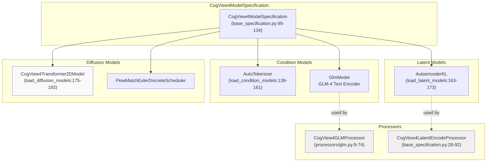
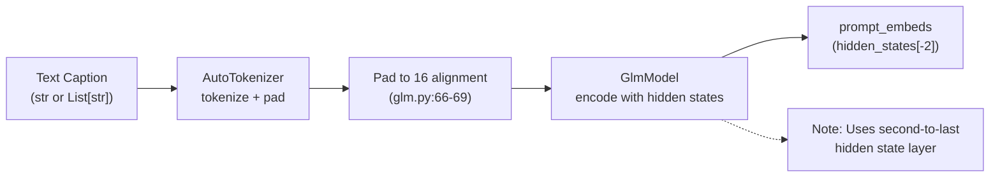
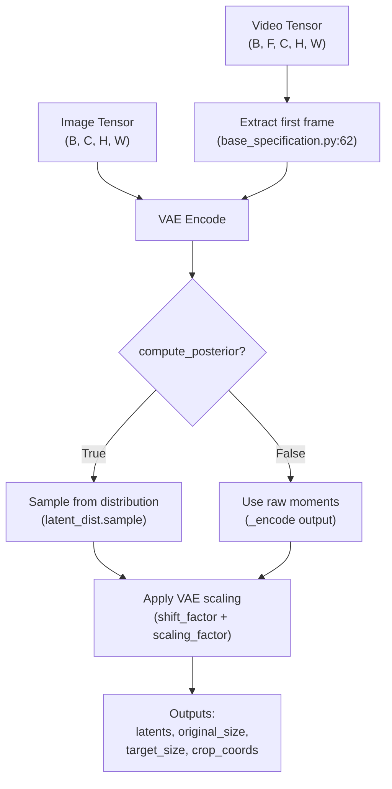
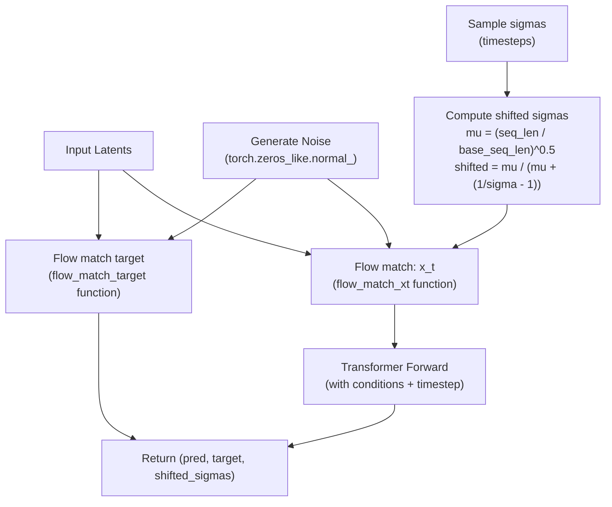
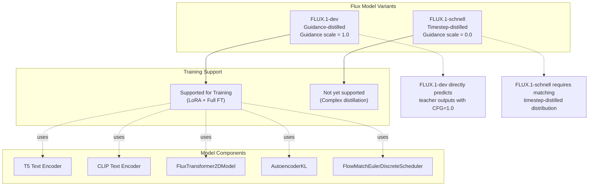
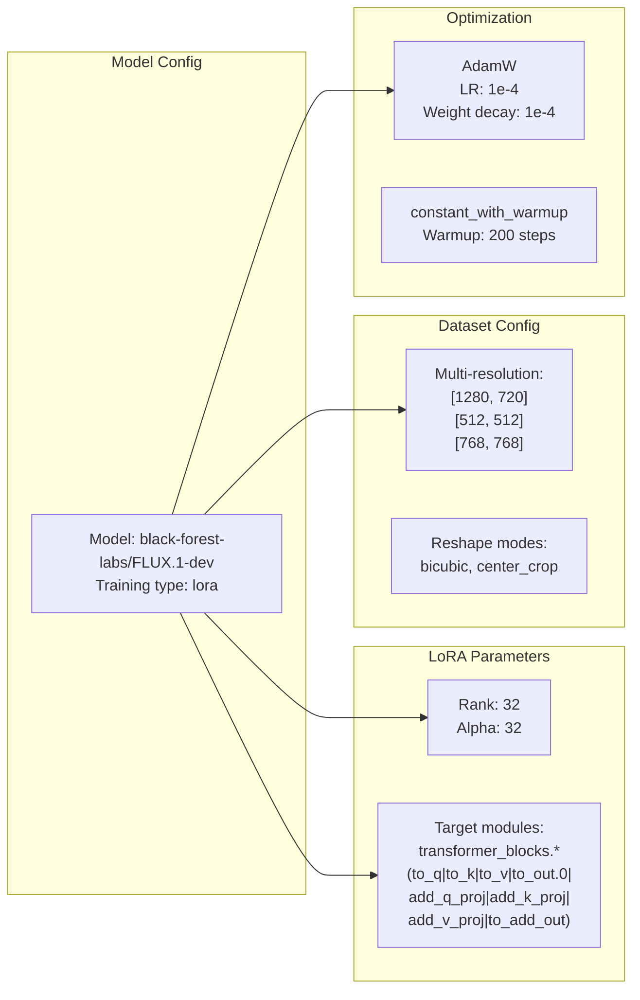
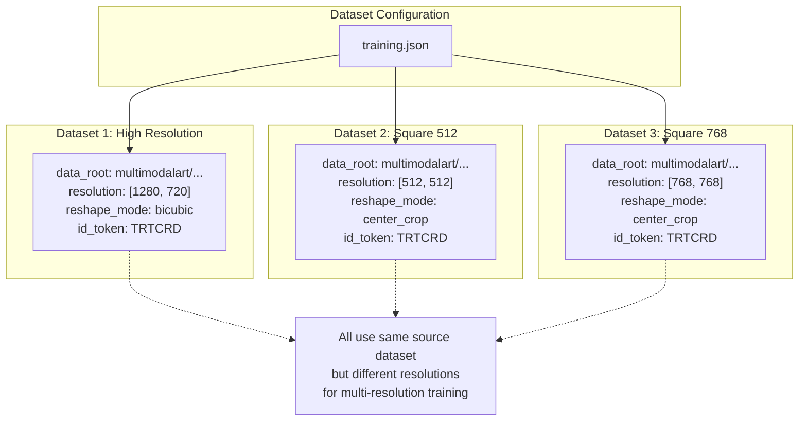
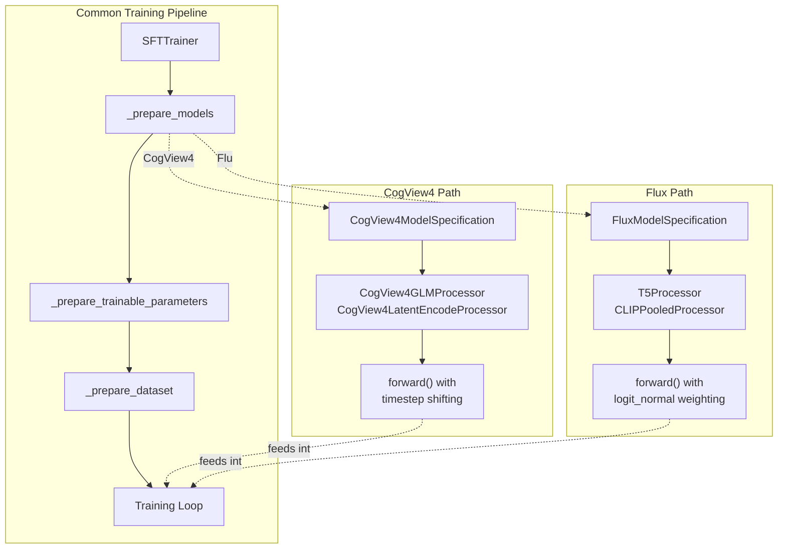
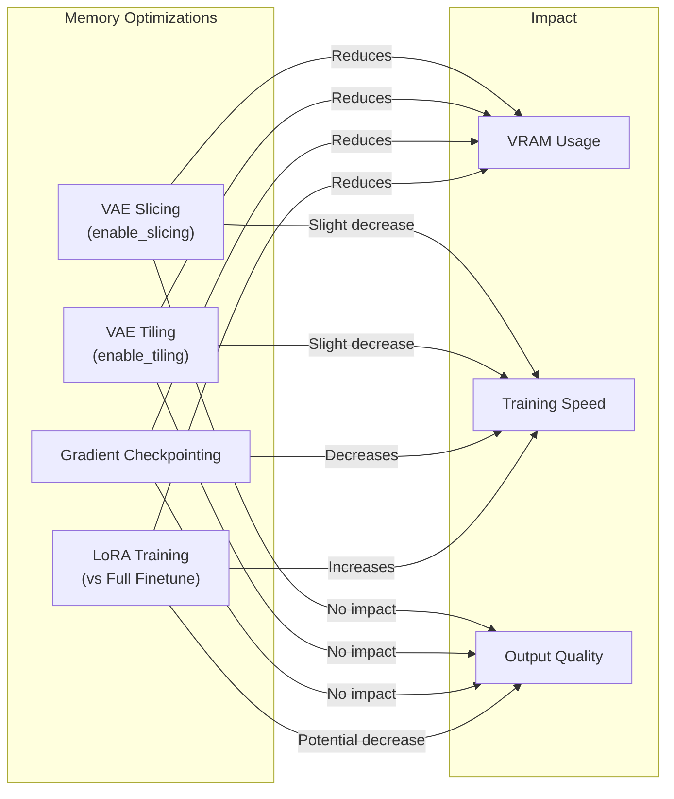

<!-- source: DeepWiki mcp.deepwiki.com · repo huggingface/finetrainers · page 6.2 Image Generation Models · fetched 2026-10-26 -->

# Image Generation Models

<details>
<summary>Relevant source files</summary>

The following files were used as context for generating this wiki page:

- [docs/models/flux.md](docs/models/flux.md)
- [examples/training/sft/cogview4/raider_white_tarot/training.json](examples/training/sft/cogview4/raider_white_tarot/training.json)
- [examples/training/sft/cogview4/raider_white_tarot/validation.json](examples/training/sft/cogview4/raider_white_tarot/validation.json)
- [examples/training/sft/flux_dev/raider_white_tarot/train.sh](examples/training/sft/flux_dev/raider_white_tarot/train.sh)
- [examples/training/sft/flux_dev/raider_white_tarot/training.json](examples/training/sft/flux_dev/raider_white_tarot/training.json)
- [examples/training/sft/flux_dev/raider_white_tarot/validation.json](examples/training/sft/flux_dev/raider_white_tarot/validation.json)
- [finetrainers/functional/image.py](finetrainers/functional/image.py)
- [finetrainers/functional/video.py](finetrainers/functional/video.py)
- [finetrainers/models/cogview4/__init__.py](finetrainers/models/cogview4/__init__.py)
- [finetrainers/models/cogview4/base_specification.py](finetrainers/models/cogview4/base_specification.py)
- [finetrainers/models/flux/__init__.py](finetrainers/models/flux/__init__.py)
- [finetrainers/parallel/accelerate.py](finetrainers/parallel/accelerate.py)
- [finetrainers/parallel/base.py](finetrainers/parallel/base.py)
- [finetrainers/parallel/ptd.py](finetrainers/parallel/ptd.py)
- [finetrainers/processors/__init__.py](finetrainers/processors/__init__.py)
- [finetrainers/processors/glm.py](finetrainers/processors/glm.py)
- [finetrainers/processors/t5.py](finetrainers/processors/t5.py)
- [tests/README.md](tests/README.md)

</details>


This page documents the two image generation models supported by finetrainers: **CogView4** and **Flux**. It covers their architectures, model components, training configurations, and implementation details. For video generation models, see [Video Generation Models](#6.1). For detailed information on model-specific processors and components, see [Model-Specific Components](#6.3).

## Supported Image Models Overview

| Model | Parameters | Text Encoder | Transformer | Scheduler | Control Training | Key Features |
|-------|-----------|--------------|-------------|-----------|------------------|--------------|
| CogView4 | 6B | GLM (GLM-4) | CogView4Transformer2DModel | FlowMatchEulerDiscreteScheduler | Yes | Flow matching, GLM-based conditioning, control-aware generation |
| Flux | dev/schnell | T5 + CLIP | FluxTransformer2DModel | FlowMatchEulerDiscreteScheduler | No | Guidance distillation (dev), timestep distillation (schnell) |

Both models use flow matching diffusion and support LoRA and full finetuning training strategies.

**Sources:** [finetrainers/models/cogview4/base_specification.py:95-134](), [docs/models/flux.md:23-28]()

---

## CogView4

CogView4 is a 6 billion parameter text-to-image diffusion model that uses the GLM-4 language model as its text encoder. It employs flow matching for the diffusion process and supports both standard supervised fine-tuning and control-conditioned training.

### Architecture and Components

CogView4 consists of four primary components loaded through the `CogView4ModelSpecification` class:



**Sources:** [finetrainers/models/cogview4/base_specification.py:95-192](), [finetrainers/processors/glm.py:9-74]()

#### Component Loading

The model specification loads components through dedicated methods:

- **Condition Models** [`load_condition_models():139-161`](): Loads the tokenizer and GLM text encoder. The text encoder can be loaded from a custom path via `text_encoder_id` parameter or from the main model repository's `text_encoder` subfolder.

- **Latent Models** [`load_latent_models():163-173`](): Loads the AutoencoderKL VAE for encoding images to latent space. Supports custom VAE via `vae_id` parameter.

- **Diffusion Models** [`load_diffusion_models():175-192`](): Loads the CogView4Transformer2DModel and initializes the FlowMatchEulerDiscreteScheduler. The transformer can be loaded from a custom path via `transformer_id`.

- **Pipeline** [`load_pipeline():194-228`](): Constructs a `CogView4Pipeline` for inference, with options for VAE slicing, tiling, and CPU offload.

**Sources:** [finetrainers/models/cogview4/base_specification.py:139-228]()

### Text Encoding with GLM

CogView4 uses a specialized `CogView4GLMProcessor` for encoding text prompts with the GLM language model:



Key implementation details:
- Text is tokenized with `max_length=max_sequence_length` and truncation enabled
- Token IDs are padded to multiples of 16 for efficient attention computation [`glm.py:66-69`]()
- Uses the second-to-last hidden state (`hidden_states[-2]`) rather than the final layer [`glm.py:71`]()
- Returns embeddings only (no attention mask, unlike T5Processor)

**Sources:** [finetrainers/processors/glm.py:29-74]()

### Latent Encoding

The `CogView4LatentEncodeProcessor` handles image-to-latent conversion:



The processor returns four outputs:
1. **latents**: Scaled VAE latents
2. **original_size**: Original image dimensions (for conditioning)
3. **target_size**: Target image dimensions (for conditioning)
4. **crop_coords**: Crop coordinates (always [0, 0] for now)

**Sources:** [finetrainers/models/cogview4/base_specification.py:28-92]()

### Training Forward Pass

The forward pass implements flow matching with timestep shifting:



Key aspects of the forward implementation [`forward():278-326`]():
- Uses timestep shifting based on sequence length to improve training stability
- Shifting formula: `mu = (image_sequence_length / 256)^0.5`, then `shifted_sigma = mu / (mu + (1/sigma - 1))`
- Returns shifted sigmas for loss weighting rather than original sigmas
- Applies VAE scaling with optional shift factor

**Sources:** [finetrainers/models/cogview4/base_specification.py:278-326]()

### Training Configuration

CogView4 supports both LoRA and full finetuning. Example configuration from the repository:

| Parameter | Value | Notes |
|-----------|-------|-------|
| Model Name | `THUDM/CogView4-6B` | Official checkpoint |
| Text Encoder | GLM-4 | Loaded from `text_encoder` subfolder |
| Max Sequence Length | 1024 | For text tokenization |
| Resolution Buckets | `[512, 512]`, `[768, 768]`, `[1280, 720]` | Multi-resolution training |
| LoRA Rank | 32 | Typical value for LoRA training |
| LoRA Alpha | 32 | Same as rank for 1.0 scaling |

**Sources:** [examples/training/sft/cogview4/raider_white_tarot/training.json:1-34]()

### Control Training Support

CogView4 uniquely supports control-conditioned training through `CogView4ControlModelSpecification` (exported from [`models/cogview4/__init__.py:2`]()). This allows training with additional control signals like Canny edges. For details on control training, see [Control Trainer](#4.2).

**Sources:** [finetrainers/models/cogview4/__init__.py:1-3]()

---

## Flux

Flux is a family of text-to-image diffusion models developed by Black Forest Labs, available in two variants: FLUX.1-dev (guidance-distilled) and FLUX.1-schnell (timestep-distilled). The finetrainers library currently supports FLUX.1-dev for training.

### Architecture and Variants



**Key differences:**
- **FLUX.1-dev**: Guidance-distilled model that predicts the output of a teacher model with classifier-free guidance. Hardcoded to use `guidance_scale=1.0` during training to match the teacher's output distribution.
- **FLUX.1-schnell**: Timestep-distilled model optimized for fast inference. Training support is experimental because matching its distilled output distribution is more complex.

**Sources:** [docs/models/flux.md:19-22]()

### Supported Checkpoints

| Checkpoint | Training Support | Notes |
|------------|------------------|-------|
| `black-forest-labs/FLUX.1-dev` | ✅ Full support | Guidance-distilled, recommended for training |
| `black-forest-labs/FLUX.1-schnell` | ⚠️ Experimental | Timestep-distilled, complex training |

**Sources:** [docs/models/flux.md:23-28]()

### Training Configuration

Flux supports flexible training configurations with multi-resolution bucketing:

#### LoRA Training Example



The example training script [`examples/training/sft/flux_dev/raider_white_tarot/train.sh`]() demonstrates:
- **LoRA targeting**: Attention projection layers only (Q, K, V, output projections)
- **Regex patterns**: Use `transformer_blocks.*(to_q|to_k|to_v|...)` to target specific layers
- **Multi-resolution**: Three resolution buckets with different reshape modes
- **Flow weighting**: Uses `logit_normal` scheme for sigma weighting
- **Memory optimization**: Enables VAE slicing and tiling

**Sources:** [examples/training/sft/flux_dev/raider_white_tarot/train.sh:38-82]()

#### Dataset Configuration

The training uses a JSON-based dataset configuration with multi-resolution support:



This configuration enables training on the same dataset at multiple resolutions simultaneously, improving the model's ability to generate images at various aspect ratios and sizes.

**Sources:** [examples/training/sft/flux_dev/raider_white_tarot/training.json:1-34]()

### Validation Configuration

Validation prompts test the model at multiple resolutions:

| Resolution | Use Case | Example Count |
|------------|----------|---------------|
| 1280×720 | Landscape/widescreen | 4 prompts |
| 512×512 | Square/thumbnail | 2 prompts |
| 768×768 | Square/medium | 2 prompts |

Each validation prompt uses `num_inference_steps=50` for high-quality generation.

**Sources:** [examples/training/sft/flux_dev/raider_white_tarot/validation.json:1-68]()

### Inference with Trained Models

After training, Flux LoRA weights can be loaded into the diffusers pipeline:

```python
from diffusers import FluxPipeline
import torch

pipe = FluxPipeline.from_pretrained(
    "black-forest-labs/FLUX.1-dev", 
    torch_dtype=torch.bfloat16
).to("cuda")

# Load and apply LoRA
pipe.load_lora_weights("your-username/your-lora", adapter_name="flux-lora")
pipe.set_adapters(["flux-lora"], [0.9])  # 0.9 = LoRA weight/strength

image = pipe("Your prompt here").images[0]
```

**Important:** FLUX.1-schnell requires `guidance_scale=0.0` for inference, while FLUX.1-dev uses the default value.

**Sources:** [docs/models/flux.md:32-47]()

---

## Model Comparison: Training Workflow

Both models follow the same high-level training workflow through the `SFTTrainer` class, but differ in their component implementations:



**Key architectural differences:**

| Aspect | CogView4 | Flux |
|--------|----------|------|
| Text Encoder | Single GLM model | Dual T5 + CLIP encoders |
| Text Processor | `CogView4GLMProcessor` | `T5Processor` + `CLIPPooledProcessor` |
| Latent Encoding | `CogView4LatentEncodeProcessor` | Standard VAE processor |
| Forward Pass | Timestep shifting based on sequence length | Standard flow matching |
| Control Support | Yes (via ControlModelSpecification) | No |
| Max Sequence Length | 1024 tokens | Model-dependent |

**Sources:** [finetrainers/models/cogview4/base_specification.py:95-326](), [finetrainers/processors/glm.py:9-74](), [finetrainers/processors/t5.py:9-88]()

---

## Memory Requirements and Optimization

Both models support memory optimization techniques through their VAE components:



These optimizations are enabled through the pipeline loading:
- [`load_pipeline():194-228`]() for CogView4
- Similar method for Flux (implementation in flux specification)

**Memory optimization flags:**
- `enable_slicing`: Process VAE in slices to reduce memory
- `enable_tiling`: Process VAE in tiles for very large images
- `enable_model_cpu_offload`: Offload components to CPU when not in use
- `gradient_checkpointing`: Trade compute for memory during backpropagation

**Sources:** [finetrainers/models/cogview4/base_specification.py:194-228](), [examples/training/sft/flux_dev/raider_white_tarot/train.sh:76-82]()

---

## Implementation Notes

### Model Registration

Both models are registered in the model registry system:

- CogView4: Registered for both SFT and Control training types
- Flux: Registered for SFT training only

The registration maps `(ModelType, TrainingType) -> ModelSpecification` class, enabling dynamic model loading based on command-line arguments. See [Model Specifications](#3.2) for details on the registration system.

**Sources:** [finetrainers/models/cogview4/__init__.py:1-3](), [finetrainers/models/flux/__init__.py:1-2]()

### Processor System

Both models use the `ProcessorMixin` interface for data transformation:

- **CogView4**: Custom `CogView4GLMProcessor` for GLM text encoding
- **Flux**: Standard `T5Processor` and `CLIPPooledProcessor` from the processors module

Processors implement a `forward()` method that takes model components and input data, returning a dictionary of processed outputs. See [Processors and Data Transforms](#8.3) for the processor architecture.

**Sources:** [finetrainers/processors/base.py](), [finetrainers/processors/glm.py:9-74](), [finetrainers/processors/t5.py:9-88]()

### Saving and Loading

Model weights are saved differently based on training type:

- **LoRA**: [`_save_lora_weights():351-369`]() saves only adapter weights using the pipeline's `save_lora_weights()` method
- **Full Finetune**: [`_save_model():371-385`]() saves the complete transformer model with `save_pretrained()`

Both methods support safetensors format and can include metadata for tracking training provenance.

**Sources:** [finetrainers/models/cogview4/base_specification.py:351-385]()

---

