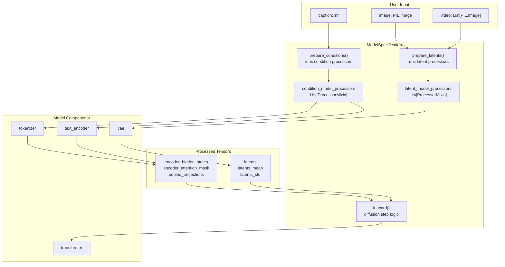
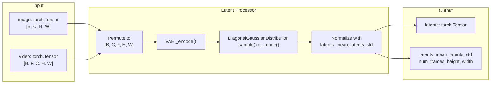
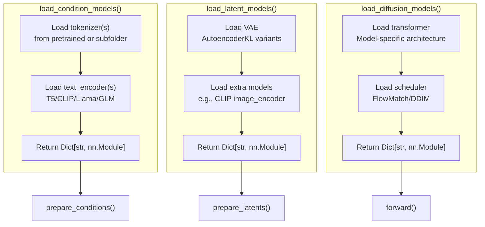
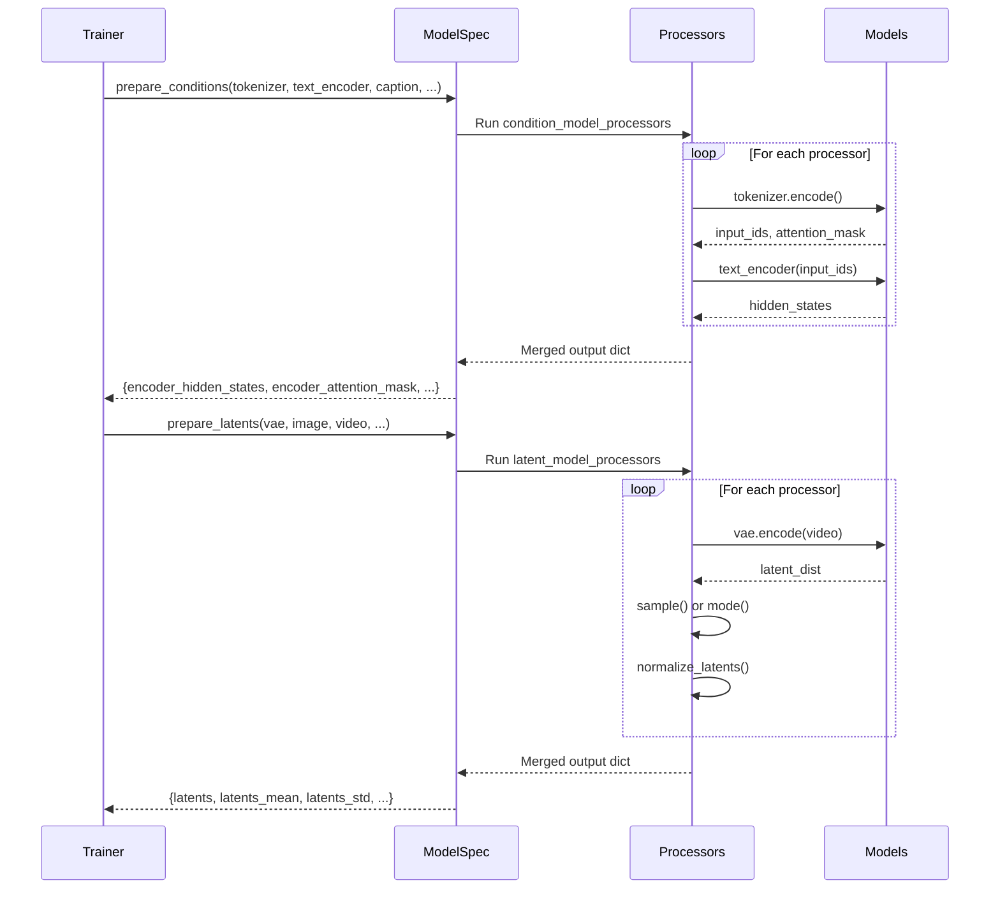
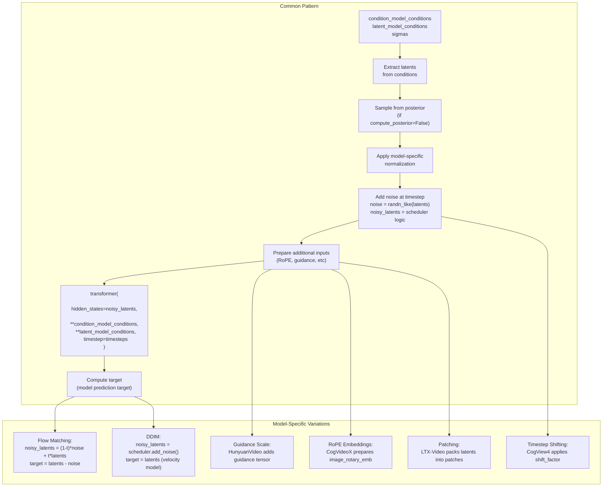
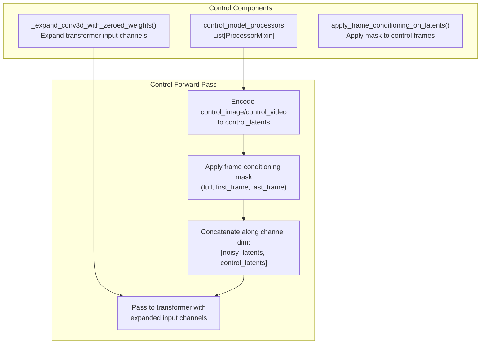

<!-- source: DeepWiki mcp.deepwiki.com · repo huggingface/finetrainers · page 6.3 Model-Specific Components · fetched 2026-10-26 -->

# Model-Specific Components

<details>
<summary>Relevant source files</summary>

The following files were used as context for generating this wiki page:

- [docs/models/flux.md](docs/models/flux.md)
- [examples/training/sft/flux_dev/raider_white_tarot/train.sh](examples/training/sft/flux_dev/raider_white_tarot/train.sh)
- [examples/training/sft/flux_dev/raider_white_tarot/training.json](examples/training/sft/flux_dev/raider_white_tarot/training.json)
- [examples/training/sft/flux_dev/raider_white_tarot/validation.json](examples/training/sft/flux_dev/raider_white_tarot/validation.json)
- [finetrainers/models/cogvideox/base_specification.py](finetrainers/models/cogvideox/base_specification.py)
- [finetrainers/models/cogview4/base_specification.py](finetrainers/models/cogview4/base_specification.py)
- [finetrainers/models/flux/__init__.py](finetrainers/models/flux/__init__.py)
- [finetrainers/models/hunyuan_video/base_specification.py](finetrainers/models/hunyuan_video/base_specification.py)
- [finetrainers/models/ltx_video/base_specification.py](finetrainers/models/ltx_video/base_specification.py)
- [finetrainers/models/wan/base_specification.py](finetrainers/models/wan/base_specification.py)
- [finetrainers/models/wan/control_specification.py](finetrainers/models/wan/control_specification.py)
- [finetrainers/parallel/accelerate.py](finetrainers/parallel/accelerate.py)
- [finetrainers/parallel/base.py](finetrainers/parallel/base.py)
- [finetrainers/parallel/ptd.py](finetrainers/parallel/ptd.py)
- [finetrainers/processors/t5.py](finetrainers/processors/t5.py)
- [tests/README.md](tests/README.md)

</details>


This page documents the model-specific components that enable finetrainers to support diverse diffusion architectures. Each model implements custom processors for text encoding and latent encoding, along with model-specific forward pass logic. For an overview of supported models and their training configurations, see [Supported Models](#6). For training-specific workflows, see [Training Workflows](#4).

## Architecture Overview

Each model in finetrainers is defined by a `ModelSpecification` subclass that encapsulates all model-specific logic. The key abstraction is the **processor system**, which provides a composable pipeline for transforming raw inputs (text, images, videos) into the tensors required by the diffusion model.



**Purpose**: This diagram shows how `ModelSpecification` orchestrates processors to transform user inputs into model-ready tensors.

Sources: [finetrainers/models/modeling_utils.py:1-200](), [finetrainers/models/wan/base_specification.py:210-260]()

## Processor System

### ProcessorMixin Base Class

All processors inherit from `ProcessorMixin`, which defines the interface for composable data transformations:

```mermaid
classDiagram
    class ProcessorMixin {
        +output_names: List[str]
        +input_names: Optional[Dict[str, Any]]
        +forward(**kwargs) Dict[str, torch.Tensor]
    }
    
    class T5Processor {
        +output_names: ["encoder_hidden_states", "encoder_attention_mask"]
        +forward(tokenizer, text_encoder, caption, max_sequence_length)
    }
    
    class LlamaProcessor {
        +output_names: ["encoder_hidden_states", "encoder_attention_mask"]
        +forward(tokenizer, text_encoder, caption, max_sequence_length)
    }
    
    class CLIPPooledProcessor {
        +output_names: ["pooled_projections"]
        +forward(tokenizer, text_encoder, caption, max_sequence_length)
    }
    
    class WanLatentEncodeProcessor {
        +output_names: ["latents", "latents_mean", "latents_std"]
        +forward(vae, image, video, generator, compute_posterior)
    }
    
    class HunyuanLatentEncodeProcessor {
        +output_names: ["latents"]
        +forward(vae, image, video, generator, compute_posterior)
    }
    
    class LTXLatentEncodeProcessor {
        +output_names: ["latents", "num_frames", "height", "width", "latents_mean", "latents_std"]
        +forward(vae, image, video, generator, compute_posterior)
    }
    
    ProcessorMixin <|-- T5Processor
    ProcessorMixin <|-- LlamaProcessor
    ProcessorMixin <|-- CLIPPooledProcessor
    ProcessorMixin <|-- WanLatentEncodeProcessor
    ProcessorMixin <|-- HunyuanLatentEncodeProcessor
    ProcessorMixin <|-- LTXLatentEncodeProcessor
```



**Key Design**: 
- `output_names` specifies the dictionary keys returned by `forward()`
- Special value `"__drop__"` in `output_names` indicates the output should be discarded
- `input_names` allows remapping model component names (e.g., `tokenizer_2` → `tokenizer`)

Sources: [finetrainers/processors/base.py:1-50](), [finetrainers/processors/t5.py:1-88]()

### Text/Condition Processors

Text processors encode captions into embeddings and attention masks. Each processor is tailored to a specific text encoder architecture:

| Processor Class | Text Encoder | Output Keys | Models Using It |
|-----------------|--------------|-------------|-----------------|
| `T5Processor` | T5EncoderModel / UMT5EncoderModel | `encoder_hidden_states`, `encoder_attention_mask` | Wan, LTX-Video, CogVideoX |
| `LlamaProcessor` | LlamaModel | `encoder_hidden_states`, `encoder_attention_mask` | HunyuanVideo |
| `CLIPPooledProcessor` | CLIPTextModel | `pooled_projections` | HunyuanVideo (secondary encoder) |
| `CogView4GLMProcessor` | GlmModel | `encoder_hidden_states` | CogView4 |
| `FluxT5Processor` | T5EncoderModel | `encoder_hidden_states` | Flux |
| `FluxCLIPProcessor` | CLIPTextModel | `pooled_projections` | Flux |

**T5Processor Example** ([finetrainers/processors/t5.py:37-87]()):
```python
def forward(
    self,
    tokenizer: Union[T5Tokenizer, T5TokenizerFast],
    text_encoder: T5EncoderModel,
    caption: Union[str, List[str]],
    max_sequence_length: int,
) -> Dict[str, torch.Tensor]:
    # Tokenize with padding and truncation
    text_inputs = tokenizer(
        caption,
        padding="max_length",
        max_length=max_sequence_length,
        truncation=True,
        return_tensors="pt",
    )
    
    # Encode to embeddings
    prompt_embeds = text_encoder(text_inputs.input_ids.to(device))[0]
    prompt_attention_mask = text_inputs.attention_mask.bool()
    
    return {
        self.output_names[0]: prompt_embeds,      # encoder_hidden_states
        self.output_names[1]: prompt_attention_mask,  # encoder_attention_mask
    }
```

Sources: [finetrainers/processors/t5.py:9-88](), [finetrainers/processors/llama.py:1-100](), [finetrainers/processors/clip.py:1-80]()

### Latent Processors

Latent processors encode images/videos into the VAE latent space. Each model has custom normalization, posterior sampling, and metadata requirements:



**Model-Specific Differences**:

| Model | Posterior Sampling | Normalization | Additional Outputs |
|-------|-------------------|---------------|-------------------|
| Wan | `sample()` or raw moments | Custom `_normalize_latents()` | `latents_mean`, `latents_std` |
| HunyuanVideo | `sample()` | VAE `scaling_factor` | None |
| LTX-Video | `sample()` | Custom `_normalize_latents()` | `num_frames`, `height`, `width`, `latents_mean`, `latents_std` |
| CogVideoX | `sample()` | VAE `scaling_factor` | None (permuted back to `[B, F, C, H, W]`) |
| CogView4 | `sample()` | VAE `scaling_factor` + `shift_factor` | `original_size`, `target_size`, `crop_coords` |

**WanLatentEncodeProcessor** ([finetrainers/models/wan/base_specification.py:30-82]()):
```python
def forward(
    self,
    vae: AutoencoderKLWan,
    image: Optional[torch.Tensor] = None,
    video: Optional[torch.Tensor] = None,
    generator: Optional[torch.Generator] = None,
    compute_posterior: bool = True,
) -> Dict[str, torch.Tensor]:
    if image is not None:
        video = image.unsqueeze(1)
    
    video = video.permute(0, 2, 1, 3, 4)  # [B, F, C, H, W] -> [B, C, F, H, W]
    
    if compute_posterior:
        latents = vae.encode(video).latent_dist.sample(generator=generator)
    else:
        moments = vae._encode(video)  # Return raw mean/logvar
        latents = moments
    
    latents_mean = torch.tensor(vae.config.latents_mean)
    latents_std = 1.0 / torch.tensor(vae.config.latents_std)
    
    return {
        self.output_names[0]: latents,
        self.output_names[1]: latents_mean,
        self.output_names[2]: latents_std,
    }
```

**LTX-Video Packing** ([finetrainers/models/ltx_video/base_specification.py:438-460]()):
LTX-Video requires patching latents into tokens before passing to the transformer:
```python
@staticmethod
def _pack_latents(latents: torch.Tensor, patch_size: int, patch_size_t: int) -> torch.Tensor:
    # [B, C, F, H, W] -> [B, F//p_t * H//p * W//p, C * p_t * p * p]
    batch_size, num_channels, num_frames, height, width = latents.shape
    latents = latents.reshape(
        batch_size, -1,
        num_frames // patch_size_t, patch_size_t,
        height // patch_size, patch_size,
        width // patch_size, patch_size,
    )
    latents = latents.permute(0, 2, 4, 6, 1, 3, 5, 7).flatten(4, 7).flatten(1, 3)
    return latents
```

Sources: [finetrainers/models/wan/base_specification.py:30-82](), [finetrainers/models/hunyuan_video/base_specification.py:28-73](), [finetrainers/models/ltx_video/base_specification.py:32-91](), [finetrainers/models/cogvideox/base_specification.py:31-77](), [finetrainers/models/cogview4/base_specification.py:28-93]()

## ModelSpecification Interface

### Component Loading

Each `ModelSpecification` subclass implements three loading methods:



**Implementation Pattern** (from Wan):
```python
class WanModelSpecification(ModelSpecification):
    def load_condition_models(self) -> Dict[str, torch.nn.Module]:
        tokenizer = AutoTokenizer.from_pretrained(
            self.pretrained_model_name_or_path, subfolder="tokenizer"
        )
        text_encoder = UMT5EncoderModel.from_pretrained(
            self.pretrained_model_name_or_path, subfolder="text_encoder",
            torch_dtype=self.text_encoder_dtype
        )
        return {"tokenizer": tokenizer, "text_encoder": text_encoder}
    
    def load_latent_models(self) -> Dict[str, torch.nn.Module]:
        vae = AutoencoderKLWan.from_pretrained(
            self.pretrained_model_name_or_path, subfolder="vae",
            torch_dtype=self.vae_dtype
        )
        # Wan I2V also loads CLIP image_encoder
        if self.transformer_config.get("image_dim") is not None:
            image_encoder = CLIPVisionModel.from_pretrained(...)
            image_processor = CLIPImageProcessor.from_pretrained(...)
            return {"vae": vae, "image_encoder": image_encoder, "image_processor": image_processor}
        return {"vae": vae}
    
    def load_diffusion_models(self) -> Dict[str, torch.nn.Module]:
        transformer = WanTransformer3DModel.from_pretrained(
            self.pretrained_model_name_or_path, subfolder="transformer",
            torch_dtype=self.transformer_dtype
        )
        scheduler = FlowMatchEulerDiscreteScheduler()
        return {"transformer": transformer, "scheduler": scheduler}
```

Sources: [finetrainers/models/wan/base_specification.py:265-330](), [finetrainers/models/hunyuan_video/base_specification.py:127-204]()

### Preparation Methods

The `prepare_conditions()` and `prepare_latents()` methods orchestrate processors:



**Base Implementation** ([finetrainers/models/modeling_utils.py:150-200]()):
```python
class ModelSpecification:
    @torch.no_grad()
    def prepare_conditions(self, **kwargs) -> Dict[str, Any]:
        return self._run_processors(self.condition_model_processors, **kwargs)
    
    @torch.no_grad()
    def prepare_latents(self, **kwargs) -> Dict[str, torch.Tensor]:
        return self._run_processors(self.latent_model_processors, **kwargs)
    
    def _run_processors(
        self, processors: List[ProcessorMixin], **kwargs
    ) -> Dict[str, Any]:
        outputs = {}
        for processor in processors:
            processor_kwargs = self._filter_processor_kwargs(processor, kwargs)
            processor_outputs = processor(**processor_kwargs)
            # Merge outputs, dropping keys marked with "__drop__"
            for k, v in processor_outputs.items():
                if k != "__drop__":
                    outputs[k] = v
        return outputs
```

Sources: [finetrainers/models/modeling_utils.py:100-200]()

### Forward Pass Implementation

The `forward()` method implements model-specific diffusion training logic:



**Flow Matching Example (Wan)** ([finetrainers/models/wan/base_specification.py:433-493]()):
```python
def forward(
    self,
    transformer: WanTransformer3DModel,
    condition_model_conditions: Dict[str, torch.Tensor],
    latent_model_conditions: Dict[str, torch.Tensor],
    sigmas: torch.Tensor,
    generator: Optional[torch.Generator] = None,
    compute_posterior: bool = True,
    **kwargs,
) -> Tuple[torch.Tensor, ...]:
    # Extract and normalize latents
    latents = latent_model_conditions.pop("latents")
    if not compute_posterior:
        latents_mean = latent_model_conditions.pop("latents_mean")
        latents_std = latent_model_conditions.pop("latents_std")
        mu, logvar = torch.chunk(latents, 2, dim=1)
        mu = self._normalize_latents(mu, latents_mean, latents_std)
        logvar = self._normalize_latents(logvar, latents_mean, latents_std)
        latents = torch.cat([mu, logvar], dim=1)
        posterior = DiagonalGaussianDistribution(latents)
        latents = posterior.sample(generator=generator)
    
    # Flow matching noise schedule
    noise = torch.zeros_like(latents).normal_(generator=generator)
    noisy_latents = FF.flow_match_xt(latents, noise, sigmas)  # (1-t)*noise + t*latents
    timesteps = (sigmas.flatten() * 1000.0).long()
    
    latent_model_conditions["hidden_states"] = noisy_latents
    
    # Forward pass
    pred = transformer(
        **latent_model_conditions,
        **condition_model_conditions,
        timestep=timesteps,
        return_dict=False,
    )[0]
    
    # Compute target
    target = FF.flow_match_target(noise, latents)  # latents - noise
    
    return pred, target, sigmas
```

**DDIM Example (CogVideoX)** ([finetrainers/models/cogvideox/base_specification.py:258-333]()):
```python
def forward(
    self,
    transformer: CogVideoXTransformer3DModel,
    scheduler: CogVideoXDDIMScheduler,
    condition_model_conditions: Dict[str, torch.Tensor],
    latent_model_conditions: Dict[str, torch.Tensor],
    sigmas: torch.Tensor,
    generator: Optional[torch.Generator] = None,
    compute_posterior: bool = True,
    **kwargs,
) -> Tuple[torch.Tensor, ...]:
    # Sample posterior
    if not compute_posterior:
        posterior = DiagonalGaussianDistribution(latents, _dim=2)
        latents = posterior.sample(generator=generator)
    
    latents = latents * self.vae_config.scaling_factor
    
    # DDIM noise schedule
    timesteps = (sigmas.flatten() * 1000.0).long()
    noise = torch.zeros_like(latents).normal_(generator=generator)
    noisy_latents = scheduler.add_noise(latents, noise, timesteps)
    
    # Prepare RoPE embeddings
    image_rotary_emb = prepare_rotary_positional_embeddings(
        height, width, num_frames, ...
    )
    
    latent_model_conditions["hidden_states"] = noisy_latents
    latent_model_conditions["image_rotary_emb"] = image_rotary_emb
    
    # Forward pass (predicts velocity)
    velocity = transformer(...)[0]
    
    # Convert velocity to prediction
    pred = scheduler.get_velocity(velocity, noisy_latents, timesteps)
    target = latents  # Target is clean latents
    
    return pred, target, sigmas
```

Sources: [finetrainers/models/wan/base_specification.py:433-493](), [finetrainers/models/cogvideox/base_specification.py:258-333](), [finetrainers/models/ltx_video/base_specification.py:271-345]()

## Model-Specific Implementations

### Wan (Text-to-Video, Image-to-Video, First+Last Frame-to-Video)

**Unique Features**:
- Supports T2V, I2V, and FLF2V (first+last frame) modes
- Custom latent normalization outside VAE
- I2V mode adds CLIP image conditioning

**Processors** ([finetrainers/models/wan/base_specification.py:240-260]()):
```python
condition_model_processors = [
    T5Processor(["encoder_hidden_states", "__drop__"])
]

latent_model_processors = [
    WanLatentEncodeProcessor(["latents", "latents_mean", "latents_std"])
]

# For I2V/FLF2V models
if transformer_config.get("image_dim") is not None:
    latent_model_processors.extend([
        WanImageConditioningLatentEncodeProcessor([
            "latent_condition", "__drop__", "__drop__", "latent_condition_mask"
        ], use_last_frame=use_last_frame),
        WanImageEncodeProcessor(["encoder_hidden_states_image"], use_last_frame=use_last_frame)
    ])
```

**Forward Pass** ([finetrainers/models/wan/base_specification.py:433-493]()):
- Normalizes latents using `latents_mean` and `latents_std` from VAE config
- For I2V, concatenates `[noisy_latents, latent_condition_mask, latent_condition]` along channel dimension
- Uses flow matching: `noisy_latents = (1-t)*noise + t*latents`, `target = latents - noise`

Sources: [finetrainers/models/wan/base_specification.py:210-578]()

### HunyuanVideo

**Unique Features**:
- Dual text encoders: Llama (primary) + CLIP (pooled projections)
- Guidance conditioning via `guidance` tensor

**Processors** ([finetrainers/models/hunyuan_video/base_specification.py:109-121]()):
```python
condition_model_processors = [
    LlamaProcessor(["encoder_hidden_states", "encoder_attention_mask"]),
    CLIPPooledProcessor(
        ["pooled_projections"],
        input_names={"tokenizer_2": "tokenizer", "text_encoder_2": "text_encoder"}
    )
]

latent_model_processors = [
    HunyuanLatentEncodeProcessor(["latents"])
]
```

**Forward Pass** ([finetrainers/models/hunyuan_video/base_specification.py:294-330]()):
- Scales latents by `vae.config.scaling_factor`
- Adds guidance tensor: `guidance = torch.full((batch_size,), fill_value=guidance) * 1000.0`
- Uses flow matching

Sources: [finetrainers/models/hunyuan_video/base_specification.py:75-392]()

### LTX-Video

**Unique Features**:
- Returns latent spatial/temporal dimensions for RoPE calculation
- Packs latents into patches before transformer
- First-frame conditioning with sigma randomization

**Processors** ([finetrainers/models/ltx_video/base_specification.py:123-131]()):
```python
condition_model_processors = [
    T5Processor(["encoder_hidden_states", "encoder_attention_mask"])
]

latent_model_processors = [
    LTXLatentEncodeProcessor([
        "latents", "num_frames", "height", "width", "latents_mean", "latents_std"
    ])
]
```

**Forward Pass** ([finetrainers/models/ltx_video/base_specification.py:271-345]()):
```python
# Normalize latents
latents = self._normalize_latents(latents, latents_mean, latents_std)

# First frame conditioning (10% probability)
if random.random() < 0.1:
    first_frame_sigma = torch.rand_like(sigmas) * sigmas
    first_frame_sigma = torch.min(first_frame_sigma, sigmas.new_full(sigmas.shape, 0.25))
    noisy_latents_first_frame = FF.flow_match_xt(latents[:, :, :1], noise[:, :, :1], first_frame_sigma)
    noisy_latents_remaining = FF.flow_match_xt(latents[:, :, 1:], noise[:, :, 1:], sigmas)
    noisy_latents = torch.cat([noisy_latents_first_frame, noisy_latents_remaining], dim=2)

# Pack into patches
noisy_latents = self._pack_latents(noisy_latents, patch_size, patch_size_t)

# Prepare RoPE interpolation scale
rope_interpolation_scale = [1 / latent_frame_rate, vae_compression, vae_compression]
```

Sources: [finetrainers/models/ltx_video/base_specification.py:93-460]()

### CogVideoX

**Unique Features**:
- Latents permuted to `[B, F, C, H, W]` (frame-first order)
- Frame padding to match `patch_size_t`
- RoPE embeddings prepared externally
- Transformer predicts velocity, not noise

**Processors** ([finetrainers/models/cogvideox/base_specification.py:109-115]()):
```python
condition_model_processors = [
    T5Processor(["encoder_hidden_states", "prompt_attention_mask"])
]

latent_model_processors = [
    CogVideoXLatentEncodeProcessor(["latents"])  # Returns [B, F, C, H, W]
]
```

**Forward Pass** ([finetrainers/models/cogvideox/base_specification.py:258-333]()):
```python
# Pad frames to multiple of patch_size_t
if patch_size_t is not None:
    latents = self._pad_frames(latents, patch_size_t)

# DDIM noise schedule
noisy_latents = scheduler.add_noise(latents, noise, timesteps)

# Prepare RoPE embeddings
image_rotary_emb = prepare_rotary_positional_embeddings(
    height * VAE_SPATIAL_SCALE_FACTOR,
    width * VAE_SPATIAL_SCALE_FACTOR,
    num_frames,
    vae_scale_factor_spatial=VAE_SPATIAL_SCALE_FACTOR,
    patch_size=patch_size,
    patch_size_t=patch_size_t,
    attention_head_dim=self.transformer_config.attention_head_dim,
    device=transformer.device,
)

# Transformer predicts velocity
velocity = transformer(...)[0]
pred = scheduler.get_velocity(velocity, noisy_latents, timesteps)
target = latents  # Target is clean latents, not noise
```

Sources: [finetrainers/models/cogvideox/base_specification.py:79-411](), [finetrainers/models/cogvideox/utils.py:1-100]()

### CogView4 (Image Generation)

**Unique Features**:
- GLM text encoder (chat-based model)
- Returns `original_size`, `target_size`, `crop_coords` for conditioning
- Timestep shifting for improved quality
- Uses `shift_factor` and `scaling_factor` for latent normalization

**Processors** ([finetrainers/models/cogview4/base_specification.py:125-133]()):
```python
condition_model_processors = [
    CogView4GLMProcessor(["encoder_hidden_states"])
]

latent_model_processors = [
    CogView4LatentEncodeProcessor(["latents", "original_size", "target_size", "crop_coords"])
]
```

**Forward Pass** ([finetrainers/models/cogview4/base_specification.py:278-327]()):
```python
# Apply shift_factor normalization
if getattr(self.vae_config, "shift_factor") is not None:
    latents = (latents - self.vae_config.shift_factor) * self.vae_config.scaling_factor
else:
    latents = latents * self.vae_config.scaling_factor

# Timestep shifting based on image sequence length
image_sequence_length = latents.size(2) * latents.size(3) // self.transformer_config.patch_size**2
mu = (image_sequence_length / base_image_sequence_length) ** 0.5
mu = mu * max_shift + base_shift
shifted_sigmas = mu / (mu + (1 / sigmas - 1) ** 1.0)

# Flow matching with shifted timesteps
noisy_latents = FF.flow_match_xt(latents, noise, shifted_sigmas)
target = FF.flow_match_target(noise, latents)

# Note: Returns shifted_sigmas for loss weighting
return pred, target, shifted_sigmas
```

Sources: [finetrainers/models/cogview4/base_specification.py:95-386]()

### Flux (Image Generation)

**Unique Features**:
- Dual text encoders: T5 + CLIP
- Guidance embedding hardcoded to 1.0 (guidance-distilled model)
- RoPE embeddings with text sequence length consideration

**Processors**:
```python
condition_model_processors = [
    FluxT5Processor(["encoder_hidden_states", "text_ids"]),
    FluxCLIPProcessor(["pooled_projections"])
]

latent_model_processors = [
    FluxLatentEncodeProcessor(["latents", "height", "width"])
]
```

**Forward Pass**:
- Packs latents with `patch_size=2`
- Prepares RoPE image and text IDs
- Adds guidance embedding (fixed at 1.0 for FLUX.1-dev)

Sources: [finetrainers/models/flux/base_specification.py:1-500]()

## Control Training Components

For models supporting control training (Wan, CogView4), additional components enable conditional generation:



**Example: WanControlModelSpecification** ([finetrainers/models/wan/control_specification.py:67-76]()):
```python
control_model_processors = [
    WanLatentEncodeProcessor(["control_latents", "__drop__", "__drop__"])
]

# Expand transformer input channels for control concatenation
def load_diffusion_models(self, new_in_features: int):
    transformer = WanTransformer3DModel.from_pretrained(...)
    transformer.patch_embedding = _expand_conv3d_with_zeroed_weights(
        transformer.patch_embedding, new_in_channels=new_in_features
    )
    return {"transformer": transformer, "scheduler": scheduler}
```

**Frame Conditioning** ([finetrainers/trainer/control_trainer/data.py:1-100]()):
```python
def apply_frame_conditioning_on_latents(
    control_latents: torch.Tensor,
    target_num_frames: int,
    channel_dim: int,
    frame_dim: int,
    frame_conditioning_type: str,  # "full", "first_frame", "last_frame"
    frame_conditioning_index: int,
    concatenate_mask: bool,
) -> torch.Tensor:
    # Apply mask based on conditioning type
    if frame_conditioning_type == "first_frame":
        mask = create_first_frame_mask(control_latents.shape)
    elif frame_conditioning_type == "last_frame":
        mask = create_last_frame_mask(control_latents.shape)
    else:  # "full"
        mask = torch.ones_like(control_latents)
    
    control_latents = control_latents * mask
    
    if concatenate_mask:
        control_latents = torch.cat([control_latents, mask], dim=channel_dim)
    
    return control_latents
```

Sources: [finetrainers/models/wan/control_specification.py:36-420](), [finetrainers/models/cogview4/control_specification.py:1-300]()

## Resolution Dimension Keys

Each model specification defines `_resolution_dim_keys` to indicate which dimensions of latent tensors correspond to spatial/temporal resolution:

| Model | `_resolution_dim_keys` | Explanation |
|-------|----------------------|-------------|
| Wan | `{"latents": (2, 3, 4)}` | Dims 2, 3, 4 of shape `[B, C, F, H, W]` |
| HunyuanVideo | `{"latents": (2, 3, 4)}` | Dims 2, 3, 4 of shape `[B, C, F, H, W]` |
| LTX-Video | `{"latents": (2, 3, 4)}` | Dims 2, 3, 4 of shape `[B, C, F, H, W]` |
| CogVideoX | `{"latents": (1, 3, 4)}` | Dims 1, 3, 4 of shape `[B, F, C, H, W]` (frame-first) |
| CogView4 | `{"latents": (2, 3)}` | Dims 2, 3 of shape `[B, C, H, W]` |
| Flux | `{"latents": (2, 3)}` | Dims 2, 3 of shape `[B, C, H, W]` |

This information is used by the [Resolution Sampler](#5.2) to bucket samples by resolution.

Sources: [finetrainers/models/wan/base_specification.py:261-263](), [finetrainers/models/cogvideox/base_specification.py:117-119]()

## Summary

The model-specific components in finetrainers follow a consistent pattern:

1. **Processors** define composable transformations for text and latents
2. **ModelSpecification** subclasses implement loading, preparation, and forward logic
3. **Forward pass** varies by model (flow matching vs DDIM, velocity vs noise prediction, timestep shifting)
4. **Control training** extends base models with additional input channels and frame conditioning

This architecture enables supporting diverse diffusion models (video/image, T2V/I2V, different encoders) while maintaining a unified training interface.

Sources: [finetrainers/models/modeling_utils.py:1-300](), [finetrainers/processors/base.py:1-50](), [finetrainers/models/wan/base_specification.py:1-578](), [finetrainers/models/hunyuan_video/base_specification.py:1-392](), [finetrainers/models/ltx_video/base_specification.py:1-505](), [finetrainers/models/cogvideox/base_specification.py:1-411](), [finetrainers/models/cogview4/base_specification.py:1-386]()

---

