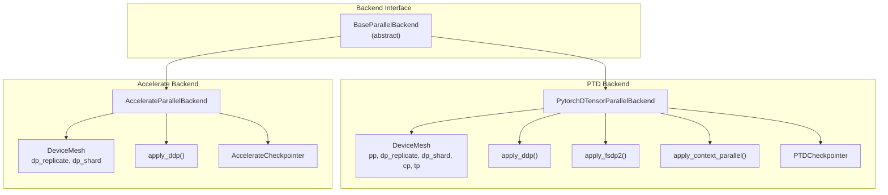
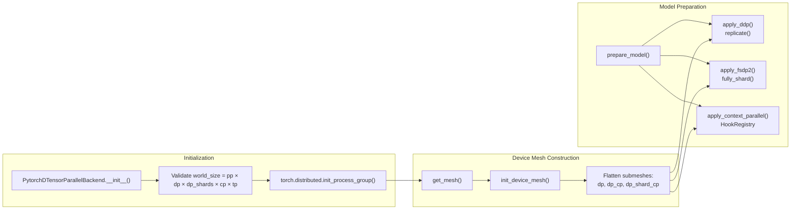
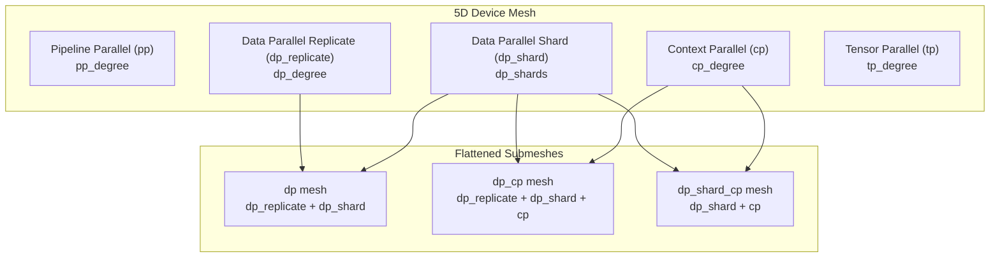
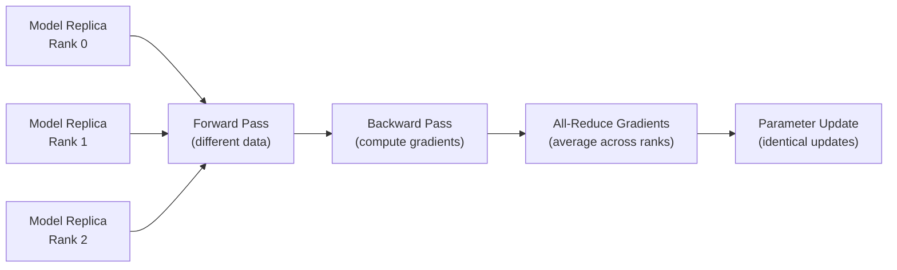
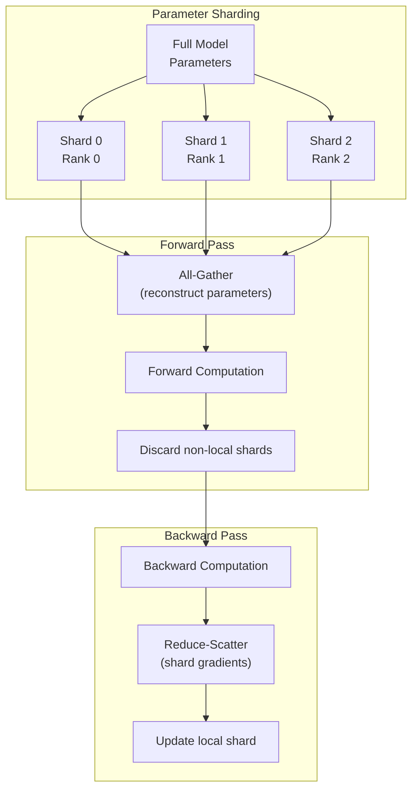
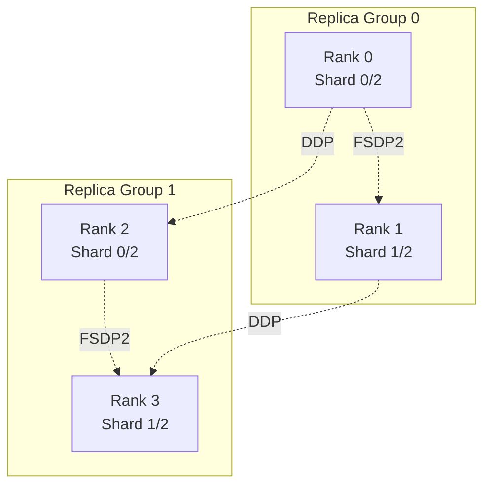
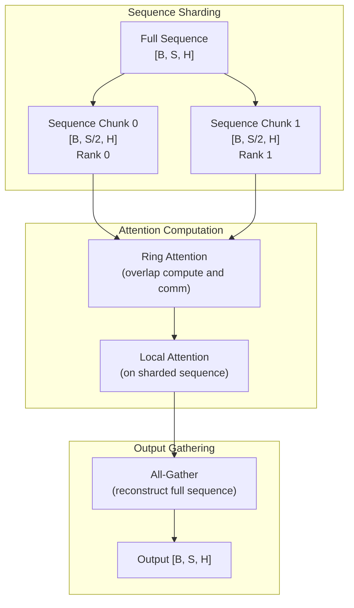
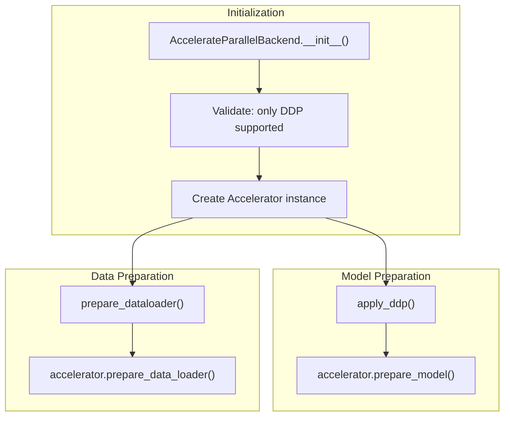
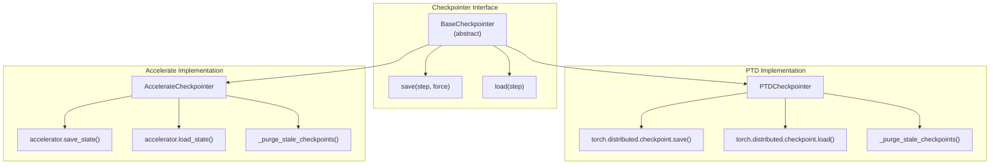

<!-- source: DeepWiki mcp.deepwiki.com · repo huggingface/finetrainers · page 7 Parallelism and Distribution · fetched 2026-10-26 -->

# Parallelism and Distribution

<details>
<summary>Relevant source files</summary>

The following files were used as context for generating this wiki page:

- [.gitignore](.gitignore)
- [README.md](README.md)
- [finetrainers/functional/__init__.py](finetrainers/functional/__init__.py)
- [finetrainers/functional/text.py](finetrainers/functional/text.py)
- [finetrainers/models/cogview4/base_specification.py](finetrainers/models/cogview4/base_specification.py)
- [finetrainers/parallel/accelerate.py](finetrainers/parallel/accelerate.py)
- [finetrainers/parallel/base.py](finetrainers/parallel/base.py)
- [finetrainers/parallel/ptd.py](finetrainers/parallel/ptd.py)
- [finetrainers/utils/__init__.py](finetrainers/utils/__init__.py)
- [finetrainers/utils/torch.py](finetrainers/utils/torch.py)
- [tests/README.md](tests/README.md)
- [tests/trainer/test_sft_trainer.py](tests/trainer/test_sft_trainer.py)

</details>


This document describes the distributed training system in finetrainers, which enables scaling model training across multiple GPUs and nodes. The system provides a backend abstraction layer that supports various parallelism strategies including Data Parallel (DDP), Fully Sharded Data Parallel (FSDP2), Hybrid Sharded Data Parallel (HSDP), Context Parallel (CP), and Tensor Parallel (TP).

For information about trainer-specific configurations, see [Training Workflows](#4). For model-specific parallelism considerations, see [Supported Models](#6).

## Backend Architecture

The parallelism system is built around an abstract `BaseParallelBackend` interface with two concrete implementations: `PytorchDTensorParallelBackend` for advanced multi-dimensional parallelism and `AccelerateParallelBackend` for simpler DDP-based training.



**BaseParallelBackend Interface**

The base class defines the contract that all parallel backends must implement:

| Method | Purpose |
|--------|---------|
| `enable_determinism()` | Set seed for reproducible training |
| `apply_ddp()` | Apply data parallel replication |
| `apply_fsdp2()` | Apply parameter/gradient sharding |
| `apply_context_parallel()` | Apply sequence dimension sharding |
| `prepare_model()` | Wrap model for distributed training |
| `prepare_dataset()` | Partition dataset across ranks |
| `prepare_dataloader()` | Create distributed dataloader |
| `prepare_optimizer()` | Prepare optimizer for distributed training |
| `get_mesh()` | Retrieve device mesh topology |
| `get_checkpointer()` | Create checkpointer instance |
| `wait_for_everyone()` | Synchronization barrier |

Sources: [finetrainers/parallel/base.py:9-116]()

**Backend Selection**

Backends are selected via the `parallel_backend` argument:

```python
# PTD backend (advanced)
args.parallel_backend = "ptd"
args.dp_degree = 2
args.dp_shards = 2
args.cp_degree = 2
args.tp_degree = 2

# Accelerate backend (simple)
args.parallel_backend = "accelerate"
args.dp_degree = 2
```

Sources: [tests/trainer/test_sft_trainer.py:122-127](), [tests/trainer/test_sft_trainer.py:240-248]()

## PyTorch DTensor Backend

`PytorchDTensorParallelBackend` provides advanced multi-dimensional parallelism using PyTorch's DTensor infrastructure. It constructs a multi-dimensional device mesh with up to five orthogonal dimensions.



**Device Mesh Topology**

The device mesh is a multi-dimensional grid that organizes GPUs into orthogonal parallelism dimensions:



The mesh dimensions are constructed only when `degree > 1`. The initialization validates that the product of all degrees equals `world_size`:

```
world_size = pp_degree × dp_degree × dp_shards × cp_degree × tp_degree
```

Sources: [finetrainers/parallel/ptd.py:41-91](), [finetrainers/parallel/ptd.py:161-209]()

**Mesh Dimension Properties**

| Property | Condition | Purpose |
|----------|-----------|---------|
| `pipeline_parallel_enabled` | `pp_degree > 1` | Stage-based model parallelism |
| `data_replication_enabled` | `dp_degree > 1` | Gradient all-reduce without sharding |
| `data_sharding_enabled` | `dp_shards > 1` | FSDP/HSDP parameter sharding |
| `context_parallel_enabled` | `cp_degree > 1` | Sequence dimension sharding |
| `tensor_parallel_enabled` | `tp_degree > 1` | Intra-layer parallelism |

Sources: [finetrainers/parallel/ptd.py:257-279]()

## Parallelism Strategies

### Data Parallel (DDP)

DDP replicates the model across all ranks and performs gradient all-reduce after backward pass. It's enabled when `dp_degree > 1` with `dp_shards == 1`.



**Implementation**

PTD backend uses `torch.distributed._composable.replicate.replicate()`:

```python
def apply_ddp(model: torch.nn.Module, dp_mesh: torch.distributed.device_mesh.DeviceMesh) -> None:
    replicate(model, device_mesh=dp_mesh, bucket_cap_mb=100)
```

Accelerate backend wraps model with `Accelerator.prepare_model()` which internally applies DDP.

Sources: [finetrainers/parallel/ptd.py:99-106](), [finetrainers/parallel/ptd.py:462-463](), [finetrainers/parallel/accelerate.py:100-123]()

### Fully Sharded Data Parallel (FSDP2)

FSDP2 shards model parameters, gradients, and optimizer states across ranks. It's enabled when `dp_shards > 1` with `dp_degree == 1`.



**Implementation**

FSDP2 is applied block-by-block to transformer layers, then to the entire model:

```python
def apply_fsdp2(
    model: torch.nn.Module,
    dp_mesh: torch.distributed.device_mesh.DeviceMesh,
    param_dtype: torch.dtype,
    reduce_dtype: torch.dtype,
    output_dtype: torch.dtype,
    pp_enabled: bool = False,
    cpu_offload: bool = False,
) -> None:
    mp_policy = MixedPrecisionPolicy(param_dtype, reduce_dtype, output_dtype, cast_forward_inputs=True)
    fsdp_config = {"mesh": dp_mesh, "mp_policy": mp_policy}
    
    if cpu_offload:
        fsdp_config["offload_policy"] = CPUOffloadPolicy(pin_memory=True)
    
    # Apply to transformer blocks
    for transformer_block_name in DIFFUSERS_TRANSFORMER_BLOCK_NAMES:
        blocks = getattr(model, transformer_block_name, None)
        if blocks is not None:
            for layer_index, block in enumerate(blocks):
                reshard_after_forward = layer_index < len(blocks) - 1
                fully_shard(block, **fsdp_config, reshard_after_forward=reshard_after_forward)
    
    # Apply to entire model
    fully_shard(model, **fsdp_config, reshard_after_forward=not pp_enabled)
```

Sources: [finetrainers/parallel/ptd.py:108-122](), [finetrainers/parallel/ptd.py:466-499]()

### Hybrid Sharded Data Parallel (HSDP)

HSDP combines DDP and FSDP2 by organizing ranks into replica groups (DDP) where each group shards parameters (FSDP2). It's enabled when both `dp_degree > 1` and `dp_shards > 1`.



HSDP is automatically configured when the mesh includes both `dp_replicate` and `dp_shard` dimensions. The same `apply_fsdp2()` function handles HSDP by using the submesh that includes both dimensions.

Sources: [finetrainers/parallel/ptd.py:186-205]()

### Context Parallel (CP)

Context Parallel shards the sequence dimension across ranks, enabling training with longer sequences. It's enabled when `cp_degree > 1`.



**Implementation**

CP uses model hooks to automatically shard inputs and gather outputs. The system defines `CPInput` and `CPOutput` metadata for each layer:

```python
def apply_context_parallel(
    model: torch.nn.Module,
    mesh: torch.distributed.device_mesh.DeviceMesh,
    plan: Optional[Dict[str, ContextParallelModelPlan]] = None,
) -> None:
    model_cls = unwrap_module(model).__class__
    
    if plan is None:
        plan = TransformerRegistry.get(model_cls).cp_plan
    
    for module_id, cp_model_plan in plan.items():
        module = get_submodule_by_name(model, module_id)
        if not isinstance(module, list):
            module = [module]
        
        for m in module:
            registry = HookRegistry.check_if_exists_or_initialize(m)
            if isinstance(cp_model_plan, list):
                # CPOutput: gather after forward
                hook = ContextParallelGatherHook(cp_model_plan, mesh)
            else:
                # CPInput: shard before forward
                hook = ContextParallelSplitHook(cp_model_plan, mesh)
            registry.register_hook(hook, hook_name)
```

The hooks use `_EquipartitionSharder` to shard/unshard tensors:

```python
class _EquipartitionSharder:
    @classmethod
    def shard(cls, tensor: torch.Tensor, dim: int, mesh: DeviceMesh) -> torch.Tensor:
        assert tensor.size()[dim] % mesh.size() == 0
        return tensor.chunk(mesh.size(), dim=dim)[mesh.get_local_rank()]
    
    @classmethod
    def unshard(cls, tensor: torch.Tensor, dim: int, mesh: DeviceMesh) -> torch.Tensor:
        tensor = tensor.contiguous()
        result = DTensor.from_local(tensor, mesh, placements=[Shard(dim)]).full_tensor()
        return result
```

Sources: [finetrainers/parallel/ptd.py:124-131](), [finetrainers/parallel/ptd.py:502-530](), [finetrainers/parallel/ptd.py:647-666]()

### Tensor Parallel (TP)

Tensor Parallel shards model layers across ranks. While the infrastructure exists (`tp_degree` parameter), full TP implementation is model-specific and not fully implemented in all models. The mesh dimension is created when `tp_degree > 1`.

Sources: [finetrainers/parallel/ptd.py:46-49](), [finetrainers/parallel/ptd.py:277-279]()

### Pipeline Parallel (PP)

Pipeline Parallel splits the model into stages across ranks. While the infrastructure exists (`pp_degree` parameter), full PP implementation requires model-specific stage partitioning and is not fully implemented.

Sources: [finetrainers/parallel/ptd.py:45](), [finetrainers/parallel/ptd.py:257-259]()

## Accelerate Backend

`AccelerateParallelBackend` provides a simpler alternative using Hugging Face Accelerate. It only supports DDP and has limited parallelism dimensions.



**Limitations**

The Accelerate backend explicitly rejects advanced parallelism:

```python
if pp_degree > 1 or dp_shards > 1 or cp_degree > 1 or tp_degree > 1:
    raise ValueError(
        "AccelerateParallelBackend does not support anything but Distributed Data Parallelism at the moment."
    )
if dp_degree != world_size:
    raise ValueError("Data parallel degree must be equal to world size.")
```

Sources: [finetrainers/parallel/accelerate.py:37-95](), [finetrainers/parallel/accelerate.py:68-73]()

## Distributed Checkpointing

The checkpointing system saves and loads distributed training state including model parameters, optimizer state, learning rate schedulers, and custom training state.



**PTDCheckpointer**

Uses PyTorch's distributed checkpoint API with stateful objects:

```python
class PTDCheckpointer(BaseCheckpointer):
    def __init__(
        self,
        dataloader: torch.utils.data.DataLoader,
        model_parts: List[torch.nn.Module],
        optimizers: OptimizerWrapper,
        schedulers: SchedulerWrapper,
        states: Dict[str, Any],
        checkpointing_steps: int,
        checkpointing_limit: int,
        output_dir: str,
        ...
    ) -> None:
        self.states = states
        self.states.update({
            "model": ModelWrapper(model_parts),
            "optimizer": optimizers,
            "dataloader": dataloader,
        })
        self.states.update(schedulers.get_lr_scheduler_state())
    
    def save(self, step: int = -1, force: bool = False, ...) -> str:
        checkpoint_dir = self._get_checkpoint_dir(step)
        torch.distributed.checkpoint.save(self.states, checkpoint_id=checkpoint_dir.as_posix())
        self._purge_stale_checkpoints()
        return checkpoint_dir.as_posix()
    
    def load(self, step: int = -1) -> bool:
        checkpoint_dir = self._get_checkpoint_dir(step)
        torch.distributed.checkpoint.load(states, checkpoint_id=checkpoint_dir.as_posix())
        return True
```

The `ModelWrapper` class provides a stateful interface for distributed checkpoint:

```python
class ModelWrapper(torch.distributed.checkpoint.stateful.Stateful):
    def __init__(self, model: Union[torch.nn.Module, List[torch.nn.Module]]) -> None:
        self.model = [model] if isinstance(model, torch.nn.Module) else model
    
    def state_dict(self) -> Dict[str, Any]:
        return {k: v for sd in map(get_model_state_dict, self.model) for k, v in sd.items()}
    
    def load_state_dict(self, state_dict: Dict[str, Any]) -> None:
        func = functools.partial(
            set_model_state_dict,
            model_state_dict=state_dict,
            options=StateDictOptions(strict=False),
        )
        list(map(func, self.model))
```

Sources: [finetrainers/parallel/ptd.py:298-412](), [finetrainers/parallel/ptd.py:282-295]()

**AccelerateCheckpointer**

Delegates to Accelerate's state management:

```python
class AccelerateCheckpointer(BaseCheckpointer):
    def __init__(self, accelerator: Accelerator, states: Dict[str, Any], ...) -> None:
        self.accelerator = accelerator
        self.states = states
        
        def save_model_hook(models, weights, output_dir: str) -> None:
            if not self.accelerator.is_main_process:
                return
            _callback_fn(weights[0])
            torch.save(self.states, os.path.join(output_dir, "states.pt"))
        
        def load_model_hook(models, input_dir) -> None:
            self.states = torch.load(os.path.join(input_dir, "states.pt"))
        
        self.accelerator.register_save_state_pre_hook(save_model_hook)
        self.accelerator.register_load_state_pre_hook(load_model_hook)
    
    def save(self, step: int = -1, force: bool = False, ...) -> str:
        checkpoint_dir = self._get_checkpoint_dir(step)
        self.accelerator.save_state(checkpoint_dir.as_posix(), safe_serialization=True)
        self._purge_stale_checkpoints()
        return checkpoint_dir.as_posix()
    
    def load(self, step: int = -1) -> bool:
        checkpoint_dir = self._get_checkpoint_dir(step)
        self.accelerator.load_state(checkpoint_dir.as_posix())
        return True
```

Sources: [finetrainers/parallel/accelerate.py:255-360]()

**Checkpoint Purging**

Both implementations support automatic purging of stale checkpoints via `checkpointing_limit`:

```python
def _purge_stale_checkpoints(self) -> None:
    if self.checkpointing_limit is None or self.checkpointing_limit <= 0:
        return
    checkpoints = sorted(
        self.output_dir.glob(f"{self._prefix}_*"), 
        key=lambda x: int(x.name.split("_")[-1]), 
        reverse=True
    )
    for checkpoint in checkpoints[self.checkpointing_limit:]:
        logger.info(f"Deleting stale checkpoint: {checkpoint}")
        shutil.rmtree(checkpoint, ignore_errors=True)
```

Sources: [finetrainers/parallel/ptd.py:403-411](), [finetrainers/parallel/accelerate.py:352-360]()

## Configuration Examples

**PTD Backend with Multiple Parallelism Dimensions**

```python
# HSDP: 4 GPUs with 2x replication and 2x sharding
args = BaseArgs()
args.parallel_backend = "ptd"
args.dp_degree = 2      # 2 replica groups
args.dp_shards = 2      # 2 shards per group
args.training_type = TrainingType.FULL_FINETUNE

# Context Parallel: 4 GPUs with 2x sharding on sequence dimension
args = BaseArgs()
args.parallel_backend = "ptd"
args.dp_degree = 2
args.cp_degree = 2
args.training_type = TrainingType.LORA

# Tensor Parallel: 2 GPUs with layer-wise sharding
args = BaseArgs()
args.parallel_backend = "ptd"
args.tp_degree = 2
args.training_type = TrainingType.LORA
```

**Accelerate Backend with DDP**

```python
# Simple DDP: 2 GPUs with model replication
args = BaseArgs()
args.parallel_backend = "accelerate"
args.dp_degree = 2
args.training_type = TrainingType.LORA
```

Sources: [tests/trainer/test_sft_trainer.py:240-248](), [tests/trainer/test_sft_trainer.py:335-341](), [tests/trainer/test_sft_trainer.py:344-349](), [tests/trainer/test_sft_trainer.py:119-127]()

**Test Matrix**

The test suite validates various parallelism configurations:

| Configuration | World Size | Description |
|---------------|------------|-------------|
| `dp_degree=1, batch_size=1` | 1 | Single GPU baseline |
| `dp_degree=2, batch_size=1` | 2 | DDP with 2 GPUs |
| `dp_shards=2, batch_size=1` | 2 | FSDP2 with 2 shards |
| `dp_degree=2, dp_shards=2` | 4 | HSDP with 2x2 topology |
| `tp_degree=2, batch_size=2` | 2 | Tensor parallel with 2 GPUs |
| `cp_degree=2, batch_size=1` | 2 | Context parallel with 2 GPUs |
| `dp_degree=2, cp_degree=2` | 4 | Combined DP and CP |

Sources: [tests/trainer/test_sft_trainer.py:250-372](), [tests/trainer/test_sft_trainer.py:382-486]()

**Launch Commands**

PTD backend uses `torchrun`:

```bash
# Single GPU
torchrun --nnodes=1 --nproc_per_node=1 train.py --parallel_backend=ptd ...

# 2 GPUs with DDP
torchrun --nnodes=1 --nproc_per_node=2 train.py --parallel_backend=ptd --dp_degree=2 ...

# 4 GPUs with HSDP
torchrun --nnodes=1 --nproc_per_node=4 train.py --parallel_backend=ptd --dp_degree=2 --dp_shards=2 ...
```

Accelerate backend uses `accelerate launch`:

```bash
# Single GPU
accelerate launch --config_file config.yaml train.py --parallel_backend=accelerate ...

# 2 GPUs with DDP
accelerate launch --config_file config_2gpu.yaml train.py --parallel_backend=accelerate --dp_degree=2 ...
```

Sources: [tests/README.md:13-41]()

## Gradient Clipping in Distributed Settings

The system provides specialized gradient clipping that handles multi-dimensional parallelism:

```python
def clip_grad_norm_(
    parameters: Union[torch.Tensor, List[torch.Tensor]],
    max_norm: float,
    norm_type: float = 2.0,
    error_if_nonfinite: bool = False,
    foreach: Optional[bool] = None,
    pp_mesh: Optional[torch.distributed.device_mesh.DeviceMesh] = None,
) -> torch.Tensor:
    # Compute gradient norm (handles DP/FSDP/TP dimensions automatically)
    total_norm = _get_total_norm(grads, norm_type, error_if_nonfinite, foreach)
    
    # Convert DTensor to local tensor if needed
    if isinstance(total_norm, torch.distributed.tensor.DTensor):
        total_norm = total_norm.full_tensor()
    
    # Reduce across PP stages if pipeline parallelism is used
    if pp_mesh is not None:
        if math.isinf(norm_type):
            dist.all_reduce(total_norm, op=dist.ReduceOp.MAX, group=pp_mesh.get_group())
        else:
            total_norm **= norm_type
            dist.all_reduce(total_norm, op=dist.ReduceOp.SUM, group=pp_mesh.get_group())
            total_norm **= 1.0 / norm_type
    
    # Clip gradients
    _clip_grads_with_norm_(parameters, max_norm, total_norm, foreach)
    return total_norm
```

This ensures gradient norms are computed correctly across all parallelism dimensions before clipping.

Sources: [finetrainers/utils/torch.py:98-161]()

## Deterministic Training

Both backends support deterministic training with reproducible results:

```python
# PTD backend
def enable_determinism(self, seed):
    world_mesh = self.get_mesh()
    enable_determinism(seed, world_mesh)

# Accelerate backend
def enable_determinism(self, seed: int) -> None:
    set_seed(seed)
```

The PTD implementation is more sophisticated, assigning different seeds to different pipeline parallel stages while keeping seeds synchronized within SPMD groups:

```python
def enable_determinism(seed: int, world_mesh: Optional[torch.distributed.DeviceMesh] = None, ...) -> None:
    if world_mesh and "pp" in world_mesh.mesh_dim_names:
        pp_mesh = world_mesh["pp"]
        seed += pp_mesh.get_local_rank()  # Different seed per PP stage
        seed %= 2**64
        spmd_mesh_dims = list(filter(lambda name: name != "pp", world_mesh.mesh_dim_names))
        spmd_mesh = world_mesh[spmd_mesh_dims] if len(spmd_mesh_dims) else None
    else:
        spmd_mesh = world_mesh
    
    torch.manual_seed(seed)
    os.environ["PYTHONHASHSEED"] = str(seed % 2**32)
    
    if spmd_mesh and spmd_mesh.get_coordinate() is not None:
        torch.distributed.tensor._random.manual_seed(seed, spmd_mesh)
```

Sources: [finetrainers/parallel/ptd.py:95-97](), [finetrainers/parallel/accelerate.py:97-98](), [finetrainers/utils/torch.py:164-216]()

---

