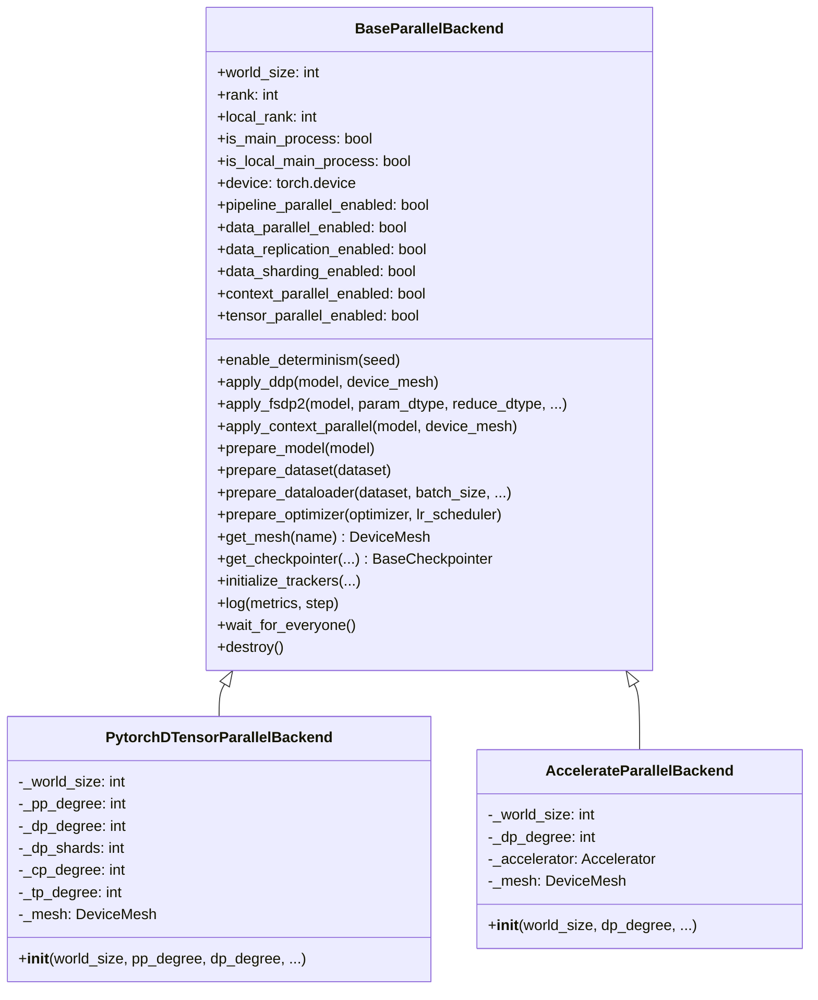
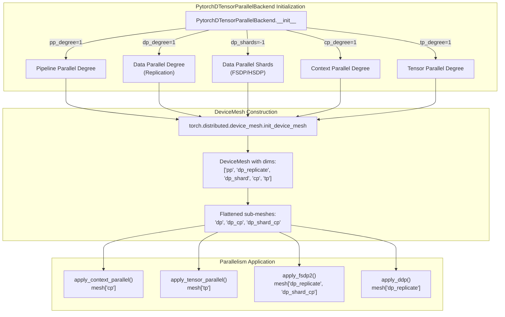
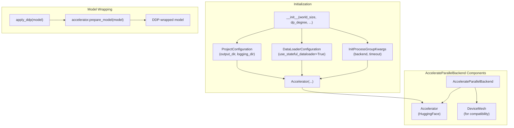
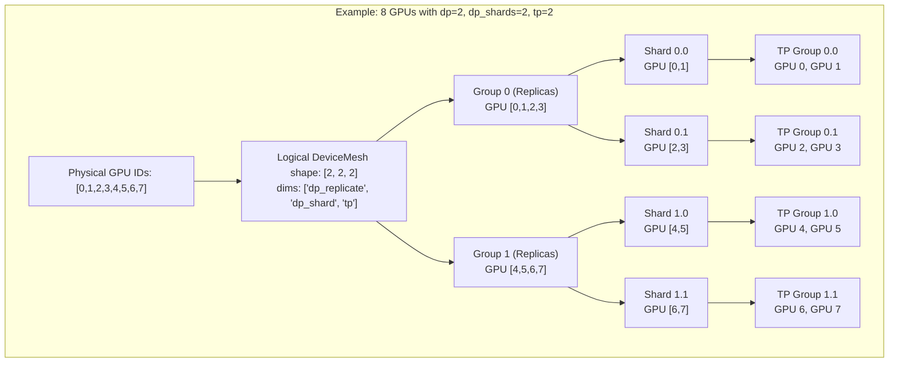
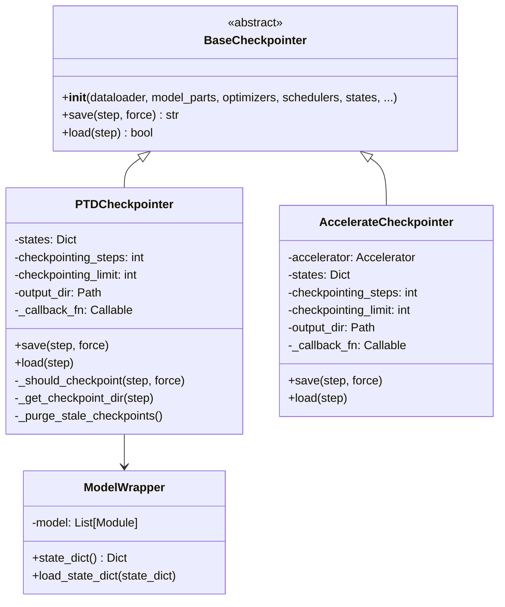
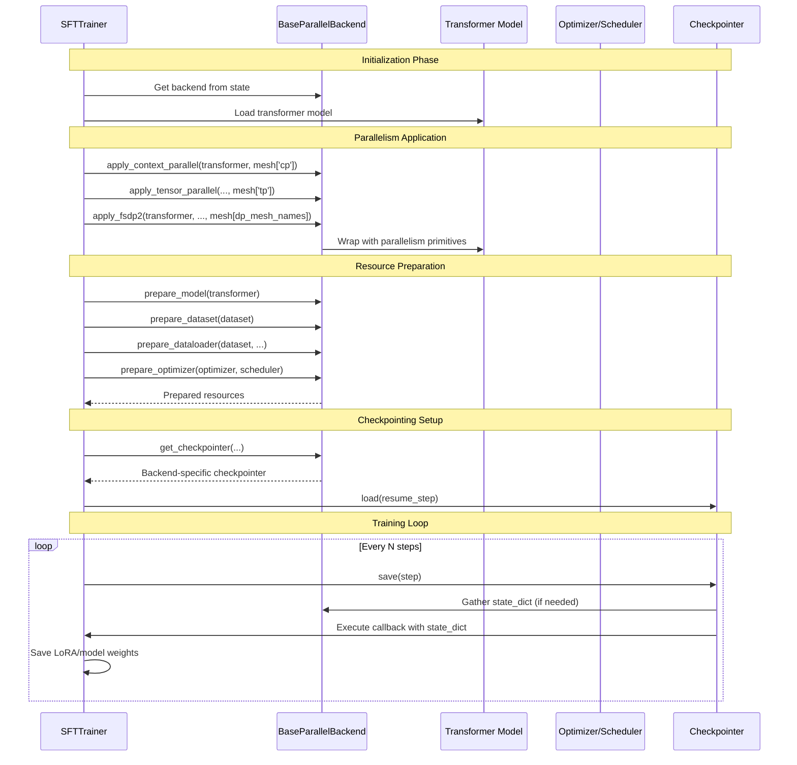

<!-- source: DeepWiki mcp.deepwiki.com · repo huggingface/finetrainers · page 7.1 Parallel Backends · fetched 2026-10-26 -->

# Parallel Backends

<details>
<summary>Relevant source files</summary>

The following files were used as context for generating this wiki page:

- [finetrainers/args.py](finetrainers/args.py)
- [finetrainers/models/cogview4/base_specification.py](finetrainers/models/cogview4/base_specification.py)
- [finetrainers/parallel/accelerate.py](finetrainers/parallel/accelerate.py)
- [finetrainers/parallel/base.py](finetrainers/parallel/base.py)
- [finetrainers/parallel/ptd.py](finetrainers/parallel/ptd.py)
- [finetrainers/trainer/sft_trainer/trainer.py](finetrainers/trainer/sft_trainer/trainer.py)
- [finetrainers/utils/__init__.py](finetrainers/utils/__init__.py)
- [finetrainers/utils/torch.py](finetrainers/utils/torch.py)
- [tests/README.md](tests/README.md)
- [tests/trainer/test_sft_trainer.py](tests/trainer/test_sft_trainer.py)

</details>


This document describes the parallel backend abstraction layer in finetrainers, which enables distributed training across multiple GPUs and nodes. The parallel backend system provides a unified interface for applying different parallelism strategies (DDP, FSDP2, Tensor Parallel, Context Parallel) while keeping trainer code agnostic to the underlying implementation.

For information about specific parallelism strategies (DDP, FSDP2, etc.), see [Parallelism Strategies](#7.2). For distributed checkpoint management, see [Distributed Checkpointing](#7.3).

## Overview

The parallel backend system abstracts distributed training complexity into two main implementations:

- **PytorchDTensorParallelBackend** (`ptd`): Advanced backend supporting multi-dimensional parallelism using PyTorch DTensor APIs
- **AccelerateParallelBackend** (`accelerate`): Simplified backend for single-node DDP using Hugging Face Accelerate

Both backends implement the `BaseParallelBackend` interface, allowing trainers to remain backend-agnostic. The backend is selected via the `--parallel_backend` command-line argument.

**Sources:** [finetrainers/parallel/base.py:9-116](), [finetrainers/parallel/ptd.py:41-280](), [finetrainers/parallel/accelerate.py:37-253](), [finetrainers/args.py:96-107]()

## BaseParallelBackend Interface



The `BaseParallelBackend` class defines the contract that all parallel backends must implement. Key method categories:

1. **Parallelism Application**: `apply_ddp()`, `apply_fsdp2()`, `apply_context_parallel()` - Wrap models with parallelism primitives
2. **Resource Preparation**: `prepare_model()`, `prepare_dataset()`, `prepare_dataloader()`, `prepare_optimizer()` - Initialize distributed resources
3. **Mesh Management**: `get_mesh()` - Access the device mesh topology
4. **Checkpointing**: `get_checkpointer()` - Obtain backend-specific checkpointer
5. **Process Information**: Properties like `rank`, `world_size`, `device` for querying distributed state
6. **Capability Flags**: Boolean properties indicating which parallelism types are enabled

**Sources:** [finetrainers/parallel/base.py:9-116]()

## PytorchDTensorParallelBackend

The `PytorchDTensorParallelBackend` is the full-featured backend supporting all parallelism dimensions. It is initialized with five parallelism degrees that define a multi-dimensional `DeviceMesh`:



### Initialization and Mesh Creation

The backend creates a `DeviceMesh` with dimensions corresponding to active parallelism types. The constructor validates that `dp_shards * pp_degree * dp_degree * cp_degree * tp_degree == world_size`, ensuring the mesh can be distributed across available devices.

```python
# Example: 8 GPUs with dp_degree=2, dp_shards=2, tp_degree=2
# Creates mesh: [2, 2, 2] with dims ['dp_replicate', 'dp_shard', 'tp']
```

The mesh is then flattened into convenient sub-meshes:
- `dp`: All data parallel dimensions (`dp_replicate` + `dp_shard`)
- `dp_cp`: Data parallel + context parallel (`dp_replicate` + `dp_shard` + `cp`)
- `dp_shard_cp`: Data parallel sharding + context parallel (`dp_shard` + `cp`)

**Sources:** [finetrainers/parallel/ptd.py:41-92](), [finetrainers/parallel/ptd.py:161-209]()

### Parallelism Methods

**`apply_ddp(model, device_mesh)`**

Applies Distributed Data Parallel using PyTorch's `replicate()` API. The model is replicated across the `dp_replicate` dimension, with gradients all-reduced during backward pass.

**Sources:** [finetrainers/parallel/ptd.py:99-106](), [finetrainers/parallel/ptd.py:462-463]()

**`apply_fsdp2(model, param_dtype, reduce_dtype, output_dtype, pp_enabled, cpu_offload, device_mesh)`**

Applies Fully Sharded Data Parallel 2 (FSDP2) by wrapping transformer blocks with `fully_shard()`. The method:
1. Creates a `MixedPrecisionPolicy` for parameter/gradient/output dtypes
2. Wraps each transformer block (identified by names in `DIFFUSERS_TRANSFORMER_BLOCK_NAMES`)
3. Optionally configures CPU offloading
4. Controls `reshard_after_forward` based on pipeline parallelism and block position

**Sources:** [finetrainers/parallel/ptd.py:108-122](), [finetrainers/parallel/ptd.py:466-499]()

**`apply_context_parallel(model, device_mesh)`**

Applies context parallel (sequence parallelism) by registering hooks on transformer modules. The implementation:
1. Looks up the model's context parallel plan from `TransformerRegistry`
2. Identifies modules to shard via `get_submodule_by_name()`
3. Registers `ContextParallelSplitHook` (input) and `ContextParallelGatherHook` (output)
4. Splits sequence dimension across the `cp` mesh using `_EquipartitionSharder`

**Sources:** [finetrainers/parallel/ptd.py:124-131](), [finetrainers/parallel/ptd.py:502-530]()

### Data Preparation

**`prepare_dataset(dataset)`**

Splits the dataset across data parallel ranks using `datasets.distributed.split_dataset_by_node()`. Each rank receives a disjoint subset of data from the `dp_replicate` dimension.

**`prepare_dataloader(dataset, batch_size, num_workers, pin_memory)`**

Creates a `DPDataLoader` wrapping the dataset with the appropriate data parallel rank. This custom dataloader handles distributed sampling.

**Sources:** [finetrainers/parallel/ptd.py:136-155]()

### Process Group Initialization

The backend initializes PyTorch's distributed process group in its constructor using `torch.distributed.init_process_group()` with configurable backend (default: `nccl`) and timeout.

**Sources:** [finetrainers/parallel/ptd.py:80-91]()

## AccelerateParallelBackend

The `AccelerateParallelBackend` provides a simplified interface for DDP-only training using Hugging Face Accelerate. It delegates most functionality to the `Accelerator` class.



### Limitations

The Accelerate backend only supports:
- Distributed Data Parallel (model replication)
- `dp_degree == world_size` (no other parallelism dimensions)

Attempting to use `pp_degree > 1`, `dp_shards > 1`, `cp_degree > 1`, or `tp_degree > 1` raises a `ValueError`.

**Sources:** [finetrainers/parallel/accelerate.py:37-96](), [finetrainers/parallel/accelerate.py:68-73]()

### Key Methods

**`apply_ddp(model)`**

Wraps the model with DDP by creating or reusing an `Accelerator` instance with `DistributedDataParallelKwargs`. The method handles both single-GPU and multi-GPU cases.

**`prepare_dataloader(dataset, batch_size, num_workers, pin_memory)`**

Creates a PyTorch `DataLoader` and wraps it with `accelerator.prepare_data_loader()`, which handles distributed sampling automatically.

**`prepare_optimizer(optimizer, lr_scheduler)`**

Wraps optimizer and scheduler with `accelerator.prepare_optimizer()` and `accelerator.prepare_scheduler()`.

**Sources:** [finetrainers/parallel/accelerate.py:100-149]()

## DeviceMesh Architecture

The `DeviceMesh` is a multi-dimensional logical view of physical devices, enabling orthogonal parallelism strategies. Here's how it maps to physical GPUs:



### Mesh Dimension Semantics

| Dimension | Purpose | Parallelism Type |
|-----------|---------|------------------|
| `pp` | Pipeline stages | Pipeline Parallel |
| `dp_replicate` | Model replicas | DDP |
| `dp_shard` | Parameter shards | FSDP2/HSDP |
| `cp` | Sequence chunks | Context Parallel |
| `tp` | Tensor slices | Tensor Parallel |

### Flattened Sub-Meshes

For convenience, the backend creates flattened views of commonly-used dimension combinations:

- **`dp`**: `[dp_replicate, dp_shard]` - All data parallel dimensions
- **`dp_cp`**: `[dp_replicate, dp_shard, cp]` - Data + context parallel
- **`dp_shard_cp`**: `[dp_shard, cp]` - FSDP + context parallel

These are used for collective operations like gradient reduction and loss aggregation.

**Sources:** [finetrainers/parallel/ptd.py:161-209]()

## Checkpointing System

Both backends provide checkpointing implementations through the `BaseCheckpointer` interface.



### PTDCheckpointer

Uses PyTorch's `torch.distributed.checkpoint` API for efficient sharded checkpoint I/O. The checkpointer:

1. Wraps model parts in `ModelWrapper` (implements `Stateful` interface)
2. Collects all stateful objects (model, optimizer, dataloader, schedulers, custom states)
3. Saves/loads using `torch.distributed.checkpoint.save()` and `load()`
4. Executes a callback function to save additional artifacts (e.g., LoRA weights, full model)

**Key Features:**
- Sharded checkpoint storage (each rank saves its partition)
- No data movement to CPU/rank 0 during save (unless via callback)
- Automatic stale checkpoint purging based on `checkpointing_limit`

**Sources:** [finetrainers/parallel/ptd.py:298-411]()

### AccelerateCheckpointer

Uses Accelerate's `accelerator.save_state()` and `load_state()` APIs. The checkpointer:

1. Registers save/load hooks with the `Accelerator`
2. Delegates checkpoint I/O to Accelerate's internal mechanisms
3. Executes callback in the save hook to save model weights

**Key Features:**
- Simplified API compared to PTD
- Automatic handling of DDP state
- Checkpoint compatibility with Accelerate ecosystem

**Sources:** [finetrainers/parallel/accelerate.py:255-361]()

### Callback Pattern

Both checkpointers accept a `_callback_fn` parameter, invoked after saving the distributed state. The callback receives model `state_dict` and is used by trainers to save:
- LoRA adapters (for LoRA training)
- Full model weights (for full finetuning)
- Additional metadata

**Sources:** [finetrainers/trainer/sft_trainer/trainer.py:279-320]()

## Integration with Trainers

Trainers interact with parallel backends through a standardized flow:



### Trainer Preparation Flow

The `SFTTrainer._prepare_for_training()` method orchestrates parallelism application in this order:

1. **Context Parallel** (if enabled): Apply to transformer before other strategies
2. **Tensor Parallel** (if enabled): Apply via `model_specification.apply_tensor_parallel()`
3. **Gradient Checkpointing** (if enabled): Apply activation checkpointing
4. **Torch Compile** (if enabled): Compile transformer modules
5. **Data Sharding (FSDP/HSDP)** (if enabled): Apply FSDP2 to transformer
6. **Data Replication (DDP)** (if enabled): Apply DDP to transformer
7. **Model Movement**: Move transformer to device

This order is critical because later strategies may depend on earlier ones (e.g., FSDP must be applied after TP).

**Sources:** [finetrainers/trainer/sft_trainer/trainer.py:138-192]()

### Backend Selection

The backend is instantiated in `Trainer.__init__()` based on `args.parallel_backend`:

```python
# In trainer/base.py or similar
if args.parallel_backend == "ptd":
    backend = PytorchDTensorParallelBackend(...)
elif args.parallel_backend == "accelerate":
    backend = AccelerateParallelBackend(...)
```

Configuration is passed via command-line arguments:
```bash
# PTD with HSDP
python train.py --parallel_backend ptd --dp_degree 2 --dp_shards 2 ...

# Accelerate with DDP
python train.py --parallel_backend accelerate --dp_degree 4 ...
```

**Sources:** [finetrainers/args.py:96-107](), [finetrainers/args.py:365-371]()

## Configuration Parameters

### Common Parameters

| Parameter | Type | Default | Description |
|-----------|------|---------|-------------|
| `parallel_backend` | str | `"accelerate"` | Backend choice: `"ptd"` or `"accelerate"` |
| `pp_degree` | int | 1 | Pipeline parallel degree |
| `dp_degree` | int | 1 | Data parallel degree (replication) |
| `dp_shards` | int | 1 | Data parallel shards (FSDP) |
| `cp_degree` | int | 1 | Context parallel degree |
| `tp_degree` | int | 1 | Tensor parallel degree |

### PTD-Specific Parameters

| Parameter | Type | Default | Description |
|-----------|------|---------|-------------|
| `timeout` | int | 180 | NCCL timeout in seconds |
| `backend` | str | `"nccl"` | Distributed backend |

### Configuration Validation

The PTD backend validates that `dp_shards * pp_degree * dp_degree * cp_degree * tp_degree == world_size`, ensuring the mesh topology is valid for the available hardware.

The Accelerate backend validates that only DDP is requested (`dp_degree == world_size` and all other degrees are 1).

**Sources:** [finetrainers/parallel/ptd.py:71-78](), [finetrainers/parallel/accelerate.py:68-73]()

## Context Parallel Implementation

Context parallel (sequence parallelism) is implemented using a hook-based approach that shards inputs/outputs of transformer layers:

```mermaid
graph TB
    subgraph "Context Parallel Flow"
        Input["Input Tensor<br/>[B, S, D]<br/>S = total_seq_len"]
        
        Input --> SplitHook["ContextParallelSplitHook.pre_forward()"]
        SplitHook --> Sharder["_EquipartitionSharder.shard()"]
        Sharder --> ShardedInput["Sharded Input<br/>[B, S/cp_degree, D]<br/>per rank"]
        
        ShardedInput --> Block["Transformer Block<br/>(local computation)"]
        Block --> ShardedOutput["Sharded Output<br/>[B, S/cp_degree, D]<br/>per rank"]
        
        ShardedOutput --> GatherHook["ContextParallelGatherHook.post_forward()"]
        GatherHook --> Unsharder["_EquipartitionSharder.unshard()"]
        Unsharder --> Output["Gathered Output<br/>[B, S, D]<br/>full sequence"]
    end
```



### Hook Registration

The `apply_context_parallel()` function registers hooks on modules identified by the model's context parallel plan (`TransformerRegistry.get(model_cls).cp_plan`):

1. **Input Hooks** (`ContextParallelSplitHook`): Shard input tensors along sequence dimension before forward pass
2. **Output Hooks** (`ContextParallelGatherHook`): Gather output tensors after forward pass

### Sharding Strategy

The `_EquipartitionSharder` class divides the sequence dimension into equal chunks:
- **Shard**: Each rank gets chunk `i` where `i` is the rank's position in the CP mesh
- **Unshard**: Uses `DTensor.from_local()` with `Shard` placement to gather across ranks

**Sources:** [finetrainers/parallel/ptd.py:502-530](), [finetrainers/parallel/ptd.py:532-667]()

## Testing and Validation

The test suite validates both backends across various parallelism configurations:

### Test Matrix

| Backend | Parallelism Config | Batch Size | Precomputation |
|---------|-------------------|------------|----------------|
| Accelerate | `dp_degree=1` | 1 | False, True |
| Accelerate | `dp_degree=2` | 1 | False, True |
| PTD | `dp_degree=1` | 1, 2 | False, True |
| PTD | `dp_degree=2` | 1, 2 | False, True |
| PTD | `dp_shards=2` | 1, 2 | False, True |
| PTD | `dp_degree=2, dp_shards=2` | 1 | False, True |
| PTD | `tp_degree=2` | 2 | False, True |
| PTD | `cp_degree=2` | 1 | True |

Each configuration is tested with:
- LoRA training (`SFTTrainerLoRATestsMixin`)
- Full finetuning (`SFTTrainerFullFinetuneTestsMixin`)
- All 6 supported model types (CogVideoX, CogView4, Flux, HunyuanVideo, LTXVideo, Wan)

**Sources:** [tests/trainer/test_sft_trainer.py:42-537](), [tests/README.md:1-54]()

---

