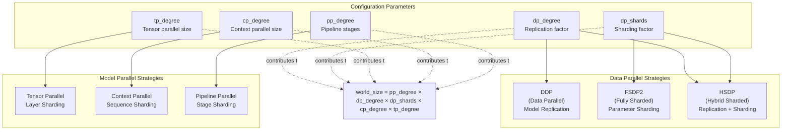
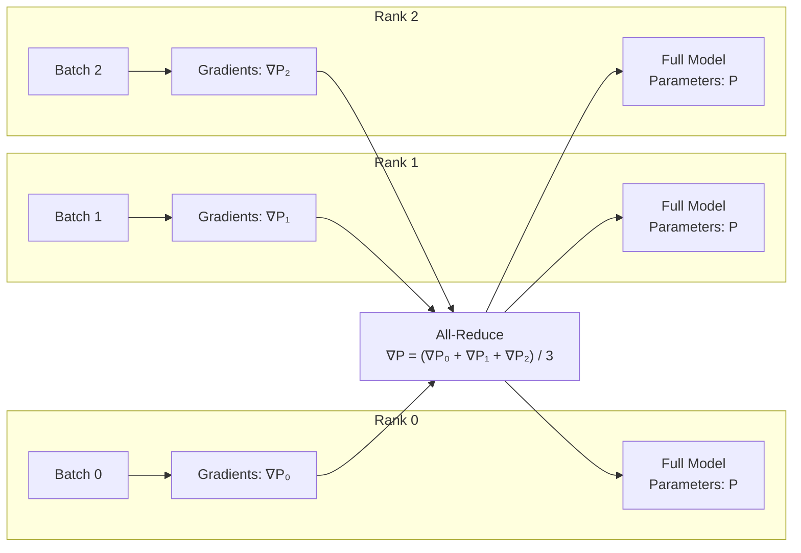
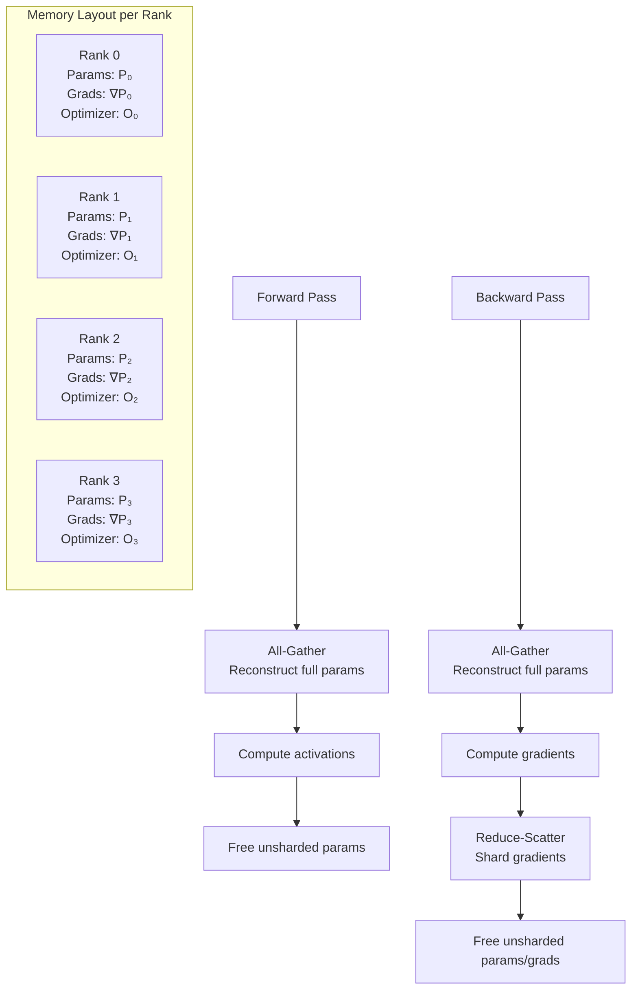
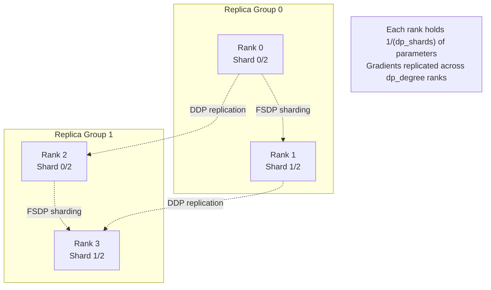
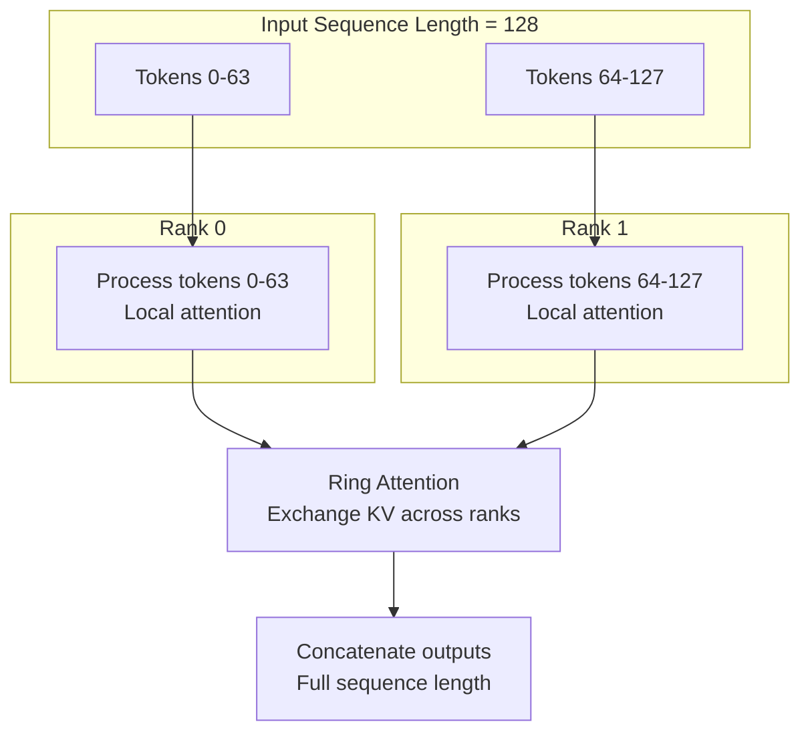
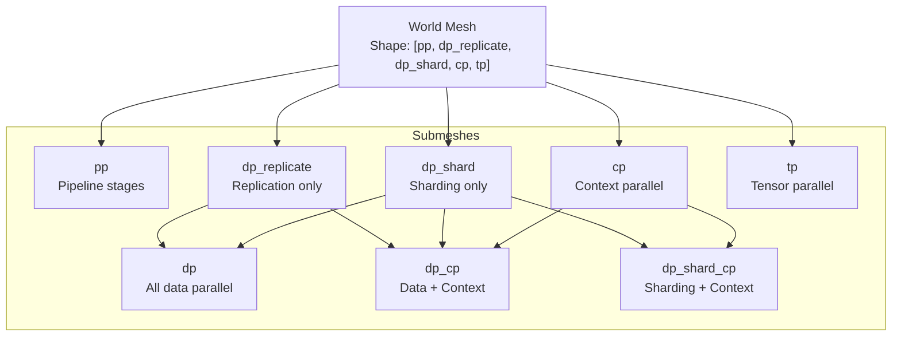
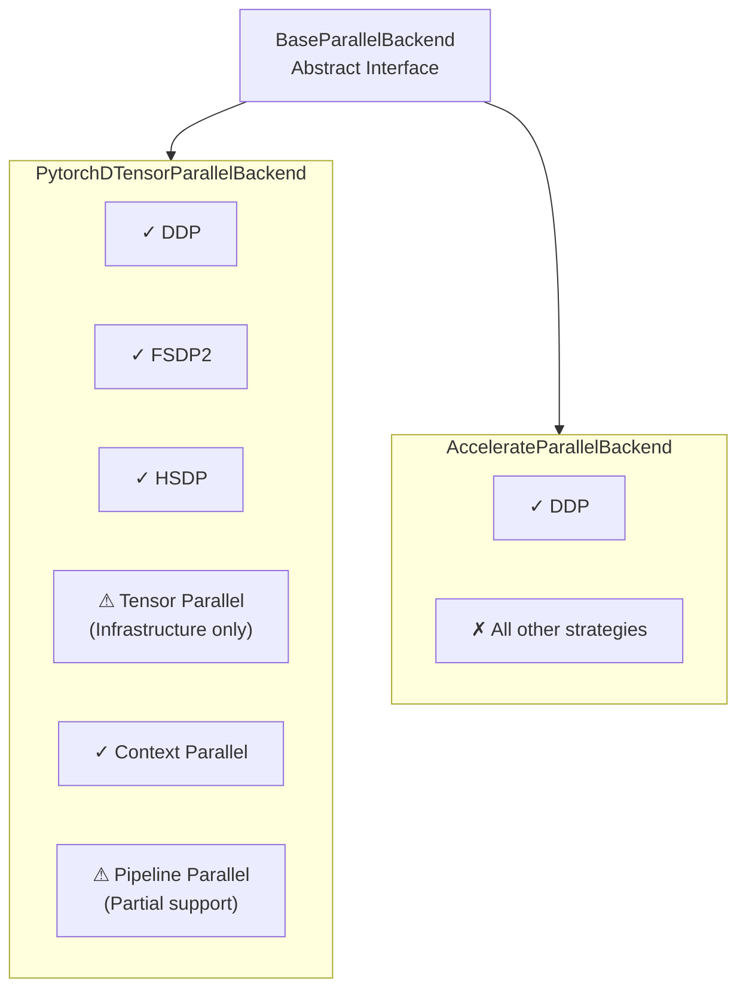

<!-- source: DeepWiki mcp.deepwiki.com · repo huggingface/finetrainers · page 7.2 Parallelism Strategies · fetched 2026-10-26 -->

# Parallelism Strategies

<details>
<summary>Relevant source files</summary>

The following files were used as context for generating this wiki page:

- [.gitignore](.gitignore)
- [README.md](README.md)
- [finetrainers/functional/__init__.py](finetrainers/functional/__init__.py)
- [finetrainers/functional/text.py](finetrainers/functional/text.py)
- [finetrainers/models/cogview4/base_specification.py](finetrainers/models/cogview4/base_specification.py)
- [finetrainers/parallel/accelerate.py](finetrainers/parallel/accelerate.py)
- [finetrainers/parallel/base.py](finetrainers/parallel/base.py)
- [finetrainers/parallel/ptd.py](finetrainers/parallel/ptd.py)
- [finetrainers/utils/__init__.py](finetrainers/utils/__init__.py)
- [finetrainers/utils/torch.py](finetrainers/utils/torch.py)
- [tests/README.md](tests/README.md)
- [tests/trainer/test_sft_trainer.py](tests/trainer/test_sft_trainer.py)

</details>


This page documents the distributed training parallelism strategies supported by finetrainers. These strategies enable scaling training from single-GPU setups to large multi-node clusters by distributing model parameters, gradients, and activations across devices.

For information about the parallel backend abstraction and implementation, see [Parallel Backends](#7.1). For distributed checkpointing mechanisms, see [Distributed Checkpointing](#7.3).

## Overview

Finetrainers supports five orthogonal parallelism dimensions that can be combined to scale diffusion model training:

| Parallelism Type | Abbreviation | What It Shards | Primary Use Case |
|-----------------|--------------|----------------|------------------|
| Data Parallel (Replication) | DP | Batch samples | Standard distributed training |
| Data Parallel (Sharding) | FSDP2/HSDP | Model parameters, gradients, optimizer states | Large models exceeding single-GPU memory |
| Tensor Parallel | TP | Layer weights and activations | Extremely large models |
| Context Parallel | CP | Sequence/spatial dimensions | Long sequences or high-resolution inputs |
| Pipeline Parallel | PP | Model layers across stages | Very deep models (limited support) |

The parallelism backend determines which strategies are available:
- **PytorchDTensorParallelBackend**: Supports all strategies (DP, FSDP2, HSDP, TP, CP, PP)
- **AccelerateParallelBackend**: Supports only DP (DDP)

**Sources:** [finetrainers/parallel/base.py:9-116](), [finetrainers/parallel/ptd.py:41-280](), [finetrainers/parallel/accelerate.py:37-253](), [README.md:56-65]()

## Parallelism Strategies Overview



**Sources:** [finetrainers/parallel/ptd.py:41-92](), [finetrainers/parallel/accelerate.py:37-74]()

## Data Parallel: DDP

**Distributed Data Parallel (DDP)** is the simplest parallelism strategy. Each device maintains a complete replica of the model. During training:

1. Each device processes a different batch
2. Gradients are computed locally
3. Gradients are all-reduced across devices
4. Each device applies the same parameter updates

DDP is configured via `dp_degree` parameter (default: 1). Setting `dp_degree > 1` enables DDP, with `dp_shards = -1` (no sharding).



### Implementation

**PTD Backend:**
```python
# finetrainers/parallel/ptd.py
def apply_ddp(model, device_mesh):
    replicate(model, device_mesh=dp_mesh, bucket_cap_mb=100)
```

The `replicate` function from `torch.distributed._composable.replicate` wraps the model to perform gradient all-reduce during backward pass.

**Accelerate Backend:**
```python
# finetrainers/parallel/accelerate.py
def apply_ddp(model, ...):
    accelerator = Accelerator(kwargs_handlers=[DistributedDataParallelKwargs(...)])
    accelerator.prepare_model(model)
```

The Accelerator handles DDP setup automatically when multiple processes are detected.

**Sources:** [finetrainers/parallel/ptd.py:99-106](), [finetrainers/parallel/ptd.py:462-463](), [finetrainers/parallel/accelerate.py:100-123](), [finetrainers/parallel/accelerate.py:363-383]()

## Data Parallel: FSDP2

**Fully Sharded Data Parallel (FSDP2)** shards model parameters, gradients, and optimizer states across devices to reduce per-device memory consumption. FSDP2 uses PyTorch's DTensor API for efficient sharding.

FSDP2 is configured via `dp_shards` parameter. Setting `dp_shards > 1` enables FSDP2, with `dp_degree = 1` (no replication).

### Sharding Strategy

1. **Parameters**: Sharded across `dp_shards` devices
2. **Gradients**: Reduced-scatter during backward pass, sharded storage
3. **Optimizer States**: Sharded to match parameter sharding
4. **Forward Pass**: All-gather parameters before computation, free after use
5. **Backward Pass**: All-gather parameters before gradient computation, free after use



### Implementation

FSDP2 is applied per transformer block using `fully_shard` from `torch.distributed._composable.fsdp`:

```python
# finetrainers/parallel/ptd.py:466-500
def apply_fsdp2(model, dp_mesh, param_dtype, reduce_dtype, output_dtype, pp_enabled, cpu_offload):
    mp_policy = MixedPrecisionPolicy(param_dtype, reduce_dtype, output_dtype, cast_forward_inputs=True)
    fsdp_config = {"mesh": dp_mesh, "mp_policy": mp_policy}
    
    if cpu_offload:
        fsdp_config["offload_policy"] = CPUOffloadPolicy(pin_memory=True)
    
    # Apply to transformer blocks
    for transformer_block_name in DIFFUSERS_TRANSFORMER_BLOCK_NAMES:
        blocks = getattr(model, transformer_block_name, None)
        if blocks is not None:
            for layer_index, block in enumerate(blocks):
                reshard_after_forward = layer_index < len(blocks) - 1
                fully_shard(block, **fsdp_config, reshard_after_forward=reshard_after_forward)
    
    # Apply to full model
    fully_shard(model, **fsdp_config, reshard_after_forward=not pp_enabled)
```

The `reshard_after_forward=False` optimization for the last block avoids unnecessary all-gathers since FSDP prefetches it immediately.

**Sources:** [finetrainers/parallel/ptd.py:108-122](), [finetrainers/parallel/ptd.py:466-500]()

## Data Parallel: HSDP

**Hybrid Sharded Data Parallel (HSDP)** combines DDP and FSDP2 to balance communication and memory efficiency. Models are replicated within `dp_degree` groups and sharded across `dp_shards` groups.

HSDP is configured by setting both `dp_degree > 1` and `dp_shards > 1`.

### Topology

With `dp_degree=2` and `dp_shards=2` on 4 GPUs:
- GPUs 0 and 1 form a replica group (shard parameters between them)
- GPUs 2 and 3 form another replica group (shard parameters between them)
- Gradients are all-reduced within replica groups
- Parameters are sharded across each replica group



HSDP uses the same `apply_fsdp2` implementation but with a 2D device mesh that includes both `dp_replicate` and `dp_shard` dimensions.

**Sources:** [finetrainers/parallel/ptd.py:71-91](), [finetrainers/parallel/ptd.py:175-209]()

## Tensor Parallel

**Tensor Parallel (TP)** shards individual layer weights and activations across devices. This is useful for extremely large models where single layers don't fit in GPU memory.

TP is configured via `tp_degree` parameter. TP requires careful model surgery to ensure correct sharding of weights and collectives for activations.

### Current Support

TP support in finetrainers is **limited** and not production-ready. The infrastructure exists but requires model-specific implementation:

```python
# Tests show tp_degree=2 is tested but no production usage
# finetrainers/parallel/ptd.py mentions tp_degree in mesh construction
```

Implementing TP requires:
1. Identifying which linear layers to shard
2. Inserting appropriate collectives (all-reduce, all-gather) for activation flow
3. Handling attention mechanism sharding correctly

**Sources:** [finetrainers/parallel/ptd.py:49-91](), [tests/trainer/test_sft_trainer.py:344-349]()

## Context Parallel

**Context Parallel (CP)** shards the sequence or spatial dimensions of inputs across devices. This is essential for training on long video sequences or high-resolution images that exceed single-GPU memory.

CP is configured via `cp_degree` parameter. Setting `cp_degree > 1` enables CP.

### Sharding Strategy

Context parallel splits inputs along the sequence dimension (for video: temporal; for images: spatial). Each rank processes a partition and uses ring-attention or similar mechanisms to compute attention across partitions.



### Implementation

CP uses a hook-based approach to intercept model inputs/outputs and apply sharding:

```python
# finetrainers/parallel/ptd.py:502-530
def apply_context_parallel(model, mesh, plan):
    for module_id, cp_model_plan in plan.items():
        module = get_submodule_by_name(model, module_id)
        registry = HookRegistry.check_if_exists_or_initialize(module)
        
        if isinstance(cp_model_plan, list):  # CPOutput metadata
            hook = ContextParallelGatherHook(cp_model_plan, mesh)
        else:  # CPInput metadata
            hook = ContextParallelSplitHook(cp_model_plan, mesh)
        
        registry.register_hook(hook, f"cp_input---{module_id}")
```

**ContextParallelSplitHook** shards inputs before forward pass:
- Intercepts module inputs via `pre_forward`
- Applies sharding along specified dimension using `_EquipartitionSharder.shard`
- Optionally shards outputs via `post_forward`

**ContextParallelGatherHook** gathers outputs after forward pass:
- Intercepts module outputs via `post_forward`
- Applies gathering using `_EquipartitionSharder.unshard`

### Sharding Implementations

Two sharders are provided:

1. **_EquipartitionSharder**: Equal partitioning across ranks (for full attention)
   ```python
   # finetrainers/parallel/ptd.py:647-666
   def shard(tensor, dim, mesh):
       return tensor.chunk(mesh.size(), dim=dim)[mesh.get_local_rank()]
   
   def unshard(tensor, dim, mesh):
       return DTensor.from_local(tensor, mesh, placements=[Shard(dim)]).full_tensor()
   ```

2. **_CausalSharder**: Causal partitioning for causal attention (experimental, untested)
   - Each rank gets two chunks to balance load in causal masking
   - Rank i gets chunks i and (2*world_size - 1 - i)

**Sources:** [finetrainers/parallel/ptd.py:124-131](), [finetrainers/parallel/ptd.py:502-709]()

## Pipeline Parallel

**Pipeline Parallel (PP)** splits model layers into stages and assigns each stage to a different device. This enables training extremely deep models.

PP is configured via `pp_degree` parameter. However, PP support is **limited** in the current implementation:

- The device mesh includes a `pp` dimension
- Checkpointing and determinism account for PP ranks
- No explicit pipeline scheduling implementation is present

**Sources:** [finetrainers/parallel/ptd.py:45-91](), [finetrainers/utils/torch.py:164-216]()

## Device Mesh Topology

Finetrainers uses PyTorch's `DeviceMesh` to organize parallelism dimensions. The mesh is a multi-dimensional grid of devices where each dimension corresponds to a parallelism strategy.

### Mesh Construction

The mesh is constructed in [finetrainers/parallel/ptd.py:161-209]():

```python
def get_mesh(self, name=None):
    mesh_list = [
        ("pp", self._pp_degree),
        ("dp_replicate", self._dp_degree),
        ("dp_shard", self._dp_shards),
        ("cp", self._cp_degree),
        ("tp", self._tp_degree),
    ]
    mesh_list = [(name, degree) for name, degree in mesh_list if degree > 1]
    names = [x[0] for x in mesh_list]
    degrees = [x[1] for x in mesh_list]
    mesh = torch.distributed.device_mesh.init_device_mesh(
        device_type, mesh_shape=degrees, mesh_dim_names=names
    )
```

### Flattened Submeshes

For convenience, the mesh creates flattened submeshes:
- `"dp"`: Combines `dp_replicate` and `dp_shard`
- `"dp_cp"`: Combines `dp_replicate`, `dp_shard`, and `cp`
- `"dp_shard_cp"`: Combines `dp_shard` and `cp`



**Example:** With 8 GPUs, `dp_degree=2`, `dp_shards=2`, `cp_degree=2`:
- Full mesh shape: `[2, 2, 2]` (dp_replicate, dp_shard, cp)
- Rank 0 is at coordinate `[0, 0, 0]`
- Rank 7 is at coordinate `[1, 1, 1]`
- `dp` submesh has shape `[4]` (2×2 from dp_replicate×dp_shard)
- `cp` submesh has shape `[2]`

**Sources:** [finetrainers/parallel/ptd.py:161-209]()

## Configuration Parameters

### PTD Backend

All parallelism dimensions are configured via `PytorchDTensorParallelBackend` constructor:

| Parameter | Type | Default | Description |
|-----------|------|---------|-------------|
| `world_size` | `int` | Required | Total number of GPUs/ranks |
| `pp_degree` | `int` | `1` | Pipeline parallel stages |
| `dp_degree` | `int` | `1` | Data parallel replication factor |
| `dp_shards` | `int` | `-1` | Data parallel sharding factor (FSDP2) |
| `cp_degree` | `int` | `1` | Context parallel world size |
| `tp_degree` | `int` | `1` | Tensor parallel world size |

**Constraint:** `world_size = pp_degree × dp_degree × dp_shards × cp_degree × tp_degree`

### Accelerate Backend

Only supports DDP configuration:

| Parameter | Type | Default | Description |
|-----------|------|---------|-------------|
| `world_size` | `int` | Required | Total number of GPUs/ranks |
| `dp_degree` | `int` | Required | Must equal `world_size` |

Other parallelism parameters (`dp_shards`, `cp_degree`, `tp_degree`, `pp_degree`) must be set to their defaults (1 or -1).

**Sources:** [finetrainers/parallel/ptd.py:42-79](), [finetrainers/parallel/accelerate.py:38-73]()

## Backend-Specific Support Matrix



**Legend:**
- ✓ Fully supported and production-ready
- ⚠ Partial support or infrastructure-only
- ✗ Not supported

### When to Use Each Backend

**PytorchDTensorParallelBackend:**
- Large-scale distributed training (>8 GPUs)
- Models requiring FSDP2 for memory efficiency
- Long sequences requiring context parallel
- Advanced users needing fine-grained control

**AccelerateParallelBackend:**
- Simple distributed training (DDP)
- Smaller models and clusters (≤8 GPUs)
- Users familiar with HuggingFace Accelerate
- Rapid prototyping

**Sources:** [finetrainers/parallel/base.py:9-116](), [finetrainers/parallel/ptd.py:41-280](), [finetrainers/parallel/accelerate.py:37-253]()

## Usage Examples

### Example 1: Single-GPU Training

No parallelism configuration needed:

```bash
# Uses default: dp_degree=1, dp_shards=-1
torchrun --nproc_per_node=1 train.py --model_name ltx_video --training_type lora
```

### Example 2: DDP on 4 GPUs

```bash
# PTD backend
torchrun --nproc_per_node=4 train.py \
    --parallel_backend ptd \
    --dp_degree 4 \
    --model_name ltx_video \
    --training_type lora

# Accelerate backend
accelerate launch --num_processes=4 train.py \
    --parallel_backend accelerate \
    --dp_degree 4 \
    --model_name ltx_video \
    --training_type lora
```

### Example 3: FSDP2 on 4 GPUs

```bash
torchrun --nproc_per_node=4 train.py \
    --parallel_backend ptd \
    --dp_shards 4 \
    --model_name hunyuan_video \
    --training_type full_finetune
```

### Example 4: HSDP on 8 GPUs

Replicate model 2x, shard each replica 4x:

```bash
torchrun --nproc_per_node=8 train.py \
    --parallel_backend ptd \
    --dp_degree 2 \
    --dp_shards 4 \
    --model_name hunyuan_video \
    --training_type full_finetune
```

### Example 5: Context Parallel on 4 GPUs

```bash
torchrun --nproc_per_node=4 train.py \
    --parallel_backend ptd \
    --cp_degree 4 \
    --model_name cogvideox \
    --training_type lora
```

### Example 6: Multi-Dimensional Parallelism

Combine DP, FSDP2, and CP on 16 GPUs:

```bash
# dp_degree=2, dp_shards=2, cp_degree=4
# world_size = 2 × 2 × 4 = 16
torchrun --nproc_per_node=16 train.py \
    --parallel_backend ptd \
    --dp_degree 2 \
    --dp_shards 2 \
    --cp_degree 4 \
    --model_name hunyuan_video \
    --training_type full_finetune
```

**Sources:** [tests/trainer/test_sft_trainer.py:117-372](), [tests/README.md:1-53]()

## Memory and Communication Trade-offs

| Strategy | Memory Savings | Communication Cost | Best For |
|----------|---------------|-------------------|----------|
| DDP | None | Low (gradient all-reduce) | Small models, fast interconnect |
| FSDP2 | High (1/N of params) | Medium (all-gather params) | Large models, memory-bound |
| HSDP | Medium | Medium | Balanced memory/communication |
| TP | High (1/N per layer) | High (per-layer collectives) | Extremely large layers |
| CP | Medium (1/N sequence) | Medium (ring attention) | Long sequences, high resolution |

**N** = number of devices in the parallelism dimension

**Sources:** [README.md:95-109](), [finetrainers/parallel/ptd.py:466-500]()

---

