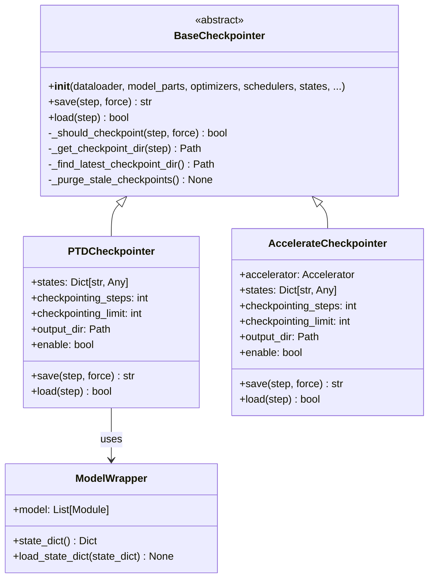
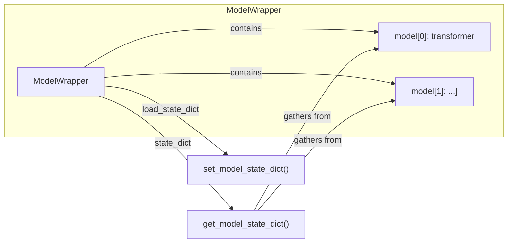
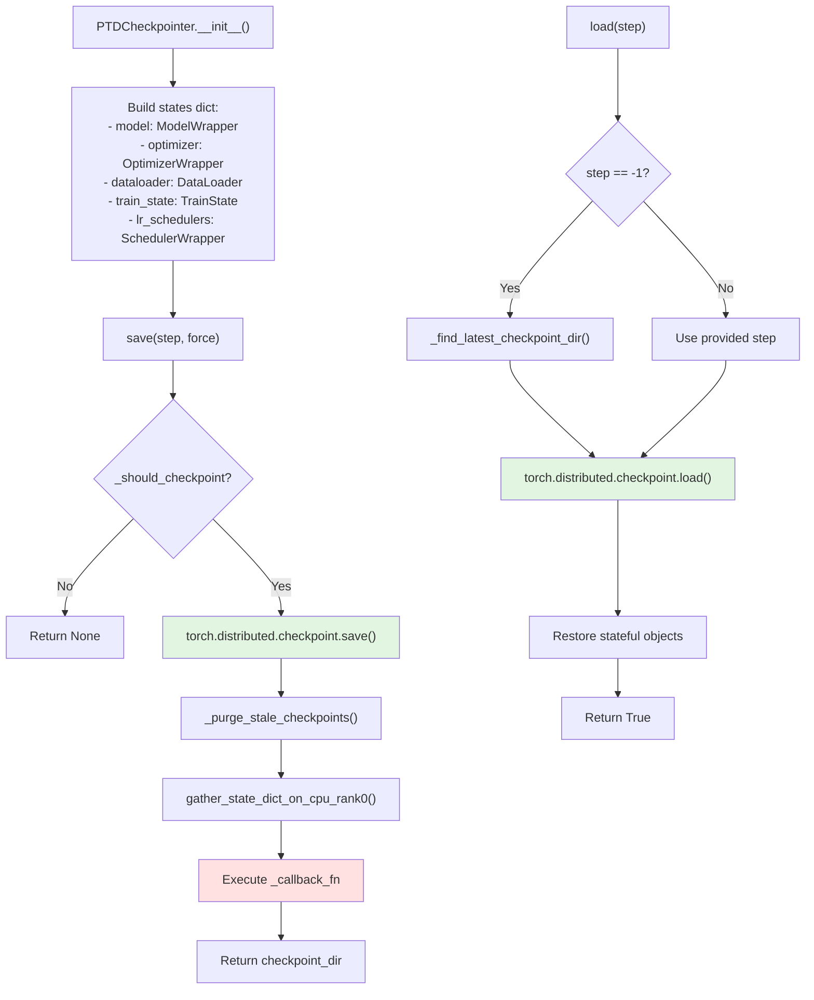
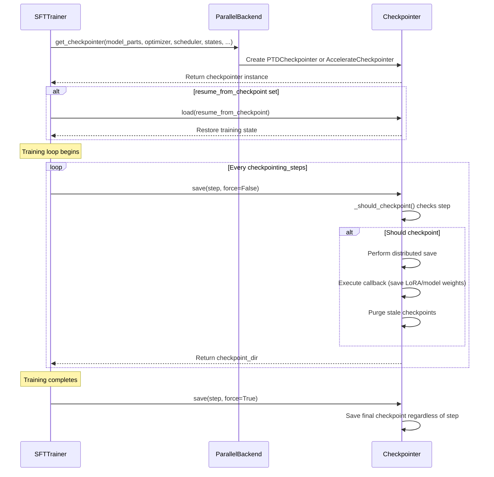

<!-- source: DeepWiki mcp.deepwiki.com · repo huggingface/finetrainers · page 7.3 Distributed Checkpointing · fetched 2026-10-26 -->

# Distributed Checkpointing

<details>
<summary>Relevant source files</summary>

The following files were used as context for generating this wiki page:

- [finetrainers/args.py](finetrainers/args.py)
- [finetrainers/models/cogview4/base_specification.py](finetrainers/models/cogview4/base_specification.py)
- [finetrainers/parallel/accelerate.py](finetrainers/parallel/accelerate.py)
- [finetrainers/parallel/base.py](finetrainers/parallel/base.py)
- [finetrainers/parallel/ptd.py](finetrainers/parallel/ptd.py)
- [finetrainers/state.py](finetrainers/state.py)
- [finetrainers/trainer/sft_trainer/trainer.py](finetrainers/trainer/sft_trainer/trainer.py)
- [tests/README.md](tests/README.md)
- [train.py](train.py)

</details>


## Overview

Distributed checkpointing in finetrainers enables saving and restoring complete training state across distributed training configurations. This system supports both simple single-GPU scenarios and complex multi-dimensional parallelism setups (FSDP, DDP, tensor parallel, context parallel).

The checkpointing system is implemented through two backend-specific classes that inherit from `BaseCheckpointer`:
- `PTDCheckpointer`: For PyTorch DTensor-based distributed training (supports FSDP, DDP, TP, CP)
- `AccelerateCheckpointer`: For Hugging Face Accelerate-based training (supports DDP only)

For information about the parallel backends themselves, see [Parallel Backends](#7.1). For information about parallelism strategies, see [Parallelism Strategies](#7.2).

**Sources:** [finetrainers/parallel/base.py:118-146](), [finetrainers/parallel/ptd.py:298-412](), [finetrainers/parallel/accelerate.py:255-361]()

---

## Checkpoint Architecture

The checkpointing system follows an abstract base class pattern where each parallel backend provides its own checkpointer implementation.

### Class Hierarchy



**Diagram: Checkpointer Class Hierarchy**

The `BaseCheckpointer` defines the interface that all checkpointers must implement. Both implementations provide checkpoint saving, loading, and management capabilities tailored to their respective backends.

**Sources:** [finetrainers/parallel/base.py:118-146](), [finetrainers/parallel/ptd.py:298-412](), [finetrainers/parallel/accelerate.py:255-361](), [finetrainers/parallel/ptd.py:282-296]()

---

## Checkpointed Components

The checkpointing system saves a comprehensive snapshot of training state to enable seamless resumption. The following components are checkpointed:

| Component | Description | Storage Key |
|-----------|-------------|-------------|
| **Model(s)** | Transformer/UNet parameters (wrapped in `ModelWrapper`) | `"model"` |
| **Optimizer** | Optimizer state and parameters | `"optimizer"` |
| **LR Scheduler** | Learning rate scheduler state | Varies by scheduler |
| **Dataloader** | Dataloader iteration state for stateful resumption | `"dataloader"` |
| **TrainState** | Training step, observed samples, loss history | `"train_state"` |

### TrainState Class

The `TrainState` class implements PyTorch's `Stateful` interface to enable distributed checkpointing:

```python
# Key fields in TrainState
step: int                           # Current training step
observed_data_samples: int          # Total samples observed
global_avg_losses: List[float]      # Average loss per log step
global_max_losses: List[float]      # Max loss per log step
log_steps: List[int]                # Steps at which logging occurred
```

The `state_dict()` and `load_state_dict()` methods serialize these fields to enable checkpointing. Loss history is serialized to `BytesIO` objects to avoid overhead.

**Sources:** [finetrainers/state.py:15-50](), [finetrainers/parallel/ptd.py:282-296](), [finetrainers/trainer/sft_trainer/trainer.py:276-327]()

### ModelWrapper

`ModelWrapper` wraps one or more model parts into a single stateful object for checkpointing:



**Diagram: ModelWrapper Structure**

The wrapper calls `get_model_state_dict()` on each model to aggregate state dictionaries, handling FSDP and other distributed scenarios automatically.

**Sources:** [finetrainers/parallel/ptd.py:282-296]()

---

## PTDCheckpointer Implementation

`PTDCheckpointer` uses PyTorch's native distributed checkpoint API (`torch.distributed.checkpoint`) to save and load checkpoints efficiently across distributed processes.

### Architecture and State Management



**Diagram: PTDCheckpointer Save and Load Flow**

**Sources:** [finetrainers/parallel/ptd.py:298-412]()

### Saving Mechanism

The `save()` method performs the following steps:

1. **Validation**: Check if checkpointing should occur based on `step` and `force` flag ([ptd.py:388-394]())
2. **Directory Setup**: Determine checkpoint directory as `{output_dir}/{prefix}_{step}` ([ptd.py:396-397]())
3. **Distributed Save**: Call `torch.distributed.checkpoint.save(states, checkpoint_id=checkpoint_dir)` ([ptd.py:338]())
   - This API handles sharded saving across all ranks
   - Each rank saves its local shard of FSDP parameters
   - Metadata is coordinated across ranks
4. **Checkpoint Rotation**: Purge old checkpoints if `checkpointing_limit` is set ([ptd.py:343](), [ptd.py:403-411]())
5. **Callback Execution**: Gather full state dict on rank 0 and execute callback ([ptd.py:345-350]())
   - Used to save LoRA weights or full model weights via `_save_lora_weights()` or `_save_model()`

### Loading Mechanism

The `load()` method restores training state:

1. **Checkpoint Discovery**: Find latest checkpoint if `step == -1` ([ptd.py:362-366]())
2. **State Selection**: For step 0 checkpoints, only load model (optimizer/scheduler not yet initialized) ([ptd.py:372]())
3. **Distributed Load**: Call `torch.distributed.checkpoint.load(states, checkpoint_id=checkpoint_dir)` ([ptd.py:379]())
   - Each rank loads its shard of parameters
   - Optimizer states are restored to match current sharding
4. **Stateful Restoration**: Restore original stateful objects after load completes ([ptd.py:384]())
   - Workaround for PyTorch bug where stateful objects are replaced instead of updated in-place

**Sources:** [finetrainers/parallel/ptd.py:332-386]()

### Gathering State Dictionary

The `gather_state_dict_on_cpu_rank0()` function consolidates distributed model state onto the main process for callback execution:

```python
# Pseudocode flow
for param_name, param in sharded_state_dict.items():
    if param.is_cpu:
        param = param.to(device)  # Move back from CPU offload
    if hasattr(param, "_local_tensor"):
        param = param.full_tensor()  # Gather DTensor shards
    if is_main_process:
        cpu_state_dict[param_name] = param.cpu()
    torch.distributed.barrier()  # Synchronize across ranks
```

This enables the main process to save full model weights while other ranks participate in gathering but discard the result.

**Sources:** [finetrainers/parallel/ptd.py:414-429]()

---

## AccelerateCheckpointer Implementation

`AccelerateCheckpointer` delegates to Hugging Face Accelerate's checkpoint management, which provides a higher-level API suitable for simpler distributed scenarios.

### Architecture and Hook System

```mermaid
flowchart TB
    Init["AccelerateCheckpointer.__init__()"]
    
    Init --> RegisterHooks["Register hooks:<br/>- save_model_hook<br/>- load_model_hook"]
    
    RegisterHooks --> SaveCall["save(step, force)"]
    SaveCall --> ShouldCheck{_should_checkpoint?}
    ShouldCheck -->|No| SkipSave["Return None"]
    ShouldCheck -->|Yes| AccelSave["accelerator.save_state()"]
    
    AccelSave --> PreHook["save_model_hook triggered"]
    PreHook --> CallbackExec["Execute _callback_fn"]
    CallbackExec --> SaveStates["torch.save(states, 'states.pt')"]
    SaveStates --> PurgeStale["_purge_stale_checkpoints()"]
    PurgeStale --> SaveComplete["Return checkpoint_dir"]
    
    LoadCall["load(step)"] --> FindLatest{step == -1?}
    FindLatest -->|Yes| LatestDir["_find_latest_checkpoint_dir()"]
    FindLatest -->|No| UseStep["Use provided step"]
    
    LatestDir --> AccelLoad["accelerator.load_state()"]
    UseStep --> AccelLoad
    AccelLoad --> LoadHook["load_model_hook triggered"]
    LoadHook --> LoadStates["torch.load('states.pt')"]
    LoadStates --> LoadComplete["Return True"]
    
    style AccelSave fill:#e1f5e1
    style AccelLoad fill:#e1f5e1
    style PreHook fill:#ffe1e1
```



**Diagram: AccelerateCheckpointer Save and Load Flow with Hooks**

**Sources:** [finetrainers/parallel/accelerate.py:255-361]()

### Hook Registration

Unlike `PTDCheckpointer`, `AccelerateCheckpointer` uses Accelerate's hook system to inject custom behavior:

**Save Hook** ([accelerate.py:279-288]()):
- Triggered before Accelerate saves model weights
- Executes `_callback_fn` with model weights for custom saving (e.g., LoRA extraction)
- Saves additional `states` dict to `states.pt` for non-model components

**Load Hook** ([accelerate.py:290-291]()):
- Triggered after Accelerate loads model weights
- Restores `states` dict from `states.pt`

### Differences from PTDCheckpointer

| Aspect | PTDCheckpointer | AccelerateCheckpointer |
|--------|-----------------|------------------------|
| **API** | `torch.distributed.checkpoint` | `accelerator.save_state()` / `load_state()` |
| **Sharding** | Native sharded checkpoint format | Accelerate's checkpoint format |
| **FSDP Support** | Full support | Limited (currently not enabled) |
| **Callback Timing** | After distributed save completes | During save via pre-hook |
| **State Serialization** | Part of distributed checkpoint | Separate `states.pt` file |

**Sources:** [finetrainers/parallel/accelerate.py:298-335](), [finetrainers/parallel/ptd.py:332-386]()

---

## Checkpoint Management

Both checkpointer implementations provide consistent checkpoint management functionality.

### Directory Structure

Checkpoints are organized as follows:

```
output_dir/
├── finetrainers_step_0/        # Step 0 checkpoint
│   ├── __0_0.distcp            # (PTD) Distributed checkpoint shard
│   ├── .metadata               # (PTD) Checkpoint metadata
│   └── ...
├── finetrainers_step_500/      # Step 500 checkpoint
├── finetrainers_step_1000/     # Step 1000 checkpoint
├── lora_weights/               # (If training LoRA)
│   ├── 000500/
│   └── 001000/
└── model_weights/              # (If full finetune)
    ├── 000500/
    └── 001000/
```

**Sources:** [finetrainers/parallel/ptd.py:396-397](), [finetrainers/parallel/accelerate.py:345-346](), [finetrainers/trainer/sft_trainer/trainer.py:293-305]()

### Checkpoint Rotation

When `checkpointing_limit` is set, the checkpointer automatically removes old checkpoints:

```python
# Pseudocode for _purge_stale_checkpoints()
checkpoints = sorted(glob(f"{prefix}_*"), key=extract_step, reverse=True)
for checkpoint in checkpoints[checkpointing_limit:]:
    shutil.rmtree(checkpoint)
```

This prevents unlimited disk usage during long training runs. The most recent `checkpointing_limit` checkpoints are retained.

**Sources:** [finetrainers/parallel/ptd.py:403-411](), [finetrainers/parallel/accelerate.py:352-360]()

### Latest Checkpoint Detection

The `_find_latest_checkpoint_dir()` method locates the most recent checkpoint:

```python
checkpoints = sorted(glob(f"{prefix}_*"), key=lambda x: int(x.name.split("_")[-1]))
return checkpoints[-1] if len(checkpoints) > 0 else None
```

This enables resuming from the latest checkpoint by passing `--resume_from_checkpoint latest`.

**Sources:** [finetrainers/parallel/ptd.py:399-401](), [finetrainers/parallel/accelerate.py:348-350]()

---

## Configuration and Usage

### Command-Line Arguments

Checkpointing behavior is controlled via `BaseArgs`:

| Argument | Type | Default | Description |
|----------|------|---------|-------------|
| `--checkpointing_steps` | `int` | `500` | Save checkpoint every N training steps |
| `--checkpointing_limit` | `int` | `None` | Maximum number of checkpoints to retain |
| `--resume_from_checkpoint` | `str` | `None` | Resume from checkpoint: integer step or `"latest"` |

**Sources:** [finetrainers/args.py:269-278]()

### Integration with Trainer

The trainer integrates checkpointing in the `_prepare_checkpointing()` phase:



**Diagram: Checkpointing Integration in Trainer Lifecycle**

**Sources:** [finetrainers/trainer/sft_trainer/trainer.py:276-327](), [finetrainers/trainer/sft_trainer/trainer.py:552-565]()

### Callback Function

The checkpointer accepts an optional `_callback_fn` that receives the full model state dict on the main process. This enables custom saving logic:

```python
def save_model_hook(state_dict: Dict[str, Any]) -> None:
    state_dict = utils.get_unwrapped_model_state_dict(state_dict)
    if parallel_backend.is_main_process:
        if self.args.training_type == TrainingType.LORA:
            state_dict = get_peft_model_state_dict(self.transformer, state_dict)
            # Save LoRA weights
            self.model_specification._save_lora_weights(...)
        elif self.args.training_type == TrainingType.FULL_FINETUNE:
            # Save full model weights
            self.model_specification._save_model(...)
```

This pattern allows saving model-specific formats (LoRA adapters, full weights) alongside the distributed checkpoint.

**Sources:** [finetrainers/trainer/sft_trainer/trainer.py:279-306](), [finetrainers/parallel/ptd.py:345-350]()

### Resume from Checkpoint

To resume training:

```bash
# Resume from specific step
python train.py --resume_from_checkpoint 1000 ...

# Resume from latest checkpoint
python train.py --resume_from_checkpoint latest ...
```

The checkpointer will:
1. Locate the checkpoint directory
2. Load distributed state (model, optimizer, scheduler, dataloader, train state)
3. Continue training from the restored step

**Important**: When resuming with `precomputation_reuse=True`, the precomputed embeddings are reused. The distributed topology (world size, sharding configuration) must match the original run for correct resumption.

**Sources:** [finetrainers/trainer/sft_trainer/trainer.py:322-326](), [finetrainers/args.py:205-211]()

---

## Summary Table

| Feature | PTDCheckpointer | AccelerateCheckpointer |
|---------|-----------------|------------------------|
| **Base API** | `torch.distributed.checkpoint` | `accelerator.save_state()` |
| **Sharding Support** | Full (FSDP, TP, CP) | DDP only |
| **File Format** | Sharded `.distcp` files | Accelerate format |
| **Stateful Pattern** | Native via `Stateful` interface | Via hooks + `states.pt` |
| **Callback Execution** | After distributed save | During save via pre-hook |
| **Optimizer State** | Sharded and distributed | Consolidated per rank |
| **Resumption** | Handles topology changes | Requires identical setup |

**Sources:** [finetrainers/parallel/ptd.py:298-412](), [finetrainers/parallel/accelerate.py:255-361]()

---

