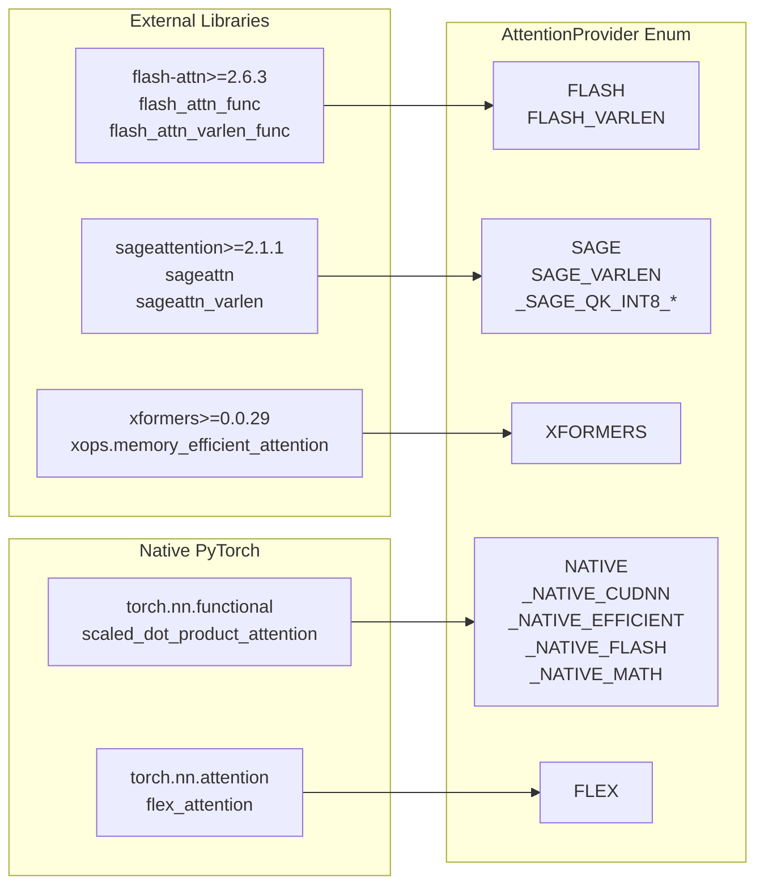
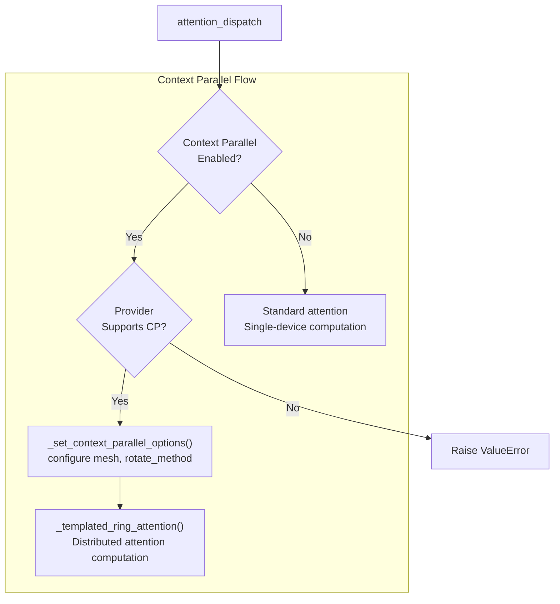
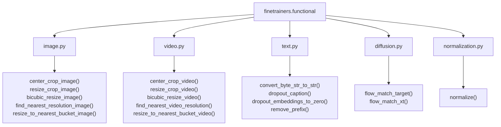
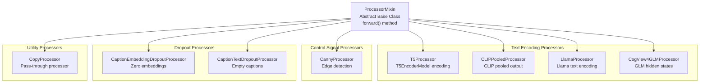
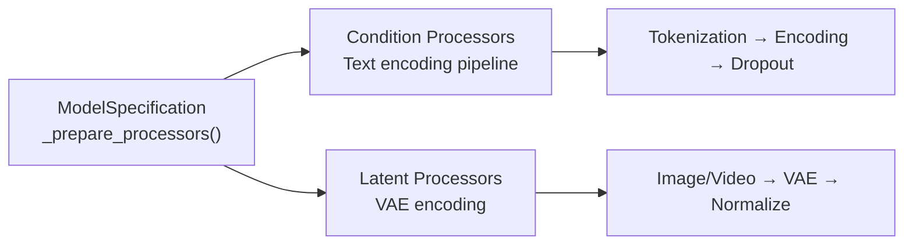
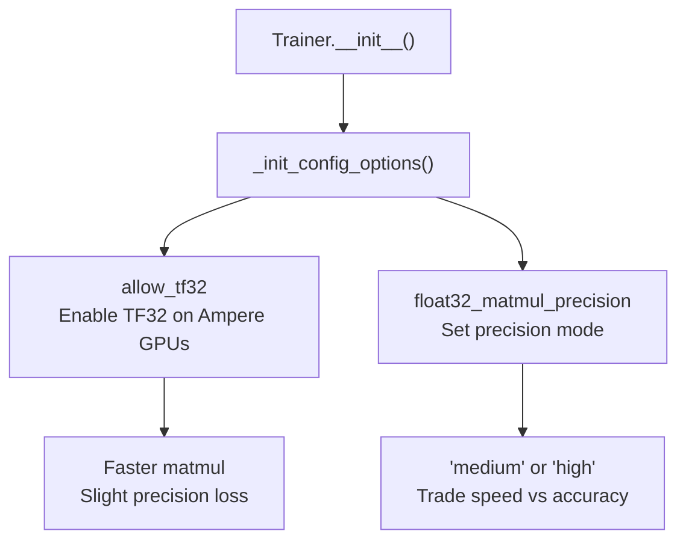
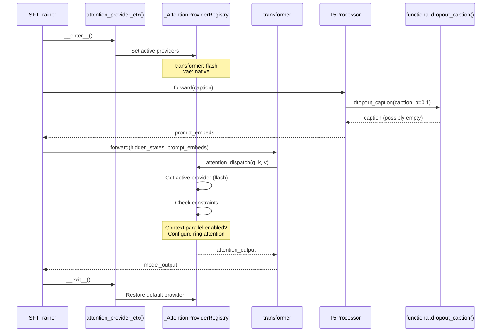

<!-- source: DeepWiki mcp.deepwiki.com · repo huggingface/finetrainers · page 8 Advanced Features · fetched 2026-10-26 -->

# Advanced Features

<details>
<summary>Relevant source files</summary>

The following files were used as context for generating this wiki page:

- [.gitignore](.gitignore)
- [README.md](README.md)
- [docs/environment.md](docs/environment.md)
- [docs/models/attention.md](docs/models/attention.md)
- [examples/training/sft/cogview4/raider_white_tarot/training.json](examples/training/sft/cogview4/raider_white_tarot/training.json)
- [examples/training/sft/cogview4/raider_white_tarot/validation.json](examples/training/sft/cogview4/raider_white_tarot/validation.json)
- [finetrainers/constants.py](finetrainers/constants.py)
- [finetrainers/functional/__init__.py](finetrainers/functional/__init__.py)
- [finetrainers/functional/image.py](finetrainers/functional/image.py)
- [finetrainers/functional/text.py](finetrainers/functional/text.py)
- [finetrainers/functional/video.py](finetrainers/functional/video.py)
- [finetrainers/models/__init__.py](finetrainers/models/__init__.py)
- [finetrainers/models/attention_dispatch.py](finetrainers/models/attention_dispatch.py)
- [finetrainers/models/cogview4/__init__.py](finetrainers/models/cogview4/__init__.py)
- [finetrainers/patches/__init__.py](finetrainers/patches/__init__.py)
- [finetrainers/processors/__init__.py](finetrainers/processors/__init__.py)
- [finetrainers/processors/glm.py](finetrainers/processors/glm.py)
- [finetrainers/trainer/base.py](finetrainers/trainer/base.py)

</details>


This document covers advanced capabilities in finetrainers that enable performance optimization, custom data processing, and fine-grained control over model behavior. These features are designed for users who need to optimize training performance, implement custom processing pipelines, or extend the library's functionality.

The four main categories of advanced features are:
- **Attention Providers** ([see section 8.1](#8.1)): Pluggable attention implementations for performance optimization
- **Functional Utilities** ([see section 8.2](#8.2)): Low-level image, video, text, and diffusion processing functions
- **Processors and Data Transforms** ([see section 8.3](#8.3)): Modular data preprocessing components
- **Utility Functions** ([see section 8.4](#8.4)): Memory management, compilation, and helper utilities

For information about distributed training strategies, see [Parallelism and Distribution](#7). For model-specific implementations, see [Supported Models](#6).

---

## System Architecture Overview

The advanced features system provides cross-cutting functionality that integrates throughout the training pipeline:

```mermaid
graph TB
    subgraph "Training Pipeline"
        Trainer["SFTTrainer / ControlTrainer"]
        ModelSpec["ModelSpecification"]
        DataPipeline["Data Pipeline"]
        ParallelBackend["ParallelBackend"]
    end
    
    subgraph "Advanced Features Layer"
        direction TB
        
        subgraph "Attention System"
            AttentionDispatch["attention_dispatch()"]
            AttentionRegistry["_AttentionProviderRegistry"]
            Providers["Flash / Sage / Native / xFormers"]
        end
        
        subgraph "Functional Utilities"
            ImageUtils["image.py<br/>center_crop_image()<br/>bicubic_resize_image()"]
            VideoUtils["video.py<br/>center_crop_video()<br/>find_nearest_video_resolution()"]
            TextUtils["text.py<br/>dropout_caption()<br/>remove_prefix()"]
            DiffusionUtils["diffusion.py<br/>flow_match_target()<br/>flow_match_xt()"]
        end
        
        subgraph "Processor System"
            ProcessorMixin["ProcessorMixin<br/>Base Interface"]
            TextProcessors["T5Processor<br/>LlamaProcessor<br/>CLIPPooledProcessor"]
            ControlProcessors["CannyProcessor<br/>DepthProcessor"]
            DropoutProcessors["CaptionEmbeddingDropoutProcessor<br/>CaptionTextDropoutProcessor"]
        end
        
        subgraph "Utilities"
            TorchUtils["torch_utils<br/>Memory Management<br/>Compilation"]
            Patches["patches<br/>Model Modifications"]
        end
    end
    
    subgraph "Configuration"
        EnvVars["Environment Variables<br/>FINETRAINERS_ATTN_PROVIDER<br/>FINETRAINERS_ATTN_CHECKS"]
        Args["BaseArgs<br/>attn_provider_training<br/>attn_provider_inference"]
    end
    
    Trainer --> AttentionDispatch
    ModelSpec --> ProcessorMixin
    ModelSpec --> AttentionDispatch
    DataPipeline --> ImageUtils
    DataPipeline --> VideoUtils
    DataPipeline --> TextUtils
    DataPipeline --> ProcessorMixin
    
    ModelSpec --> DiffusionUtils
    
    Trainer --> TorchUtils
    Trainer --> Patches
    ParallelBackend --> TorchUtils
    
    EnvVars --> AttentionRegistry
    Args --> AttentionRegistry
    
    AttentionDispatch --> AttentionRegistry
    AttentionRegistry --> Providers
    
    ProcessorMixin --> TextProcessors
    ProcessorMixin --> ControlProcessors
    ProcessorMixin --> DropoutProcessors
```



**Sources:** [finetrainers/models/attention_dispatch.py:1-1260](), [finetrainers/functional/__init__.py:1-18](), [finetrainers/processors/__init__.py:1-24](), [finetrainers/trainer/base.py:1-189]()

---

## Attention Providers

The attention provider system allows runtime selection of optimized attention implementations without modifying model code. This enables significant performance improvements on different hardware configurations.

### Key Components

| Component | Location | Purpose |
|-----------|----------|---------|
| `AttentionProvider` | [finetrainers/models/attention_dispatch.py:265-293]() | Enum defining available attention implementations |
| `_AttentionProviderRegistry` | [finetrainers/models/attention_dispatch.py:295-363]() | Registry for attention provider implementations and constraints |
| `attention_dispatch()` | [finetrainers/models/attention_dispatch.py:405-448]() | Main dispatch function that routes to active provider |
| `attention_provider()` | [finetrainers/models/attention_dispatch.py:365-403]() | Context manager for temporarily switching providers |

### Supported Providers



**Sources:** [finetrainers/models/attention_dispatch.py:265-293](), [docs/models/attention.md:1-264]()

### Configuration

Attention providers can be configured via environment variables or runtime arguments:

**Environment Variables:**
- `FINETRAINERS_ATTN_PROVIDER`: Default provider (e.g., `"native"`, `"flash"`, `"sage"`)
- `FINETRAINERS_ATTN_CHECKS`: Enable constraint validation (`"0"` or `"1"`)

**Runtime Configuration:**
```python
# Via context manager (code example for illustration only)
with attention_provider(AttentionProvider.FLASH):
    output = model(input)

# Per-module configuration in trainer
args.attn_provider_training = ["transformer:flash", "vae:native"]
args.attn_provider_inference = ["transformer:sage_varlen"]
```

**Sources:** [finetrainers/constants.py:6-9](), [finetrainers/trainer/base.py:28-91]()

### Context Parallel Support

Selected attention providers support context parallelism for distributed sequence processing. The system automatically configures ring attention when `cp_degree > 1`:



Providers supporting context parallelism: `FLASH`, `_NATIVE_CUDNN`, `_NATIVE_EFFICIENT`, `_NATIVE_FLASH`

**Sources:** [finetrainers/models/attention_dispatch.py:333-363](), [finetrainers/models/attention_dispatch.py:454-458](), [docs/models/attention.md:86-264]()

For detailed information on attention providers, installation instructions, and usage examples, see [Attention Providers](#8.1).

---

## Functional Utilities

The `finetrainers.functional` module provides low-level stateless functions for data processing operations. These utilities are used throughout the data pipeline and can be imported directly for custom processing.

### Module Organization



**Sources:** [finetrainers/functional/__init__.py:1-18](), [finetrainers/functional/image.py:1-57](), [finetrainers/functional/video.py:1-97](), [finetrainers/functional/text.py:1-41]()

### Key Capabilities

**Resolution Bucketing:**
The system automatically resizes images/videos to match predefined resolution buckets:

| Function | Purpose | Resize Modes |
|----------|---------|--------------|
| `resize_to_nearest_bucket_image()` | Find and resize to nearest image resolution | `center_crop`, `resize_crop`, `bicubic` |
| `resize_to_nearest_bucket_video()` | Find and resize to nearest video resolution | `center_crop`, `resize_crop`, `bicubic` |
| `find_nearest_resolution_image()` | Calculate optimal bucket by aspect ratio | N/A |
| `find_nearest_video_resolution()` | Calculate optimal bucket by frames + aspect ratio | N/A |

**Caption Processing:**
- `dropout_caption()`: Randomly drop captions for unconditional training
- `dropout_embeddings_to_zero()`: Zero out embeddings with probability `dropout_p`
- `remove_prefix()`: Strip common LLM caption prefixes (defined in `COMMON_LLM_START_PHRASES`)
- `convert_byte_str_to_str()`: Parse stringified bytes from WebDataset formats

**Diffusion Utilities:**
- `flow_match_target()`: Compute flow matching target for training
- `flow_match_xt()`: Compute noisy latents for flow matching

**Sources:** [finetrainers/functional/image.py:30-57](), [finetrainers/functional/video.py:32-97](), [finetrainers/functional/text.py:1-41](), [finetrainers/constants.py:60-84]()

For comprehensive documentation of all functional utilities, see [Functional Utilities](#8.2).

---

## Processors and Data Transforms

The processor system provides a modular interface for data preprocessing. Processors encapsulate tokenization, text encoding, and custom transformations in reusable components.

### Processor Architecture



**Sources:** [finetrainers/processors/__init__.py:1-24](), [finetrainers/processors/glm.py:1-75]()

### ProcessorMixin Interface

All processors inherit from `ProcessorMixin` and implement the `forward()` method:

**Key Attributes:**
- `output_names: List[str]` - Names of outputs to return
- `input_names: Optional[Dict[str, Any]]` - Optional input name mapping

**Contract:**
- `forward()` must return a dictionary mapping `output_names` to processed values
- Processors should be stateless (no learnable parameters)
- GPU memory management is handled by caller

**Example Usage Pattern:**
```python
# Processor instantiation (for illustration)
processor = T5Processor(output_names=["prompt_embeds"])

# Processing
result = processor.forward(
    tokenizer=tokenizer,
    text_encoder=text_encoder,
    caption="a cat",
    max_sequence_length=512
)
# Returns: {"prompt_embeds": tensor(...)}
```

**Sources:** [finetrainers/processors/base.py:1-25]() (referenced but not shown), [finetrainers/processors/glm.py:9-75]()

### Integration with ModelSpecification

Processors are instantiated by `ModelSpecification` classes in their `_prepare_processors()` methods. Each model defines which processors to use for condition and latent preparation:



**Sources:** [finetrainers/models/modeling_utils.py:200-250]() (referenced in diagram analysis)

For detailed processor documentation and custom processor creation, see [Processors and Data Transforms](#8.3).

---

## Utility Functions and Optimization Techniques

The library provides various utility functions for memory management, model compilation, and training optimizations.

### Patching System

The patching system modifies library behavior at runtime to enable features or fix incompatibilities:

**Patch Categories:**

| Patch Module | Purpose | Applied When |
|--------------|---------|--------------|
| `patches/dependencies/diffusers/` | Diffusers library modifications | Always during training initialization |
| `patches/dependencies/peft/` | PEFT library modifications | LoRA training with layerwise upcasting |
| `patches/models/{model_name}/` | Model-specific modifications | Training specific models |

**Key Patches:**
- `patch_scaled_dot_product_attention()`: Replaces PyTorch SDPA with `attention_dispatch()`
- `patch_diffusers_rms_norm_forward()`: Optimized RMSNorm implementation
- Model-specific transformer patches (e.g., LTX-Video, Wan)

**Sources:** [finetrainers/patches/__init__.py:13-58]()

### Compilation and Memory Optimization

**Configuration Options:**



**Memory Management:**
- Gradient checkpointing via `BaseArgs.gradient_checkpointing`
- Layerwise module offloading
- Precomputation of embeddings to disk (see [Precomputation System](#5.3))

**Torch Compilation:**
- Models can be compiled via `torch.compile()` for inference
- Compilation is applied regionally to transformer blocks
- Requires PyTorch 2.0+

**Sources:** [finetrainers/trainer/base.py:127-132](), [docs/models/attention.md:150-173]()

### Environment Variables

Key environment variables for advanced configuration:

| Variable | Purpose | Default |
|----------|---------|---------|
| `FINETRAINERS_LOG_LEVEL` | Logging verbosity | `"INFO"` |
| `FINETRAINERS_ATTN_PROVIDER` | Default attention provider | `"native"` |
| `FINETRAINERS_ATTN_CHECKS` | Enable attention constraint checks | `"0"` |
| `FINETRAINERS_ENABLE_TIMING` | Enable operation timing | `"1"` |

**Sources:** [finetrainers/constants.py:6-9]()

For detailed utility function documentation, see [Utility Functions](#8.4).

---

## Integration Example

The following diagram illustrates how advanced features integrate during a typical training step:



**Sources:** [finetrainers/trainer/base.py:37-91](), [finetrainers/models/attention_dispatch.py:405-448](), [finetrainers/processors/text.py:1-34]()

---

## Summary

Advanced features in finetrainers provide:

1. **Performance Optimization**: Pluggable attention implementations (Flash, Sage, xFormers) enable 2-4x speedups
2. **Flexibility**: Functional utilities and processors enable custom data processing pipelines
3. **Extensibility**: Well-defined interfaces (`ProcessorMixin`, `_AttentionProviderRegistry`) for adding new implementations
4. **Hardware Adaptation**: Context parallel support, TF32, compilation for different GPU generations

The modular design ensures these features can be used independently or composed together. For implementing custom extensions, see [Extending Finetrainers](#9).

**Sources:** [finetrainers/models/attention_dispatch.py:1-1260](), [finetrainers/functional/__init__.py:1-18](), [finetrainers/processors/__init__.py:1-24](), [finetrainers/patches/__init__.py:1-59]()

---

