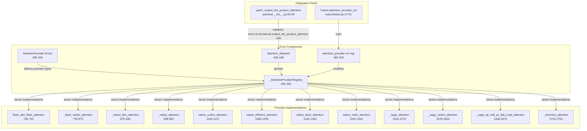
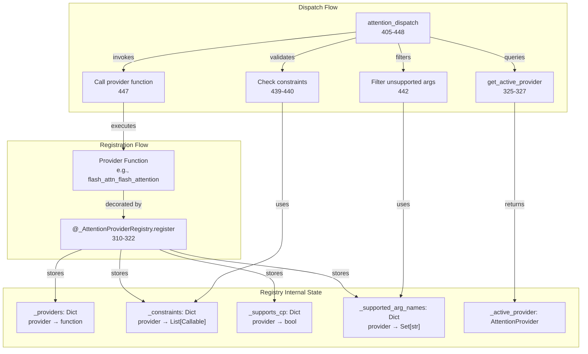
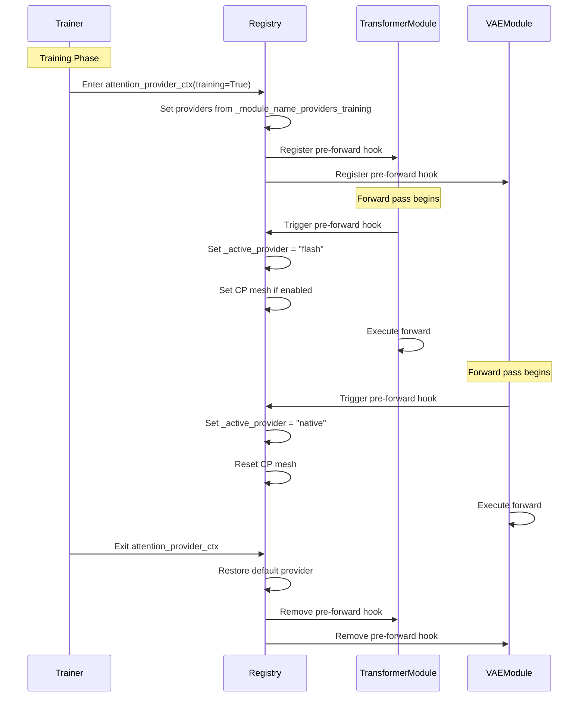
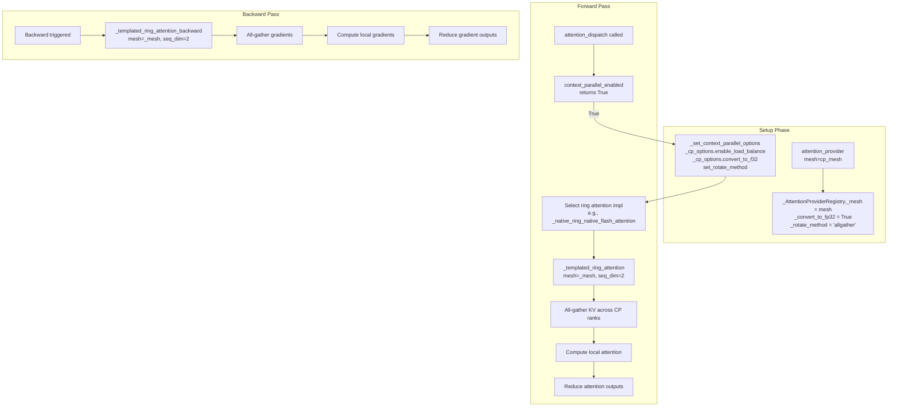
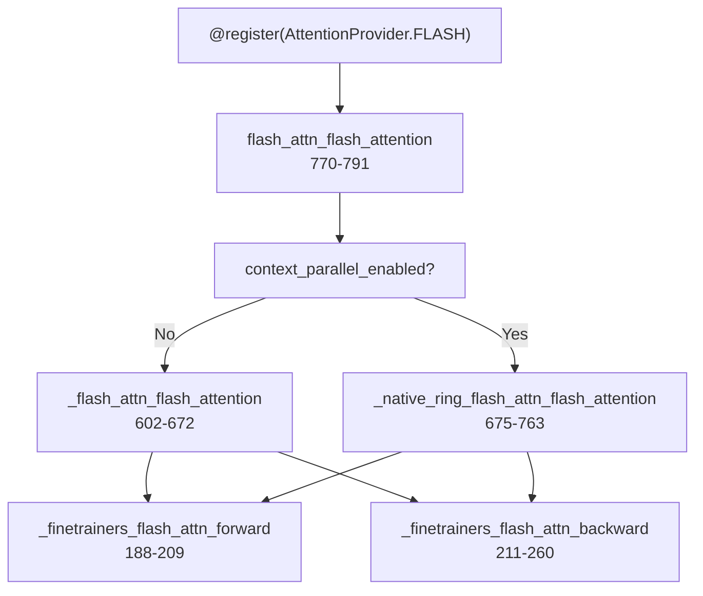
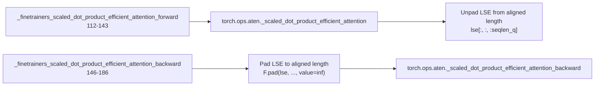

<!-- source: DeepWiki mcp.deepwiki.com · repo huggingface/finetrainers · page 8.1 Attention Providers · fetched 2026-10-26 -->

# Attention Providers

<details>
<summary>Relevant source files</summary>

The following files were used as context for generating this wiki page:

- [.gitignore](.gitignore)
- [README.md](README.md)
- [docs/environment.md](docs/environment.md)
- [docs/models/attention.md](docs/models/attention.md)
- [finetrainers/constants.py](finetrainers/constants.py)
- [finetrainers/functional/__init__.py](finetrainers/functional/__init__.py)
- [finetrainers/functional/text.py](finetrainers/functional/text.py)
- [finetrainers/models/__init__.py](finetrainers/models/__init__.py)
- [finetrainers/models/attention_dispatch.py](finetrainers/models/attention_dispatch.py)
- [finetrainers/patches/__init__.py](finetrainers/patches/__init__.py)
- [finetrainers/trainer/base.py](finetrainers/trainer/base.py)
- [finetrainers/utils/__init__.py](finetrainers/utils/__init__.py)
- [finetrainers/utils/torch.py](finetrainers/utils/torch.py)
- [tests/trainer/test_sft_trainer.py](tests/trainer/test_sft_trainer.py)

</details>


This page documents the attention provider system in finetrainers, which enables dynamic dispatching to different attention implementations for training and inference. The system provides a unified interface for using Flash Attention, Sage Attention, PyTorch's native SDPA, Flex Attention, and xFormers, with support for context parallel training.

For general information about distributed training strategies, see [Parallelism Strategies](#7.2).

## Purpose and Scope

The attention provider system allows models to:
- Switch between different attention implementations at runtime without code changes
- Use optimized attention kernels (Flash Attention, Sage Attention) for better performance
- Support context parallel training with compatible attention providers
- Apply different attention providers to different modules (e.g., transformer vs VAE)
- Validate attention provider constraints automatically during execution

## System Architecture

The attention provider system consists of four main components: a registry for managing providers, a dispatch function that routes attention calls, an enum for provider types, and a context manager for dynamic provider switching.

### Component Overview



**Sources:** [finetrainers/models/attention_dispatch.py:1-2167]()

### Attention Provider Types

The `AttentionProvider` enum defines all supported attention implementations. Each provider is a string enum value that identifies a specific attention kernel or implementation.

| Provider | Type | Context Parallel | Attention Mask Support | Description |
|----------|------|------------------|------------------------|-------------|
| `flash` | Flash Attention | ✓ | None only | Flash Attention 2.x kernel |
| `flash_varlen` | Flash Attention | ✗ | Variable length | Variable-length Flash Attention |
| `flex` | PyTorch Native | ✗ | Full support | PyTorch Flex Attention (requires 2.5.0+) |
| `native` | PyTorch Native | ✗ | Full support | PyTorch SDPA with automatic backend selection |
| `_native_cudnn` | PyTorch Native | ✓ | Full support | PyTorch cuDNN attention backend |
| `_native_efficient` | PyTorch Native | ✓ | Full support | PyTorch memory-efficient attention backend |
| `_native_flash` | PyTorch Native | ✓ | None only | PyTorch Flash Attention backend |
| `_native_math` | PyTorch Native | ✗ | Full support | PyTorch math (naive) attention backend |
| `sage` | Sage Attention | ✗ | None only | Sage Attention kernel |
| `sage_varlen` | Sage Attention | ✗ | Variable length | Variable-length Sage Attention |
| `_sage_qk_int8_pv_fp8_cuda` | Sage Attention | ✗ | None only | Sage int8/fp8 quantized (H100+) |
| `_sage_qk_int8_pv_fp8_cuda_sm90` | Sage Attention | ✗ | None only | Sage int8/fp8 quantized SM90 |
| `_sage_qk_int8_pv_fp16_cuda` | Sage Attention | ✗ | None only | Sage int8/fp16 quantized CUDA |
| `_sage_qk_int8_pv_fp16_triton` | Sage Attention | ✗ | None only | Sage int8/fp16 quantized Triton |
| `xformers` | xFormers | ✗ | None only | xFormers memory-efficient attention |

**Sources:** [finetrainers/models/attention_dispatch.py:265-293](), [docs/models/attention.md:1-264]()

## Registry and Dispatch Mechanism

The `_AttentionProviderRegistry` class manages all registered attention providers using a singleton pattern. It stores provider functions, their constraints, context parallel support flags, and supported argument names.



**Sources:** [finetrainers/models/attention_dispatch.py:295-363](), [finetrainers/models/attention_dispatch.py:405-448]()

### Registration Pattern

Each attention provider is registered using the `@_AttentionProviderRegistry.register` decorator. The decorator accepts constraints (validation functions) and a flag indicating context parallel support.

Example registration from the codebase:

```python
@_AttentionProviderRegistry.register(
    AttentionProvider.FLASH,
    constraints=[_check_attn_mask_is_none, _check_device, _check_qkv_dtype_bf16_or_fp16, _check_shape],
    supports_cp=True,
)
def flash_attn_flash_attention(query, key, value, dropout_p=0.0, scale=None, is_causal=False, ...):
    # Implementation
```

**Sources:** [finetrainers/models/attention_dispatch.py:765-791]()

### Constraint Validation

Constraints are functions that validate input tensors before dispatching to a provider. Common constraints include:

- `_check_attn_mask_is_none` - Ensures no attention mask is provided
- `_check_attn_mask_or_causal` - Ensures attn_mask and is_causal are not both set
- `_check_device` - Validates tensors are on the same device with same dtype
- `_check_device_cuda` - Validates tensors are on CUDA
- `_check_device_cuda_atleast_smXY` - Validates compute capability
- `_check_qkv_dtype_bf16_or_fp16` - Ensures tensors are bfloat16 or float16
- `_check_shape` - Validates tensor dimensions

**Sources:** [finetrainers/models/attention_dispatch.py:460-521]()

## Configuration

The attention provider system can be configured through environment variables, command-line arguments, and programmatic context managers.

### Environment Variables

| Variable | Default | Description |
|----------|---------|-------------|
| `FINETRAINERS_ATTN_PROVIDER` | `"native"` | Default attention provider for all modules |
| `FINETRAINERS_ATTN_CHECKS` | `"0"` | Enable constraint validation (disable for production) |

**Sources:** [finetrainers/constants.py:7-8]()

### Command-Line Arguments

The training scripts accept two arguments for specifying attention providers:

- `--attn_provider_training` - Providers to use during training (list of `module_name:provider_name`)
- `--attn_provider_inference` - Providers to use during validation/inference (list of `module_name:provider_name`)

Example usage:
```bash
python train.py \
  --attn_provider_training "transformer:flash" "vae:native" \
  --attn_provider_inference "transformer:sage" "vae:native"
```

**Sources:** [finetrainers/trainer/base.py:28-29](), [finetrainers/trainer/base.py:148-159]()

## Usage Patterns

### Global Patching

The most common usage pattern is to globally replace PyTorch's `scaled_dot_product_attention` with the attention dispatcher:

```python
import torch.nn.functional as F
from finetrainers.models.attention_dispatch import attention_dispatch

F.scaled_dot_product_attention = attention_dispatch
```

This happens automatically when training is initialized through `perform_patches_for_training`.

**Sources:** [finetrainers/patches/__init__.py:55-59]()

### Context Manager

For finer control, use the `attention_provider` context manager:

```python
from finetrainers.models.attention_dispatch import attention_provider, AttentionProvider

# Basic usage
with attention_provider(AttentionProvider.FLASH):
    output = model(input)

# With context parallel
with attention_provider("_native_flash", mesh=cp_mesh, convert_to_fp32=True, rotate_method="allgather"):
    output = model(input)
```

**Sources:** [finetrainers/models/attention_dispatch.py:365-403]()

### Trainer Integration

Trainers automatically manage attention providers for different modules during training and inference phases:



**Sources:** [finetrainers/trainer/base.py:37-91]()

The trainer parses module-specific providers from command-line arguments and applies them using hooks that lazily switch providers before each module's forward pass. This ensures:
1. The backward pass uses the same provider as the forward pass
2. Different modules can use different providers
3. Context parallel settings are automatically configured for supported modules

## Context Parallel Support

Context parallel (CP) splits the sequence dimension across multiple GPUs to handle longer sequences. The attention provider system integrates with PyTorch's ring attention implementation for CP-compatible providers.

### CP-Compatible Providers

Only these providers support context parallel:
- `flash` - Uses ring attention with Flash Attention kernels
- `_native_cudnn` - Uses ring attention with cuDNN backend
- `_native_efficient` - Uses ring attention with memory-efficient backend
- `_native_flash` - Uses ring attention with Flash Attention backend

**Sources:** [finetrainers/models/attention_dispatch.py:765-791](), [finetrainers/models/attention_dispatch.py:1116-1137](), [finetrainers/models/attention_dispatch.py:1280-1300](), [finetrainers/models/attention_dispatch.py:1442-1462]()

### Context Parallel Flow



**Sources:** [finetrainers/models/attention_dispatch.py:444-447](), [finetrainers/models/attention_dispatch.py:453-458](), [finetrainers/models/attention_dispatch.py:675-763](), [finetrainers/models/attention_dispatch.py:1371-1440]()

### Ring Attention Implementation

For CP-enabled providers, the system uses PyTorch's `_templated_ring_attention` and `_templated_ring_attention_backward` functions, which require:
1. A device mesh specifying the CP group
2. The sequence dimension to split (typically dimension 2 for BNSD layout)
3. An attention operator with compatible forward/backward signatures
4. Log-sum-exp (LSE) tensors for numerically stable aggregation

The system wraps Flash Attention and native PyTorch attention operators to return LSE tensors and handle the necessary tensor permutations between BNSD and BSND layouts.

**Sources:** [finetrainers/models/attention_dispatch.py:71-89](), [finetrainers/models/attention_dispatch.py:189-260](), [docs/models/attention.md:86-264]()

## Provider Implementation Details

### Flash Attention Providers

Flash Attention providers use the `flash-attn` library (requires version 2.6.3+). The implementation wraps the library's forward/backward functions with custom autograd functions that handle:
- Tensor layout conversions (BNSD ↔ BSND)
- LSE tensor alignment issues
- Ring attention integration for CP

#### Standard Flash Attention



**Sources:** [finetrainers/models/attention_dispatch.py:602-791]()

#### Variable-Length Flash Attention

Variable-length Flash Attention (`flash_varlen`) handles sequences with padding by:
1. Accepting or computing cumulative sequence lengths (`cu_seqlens_q`, `cu_seqlens_k`)
2. Packing valid tokens into contiguous memory
3. Calling `flash_attn_varlen_func` with packed tensors
4. Unpacking outputs back to padded format

**Sources:** [finetrainers/models/attention_dispatch.py:793-873]()

### Native PyTorch Providers

Native providers wrap PyTorch's ATen attention operations. Each has a custom autograd function that:
- Stores context for backward pass
- Returns LSE tensors when needed
- Supports ring attention for CP

The four native attention backends (`_native_cudnn`, `_native_efficient`, `_native_flash`, `_native_math`) correspond to PyTorch's internal SDPA backend selection.

**Custom Operators for Efficient Backend:**

The efficient attention backend has an LSE alignment issue (aligned to multiples of 32) that breaks ring attention. Custom operators handle this:



**Sources:** [finetrainers/models/attention_dispatch.py:112-186](), [finetrainers/models/attention_dispatch.py:1139-1300]()

### Sage Attention Providers

Sage Attention providers use the `sageattention` library (requires version 2.1.1+). Sage provides quantized attention kernels with different precision configurations:

- `sage` - Standard Sage Attention
- `sage_varlen` - Variable-length Sage Attention
- `_sage_qk_int8_pv_fp8_cuda` - INT8 query/key, FP8 product/value (H100+)
- `_sage_qk_int8_pv_fp16_cuda` - INT8 query/key, FP16 product/value (A100+)
- `_sage_qk_int8_pv_fp16_triton` - INT8 query/key, FP16 product/value (Triton backend)

Sage providers require specific compute capabilities and do not currently support context parallel.

**Sources:** [finetrainers/models/attention_dispatch.py:44-64](), [finetrainers/models/attention_dispatch.py:1543-1722]()

### Flex Attention Provider

Flex Attention (`flex`) uses PyTorch's experimental flex attention API (requires PyTorch 2.5.0+). It supports:
- Custom score modification functions
- Block-sparse attention patterns
- Causal masking through mask modifiers
- Dense attention masks

Flex Attention creates block masks from attention masks or causal patterns, enabling optimized sparse attention patterns.

**Sources:** [finetrainers/models/attention_dispatch.py:67-69](), [finetrainers/models/attention_dispatch.py:875-936]()

### xFormers Provider

The xFormers provider uses the `xformers` library's memory-efficient attention (requires version 0.0.29+). It provides efficient attention without requiring Flash Attention's specific GPU requirements.

**Sources:** [finetrainers/models/attention_dispatch.py:91-99](), [finetrainers/models/attention_dispatch.py:1724-1753]()

## Dependency Versions

The attention provider system requires specific versions of optional dependencies:

| Library | Minimum Version | Providers |
|---------|----------------|-----------|
| `flash-attn` | 2.6.3 | `flash`, `flash_varlen` |
| `sageattention` | 2.1.1 | `sage`, `sage_varlen`, `_sage_qk_int8_pv_*` |
| `xformers` | 0.0.29 | `xformers` |
| `torch` | 2.5.0 | `flex` |
| `torch` | 2.6.0 | Context parallel support |

Version checks are performed at import time and raise `OptionalDependencyNotAvailable` if versions are too old.

**Sources:** [finetrainers/models/attention_dispatch.py:29-99](), [docs/models/attention.md:13-16]()

---

