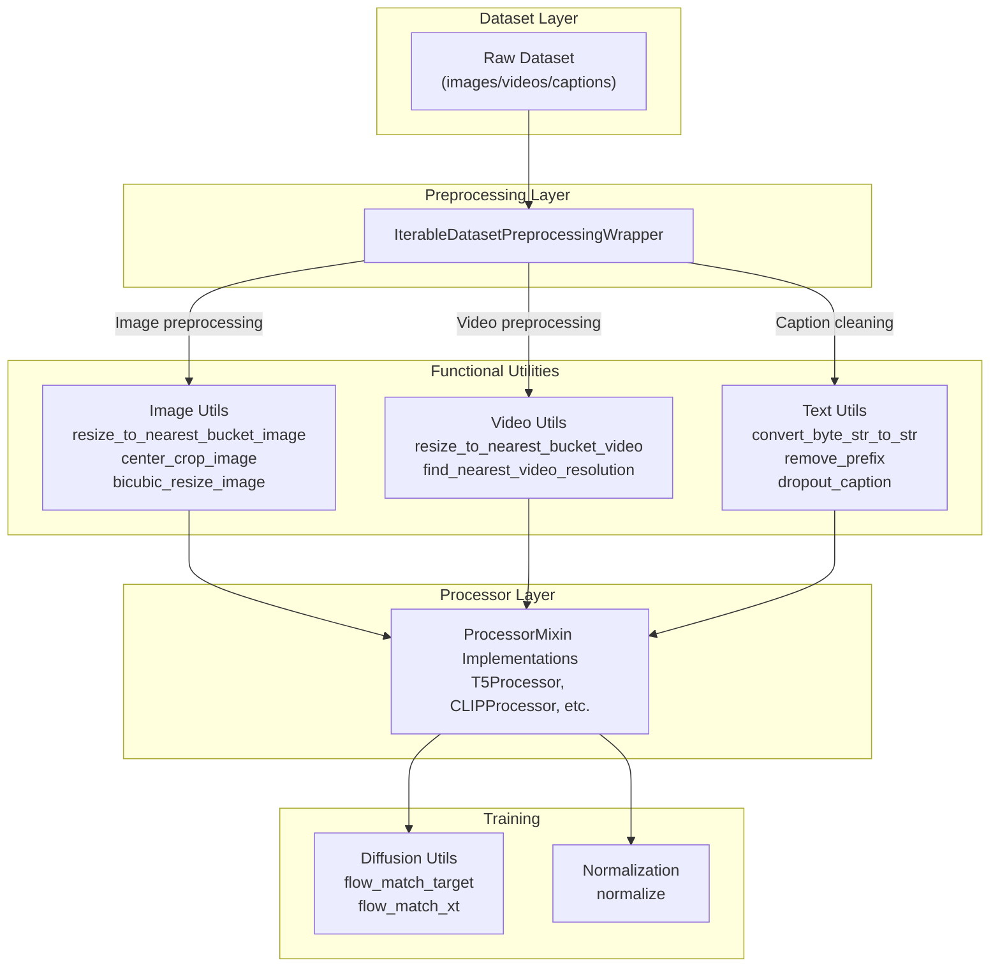
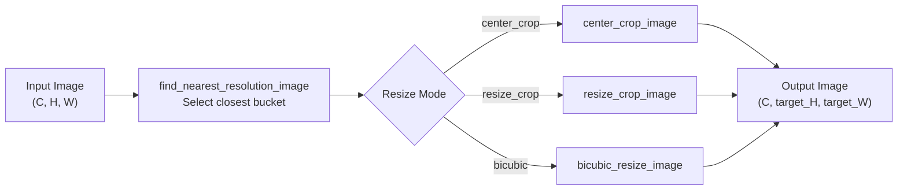
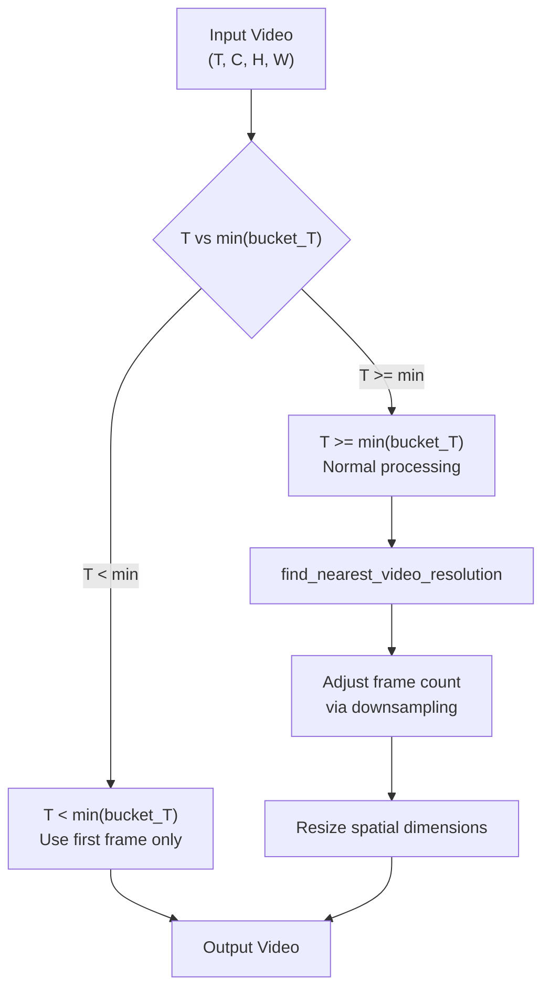
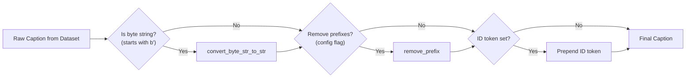
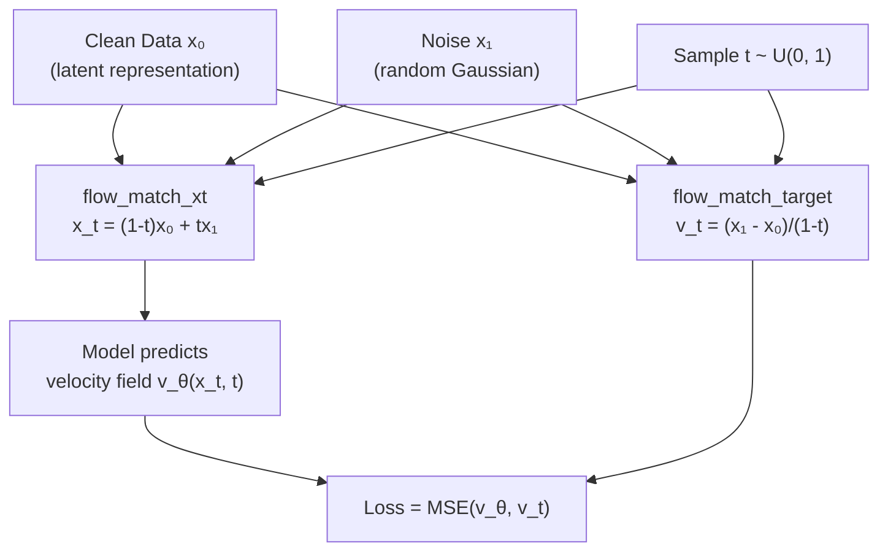

<!-- source: DeepWiki mcp.deepwiki.com · repo huggingface/finetrainers · page 8.2 Functional Utilities · fetched 2026-10-26 -->

# Functional Utilities

<details>
<summary>Relevant source files</summary>

The following files were used as context for generating this wiki page:

- [.gitignore](.gitignore)
- [README.md](README.md)
- [docs/dataset/README.md](docs/dataset/README.md)
- [examples/training/sft/cogview4/raider_white_tarot/training.json](examples/training/sft/cogview4/raider_white_tarot/training.json)
- [examples/training/sft/cogview4/raider_white_tarot/validation.json](examples/training/sft/cogview4/raider_white_tarot/validation.json)
- [finetrainers/data/__init__.py](finetrainers/data/__init__.py)
- [finetrainers/data/dataset.py](finetrainers/data/dataset.py)
- [finetrainers/data/precomputation.py](finetrainers/data/precomputation.py)
- [finetrainers/functional/__init__.py](finetrainers/functional/__init__.py)
- [finetrainers/functional/image.py](finetrainers/functional/image.py)
- [finetrainers/functional/text.py](finetrainers/functional/text.py)
- [finetrainers/functional/video.py](finetrainers/functional/video.py)
- [finetrainers/models/cogview4/__init__.py](finetrainers/models/cogview4/__init__.py)
- [finetrainers/processors/__init__.py](finetrainers/processors/__init__.py)
- [finetrainers/processors/glm.py](finetrainers/processors/glm.py)
- [tests/data/test_dataset.py](tests/data/test_dataset.py)
- [tests/data/test_precomputation.py](tests/data/test_precomputation.py)

</details>


The `finetrainers.functional` module provides a collection of stateless utility functions for common data transformations used throughout the training pipeline. These pure functions handle image processing, video processing, text manipulation, and diffusion-related computations without maintaining internal state.

For information about stateful data processors that use these utilities, see [Processors and Data Transforms](#8.3). For dataset loading and preprocessing workflows, see [Data Pipeline](#5).

## Overview

The functional utilities are organized into five categories, each addressing specific transformation needs in the diffusion model training pipeline:

| Category | Module | Primary Use Cases |
|----------|--------|-------------------|
| Image Processing | `finetrainers.functional.image` | Resolution bucketing, cropping, resizing images |
| Video Processing | `finetrainers.functional.video` | Temporal-spatial bucketing, video resizing |
| Text Processing | `finetrainers.functional.text` | Caption cleaning, dropout, prefix removal |
| Diffusion | `finetrainers.functional.diffusion` | Flow matching computations for training |
| Normalization | `finetrainers.functional.normalization` | Tensor normalization operations |

Sources: [finetrainers/functional/__init__.py:1-18]()

## Utility Integration in Data Pipeline



Sources: [finetrainers/data/dataset.py:677-773](), [finetrainers/functional/__init__.py:1-18]()

## Image Processing Utilities

The image processing utilities provide functions for spatial transformations and resolution bucketing. All functions operate on tensors of shape `(C, H, W)`.

### Core Image Functions

| Function | Signature | Description |
|----------|-----------|-------------|
| `center_crop_image` | `(image: Tensor, size: Tuple[int, int]) -> Tensor` | Crops image to target size from center |
| `resize_crop_image` | `(image: Tensor, size: Tuple[int, int]) -> Tensor` | Scales then center-crops to maintain aspect ratio |
| `bicubic_resize_image` | `(image: Tensor, size: Tuple[int, int]) -> Tensor` | Bicubic interpolation resize |
| `find_nearest_resolution_image` | `(image: Tensor, buckets: List[Tuple]) -> Tuple` | Finds closest bucket by aspect ratio |
| `resize_to_nearest_bucket_image` | `(image: Tensor, buckets: List, mode: str) -> Tensor` | Complete bucketing workflow |

**Implementation Details:**

The `center_crop_image` function extracts the center region of an image:

```
Input: (C, H, W) with H=256, W=512, target=(224, 448)
Process: 
  - top = (256 - 224) // 2 = 16
  - left = (512 - 448) // 2 = 32
  - Extract image[:, 16:240, 32:480]
Output: (C, 224, 448)
```

The `find_nearest_resolution_image` function selects buckets by minimizing aspect ratio difference:

```python
def aspect_ratio_diff(bucket):
    return abs((bucket[1] / bucket[0]) - aspect_ratio), (-bucket[0], -bucket[1])
```

This ensures images are resized to the bucket with the closest aspect ratio, minimizing distortion.

Sources: [finetrainers/functional/image.py:1-57]()

### Resolution Bucketing Workflow



The `resize_to_nearest_bucket_image` function at [finetrainers/functional/image.py:40-56]() orchestrates this workflow by:
1. Finding the nearest resolution bucket based on aspect ratio
2. Applying the specified resize mode (`center_crop`, `resize_crop`, or `bicubic`)
3. Returning the transformed tensor

Sources: [finetrainers/functional/image.py:7-56](), [finetrainers/data/dataset.py:730-737]()

## Video Processing Utilities

Video processing utilities extend image operations to the temporal dimension, handling tensors of shape `(T, C, H, W)`.

### Core Video Functions

| Function | Signature | Description |
|----------|-----------|-------------|
| `center_crop_video` | `(video: Tensor, size: Tuple[int, int]) -> Tensor` | Spatially crops video frames |
| `resize_crop_video` | `(video: Tensor, size: Tuple[int, int]) -> Tensor` | Scales then crops video |
| `bicubic_resize_video` | `(video: Tensor, size: Tuple[int, int]) -> Tensor` | Bicubic resize across all frames |
| `find_nearest_video_resolution` | `(video: Tensor, buckets: List[Tuple]) -> Tuple` | Finds closest (T, H, W) bucket |
| `resize_to_nearest_bucket_video` | `(video: Tensor, buckets: List, mode: str) -> Tuple` | Complete video bucketing with frame adjustment |

**Temporal-Spatial Bucketing Algorithm:**

The `find_nearest_video_resolution` function at [finetrainers/functional/video.py:32-49]() implements a two-stage matching algorithm:

1. **Frame Matching:** Find buckets with `bucket_frames <= video_frames`, select the maximum
2. **Aspect Ratio Matching:** Among frame-matched buckets, select closest spatial aspect ratio

```
Example:
Video: (45 frames, 3, 720, 1280)
Buckets: [(49, 512, 768), (49, 720, 1280), (25, 512, 768)]

Stage 1: Filter to buckets with frames <= 45
  Result: [(25, 512, 768)]
Stage 2: Select best frame match
  Result: (25, 512, 768)
Stage 3: Among (25, H, W) buckets, select by aspect ratio
  Result: (25, 512, 768)
```

**Frame Adjustment:**

The `resize_to_nearest_bucket_video` function at [finetrainers/functional/video.py:52-96]() handles frame count mismatches:

```python
if num_frames > target_frames:
    # Downsample: Select frames evenly
    indices = torch.linspace(0, num_frames - 1, target_frames).long()
    video = video[indices, :, :, :]
elif num_frames < target_frames:
    # Flag that video has fewer frames than minimum bucket
    _first_frame_only = False
```

Sources: [finetrainers/functional/video.py:1-97]()

### Video Bucketing Edge Cases



When a video has fewer frames than all available buckets, the system logs a warning at [finetrainers/data/dataset.py:746-754]() and uses only the first frame, treating it as a single-frame video.

Sources: [finetrainers/functional/video.py:52-96](), [finetrainers/data/dataset.py:739-754]()

## Text Processing Utilities

Text utilities handle caption preprocessing, including format conversion, dropout, and cleaning operations commonly needed when working with diverse dataset sources.

### Caption Processing Functions

| Function | Signature | Description |
|----------|-----------|-------------|
| `convert_byte_str_to_str` | `(s: str, encoding: str) -> str` | Converts stringified bytes (e.g., `"b'text'"`) to strings |
| `remove_prefix` | `(text: str, prefixes: List[str]) -> str` | Removes common LLM caption prefixes |
| `dropout_caption` | `(caption: Union[str, List], p: float) -> Union[str, List]` | Randomly replaces caption with empty string |
| `dropout_embeddings_to_zero` | `(embed: Tensor, p: float) -> Tensor` | Randomly zeros out embeddings |

**Byte String Conversion:**

Many web datasets store captions as stringified byte arrays (e.g., `"b'A cat sitting on a mat'"`). The `convert_byte_str_to_str` function at [finetrainers/functional/text.py:7-18]() handles this by:

```python
s = s[2:-1]  # Remove b' and '
s = s.encode("utf-8").decode(encoding)  # Re-encode and decode properly
```

This is automatically applied during dataset preprocessing at [finetrainers/data/dataset.py:759-760]().

**Prefix Removal:**

The `remove_prefix` function at [finetrainers/functional/text.py:36-40]() removes common LLM-generated caption prefixes defined in `constants.COMMON_LLM_START_PHRASES`. This is useful when working with synthetically captioned datasets where models add phrases like "This image shows" or "The video depicts".

Sources: [finetrainers/functional/text.py:1-41]()

### Text Utility Usage in Dataset Pipeline



This pipeline is implemented in the `IterableDatasetPreprocessingWrapper` at [finetrainers/data/dataset.py:756-765]().

**Dropout Operations:**

The `dropout_caption` and `dropout_embeddings_to_zero` functions support classifier-free guidance training by randomly nullifying conditioning signals. These are used in processor implementations (see [Processors and Data Transforms](#8.3)) to enable unconditional generation during training.

Sources: [finetrainers/functional/text.py:21-40](), [finetrainers/data/dataset.py:756-765]()

## Diffusion Utilities

Diffusion utilities provide core mathematical operations for flow matching-based diffusion training. These functions compute training targets and intermediate states in the flow matching framework.

### Flow Matching Functions

The functional module exports two primary flow matching utilities (imported from `finetrainers.functional.diffusion`):

| Function | Purpose | Mathematical Operation |
|----------|---------|------------------------|
| `flow_match_target` | Computes velocity field target for training | `v_t = (x_1 - x_0) / (1 - t)` |
| `flow_match_xt` | Computes intermediate noisy state | `x_t = (1 - t) * x_0 + t * x_1` |

**Flow Matching Training Flow:**



These functions implement the continuous-time flow matching objective, where the model learns to predict the velocity field that transforms noise into data. This is the training objective used by models like CogVideoX, Flux, and other flow-based diffusion models in the finetrainers system.

Sources: [finetrainers/functional/__init__.py:1]()

## Normalization Utilities

The `normalize` function provides tensor normalization operations used throughout the training pipeline for preprocessing and conditioning.

### Normalize Function

```python
normalize(tensor: torch.Tensor, mean: List[float], std: List[float]) -> torch.Tensor
```

The function normalizes tensors channel-wise using the formula:
```
normalized_tensor[c, h, w] = (tensor[c, h, w] - mean[c]) / std[c]
```

**Common Normalization Parameters:**

| Use Case | Mean | Std | Purpose |
|----------|------|-----|---------|
| ImageNet | `[0.485, 0.456, 0.406]` | `[0.229, 0.224, 0.225]` | CLIP/Vision models |
| VAE Input | `[0.5, 0.5, 0.5]` | `[0.5, 0.5, 0.5]` | [-1, 1] normalization |
| Raw Pixels | `[0.0, 0.0, 0.0]` | `[1.0, 1.0, 1.0]` | No normalization |

The normalize function is typically used in model-specific processors and latent encoding pipelines to ensure inputs match the expected distribution of pre-trained components.

Sources: [finetrainers/functional/__init__.py:9]()

## Usage Examples

### Example 1: Image Resolution Bucketing

```python
import torch
from finetrainers import functional as FF

# Define resolution buckets for training
buckets = [(512, 512), (512, 768), (768, 512), (1024, 1024)]

# Process image
image = torch.randn(3, 720, 1280)  # Example image tensor
resized = FF.resize_to_nearest_bucket_image(
    image, 
    buckets, 
    resize_mode="bicubic"
)
# Result: (3, 512, 768) - closest aspect ratio to 720x1280
```

### Example 2: Video Bucketing with Frame Adjustment

```python
from finetrainers import functional as FF

# Define temporal-spatial buckets
buckets = [(49, 512, 768), (25, 512, 768), (49, 720, 1280)]

# Process video
video = torch.randn(65, 3, 720, 1280)  # 65 frames
resized, first_frame_only = FF.resize_to_nearest_bucket_video(
    video,
    buckets,
    resize_mode="bicubic"
)
# Result: (49, 3, 720, 1280) - frames downsampled, spatial matched
```

### Example 3: Caption Preprocessing

```python
from finetrainers import functional as FF
from finetrainers.constants import COMMON_LLM_START_PHRASES

# Clean web dataset caption
raw_caption = "b'This image shows a cat sitting on a mat'"
clean = FF.convert_byte_str_to_str(raw_caption)
# Result: "This image shows a cat sitting on a mat"

final = FF.remove_prefix(clean, COMMON_LLM_START_PHRASES)
# Result: "a cat sitting on a mat"
```

### Example 4: Flow Matching Training Step

```python
from finetrainers import functional as FF

# Training step pseudo-code
latents = vae.encode(images)  # x_0
noise = torch.randn_like(latents)  # x_1
t = torch.rand(batch_size)  # timesteps

# Compute noisy latents
x_t = FF.flow_match_xt(latents, noise, t)

# Model predicts velocity
v_pred = model(x_t, t, conditions)

# Compute target velocity
v_target = FF.flow_match_target(latents, noise, t)

# Loss
loss = F.mse_loss(v_pred, v_target)
```

Sources: [finetrainers/functional/image.py:40-56](), [finetrainers/functional/video.py:52-96](), [finetrainers/functional/text.py:7-40]()

## Design Principles

The functional utilities follow these design principles:

1. **Stateless Operations:** All functions are pure with no side effects or internal state
2. **Type Flexibility:** Support both single items and batched operations where appropriate
3. **Error Handling:** Explicit validation with informative error messages
4. **Composability:** Functions can be easily chained and combined
5. **Performance:** Leverage PyTorch operations for GPU acceleration
6. **Modularity:** Each utility category is independently importable

These principles enable the functional utilities to serve as reliable building blocks throughout the finetrainers codebase, from dataset preprocessing to model training loops.

Sources: [finetrainers/functional/__init__.py:1-18](), [finetrainers/functional/image.py:1-57](), [finetrainers/functional/video.py:1-97](), [finetrainers/functional/text.py:1-41]()

---

