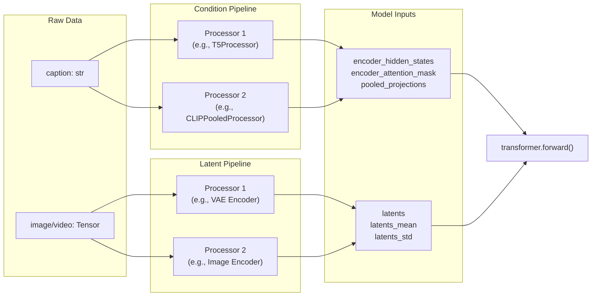
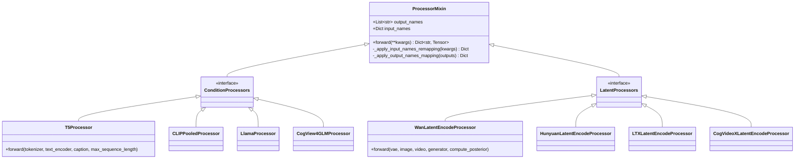
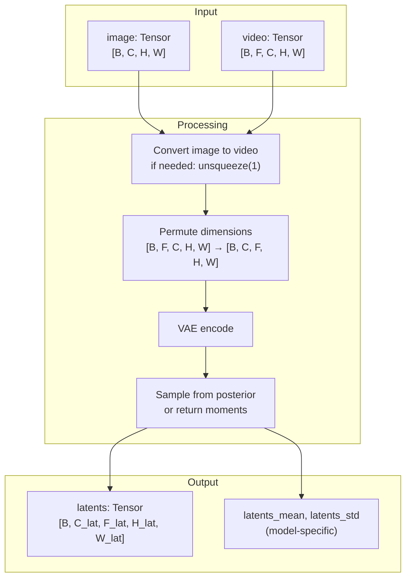
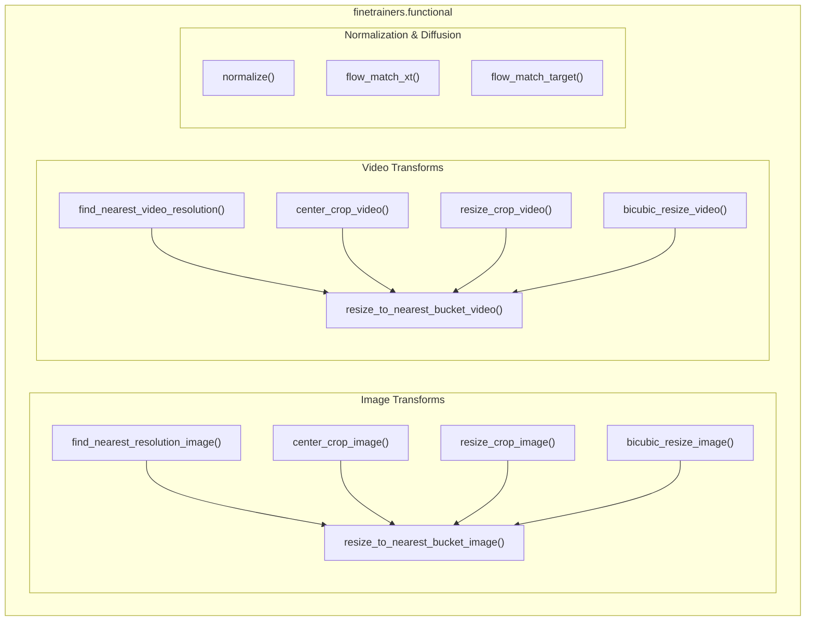
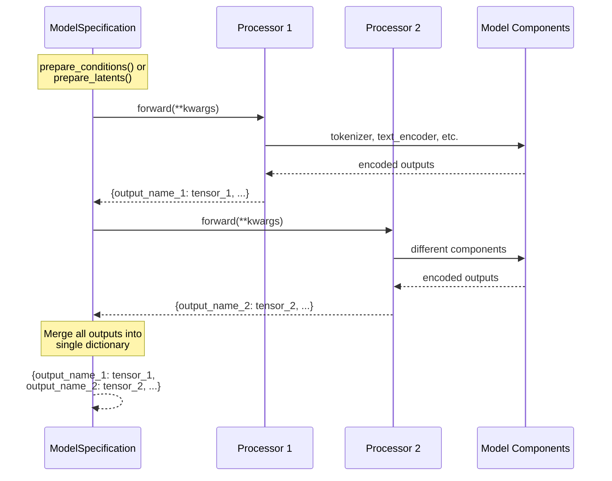
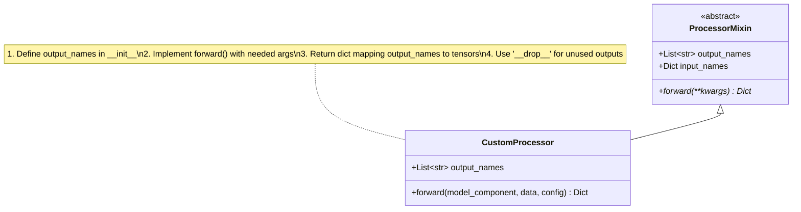

<!-- source: DeepWiki mcp.deepwiki.com · repo huggingface/finetrainers · page 8.3 Processors and Data Transforms · fetched 2026-10-26 -->

# Processors and Data Transforms

<details>
<summary>Relevant source files</summary>

The following files were used as context for generating this wiki page:

- [docs/models/flux.md](docs/models/flux.md)
- [examples/training/sft/cogview4/raider_white_tarot/training.json](examples/training/sft/cogview4/raider_white_tarot/training.json)
- [examples/training/sft/cogview4/raider_white_tarot/validation.json](examples/training/sft/cogview4/raider_white_tarot/validation.json)
- [examples/training/sft/flux_dev/raider_white_tarot/train.sh](examples/training/sft/flux_dev/raider_white_tarot/train.sh)
- [examples/training/sft/flux_dev/raider_white_tarot/training.json](examples/training/sft/flux_dev/raider_white_tarot/training.json)
- [examples/training/sft/flux_dev/raider_white_tarot/validation.json](examples/training/sft/flux_dev/raider_white_tarot/validation.json)
- [finetrainers/functional/image.py](finetrainers/functional/image.py)
- [finetrainers/functional/video.py](finetrainers/functional/video.py)
- [finetrainers/models/cogvideox/base_specification.py](finetrainers/models/cogvideox/base_specification.py)
- [finetrainers/models/cogview4/__init__.py](finetrainers/models/cogview4/__init__.py)
- [finetrainers/models/flux/__init__.py](finetrainers/models/flux/__init__.py)
- [finetrainers/models/hunyuan_video/base_specification.py](finetrainers/models/hunyuan_video/base_specification.py)
- [finetrainers/models/ltx_video/base_specification.py](finetrainers/models/ltx_video/base_specification.py)
- [finetrainers/models/wan/base_specification.py](finetrainers/models/wan/base_specification.py)
- [finetrainers/models/wan/control_specification.py](finetrainers/models/wan/control_specification.py)
- [finetrainers/processors/__init__.py](finetrainers/processors/__init__.py)
- [finetrainers/processors/glm.py](finetrainers/processors/glm.py)
- [finetrainers/processors/t5.py](finetrainers/processors/t5.py)

</details>


This document describes the processor abstraction and data transformation utilities in finetrainers. Processors are modular components that transform raw data (text, images, videos) into model-compatible formats (embeddings, latents). They encapsulate the logic for tokenizing text, encoding with text encoders, compressing media with VAEs, and applying preprocessing transforms.

For information about dataset loading and initialization, see [Dataset Loading](#5.1). For resolution bucketing and sampling strategies, see [Preprocessing and Resolution Bucketing](#5.2). For the precomputation system that caches processor outputs, see [Precomputation System](#5.3).

## Overview

Processors in finetrainers serve two primary purposes:

1. **Condition Processing**: Transform text captions into embeddings using tokenizers and text encoders (T5, CLIP, Llama, GLM)
2. **Latent Processing**: Transform images/videos into latent representations using VAEs and additional encodings

Each `ModelSpecification` (see [Model Specifications](#3.2)) defines lists of `condition_model_processors` and `latent_model_processors` that are applied during data preparation. Processors operate on individual data items and return dictionaries mapping output names to tensors.

**Processor Pipeline in Training Flow**



Sources: [finetrainers/models/wan/base_specification.py:240-259](), [finetrainers/models/hunyuan_video/base_specification.py:109-121](), [finetrainers/models/ltx_video/base_specification.py:123-131]()

## ProcessorMixin Interface

All processors inherit from `ProcessorMixin`, which defines the base abstraction. A processor is a lightweight, stateless component that transforms inputs using model components (tokenizers, encoders, VAEs).

**Key Attributes**:
- `output_names`: List of output keys that the processor returns (e.g., `["encoder_hidden_states", "encoder_attention_mask"]`)
- `input_names`: Optional dictionary to remap input argument names (e.g., `{"tokenizer_2": "tokenizer"}`)

**Key Method**:
- `forward(**kwargs) -> Dict[str, torch.Tensor]`: Processes inputs and returns a dictionary mapping output names to tensors

**Special Output Names**:
- `"__drop__"`: Indicates the output at this position should be discarded and not returned

**ProcessorMixin Class Structure**



Sources: [finetrainers/processors/__init__.py:1-24](), [finetrainers/processors/t5.py:9-88]()

The processor system uses name mapping to handle model variations. The `input_names` dictionary allows a processor to accept differently-named inputs. For example, `CLIPPooledProcessor` may remap `tokenizer_2 → tokenizer` to use the second tokenizer with a generic processor interface.

Sources: [finetrainers/models/hunyuan_video/base_specification.py:112-116]()

## Condition Processors

Condition processors transform text captions into embeddings suitable for diffusion model conditioning. They handle tokenization, encoding, and attention mask generation.

### T5Processor

The `T5Processor` encodes text using T5-family models (T5, UMT5). It tokenizes input captions with padding/truncation and generates embeddings and attention masks.

**Implementation**: [finetrainers/processors/t5.py:9-88]()

**Constructor Parameters**:
- `output_names`: List of 2 output names (typically `["encoder_hidden_states", "encoder_attention_mask"]` or `["encoder_hidden_states", "__drop__"]`)
- `input_names`: Optional remapping dictionary
- `use_attention_mask`: Whether to pass attention mask to the text encoder (default: `False`)

**Forward Method Signature**:
```python
def forward(
    tokenizer: Union[T5Tokenizer, T5TokenizerFast],
    text_encoder: T5EncoderModel,
    caption: Union[str, List[str]],
    max_sequence_length: int,
) -> Dict[str, torch.Tensor]
```

**Processing Steps**:
1. Convert single caption to list if needed
2. Tokenize with padding to `max_sequence_length`
3. Generate attention mask
4. Encode text (optionally with attention mask)
5. Return embeddings and mask as dictionary

**Usage Example** (from Wan model):
```python
condition_model_processors = [
    T5Processor(["encoder_hidden_states", "__drop__"])
]
```

Sources: [finetrainers/processors/t5.py:9-88](), [finetrainers/models/wan/base_specification.py:243](), [finetrainers/models/ltx_video/base_specification.py:124]()

### CLIPPooledProcessor

The `CLIPPooledProcessor` generates pooled text embeddings using CLIP text encoders. This is commonly used as a secondary conditioning signal alongside primary text embeddings.

**Usage Example** (from HunyuanVideo):
```python
CLIPPooledProcessor(
    ["pooled_projections"],
    input_names={"tokenizer_2": "tokenizer", "text_encoder_2": "text_encoder"}
)
```

The `input_names` remapping allows using the second tokenizer/encoder pair with a generic interface.

Sources: [finetrainers/models/hunyuan_video/base_specification.py:112-116]()

### LlamaProcessor

The `LlamaProcessor` encodes text using Llama-family models. Used by HunyuanVideo for primary text conditioning.

**Usage Example**:
```python
LlamaProcessor(["encoder_hidden_states", "encoder_attention_mask"])
```

Sources: [finetrainers/models/hunyuan_video/base_specification.py:111]()

### CogView4GLMProcessor

The `CogView4GLMProcessor` encodes text using GLM (General Language Model) models, specifically for CogView4.

**Implementation**: [finetrainers/processors/glm.py:9-75]()

**Special Behavior**:
- Tokenizes with padding="longest" instead of max_length padding
- Applies 16-token padding alignment for efficiency
- Returns only embeddings (no attention mask output)

**Processing Steps**:
1. Tokenize with longest padding
2. Pad input_ids to 16-token boundary (adds padding tokens at the beginning)
3. Extract hidden states from second-to-last layer
4. Return embeddings only

Sources: [finetrainers/processors/glm.py:9-75]()

### Caption Dropout Processors

Two specialized processors handle classifier-free guidance training:

- `CaptionEmbeddingDropoutProcessor`: Zeros out embeddings with probability `p`
- `CaptionTextDropoutProcessor`: Replaces captions with empty strings with probability `p`

Sources: [finetrainers/processors/__init__.py:9]()

## Latent Processors

Latent processors encode images/videos into latent representations using VAEs. Each model architecture has its own latent processor implementation to handle model-specific encoding logic.

**Common Latent Processor Pattern**



Sources: [finetrainers/models/wan/base_specification.py:47-81](), [finetrainers/models/hunyuan_video/base_specification.py:43-72]()

### WanLatentEncodeProcessor

Encodes images/videos for Wan models with VAE-based latent encoding and normalization statistics.

**Implementation**: [finetrainers/models/wan/base_specification.py:30-82]()

**Output Names**: `["latents", "latents_mean", "latents_std"]`

**Forward Parameters**:
- `vae`: AutoencoderKLWan instance
- `image` or `video`: Input tensor
- `generator`: Random generator for sampling
- `compute_posterior`: If True, samples from posterior; if False, returns moments

**Processing Steps**:
1. Convert image to video format if needed
2. Permute to [B, C, F, H, W] format
3. Encode with VAE (sample from posterior or return moments)
4. Extract latents_mean and latents_std from VAE config
5. Return latents and normalization statistics

**Special Behavior**: 
- When `compute_posterior=False`, returns raw moments instead of sampled latents
- Latents must be normalized using the returned mean/std before adding noise (handled in `forward()` method)

Sources: [finetrainers/models/wan/base_specification.py:30-82]()

### WanImageConditioningLatentEncodeProcessor

Specialized processor for Wan I2V (image-to-video) training that encodes conditioning frames with masking.

**Implementation**: [finetrainers/models/wan/base_specification.py:84-163]()

**Output Names**: `["latent_condition", "__drop__", "__drop__", "latent_condition_mask"]`

**Special Features**:
- Supports first-frame-only or first-and-last-frame conditioning
- Uses mode sampling (argmax) instead of random sampling for deterministic conditioning
- Generates temporal mask for frame conditioning
- Zeros out non-conditioning frames in latent space

**Processing Steps**:
1. Extract first frame (and optionally last frame)
2. Zero out remaining frames in input
3. Encode with VAE using mode sampling
4. Generate conditioning mask (1 for conditioning frames, 0 otherwise)
5. Apply temporal downsampling to mask to match latent dimensions

Sources: [finetrainers/models/wan/base_specification.py:84-163]()

### WanImageEncodeProcessor

Encodes images using CLIP vision model for I2V conditioning.

**Implementation**: [finetrainers/models/wan/base_specification.py:165-208]()

**Output Names**: `["encoder_hidden_states_image"]`

**Processing Steps**:
1. Extract first frame (and optionally last frame) from video
2. Normalize to [0, 1] range (from [-1, 1])
3. Process with CLIP image processor
4. Encode with CLIP vision model
5. Extract second-to-last hidden layer

Sources: [finetrainers/models/wan/base_specification.py:165-208]()

### HunyuanLatentEncodeProcessor

Encodes latents for HunyuanVideo using its VAE with optional slicing.

**Implementation**: [finetrainers/models/hunyuan_video/base_specification.py:28-73]()

**Output Names**: `["latents"]`

**Special Behavior**:
- Supports VAE slicing for memory efficiency when batch size > 1
- No additional normalization statistics returned (handled by VAE config)

Sources: [finetrainers/models/hunyuan_video/base_specification.py:28-73]()

### LTXLatentEncodeProcessor

Encodes latents for LTX-Video with additional metadata outputs.

**Implementation**: [finetrainers/models/ltx_video/base_specification.py:32-91]()

**Output Names**: `["latents", "num_frames", "height", "width", "latents_mean", "latents_std"]`

**Special Features**:
- Returns spatial dimensions (num_frames, height, width) of latent space
- Returns latent normalization statistics from VAE state dict
- Dimensions are used for packing operations in forward pass

Sources: [finetrainers/models/ltx_video/base_specification.py:32-91]()

### CogVideoXLatentEncodeProcessor

Encodes latents for CogVideoX with different dimension ordering.

**Implementation**: [finetrainers/models/cogvideox/base_specification.py:31-77]()

**Output Names**: `["latents"]`

**Special Behavior**:
- Permutes output back to [B, F, C, H, W] format (different from other models)
- Supports VAE slicing

Sources: [finetrainers/models/cogvideox/base_specification.py:31-77]()

## Functional Transform Utilities

The `finetrainers.functional` module provides low-level transform functions for preprocessing images and videos before VAE encoding. These are used by the dataset preprocessing layer, not directly by processors.

**Transform Module Organization**



Sources: [finetrainers/functional/image.py:1-57](), [finetrainers/functional/video.py:1-97]()

### Image Transforms

**center_crop_image(image, size)**

Crops an image to target size from the center. Raises ValueError if image is smaller than target.

Implementation: [finetrainers/functional/image.py:7-14]()

**resize_crop_image(image, size)**

Resizes image to ensure both dimensions are at least as large as target, then center crops.

Implementation: [finetrainers/functional/image.py:17-23]()

**bicubic_resize_image(image, size)**

Resizes image using bicubic interpolation without cropping.

Implementation: [finetrainers/functional/image.py:26-27]()

**find_nearest_resolution_image(image, resolution_buckets)**

Finds the resolution bucket with closest aspect ratio to the input image.

Implementation: [finetrainers/functional/image.py:30-37]()

**resize_to_nearest_bucket_image(image, resolution_buckets, resize_mode)**

High-level function that finds nearest bucket and applies the specified resize mode.

Supported modes:
- `"center_crop"`: Crop from center (no resize if larger)
- `"resize_crop"`: Scale up then crop
- `"bicubic"`: Bicubic resize without cropping

Implementation: [finetrainers/functional/image.py:40-56]()

Sources: [finetrainers/functional/image.py:1-57]()

### Video Transforms

Video transforms operate on [F, C, H, W] tensors and provide equivalent functionality to image transforms with additional frame handling.

**find_nearest_video_resolution(video, resolution_buckets)**

Finds nearest (num_frames, height, width) bucket using a two-step process:
1. Find best frame count match (≤ input frames, or closest if none exist)
2. Among buckets with that frame count, find closest aspect ratio

Implementation: [finetrainers/functional/video.py:32-49]()

**resize_to_nearest_bucket_video(video, resolution_buckets, resize_mode)**

Resizes video to nearest bucket, handling both temporal and spatial dimensions.

**Frame Handling**:
- If `num_frames > target_frames`: Downsamples by selecting evenly-spaced frames using `torch.linspace`
- If `num_frames < target_frames`: Returns as-is (no temporal upsampling)

**Spatial Handling**: Same three modes as image transforms (center_crop, resize_crop, bicubic)

Implementation: [finetrainers/functional/video.py:52-96]()

Sources: [finetrainers/functional/video.py:1-97]()

### Usage in Dataset Preprocessing

The functional transforms are called by the dataset preprocessing layer (see [Preprocessing and Resolution Bucketing](#5.2)), not by processors. The typical flow is:

1. Dataset loads raw image/video file
2. Preprocessing wrapper applies resolution bucketing using `resize_to_nearest_bucket_*`
3. Normalized tensor is passed to latent processors for VAE encoding

## Processor Chaining and Execution

Multiple processors can be chained together by specifying them in the `condition_model_processors` or `latent_model_processors` lists. The `ModelSpecification` base class orchestrates processor execution.

**Processor Execution Flow**



Sources: [finetrainers/models/wan/base_specification.py:383-401](), [finetrainers/models/wan/base_specification.py:403-431]()

### Example: HunyuanVideo Dual Text Encoders

HunyuanVideo uses two condition processors to encode text with both Llama and CLIP:

```python
condition_model_processors = [
    LlamaProcessor(["encoder_hidden_states", "encoder_attention_mask"]),
    CLIPPooledProcessor(
        ["pooled_projections"],
        input_names={"tokenizer_2": "tokenizer", "text_encoder_2": "text_encoder"}
    )
]
```

When `prepare_conditions()` is called:
1. `LlamaProcessor` receives `tokenizer`, `text_encoder`, `caption`, and returns `encoder_hidden_states` and `encoder_attention_mask`
2. `CLIPPooledProcessor` receives `tokenizer_2` (remapped to `tokenizer`), `text_encoder_2` (remapped to `text_encoder`), and returns `pooled_projections`
3. Final output merges all three tensors: `{"encoder_hidden_states": ..., "encoder_attention_mask": ..., "pooled_projections": ...}`

Sources: [finetrainers/models/hunyuan_video/base_specification.py:109-121](), [finetrainers/models/hunyuan_video/base_specification.py:247-269]()

### Example: Wan I2V Multiple Latent Processors

Wan I2V uses multiple latent processors for different encoding tasks:

```python
latent_model_processors = [
    WanLatentEncodeProcessor(["latents", "latents_mean", "latents_std"]),
    WanImageConditioningLatentEncodeProcessor(
        ["latent_condition", "__drop__", "__drop__", "latent_condition_mask"],
        use_last_frame=use_last_frame
    ),
    WanImageEncodeProcessor(["encoder_hidden_states_image"], use_last_frame=use_last_frame)
]
```

Execution flow:
1. First processor encodes full video to latents with normalization stats
2. Second processor encodes conditioning frames with masking (drops latents_mean and latents_std using `"__drop__"`)
3. Third processor encodes image with CLIP vision model
4. Outputs are merged, with `__drop__` keys removed

Sources: [finetrainers/models/wan/base_specification.py:244-256]()

## Creating Custom Processors

To create a custom processor, inherit from `ProcessorMixin` and implement the `forward()` method.

**Custom Processor Template**



**Implementation Steps**:

1. **Define Constructor**: Set `output_names` list and optionally `input_names` dict
2. **Implement forward()**: Accept model components and data as kwargs
3. **Process Data**: Transform inputs using provided model components
4. **Return Dictionary**: Map each output name to its corresponding tensor
5. **Use `__drop__`**: For outputs that should be discarded

**Example Custom Processor**:

```python
class CustomT5Processor(ProcessorMixin):
    def __init__(self, output_names: List[str]):
        super().__init__()
        self.output_names = output_names
        # output_names example: ["custom_embeds", "custom_mask"]
        
    def forward(
        self,
        tokenizer: T5Tokenizer,
        text_encoder: T5EncoderModel,
        caption: str,
        max_length: int = 128,
    ) -> Dict[str, torch.Tensor]:
        # 1. Tokenize
        tokens = tokenizer(
            caption,
            padding="max_length",
            max_length=max_length,
            return_tensors="pt"
        )
        
        # 2. Encode
        embeds = text_encoder(tokens.input_ids)[0]
        
        # 3. Return mapped outputs
        return {
            self.output_names[0]: embeds,
            self.output_names[1]: tokens.attention_mask
        }
```

**Integration with ModelSpecification**:

```python
class MyModelSpecification(ModelSpecification):
    def __init__(self, **kwargs):
        super().__init__(**kwargs)
        
        # Register custom processor
        self.condition_model_processors = [
            CustomT5Processor(["custom_embeds", "custom_mask"])
        ]
```

The processor will be automatically called during `prepare_conditions()` with the appropriate model components.

Sources: [finetrainers/processors/t5.py:9-88](), [finetrainers/processors/__init__.py:12-24]()

## Summary Table

| Processor Type | Purpose | Common Output Names | Example Classes |
|---------------|---------|-------------------|----------------|
| **Condition Processors** | Text → Embeddings | `encoder_hidden_states`, `encoder_attention_mask`, `pooled_projections` | T5Processor, CLIPPooledProcessor, LlamaProcessor, CogView4GLMProcessor |
| **Latent Processors** | Image/Video → Latents | `latents`, `latents_mean`, `latents_std` | WanLatentEncodeProcessor, HunyuanLatentEncodeProcessor, LTXLatentEncodeProcessor |
| **Conditioning Processors** | Image → Conditioning | `latent_condition`, `latent_condition_mask`, `encoder_hidden_states_image` | WanImageConditioningLatentEncodeProcessor, WanImageEncodeProcessor |
| **Utility Processors** | Data manipulation | Varies | CopyProcessor, CaptionEmbeddingDropoutProcessor, CannyProcessor |

| Transform Category | Functions | Input Format | Output Format |
|-------------------|-----------|--------------|---------------|
| **Image Transforms** | `center_crop_image`, `resize_crop_image`, `bicubic_resize_image`, `resize_to_nearest_bucket_image` | [C, H, W] | [C, H', W'] |
| **Video Transforms** | `center_crop_video`, `resize_crop_video`, `bicubic_resize_video`, `resize_to_nearest_bucket_video` | [F, C, H, W] | [F', C, H', W'] |
| **Bucket Selection** | `find_nearest_resolution_image`, `find_nearest_video_resolution` | Tensor + Buckets | Tuple[int, ...] |

Sources: All sections above

---

