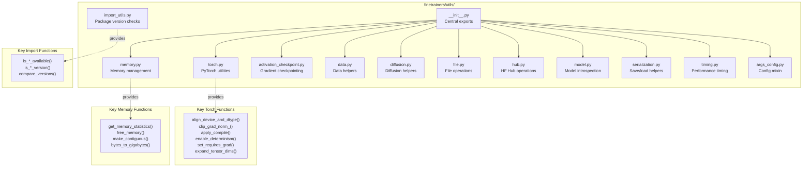
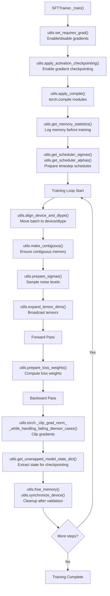

<!-- source: DeepWiki mcp.deepwiki.com · repo huggingface/finetrainers · page 8.4 Utility Functions · fetched 2026-10-26 -->

# Utility Functions

<details>
<summary>Relevant source files</summary>

The following files were used as context for generating this wiki page:

- [finetrainers/args.py](finetrainers/args.py)
- [finetrainers/trainer/control_trainer/config.py](finetrainers/trainer/control_trainer/config.py)
- [finetrainers/trainer/sft_trainer/config.py](finetrainers/trainer/sft_trainer/config.py)
- [finetrainers/trainer/sft_trainer/trainer.py](finetrainers/trainer/sft_trainer/trainer.py)
- [finetrainers/utils/__init__.py](finetrainers/utils/__init__.py)
- [finetrainers/utils/import_utils.py](finetrainers/utils/import_utils.py)
- [finetrainers/utils/torch.py](finetrainers/utils/torch.py)
- [tests/trainer/test_sft_trainer.py](tests/trainer/test_sft_trainer.py)

</details>


This page documents the utility functions and helper modules that support training workflows in finetrainers. These utilities handle cross-cutting concerns including PyTorch operations, memory management, gradient clipping, model compilation, import checking, and various helper functions used throughout the codebase.

For attention-related utilities, see [Attention Providers](#8.1). For functional utilities specific to image/video/text processing, see [Functional Utilities](#8.2).

---

## Overview

The utility system is organized in the `finetrainers/utils/` module and provides reusable components for:

- **Torch Operations**: Device/dtype alignment, gradient clipping with distributed support, model compilation, determinism control
- **Memory Management**: Statistics gathering, memory cleanup, contiguous tensor conversion
- **Activation Checkpointing**: Selective gradient checkpointing for memory optimization
- **Import Checking**: Package availability and version verification
- **Helper Functions**: Data processing, diffusion operations, file handling, model introspection, serialization, timing

Sources: [finetrainers/utils/__init__.py:1-52]()

---

## Utility Module Organization

The following diagram shows the organization of utility modules and their primary responsibilities:



**Key Exports from `finetrainers/utils/__init__.py`:**

| Category | Functions |
|----------|-----------|
| Activation Checkpointing | `apply_activation_checkpointing` |
| Configuration | `ArgsConfigMixin` |
| Data | `determine_batch_size`, `should_perform_precomputation` |
| Diffusion | `_enable_vae_memory_optimizations`, `default_flow_shift`, `get_scheduler_alphas`, `get_scheduler_sigmas`, `prepare_loss_weights`, `prepare_sigmas`, `prepare_target`, `resolution_dependent_timestep_flow_shift` |
| File | `delete_files`, `find_files`, `string_to_filename` |
| Hub | `save_model_card` |
| Memory | `bytes_to_gigabytes`, `free_memory`, `get_memory_statistics`, `make_contiguous` |
| Model | `resolve_component_cls` |
| Serialization | `safetensors_torch_save_function` |
| Timing | `Timer`, `TimerDevice` |
| Torch | `align_device_and_dtype`, `apply_compile`, `clip_grad_norm_`, `enable_determinism`, `expand_tensor_dims`, `get_device_info`, `get_submodule_by_name`, `get_unwrapped_model_state_dict`, `is_compiled_module`, `set_requires_grad`, `synchronize_device`, `unwrap_module` |

Sources: [finetrainers/utils/__init__.py:1-52]()

---

## Utility Usage in Training Workflow

The following diagram illustrates how the trainer consumes utilities throughout the training lifecycle:



Sources: [finetrainers/trainer/sft_trainer/trainer.py:85-582]()

---

## Torch Utilities

The `finetrainers/utils/torch.py` module provides PyTorch-specific utilities for distributed training.

### Device and Dtype Alignment

**Function:** `align_device_and_dtype(x, device, dtype)`

Recursively moves tensors or dictionaries of tensors to specified device and dtype. Handles both single tensors and nested dictionaries.

```python
# Usage in training loop
latent_model_conditions = utils.align_device_and_dtype(latent_model_conditions, device, dtype)
condition_model_conditions = utils.align_device_and_dtype(condition_model_conditions, device, dtype)
```

**Implementation:** [finetrainers/utils/torch.py:26-41]()

Sources: [finetrainers/utils/torch.py:26-41](), [finetrainers/trainer/sft_trainer/trainer.py:430-433]()

---

### Gradient Clipping with Distributed Support

**Function:** `clip_grad_norm_(parameters, max_norm, norm_type, error_if_nonfinite, foreach, pp_mesh)`

A custom gradient clipping implementation that properly handles:
1. **DTensor support**: Reduces norm across FSDP/TP dimensions
2. **Pipeline parallelism**: Reduces norm across PP stages
3. **Robust error handling**: Catches DTensor cross-mesh errors gracefully

The implementation differs from `torch.nn.utils.clip_grad_norm_` by manually reducing gradient norm across pipeline parallel stages, which is necessary for correct clipping in multi-dimensional parallelism setups.

**Algorithm:**
1. Compute per-device gradient norms using `torch._foreach_norm` (when available)
2. Reduce DTensor norms to local tensors via `full_tensor()`
3. Reduce across pipeline parallel mesh if `pp_mesh` is provided
4. Clip gradients using the computed total norm

**Fallback:** `_clip_grad_norm_while_handling_failing_dtensor_cases()` wraps the main function and skips gradient clipping if DTensor cross-mesh errors occur, logging a warning instead.

```python
# Usage in training loop
grad_norm = utils.torch._clip_grad_norm_while_handling_failing_dtensor_cases(
    [p for m in model_parts for p in m.parameters()],
    self.args.max_grad_norm,
    foreach=True,
    pp_mesh=parallel_backend.get_mesh()["pp"] if parallel_backend.pipeline_parallel_enabled else None,
)
```

**Implementation:** [finetrainers/utils/torch.py:68-161]()

**Related Functions:**
- `_get_total_norm()`: Computes total gradient norm across all parameters [finetrainers/utils/torch.py:299-339]()
- `_clip_grads_with_norm_()`: Applies clipping coefficient to gradients [finetrainers/utils/torch.py:342-374]()

Sources: [finetrainers/utils/torch.py:68-161](), [finetrainers/utils/torch.py:299-396](), [finetrainers/trainer/sft_trainer/trainer.py:486-494]()

---

### Model Compilation

**Function:** `apply_compile(model, compile_scope)`

Applies `torch.compile` to a model with two compilation scopes:

| Scope | Behavior | Use Case |
|-------|----------|----------|
| `"full"` | Compiles entire model as single unit | Small models, maximum optimization |
| `"regional"` | Compiles each direct child module separately | Large models, better compile time, more flexible |

For `torch.nn.ModuleList` containers, regional compilation compiles each element independently. For other modules, it recursively applies compilation to children. The function tracks compiled modules via a `_torch_compiled` attribute to avoid re-compilation.

```python
# Usage in training preparation
if self.args.gradient_checkpointing:
    utils.apply_activation_checkpointing(self.transformer, checkpointing_type="full")

self._maybe_torch_compile()  # Calls utils.apply_compile internally
```

**Implementation:** [finetrainers/utils/torch.py:44-65]()

**Related Functions:**
- `is_compiled_module(module)`: Checks if module is torch-compiled [finetrainers/utils/torch.py:252-253]()
- `unwrap_module(module)`: Extracts original module from compiled wrapper [finetrainers/utils/torch.py:271-273]()

Sources: [finetrainers/utils/torch.py:44-65](), [finetrainers/utils/torch.py:252-253](), [finetrainers/utils/torch.py:271-273](), [finetrainers/trainer/sft_trainer/trainer.py:154-160]()

---

### Determinism Control

**Function:** `enable_determinism(seed, world_mesh, deterministic)`

Enables reproducible training by:
1. Setting PyTorch and Python random seeds
2. Optionally enabling deterministic algorithms (`torch.use_deterministic_algorithms`)
3. Handling seed distribution across process groups:
   - Same seed for all ranks in SPMD (DP/TP/CP) group
   - Different seeds per pipeline parallel rank

For multi-dimensional parallelism with pipeline parallel, different PP ranks get different seeds (computed as `seed + pp_rank`), while all ranks within the same SPMD mesh share the same seed.

```python
# Example: PP rank 0 gets seed=42, PP rank 1 gets seed=43
# Within each PP rank, all DP/TP/CP ranks share the same seed
torch.distributed.tensor._random.manual_seed(seed, spmd_mesh)
```

**Implementation:** [finetrainers/utils/torch.py:164-216]()

Sources: [finetrainers/utils/torch.py:164-216]()

---

### Additional Torch Utilities

**Tensor Operations:**

- `expand_tensor_dims(tensor, ndim)`: Expands tensor to target dimensionality by appending singleton dimensions [finetrainers/utils/torch.py:219-221]()
- `set_requires_grad(models, value)`: Sets `requires_grad` on all parameters of one or more models [finetrainers/utils/torch.py:256-261]()
- `synchronize_device()`: Synchronizes CUDA or MPS device [finetrainers/utils/torch.py:264-268]()

**Model Introspection:**

- `get_submodule_by_name(model, name)`: Retrieves submodule by dotted name, supporting wildcard `*` for `ModuleList` [finetrainers/utils/torch.py:242-244]()
- `get_unwrapped_model_state_dict(state_dict)`: Removes `_orig_mod.` prefixes from compiled model state dicts [finetrainers/utils/torch.py:247-249]()

**Device Management:**

- `get_device_info()`: Returns current device type and module (`cuda`, `mps`, etc.) [finetrainers/utils/torch.py:224-231]()

Sources: [finetrainers/utils/torch.py:219-296]()

---

## Memory Management

Memory utilities help monitor and optimize GPU/CPU memory usage during training.

### Memory Statistics

**Function:** `get_memory_statistics()`

Returns a dictionary of memory statistics including:
- Allocated memory
- Reserved memory  
- Peak allocated memory
- Peak reserved memory

Values are returned in gigabytes for readability. Called at key training milestones to track memory consumption.

```python
memory_statistics = utils.get_memory_statistics()
logger.info(f"Memory before training start: {json.dumps(memory_statistics, indent=4)}")
```

**Implementation:** [finetrainers/utils/memory.py]()

Sources: [finetrainers/trainer/sft_trainer/trainer.py:336-337](), [finetrainers/trainer/sft_trainer/trainer.py:570-571]()

---

### Memory Cleanup

**Function:** `free_memory()`

Triggers garbage collection and clears GPU caches to free unused memory. Typically called after deleting large components (models, pipelines) to ensure memory is actually released.

```python
# After deleting validation pipeline
del pipeline
self._delete_components(module_names)
utils.free_memory()
utils.synchronize_device()
```

**Function:** `bytes_to_gigabytes(bytes)`

Converts byte counts to gigabytes for human-readable logging.

**Implementation:** [finetrainers/utils/memory.py]()

Sources: [finetrainers/trainer/sft_trainer/trainer.py:569-570](), [finetrainers/trainer/sft_trainer/trainer.py:687-693]()

---

### Contiguous Memory Conversion

**Function:** `make_contiguous(x)`

Recursively ensures tensors or dictionaries of tensors are stored contiguously in memory. This can improve performance by enabling more efficient memory access patterns and kernel execution.

```python
latent_model_conditions = utils.make_contiguous(latent_model_conditions)
condition_model_conditions = utils.make_contiguous(condition_model_conditions)
```

**Implementation:** [finetrainers/utils/memory.py]()

Sources: [finetrainers/trainer/sft_trainer/trainer.py:432-433]()

---

## Activation Checkpointing

**Function:** `apply_activation_checkpointing(model, checkpointing_type)`

Applies gradient checkpointing to a model to trade compute for memory. During forward pass, activations are not stored; during backward pass, they are recomputed.

**Checkpointing Types:**
- `"full"`: Checkpoints all layers/blocks
- Other types may be supported in the future (e.g., selective checkpointing)

Activation checkpointing is critical for training large models as it significantly reduces peak memory usage at the cost of ~33% longer training time.

```python
if self.args.gradient_checkpointing:
    utils.apply_activation_checkpointing(self.transformer, checkpointing_type="full")
```

**Implementation:** [finetrainers/utils/activation_checkpoint.py]()

Sources: [finetrainers/utils/__init__.py:4](), [finetrainers/trainer/sft_trainer/trainer.py:155-157]()

---

## Import and Version Checking

The `import_utils.py` module provides utilities for checking package availability and versions, enabling graceful degradation when optional dependencies are missing.

### Package Availability Checks

The following table shows all availability check functions:

| Function | Checks For |
|----------|------------|
| `is_bitsandbytes_available()` | bitsandbytes library |
| `is_datasets_available()` | HuggingFace datasets library |
| `is_flash_attn_available()` | flash-attn library |
| `is_kornia_available()` | kornia library |
| `is_sageattention_available()` | sageattention library |
| `is_torch_available()` | PyTorch |
| `is_xformers_available()` | xformers library |

These functions return `True` if the package is installed and importable, `False` otherwise.

**Implementation:** [finetrainers/utils/import_utils.py:18-29](), [finetrainers/utils/import_utils.py:62-87]()

---

### Version Comparison

**Function:** `compare_versions(library_or_version, operation, requirement_version)`

Compares a library version against a requirement using operators: `">"`, `">="`, `"=="`, `"!="`, `"<="`, `"<"`.

**Function:** `is_<package>_version(operation, version)`

Convenience functions for checking specific package versions:
- `is_bitsandbytes_version(operation, version)`
- `is_datasets_version(operation, version)`
- `is_flash_attn_version(operation, version)`
- `is_kornia_version(operation, version)`
- `is_sageattention_version(operation, version)`
- `is_torch_version(operation, version)`
- `is_xformers_version(operation, version)`

```python
# Example usage
if is_torch_version(">=", "2.0.0"):
    # Use torch 2.0+ features
    pass
```

**Implementation:** [finetrainers/utils/import_utils.py:33-129]()

Sources: [finetrainers/utils/import_utils.py:1-130]()

---

## Additional Helper Utilities

### Data Utilities

From [finetrainers/utils/data.py]():
- `determine_batch_size()`: Determines effective batch size accounting for gradient accumulation
- `should_perform_precomputation()`: Checks if data should be precomputed based on configuration

Sources: [finetrainers/utils/__init__.py:6]()

---

### Diffusion Utilities

From [finetrainers/utils/diffusion.py]():
- `get_scheduler_sigmas()`: Extracts sigma schedule from scheduler
- `get_scheduler_alphas()`: Extracts alpha schedule from scheduler  
- `prepare_sigmas()`: Samples noise levels for training timesteps
- `prepare_loss_weights()`: Computes loss weighting based on flow weighting scheme
- `prepare_target()`: Prepares target for diffusion loss computation
- `default_flow_shift()`: Applies default timestep shifting
- `resolution_dependent_timestep_flow_shift()`: Applies resolution-dependent shifting
- `_enable_vae_memory_optimizations()`: Enables VAE tiling and slicing

These utilities support flow matching and continuous diffusion training with various weighting schemes (`none`, `sigma_sqrt`, `logit_normal`, `mode`, `cosmap`).

Sources: [finetrainers/utils/__init__.py:7-16](), [finetrainers/trainer/sft_trainer/trainer.py:361-368](), [finetrainers/trainer/sft_trainer/trainer.py:436-470]()

---

### File Utilities

From [finetrainers/utils/file.py]():
- `find_files(directory, pattern)`: Finds files matching a glob pattern
- `delete_files(file_list)`: Deletes specified files
- `string_to_filename(string)`: Converts string to valid filename

```python
# Example usage in validation
prompt_filename = utils.string_to_filename(PROMPT)[:25]
```

Sources: [finetrainers/utils/__init__.py:17](), [finetrainers/trainer/sft_trainer/trainer.py:646]()

---

### Hub Utilities

From [finetrainers/utils/hub.py]():
- `save_model_card()`: Creates a model card with training information and sample outputs for Hugging Face Hub

```python
if self.args.push_to_hub and final_validation:
    utils.save_model_card(
        args=self.args, 
        repo_id=self.state.repo_id, 
        videos=video_filenames, 
        validation_prompts=prompts
    )
```

Sources: [finetrainers/utils/__init__.py:18](), [finetrainers/trainer/sft_trainer/trainer.py:714-719]()

---

### Model Utilities

From [finetrainers/utils/model.py]():
- `resolve_component_cls()`: Resolves component class from configuration

Sources: [finetrainers/utils/__init__.py:20]()

---

### Serialization Utilities

From [finetrainers/utils/serialization.py]():
- `safetensors_torch_save_function()`: Wrapper for saving tensors in safetensors format

Sources: [finetrainers/utils/__init__.py:21]()

---

### Timing Utilities

From [finetrainers/utils/timing.py]():
- `Timer`: Context manager for timing code blocks
- `TimerDevice`: Device-synchronized timer for accurate GPU timing

These are used internally for performance profiling and logging timing metrics.

Sources: [finetrainers/utils/__init__.py:22]()

---

### Generic Helpers

From [finetrainers/utils/__init__.py:39-51]():

**Function:** `get_parameter_names(obj, method_name)`

Returns the set of parameter names for a callable or method. Useful for introspecting function signatures.

**Function:** `get_non_null_items(x)`

Filters out `None` values from lists, tuples, or dictionaries. Used extensively to clean up configuration dictionaries before serialization.

```python
# Example usage in BaseArgs.to_dict()
model_arguments = get_non_null_items(model_arguments)
```

Sources: [finetrainers/utils/__init__.py:39-51](), [finetrainers/args.py:521]()

---

### Configuration Mixins

**Class:** `ArgsConfigMixin`

Abstract base class for modular argument groups that can be registered with `BaseArgs`. Subclasses must implement:
- `add_args(parser)`: Add arguments to argparse parser
- `map_args(argparse_args, mapped_args)`: Map parsed args to config object
- `validate_args(args)`: Validate argument values
- `to_dict()`: Serialize config to dictionary

This pattern enables composable configuration systems where different training types can add their specific arguments without modifying the core `BaseArgs` class.

**Example Implementations:**
- `SFTLowRankConfig`: Adds LoRA-specific arguments (rank, lora_alpha, target_modules) [finetrainers/trainer/sft_trainer/config.py:11-51]()
- `SFTFullRankConfig`: Placeholder for full-rank finetuning (no additional args) [finetrainers/trainer/sft_trainer/config.py:53-66]()
- `ControlLowRankConfig`: Adds control training arguments (control_type, frame_conditioning, etc.) [finetrainers/trainer/control_trainer/config.py:34-123]()
- `AttentionProviderArgs`: Adds attention provider selection arguments [finetrainers/args.py:27-83]()

Sources: [finetrainers/utils/args_config.py](), [finetrainers/args.py:12](), [finetrainers/trainer/sft_trainer/config.py:1-66](), [finetrainers/trainer/control_trainer/config.py:34-186]()

---

## Summary of Key Utility Functions

The following table summarizes the most frequently used utilities in training workflows:

| Utility | Purpose | When Used |
|---------|---------|-----------|
| `align_device_and_dtype` | Move tensors to device/dtype | Every training step before forward pass |
| `clip_grad_norm_` | Clip gradients with distributed support | Every training step after backward pass |
| `apply_compile` | Apply torch.compile to models | Once during training preparation |
| `apply_activation_checkpointing` | Enable gradient checkpointing | Once during training preparation |
| `set_requires_grad` | Enable/disable gradients | Training preparation, validation |
| `get_memory_statistics` | Log memory usage | Training start/end, validation start/end |
| `free_memory` | Release GPU memory | After deleting models/pipelines |
| `make_contiguous` | Optimize memory layout | Every training step before forward pass |
| `expand_tensor_dims` | Broadcast tensors | During sigma/weight preparation |
| `get_unwrapped_model_state_dict` | Extract clean state dict | During checkpointing |
| `string_to_filename` | Convert prompts to filenames | During validation artifact saving |
| `is_*_available` | Check package availability | Module initialization |

Sources: [finetrainers/utils/__init__.py:1-52](), [finetrainers/utils/torch.py:1-396](), [finetrainers/trainer/sft_trainer/trainer.py:85-725]()

---

