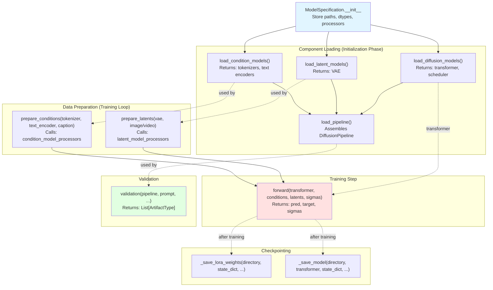
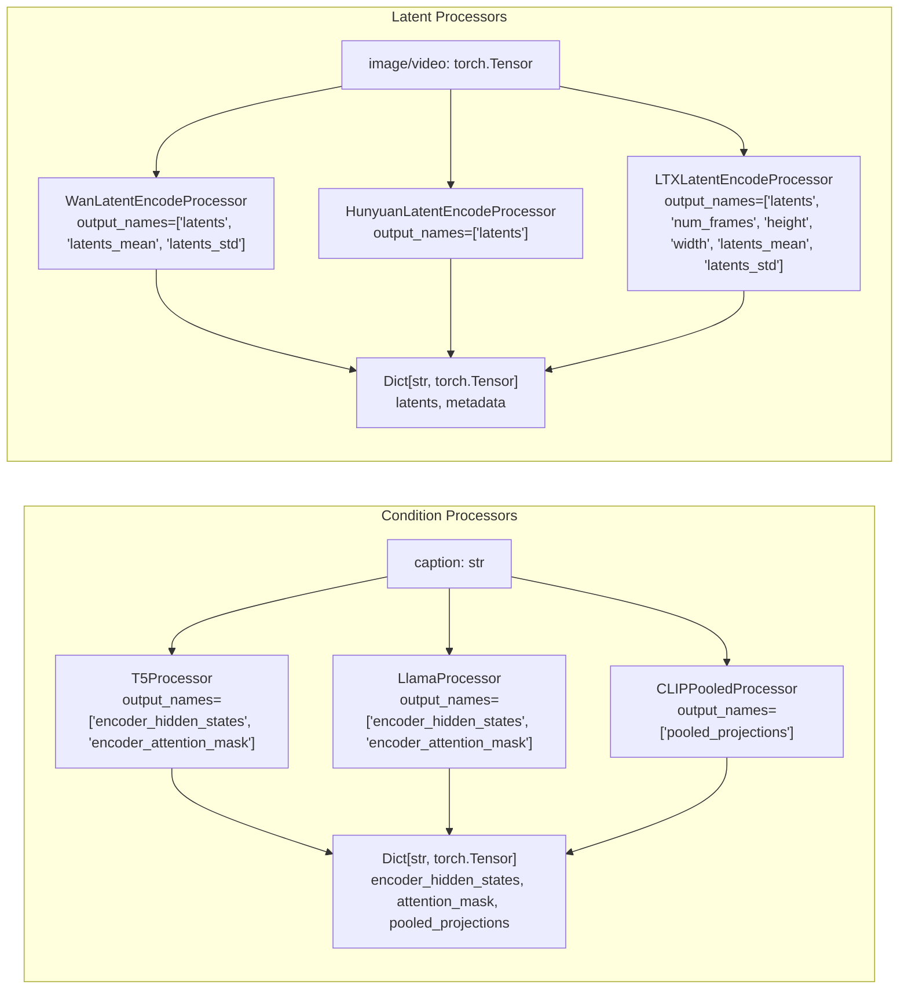
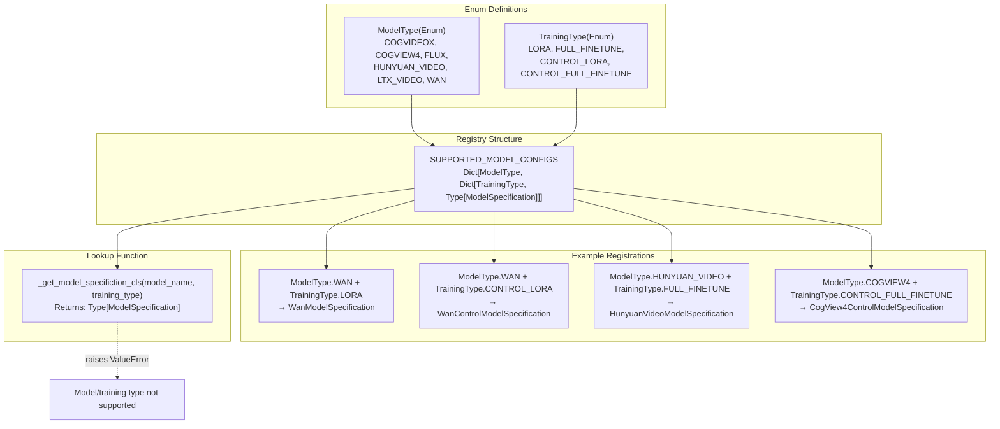
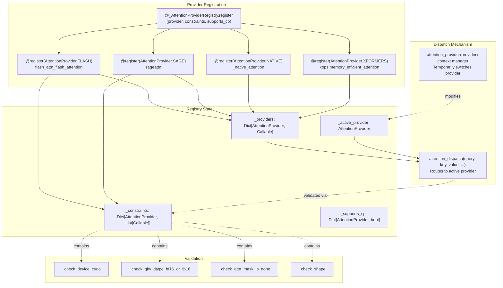
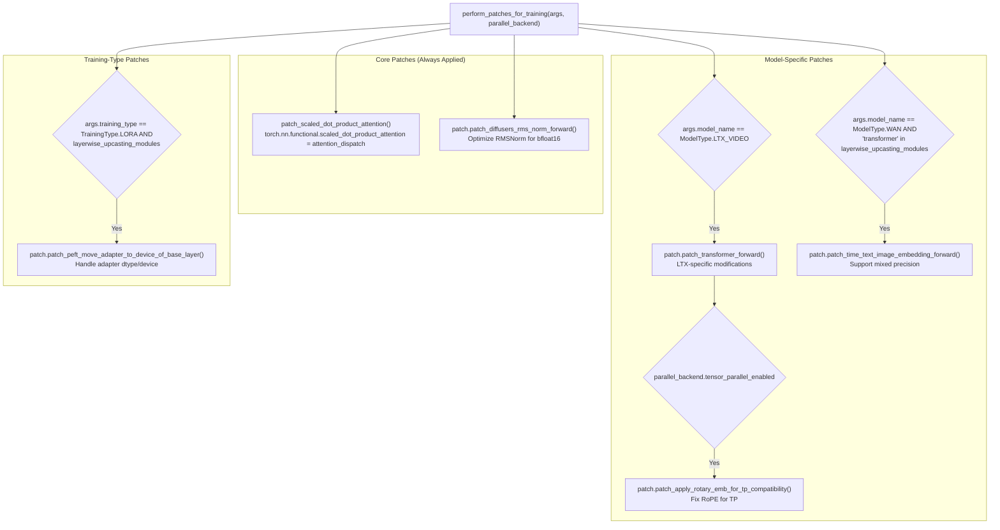
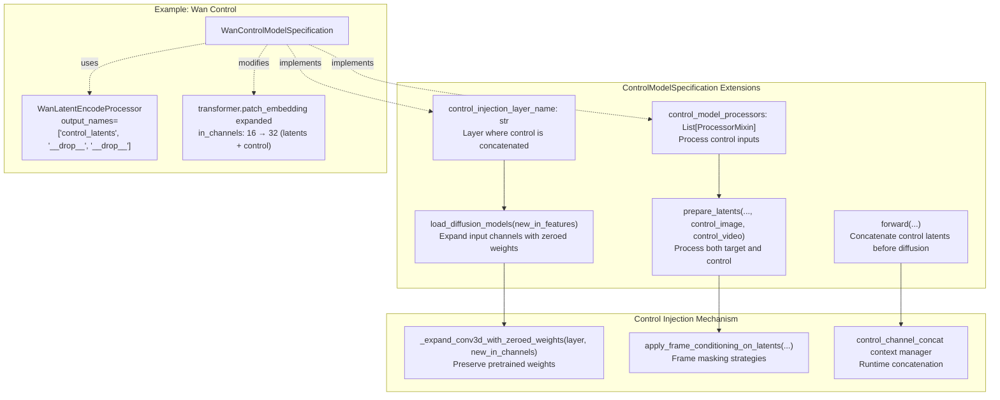
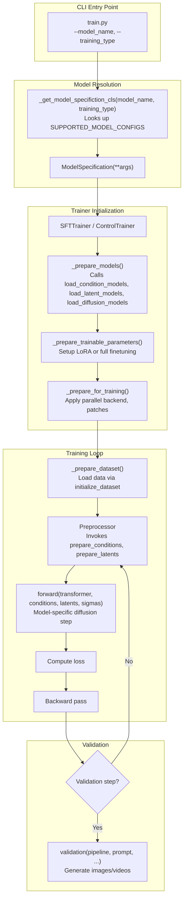

<!-- source: DeepWiki mcp.deepwiki.com · repo huggingface/finetrainers · page 9 Extending Finetrainers · fetched 2026-10-26 -->

# Extending Finetrainers

<details>
<summary>Relevant source files</summary>

The following files were used as context for generating this wiki page:

- [docs/environment.md](docs/environment.md)
- [docs/models/README.md](docs/models/README.md)
- [docs/models/attention.md](docs/models/attention.md)
- [finetrainers/config.py](finetrainers/config.py)
- [finetrainers/constants.py](finetrainers/constants.py)
- [finetrainers/models/__init__.py](finetrainers/models/__init__.py)
- [finetrainers/models/attention_dispatch.py](finetrainers/models/attention_dispatch.py)
- [finetrainers/models/cogvideox/base_specification.py](finetrainers/models/cogvideox/base_specification.py)
- [finetrainers/models/flux/base_specification.py](finetrainers/models/flux/base_specification.py)
- [finetrainers/models/hunyuan_video/base_specification.py](finetrainers/models/hunyuan_video/base_specification.py)
- [finetrainers/models/ltx_video/base_specification.py](finetrainers/models/ltx_video/base_specification.py)
- [finetrainers/models/wan/base_specification.py](finetrainers/models/wan/base_specification.py)
- [finetrainers/models/wan/control_specification.py](finetrainers/models/wan/control_specification.py)
- [finetrainers/patches/__init__.py](finetrainers/patches/__init__.py)
- [finetrainers/trainer/base.py](finetrainers/trainer/base.py)
- [tests/models/flux/base_specification.py](tests/models/flux/base_specification.py)

</details>


This page provides a technical overview of finetrainers' extension architecture, enabling developers to add new models, custom processors, parallel backends, and attention providers. The library is designed with extensibility as a core principle, using abstract base classes and registry patterns to support diverse diffusion architectures without modifying core training logic.

For step-by-step guides on specific extension tasks:
- Adding a new model: See [Adding a New Model](#9.1)
- Creating custom processors or backends: See [Custom Processors and Backends](#9.2)
- Development tools and contribution workflow: See [Development Workflow](#9.3)

---

## Extension Points Overview

Finetrainers provides four primary extension points, each serving a distinct purpose in the training pipeline:

**Extension Points Architecture**

```mermaid
graph TB
    subgraph "Core Extension Points"
        ModelExt["ModelSpecification<br/>finetrainers/models/modeling_utils.py"]
        ProcessorExt["ProcessorMixin<br/>finetrainers/processors/__init__.py"]
        BackendExt["BaseParallelBackend<br/>finetrainers/parallel/base.py"]
        AttentionExt["@_AttentionProviderRegistry.register<br/>finetrainers/models/attention_dispatch.py"]
    end
    
    subgraph "Registration Mechanisms"
        ModelReg["SUPPORTED_MODEL_CONFIGS<br/>Dict[ModelType, Dict[TrainingType, Type]]"]
        AttentionReg["_AttentionProviderRegistry._providers<br/>Dict[AttentionProvider, Callable]"]
    end
    
    subgraph "Implementation Examples"
        WanSpec["WanModelSpecification"]
        HunyuanSpec["HunyuanVideoModelSpecification"]
        LTXSpec["LTXVideoModelSpecification"]
        
        T5Proc["T5Processor"]
        LatentProc["WanLatentEncodeProcessor"]
        
        PTDBackend["PytorchDTensorParallelBackend"]
        AccelBackend["AccelerateParallelBackend"]
        
        FlashAttn["flash_attn_flash_attention"]
        NativeAttn["_native_attention"]
    end
    
    ModelExt -.extends.-> WanSpec
    ModelExt -.extends.-> HunyuanSpec
    ModelExt -.extends.-> LTXSpec
    
    ProcessorExt -.extends.-> T5Proc
    ProcessorExt -.extends.-> LatentProc
    
    BackendExt -.extends.-> PTDBackend
    BackendExt -.extends.-> AccelBackend
    
    AttentionExt -.registers.-> FlashAttn
    AttentionExt -.registers.-> NativeAttn
    
    ModelReg --> WanSpec
    ModelReg --> HunyuanSpec
    ModelReg --> LTXSpec
    
    AttentionReg --> FlashAttn
    AttentionReg --> NativeAttn
    
    style ModelExt fill:#ffcccc
    style ProcessorExt fill:#ccffcc
    style BackendExt fill:#ccccff
    style AttentionExt fill:#ffffcc
```



**Sources:** [finetrainers/models/modeling_utils.py](), [finetrainers/processors/__init__.py](), [finetrainers/parallel/base.py](), [finetrainers/models/attention_dispatch.py](), [finetrainers/config.py:32-63]()

| Extension Point | Base Class | Purpose | Registration Method |
|-----------------|------------|---------|---------------------|
| **Model** | `ModelSpecification` | Define model architectures, component loading, forward pass, validation | Add to `SUPPORTED_MODEL_CONFIGS` dictionary |
| **Processor** | `ProcessorMixin` | Transform data during preprocessing (text encoding, latent encoding) | Pass list to `ModelSpecification` constructor |
| **Parallel Backend** | `BaseParallelBackend` | Implement distributed training strategies (FSDP, TP, CP) | Specify via `--parallel_backend` CLI argument |
| **Attention** | Decorator + function | Provide optimized attention implementations | `@_AttentionProviderRegistry.register` decorator |

---

## Model Extension Architecture

The `ModelSpecification` interface is the most important extension point, defining how models load components, preprocess data, execute forward passes, and generate validation artifacts.

**ModelSpecification Lifecycle**



**Sources:** [finetrainers/models/modeling_utils.py](), [finetrainers/models/wan/base_specification.py:210-578](), [finetrainers/models/hunyuan_video/base_specification.py:75-392](), [finetrainers/models/ltx_video/base_specification.py:93-414]()

### Core Methods Required

Each `ModelSpecification` implementation must provide the following methods:

**Component Loading Methods:**
- `load_condition_models()` → `Dict[str, torch.nn.Module]`: Load tokenizers and text encoders
- `load_latent_models()` → `Dict[str, torch.nn.Module]`: Load VAE and related models
- `load_diffusion_models()` → `Dict[str, torch.nn.Module]`: Load transformer/UNet and scheduler
- `load_pipeline()` → `DiffusionPipeline`: Assemble components into inference pipeline

**Data Processing Methods:**
- `prepare_conditions()` → `Dict[str, Any]`: Process captions through text encoders via `condition_model_processors`
- `prepare_latents()` → `Dict[str, torch.Tensor]`: Encode images/videos via `latent_model_processors`

**Training Methods:**
- `forward()` → `Tuple[torch.Tensor, ...]`: Execute diffusion forward pass, return predictions and targets
- `validation()` → `List[ArtifactType]`: Generate validation artifacts using pipeline

**Serialization Methods:**
- `_save_lora_weights()`: Save LoRA adapter weights and scheduler
- `_save_model()`: Save full model weights and scheduler

**Sources:** [finetrainers/models/modeling_utils.py](), [finetrainers/models/wan/base_specification.py:265-330]()

---

## Processor Extension System

Processors transform data during preprocessing, executing operations like text tokenization, latent encoding, and custom conditioning. They are invoked by `ModelSpecification.prepare_conditions()` and `ModelSpecification.prepare_latents()` methods.

**Processor Data Flow**



**Sources:** [finetrainers/processors/__init__.py](), [finetrainers/models/wan/base_specification.py:30-82](), [finetrainers/models/hunyuan_video/base_specification.py:28-73](), [finetrainers/models/ltx_video/base_specification.py:32-91]()

### ProcessorMixin Interface

All processors inherit from `ProcessorMixin` and implement a `forward()` method:

```python
class ProcessorMixin:
    def forward(self, **kwargs) -> Dict[str, Any]:
        """Transform input data and return outputs keyed by self.output_names"""
        raise NotImplementedError
```

**Key Characteristics:**
- `output_names`: List of keys for returned dictionary. Use `"__drop__"` to discard outputs.
- `forward()` signature: Accepts model components and data as keyword arguments
- Return type: `Dict[str, Any]` mapping output_names to processed tensors

**Example Implementation:** [finetrainers/models/wan/base_specification.py:30-82]() shows `WanLatentEncodeProcessor` with three outputs (`latents`, `latents_mean`, `latents_std`)

**Sources:** [finetrainers/processors/__init__.py](), [finetrainers/models/wan/base_specification.py:30-82]()

---

## Model and Training Type Registration

Models are registered in the `SUPPORTED_MODEL_CONFIGS` dictionary, which maps `(ModelType, TrainingType)` tuples to `ModelSpecification` classes.

**Registration System**



**Sources:** [finetrainers/config.py:1-76]()

### Adding a New Model to the Registry

To register a new model:

1. **Define the ModelType** (if new): Add enum value to `ModelType` in [finetrainers/config.py:13-20]()
2. **Implement ModelSpecification**: Create a subclass in `finetrainers/models/<model_name>/base_specification.py`
3. **Register in SUPPORTED_MODEL_CONFIGS**: Add mapping in [finetrainers/config.py:32-63]()

Example registration pattern:
```python
SUPPORTED_MODEL_CONFIGS = {
    ModelType.YOUR_MODEL: {
        TrainingType.LORA: YourModelSpecification,
        TrainingType.FULL_FINETUNE: YourModelSpecification,
        # Optional: control variants
        TrainingType.CONTROL_LORA: YourControlModelSpecification,
        TrainingType.CONTROL_FULL_FINETUNE: YourControlModelSpecification,
    },
}
```

**Sources:** [finetrainers/config.py:32-63](), [finetrainers/config.py:66-76]()

---

## Attention Provider System

The attention provider system enables pluggable attention implementations optimized for different hardware and memory profiles. Providers are registered via decorator and dispatched through `attention_dispatch()`.

**Attention Provider Architecture**



**Sources:** [finetrainers/models/attention_dispatch.py:295-448]()

### Registering Custom Attention Providers

To add a custom attention provider:

1. **Define the provider function** with signature compatible with `torch.nn.functional.scaled_dot_product_attention`
2. **Add enum value** to `AttentionProvider` in [finetrainers/models/attention_dispatch.py:265-293]()
3. **Register with decorator**:

```python
@_AttentionProviderRegistry.register(
    AttentionProvider.YOUR_PROVIDER,
    constraints=[_check_device_cuda, _check_qkv_dtype_bf16_or_fp16],
    supports_cp=False
)
def your_attention_function(
    query: torch.Tensor,
    key: torch.Tensor,
    value: torch.Tensor,
    attn_mask: Optional[torch.Tensor] = None,
    dropout_p: float = 0.0,
    is_causal: bool = False,
    scale: Optional[float] = None,
) -> torch.Tensor:
    # Your implementation
    pass
```

**Supported Arguments:** The registry tracks which arguments each provider supports via `_supported_arg_names`. Unsupported arguments are automatically filtered out during dispatch.

**Constraints:** Optional validation functions that check tensor properties (device, dtype, shape) before invoking the provider. See [finetrainers/models/attention_dispatch.py:460-521]() for built-in constraint functions.

**Context Parallel Support:** Set `supports_cp=True` if the provider works with sequence dimension sharding. See [docs/models/attention.md]() for CP implementation details.

**Sources:** [finetrainers/models/attention_dispatch.py:295-323](), [finetrainers/models/attention_dispatch.py:765-791](), [finetrainers/models/attention_dispatch.py:405-448]()

---

## Patching System

The patching system modifies upstream library behavior to support advanced features like layerwise upcasting, tensor parallelism, and model-specific optimizations. Patches are applied conditionally based on `args` and `parallel_backend` configuration.

**Patch Application Flow**



**Sources:** [finetrainers/patches/__init__.py:13-59]()

### Patch Categories

| Category | Purpose | Example |
|----------|---------|---------|
| **Core Patches** | Replace attention dispatch, optimize normalization | `patch_scaled_dot_product_attention()` |
| **Model-Specific** | Fix bugs or enable features for specific architectures | `patch_transformer_forward()` for LTX |
| **Parallelism** | Enable TP/CP compatibility | `patch_apply_rotary_emb_for_tp_compatibility()` |
| **Training Mode** | Support LoRA with mixed precision | `patch_peft_move_adapter_to_device_of_base_layer()` |

**Adding New Patches:**
1. Implement patch function in `finetrainers/patches/models/<model_name>/` or `finetrainers/patches/dependencies/<library>/`
2. Add conditional logic to `perform_patches_for_training()` in [finetrainers/patches/__init__.py:13-44]()
3. Document the patch purpose and conditions in code comments

**Sources:** [finetrainers/patches/__init__.py:13-59]()

---

## Control Model Extensions

`ControlModelSpecification` extends `ModelSpecification` to support conditional generation with additional control channels (e.g., depth maps, pose). It adds control-specific preprocessing and injection logic.

**Control Model Architecture**



**Sources:** [finetrainers/models/modeling_utils.py](), [finetrainers/models/wan/control_specification.py:36-438]()

### Key Differences from Base ModelSpecification

**Additional Properties:**
- `control_injection_layer_name`: Name of layer where control is concatenated (e.g., `"patch_embedding"`)
- `control_model_processors`: Processors for control inputs (separate from target latent processors)

**Modified Methods:**
- `load_diffusion_models(new_in_features: int)`: Accepts `new_in_features` to expand input channels
- `prepare_latents()`: Processes both target and control images/videos
- `forward()`: Applies frame conditioning and concatenates control latents

**Frame Conditioning Types:** Defined in `FrameConditioningType` enum:
- `"full"`: Use all control frames
- `"first"`: Use only first frame
- `"last"`: Use only last frame
- `"first_and_last"`: Use first and last frames

**Sources:** [finetrainers/models/wan/control_specification.py:36-438](), [finetrainers/models/utils.py]()

---

## Integration with Training Pipeline

Extensions integrate seamlessly with the training pipeline through standardized interfaces. The following diagram shows how custom components are discovered and invoked.

**Extension Invocation in Training**



**Sources:** [finetrainers/config.py:66-76](), [finetrainers/trainer/base.py]()

### Attention Provider Context Management

The `Trainer` class manages attention provider switching per module using the `attention_provider_ctx()` context manager. This enables different attention implementations for different components (e.g., Flash Attention for transformer, Native SDPA for VAE).

**Configuration:**
- `--attn_provider_training`: List of `module_name:provider_name` pairs for training
- `--attn_provider_inference`: List of `module_name:provider_name` pairs for validation

**Example:** `--attn_provider_training transformer:flash vae:native` uses Flash Attention for the transformer and native PyTorch SDPA for the VAE.

**Sources:** [finetrainers/trainer/base.py:37-91](), [finetrainers/trainer/base.py:148-160]()

---

## Testing Custom Extensions

When adding custom components, implement unit tests to verify:

1. **Model Components Load Correctly:** Test `load_condition_models()`, `load_latent_models()`, `load_diffusion_models()`
2. **Processors Transform Data:** Verify `forward()` returns expected keys and shapes
3. **Forward Pass Executes:** Ensure `forward()` produces valid predictions and targets
4. **Validation Generates Artifacts:** Check `validation()` returns appropriate `ArtifactType` instances
5. **Serialization Works:** Test `_save_lora_weights()` and `_save_model()` produce loadable checkpoints

**Test Structure Example:** See [tests/models/flux/base_specification.py:1-7]() for a minimal test ModelSpecification using a tiny model.

**Sources:** [tests/models/flux/base_specification.py:1-7](), [docs/models/README.md]()

---

For detailed implementation guides:
- **Adding a new model:** See [Adding a New Model](#9.1)
- **Creating custom processors or backends:** See [Custom Processors and Backends](#9.2)
- **Development tools and contribution workflow:** See [Development Workflow](#9.3)

---

